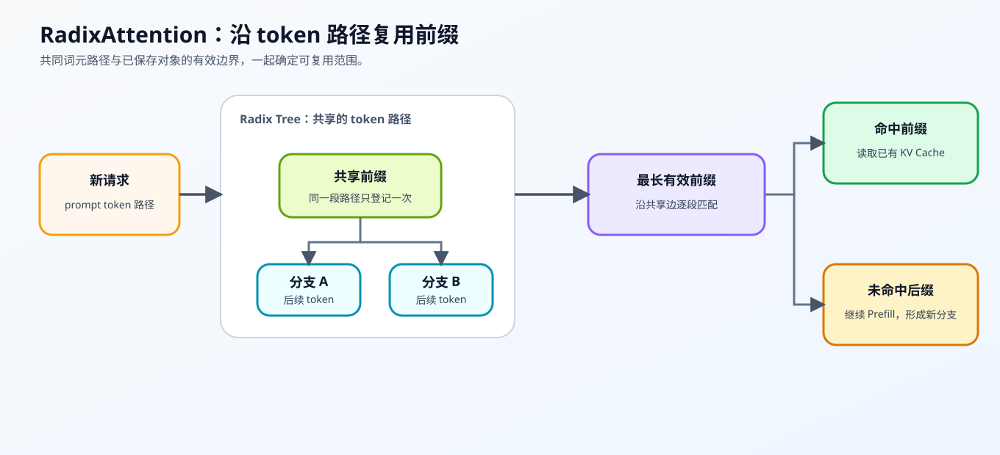
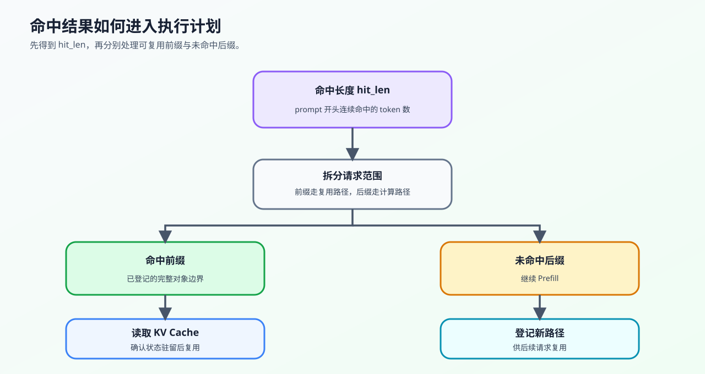

# 34. SGLang RadixAttention | SGLang 基数注意力
**难度：** Hard | **环境：** [CPU 主线](#runtime-environment) | **标签：** `推理优化`, `KV Cache`, `RadixAttention` | **目标人群：** 理解注意力与 KV 缓存的学习者

> 🚀 **云端运行环境**
>
> 本章节的实战代码可以点击以下链接在免费 GPU 算力平台上直接运行：
>
> [](https://colab.research.google.com/github/datawhalechina/llm-algo-leetcode/blob/main/02_PyTorch_Algorithms/34_SGLang_RadixAttention.ipynb)
> [](https://modelscope.cn/my/mynotebook) *(国内推荐：魔搭社区免费实例)*


---

## 本节导读

真实推理服务里，请求往往不是彼此独立的：多轮对话会反复带上历史上下文，智能体和工具调用也会共享很长的系统提示词。如果每个请求都重新计算这些公共前缀，KV Cache 会被重复占用，首词元延迟也会升高。

基数树（Radix Tree）把连续无分叉的词元路径压缩成一条边。RadixAttention 用这样的索引组织可复用的前缀状态；树结构负责查找，缓存管理还需保证状态驻留与安全引用。新请求到来时，系统先寻找当前可复用的最长前缀：命中的部分复用已有状态，未命中的后缀再进入预填充。

**关键词：** `RadixAttention`, `前缀树`, `多轮请求`

---
<a id="runtime-environment"></a>

## 运行环境

- **基础练习：** 使用 [BASE-CPU](../guide.md#base-cpu)，运行本页题目与测试。

## 前置阅读

先理解 KV Cache 的存储与最长前缀命中，再观察 RadixAttention 如何把大量共享前缀组织成可检索路径。
- [Part 02 · 22. vLLM PagedAttention | vLLM 分页注意力](./22_vLLM_PagedAttention.md)
- [Part 02 · 24. Prefix Cache Matching and Reuse | Prefix Cache 匹配与复用](./24_Prefix_Cache_Matching_and_Reuse.md)

---

## Step 1：RadixAttention 如何组织公共前缀复用

重复出现的系统提示词或历史上下文会让请求反复执行相同的预填充。RadixAttention 接收已登记的词元前缀和新请求，沿基数树查找最长路径，结合已登记缓存边界返回可复用范围和需要继续计算的未命中后缀。

| 概念 | 它记录什么 | 对请求执行的作用 |
|---|---|---|
| 公共前缀 | 多个请求开头相同的词元序列 | 作为可复用的候选缓存范围 |
| 基数树 | 按词元路径组织共享边，并支持最长前缀匹配 | 快速找到当前请求可以复用的范围 |
| 未命中后缀 | 从首个不一致词元开始的剩余序列 | 继续执行预填充，并登记为新分支 |
| PagedAttention 对照 | 按物理块管理 KV Cache；RadixAttention 按词元前缀组织共享路径 | 两者是不同机制层次，并非互斥的引擎能力；分页系统也可支持前缀索引 |



## Step 2：基数树的插入、分裂与匹配

压缩边保存一段连续词元，而不是一个字符。插入 `[1,2,3]` 和 `[1,2,4]` 时，原边拆成共享段 `[1,2]` 与后续分支；旧路径的结束标记和缓存引用必须随对应后缀保留。若再登记 `[1,2]`，共享节点本身也成为一个完整缓存对象的结束位置。

| 操作 | 输入 | 树的变化 | 要观察的结果 |
|---|---|---|---|
| 插入 | 新词元路径 | 新建边，或在首个不一致位置分裂已有边 | 公共前缀只保留一条共享路径 |
| 匹配 | 新请求输入 | 沿边逐段比较词元 | 返回最长命中长度 |
| 拆分 | 命中长度与请求输入 | 切出命中前缀和未命中后缀 | 未命中后缀进入后续预填充 |


## Step 3：公共路径与可复用对象边界如何对应

最长公共前缀长度（LCP）只描述词元是否相同，不能单独证明对应状态已经保存。本页索引将完整登记路径的结束节点标为终止节点；设这些对象组成集合 $C$，请求词元序列为 $P$，可返回的命中长度为：

$$
H=\max\left(\{0\}\cup\{|c|:c\in C,\ c=P[:|c|]\}\right).
$$

其中 $|c|$ 是对象词元数，$P[:|c|]$ 表示请求开头相同长度的片段。例如只有 `[1,2,3]` 和 `[1,2,4]` 两个对象时，`[1,2,9]` 经过共享边却不能命中完整对象；登记 `[1,2]` 后才命中两个。真实缓存可以按别的有效边界拆分对象，但都要确认相应状态可读；K/V 指针不是本页索引练习的实际张量。

| 观察对象 | 意义 | 后续动作 |
| --- | --- | --- |
| 公共路径 | 从开头相同的词元段 | 继续检索，不能直接当驻留证明 |
| 完整对象边界 | 已登记状态在该节点结束 | 更新当前最长有效命中 |
| 命中前缀 | 有可复用对象覆盖的请求开头 | 执行器确认驻留与引用后读取 |
| 未命中后缀 | 命中边界之后的剩余输入 | 继续预填充，完成后登记新对象 |



## Step 4：实现并验证前缀缓存索引

本题用压缩边和完整路径终止标记复现逻辑索引，缓存指针保留为接口占位。你需要完成边分裂、最长公共前缀判断、完整路径命中和请求拆分，并通过测试检查共享路径与输入词元是否保持一致。

| TODO / 函数 | 学习者完成的机制 | 必须满足的约束 | 测试证据 |
|---|---|---|---|
| TODO 1：分裂部分重叠边<br>`insert` | 把部分重叠边拆成共享前缀和旧后缀 | 保留旧边的子节点、终止状态和缓存引用 | 共享边与边分裂测试 |
| TODO 2：计算最长公共前缀<br>`_lcp_len` | 判断当前位置词元是否继续匹配 | 首个不一致位置立即停止 | 最长公共前缀边界测试 |
| TODO 3：记录完整路径命中<br>`match_prefix` | 只在完整缓存路径结束处更新命中长度 | 不完整边和非终止节点不能复用 | 最长命中与未命中测试 |
| TODO 4：拆分请求输入<br>`split_prompt` | 按命中长度拆分前缀与后缀 | 空输入和零命中安全回退 | 前缀/后缀契约测试 |


```python
import torch
```


```python
class TreeNode:
    """表示一条压缩边及其子路径；`terminal` 表示完整路径在此结束。"""
    def __init__(self, key_tokens, terminal=False):
        self.key_tokens = list(key_tokens)  # 这条边上的 Token 序列
        self.children = []            # 子节点列表
        self.kv_cache_ptr = None      # 模拟指向物理 KV Cache 的指针
        self.terminal = terminal      # 是否有完整请求在此结束

class SimpleRadixCache:
    """用压缩 Radix Tree 模拟公共 token 前缀的登记与匹配。"""
    def __init__(self):
        # 根节点是空的
        self.root = TreeNode([])

    def _find_child(self, node, token):
        """返回首 token 匹配的子边；同一节点下不应出现重复首 token。"""
        return next((child for child in node.children if child.key_tokens and child.key_tokens[0] == token), None)

    def insert(self, tokens):
        """插入路径；遇到部分重叠边时分裂旧边。"""
        tokens = list(tokens)
        if not tokens:
            raise ValueError('tokens 不能为空')
        node = self.root
        offset = 0
        while offset < len(tokens):
            child = self._find_child(node, tokens[offset])
            # 若没有同首 token 的 child，新增叶节点时要标记 terminal=True，
            # 因为这条完整 token 路径已经登记，可以作为后续复用候选。
            if child is None:
                node.children.append(TreeNode(tokens[offset:], terminal=True))
                return
            common = self._lcp_len(child.key_tokens, tokens[offset:])
            if common == len(child.key_tokens):
                node, offset = child, offset + common
                continue
            # TODO 1（边分裂）：切出共享前缀和旧边剩余后缀。
            # shared_tokens = ???
            # old_suffix_tokens = ???
            raise NotImplementedError('TODO 1：请拆分部分重叠的压缩边')
            shared = TreeNode(shared_tokens)
            old_suffix = TreeNode(old_suffix_tokens, terminal=child.terminal)
            old_suffix.children = child.children
            old_suffix.kv_cache_ptr = child.kv_cache_ptr
            shared.children.append(old_suffix)
            node.children[node.children.index(child)] = shared
            if offset + common == len(tokens):
                shared.terminal = True
            else:
                shared.children.append(TreeNode(tokens[offset + common:], terminal=True))
            return
        node.terminal = True

    def _lcp_len(self, cached_tokens, prompt_tokens):
        """计算两段 token 序列的最长公共前缀长度。"""
        match_len = 0
        for cached_token, prompt_token in zip(cached_tokens, prompt_tokens):
            # TODO 2（公共前缀）：判断当前位置是否仍然匹配。
            # tokens_match = ???
            raise NotImplementedError('TODO 2：请判断当前位置 token 是否匹配')
            if not tokens_match:
                break
            match_len += 1
        return match_len

    def match_prefix(self, prompt_tokens):
        """
        在现有树中，为新的 prompt_tokens 寻找最长的匹配前缀。
        只返回已登记完整对象的终止位置；本函数不检查真实 K/V 驻留。
        """
        best_match_len = 0
        node = self.root
        offset = 0
        while offset < len(prompt_tokens):
            child = self._find_child(node, prompt_tokens[offset])
            common = self._lcp_len(child.key_tokens, prompt_tokens[offset:]) if child is not None else 0
            if child is None or common < len(child.key_tokens):
                break
            offset += common
            node = child
            # TODO 3（完整路径）：只有终止节点才更新可复用长度。
            if node.terminal:
                # best_match_len = ???
                raise NotImplementedError('TODO 3：请更新完整路径的命中长度')
        return best_match_len

    def split_prompt(self, prompt_tokens):
        """把 prompt 拆成可复用前缀和需要重算的后缀。

        `hit_prefix` 必须来自 prompt 的开头，`miss_suffix` 从首个未命中 token 开始。"""
        # TODO 4（执行拆分）：根据命中长度拆出可复用前缀与待计算后缀。
        # hit_len = ???
        # hit_prefix = ???
        # miss_suffix = ???
        raise NotImplementedError('TODO 4：请拆分命中前缀与未命中后缀')
        return hit_prefix, miss_suffix, hit_len
```

## 测试


```python
# 按机制拆分测试，失败时可以直接定位到 LCP、分裂、匹配或 prompt 拆分。
def _build_radix_cache():
    cache = SimpleRadixCache()
    cache.insert([0, 1, 2, 3])
    cache.insert([0, 1, 2, 3, 4])
    cache.insert([9, 9, 9])
    return cache

def test_lcp_contract():
    """验证最长公共前缀的停止条件。"""
    cache = SimpleRadixCache()
    assert cache._lcp_len([1, 2, 3], [1, 2, 4]) == 2
    assert cache._lcp_len([7, 8], [7, 8, 9, 10]) == 2

def test_insert_and_split():
    """验证公共边共享和部分重叠边分裂。"""
    cache = _build_radix_cache()
    assert len(cache.root.children) == 2, "公共前缀没有被合并为共享边"
    shared = next(child for child in cache.root.children if child.key_tokens[0] == 0)
    assert shared.key_tokens == [0, 1, 2, 3]
    assert shared.terminal is True
    assert len(shared.children) == 1 and shared.children[0].key_tokens == [4]
    assert shared.children[0].terminal is True

    reverse_cache = SimpleRadixCache()
    reverse_cache.insert([4, 5, 6, 7])
    reverse_cache.insert([4, 5])
    assert reverse_cache.match_prefix([4, 5, 8]) == 2

def test_register_existing_internal_prefix():
    """显式登记共享内部路径后，它才成为可复用对象。"""
    cache = SimpleRadixCache()
    cache.insert([1, 2, 3])
    marker = object()
    cache.root.children[0].kv_cache_ptr = marker
    cache.insert([1, 2, 4])
    shared = cache.root.children[0]
    old_suffix = next(child for child in shared.children if child.key_tokens == [3])
    assert old_suffix.kv_cache_ptr is marker
    assert cache.match_prefix([1, 2, 9]) == 0
    cache.insert([1, 2])
    assert cache.match_prefix([1, 2, 9]) == 2
    assert cache.match_prefix([1, 2, 3]) == 3


def test_match_prefix_contract():
    """验证完整 terminal 路径才能计入命中长度。"""
    cache = _build_radix_cache()
    assert cache.match_prefix([0, 1, 2, 3, 4, 5]) == 5
    assert cache.match_prefix([9, 9, 9]) == 3
    assert cache.match_prefix([7, 6, 5]) == 0

def test_split_prompt_contract():
    """验证命中前缀与待计算后缀的拆分契约。"""
    cache = _build_radix_cache()
    assert cache.split_prompt([0, 1, 2, 3, 4, 5]) == ([0, 1, 2, 3, 4], [5], 5)
    assert cache.split_prompt([0, 1, 2, 3, 4]) == ([0, 1, 2, 3, 4], [], 5)
    assert cache.split_prompt([7, 6, 5]) == ([], [7, 6, 5], 0)

def test_empty_prompt_and_path():
    """验证空 prompt、空路径和零命中回退。"""
    cache = _build_radix_cache()
    assert cache.match_prefix([]) == 0
    assert cache.split_prompt([]) == ([], [], 0)
    try:
        cache.insert([])
    except ValueError:
        pass
    else:
        raise AssertionError("空 token 路径不能登记")

def test_radix_attention():
    """汇总运行公共前缀、边分裂、完整命中和 prompt 拆分测试。"""
    try:
        test_lcp_contract()
        test_insert_and_split()
        test_register_existing_internal_prefix()
        test_match_prefix_contract()
        test_split_prompt_contract()
        test_empty_prompt_and_path()
        print("✅ RadixAttention 机制测试通过：LCP、共享边、最长命中和 prompt 拆分均通过。")
    except NotImplementedError:
        print("请先完成 TODO 部分的代码！")
        raise
    except Exception as error:
        print(f"❌ RadixAttention 测试失败: {type(error).__name__}: {error}")
        raise


test_radix_attention()

```

---

🛑 **STOP HERE**

先完成题目并运行测试，再展开参考代码。

<br><br><br><br><br><br><br><br><br><br>
## 参考代码与解析

### 代码

```python
class TreeNode:
    """表示一条压缩边及其子路径；`terminal` 表示完整路径在此结束。"""
    def __init__(self, key_tokens, terminal=False):
        self.key_tokens = list(key_tokens)
        self.children = []
        self.kv_cache_ptr = None
        self.terminal = terminal

class SimpleRadixCache:
    """用压缩 Radix Tree 模拟公共 token 前缀的登记与匹配。"""
    def __init__(self):
        self.root = TreeNode([])

    def _find_child(self, node, token):
        """返回首 token 匹配的子边；同一节点下不应出现重复首 token。"""
        return next((child for child in node.children if child.key_tokens and child.key_tokens[0] == token), None)

    def insert(self, tokens):
        """插入路径；部分重叠时分裂边，公共边由多个请求共享。"""
        tokens = list(tokens)
        if not tokens:
            raise ValueError('tokens 不能为空')
        node, offset = self.root, 0
        while offset < len(tokens):
            child = self._find_child(node, tokens[offset])
            if child is None:
                node.children.append(TreeNode(tokens[offset:], terminal=True))
                return
            common = self._lcp_len(child.key_tokens, tokens[offset:])
            if common == len(child.key_tokens):
                node, offset = child, offset + common
                continue
            # TODO 1（边分裂）：切出共享前缀和旧边剩余后缀。
            shared_tokens = child.key_tokens[:common]
            old_suffix_tokens = child.key_tokens[common:]
            shared = TreeNode(shared_tokens)
            old_suffix = TreeNode(old_suffix_tokens, terminal=child.terminal)
            old_suffix.children = child.children
            old_suffix.kv_cache_ptr = child.kv_cache_ptr
            shared.children.append(old_suffix)
            child_index = node.children.index(child)
            node.children[child_index] = shared
            if offset + common == len(tokens):
                shared.terminal = True
            else:
                shared.children.append(TreeNode(tokens[offset + common:], terminal=True))
            return
        node.terminal = True

    def _lcp_len(self, cached_tokens, prompt_tokens):
        """逐位置比较词元，返回首个分歧之前的公共长度。"""
        match_len = 0
        for cached_token, prompt_token in zip(cached_tokens, prompt_tokens):
            # TODO 2（公共前缀）：判断当前位置是否仍然匹配。
            tokens_match = cached_token == prompt_token
            if not tokens_match:
                break
            match_len += 1
        return match_len

    def match_prefix(self, prompt_tokens):
        """
        在现有树中，为新的 prompt_tokens 寻找最长的匹配前缀。
        """
        prompt_tokens = list(prompt_tokens)
        node, offset, best_match_len = self.root, 0, 0
        while offset < len(prompt_tokens):
            child = self._find_child(node, prompt_tokens[offset])
            if child is None:
                break
            common = self._lcp_len(child.key_tokens, prompt_tokens[offset:])
            if common < len(child.key_tokens):
                break
            offset += common
            node = child
            # TODO 3（完整路径）：只有终止节点才更新可复用长度。
            if node.terminal:
                best_match_len = offset
        return best_match_len

    def split_prompt(self, prompt_tokens):
        """把 prompt 拆成可复用前缀和需要重算的后缀。"""
        # TODO 4（执行拆分）：根据命中长度拆出可复用前缀与待计算后缀。
        hit_len = self.match_prefix(prompt_tokens)
        hit_prefix = prompt_tokens[:hit_len]
        miss_suffix = prompt_tokens[hit_len:]
        return hit_prefix, miss_suffix, hit_len
```

### 解析

#### TODO 1：分裂部分重叠边

- 把公共前缀提升为共享父边，再将旧后缀和新后缀放到两个分支。旧边的子节点、终止状态和缓存引用必须随旧后缀保留。
- 共享边、反向插入和边分裂测试检查两条路径都能继续命中。

#### TODO 2：计算最长公共前缀

- 逐 token 比较两条路径，在首个不一致位置停止。返回长度不能超过任一输入序列，完全一致时等于较短序列长度。
- LCP 测试覆盖首 token 不同、中途分叉和长度不同。

#### TODO 3：记录完整路径命中

- 只有完整走过已登记路径并到达终止节点，才更新可复用长度。不完整边和非终止节点不能被当作可复用缓存对象。
- 完整命中、部分路径和未命中测试检查命中边界。

#### TODO 4：拆分命中前缀与未命中后缀

- 按命中长度切分可复用前缀和仍需计算的后缀。两段重新拼接后必须等于原始 prompt。
- 完整命中、部分命中、零命中和空 prompt 测试检查拆分结果。

## 相关阅读

继续核对索引之外的引用保护，再把命中范围与真实服务延迟对应起来。

- [SGLang 原论文：Efficient Execution of Structured Language Model Programs](https://arxiv.org/abs/2312.07104)
- [SGLang 官方仓库](https://github.com/sgl-project/sglang)
- [SGLang 官方文档](https://docs.sglang.ai/)
- [37. KV Cache Lifecycle and Capacity Control | KV Cache 生命周期与容量控制](./37_KV_Cache_Lifecycle_and_Capacity_Control.md)
- [69. Prefix Caching Benchmark | 前缀缓存基准项目](./69_Prefix_Caching_Benchmark.md)
