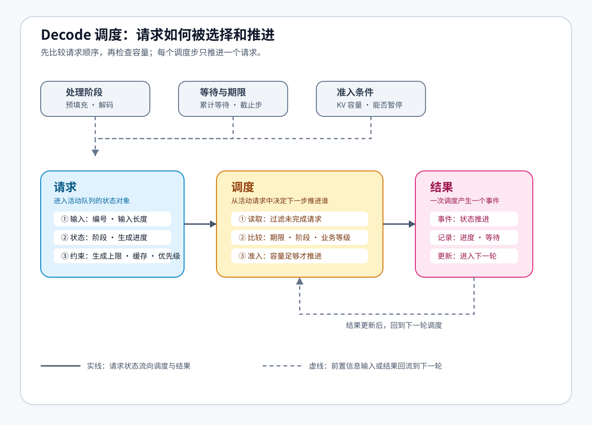
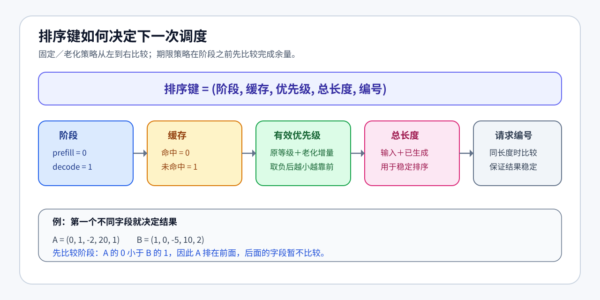

# 36. Decode Scheduling | 解码调度
**难度：** Hard | **环境：** [CPU 主线](#runtime-environment) | **标签：** `推理优化`, `解码`, `Scheduling` | **目标人群：** 理解请求与 KV 缓存的读者

> 🚀 **云端运行环境**
>
> 本章节的实战代码可以点击以下链接在免费 GPU 算力平台上直接运行：
>
> [](https://colab.research.google.com/github/datawhalechina/llm-algo-leetcode/blob/main/02_PyTorch_Algorithms/36_Decode_Scheduling.ipynb)
> [](https://modelscope.cn/my/mynotebook) *(国内推荐：魔搭社区免费实例)*


---

## 本节导读

两个正在生成的请求还没结束，又来了一个长输入请求。调度器既要决定谁先推进，也要检查剩余 KV 缓存能否容纳新请求；优先照顾其中一个请求，通常意味着其他请求多等一轮。

先把“处理到哪个阶段”和“是否已经获得容量”分开，再比较固定优先级、等待老化和截止期限三种选择规则。等待老化（aging）会随累计等待提高有效优先级；抢占（preemption）则暂停已准入请求，把容量让给更紧急的请求。沿着事件序列，可以解释服务顺序怎样变化，以及暂停后需要保留哪些进度。

**关键词：** `decode scheduling`, `admission`, `aging`, `fairness`, `preemption`

---
<a id="runtime-environment"></a>

## 运行环境

- **基础练习：** 使用 [`BASE-CPU`](../guide.md#base-cpu)，运行请求状态与调度测试。
- **真实服务对照：** [Serving 调度基准](./70_Serving_Scheduler_Benchmark.md)提供独立后端实验与环境入口。

## 前置阅读

进入本节前，先能区分请求的 prefill、decode 和完成状态，再观察调度器如何依据状态选择下一步请求。

- [21. Decoding Strategies | 解码策略](./21_Decoding_Strategies.md)

---

## Step 1：多个请求怎样竞争执行机会

多个请求同时等待时，阶段、缓存命中和业务优先级会影响下一步选谁。固定优先级使用业务给定的等级；等待老化把累计等待步数折算成等级增量；截止期限策略先比较预计完成后还剩多少调度步。一次选择改变一个请求的进度，也增加其他请求的等待。

排序靠前仍不一定能够执行：准入是为请求预留 KV 容量，容量不足时需要继续等待，或暂停一个能够让出足够容量的请求。这里把时间简化成调度步：输入处理占一步，之后每步生成一个 token；步数不能直接换算成真实毫秒延迟。

| 观察对象 | 在选择中的作用 | 需要保留的信息 |
| --- | --- | --- |
| 阶段与缓存命中 | 区分输入处理与逐 token 生成，以及可复用的输入状态 | 当前阶段与命中标记 |
| 业务等级与累计等待 | 决定同类请求中的优先次序 | 原始等级与累计等待步数 |
| 容量与可暂停性 | 判断能否准入或让出容量 | 块需求、准入状态、能否暂停 |
| 完成期限与生成进度 | 比较紧急程度并判断是否完成 | 截止步、已生成长度与生成上限 |



## Step 2：处理阶段与准入状态怎样变化

处理阶段回答“还在读输入，还是已经逐 token 生成”；准入状态回答“正在等待、已获得容量、被暂停，还是已经完成”。两者是不同维度：等待中的新请求已经标记为预填充阶段，被抢占的请求也仍保留原来的处理阶段。

暂停时释放的是容量账本中的预留块数，恢复时重新申请相同容量，生成进度保持不变。真实后端还必须恢复 KV 内容，或重新计算被丢弃的部分；这些传输和重计算耗时需要由服务轨迹测量，不能从容量账本推导。

| 事件 | 准入状态变化 | 处理阶段与容量变化 |
| --- | --- | --- |
| 新请求入队 | 进入等待状态 | 从预填充阶段开始，尚未占用容量 |
| 首次获准执行 | 等待 → 运行 | 预留容量，完成输入处理后进入解码 |
| 逐步生成 | 保持运行 | 每次选中增加一个生成 token |
| 被抢占后恢复 | 运行 → 暂停 → 运行 | 先归还、再申请容量，阶段与生成进度不重置 |
| 达到生成上限 | 运行 → 完成 | 归还容量，不再参与选择 |

## Step 3：排序规则怎样改变请求顺序

固定策略和老化策略先比较阶段，再比较缓存命中，最后才比较有效业务优先级、当前总长度与请求编号。有效优先级越大越早执行；这与真实后端可能采用的“小数值更优先”约定不同，读取配置时需要先确认方向。截止期限策略在这些字段之前，优先比较“截止步减去当前时钟和预计剩余步数”。

老化只能改变同一阶段、同一命中类别内的优先级，不能保证所有请求最终都能获选。例如，持续到达的预填充请求仍可能压住解码请求。容量不足时，这个模拟器只尝试暂停一个可抢占、有效优先级更低且能让出足够块数的请求，不合并多个受害者的容量。



<a id="mechanism-practice"></a>

## Step 4：实现请求状态与调度循环

补全请求登记、排序、容量准入和单步推进。抢占与恢复保持处理阶段和生成进度，未选中的请求累计等待，完成请求归还容量。

| TODO / 函数 | 学习者完成的机制 | 必须满足的约束 | 测试证据 |
| --- | --- | --- | --- |
| TODO 1 / `enqueue` | 构造请求状态并加入队列 | 初始阶段、容量需求与截止步合法 | 输入状态与重复编号 |
| TODO 2 / `_schedule_key` | 比较固定、老化与期限策略 | 先后字段明确，平局次序稳定 | 优先级方向与老化作用范围 |
| TODO 3 / `_ensure_capacity` | 执行准入或选择一个抢占对象 | 受害者可暂停、等级较低且容量足够 | 容量守恒与不可抢占保护 |
| TODO 4 / `step` | 推进、暂停、恢复与完成 | 恢复不重置进度，完成归还容量 | 事件、等待累计与期限记录 |


```python
from dataclasses import dataclass
from typing import Dict, List, Literal

```


```python
Phase = Literal['prefill', 'decode']
RequestStatus = Literal['waiting', 'running', 'preempted', 'finished']


@dataclass
class RequestState:
    """记录一个请求在 prefill/decode 调度过程中的最小状态。"""
    request_id: int
    prompt_len: int
    max_new_tokens: int
    generated_len: int = 0
    phase: Phase = 'prefill'
    priority: int = 0
    cache_hit: bool = False
    wait_steps: int = 0
    required_blocks: int = 1
    admitted: bool = False
    deadline_step: int | None = None
    preemptible: bool = True
    status: RequestStatus = 'waiting'
    preemptions: int = 0

    @property
    def total_len(self) -> int:
        return self.prompt_len + self.generated_len

    @property
    def done(self) -> bool:
        return self.generated_len >= self.max_new_tokens


class DecodeSchedulerSim:
    """用事件序列观察多个请求如何在 prefill 与 decode 之间推进。"""

    def __init__(self, policy: str = 'fixed_priority', free_kv_blocks: int = 1_000_000, aging_interval: int = 4):
        if policy not in {'fixed_priority', 'aging', 'deadline'}:
            raise ValueError('policy 必须是 fixed_priority、aging 或 deadline')
        if free_kv_blocks < 0 or aging_interval <= 0:
            raise ValueError('容量不能为负，aging_interval 必须为正数')
        self.policy = policy
        self.free_kv_blocks = free_kv_blocks
        self.aging_interval = aging_interval
        self.clock = 0
        self.queue: List[RequestState] = []
        self.timeline: List[Dict[str, int | str]] = []

    def enqueue(self, request_id: int, prompt_len: int, max_new_tokens: int = 2, priority: int = 0, cache_hit: bool = False, required_blocks: int = 1, deadline_step: int | None = None, preemptible: bool = True) -> None:
        """校验并登记请求；请求从 prefill 阶段开始。"""
        if request_id in {item.request_id for item in self.queue}:
            raise ValueError(f'重复的 request_id: {request_id}')
        if prompt_len <= 0 or max_new_tokens <= 0 or required_blocks <= 0:
            raise ValueError('prompt_len、max_new_tokens 和 required_blocks 必须为正数')
        if deadline_step is not None and deadline_step <= self.clock:
            raise ValueError('deadline_step 必须晚于当前调度时钟')
        # ==========================================
        # TODO 1: 构造请求状态，并加入调度队列
        # 提示：保留优先级、容量、deadline 与 preemptible；状态从 waiting 开始。
        # request：待加入队列的 RequestState，保存请求的最小调度状态
        # ==========================================
        raise NotImplementedError("请完成 TODO 1：request")
        # request = ???
        self.queue.append(request)

    def _effective_priority(self, req: RequestState) -> int:
        """返回 fixed/aging 共用的有效业务优先级。"""
        return req.priority + (req.wait_steps // self.aging_interval if self.policy == 'aging' else 0)

    def _remaining_steps(self, req: RequestState) -> int:
        return (1 if req.phase == 'prefill' else 0) + max(req.max_new_tokens - req.generated_len, 0)

    def _schedule_key(self, req: RequestState) -> tuple[int, int, int, int, int, int]:
        """返回 deadline、阶段、缓存、有效优先级与稳定字段组成的排序键。"""
        # TODO 2（排序策略）：deadline 模式使用完成余量；其他模式不启用 deadline 排序。
        raise NotImplementedError("请完成 TODO 2：deadline_slack")
        # deadline_slack = ???
        phase_rank = 0 if req.phase == 'prefill' else 1
        cache_rank = 0 if req.cache_hit else 1
        return (deadline_slack, phase_rank, cache_rank, -self._effective_priority(req), req.total_len, req.request_id)

    def _ensure_capacity(self, challenger: RequestState) -> int | None:
        """为 challenger 准入；必要时抢占一个低优先级、可暂停的已准入请求。"""
        # TODO 3（准入与抢占）：返回被抢占的 request_id；无需抢占时返回 None。
        # 约束：只有 challenger 更紧急时才可抢占，且 victim 的阶段与 generated_len 不得重置。
        raise NotImplementedError

    def step(self) -> Dict[str, int | str] | None:
        """选择并推进一个活动请求，同时记录事件和等待步数。"""
        candidates = [req for req in self.queue if not req.done]
        if not candidates:
            return None

        # ==========================================
        # TODO 4: 按排序键选择请求，并通过 _ensure_capacity 完成准入、抢占或恢复。
        # chosen：本轮实际获得一个调度步的 RequestState
        # ==========================================
        raise NotImplementedError("请完成 TODO 4：chosen 与 preempted_request_id")
        # chosen = ???
        # preempted_request_id = ???

        for req in candidates:
            if req is not chosen:
                req.wait_steps += 1

        if chosen.phase == 'prefill':
            if not chosen.admitted:
                self.free_kv_blocks -= chosen.required_blocks
                chosen.admitted = True
            chosen.status = 'running'
            chosen.phase = 'decode'
            action = 'prefill_to_decode'
        else:
            chosen.generated_len += 1
            action = 'finish' if chosen.done else 'decode_one_step'
            if chosen.done and chosen.admitted:
                self.free_kv_blocks += chosen.required_blocks
                chosen.admitted = False
                chosen.status = 'finished'

        event = {
            'request_id': chosen.request_id,
            'phase': 'prefill' if action == 'prefill_to_decode' else 'decode',
            'action': action,
            'prompt_len': chosen.prompt_len,
            'generated_len': chosen.generated_len,
            'max_new_tokens': chosen.max_new_tokens,
            'wait_steps': chosen.wait_steps,
            'free_kv_blocks': self.free_kv_blocks,
            'preempted_request_id': preempted_request_id,
            'deadline_missed': chosen.deadline_step is not None and self.clock + 1 + self._remaining_steps(chosen) > chosen.deadline_step,
        }
        self.timeline.append(event)
        self.clock += 1
        return event

    def run(self, max_steps: int = 100) -> List[Dict[str, int | str]]:
        """持续推进请求，直到全部完成或达到步数上限。"""
        if max_steps < 0:
            raise ValueError('max_steps 不能为负数')
        steps = 0
        while steps < max_steps:
            event = self.step()
            if event is None:
                break
            # 每个成功事件消耗一个调度步；这是 max_steps 的防护计数，不是调度策略。
            steps = steps + 1
        return self.timeline

```

## 测试

分别核对状态、排序、容量和恢复进度。


```python
# 机制测试：分别验证请求状态、排序、公平性、容量准入和输入保护。
def test_enqueue_contract():
    """验证新请求从 prefill 状态入队，并保留输入契约字段。"""
    sim = DecodeSchedulerSim()
    sim.enqueue(request_id=1, prompt_len=2, max_new_tokens=2, priority=2, cache_hit=True)
    req = sim.queue[0]
    assert req.phase == 'prefill' and req.generated_len == 0
    assert req.prompt_len == 2 and req.max_new_tokens == 2
    assert req.required_blocks == 1 and not req.admitted


def test_schedule_key_decision_order():
    """验证阶段、缓存命中、业务优先级与稳定字段的既定顺序。"""
    sim = DecodeSchedulerSim()
    sim.enqueue(1, 4, 1, priority=0, cache_hit=False)
    sim.enqueue(2, 4, 1, priority=9, cache_hit=True)
    sim.queue[1].phase = 'decode'
    # phase 比缓存和 priority 更靠前，因此 prefill 请求先被选中。
    assert sim._schedule_key(sim.queue[0]) < sim._schedule_key(sim.queue[1])

    sim = DecodeSchedulerSim()
    sim.enqueue(1, 4, 1, priority=1, cache_hit=False)
    sim.enqueue(2, 4, 1, priority=1, cache_hit=True)
    assert sim._schedule_key(sim.queue[1]) < sim._schedule_key(sim.queue[0])

    sim = DecodeSchedulerSim()
    sim.enqueue(1, 4, 1, priority=1, cache_hit=True)
    sim.enqueue(2, 4, 1, priority=3, cache_hit=True)
    assert sim._schedule_key(sim.queue[1]) < sim._schedule_key(sim.queue[0])
    assert sim.step()['request_id'] == 2


def test_wait_steps_is_observation_not_priority():
    """验证等待步数只记录公平性，不得改变当前排序键。"""
    sim = DecodeSchedulerSim()
    sim.enqueue(1, 4, 1, priority=1, cache_hit=True)
    sim.enqueue(2, 4, 1, priority=1, cache_hit=True)
    first, second = sim.queue
    key_before = sim._schedule_key(first)
    first.wait_steps = 50
    second.wait_steps = 0
    assert sim._schedule_key(first) == key_before
    assert sim._schedule_key(first) < sim._schedule_key(second)


def test_aging_changes_effective_priority():
    """验证 aging 只在显式启用时提高等待请求的有效优先级。"""
    sim = DecodeSchedulerSim(policy='aging', aging_interval=2)
    sim.enqueue(1, 4, 1, priority=1, cache_hit=True)
    sim.enqueue(2, 4, 1, priority=3, cache_hit=True)
    sim.queue[0].wait_steps = 6
    assert sim._effective_priority(sim.queue[0]) == 4
    assert sim._schedule_key(sim.queue[0]) < sim._schedule_key(sim.queue[1])


def test_capacity_admission_and_release():
    """验证容量不足的请求暂不准入，完成请求会释放 KV block。"""
    sim = DecodeSchedulerSim(free_kv_blocks=2)
    sim.enqueue(1, 4, 1, priority=9, required_blocks=3)
    sim.enqueue(2, 4, 1, priority=1, required_blocks=2)
    assert sim.step()['request_id'] == 2
    assert sim.free_kv_blocks == 0
    assert sim.step()['action'] == 'finish'
    assert sim.free_kv_blocks == 2


def test_preemption_and_resume_preserve_progress():
    """验证高优先级请求可抢占，victim 恢复时保留阶段与生成进度。"""
    sim = DecodeSchedulerSim(free_kv_blocks=2)
    sim.enqueue(1, 4, 2, priority=1, required_blocks=2, preemptible=True)
    assert sim.step()['request_id'] == 1
    victim = sim.queue[0]
    assert victim.phase == 'decode' and victim.admitted
    sim.enqueue(2, 2, 1, priority=9, required_blocks=2)
    event = sim.step()
    assert event['request_id'] == 2 and event['preempted_request_id'] == 1
    assert victim.status == 'preempted' and victim.phase == 'decode' and victim.generated_len == 0
    sim.run(max_steps=10)
    assert victim.done and victim.preemptions == 1


def test_non_preemptible_and_deadline_policy():
    """验证不可抢占请求受保护，并验证 deadline 余量进入排序与违约记录。"""
    sim = DecodeSchedulerSim(free_kv_blocks=2)
    sim.enqueue(1, 4, 2, priority=1, required_blocks=2, preemptible=False)
    sim.step()
    sim.enqueue(2, 2, 1, priority=9, required_blocks=2)
    event = sim.step()
    assert event['request_id'] == 1 and event['preempted_request_id'] is None

    deadline_sim = DecodeSchedulerSim(policy='deadline')
    deadline_sim.enqueue(1, 4, 4, priority=9, deadline_step=20)
    deadline_sim.enqueue(2, 2, 1, priority=0, deadline_step=1)
    event = deadline_sim.step()
    assert event['request_id'] == 2 and event['deadline_missed'] is True


def test_state_progression_and_completion():
    """验证 prefill 到 decode、完成退出和等待累计。"""
    sim = DecodeSchedulerSim()
    sim.enqueue(1, 2, 2, priority=2, cache_hit=True)
    sim.enqueue(2, 3, 3, priority=1, cache_hit=False)
    events = sim.run(max_steps=20)
    assert len(events) == 7
    assert any(event['action'] == 'finish' for event in events)
    assert all(req.done for req in sim.queue)
    assert any(event['wait_steps'] > 0 for event in events)


def test_input_guards_and_step_limit():
    """验证非法请求与调度步数上限的保护。"""
    sim = DecodeSchedulerSim()
    for kwargs in ({'request_id': 1, 'prompt_len': 0}, {'request_id': 1, 'prompt_len': 1, 'max_new_tokens': 0}, {'request_id': 1, 'prompt_len': 1, 'required_blocks': 0}):
        try:
            sim.enqueue(**kwargs)
        except ValueError:
            continue
        raise AssertionError('非法请求参数应被拒绝')
    sim.enqueue(1, 1, 3)
    assert len(sim.run(max_steps=2)) == 2
    try:
        sim.run(max_steps=-1)
    except ValueError:
        pass
    else:
        raise AssertionError('负数 max_steps 应被拒绝')


def test_aging_respects_phase_precedence():
    """验证老化不会越过阶段排序，且较大业务等级更优先。"""
    sim = DecodeSchedulerSim(policy='aging', aging_interval=1)
    sim.enqueue(1, 4, priority=0)
    sim.enqueue(2, 4, priority=10)
    assert sim._schedule_key(sim.queue[1]) < sim._schedule_key(sim.queue[0])
    sim.queue[1].phase = 'decode'
    sim.queue[1].wait_steps = 1000
    assert sim._schedule_key(sim.queue[0]) < sim._schedule_key(sim.queue[1])


def test_decode_scheduler():
    test_enqueue_contract()
    test_schedule_key_decision_order()
    test_wait_steps_is_observation_not_priority()
    test_aging_changes_effective_priority()
    test_aging_respects_phase_precedence()
    test_capacity_admission_and_release()
    test_preemption_and_resume_preserve_progress()
    test_non_preemptible_and_deadline_policy()
    test_state_progression_and_completion()
    test_input_guards_and_step_limit()
    print('✅ DecodeSchedulerSim 机制测试通过：排序、公平性、准入、抢占、恢复和 deadline 均通过。')


test_decode_scheduler()
```

---

🛑 **STOP HERE**

请先完成题目并运行测试，再查看参考代码与解析。

## 参考代码与解析

### 代码

```python
# TODO：下面是题目区的参考实现。

Phase = Literal['prefill', 'decode']
RequestStatus = Literal['waiting', 'running', 'preempted', 'finished']


@dataclass
class RequestState:
    """记录一个请求在 prefill/decode 调度过程中的最小状态。"""
    request_id: int
    prompt_len: int
    max_new_tokens: int
    generated_len: int = 0
    phase: Phase = 'prefill'
    priority: int = 0
    cache_hit: bool = False
    wait_steps: int = 0
    required_blocks: int = 1
    admitted: bool = False
    deadline_step: int | None = None
    preemptible: bool = True
    status: RequestStatus = 'waiting'
    preemptions: int = 0

    @property
    def total_len(self) -> int:
        return self.prompt_len + self.generated_len

    @property
    def done(self) -> bool:
        return self.generated_len >= self.max_new_tokens


class DecodeSchedulerSim:
    """用事件序列观察多个请求如何在 prefill 与 decode 之间推进。"""

    def __init__(self, policy: str = 'fixed_priority', free_kv_blocks: int = 1_000_000, aging_interval: int = 4):
        if policy not in {'fixed_priority', 'aging', 'deadline'}:
            raise ValueError('policy 必须是 fixed_priority、aging 或 deadline')
        if free_kv_blocks < 0 or aging_interval <= 0:
            raise ValueError('容量不能为负，aging_interval 必须为正数')
        self.policy = policy
        self.free_kv_blocks = free_kv_blocks
        self.aging_interval = aging_interval
        self.clock = 0
        self.queue: List[RequestState] = []
        self.timeline: List[Dict[str, int | str]] = []

    def enqueue(self, request_id: int, prompt_len: int, max_new_tokens: int = 2, priority: int = 0, cache_hit: bool = False, required_blocks: int = 1, deadline_step: int | None = None, preemptible: bool = True) -> None:
        """校验并登记请求；请求从 prefill 阶段开始。"""
        if request_id in {item.request_id for item in self.queue}:
            raise ValueError(f'重复的 request_id: {request_id}')
        if prompt_len <= 0 or max_new_tokens <= 0 or required_blocks <= 0:
            raise ValueError('prompt_len、max_new_tokens 和 required_blocks 必须为正数')
        if deadline_step is not None and deadline_step <= self.clock:
            raise ValueError('deadline_step 必须晚于当前调度时钟')
        # ==========================================
        # TODO 1: 构造请求状态，并加入调度队列
        # 提示: RequestState 默认处于 prefill 阶段；分别传入输入长度和生成上限
        # ==========================================
        request = RequestState(
            request_id=request_id,
            prompt_len=prompt_len,
            max_new_tokens=max_new_tokens,
            priority=priority,
            cache_hit=cache_hit,
            required_blocks=required_blocks,
            deadline_step=deadline_step,
            preemptible=preemptible,
        )
        self.queue.append(request)

    def _effective_priority(self, req: RequestState) -> int:
        """返回固定策略或 aging 策略使用的有效优先级。"""
        # ==========================================
        # TODO 2: 计算固定优先级或 aging 策略的有效优先级
        # ==========================================
        effective_priority = req.priority
        if self.policy == 'aging':
            effective_priority += req.wait_steps // self.aging_interval
        return effective_priority

    def _remaining_steps(self, req: RequestState) -> int:
        return (1 if req.phase == 'prefill' else 0) + max(req.max_new_tokens - req.generated_len, 0)

    def _schedule_key(self, req: RequestState) -> tuple[int, int, int, int, int, int]:
        """返回 deadline、阶段、缓存、有效优先级与稳定字段组成的排序键。"""
        # TODO 2: deadline 模式优先比较完成余量。
        deadline_slack = 1_000_000_000
        if self.policy == 'deadline' and req.deadline_step is not None:
            deadline_slack = req.deadline_step - self.clock - self._remaining_steps(req)
        phase_rank = 0 if req.phase == 'prefill' else 1
        cache_rank = 0 if req.cache_hit else 1
        return (deadline_slack, phase_rank, cache_rank, -self._effective_priority(req), req.total_len, req.request_id)

    def _ensure_capacity(self, challenger: RequestState) -> int | None:
        """为 challenger 准入，必要时抢占一个低优先级、可暂停的请求。"""
        # TODO 3: 已准入请求直接继续；空闲容量不足时寻找一个可安全抢占的 victim。
        if challenger.admitted:
            challenger.status = 'running'
            return None
        if challenger.required_blocks <= self.free_kv_blocks:
            self.free_kv_blocks -= challenger.required_blocks
            challenger.admitted = True
            challenger.status = 'running'
            return None
        victims = [req for req in self.queue if req.admitted and not req.done and req.preemptible and self._effective_priority(req) < self._effective_priority(challenger)]
        victims.sort(key=lambda req: (self._effective_priority(req), -req.required_blocks, req.request_id))
        victim = next((req for req in victims if self.free_kv_blocks + req.required_blocks >= challenger.required_blocks), None)
        if victim is None:
            return None
        victim.admitted = False
        victim.status = 'preempted'
        victim.preemptions += 1
        self.free_kv_blocks += victim.required_blocks
        self.free_kv_blocks -= challenger.required_blocks
        challenger.admitted = True
        challenger.status = 'running'
        return victim.request_id

    def step(self) -> Dict[str, int | str] | None:
        """选择并推进一个活动请求，同时记录事件和等待步数。"""
        candidates = [req for req in self.queue if not req.done]
        if not candidates:
            return None

        # ==========================================
        # TODO 4: 按排序键尝试准入；容量不足时允许 _ensure_capacity 执行安全抢占。
        # ==========================================
        chosen = None
        preempted_request_id = None
        for candidate in sorted(candidates, key=self._schedule_key):
            preempted_request_id = self._ensure_capacity(candidate)
            if candidate.admitted:
                chosen = candidate
                break
        if chosen is None:
            return None
        for req in candidates:
            if req is not chosen:
                req.wait_steps += 1
        if chosen.phase == 'prefill':
            chosen.phase = 'decode'
            action = 'prefill_to_decode'
        else:
            chosen.generated_len += 1
            action = 'finish' if chosen.done else 'decode_one_step'
            if chosen.done and chosen.admitted:
                self.free_kv_blocks += chosen.required_blocks
                chosen.admitted = False
                chosen.status = 'finished'

        event = {
            'request_id': chosen.request_id,
            'phase': 'prefill' if action == 'prefill_to_decode' else 'decode',
            'action': action,
            'prompt_len': chosen.prompt_len,
            'generated_len': chosen.generated_len,
            'max_new_tokens': chosen.max_new_tokens,
            'wait_steps': chosen.wait_steps,
            'free_kv_blocks': self.free_kv_blocks,
            'preempted_request_id': preempted_request_id,
            'deadline_missed': chosen.deadline_step is not None and self.clock + 1 + self._remaining_steps(chosen) > chosen.deadline_step,
        }
        self.timeline.append(event)
        self.clock += 1
        return event

    def run(self, max_steps: int = 100) -> List[Dict[str, int | str]]:
        """持续推进请求，直到全部完成或达到步数上限。"""
        if max_steps < 0:
            raise ValueError('max_steps 不能为负数')
        steps = 0
        while steps < max_steps:
            event = self.step()
            if event is None:
                break
            # 每个成功事件消耗一个调度步；这是 max_steps 的防护计数，不是调度策略。
            steps = steps + 1
        return self.timeline

```

### 解析

#### TODO 1：构造请求状态

- 保存输入长度、生成上限、业务等级、容量需求与期限；初始状态是等待准入、尚未生成、处于预填充阶段。
- 重复编号和非法输入测试阻止同一请求被重复登记，或用负容量进入账本。

#### TODO 2：计算排序键

- 期限策略先计算预计完成余量；其余策略保持阶段和命中类别在前，仅老化策略把累计等待加入有效优先级。
- 排序测试分别改变等级、等待和阶段，确认较大等级优先，但老化不能跨越阶段优先次序。

#### TODO 3：执行容量准入与抢占

- 请求尚未准入时先检查可用容量；不足则选择一个可暂停、等级更低且能释放足够块数的受害者。
- 归还与预留容量后，保留受害者的阶段和生成长度；恢复测试检查这些进度没有被重置。

#### TODO 4：选择并推进请求

- 按排序键尝试准入，选中的请求前进一步，其他请求累计等待；达到生成上限后释放容量。
- 事件测试核对完成、抢占、恢复和期限记录；期限基于抽象调度步，而非真实服务延迟。

### 真实 GPU 验证出口

本节 Step 4 比较 FCFS、业务优先级、aging、SLO 与容量准入的请求选择结果。随机矩阵微基准不能反映队列等待、饥饿、抢占或尾延迟，因此不作为 GPU 证据。

真实调度实验应在同一 Serving backend 上固定模型、到达轨迹、输入/输出长度和 KV 预算，仅替换请求选择策略，并记录 queue wait、TTFT、TPOT、P95/P99、饥饿与拒绝请求。该对照由 [70 Serving 调度基准](./70_Serving_Scheduler_Benchmark.md) 承接。
## 相关阅读

完成请求状态、选择规则和推进顺序的模拟后，可以继续阅读推理服务调度的论文与真实基准项目。

- [Orca 原论文：A Distributed Serving System for Transformer-Based Generative Models](https://www.usenix.org/conference/osdi22/presentation/yu)
- [vLLM 官方仓库](https://github.com/vllm-project/vllm)
- [37. KV Cache Lifecycle and Capacity Control | KV Cache 生命周期与容量控制](./37_KV_Cache_Lifecycle_and_Capacity_Control.md)
- [38. Prefill/Decode Scheduling | Prefill/Decode 调度](./38_Prefill_Decode_Scheduling.md)
- [70. Serving Scheduler Benchmark | 服务调度基准项目](./70_Serving_Scheduler_Benchmark.md)
