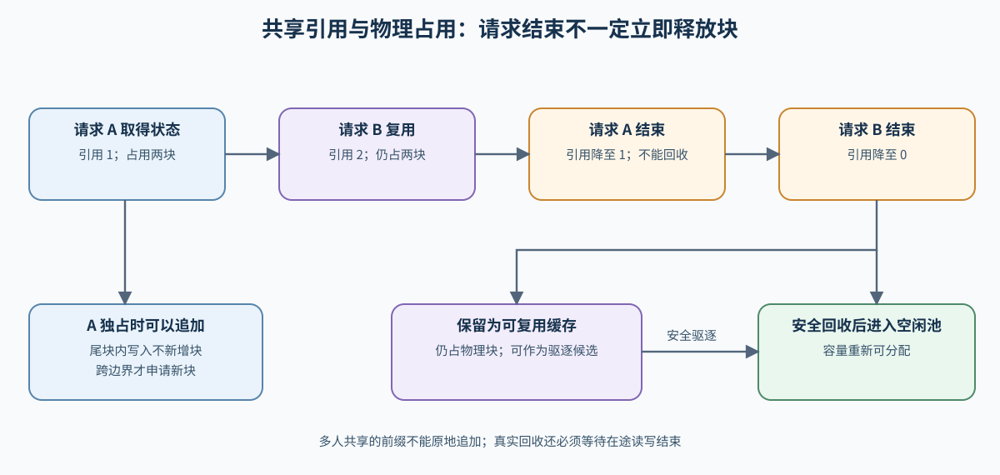
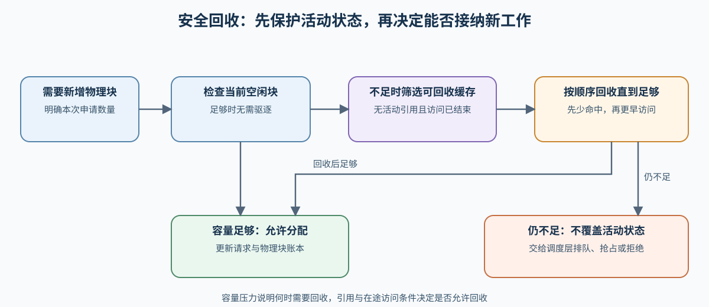

# 37. KV Cache Lifecycle and Capacity Control | KV Cache 生命周期与容量控制
**难度：** Hard | **环境：** [CPU 主线，GPU 可选](#runtime-environment) | **标签：** `推理优化`, `KV Cache`, `生命周期` | **目标人群：** 理解注意力与 KV 缓存的学习者

> 🚀 **云端运行环境**
>
> 本章节的实战代码可以点击以下链接在免费 GPU 算力平台上直接运行：
>
> [](https://colab.research.google.com/github/datawhalechina/llm-algo-leetcode/blob/main/02_PyTorch_Algorithms/37_KV_Cache_Lifecycle_and_Capacity_Control.ipynb)
> [](https://modelscope.cn/my/mynotebook) *(国内推荐：魔搭社区免费实例)*


---

## 本节导读

键值缓存（KV Cache）会随预填充分配、随解码追加，也可能被多个请求共享；请求结束、容量不足或状态迁移时，还会发生引用释放、驱逐、抢占与回收。PagedAttention 提供物理 Block 和映射表后，本节继续追踪请求状态、引用变化与容量动作。

本节沿着“分配 → 追加 → 共享与引用 → 容量压力 → 驱逐或抢占 → 回收”的顺序建立容量账本。学习后，你应能判断请求在什么时刻占用或释放 Block，以及缓存容量状态如何约束 服务调度。

**关键词：** `KV Cache 生命周期`、`引用计数`、`容量控制`、`驱逐与回收`

---

<a id="runtime-environment"></a>

## 运行环境

- **基础练习：** 使用 [BASE-CPU](../guide.md#base-cpu)，运行本页题目与测试。
- **真实服务实验：** 使用 [INF-VLLM-011-CU128](../topic_discussion/inference_optimization/quickstart.md#inf-vllm-quickstart)，服务参数与证据范围见 Step 5。

## 前置阅读

进入本节前，先理解分页 Block 如何把逻辑序列映射到物理缓存；本节在该物理布局上追踪完整生命周期。

- [Part 02 · 22. vLLM PagedAttention | vLLM 分页注意力](./22_vLLM_PagedAttention.md)

---

## Step 1：KV Cache 在请求生命周期中如何变化

预填充建立初始 K/V，解码处理新位置时向尾块追加。活动引用数表示仍有多少请求需要该缓存对象；前缀命中时，新请求引用已有 block，而不是复制同一份状态。请求结束只会减少引用，引用归零后，缓存才可能保留为可复用状态，或被驱逐、回收。

| 生命周期事件 | 状态变化 | 容量账本变化 |
|---|---|---|
| 分配 | 为新请求取得首批 Block | 已分配 Block 增加 |
| 追加 | 向尾块写入 token，跨越边界时申请新 Block | 可能只增加有效 token，也可能增加 Block |
| 共享与引用 | 另一个请求复用相同前缀 | 引用数增加，物理 Block 不重复增加 |
| 释放引用 | 请求结束或取消 | 引用数减少，不一定立即释放 Block |
| 驱逐与回收 | 淘汰未引用缓存或主动释放状态 | 已分配 Block 减少，可用容量增加 |



## Step 2：引用、尾块与容量账本

例如一个六词元前缀占两块、每块四个位置，两个请求共享时仍只占两块；结束一个请求只使活动引用从二降为一。两个请求的后缀必须写到各自私有状态，不能共同修改已共享的前缀。容量判断因此不能只看“缓存条目有几个”。系统还要区分有效 token、尾块余量、物理 block 和活动引用：尾块尚有空间时，追加不增加物理占用；同一前缀被多个请求共享时，引用增加但 block 数不变。

| 状态量 | 物理意义 | 影响的决策 |
|---|---|---|
| 有效 token 数 | 当前缓存覆盖的有效 token | 判断尾块是否已满 |
| 已占用 Block 数 | 当前占用的物理 Block 数 | 计算容量和新增分配量 |
| 活动引用数 | 仍在使用该状态的请求数 | 大于零时禁止驱逐 |
| 历史命中次数 | 前缀被复用的次数 | 引用归零后估计保留价值 |
| 最近访问时间 | 最近一次访问时刻 | 区分热缓存与冷缓存 |
| 空闲 Block 数 | 总 Block 减去已分配 Block | 为准入和追加提供容量约束 |

## Step 3：容量不足时如何选择动作

新增请求或 append 需要 block 时，系统先检查空闲容量，再从引用为零的缓存中选择回收对象。活动缓存不能为了接纳新请求而直接驱逐；如果安全回收后仍然不足，调度层只能排队、抢占或拒绝请求。

| 动作 | 适用条件 | 状态结果 | 主要代价 |
|---|---|---|---|
| 回收 | 无活动引用、在途访问结束且无需保留 | 立即释放 Block | 失去后续复用 |
| 驱逐 | 无活动引用、在途访问结束，且需要回收容量 | 按复用价值释放冷缓存 | 再次命中需要重算 Prefill |
| 抢占并换出 | 活跃请求允许暂停且有外部容量 | 活跃状态移出 GPU | 传输与恢复延迟 |
| 抢占并重算 | 可接受重新执行 Prefill | 在暂停并记录恢复进度后丢弃状态 | 历史重算、生成间隔与端到端延迟 |
| 排队或拒绝 | 没有安全释放路径 | 不改变活动缓存 | 排队或失败 |



## Step 4：实现 KV Cache 生命周期状态机

本题用离散块数与活动引用模拟缓存池，前缀字符串是调用方提供的状态身份，不校验实际词元或执行 GPU 访问。你将处理 token 到 block 的取整、共享引用、跨尾块追加和释放转换；骨架仅允许独占活动记录追加；多人共享时需先建立私有后缀，本题以拒绝原地追加保护共享状态。驱逐器只回收无活动引用的记录；真实执行还需等待在途读写结束。

| TODO / 函数 | 学习者完成的机制 | 必须满足的约束 | 测试证据 |
|:---|:---|:---|:---|
| TODO 1<br>`_blocks_for_tokens` | 将 Token 数向上取整为物理块数 | 不足一个块也占一个块 | 尾块边界与非法输入 |
| TODO 2<br>`acquire` | 命中前缀时增加引用、命中和访问时间 | 不重复分配物理块 | 共享引用与容量守恒 |
| TODO 3<br>`append` | 只为跨尾块边界的部分申请新增块 | Token、块数与总容量一致 | 尾块内追加与跨块追加 |
| TODO 4<br>`release` | 引用归零后转为可复用状态或立即回收 | 引用不得为负，活动记录不可驱逐 | 多引用释放与立即回收 |


```python
import heapq
from dataclasses import dataclass, field
from typing import Dict, List, Tuple

```


```python
@dataclass
class CacheRecord:
    """一段可共享前缀的逻辑状态与物理 block 账本。"""

    prefix: str
    used_tokens: int
    block_count: int
    ref_count: int = 1
    hits: int = 1
    last_used: int = 0


class KVCacheLifecycleSim:
    """模拟 allocate、append、share、release、evict 与 reclaim。"""

    def __init__(self, total_blocks: int = 16, block_size_tokens: int = 4):
        if total_blocks <= 0 or block_size_tokens <= 0:
            raise ValueError('total_blocks and block_size_tokens must be positive')
        self.total_blocks = total_blocks
        self.block_size_tokens = block_size_tokens
        self.time = 0
        self.records: Dict[str, CacheRecord] = {}
        self.log: List[str] = []

    @property
    def allocated_blocks(self) -> int:
        """返回仍被活动请求或 reusable 缓存占用的 block 数。"""
        return sum(record.block_count for record in self.records.values())

    @property
    def free_blocks(self) -> int:
        """返回可立即分配的 block 数。"""
        return self.total_blocks - self.allocated_blocks

    def _blocks_for_tokens(self, token_count: int) -> int:
        """按 block 粒度向上取整 token 数。"""
        if token_count <= 0:
            raise ValueError('token_count must be positive')
        # ==========================================
        # TODO 1（物理分配）：计算 token_count 至少需要多少个 block。
        # 注意：不能整除时也必须保留尾块；结果必须是正整数。
        # 可用变量：token_count、self.block_size_tokens
        # ==========================================
        # block_count = ???
        raise NotImplementedError("请完成 TODO 1：block_count")
        return block_count

    def _eviction_candidates(self) -> List[CacheRecord]:
        """只返回未被请求引用的缓存，冷且低复用的记录排在前面。"""
        candidates = [record for record in self.records.values() if record.ref_count == 0]
        return sorted(candidates, key=lambda record: (record.hits, record.last_used, -record.block_count))

    def _ensure_capacity(self, needed_blocks: int) -> None:
        """驱逐未引用缓存；不得删除仍被活动请求引用的状态。"""
        for record in self._eviction_candidates():
            if self.free_blocks >= needed_blocks:
                break
            self.records.pop(record.prefix)
            self.log.append(f'evict:{record.prefix}:{record.block_count}')
        if self.free_blocks < needed_blocks:
            raise RuntimeError('insufficient blocks: queue, preempt, or reject the request')

    def acquire(self, prefix: str, prompt_tokens: int) -> CacheRecord:
        """为新请求分配前缀，或共享已经存在的前缀状态。"""
        if not isinstance(prefix, str) or not prefix:
            raise ValueError('prefix must be a non-empty string')
        if prompt_tokens <= 0:
            raise ValueError("prompt_tokens must be positive")
        if prefix in self.records and self.records[prefix].used_tokens != prompt_tokens:
            raise ValueError("同一前缀身份的有效长度必须一致")
        self.time += 1
        if prefix in self.records:
            record = self.records[prefix]
            # ==========================================
            # TODO 2（共享引用）：更新已有前缀的引用、命中与访问时间。
            # 注意：共享不会改变 used_tokens、block_count 或总物理占用。
            # ==========================================
            # record.ref_count = ???
            # record.hits = ???
            # record.last_used = ???
            raise NotImplementedError("请完成 TODO 2：引用、命中与访问时间")
            self.log.append(f'share:{prefix}')
            return record

        block_count = self._blocks_for_tokens(prompt_tokens)
        self._ensure_capacity(block_count)
        record = CacheRecord(prefix, prompt_tokens, block_count, last_used=self.time)
        self.records[prefix] = record
        self.log.append(f'allocate:{prefix}:{block_count}')
        return record

    def append(self, prefix: str, new_tokens: int) -> int:
        """追加 Decode token，并返回本次新增的物理 block 数。"""
        if prefix not in self.records or self.records[prefix].ref_count == 0:
            raise ValueError('append requires an active cache record')
        if new_tokens <= 0:
            raise ValueError('new_tokens must be positive')
        if self.records[prefix].ref_count != 1:
            raise ValueError("共享前缀不能原地追加；请使用私有后缀")
        self.time += 1
        record = self.records[prefix]
        target_tokens = record.used_tokens + new_tokens
        target_blocks = self._blocks_for_tokens(target_tokens)
        # ==========================================
        # TODO 3（尾块追加）：计算增量 block，确认容量后更新记录。
        # 注意：尾块未填满时 added_blocks 应为 0；跨边界时只申请差值。
        # ==========================================
        # added_blocks = ???
        # self._ensure_capacity(???)
        # record.used_tokens = ???
        # record.block_count = ???
        raise NotImplementedError("请完成 TODO 3：追加容量与状态")
        record.last_used = self.time
        self.log.append(f'append:{prefix}:{new_tokens}:{added_blocks}')
        return added_blocks

    def release(self, prefix: str, *, keep_reusable: bool = True) -> int:
        """释放一个请求引用，并返回释放后剩余的引用数。"""
        if prefix not in self.records or self.records[prefix].ref_count <= 0:
            raise ValueError('release requires an active reference')
        self.time += 1
        record = self.records[prefix]
        # ==========================================
        # TODO 4（释放与回收）：减少引用；归零且不保留时立即移除记录。
        # 注意：仍有其他引用时不得 reclaim，ref_count 不能小于 0。
        # ==========================================
        # record.ref_count = ???
        # if ???:
        #     self.records.pop(prefix)
        #     self.log.append(...)
        # else:
        #     record.last_used = self.time
        #     self.log.append(...)
        raise NotImplementedError("请完成 TODO 4：释放引用与回收")
        return record.ref_count

    def snapshot(self) -> List[Dict[str, int | str]]:
        """导出容量、引用和缓存状态，便于检查不变量。"""
        return [
            {
                'prefix': record.prefix,
                'state': 'active' if record.ref_count > 0 else 'reusable',
                'used_tokens': record.used_tokens,
                'block_count': record.block_count,
                'ref_count': record.ref_count,
                'hits': record.hits,
            }
            for record in sorted(self.records.values(), key=lambda item: item.prefix)
        ]

```

## 测试

运行下面的机制测试，分别定位 block 取整、共享引用、尾块追加、释放回收和容量保护问题。


```python
# 机制测试：分别验证分配粒度、共享引用、尾块追加和安全回收。
def _expect_error(error_type, action, label):
    """验证非法状态会抛出指定异常。"""
    try:
        action()
    except error_type:
        return
    raise AssertionError(f'{label} 应抛出 {error_type.__name__}')


def test_block_rounding_and_input_contract():
    """验证 token 到 block 的向上取整与输入契约。"""
    sim = KVCacheLifecycleSim(total_blocks=6, block_size_tokens=4)
    assert sim._blocks_for_tokens(1) == 1
    assert sim._blocks_for_tokens(4) == 1
    assert sim._blocks_for_tokens(5) == 2
    _expect_error(ValueError, lambda: sim._blocks_for_tokens(0), '零 token')
    _expect_error(ValueError, lambda: sim.acquire('', 4), '空 prefix')


def test_shared_reference_does_not_duplicate_blocks():
    """验证前缀共享只增加引用，不增加物理 block。"""
    sim = KVCacheLifecycleSim(total_blocks=6, block_size_tokens=4)
    first = sim.acquire('shared', 6)
    blocks_before = sim.allocated_blocks
    second = sim.acquire('shared', 6)
    assert first is second
    assert second.ref_count == 2 and second.hits == 2
    assert sim.allocated_blocks == blocks_before == 2


def test_append_allocates_only_at_tail_boundary():
    """验证 append 只在跨越尾块边界时增加 block。"""
    sim = KVCacheLifecycleSim(total_blocks=6, block_size_tokens=4)
    sim.acquire('decode', 3)
    assert sim.append('decode', 1) == 0
    assert sim.append('decode', 1) == 1
    record = sim.records['decode']
    assert (record.used_tokens, record.block_count) == (5, 2)
    assert sim.allocated_blocks == 2


def test_release_reclaim_and_active_protection():
    """验证 reusable 状态可被驱逐，而活动引用受到保护。"""
    sim = KVCacheLifecycleSim(total_blocks=5, block_size_tokens=4)
    sim.acquire('cold', 8)       # 2 blocks
    sim.release('cold')          # reusable
    sim.acquire('active', 8)     # 2 blocks, remains referenced
    sim.acquire('new', 8)        # evicts cold, then allocates 2 blocks
    assert 'cold' not in sim.records
    assert sim.records['active'].ref_count == 1
    assert sim.allocated_blocks == 4 and sim.free_blocks == 1
    sim.release('new', keep_reusable=False)
    assert 'new' not in sim.records and sim.allocated_blocks == 2
    _expect_error(ValueError, lambda: sim.append('new', 1), '已回收记录')


def test_capacity_failure_preserves_active_records():
    """验证没有安全回收对象时拒绝分配，且容量账本不被破坏。"""
    sim = KVCacheLifecycleSim(total_blocks=3, block_size_tokens=4)
    sim.acquire('a', 8)
    sim.acquire('b', 4)
    _expect_error(RuntimeError, lambda: sim.acquire('c', 4), '活动缓存占满容量')
    assert set(sim.records) == {'a', 'b'}
    assert sim.allocated_blocks == sim.total_blocks


def test_shared_state_is_immutable_and_identity_is_consistent():
    """共享前缀不能原地追加，同一身份不能指向不同有效长度。"""
    sim = KVCacheLifecycleSim(total_blocks=6, block_size_tokens=4)
    sim.acquire('shared', 6)
    sim.acquire('shared', 6)
    before = sim.snapshot()
    _expect_error(ValueError, lambda: sim.append('shared', 1), '共享状态追加')
    _expect_error(ValueError, lambda: sim.acquire('shared', 7), '前缀身份长度错配')
    assert sim.snapshot() == before
    sim.release('shared')
    assert sim.records['shared'].ref_count == 1


def test_kv_cache_lifecycle():
    """汇总生命周期机制测试，并保留具体失败上下文。"""
    try:
        test_block_rounding_and_input_contract()
        test_shared_reference_does_not_duplicate_blocks()
        test_append_allocates_only_at_tail_boundary()
        test_release_reclaim_and_active_protection()
        test_capacity_failure_preserves_active_records()
        test_shared_state_is_immutable_and_identity_is_consistent()
        print('✅ KV Cache 生命周期测试通过：分配、共享、追加、释放和容量保护均符合预期。')
    except NotImplementedError:
        raise


test_kv_cache_lifecycle()

```

---

🛑 **STOP HERE**

先完成题目并运行测试，再展开参考代码。

<br><br><br><br><br><br><br><br><br><br>
## 参考代码与解析

### 代码


```python
# TODO：下面是题目区的参考实现。

@dataclass
class CacheRecord:
    """一段可共享前缀的逻辑状态与物理 block 账本。"""

    prefix: str
    used_tokens: int
    block_count: int
    ref_count: int = 1
    hits: int = 1
    last_used: int = 0


class KVCacheLifecycleSim:
    """模拟 allocate、append、share、release、evict 与 reclaim。"""

    def __init__(self, total_blocks: int = 16, block_size_tokens: int = 4):
        if total_blocks <= 0 or block_size_tokens <= 0:
            raise ValueError('total_blocks and block_size_tokens must be positive')
        self.total_blocks = total_blocks
        self.block_size_tokens = block_size_tokens
        self.time = 0
        self.records: Dict[str, CacheRecord] = {}
        self.log: List[str] = []

    @property
    def allocated_blocks(self) -> int:
        """返回仍被活动请求或 reusable 缓存占用的 block 数。"""
        return sum(record.block_count for record in self.records.values())

    @property
    def free_blocks(self) -> int:
        """返回可立即分配的 block 数。"""
        return self.total_blocks - self.allocated_blocks

    def _blocks_for_tokens(self, token_count: int) -> int:
        """按 block 粒度向上取整 token 数。"""
        if token_count <= 0:
            raise ValueError('token_count must be positive')
        # ==========================================
        # TODO 1（物理分配）：计算 token_count 至少需要多少个 block。
        # 注意：不能整除时也必须保留尾块；结果必须是正整数。
        # 可用变量：token_count、self.block_size_tokens
        # ==========================================
        block_count = (token_count + self.block_size_tokens - 1) // self.block_size_tokens
        return block_count

    def _eviction_candidates(self) -> List[CacheRecord]:
        """只返回未被请求引用的缓存，冷且低复用的记录排在前面。"""
        candidates = [record for record in self.records.values() if record.ref_count == 0]
        return sorted(candidates, key=lambda record: (record.hits, record.last_used, -record.block_count))

    def _ensure_capacity(self, needed_blocks: int) -> None:
        """驱逐未引用缓存；不得删除仍被活动请求引用的状态。"""
        for record in self._eviction_candidates():
            if self.free_blocks >= needed_blocks:
                break
            self.records.pop(record.prefix)
            self.log.append(f'evict:{record.prefix}:{record.block_count}')
        if self.free_blocks < needed_blocks:
            raise RuntimeError('insufficient blocks: queue, preempt, or reject the request')

    def acquire(self, prefix: str, prompt_tokens: int) -> CacheRecord:
        """为新请求分配前缀，或共享已经存在的前缀状态。"""
        if not isinstance(prefix, str) or not prefix:
            raise ValueError('prefix must be a non-empty string')
        if prompt_tokens <= 0:
            raise ValueError("prompt_tokens must be positive")
        if prefix in self.records and self.records[prefix].used_tokens != prompt_tokens:
            raise ValueError("同一前缀身份的有效长度必须一致")
        self.time += 1
        if prefix in self.records:
            record = self.records[prefix]
            # ==========================================
            # TODO 2（共享引用）：更新已有前缀的引用、命中与访问时间。
            # 注意：共享不会改变 used_tokens、block_count 或总物理占用。
            # ==========================================
            record.ref_count += 1
            record.hits += 1
            record.last_used = self.time
            self.log.append(f'share:{prefix}')
            return record

        block_count = self._blocks_for_tokens(prompt_tokens)
        self._ensure_capacity(block_count)
        record = CacheRecord(prefix, prompt_tokens, block_count, last_used=self.time)
        self.records[prefix] = record
        self.log.append(f'allocate:{prefix}:{block_count}')
        return record

    def append(self, prefix: str, new_tokens: int) -> int:
        """追加 Decode token，并返回本次新增的物理 block 数。"""
        if prefix not in self.records or self.records[prefix].ref_count == 0:
            raise ValueError('append requires an active cache record')
        if new_tokens <= 0:
            raise ValueError('new_tokens must be positive')
        if self.records[prefix].ref_count != 1:
            raise ValueError("共享前缀不能原地追加；请使用私有后缀")
        self.time += 1
        record = self.records[prefix]
        target_tokens = record.used_tokens + new_tokens
        target_blocks = self._blocks_for_tokens(target_tokens)
        # ==========================================
        # TODO 3（尾块追加）：计算增量 block，确认容量后更新记录。
        # 注意：尾块未填满时 added_blocks 应为 0；跨边界时只申请差值。
        # ==========================================
        added_blocks = target_blocks - record.block_count
        self._ensure_capacity(added_blocks)
        record.used_tokens = target_tokens
        record.block_count = target_blocks
        record.last_used = self.time
        self.log.append(f'append:{prefix}:{new_tokens}:{added_blocks}')
        return added_blocks

    def release(self, prefix: str, *, keep_reusable: bool = True) -> int:
        """释放一个请求引用，并返回释放后剩余的引用数。"""
        if prefix not in self.records or self.records[prefix].ref_count <= 0:
            raise ValueError('release requires an active reference')
        self.time += 1
        record = self.records[prefix]
        # ==========================================
        # TODO 4（释放与回收）：减少引用；归零且不保留时立即移除记录。
        # 注意：仍有其他引用时不得 reclaim，ref_count 不能小于 0。
        # ==========================================
        record.ref_count -= 1
        if record.ref_count == 0 and not keep_reusable:
            self.records.pop(prefix)
            self.log.append(f'reclaim:{prefix}:{record.block_count}')
        else:
            record.last_used = self.time
            state = 'reusable' if record.ref_count == 0 else 'active'
            self.log.append(f'release:{prefix}:{state}:{record.ref_count}')
        return record.ref_count

    def snapshot(self) -> List[Dict[str, int | str]]:
        """导出容量、引用和缓存状态，便于检查不变量。"""
        return [
            {
                'prefix': record.prefix,
                'state': 'active' if record.ref_count > 0 else 'reusable',
                'used_tokens': record.used_tokens,
                'block_count': record.block_count,
                'ref_count': record.ref_count,
                'hits': record.hits,
            }
            for record in sorted(self.records.values(), key=lambda item: item.prefix)
        ]

```

### 解析

#### TODO 1：token 到 Block 的向上取整

- 根据 token 数和 Block 大小计算最少物理 Block 数。只要 token 数大于零，不足一个 Block 的尾部也必须占用一个 Block。
- 测试覆盖单 token、整除边界、跨边界和非法输入。

#### TODO 2：共享已有前缀

- 命中已有前缀时增加活动引用、历史命中次数并更新时间。共享不会改变有效 token 数、Block 数和总物理占用。
- 测试同时比较对象身份、引用数和总 Block 数。

#### TODO 3：追加 Decode token

- 先计算追加后的目标 Block 数，再申请与当前占用之间的差值。尾块内追加不增加 Block；跨越边界时只增加必要的 Block，失败时原状态不变。
- 测试覆盖尾块内追加、跨边界追加、容量不足以及共享记录禁止原地修改。

#### TODO 4：释放引用与回收

- 请求结束时减少活动引用，引用归零后根据保留策略继续驻留或立即回收。引用不能为负，仍有活动引用的缓存不能被驱逐。
- 测试覆盖多引用释放、立即回收和容量驱逐。

## Step 5：可选真实服务实验——前缀复用与容量压力

CPU 状态机检查分配、共享、独占追加与回收；真实服务实验观察前缀复用和容量压力，并不直接暴露每个物理块的引用。

### 5.1 环境、配置与固定条件

本实验使用独立的 `INF-VLLM-011-CU128` 服务环境，不安装在 `INF-CUDA-MECHANISM` 中。先按[推理优化实验资产表](../topic_discussion/inference_optimization/experiment_assets.md#外部服务准备)启动服务，并确认 Prefix Cache 已开启。共享前缀配对固定请求数、并发度、输出上限和近似 Prompt 长度；容量压力矩阵固定服务配置与输出长度，只扫描上下文长度和并发度。

| 实验 | 对照或扫描变量 | 固定条件 | 主要证据 |
|:---|:---|:---|:---|
| 共享前缀配对 | 唯一前缀与共享长前缀 | 模型、请求数、并发、输出长度和近似 Prompt 长度 | TTFT、TPOT、吞吐、失败和可用 Cache 指标 |
| 容量压力矩阵 | Prompt token 长度与并发度 | 模型、服务配置、输出长度和重复次数 | P99、吞吐、失败、抢占和 Cache 计数器 |

### 5.2 执行两组实验

先生成共享前缀配对的 JSONL workload 并保存汇总 JSON，再运行容量压力矩阵。两组实验都保留原始请求结果和 backend 可提供的 Prometheus 指标。

#### 共享前缀配对


```python
# 5.1 学习者入口：服务已经启动后，先核对运行模式、结果标签和扫描矩阵。
RUN_MODE = "dry_run"  # 默认值 dry_run：只登记计划；服务就绪后改为 real_backend。
RUN_LABEL = "default"  # 默认值 default：正式复测改为唯一标签，避免覆盖历史结果。

ENVIRONMENT_PROFILE = "INF-VLLM-011-CU128"  # 独立 Serving Profile，不与机制环境混装。
WORKLOAD_ID = "inference-kv-prefix-lifecycle"  # 稳定 workload 身份。
WORKLOAD_VERSION = "v3"  # v3 固定近似等长配对、原始 metrics 与汇总结果契约。
BACKEND_BASE_URL = "http://127.0.0.1:8000"  # 已启动的 OpenAI-compatible vLLM 服务地址。
MODEL_ID = "Qwen/Qwen3-0.6B"  # 服务实际加载模型；结果中还需登记 resolved revision。
MODEL_REVISION = "main"  # tokenizer 与服务模型使用同一请求 revision；实际 commit 写入结果。
NUM_PROMPTS = 12  # 两组请求数保持一致。
CONCURRENCY = 4  # 容量压力复测只改变并发或上下文长度之一。
MAX_TOKENS = 32  # 固定输出上限，避免生成长度掩盖缓存差异。
REPEATS = 1  # 单轮避免同一 prompt 因重复运行直接命中缓存。
RUN_ORDER = "baseline_then_candidate"  # 可改为 candidate_then_baseline，用于交换顺序复测。
OUTPUT_RELATIVE_PATH = f"benchmarks/results/37_kv_cache_lifecycle/{WORKLOAD_ID}_{RUN_LABEL}.json"  # 汇总结果路径。

# 容量压力矩阵配置。
PRESSURE_RUN_MODE = RUN_MODE  # 默认继承 RUN_MODE。
PRESSURE_RUN_LABEL = "default"  # 默认值 default：容量压力复测时使用新的唯一标签。
PRESSURE_CONTEXT_LENGTHS = (512, 1024, 1536)  # 扫描的目标 Prompt token 长度。
PRESSURE_CONCURRENCIES = (4, 8, 16, 32)  # 扫描的并发阶梯；容量不足时从较小档位开始。
PRESSURE_MAX_TOKENS = 32  # 固定输出上限，隔离输出长度变量。
PRESSURE_REPEATS = 1  # 每档只运行一轮，避免重复请求改变缓存状态。

```


```python
# 5.2 生成配对 workload、执行真实 backend 请求并保存汇总 JSON。
import json
import urllib.request
from pathlib import Path

from tools.inference_project_runtime import locate_repo_root, run_backend_benchmark

root = locate_repo_root()
output_path = root / OUTPUT_RELATIVE_PATH
result_dir = output_path.parent
workload_dir = result_dir / f"workloads_{RUN_LABEL}"

result = {
    "schema_version": "inference-mechanism-backend/v1",
    "semantic_id": "INF-KV-LIFECYCLE",
    "environment_profile": ENVIRONMENT_PROFILE,
    "run_mode": RUN_MODE,
    "run_label": RUN_LABEL,
    "workload": {
        "id": WORKLOAD_ID,
        "version": WORKLOAD_VERSION,
        "model_id": MODEL_ID,
        "num_prompts": NUM_PROMPTS,
        "concurrency": CONCURRENCY,
        "max_tokens": MAX_TOKENS,
        "repeats": REPEATS,
    },
    "baseline": None,
    "candidate": None,
    "metrics_artifacts": {},
    "failure": None,
    "evidence_level": "dry_run",
    "decision": "not_measured",
}


def read_metrics():
    """读取 backend 原始 Prometheus 文本；不可用时保留失败原因。"""
    try:
        with urllib.request.urlopen(
            BACKEND_BASE_URL.rstrip("/") + "/metrics", timeout=10
        ) as response:
            return response.read().decode("utf-8", errors="replace")
    except Exception as exc:
        return f"# metrics unavailable: {exc}"


if RUN_MODE == "real_backend":
    try:
        workload_dir.mkdir(parents=True, exist_ok=True)
        shared_context = "KV Cache 生命周期包括分配、追加、共享、释放、驱逐与回收。" * 32
        suffix_template = "\n请求编号 {index}：请概括上述生命周期。"
        unique_path = workload_dir / "unique_prefix.jsonl"
        shared_path = workload_dir / "shared_prefix.jsonl"
        unique_rows = [
            {"prompt": f"独立前缀 {index * 7919}。" + shared_context + suffix_template.format(index=index)}
            for index in range(NUM_PROMPTS)
        ]
        shared_rows = [
            {"prompt": shared_context + suffix_template.format(index=index)}
            for index in range(NUM_PROMPTS)
        ]
        unique_path.write_text(
            "\n".join(json.dumps(row, ensure_ascii=False) for row in unique_rows),
            encoding="utf-8",
        )
        shared_path.write_text(
            "\n".join(json.dumps(row, ensure_ascii=False) for row in shared_rows),
            encoding="utf-8",
        )

        before_path = result_dir / f"metrics_before_{RUN_LABEL}.prom"
        after_baseline_path = result_dir / f"metrics_after_baseline_{RUN_LABEL}.prom"
        after_candidate_path = result_dir / f"metrics_after_candidate_{RUN_LABEL}.prom"
        before_path.write_text(read_metrics(), encoding="utf-8")
        if RUN_ORDER not in {"baseline_then_candidate", "candidate_then_baseline"}:
            raise ValueError("RUN_ORDER 必须是 baseline_then_candidate 或 candidate_then_baseline")
        cases = {
            "baseline": ("unique_prefix", unique_path),
            "candidate": ("shared_prefix", shared_path),
        }
        order = ["baseline", "candidate"]
        if RUN_ORDER == "candidate_then_baseline":
            order.reverse()
        reports = {}
        for role in order:
            label_prefix, workload_path = cases[role]
            reports[role] = run_backend_benchmark(
                project="37",
                base_url=BACKEND_BASE_URL,
                model=MODEL_ID,
                label=f"{label_prefix}_{RUN_LABEL}",
                output=result_dir / f"{label_prefix}_{RUN_LABEL}.json",
                workload=str(workload_path.relative_to(root)),
                num_prompts=NUM_PROMPTS,
                max_tokens=MAX_TOKENS,
                concurrency=CONCURRENCY,
                warmup=1,
                repeats=REPEATS,
                backend="vllm",
                cache_policy="prefix_cache_enabled",
                role=role,
            )
            normalized = reports[role].get("normalized_result")
            if normalized is not None:
                normalized["status"] = "measured"
                normalized["evidence_level"] = "backend_mechanism_benchmark"
                normalized["decision"] = {"decision": "measured"}
            snapshot_path = after_baseline_path if role == "baseline" else after_candidate_path
            snapshot_path.write_text(read_metrics(), encoding="utf-8")
        baseline = reports["baseline"]
        candidate = reports["candidate"]
        result.update({
            "baseline": baseline,
            "candidate": candidate,
            "pairing_contract": {
                "prompt_body": "same approximate body and suffix; only the leading prefix differs",
                "baseline": "unique prefix before the same body",
                "candidate": "shared prefix before the same suffix",
                "cache_policy": "prefix_cache_enabled",
                "run_order": RUN_ORDER,
            },
            "metrics_artifacts": {
                "before": str(before_path.relative_to(root)),
                "after_baseline": str(after_baseline_path.relative_to(root)),
                "after_candidate": str(after_candidate_path.relative_to(root)),
            },
            "evidence_level": "backend_mechanism_benchmark",
            "decision": "tune",
        })
    except Exception as exc:
        result.update({
            "failure": {"type": type(exc).__name__, "message": str(exc)},
            "evidence_level": "failed_real_backend_attempt",
            "decision": "reject_until_environment_fixed",
        })

output_path.parent.mkdir(parents=True, exist_ok=True)
output_path.write_text(json.dumps(result, ensure_ascii=False, indent=2), encoding="utf-8")
print(json.dumps(result, ensure_ascii=False, indent=2))
```

#### 容量压力矩阵

矩阵使用请求级和 Block 级 nonce 减少长共享前缀，但 tokenizer 与公共文本结构仍可能产生少量 Cache 命中。因此，容量判断以延迟、吞吐、失败请求和抢占为主要证据，Prefix Cache 计数器只作为辅助观察。


```python
# 容量压力矩阵：复用 5.1 的服务与扫描配置。
import json
import re
import urllib.request

from transformers import AutoTokenizer

from tools.inference_project_runtime import locate_repo_root, run_backend_benchmark

pressure_root = locate_repo_root() / f"benchmarks/results/37_kv_cache_lifecycle/{PRESSURE_RUN_LABEL}"
pressure_root.mkdir(parents=True, exist_ok=True)
pressure_tokenizer = AutoTokenizer.from_pretrained(MODEL_ID, revision=MODEL_REVISION)

def pressure_metrics():
    try:
        with urllib.request.urlopen(BACKEND_BASE_URL.rstrip("/") + "/metrics", timeout=10) as response:
            text = response.read().decode("utf-8", errors="replace")
    except Exception as exc:
        return {"metrics_error": str(exc)}
    values = {}
    for metric in ("kv_cache_usage_perc", "prefix_cache_queries_total", "prefix_cache_hits_total", "num_preemptions_total"):
        match = re.search(rf"vllm:{metric}[^\n]*\s+([0-9.]+)", text)
        values[metric] = float(match.group(1)) if match else None
    return values

def make_pressure_workload(context_length, concurrency):
    # 用请求级和 Block 级 nonce 减少长共享前缀；公共模板 token 仍可能产生少量命中。
    path = pressure_root / f"unique_c{context_length}_n{concurrency}.jsonl"
    rows = []
    prompt_token_counts = []
    for request_index in range(concurrency):
        blocks = [
            f"pressure_request_{request_index}_block_{block_index}_nonce_{(request_index + 1) * 7919 + block_index * 104729}"
            for block_index in range(max(1, context_length // 8 + 2))
        ]
        candidate = " ".join(blocks)
        token_ids = pressure_tokenizer.encode(candidate, add_special_tokens=False)
        prompt = pressure_tokenizer.decode(
            token_ids[:context_length], clean_up_tokenization_spaces=False
        )
        actual_tokens = len(pressure_tokenizer.encode(prompt, add_special_tokens=False))
        if actual_tokens + PRESSURE_MAX_TOKENS > 2048:
            raise ValueError(
                f"压力 Prompt 超过服务 max_model_len：requested={context_length}, actual={actual_tokens}"
            )
        rows.append({"prompt": prompt})
        prompt_token_counts.append(actual_tokens)
    path.write_text("\n".join(json.dumps(row, ensure_ascii=False) for row in rows), encoding="utf-8")
    return path, prompt_token_counts

pressure_report = {
    "schema_version": "inference-kv-capacity-pressure/v1",
    "semantic_id": "INF-KV-LIFECYCLE",
    "environment_profile": ENVIRONMENT_PROFILE,
    "run_mode": PRESSURE_RUN_MODE,
    "run_label": PRESSURE_RUN_LABEL,
    "workload": {"model_id": MODEL_ID, "max_tokens": PRESSURE_MAX_TOKENS, "context_lengths_requested": PRESSURE_CONTEXT_LENGTHS, "concurrencies": PRESSURE_CONCURRENCIES, "prefix_mode": "unique_per_block", "max_model_len_guard": 2048},
    "cases": [],
    "failure": None,
}
if PRESSURE_RUN_MODE != "real_backend":
    pressure_report["evidence_level"] = "dry_run"
    pressure_report["decision"] = "not_measured"
else:
    try:
        for context_length in PRESSURE_CONTEXT_LENGTHS:
            for concurrency in PRESSURE_CONCURRENCIES:
                workload_path, prompt_token_counts = make_pressure_workload(context_length, concurrency)
                before = pressure_metrics()
                label = f"kv_pressure_c{context_length}_n{concurrency}_{PRESSURE_RUN_LABEL}"
                report = run_backend_benchmark(
                    project="37", base_url=BACKEND_BASE_URL, model=MODEL_ID, label=label,
                    output=pressure_root / f"{label}.json", workload=str(workload_path.relative_to(locate_repo_root())),
                    num_prompts=concurrency, max_tokens=PRESSURE_MAX_TOKENS, concurrency=concurrency,
                    warmup=0, repeats=PRESSURE_REPEATS, backend="vllm",
                    cache_policy="prefix_cache_enabled", role="candidate",
                )
                after = pressure_metrics()
                pressure_report["cases"].append({
                    "context_length_requested": context_length,
                    "prompt_tokens_actual": prompt_token_counts,
                    "concurrency": concurrency,
                    "workload": str(workload_path.relative_to(locate_repo_root())),
                    "benchmark": report,
                    "metrics_before": before,
                    "metrics_after": after,
                    "counter_delta": {key: (after.get(key) - before.get(key)) if after.get(key) is not None and before.get(key) is not None else None for key in ("prefix_cache_queries_total", "prefix_cache_hits_total", "num_preemptions_total")},
                })
        pressure_report["evidence_level"] = "backend_capacity_matrix"
        pressure_report["decision"] = "tune"
    except Exception as exc:
        pressure_report["failure"] = {"type": type(exc).__name__, "message": str(exc)}
        pressure_report["evidence_level"] = "failed_capacity_matrix_attempt"
        pressure_report["decision"] = "reject_until_fixed"

pressure_output = pressure_root / f"kv_capacity_pressure_{PRESSURE_RUN_LABEL}.json"
pressure_output.write_text(json.dumps(pressure_report, ensure_ascii=False, indent=2), encoding="utf-8")
print(json.dumps(pressure_report, ensure_ascii=False, indent=2))
```

### 5.3 读取两组结果

先核对模型、请求口径、缓存策略和失败状态，再读取共享前缀配对与容量压力矩阵。没有 Cache 命中或抢占指标时应记为 unavailable，不能由延迟反推内部事件。


```python
# 5.3 读取共享前缀配对结果，不重复请求 backend。
import json
from tools.inference_project_runtime import locate_repo_root

output_path = locate_repo_root() / OUTPUT_RELATIVE_PATH
if not output_path.exists():
    print(f"等待 KV 生命周期 backend 结果：{output_path}")
else:
    report = json.loads(output_path.read_text(encoding="utf-8"))
    print(json.dumps({
        key: report.get(key)
        for key in (
            "schema_version", "environment_profile", "workload", "failure",
            "evidence_level", "decision",
        )
    }, ensure_ascii=False, indent=2))
    for label in ("baseline", "candidate"):
        item = report.get(label) or {}
        print(label, item.get("metrics", {}))

```


```python
# 5.3 读取容量压力矩阵结果，不重复请求 backend。
import json
from tools.inference_project_runtime import locate_repo_root

pressure_output = (
    locate_repo_root()
    / f"benchmarks/results/37_kv_cache_lifecycle/{PRESSURE_RUN_LABEL}"
    / f"kv_capacity_pressure_{PRESSURE_RUN_LABEL}.json"
)
if not pressure_output.exists():
    print(f"等待容量压力矩阵结果：{pressure_output}")
else:
    pressure_record = json.loads(pressure_output.read_text(encoding="utf-8"))
    cases = pressure_record.get("cases", [])
    summary = {
        "run_label": pressure_record.get("run_label"),
        "failure": pressure_record.get("failure"),
        "evidence_level": pressure_record.get("evidence_level"),
        "decision": pressure_record.get("decision"),
        "case_count": len(cases),
        "failed_case_count": sum(
            1 for case in cases if (case.get("benchmark") or {}).get("failure")
        ),
    }
    print(json.dumps(summary, ensure_ascii=False, indent=2))

```

### 5.4 解释前缀复用与容量证据

先检查 `failure` 和请求口径，再比较共享前缀配对与容量压力矩阵。TTFT 改善只有在 backend 指标明确记录命中时，才能作为 Prefix Cache 复用证据；容量矩阵则以不同上下文和并发下的延迟、吞吐、失败和抢占为主要依据。

| 观察项 | 读取字段或资产 | 当前结果 | 结论 |
|:---|:---|:---|:---|
| 运行与口径 | `workload`、两份 JSONL、`failure` | v3 配对通过 | 两组 Prompt 长度接近，主要变化是前缀是否共享 |
| 前缀复用 | Cache 指标、首 Token 延迟、每输出 Token 时间、吞吐 | 两次交换顺序复测中，共享前缀的首 Token 延迟 P95 均更低，且后端记录前缀命中 | 支持当前请求分布下的复用收益；这些观测没有直接测量逐块活动引用 |
| 容量压力 | v4_03 矩阵、P99、吞吐、失败和抢占 | 12/12 压力档成功，抢占为 0；512 Token、并发 4 的首档包含明显冷启动异常 | 只采用整体压力趋势；当前矩阵没有触发驱逐、抢占或拒绝，不能据此确定容量上限 |
| 证据与决策 | v3_01、v3_02、v4_03、`evidence_level`、`decision` | `tune` | 当前证据支持机制结论，不能证明容量上限或生产 SLO |

## 相关阅读

完成生命周期状态机后，可继续学习前缀匹配、Radix 索引、服务准入和调度结果。

- [PagedAttention 原论文：Efficient Memory Management for Large Language Model Serving](https://arxiv.org/abs/2309.06180)
- [vLLM 官方 Prefix Caching 文档](https://docs.vllm.ai/en/latest/features/automatic_prefix_caching/)
- [24. Prefix Cache Matching and Reuse | Prefix Cache 匹配与复用](./24_Prefix_Cache_Matching_and_Reuse.md)
- [34. SGLang RadixAttention | SGLang 基数注意力](./34_SGLang_RadixAttention.md)
- [38. Prefill/Decode Scheduling | Prefill/Decode 调度](./38_Prefill_Decode_Scheduling.md)
- [69. Prefix Caching Benchmark | 前缀缓存基准项目](./69_Prefix_Caching_Benchmark.md)
- [70. Serving Scheduler Benchmark | 服务调度基准项目](./70_Serving_Scheduler_Benchmark.md)
