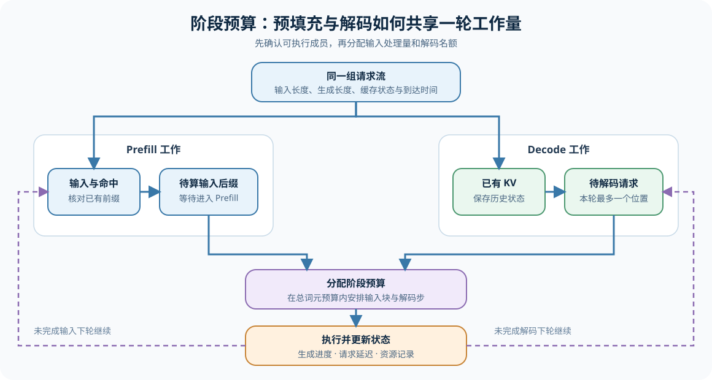
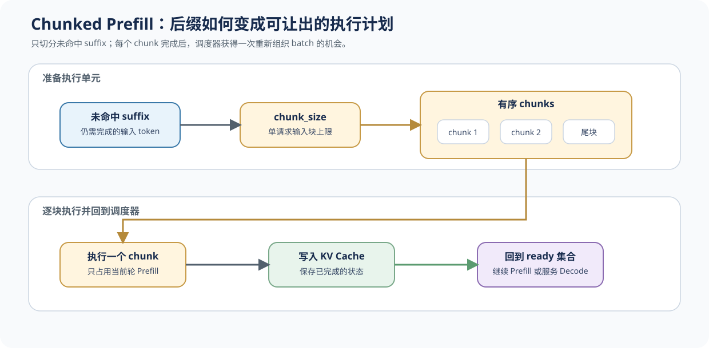

# 38. Prefill Decode Scheduling | Prefill/Decode 调度
**难度：** Medium | **环境：** [CPU 主线，GPU 可选](#runtime-environment) | **标签：** `推理优化`, `Serving`, `Chunked Prefill`, `PD Disaggregation` | **目标人群：** 理解请求阶段与单轮预算的读者

> 🚀 **云端运行环境**
>
> 本章节的实战代码可以点击以下链接在免费 GPU 算力平台上直接运行：
>
> [](https://colab.research.google.com/github/datawhalechina/llm-algo-leetcode/blob/main/02_PyTorch_Algorithms/38_Prefill_Decode_Scheduling.ipynb)
> [](https://modelscope.cn/my/mynotebook) *(国内推荐：魔搭社区免费实例)*


## 本节导读

三个请求正在逐 token 生成，又来了一个长输入。即使还有空闲序列名额，整段处理新输入也可能让原有请求等待更久。把输入分块能提供重新调度的机会，但每块多大、是否先给解码留位置，仍会改变等待与吞吐。

先观察同一实例内的预填充和解码怎样分配一轮预算，再比较解码优先、预填充优先与预留解码名额三种安排。只有在分块后争用仍不能满足目标时，才进一步评估使用独立资源的预填充／解码分离，以及它新增的 KV 交接成本。

**关键词：** `chunked prefill`, `continuous batching`, `phase budget`, `PD disaggregation`

<a id="runtime-environment"></a>

## 运行环境

- **基础练习：** 使用 [`BASE-CPU`](../guide.md#base-cpu)，运行 Step 4 题目与测试。
- **GPU 实测：** 运行 Step 5 前，按其中 5.1 准备独立环境与固定输入。

## 前置阅读

先确认哪些输入已经命中缓存、请求怎样加入批次，以及一轮可以执行多少工作，再分配两阶段的份额。

- [Part 02 · 24 Prefix Cache 匹配与复用](./24_Prefix_Cache_Matching_and_Reuse.md)：确定仍需计算的输入后缀。
- [Part 02 · INF-ITERATION-BUDGET Serving 迭代成本与批次容量上界](./INF-ITERATION-BUDGET_Serving_Iteration_Cost_and_Batch_Bounds.md)：区分容量与单轮工作量。
- [Part 02 · INF-CONTINUOUS-BATCHING 连续批处理](./INF-CONTINUOUS-BATCHING_Continuous_Batching.md)：理解批次成员的释放与补位。

## Step 1：长输入为什么会打断已有解码

预填充处理尚未计算的输入，解码利用历史 KV 继续生成。长输入一次占用较多计算与读写，可能延后已有请求的下一次解码。连续批处理决定哪些请求成为成员，阶段预算进一步决定这些成员本轮各能推进多少。

单轮词元预算统计送入模型的处理位置数，不是客户端已收到的输出词元数。普通解码每个请求至多占一个位置；预填充可能占多个位置。两者相加要满足总预算，但位置数相同不代表耗时相同，历史长度和实际执行内核仍会改变成本。

| 请求形态 | 可能增加什么压力 | 相应观察量 |
| --- | --- | --- |
| 长输入、短生成 | 集中的输入计算与批次占用 | 首 token 延迟、预填充等待、已有流输出间隔 |
| 短输入、长生成 | KV 驻留与持续解码 | 后续 token 平均耗时、缓存量与完成延迟 |
| 输入和生成都长 | 两类压力叠加 | 请求总耗时和延迟分布尾部 |



## Step 2：输入分块怎样给解码留下机会

分块预填充（Chunked Prefill）把未命中的输入后缀切成有序块。每完成一块就出现新的选择边界，可以继续处理输入，也可以先推进解码；分块不会改变前缀是否命中。单轮计划同时受块上限和剩余总预算约束，必要时本轮块小于预先切分的上限。

例如总预算为 4，有两个解码请求，另有两条剩余输入分别为 5 和 2、块上限为 2。解码优先可先推进两个解码，再处理 2 个输入位置；预填充优先可把 4 个位置全用于输入；预留一个解码名额后再处理输入，则分配为 1 个解码与 3 个输入位置。三者总量相同，成员和等待不同；固定预留名额也不保证长期公平。

| 安排 | 本轮先做什么 | 可能付出的代价 |
| --- | --- | --- |
| 解码优先 | 尽量安排已有解码，再给输入剩余额度 | 新请求可能更晚得到首 token |
| 预填充优先 | 依次处理输入块，再安排解码 | 已有流的输出间隔可能变长 |
| 预留解码 | 先保留指定解码位置，再处理输入，最后补充解码 | 预留过少保护不足，过多压缩输入份额 |



## Step 3：什么时候值得评估两阶段分离

分块增加了轮次选择机会，也增加提交与调度次数。如果分块后目标负载的解码等待仍过高，应先检查块大小、并发和计算或带宽争用；持续达不到目标，才考虑给预填充与解码分别分配执行资源。单实例内的阶段配额，与两个资源角色之间的服务分离不是同一种方案。

两阶段分离需要把已算出的 KV 交给解码侧，新增搬运、同步与容量管理。只有减少的争用超过这些代价，才可能改善服务表现；资源池、状态交接和失败回退由 [Part 02 · 39 异构 PD 与服务分层](./39_Hetero_PD_and_Serving_Tiers.md)进一步验证。

| 分块后的观察 | 下一步判断 | 需要的证据 |
| --- | --- | --- |
| 解码等待改善且吞吐可接受 | 保留单实例分块安排 | 同负载下的首 token、输出间隔与吞吐 |
| 解码等待仍高 | 比较配额、并发和资源分离候选 | 轮次工作量、资源时间线与单实例基线 |
| 分离候选减少争用但交接昂贵 | 比较总成本，必要时回到单实例 | KV 搬运与请求级端到端结果 |

<a id="mechanism-practice"></a>

## Step 4：实现输入分块与单轮阶段配额

先生成有序输入块，再给一轮中的解码请求和输入后缀分配位置。输入校验与预算扣减骨架已经给出；补全分块结果、阶段次序与首轮解码额度。请求只能出现在一个阶段，解码请求本轮最多执行一次。

| TODO / 函数 | 学习者完成的机制 | 必须满足的约束 | 测试证据 |
| --- | --- | --- | --- |
| TODO 1 / `build_chunked_prefill_plan` | 按顺序切分未命中输入 | 不丢失、不重排，尾块可短于上限 | 空输入、顺序、尾块与非法块大小 |
| TODO 2 / `plan_iteration_budget` | 选择阶段次序与初始解码额度 | 同一请求不跨阶段重复执行，总工作量不超过预算 | 三种策略、余量守恒、重复编号与空负载 |


```python
from typing import Dict, List

```


```python
def build_chunked_prefill_plan(suffix_tokens: List[int], chunk_size: int) -> List[List[int]]:
    """把未命中 suffix 切成有序 chunk；尾块可以小于 chunk_size。"""
    if type(chunk_size) is not int or chunk_size <= 0:
        raise ValueError('chunk_size 必须为正数')
    suffix = list(suffix_tokens)
    # TODO 1：chunks 保持输入顺序，每块至多 chunk_size 个词元。
    # chunks = ???
    raise NotImplementedError('请完成 TODO 1：chunks')
    return chunks


def plan_iteration_budget(prefill_suffixes: Dict[str, int], decode_request_ids: List[str], max_num_batched_tokens: int, max_prefill_chunk_tokens: int, policy: str = 'balanced', decode_reserve_tokens: int = 1) -> Dict[str, object]:
    """在单轮 token 预算内分配 Decode token 与 Prefill chunk。"""
    if any(type(value) is not int or value <= 0 for value in (max_num_batched_tokens, max_prefill_chunk_tokens)):
        raise ValueError('token 预算与 Prefill chunk 上限必须为正数')
    if type(decode_reserve_tokens) is not int or decode_reserve_tokens < 0:
        raise ValueError('decode_reserve_tokens 不能为负数')
    if policy not in {'decode_first', 'prefill_first', 'balanced'}:
        raise ValueError(f'不支持的阶段策略: {policy}')
    if any(type(tokens) is not int or tokens < 0 for tokens in prefill_suffixes.values()):
        raise ValueError('Prefill suffix 长度不能为负数')
    if any(not isinstance(request_id, str) or not request_id for request_id in list(prefill_suffixes) + decode_request_ids):
        raise ValueError('请求 ID 必须是非空字符串')
    if len(set(decode_request_ids)) != len(decode_request_ids):
        raise ValueError('Decode 请求 ID 不能重复')

    if set(prefill_suffixes).intersection(decode_request_ids):
        raise ValueError('同一请求不能在本轮同时处于预填充与解码阶段')

    remaining = max_num_batched_tokens
    scheduled_decode: List[str] = []
    prefill_chunks: List[Dict[str, object]] = []

    def schedule_decode(limit: int | None = None) -> None:
        nonlocal remaining
        pending = [request_id for request_id in decode_request_ids if request_id not in scheduled_decode]
        take = min(len(pending), remaining) if limit is None else min(len(pending), remaining, limit)
        scheduled_decode.extend(pending[:take])
        remaining -= take

    def schedule_prefill() -> None:
        nonlocal remaining
        for request_id, suffix_tokens in prefill_suffixes.items():
            if remaining == 0:
                break
            chunk_tokens = min(suffix_tokens, max_prefill_chunk_tokens, remaining)
            if chunk_tokens > 0:
                prefill_chunks.append({'request_id': request_id, 'tokens': chunk_tokens})
                remaining -= chunk_tokens

    # TODO 2：phase_order 保存各策略的阶段执行次序，balanced 需要两次解码机会。
    # first_decode_limit 为第一次解码的名额；None 表示使用全部剩余额度。
    # phase_order = ???
    # first_decode_limit = ???
    raise NotImplementedError('请完成 TODO 2：phase_order 与 first_decode_limit')
    for phase in phase_order:
        if phase == 'decode':
            schedule_decode(limit=first_decode_limit)
            first_decode_limit = None
        else:
            schedule_prefill()

    used_tokens = max_num_batched_tokens - remaining
    return {
        'policy': policy,
        'max_num_batched_tokens': max_num_batched_tokens,
        'decode_request_ids': scheduled_decode,
        'prefill_chunks': prefill_chunks,
        'used_tokens': used_tokens,
        'remaining_tokens': remaining,
    }
```

## 测试

核对分块顺序、三种策略和请求唯一性；多档预算下逐项验证工作量守恒。


```python
# 机制测试：分别检查输入分块与单轮 token 预算。
def test_chunked_prefill_plan():
    """验证 suffix 顺序、尾块和非法 chunk_size。"""
    assert build_chunked_prefill_plan([9, 10, 11, 12, 13], chunk_size=2) == [[9, 10], [11, 12], [13]]
    try:
        build_chunked_prefill_plan([1], chunk_size=0)
    except ValueError:
        pass
    else:
        raise AssertionError('非正 chunk_size 必须拒绝')


def test_iteration_budget_policies():
    """验证三种阶段策略的成员差异与 token 预算守恒。"""
    suffixes = {'p1': 5, 'p2': 2}
    decode_ids = ['d1', 'd2']

    balanced = plan_iteration_budget(suffixes, decode_ids, 4, 2, policy='balanced', decode_reserve_tokens=1)
    assert balanced['decode_request_ids'] == ['d1']
    assert balanced['prefill_chunks'] == [{'request_id': 'p1', 'tokens': 2}, {'request_id': 'p2', 'tokens': 1}]

    decode_first = plan_iteration_budget(suffixes, decode_ids, 3, 2, policy='decode_first')
    assert decode_first['decode_request_ids'] == ['d1', 'd2']
    assert decode_first['prefill_chunks'] == [{'request_id': 'p1', 'tokens': 1}]

    prefill_first = plan_iteration_budget(suffixes, decode_ids, 3, 2, policy='prefill_first')
    assert prefill_first['decode_request_ids'] == []
    assert prefill_first['prefill_chunks'] == [{'request_id': 'p1', 'tokens': 2}, {'request_id': 'p2', 'tokens': 1}]

    for plan in (balanced, decode_first, prefill_first):
        assert plan['used_tokens'] <= plan['max_num_batched_tokens']
        assert plan['used_tokens'] + plan['remaining_tokens'] == plan['max_num_batched_tokens']


def test_iteration_budget_contract():
    """验证非法策略、非正预算与负 suffix 会被拒绝。"""
    invalid_cases = [
        ({'p': 1}, [], 0, 1, 'balanced'),
        ({'p': 1}, [], 2, 1, 'unknown'),
        ({'p': -1}, [], 2, 1, 'balanced'),
    ]
    for suffixes, decode_ids, budget, chunk, policy in invalid_cases:
        try:
            plan_iteration_budget(suffixes, decode_ids, budget, chunk, policy=policy)
        except ValueError:
            pass
        else:
            raise AssertionError('非法阶段预算输入必须拒绝')


def test_empty_and_cross_phase_requests():
    """空负载保留预算，同一请求不能重复或跨阶段执行。"""
    assert build_chunked_prefill_plan([], 2) == []
    empty = plan_iteration_budget({}, [], 4, 2)
    assert empty['used_tokens'] == 0 and empty['remaining_tokens'] == 4
    zero_reserve = plan_iteration_budget({'p': 3}, ['d'], 2, 2, decode_reserve_tokens=0)
    assert zero_reserve['decode_request_ids'] == [] and zero_reserve['used_tokens'] == 2
    for suffixes, decode_ids in [({'same': 1}, ['same']), ({}, ['d', 'd'])]:
        try:
            plan_iteration_budget(suffixes, decode_ids, 4, 2)
        except ValueError:
            pass
        else:
            raise AssertionError('重复或跨阶段请求应拒绝')


def test_all_policy_conservation():
    """多档预算与预留下，实际成员满足预算与阶段上限。"""
    suffixes = {'p1': 5, 'p2': 2, 'empty': 0}
    decode_ids = ['d1', 'd2', 'd3']
    for budget in (1, 2, 4, 8):
        for reserve in (0, 1, 6):
            for policy in ('decode_first', 'prefill_first', 'balanced'):
                plan = plan_iteration_budget(suffixes, decode_ids, budget, 2, policy, reserve)
                chunks = plan['prefill_chunks']
                assert sum(row['tokens'] for row in chunks) + len(plan['decode_request_ids']) == plan['used_tokens']
                assert plan['used_tokens'] + plan['remaining_tokens'] == budget
                assert 0 <= plan['used_tokens'] <= budget
                assert len(plan['decode_request_ids']) == len(set(plan['decode_request_ids']))
                assert all(0 < row['tokens'] <= min(2, suffixes[row['request_id']]) for row in chunks)
    assert suffixes == {'p1': 5, 'p2': 2, 'empty': 0} and decode_ids == ['d1', 'd2', 'd3']


def test_prefill_decode_scheduling():
    """运行所有机制断言；真实错误保持原类型，不伪装成未完成题目。"""
    test_chunked_prefill_plan()
    test_iteration_budget_policies()
    test_iteration_budget_contract()
    test_empty_and_cross_phase_requests()
    test_all_policy_conservation()
    print('PASS: 分块顺序、阶段策略、请求唯一性与多档预算守恒测试通过。')


test_prefill_decode_scheduling()

```

---

🛑 **STOP HERE**

请先完成题目并运行测试，再查看参考代码与解析。

## 参考代码与解析

### 代码


```python
def build_chunked_prefill_plan(suffix_tokens: List[int], chunk_size: int) -> List[List[int]]:
    """把未命中 suffix 切成有序 chunk；尾块可以小于 chunk_size。"""
    # TODO 1：生成分块预填充计划
    if type(chunk_size) is not int or chunk_size <= 0:
        raise ValueError('chunk_size 必须为正数')
    suffix = list(suffix_tokens)
    return [suffix[start:start + chunk_size] for start in range(0, len(suffix), chunk_size)]


def plan_iteration_budget(prefill_suffixes: Dict[str, int], decode_request_ids: List[str], max_num_batched_tokens: int, max_prefill_chunk_tokens: int, policy: str = 'balanced', decode_reserve_tokens: int = 1) -> Dict[str, object]:
    """在单轮 token 预算内分配 Decode token 与 Prefill chunk。"""
    # TODO 2：用阶段优先级分配预算，并保持 used_tokens 不超过单轮上限
    if any(type(value) is not int or value <= 0 for value in (max_num_batched_tokens, max_prefill_chunk_tokens)):
        raise ValueError('token 预算与 Prefill chunk 上限必须为正数')
    if type(decode_reserve_tokens) is not int or decode_reserve_tokens < 0:
        raise ValueError('decode_reserve_tokens 不能为负数')
    if policy not in {'decode_first', 'prefill_first', 'balanced'}:
        raise ValueError(f'不支持的阶段策略: {policy}')
    if any(type(tokens) is not int or tokens < 0 for tokens in prefill_suffixes.values()):
        raise ValueError('Prefill suffix 长度不能为负数')
    if any(not isinstance(request_id, str) or not request_id for request_id in list(prefill_suffixes) + decode_request_ids):
        raise ValueError('请求 ID 必须是非空字符串')
    if len(set(decode_request_ids)) != len(decode_request_ids):
        raise ValueError('Decode 请求 ID 不能重复')

    if set(prefill_suffixes).intersection(decode_request_ids):
        raise ValueError('同一请求不能在本轮同时处于预填充与解码阶段')

    remaining = max_num_batched_tokens
    scheduled_decode: List[str] = []
    prefill_chunks: List[Dict[str, object]] = []

    def schedule_decode(limit: int | None = None) -> None:
        nonlocal remaining
        pending = [request_id for request_id in decode_request_ids if request_id not in scheduled_decode]
        take = min(len(pending), remaining) if limit is None else min(len(pending), remaining, limit)
        scheduled_decode.extend(pending[:take])
        remaining -= take

    def schedule_prefill() -> None:
        nonlocal remaining
        for request_id, suffix_tokens in prefill_suffixes.items():
            if remaining == 0:
                break
            chunk_tokens = min(suffix_tokens, max_prefill_chunk_tokens, remaining)
            if chunk_tokens > 0:
                prefill_chunks.append({'request_id': request_id, 'tokens': chunk_tokens})
                remaining -= chunk_tokens

    phase_order = {
        'decode_first': ('decode', 'prefill'),
        'prefill_first': ('prefill', 'decode'),
        'balanced': ('decode', 'prefill', 'decode'),
    }[policy]
    first_decode_limit = decode_reserve_tokens if policy == 'balanced' else None
    for phase in phase_order:
        if phase == 'decode':
            schedule_decode(limit=first_decode_limit)
            first_decode_limit = None
        else:
            schedule_prefill()

    used_tokens = max_num_batched_tokens - remaining
    return {
        'policy': policy,
        'max_num_batched_tokens': max_num_batched_tokens,
        'decode_request_ids': scheduled_decode,
        'prefill_chunks': prefill_chunks,
        'used_tokens': used_tokens,
        'remaining_tokens': remaining,
    }
```

### 解析

#### TODO 1：生成有序分块

- 按块大小递增切片起点，每次读取连续输入；尾块不足上限时保留实际长度，空输入返回空计划。
- 顺序与尾块测试检查词元不丢失、不重复，非正块大小在切片前拒绝。

#### TODO 2：分配阶段配额

- 解码优先先安排解码，预填充优先反过来；预留策略先给指定数量的解码名额，再处理输入，最后用余量补充解码。第二次解码不能再次选择已执行成员。
- 多档预算测试逐项累加预填充位置与解码成员数，核对总预算、剩余额度和每块上限；重复编号与跨阶段反例防止同一请求被执行两次。

## Step 5：真实后端实验——整段预填充与分块预填充

CPU 题目确认输入分块与单轮 token 预算；真实后端先建立活跃解码流，再注入长预填充与短探针请求，比较整段预填充和分块预填充对解码停顿与探针首 token 延迟的影响。PD 分池不在单卡实验中模拟。

| 学习问题 | CPU 已确认 | 真实后端要确认 |
|---|---|---|
| 输入如何进入单轮预算 | 顺序分块与 token 守恒 | 后端是否按固定 token 上限切分预填充 |
| 分块保护了什么 | 块边界提供重新调度机会 | 活跃解码流的最大输出间隔是否缩短 |
| 新请求能否及时进入 | 阶段预算决定本轮成员 | 长预填充之后到达的短探针 TTFT 是否下降 |
| 分块是否有代价 | 更频繁的调度会增加开销 | 请求吞吐是否明显下降 |

### 5.1 环境与配对运行方式

本实验使用 `INF-VLLM-011-CU128`。首次运行先按[推理服务环境 Quickstart](../topic_discussion/inference_optimization/quickstart.md#inf-vllm-quickstart)安装环境，再按[实验资产表的外部服务准备](../topic_discussion/inference_optimization/experiment_assets.md#外部服务准备)依次启动整段预填充和分块预填充服务。两次运行保持相同 `PAIR_LABEL`，只修改 `SERVICE_VARIANT`；Notebook 不同时启动两个服务。

| 配置项 | 整段预填充基线 | 分块预填充候选 |
|---|---|---|
| 模型与最大长度 | `Qwen/Qwen3-0.6B`，4096 | 相同 |
| 分块开关 | 关闭 | 开启 |
| 单轮 token 上限 | 后端随整段输入调度 | 512 |
| 到达序列 | 4 条活跃解码请求 → 1 条 2048-token 长输入 → 1 条短探针 | 相同到达时间与输出上限 |


```python
# 5.1 每次只运行一个服务变体；两次运行共享 PAIR_LABEL。
RUN_MODE = "dry_run"  # 默认值 dry_run：只登记计划；服务就绪后改为 real_backend。
PAIR_LABEL = "default"  # 默认值 default：正式配对实验改为唯一标签。
SERVICE_VARIANT = "whole_prefill"  # 默认值 whole_prefill：完成后改为 chunked_prefill。

ENVIRONMENT_PROFILE = "INF-VLLM-011-CU128"  # Quickstart 中登记的服务环境。
BACKEND_BASE_URL = "http://127.0.0.1:8000"  # 当前已启动服务地址。
MODEL_ID = "Qwen/Qwen3-0.6B"  # 两个服务变体使用同一模型。
MODEL_REVISION = "main"  # 5.2 从本地缓存解析实际 commit。
ACTIVE_DECODE_REQUESTS = 4  # 默认值 4：先建立四条持续解码流。
ACTIVE_DECODE_PROMPT_TOKENS = 128  # 默认值 128：活跃解码请求的输入长度。
ACTIVE_DECODE_MAX_NEW_TOKENS = 256  # 默认值 256：强制保持足够长的解码窗口。
LONG_PREFILL_PROMPT_TOKENS = 2048  # 默认值 2048：制造预填充干扰。
LONG_PREFILL_MAX_NEW_TOKENS = 16  # 默认值 16：避免长请求的解码阶段主导结果。
SHORT_PROBE_PROMPT_TOKENS = 128  # 默认值 128：探针请求的输入长度。
SHORT_PROBE_MAX_NEW_TOKENS = 32  # 默认值 32：获得稳定的首 token 与完成时间。
LONG_PREFILL_ARRIVAL_DELAY_S = 0.20  # 默认值 0.20：等待活跃请求进入解码后再注入长输入。
SHORT_PROBE_ARRIVAL_DELAY_S = 0.22  # 默认值 0.22：让探针紧随长输入进入。
REQUEST_COUNT = ACTIVE_DECODE_REQUESTS + 2  # 四条解码流、一个长输入和一个短探针。
CONCURRENCY = REQUEST_COUNT  # 所有角色均可按计划到达后端。
WARMUP_STEPS = 1  # 每个服务变体开始前的预热次数。
CHUNK_TOKEN_BUDGET = 512  # 候选服务的 --max-num-batched-tokens。
RESULT_DIR_RELATIVE = "benchmarks/results/inf_chunked_prefill"

```

### 5.2 执行当前服务变体并保存阶段结果

当前运行只测一个服务变体。完成后停止服务，按 Quickstart 切换后端配置，再修改 `SERVICE_VARIANT` 重跑本节；模型、请求顺序和 `PAIR_LABEL` 不变。


```python
# 5.2 构造固定 token 长度请求，执行当前服务变体并保存阶段 JSON。
import json

import torch
from transformers import AutoTokenizer
from tools.inference_project_runtime import locate_repo_root
from tools.notebook_runtime import package_version, resolve_model_commit
from tools.serving_mechanism_runtime import percentile, run_arrival_schedule

if RUN_MODE not in {"dry_run", "real_backend"}:
    raise ValueError("RUN_MODE 必须是 dry_run 或 real_backend；服务实验不能使用 real_gpu")
if SERVICE_VARIANT not in {"whole_prefill", "chunked_prefill"}:
    raise ValueError("SERVICE_VARIANT 必须是 whole_prefill 或 chunked_prefill")
root = locate_repo_root()
result_dir = root / RESULT_DIR_RELATIVE
stage_path = result_dir / f"chunked_prefill_{PAIR_LABEL}_{SERVICE_VARIANT}.json"
pair_path = result_dir / f"chunked_prefill_{PAIR_LABEL}_pair.json"
declared_backend = {
    "whole_prefill": {"enable_chunked_prefill": False, "max_num_batched_tokens": None},
    "chunked_prefill": {"enable_chunked_prefill": True, "max_num_batched_tokens": CHUNK_TOKEN_BUDGET},
}[SERVICE_VARIANT]
stage = {
    "schema_version": "inference-chunked-prefill-stage/v2",
    "semantic_id": "INF-CHUNKED-PREFILL",
    "environment_profile": ENVIRONMENT_PROFILE,
    "run_mode": RUN_MODE, "pair_label": PAIR_LABEL, "service_variant": SERVICE_VARIANT,
    "framework": {"torch": torch.__version__, "vllm": package_version("vllm")},
    "backend_config": declared_backend,
    "workload": {
        "id": "inf-chunked-prefill-interference-v2", "model_id": MODEL_ID,
        "requested_revision": MODEL_REVISION, "resolved_commit": None,
        "active_decode_requests": ACTIVE_DECODE_REQUESTS,
        "active_decode_prompt_tokens": ACTIVE_DECODE_PROMPT_TOKENS,
        "active_decode_max_new_tokens": ACTIVE_DECODE_MAX_NEW_TOKENS,
        "long_prefill_prompt_tokens": LONG_PREFILL_PROMPT_TOKENS,
        "long_prefill_max_new_tokens": LONG_PREFILL_MAX_NEW_TOKENS,
        "short_probe_prompt_tokens": SHORT_PROBE_PROMPT_TOKENS,
        "short_probe_max_new_tokens": SHORT_PROBE_MAX_NEW_TOKENS,
        "long_prefill_arrival_delay_s": LONG_PREFILL_ARRIVAL_DELAY_S,
        "short_probe_arrival_delay_s": SHORT_PROBE_ARRIVAL_DELAY_S,
        "request_count": REQUEST_COUNT, "concurrency": CONCURRENCY,
    },
    "report": None, "mechanism_metrics": None,
    "failure": None, "evidence_level": "dry_run",
}

if RUN_MODE == "real_backend":
    try:
        commit, source = resolve_model_commit(MODEL_ID, MODEL_REVISION, local_files_only=True)
        stage["workload"]["resolved_commit"] = commit
        stage["workload"]["revision_source"] = source
        tokenizer = AutoTokenizer.from_pretrained(MODEL_ID, revision=commit, local_files_only=True)
        seed_text = "分块预填充通过限制单轮输入工作量，为等待中的解码请求保留调度机会。"
        def fixed_token_prompt(target_tokens, instruction):
            suffix_ids = tokenizer("\n" + instruction, add_special_tokens=False)["input_ids"]
            if len(suffix_ids) >= target_tokens:
                raise ValueError("目标 token 数必须大于指令后缀长度")
            body_budget = target_tokens - len(suffix_ids)
            body_ids = tokenizer(seed_text * (target_tokens // 8 + 16), add_special_tokens=False)["input_ids"][:body_budget]
            return tokenizer.decode(body_ids + suffix_ids, skip_special_tokens=True)
        prompts = [
            {
                "prompt": fixed_token_prompt(ACTIVE_DECODE_PROMPT_TOKENS, f"活跃解码 {index}：持续列出机制要点。"),
                "max_tokens": ACTIVE_DECODE_MAX_NEW_TOKENS, "arrival_delay_s": 0.0,
                "request_role": "active_decode", "ignore_eos": True,
            }
            for index in range(ACTIVE_DECODE_REQUESTS)
        ]
        prompts.extend([
            {
                "prompt": fixed_token_prompt(LONG_PREFILL_PROMPT_TOKENS, "请总结长输入中的核心机制。"),
                "max_tokens": LONG_PREFILL_MAX_NEW_TOKENS,
                "arrival_delay_s": LONG_PREFILL_ARRIVAL_DELAY_S, "request_role": "long_prefill",
            },
            {
                "prompt": fixed_token_prompt(SHORT_PROBE_PROMPT_TOKENS, "短探针：给出一句结论。"),
                "max_tokens": SHORT_PROBE_MAX_NEW_TOKENS,
                "arrival_delay_s": SHORT_PROBE_ARRIVAL_DELAY_S, "request_role": "short_probe",
            },
        ])
        stage["workload"]["client_content_token_counts"] = [
            len(tokenizer(item["prompt"], add_special_tokens=False)["input_ids"]) for item in prompts
        ]
        report = run_arrival_schedule(
            base_url=BACKEND_BASE_URL, model=MODEL_ID, prompts=prompts,
            schedule="rolling_admission", concurrency=CONCURRENCY, max_tokens=ACTIVE_DECODE_MAX_NEW_TOKENS,
            warmup=WARMUP_STEPS, timeout_s=300.0,
        )
        successful = [item for item in report["requests"] if item.get("ok")]
        active_rows = [item for item in successful if item.get("request_role") == "active_decode"]
        long_rows = [item for item in successful if item.get("request_role") == "long_prefill"]
        probe_rows = [item for item in successful if item.get("request_role") == "short_probe"]
        if len(active_rows) != ACTIVE_DECODE_REQUESTS or len(long_rows) != 1 or len(probe_rows) != 1:
            raise RuntimeError("请求角色未全部成功，不能形成分块预填充机制证据")
        active_gap_p95 = [item["stream_gap_ms"]["p95"] for item in active_rows if item["stream_gap_ms"]["p95"] is not None]
        active_gap_max = [item["stream_gap_ms"]["max"] for item in active_rows if item["stream_gap_ms"]["max"] is not None]
        if len(active_gap_p95) != ACTIVE_DECODE_REQUESTS or len(active_gap_max) != ACTIVE_DECODE_REQUESTS:
            raise RuntimeError("活跃解码流缺少连续 token 间隔，不能判断预填充阻塞")
        stage["report"] = report
        stage["mechanism_metrics"] = {
            "short_probe_ttft_ms": probe_rows[0]["ttft_ms"],
            "long_prefill_ttft_ms": long_rows[0]["ttft_ms"],
            "active_decode_stream_gap_p95_ms": percentile(active_gap_p95, 95),
            "active_decode_stream_gap_max_ms": max(active_gap_max),
        }
        stage["evidence_level"] = "real_backend_mechanism_stage"
    except Exception as exc:
        stage.update({
            "failure": {"type": type(exc).__name__, "message": str(exc)},
            "evidence_level": "failed_real_backend_attempt",
        })

result_dir.mkdir(parents=True, exist_ok=True)
stage_path.write_text(json.dumps(stage, ensure_ascii=False, indent=2), encoding="utf-8")
print(json.dumps(stage, ensure_ascii=False, indent=2))

```

### 5.3 汇总两个服务变体

只有同一 `PAIR_LABEL` 下的两个阶段结果都成功，才比较短探针 TTFT、活跃解码流输出间隔、吞吐和失败数。


```python
# 5.3 读取两个阶段 JSON 并形成配对结论；重启 Kernel 后不依赖 5.2 的内存状态。
import json
from tools.inference_project_runtime import locate_repo_root

result_dir = locate_repo_root() / RESULT_DIR_RELATIVE
pair_path = result_dir / f"chunked_prefill_{PAIR_LABEL}_pair.json"
stage_paths = {name: result_dir / f"chunked_prefill_{PAIR_LABEL}_{name}.json" for name in ("whole_prefill", "chunked_prefill")}
missing = [name for name, path in stage_paths.items() if not path.exists()]
pair = {
    "schema_version": "inference-chunked-prefill-pair/v3",
    "semantic_id": "INF-CHUNKED-PREFILL", "pair_label": PAIR_LABEL,
    "baseline": None, "candidate": None, "comparison": None, "decision_checks": None,
    "failure": None, "evidence_level": "incomplete_pair", "decision": "run_missing_variant",
}
if missing:
    pair["failure"] = {"type": "MissingVariant", "message": f"仍需运行：{missing}"}
else:
    pair["baseline"] = json.loads(stage_paths["whole_prefill"].read_text(encoding="utf-8"))
    pair["candidate"] = json.loads(stage_paths["chunked_prefill"].read_text(encoding="utf-8"))
    failures = [item["failure"] for item in (pair["baseline"], pair["candidate"]) if item["failure"]]
    identity_fields = (
        "id", "model_id", "resolved_commit", "active_decode_requests",
        "active_decode_prompt_tokens", "active_decode_max_new_tokens",
        "long_prefill_prompt_tokens", "long_prefill_max_new_tokens",
        "short_probe_prompt_tokens", "short_probe_max_new_tokens",
        "long_prefill_arrival_delay_s", "short_probe_arrival_delay_s",
        "request_count", "concurrency", "client_content_token_counts",
    )
    mismatches = [field for field in identity_fields if pair["baseline"]["workload"].get(field) != pair["candidate"]["workload"].get(field)]
    variants_valid = (
        pair["baseline"].get("service_variant") == "whole_prefill"
        and pair["candidate"].get("service_variant") == "chunked_prefill"
        and pair["baseline"]["backend_config"].get("enable_chunked_prefill") is False
        and pair["candidate"]["backend_config"].get("enable_chunked_prefill") is True
        and pair["candidate"]["backend_config"].get("max_num_batched_tokens") == CHUNK_TOKEN_BUDGET
    )
    if mismatches or not variants_valid:
        pair.update({"failure": {"type": "PairMismatch", "fields": mismatches, "variants_valid": variants_valid}, "decision": "reject_until_fixed"})
    elif failures:
        pair.update({"failure": {"type": "StageFailure", "details": failures}, "decision": "reject_until_fixed"})
    else:
        base_metrics = pair["baseline"]["report"]["metrics"]
        cand_metrics = pair["candidate"]["report"]["metrics"]
        base_mechanism = pair["baseline"]["mechanism_metrics"]
        cand_mechanism = pair["candidate"]["mechanism_metrics"]
        short_probe_ttft_ratio = cand_mechanism["short_probe_ttft_ms"] / max(base_mechanism["short_probe_ttft_ms"], 1e-12)
        active_gap_p95_ratio = cand_mechanism["active_decode_stream_gap_p95_ms"] / max(base_mechanism["active_decode_stream_gap_p95_ms"], 1e-12)
        active_gap_max_ratio = cand_mechanism["active_decode_stream_gap_max_ms"] / max(base_mechanism["active_decode_stream_gap_max_ms"], 1e-12)
        throughput_ratio = cand_metrics["request_throughput_per_s"] / max(base_metrics["request_throughput_per_s"], 1e-12)
        tpot_p95_ratio = cand_metrics["tpot_ms"]["p95"] / max(base_metrics["tpot_ms"]["p95"], 1e-12)
        all_succeeded = base_metrics["failed_requests"] == cand_metrics["failed_requests"] == 0
        pair["comparison"] = {
            "short_probe_ttft_ratio": short_probe_ttft_ratio,
            "active_decode_stream_gap_p95_ratio": active_gap_p95_ratio,
            "active_decode_stream_gap_max_ratio": active_gap_max_ratio,
            "request_throughput_ratio": throughput_ratio,
            "tpot_p95_ratio": tpot_p95_ratio,
            "all_requests_succeeded": all_succeeded,
        }
        pair["evidence_level"] = "real_backend_mechanism_benchmark"
        protects_decode_tail = active_gap_max_ratio <= 0.75 and active_gap_p95_ratio <= 1.10
        stable_throughput = throughput_ratio >= 0.90
        protects_probe = short_probe_ttft_ratio < 0.95
        pair["decision_checks"] = {
            "active_stream_gap_max_ratio_lte_0_75": active_gap_max_ratio <= 0.75,
            "active_stream_gap_p95_ratio_lte_1_10": active_gap_p95_ratio <= 1.10,
            "request_throughput_ratio_gte_0_90": stable_throughput,
            "short_probe_ttft_ratio_lt_0_95": protects_probe,
            "all_requests_succeeded": all_succeeded,
        }
        if all_succeeded and protects_decode_tail and stable_throughput:
            pair["decision"] = "accept_chunked_prefill" if protects_probe else "accept_decode_protection_with_probe_tradeoff"
        else:
            pair["decision"] = "tune"
pair_path.write_text(json.dumps(pair, ensure_ascii=False, indent=2), encoding="utf-8")
pair

```

### 5.4 解释短请求保护与系统代价

纯预填充负载曾得到候选无收益的负例；加入活跃解码、长预填充和短探针的到达顺序后，正向与反向两轮配对均显示客户端观测的流式输出间隔和短探针首 Token 延迟下降。这里的流式间隔包含服务调度、流式传输与客户端读取时间，不等同于 GPU Kernel 的单 Token 执行时间。吞吐和每输出 Token 时间的改善幅度随运行状态变化，因此只把稳定方向归因于分块预填充，不把单轮加速比外推为服务容量结论。

| 配对与运行顺序 | 流式间隔 P95 / 最大值：基线 → 候选 | 短探针首 Token 延迟：基线 → 候选 | 吞吐比 | 每输出 Token 时间 P95 比 | 决策 |
|---|---:|---:|---:|---:|---|
| v2：整段 → 分块 | 14.47 / 89.93 → 8.46 / 22.51 ms | 125.40 → 98.21 ms | 1.473 | 0.672 | 接受 |
| v3：分块 → 整段 | 9.04 / 62.62 → 8.35 / 11.66 ms | 100.04 → 41.35 ms | 1.076 | 0.915 | 接受 |

## 相关阅读

理解单实例内的输入分块与阶段配额后，再按资源争用和 KV 交接成本评估两阶段分离，并进入真实服务调度比较。

- [DistServe 原论文：Disaggregating Prefill and Decoding for Goodput-optimized Large Language Model Serving](https://arxiv.org/abs/2401.09670)
- [vLLM 官方仓库](https://github.com/vllm-project/vllm)
- [SGLang PD Disaggregation 文档](https://docs.sglang.ai/advanced_features/pd_disaggregation.html)
- [Part 02 · 39. Hetero PD and Serving Tiers | 异构 PD 与服务分层](./39_Hetero_PD_and_Serving_Tiers.md)
- [Part 02 · 70. Serving Scheduler Benchmark | 推理服务调度基准](./70_Serving_Scheduler_Benchmark.md)
