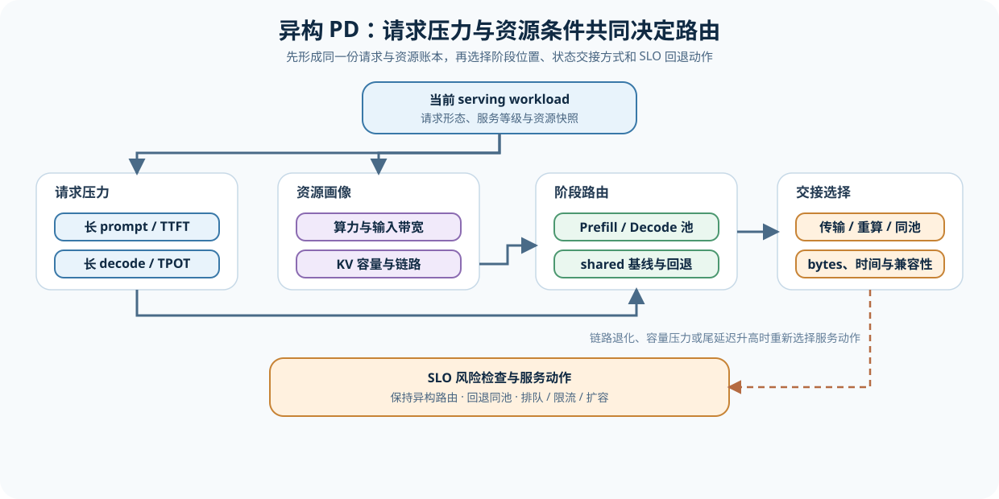
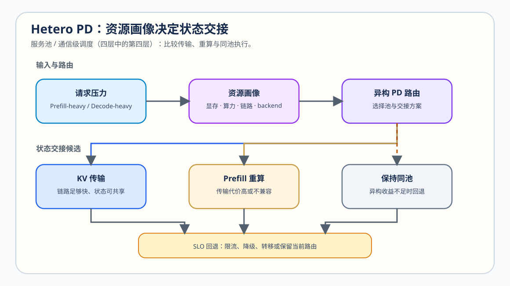

# 39. Hetero PD and Serving Tiers | 异构 PD 与服务分层
**难度：** Hard | **环境：** CPU-first | **标签：** `推理优化`, `Serving`, `Hetero PD`, `SLO` | **目标人群：** 推理服务学习者

> 🚀 **云端运行环境**
>
> 本章节的实战代码可以点击以下链接在免费 GPU 算力平台上直接运行：
>
> [](https://colab.research.google.com/github/datawhalechina/llm-algo-leetcode/blob/main/02_PyTorch_Algorithms/39_Hetero_PD_and_Serving_Tiers.ipynb)
> [](https://modelscope.cn/my/mynotebook) *(国内推荐：魔搭社区免费实例)*


---

## 本节导读

当 Prefill 与 Decode 不只位于不同逻辑池，而是运行在算力、显存、带宽或 backend 能力不同的资源上，分离本身不再足够。系统还要决定请求该路由到哪里、KV 状态该传输还是重算，以及资源紧张时如何保护服务目标。

本节把异构 PD 收成一条可检查的决策链：识别请求压力与资源画像，选择状态交接方式，再按照延迟和可运行性目标执行分层、回退或同池处理。

**关键词：** `heterogeneous PD`, `KV handoff`, `routing`, `SLO`, `fallback`
## 前置阅读

**导语：** 先理解 Chunked Prefill 和 PD 分池怎样改变请求的执行位置；再比较计算、显存与链路条件如何决定跨池交接、重算或保持同池。

- [38. Prefill/Decode Scheduling | Prefill/Decode 调度](./38_Prefill_Decode_Scheduling.md)
- [INF-SERVING-OVERLAP. Serving Overlap and State Handoff | Serving 重叠与状态交接](./INF-SERVING-OVERLAP_Serving_Overlap_and_State_Handoff.md)

### Step 1: 请求压力如何匹配异构资源

异构 PD 从请求阶段与资源能力的匹配开始：Prefill 更需要突发计算和输入带宽，Decode 更依赖持续 KV 容量、稳定读带宽与低排队。先将请求压力和资源画像写成同一张账本，才能判断哪种路由更合适。

| 对象 | 需要记录的特征 | 它影响的决策 |
|---|---|---|
| Prefill-heavy 请求 | prompt 长度、TTFT 目标、输入处理压力 | 是否进入计算更强的 prefill 池 |
| Decode-heavy 请求 | 生成长度、KV 驻留、TPOT 目标 | 是否进入显存/带宽更合适的 decode 池 |
| 资源池 | 计算能力、可用显存、链路和 backend 支持 | 能否承接对应阶段 |
| 服务等级 | P95/P99、超时与质量约束 | 是否允许排队、降级或回退 |



### Step 2: KV 状态交接应传输、重算还是同池执行

Prefill 完成后，Decode 需要已有的 KV 状态。跨池执行时，系统可传输状态、在目标池重算 Prefill，或继续留在原池；状态大小、链路带宽和资源空闲程度会改变三种选择的代价。这里的路由决策读取完整 transfer time 与 exposed time，但 overlap 时间线和交接依赖由前置机制页统一定义。

| 交接方式 | 适合条件 | 主要代价 | 必须验证 |
|---|---|---|---|
| KV 传输 | 链路足够快，状态传输低于重算预算 | 传输时间、通信拥塞、兼容性 | transfer bytes、handoff ms、P99 |
| 重算 Prefill | 链路慢或状态难以共享 | 额外 Prefill 计算与 TTFT | recompute ms、算力占用 |
| 保持同池 | 跨池交接代价高或资源未明显分化 | 失去隔离收益 | 队列、利用率、尾延迟 |



### Step 3: 服务分层与回退如何保护 SLO

资源压力、链路退化或某个池持续饱和时，路由需要随当前风险改变。执行兼容性先检查阶段、模型版本、健康状态和可用显存；KV 兼容性再检查 dtype 与布局。目标池不能直接接收 KV 但仍可运行模型时，系统可以改为重算；目标池不可执行时，才继续寻找回退池。

| 触发信号 | 首选动作 | 保护目标 | 需要记录 |
|---|---|---|---|
| Decode 池显存接近上限 | 回到同池或限制新接纳 | 可运行性与已有请求 | memory pressure、拒绝数 |
| 交接超过预算 | 选择重算或同池执行 | P95/P99 | handoff、recompute、尾延迟 |
| 队列超出 SLO | 路由、限流或扩容 | 等待时间与公平性 | queue delay、超时率 |
| 两池均稳定 | 保持当前异构路由 | 吞吐与资源利用率 | pool utilization、throughput |
| KV dtype / layout 不兼容 | 保留可执行目标池并重算 Prefill | 可运行性 | incompatibility reason、recompute ms |
| 目标池不健康或显存不足 | 改路由到兼容回退池；无候选则拒绝 | SLO 与故障隔离 | rejected pool、fallback pool、decision |

### Step 4: 实现资源路由、交接与服务动作

题目区提供请求、资源池和服务压力输入，并保留服务动作与路由记录骨架。学习者只需完成资源分类、交接成本比较、能力门槛和失败路由四个机制；测试分别覆盖阈值边界、快慢链路、KV 不兼容、主池失效与无池可用。

| TODO / 函数 | 学习者完成的机制 | 必须满足的约束 | 测试证据 |
|---|---|---|---|
| TODO 1 / `classify_resource_need` | 根据输入与生成长度识别主要资源压力 | 长输入、长生成与共享三类互斥 | 三类请求与阈值边界 |
| TODO 2 / `choose_handoff_mode` | 将状态大小和链路带宽换算为传输时间 | 统一单位后再与重算时间比较 | 快链路选择传输，慢链路选择重算 |
| TODO 3 / `evaluate_pool_capability` | 分离执行兼容与 KV 兼容 | KV 不兼容不能等同于资源池不可执行 | 正常、布局不匹配与不健康资源池 |
| TODO 4 / `plan_route_with_fallback` | 在主池、回退池与拒绝之间重规划 | 能执行但不能接收 KV 时改为重算 | KV 重算、换池与拒绝三条路径 |

```python
from typing import Dict, List

```


```python
def classify_resource_need(request: Dict[str, int], long_prompt_threshold: int, long_decode_threshold: int) -> str:
    """根据 prompt 与 decode 长度返回 prefill、decode 或 shared 资源需求。"""
    # TODO 1（请求分类）：长 prompt 进入 prefill，长 decode 进入 decode，其余请求保持 shared。
    # resource_need = ???
    raise NotImplementedError('TODO 1：请完成资源需求分类')


def choose_handoff_mode(link_gbps: float, cache_transfer_mb: float, recompute_ms: float) -> Dict[str, object]:
    """比较 KV 传输与重算的教学成本，并选择耗时较低的路径。"""
    if link_gbps <= 0 or cache_transfer_mb < 0 or recompute_ms < 0:
        raise ValueError('链路、状态大小和重算时间必须合法')
    # TODO 2（状态交接）：计算 transfer_ms，并选择 transfer 或 recompute。
    # transfer_ms = ???  # cache_transfer_mb 转为 Gb 后除以 link_gbps，再换算为 ms。
    # mode = ???
    raise NotImplementedError('TODO 2：请完成交接方式选择')


def evaluate_pool_capability(request: Dict[str, object], pool: Dict[str, object]) -> Dict[str, object]:
    """检查资源池能否执行请求，以及能否直接接收已有 KV 状态。"""
    # TODO 3（能力门槛）：分别判断 execution compatibility 与 KV compatibility，并返回失败原因。
    # capability = ???
    raise NotImplementedError('TODO 3：请完成资源池能力检查')


def plan_route_with_fallback(request: Dict[str, object], primary_pool: Dict[str, object], fallback_pools: List[Dict[str, object]], preferred_handoff: str) -> Dict[str, object]:
    """先尝试主池，再按顺序寻找可执行的回退池，并重规划 transfer 或 recompute。"""
    # TODO 4（失败路由）：不可执行时换池；KV 不兼容但可执行时改为 recompute；无池可用时 reject。
    # route = ???
    raise NotImplementedError('TODO 4：请完成失败路由与回退重规划')


def select_serving_action(memory_pressure: float, queue_delay_ms: float, slo_queue_budget_ms: float) -> Dict[str, str]:
    """在资源压力和队列等待之间选择路由、回退或限流动作。"""
    if memory_pressure > 0.9:
        return {'action': 'fallback_to_shared', 'protect': 'residency'}
    if queue_delay_ms > slo_queue_budget_ms:
        return {'action': 'route_or_throttle', 'protect': 'latency'}
    return {'action': 'keep_heterogeneous_route', 'protect': 'throughput'}


def build_route_record(request: Dict[str, object], route: Dict[str, object], action: Dict[str, str]) -> Dict[str, str]:
    """将资源需求、实际路由和服务动作整理为可复查记录。"""
    return {
        'resource_need': str(request.get('resource_need', 'shared')),
        'selected_pool': str(route['selected_pool']),
        'execution_mode': str(route['execution_mode']),
        'route_decision': str(route['decision']),
        'service_action': action['action'],
        'protect': action['protect'],
    }

```


```python
# 机制测试：分别检查资源分类、handoff、能力门槛、失败路由和服务动作。
REQUEST = {'stage': 'decode', 'model_revision': 'rev-a', 'kv_dtype': 'float16', 'kv_layout': 'paged-v1', 'required_memory_gb': 8}
PRIMARY_POOL = {'pool_id': 'decode-a', 'supported_stages': ['decode'], 'model_revision': 'rev-a', 'kv_dtype': 'float16', 'kv_layout': 'paged-v1', 'available_memory_gb': 16, 'healthy': True}

def test_resource_need_classification():
    """验证请求压力标签的阈值边界。"""
    assert classify_resource_need({'prompt_tokens': 3000, 'decode_tokens': 64}, 2048, 256) == 'prefill'
    assert classify_resource_need({'prompt_tokens': 128, 'decode_tokens': 512}, 2048, 256) == 'decode'
    assert classify_resource_need({'prompt_tokens': 800, 'decode_tokens': 128}, 2048, 256) == 'shared'


def test_handoff_mode_selection():
    """验证传输成本与重算成本的选择。"""
    fast_link = choose_handoff_mode(link_gbps=200, cache_transfer_mb=100, recompute_ms=12)
    assert fast_link == {'mode': 'transfer', 'transfer_ms': 4.0, 'recompute_ms': 12}
    slow_link = choose_handoff_mode(link_gbps=25, cache_transfer_mb=100, recompute_ms=12)
    assert slow_link['mode'] == 'recompute'


def test_pool_capability_matrix():
    """验证执行兼容与 KV 兼容是两层不同门槛。"""
    compatible = evaluate_pool_capability(REQUEST, PRIMARY_POOL)
    assert compatible['can_execute'] is True and compatible['can_accept_kv'] is True

    layout_mismatch = evaluate_pool_capability(REQUEST, {**PRIMARY_POOL, 'kv_layout': 'contiguous'})
    assert layout_mismatch['can_execute'] is True
    assert layout_mismatch['can_accept_kv'] is False
    assert 'kv_layout_mismatch' in layout_mismatch['reasons']

    unhealthy = evaluate_pool_capability(REQUEST, {**PRIMARY_POOL, 'healthy': False})
    assert unhealthy['can_execute'] is False


def test_fallback_replanning():
    """验证 KV 不兼容触发重算，主池失效触发换池，无可用池时拒绝。"""
    recompute = plan_route_with_fallback(REQUEST, {**PRIMARY_POOL, 'kv_layout': 'contiguous'}, [], 'transfer')
    assert recompute['selected_pool'] == 'decode-a'
    assert recompute['execution_mode'] == 'recompute'
    assert recompute['decision'] == 'primary'

    fallback = {**PRIMARY_POOL, 'pool_id': 'decode-b'}
    rerouted = plan_route_with_fallback(REQUEST, {**PRIMARY_POOL, 'healthy': False}, [fallback], 'transfer')
    assert rerouted['selected_pool'] == 'decode-b'
    assert rerouted['decision'] == 'reroute'

    rejected = plan_route_with_fallback(REQUEST, {**PRIMARY_POOL, 'available_memory_gb': 2}, [], 'transfer')
    assert rejected['decision'] == 'reject'
    assert rejected['selected_pool'] == 'none'


def test_serving_action_policy():
    """验证显存压力优先于队列延迟的服务动作。"""
    memory_action = select_serving_action(memory_pressure=0.92, queue_delay_ms=20, slo_queue_budget_ms=80)
    assert memory_action == {'action': 'fallback_to_shared', 'protect': 'residency'}
    latency_action = select_serving_action(memory_pressure=0.4, queue_delay_ms=120, slo_queue_budget_ms=80)
    assert latency_action == {'action': 'route_or_throttle', 'protect': 'latency'}


def test_route_record_contract():
    """验证路由记录保留目标池、执行方式和保护目标。"""
    route = plan_route_with_fallback(REQUEST, PRIMARY_POOL, [], 'transfer')
    action = select_serving_action(memory_pressure=0.4, queue_delay_ms=120, slo_queue_budget_ms=80)
    record = build_route_record({'resource_need': 'decode'}, route, action)
    assert record == {'resource_need': 'decode', 'selected_pool': 'decode-a', 'execution_mode': 'transfer', 'route_decision': 'primary', 'service_action': 'route_or_throttle', 'protect': 'latency'}


def test_heterogeneous_pd_policy():
    """汇总异构 PD 的分类、兼容、回退与服务动作测试。"""
    try:
        test_resource_need_classification()
        test_handoff_mode_selection()
        test_pool_capability_matrix()
        test_fallback_replanning()
        test_serving_action_policy()
        test_route_record_contract()
        print('✅ 异构 PD 路由机制测试通过：资源分类、handoff、能力门槛、失败路由和服务动作均通过。')
    except NotImplementedError:
        raise
    except (NameError, AttributeError, TypeError, ValueError, AssertionError) as error:
        raise NotImplementedError('请先完成 TODO 代码或检查字段名！') from error


test_heterogeneous_pd_policy()

```

## 参考代码与解析

### 代码


```python
def classify_resource_need(request: Dict[str, int], long_prompt_threshold: int, long_decode_threshold: int) -> str:
    """根据 prompt 与 decode 长度返回 prefill、decode 或 shared 资源需求。"""
    # TODO 1：根据两类长度选择请求主要压力。
    prompt_tokens = request.get('prompt_tokens', 0)
    decode_tokens = request.get('decode_tokens', 0)
    if prompt_tokens > long_prompt_threshold and decode_tokens <= long_decode_threshold:
        return 'prefill'
    if decode_tokens > long_decode_threshold and prompt_tokens <= long_prompt_threshold:
        return 'decode'
    return 'shared'


def choose_handoff_mode(link_gbps: float, cache_transfer_mb: float, recompute_ms: float) -> Dict[str, object]:
    """比较 KV 传输与重算的教学成本，并选择耗时较低的路径。"""
    if link_gbps <= 0 or cache_transfer_mb < 0 or recompute_ms < 0:
        raise ValueError('链路、状态大小和重算时间必须合法')
    # TODO 2：将 MB 转为 Gb，估算 transfer_ms 后与 recompute_ms 比较。
    transfer_ms = (cache_transfer_mb * 8) / link_gbps
    mode = 'transfer' if transfer_ms <= recompute_ms else 'recompute'
    return {'mode': mode, 'transfer_ms': round(transfer_ms, 4), 'recompute_ms': recompute_ms}


def evaluate_pool_capability(request: Dict[str, object], pool: Dict[str, object]) -> Dict[str, object]:
    """检查资源池能否执行请求，以及能否直接接收已有 KV 状态。"""
    # TODO 3：执行兼容性负责可运行性，KV 兼容性再检查 dtype 与布局。
    reasons: List[str] = []
    stage = str(request.get('stage', 'decode'))
    supported_stages = set(pool.get('supported_stages', []))
    if not bool(pool.get('healthy', False)):
        reasons.append('unhealthy')
    if stage not in supported_stages:
        reasons.append('unsupported_stage')
    if request.get('model_revision') != pool.get('model_revision'):
        reasons.append('model_revision_mismatch')
    if float(pool.get('available_memory_gb', 0.0)) < float(request.get('required_memory_gb', 0.0)):
        reasons.append('insufficient_memory')

    can_execute = not reasons
    kv_reasons: List[str] = []
    if request.get('kv_dtype') != pool.get('kv_dtype'):
        kv_reasons.append('kv_dtype_mismatch')
    if request.get('kv_layout') != pool.get('kv_layout'):
        kv_reasons.append('kv_layout_mismatch')
    can_accept_kv = can_execute and not kv_reasons
    return {
        'pool_id': str(pool.get('pool_id', 'unknown')),
        'can_execute': can_execute,
        'can_accept_kv': can_accept_kv,
        'reasons': reasons + kv_reasons,
    }


def plan_route_with_fallback(request: Dict[str, object], primary_pool: Dict[str, object], fallback_pools: List[Dict[str, object]], preferred_handoff: str) -> Dict[str, object]:
    """先尝试主池，再按顺序寻找可执行的回退池，并重规划 transfer 或 recompute。"""
    # TODO 4：能力失败时换池；只有 KV 不兼容时保留目标池并改为重算。
    if preferred_handoff not in {'transfer', 'recompute'}:
        raise ValueError('preferred_handoff 必须是 transfer 或 recompute')
    candidates = [primary_pool, *fallback_pools]
    rejected_reasons: Dict[str, List[str]] = {}
    for index, pool in enumerate(candidates):
        capability = evaluate_pool_capability(request, pool)
        pool_id = capability['pool_id']
        if not capability['can_execute']:
            rejected_reasons[pool_id] = list(capability['reasons'])
            continue
        execution_mode = preferred_handoff
        if preferred_handoff == 'transfer' and not capability['can_accept_kv']:
            execution_mode = 'recompute'
        return {
            'selected_pool': pool_id,
            'execution_mode': execution_mode,
            'decision': 'primary' if index == 0 else 'reroute',
            'reasons': list(capability['reasons']),
            'rejected_pools': rejected_reasons,
        }
    return {
        'selected_pool': 'none',
        'execution_mode': 'none',
        'decision': 'reject',
        'reasons': ['no_executable_pool'],
        'rejected_pools': rejected_reasons,
    }


def select_serving_action(memory_pressure: float, queue_delay_ms: float, slo_queue_budget_ms: float) -> Dict[str, str]:
    """在资源压力和队列等待之间选择路由、回退或限流动作。"""
    # 骨架策略：显存压力优先于队列等待；两者正常时保持异构路由。
    if memory_pressure > 0.9:
        return {'action': 'fallback_to_shared', 'protect': 'residency'}
    if queue_delay_ms > slo_queue_budget_ms:
        return {'action': 'route_or_throttle', 'protect': 'latency'}
    return {'action': 'keep_heterogeneous_route', 'protect': 'throughput'}


def build_route_record(request: Dict[str, object], route: Dict[str, object], action: Dict[str, str]) -> Dict[str, str]:
    """将资源需求、实际路由和服务动作整理为可复查记录。"""
    return {
        'resource_need': str(request.get('resource_need', 'shared')),
        'selected_pool': str(route['selected_pool']),
        'execution_mode': str(route['execution_mode']),
        'route_decision': str(route['decision']),
        'service_action': action['action'],
        'protect': action['protect'],
    }

```

### 解析

#### TODO 1：分类资源压力

- **机制**：长输入短生成优先使用预填充资源，短输入长生成优先使用解码资源，其余请求走共享路径。
- **不变量**：三类结果互斥且覆盖所有合法请求。
- **测试证据**：测试覆盖三类请求和阈值边界。

#### TODO 2：选择状态交接方式

- **机制**：将状态大小和链路带宽换算为传输时间，再与重算时间比较。
- **不变量**：只有传输更快且状态兼容时才保留交接路径。
- **测试证据**：快链路与慢链路分别触发传输和重算。

#### TODO 3：检查资源池能力

- **机制**：执行能力检查阶段、模型版本、健康状态和显存；状态接收能力继续检查 KV 数据类型与布局。
- **不变量**：无法直接接收 KV 不等于无法执行，请求仍可通过重算进入目标池。
- **测试证据**：测试区分正常、布局不匹配和资源池不健康。

#### TODO 4：执行失败路由与回退重规划

- **机制**：主池不能直接接收状态时改为重算，主池不可执行时按顺序尝试回退池。
- **不变量**：不得路由到不健康资源池；没有可执行候选时必须显式拒绝。
- **测试证据**：测试覆盖主池成功、KV 重算、换池和全部失败。
### 真实 GPU / backend 验证出口

本节 Step 4 验证资源分类、handoff 准入、能力门槛与失败回退。合成 KV 搬运与矩阵重算只是成本下界，无法表达真实网络、worker 队列、状态序列化和 backend 同步，因此不作为 GPU 证据。

真实对照需要两类资源池和可观测的状态交接，在固定模型、请求清单和路由策略后，比较同构 shared pool 与异构 PD 的 TTFT、TPOT、吞吐、queue wait、handoff/exposed time、失败和回退路径。该证据由 [70 Serving 调度基准](./70_Serving_Scheduler_Benchmark.md) 与 [81 分布式推理项目](./81_Distributed_Inference_Project.md) 承接。
## 相关阅读

完成资源画像、状态交接和服务动作判断后，可以继续阅读真实 PD 实现、多实例 Serving 与通信验证。

- [DistServe 原论文：Disaggregating Prefill and Decoding for Goodput-optimized Large Language Model Serving](https://arxiv.org/abs/2401.09670)
- [SGLang PD Disaggregation 文档](https://docs.sglang.ai/advanced_features/pd_disaggregation.html)
- [vLLM 官方仓库](https://github.com/vllm-project/vllm)
- [70. Serving Scheduler Benchmark | 服务调度基准](./70_Serving_Scheduler_Benchmark.md)
- [79–81 分布式推理项目](./79_Distributed_Parallel_Benchmark.md)
