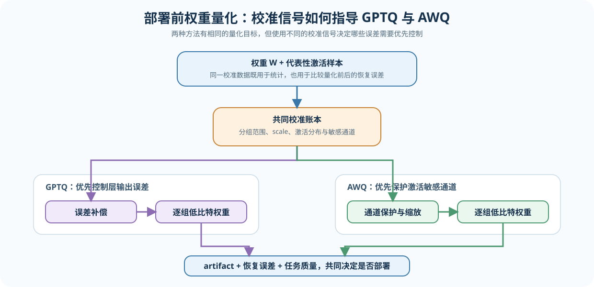
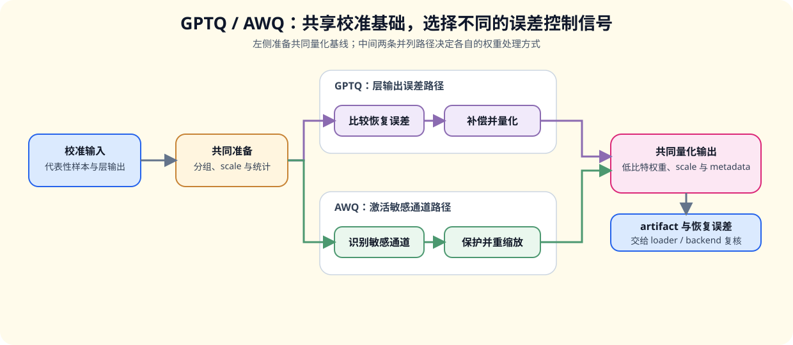

# 40. GPTQ and AWQ Weight Quantization | GPTQ 与 AWQ 权重量化
**难度：** Hard | **环境：** [CPU 主线，GPU 可选](#runtime-environment) | **标签：** `量化压缩`, `GPTQ`, `AWQ`, `artifact` | **目标人群：** 理解量化表示与校准输入的读者

> 🚀 **云端运行环境**
>
> 本章节的实战代码可以点击以下链接在免费 GPU 算力平台上直接运行：
>
> [](https://colab.research.google.com/github/datawhalechina/llm-algo-leetcode/blob/main/02_PyTorch_Algorithms/40_GPTQ_and_AWQ_Weight_Quantization.ipynb)
> [](https://modelscope.cn/my/mynotebook) *(国内推荐：魔搭社区免费实例)*


---

## 本节导读

W8A16 建立了整数码、量化参数和粒度的基础；继续压缩到 4 位后，不同通道对层输出的影响差异会变得更重要。GPTQ 使用校准激活近似二阶敏感度，降低量化误差对层输出的影响；AWQ 使用激活统计识别显著通道，再搜索缩放来减轻这些通道的量化损失。

本节沿“校准统计 → 分组候选 → 层输出误差 → 量化产物”分析两种方法，先用校准统计解释哪些误差更重要，再区分教学代理与真实算法：CPU 路径观察敏感度和保护掩码，完整 GPTQ 误差补偿及 AWQ 缩放搜索由成熟框架执行。

**关键词：** `GPTQ`、`AWQ`、Hessian 对角代理、激活统计、量化产物

---

<a id="runtime-environment"></a>

## 运行环境

- **基础练习：** 使用 [`BASE-CPU`](../guide.md#base-cpu)，运行 [Step 4 的题目与测试](#mechanism-practice)。
- **框架接口：** 使用 [`Q-CPU`](../topic_discussion/quantization_compression/quickstart.md#q-cpu-quickstart)，运行 [框架接口探测](#framework-check)。
- **GPU 实测：** 使用 `Q-CUDA-MECHANISM`；实验环境、运行配置与固定工作负载见 [Step 5](#gpu-experiment)。

---
## 前置阅读

先掌握独立校准协议和逐组（per-group）表示，再比较 GPTQ 与 AWQ 使用校准激活的不同方式。

- [52. Quantization Calibration and Error | 量化校准与误差控制](./52_Quantization_Calibration_and_Error.md)
- [25. W8A16 Quantization | W8A16 表示基础](./25_Quantization_W8A16.md)

---

## Step 1：校准统计怎样变成权重量化产物

权重量化产物不只是打包后的权重文件。生成候选时需要固定源模型版本标识、校准样本、位宽和分组大小；保存时还要记录缩放因子、零点或对称约定、打包布局、目标模块和方法专属统计。缺失这些信息，即使权重文件存在，也无法可靠恢复或交给加载器。

校准激活是目标层在代表性输入上产生的运行值。通道均方根（RMS）概括幅度，二阶统计则描述权重误差在不同输入方向上的影响；校准样本用于选择表示，独立评测样本用于检查选择后的质量。

| 阶段 | 输入 | 产生的状态 | 进入下一阶段的条件 |
|---|---|---|---|
| 校准 | 独立校准样本、浮点权重 | 激活 RMS、Hessian 近似或显著通道 | 统计维度与目标层一致 |
| 分组量化 | bit、分组大小、方法配置 | qweight、缩放因子、保护/补偿状态 | 尾组完整、误差有限 |
| 层输出复核 | 同一校准输入与浮点输出 | 权重误差、加权误差、层输出误差 | 通过局部候选门槛 |
| 量化产物生成 | 量化状态与模型身份 | 权重文件、配置与清单 | 元数据完整，可由目标加载器恢复 |



## Step 2：GPTQ 如何使用激活统计近似输出敏感度

线性层输出为 `Y = XWᵀ`。同样大小的权重误差，如果落在输入经常激活的方向上，会造成更大的输出偏移。GPTQ 使用校准矩阵构造二阶信息；每通道平方均值可以作为 Hessian 对角代理，给不同输入方向的误差赋予不同权重。均方误差（MSE）是误差平方的平均值；它不区分通道重要性，加权代理则使用输入统计。

令 $X\in\mathbb R^{N\times d}$ 为校准输入， $W$ 为浮点权重， $\Delta W=\widehat W-W$ 为量化扰动。层输出扰动为 $\Delta Y=X\Delta W^{\mathsf T}$；用 $H=X^{\mathsf T}X/N$ 表示输入方向的二阶代理时，局部误差可写为

$$
\frac1N\lVert\Delta Y\rVert_F^2
=\mathrm{tr}(\Delta W H\Delta W^{\mathsf T}).
$$

因此普通权重 MSE 相同的两个候选，也可能产生不同输出误差。对角代理忽略了通道相关性；只用它给已经量化的权重打分，并未执行 GPTQ 的逐步量化与误差补偿。当前 CPU 的 gptq 选项正是“逐组直接舍入＋敏感度评价”，不能把评分变化解释成算法已经改善码值。

| 统计或配置 | 机制意义 | 需要检查 |
|---|---|---|
| 校准矩阵 `X` | 代表目标工作负载的层输入 | 样本隔离、形状与覆盖范围 |
| `XᵀX / N` 或对角近似 | 描述输入方向的局部敏感度 | 数值稳定性与通道对应关系 |
| `group_size` | 限制共享缩放因子的权重范围 | 误差、元数据与计算内核支持 |
| 加权重构误差 | 估计权重误差对层输出的影响 | 仍需独立任务质量复核 |

## Step 3：AWQ 如何使用激活统计保护显著通道

AWQ 关注输入激活幅度较大的通道，因为这些通道对应的权重误差更容易影响输出。通道均方根（RMS）描述输入幅度，可以据此排序显著通道。真实 AWQ 通过缩放搜索保护这些通道，而非永久旁路一份高精度权重；CPU 代理为便于观察，显式保留被保护位置的浮点值，不能直接充当压缩产物。

令 $a_j=\sqrt{\frac1N\sum_{n=1}^NX_{nj}^2}$ 为第 $j$ 个输入通道的激活 RMS。按 $a_j$ 排序可以观察显著性；结合权重列范数时，也可形成教学显著性代理 $I_j=a_j\lVert W_{:j}\rVert_2$。该代理解释“哪些通道更敏感”，真实 AWQ 仍需按其缩放搜索和目标后端生成产物。教学整数码使用 INT8 容器，即便取 4 位码值也没有做双码打包；浮点旁路和掩码还会增加存储。

| 方法 | 校准信号 | 决策重点 | 产物需要记录 |
|---|---|---|---|
| GPTQ | Hessian 或其近似 | 量化误差如何影响层输出 | bit、分组大小、缩放因子、打包与方法配置 |
| AWQ | 激活幅度与显著通道 | 哪些通道需要缩放或保护 | 缩放因子、显著性/缩放配置与打包 |
| 共同部分 | 独立校准输入 | 生成可复现的逐组权重状态 | 模型版本标识、目标模块与校准摘要 |



<a id="mechanism-practice"></a>

## Step 4：实现校准统计、显著通道与量化产物契约

题目区实现三个机制：从校准激活得到 RMS 和 Hessian 对角近似；为 AWQ 教学代理标记显著通道；为每个分组生成安全缩放因子。分组循环、恢复、加权误差和产物清单由骨架提供，使测试能够核对统计、方法差异和产物元数据。

| TODO / 函数 | 学习者完成的机制 | 必须满足的约束 | 测试证据 |
|:---|:---|:---|:---|
| TODO 1：收集校准统计<br>`WeightQuantizerSim._collect_statistics` | 从校准激活计算均方根与 Hessian 对角代理 | 两个统计量共用输入通道语义，均方根是对角代理的平方根 | 形状、平方关系与通道对齐 |
| TODO 2：标记 AWQ 显著通道<br>`WeightQuantizerSim._awq_protection_mask` | 将组内显著通道下标写入布尔掩码 | 保护范围不跨分组；敏感度评价分支不创建保护位 | 保护比例、局部下标与方法差异 |
| TODO 3：计算分组缩放因子<br>`WeightQuantizerSim.fit` | 为当前分组中未保护权重计算缩放因子 | 全零与尾组仍产生有限正缩放因子，码值不越界 | 全零分组、尾组与 INT4 范围 |


```python
from math import isfinite
import torch
import torch.nn as nn
import torch.nn.functional as F

```


```python
class WeightQuantizerSim(nn.Module):
    """教学化比较 GPTQ 敏感度代理与 AWQ 显著通道策略。"""

    def __init__(self, bits: int = 4, group_size: int = 32, method: str = "gptq",
                 protect_ratio: float = 0.05, eps: float = 1e-8):
        super().__init__()
        if type(bits) is not int or not 2 <= bits <= 8 or type(group_size) is not int or group_size <= 0:
            raise ValueError('INT8 教学容器支持 2–8 位码值，group_size 必须为正整数')
        if not isfinite(eps) or eps <= 0:
            raise ValueError('eps 必须为有限正数')
        if method.lower() not in {"gptq", "awq"}:
            raise ValueError("method must be gptq or awq")
        if not 0.0 <= protect_ratio <= 1.0:
            raise ValueError("protect_ratio must be in [0, 1]")
        self.bits, self.group_size = bits, group_size
        self.method, self.protect_ratio, self.eps = method.lower(), protect_ratio, eps
        self.qmax = 2 ** (bits - 1) - 1
        self.register_buffer("qweight", torch.empty(0, dtype=torch.int8), persistent=False)
        self.register_buffer("scales", torch.empty(0), persistent=False)
        self.register_buffer("protected_weight", torch.empty(0), persistent=False)
        self.register_buffer("protected_mask", torch.empty(0, dtype=torch.bool), persistent=False)
        self.register_buffer("activation_rms", torch.empty(0), persistent=False)
        self.register_buffer("hessian_diag", torch.empty(0), persistent=False)
        self.weight_shape = None

    def _collect_statistics(self, activations: torch.Tensor, in_features: int):
        """返回每个输入通道的 activation RMS 与 Hessian 对角近似。"""
        if activations.ndim < 2 or activations.numel() == 0 or not activations.is_floating_point() or not bool(torch.isfinite(activations).all()):
            raise ValueError('校准激活必须是非空、有限的浮点张量，并具有输入通道维度')
        flat = activations.detach().float().reshape(-1, activations.shape[-1])
        if flat.shape[-1] != in_features:
            raise ValueError("calibration activation dim does not match weight")
        # TODO 1（校准统计）：mean(X²) 是 Hessian 对角代理，RMS 是其平方根。
        # hessian_diag = ???  # 形状为 [in_features] 的 mean(X²)。
        # activation_rms = ???  # 形状为 [in_features] 的 RMS。
        raise NotImplementedError("TODO 1: collect activation RMS and Hessian diagonal proxy")

    def _awq_protection_mask(self, importance: torch.Tensor) -> torch.Tensor:
        """在当前 group 内按 activation RMS 标出需要保护的通道。"""
        mask = torch.zeros_like(importance, dtype=torch.bool)
        if self.method != "awq" or importance.numel() == 0 or self.protect_ratio == 0:
            return mask
        count = min(importance.numel(), max(1, int(round(importance.numel() * self.protect_ratio))))
        topk = torch.topk(importance, k=count, largest=True).indices
        # TODO 2（AWQ 显著通道）：把 topk 局部下标写入布尔 mask。
        # mask[topk] = ???
        raise NotImplementedError("请完成 TODO 2：mask[topk]")
        return mask

    def fit(self, weight: torch.Tensor, activations: torch.Tensor) -> "WeightQuantizerSim":
        """构造直接舍入或显著通道保护的教学状态，不执行完整 GPTQ/AWQ。"""
        if weight.ndim != 2 or weight.numel() == 0 or not weight.is_floating_point() or not bool(torch.isfinite(weight).all()):
            raise ValueError('weight 必须是非空、有限的二维浮点权重')
        w = weight.detach().float()
        if w.ndim != 2:
            raise ValueError("weight must be a 2D Linear weight")
        out_features, in_features = w.shape
        self.weight_shape = (out_features, in_features)
        self.activation_rms, self.hessian_diag = self._collect_statistics(activations, in_features)
        n_groups = (in_features + self.group_size - 1) // self.group_size
        qweight = torch.zeros_like(w, dtype=torch.int8)
        scales = torch.zeros((out_features, n_groups), dtype=w.dtype, device=w.device)
        protected_weight = torch.zeros_like(w)
        protected_mask = torch.zeros_like(w, dtype=torch.bool)

        for row in range(out_features):
            for group in range(n_groups):
                start, end = group * self.group_size, min((group + 1) * self.group_size, in_features)
                chunk = w[row, start:end]
                mask = self._awq_protection_mask(self.activation_rms[start:end])
                protected_mask[row, start:end] = mask
                protected_weight[row, start:end] = chunk * mask.to(chunk.dtype)
                quantized_source = chunk[~mask] if (~mask).any() else chunk
                # TODO 3（分组缩放因子）：按未保护权重的 absmax 生成安全缩放因子。
                # scale = ???
                raise NotImplementedError("请完成 TODO 3：scale")
                q_chunk = torch.zeros_like(chunk, dtype=torch.int8)
                q_chunk[~mask] = torch.clamp(torch.round(chunk[~mask] / scale), -self.qmax, self.qmax).to(torch.int8)
                qweight[row, start:end] = q_chunk
                scales[row, group] = scale

        self.qweight, self.scales = qweight, scales
        self.protected_weight, self.protected_mask = protected_weight, protected_mask
        return self

    def dequantize(self) -> torch.Tensor:
        """按 group 恢复权重，并回填教学化 AWQ 保护位置。"""
        if self.weight_shape is None:
            raise RuntimeError("Call fit() before dequantize().")
        out_features, in_features = self.weight_shape
        restored = torch.zeros((out_features, in_features), dtype=self.scales.dtype, device=self.scales.device)
        for row in range(out_features):
            for group in range(self.scales.shape[1]):
                start, end = group * self.group_size, min((group + 1) * self.group_size, in_features)
                chunk = self.qweight[row, start:end].to(self.scales.dtype) * self.scales[row, group]
                mask = self.protected_mask[row, start:end]
                chunk[mask] = self.protected_weight[row, start:end][mask]
                restored[row, start:end] = chunk
        return restored

    def mse(self, weight: torch.Tensor) -> torch.Tensor:
        """比较恢复权重与浮点权重的普通均方误差。"""
        return torch.mean((weight.float() - self.dequantize().float()) ** 2)

    def weighted_reconstruction_error(self, weight: torch.Tensor) -> torch.Tensor:
        """用 Hessian 对角代理加权各输入通道的权重误差。"""
        error = (weight.float() - self.dequantize().float()).square()
        return torch.mean(error * self.hessian_diag.reshape(1, -1))

    def artifact_manifest(self) -> dict[str, object]:
        """返回教学状态清单，注明代理实现与未打包容器；不是后端加载产物。"""
        if self.weight_shape is None:
            raise RuntimeError("Call fit() before artifact_manifest().")
        return {
            "schema_version": "weight-quant-artifact/v1",
            "method": self.method,
            "bits": self.bits,
            "group_size": self.group_size,
            "weight_shape": list(self.weight_shape),
            "scale_shape": list(self.scales.shape),
            "symmetric": True,
            "packing_layout": "teaching_int8_container",
            "implementation_scope": 'rtn_with_diagonal_error_proxy' if self.method == 'gptq' else 'salient_float_sidecar_proxy',
            "packed_low_bit_weights": False,
            "calibration_statistics": ["activation_rms", "hessian_diag"],
            "protected_count": int(self.protected_mask.sum()),
        }

    def forward(self, x: torch.Tensor) -> torch.Tensor:
        """先显式恢复权重，再执行浮点线性层。"""
        return F.linear(x, self.dequantize().to(x.dtype))

```

## 测试

测试分别验证校准统计、尾组、AWQ 显著通道、GPTQ 加权误差和产物清单；每个机制 TODO 都有独立验证入口。

```python
# 机制测试：校准统计、分组边界、AWQ 显著通道、GPTQ 误差代理与 量化产物契约。
def test_calibration_statistics_contract():
    """RMS 与 Hessian 对角代理保持通道 shape 和平方关系。"""
    acts = torch.randn(3, 5, 8)
    rms, hessian = WeightQuantizerSim()._collect_statistics(acts, 8)
    assert rms.shape == hessian.shape == (8,)
    assert torch.allclose(rms.square(), hessian, atol=1e-6)


def test_group_partition_and_tail_contract():
    """不能整除的输入维度仍保留尾组。"""
    weight, acts = torch.randn(4, 10), torch.randn(16, 10)
    sim = WeightQuantizerSim(bits=4, group_size=4, method="gptq").fit(weight, acts)
    assert sim.scales.shape == (4, 3)
    assert sim.qweight.shape == weight.shape


def test_awq_protection_contract():
    """显著通道代理保护高激活通道，敏感度评价分支不创建保护状态。"""
    weight = torch.randn(4, 8)
    acts = torch.ones(16, 8)
    acts[:, 3] = 20
    gptq = WeightQuantizerSim(group_size=4, method="gptq").fit(weight, acts)
    awq = WeightQuantizerSim(group_size=4, method="awq", protect_ratio=0.25).fit(weight, acts)
    assert not gptq.protected_mask.any()
    assert awq.protected_mask[:, 3].all()


def test_weighted_error_contract():
    """普通 MSE 与 Hessian 加权误差都可比较且保持有限。"""
    weight, acts = torch.randn(4, 8), torch.randn(16, 8)
    sim = WeightQuantizerSim(group_size=4, method="gptq").fit(weight, acts)
    assert torch.isfinite(sim.mse(weight))
    assert torch.isfinite(sim.weighted_reconstruction_error(weight))


def test_artifact_manifest_contract():
    """产物清单保留权重恢复与加载器兼容性检查所需的元数据。"""
    sim = WeightQuantizerSim(bits=4, group_size=4, method="awq", protect_ratio=0.25)
    sim.fit(torch.randn(4, 8), torch.randn(16, 8))
    manifest = sim.artifact_manifest()
    required = {"method", "bits", "group_size", "weight_shape", "scale_shape",
                "symmetric", "packing_layout", "calibration_statistics"}
    assert required <= set(manifest)
    assert manifest["method"] == "awq" and manifest["scale_shape"] == [4, 2]


def test_proxy_scope_and_weighted_error():
    """校准变化只改变敏感度评分，不误称当前代理已执行 GPTQ 补偿。"""
    weight = torch.tensor([[0.1, 0.3, 1.0, -2.0]])
    first = WeightQuantizerSim(group_size=4, method='gptq').fit(weight, torch.eye(4))
    second = WeightQuantizerSim(group_size=4, method='gptq').fit(weight, 2 * torch.eye(4))
    assert torch.equal(first.qweight, second.qweight) and torch.equal(first.scales, second.scales)
    assert torch.allclose(second.weighted_reconstruction_error(weight), 4 * first.weighted_reconstruction_error(weight))
    assert first.artifact_manifest()['implementation_scope'] == 'rtn_with_diagonal_error_proxy'
    assert first.artifact_manifest()['packed_low_bit_weights'] is False
    protected = WeightQuantizerSim(group_size=4, method='awq', protect_ratio=1).fit(weight, torch.eye(4))
    assert protected.protected_mask.all() and torch.equal(protected.dequantize(), weight)


def test_group_zero_range_and_input_guards():
    """零范围、尾组与码值上限有效；容器溢出和空校准被拒绝。"""
    sim = WeightQuantizerSim(bits=4, group_size=2).fit(torch.zeros(2, 3), torch.ones(4, 3))
    assert sim.scales.shape == (2, 2) and torch.all(sim.scales > 0)
    assert torch.count_nonzero(sim.qweight) == 0
    assert sim.qweight.abs().max() <= 7
    calls = [lambda: WeightQuantizerSim(bits=9), lambda: WeightQuantizerSim(group_size=1.5),
             lambda: WeightQuantizerSim(eps=0),
             lambda: WeightQuantizerSim().fit(torch.ones(2, 3), torch.empty(0, 3)),
             lambda: WeightQuantizerSim().fit(torch.ones(2, 3), torch.full((2, 3), float('nan')))]
    for call in calls:
        try:
            call()
        except ValueError:
            pass
        else:
            raise AssertionError('应拒绝非法量化配置或校准输入')


for test in (
    test_calibration_statistics_contract,
    test_group_partition_and_tail_contract,
    test_awq_protection_contract,
    test_weighted_error_contract,
    test_artifact_manifest_contract,
    test_proxy_scope_and_weighted_error,
    test_group_zero_range_and_input_guards,
):
    test()
print("✅ GPTQ/AWQ 机制测试通过：统计、分组、显著通道、误差代理与 artifact 均已验证。")

```

---

🛑 **STOP HERE** 🛑
<br><br><br><br><br><br><br><br><br><br>
> 请先尝试自己完成代码并跑通测试。<br>
> 如果遇到困难，再向下查看参考代码与解析。
<br><br><br><br><br><br><br><br><br><br>

---

## 参考代码与解析

### 代码

```python
class WeightQuantizerSim(nn.Module):
    """教学化比较 GPTQ 敏感度代理与 AWQ 显著通道策略。"""

    def __init__(self, bits: int = 4, group_size: int = 32, method: str = "gptq",
                 protect_ratio: float = 0.05, eps: float = 1e-8):
        super().__init__()
        if type(bits) is not int or not 2 <= bits <= 8 or type(group_size) is not int or group_size <= 0:
            raise ValueError('INT8 教学容器支持 2–8 位码值，group_size 必须为正整数')
        if not isfinite(eps) or eps <= 0:
            raise ValueError('eps 必须为有限正数')
        if method.lower() not in {"gptq", "awq"}:
            raise ValueError("method must be gptq or awq")
        if not 0.0 <= protect_ratio <= 1.0:
            raise ValueError("protect_ratio must be in [0, 1]")
        self.bits, self.group_size = bits, group_size
        self.method, self.protect_ratio, self.eps = method.lower(), protect_ratio, eps
        self.qmax = 2 ** (bits - 1) - 1
        self.register_buffer("qweight", torch.empty(0, dtype=torch.int8), persistent=False)
        self.register_buffer("scales", torch.empty(0), persistent=False)
        self.register_buffer("protected_weight", torch.empty(0), persistent=False)
        self.register_buffer("protected_mask", torch.empty(0, dtype=torch.bool), persistent=False)
        self.register_buffer("activation_rms", torch.empty(0), persistent=False)
        self.register_buffer("hessian_diag", torch.empty(0), persistent=False)
        self.weight_shape = None

    def _collect_statistics(self, activations: torch.Tensor, in_features: int):
        """返回每个输入通道的 activation RMS 与 Hessian 对角近似。"""
        if activations.ndim < 2 or activations.numel() == 0 or not activations.is_floating_point() or not bool(torch.isfinite(activations).all()):
            raise ValueError('校准激活必须是非空、有限的浮点张量，并具有输入通道维度')
        flat = activations.detach().float().reshape(-1, activations.shape[-1])
        if flat.shape[-1] != in_features:
            raise ValueError("calibration activation dim does not match weight")
        # TODO 1（校准统计）：mean(X²) 是 Hessian 对角代理，RMS 是其平方根。
        hessian_diag = flat.square().mean(dim=0)
        activation_rms = hessian_diag.sqrt()
        return activation_rms, hessian_diag

    def _awq_protection_mask(self, importance: torch.Tensor) -> torch.Tensor:
        """在当前 group 内按 activation RMS 标出需要保护的通道。"""
        mask = torch.zeros_like(importance, dtype=torch.bool)
        if self.method != "awq" or importance.numel() == 0 or self.protect_ratio == 0:
            return mask
        count = min(importance.numel(), max(1, int(round(importance.numel() * self.protect_ratio))))
        topk = torch.topk(importance, k=count, largest=True).indices
        # TODO 2（AWQ 显著通道）：把 topk 局部下标写入布尔 mask。
        mask[topk] = True
        return mask

    def fit(self, weight: torch.Tensor, activations: torch.Tensor) -> "WeightQuantizerSim":
        """构造直接舍入或显著通道保护的教学状态，不执行完整 GPTQ/AWQ。"""
        if weight.ndim != 2 or weight.numel() == 0 or not weight.is_floating_point() or not bool(torch.isfinite(weight).all()):
            raise ValueError('weight 必须是非空、有限的二维浮点权重')
        w = weight.detach().float()
        if w.ndim != 2:
            raise ValueError("weight must be a 2D Linear weight")
        out_features, in_features = w.shape
        self.weight_shape = (out_features, in_features)
        self.activation_rms, self.hessian_diag = self._collect_statistics(activations, in_features)
        n_groups = (in_features + self.group_size - 1) // self.group_size
        qweight = torch.zeros_like(w, dtype=torch.int8)
        scales = torch.zeros((out_features, n_groups), dtype=w.dtype, device=w.device)
        protected_weight = torch.zeros_like(w)
        protected_mask = torch.zeros_like(w, dtype=torch.bool)

        for row in range(out_features):
            for group in range(n_groups):
                start, end = group * self.group_size, min((group + 1) * self.group_size, in_features)
                chunk = w[row, start:end]
                mask = self._awq_protection_mask(self.activation_rms[start:end])
                protected_mask[row, start:end] = mask
                protected_weight[row, start:end] = chunk * mask.to(chunk.dtype)
                quantized_source = chunk[~mask] if (~mask).any() else chunk
                # TODO 3（分组缩放因子）：按未保护权重的 absmax 生成安全缩放因子。
                scale = (quantized_source.abs().max() / self.qmax).clamp_min(self.eps)
                q_chunk = torch.zeros_like(chunk, dtype=torch.int8)
                q_chunk[~mask] = torch.clamp(torch.round(chunk[~mask] / scale), -self.qmax, self.qmax).to(torch.int8)
                qweight[row, start:end] = q_chunk
                scales[row, group] = scale

        self.qweight, self.scales = qweight, scales
        self.protected_weight, self.protected_mask = protected_weight, protected_mask
        return self

    def dequantize(self) -> torch.Tensor:
        """按 group 恢复权重，并回填教学化 AWQ 保护位置。"""
        if self.weight_shape is None:
            raise RuntimeError("Call fit() before dequantize().")
        out_features, in_features = self.weight_shape
        restored = torch.zeros((out_features, in_features), dtype=self.scales.dtype, device=self.scales.device)
        for row in range(out_features):
            for group in range(self.scales.shape[1]):
                start, end = group * self.group_size, min((group + 1) * self.group_size, in_features)
                chunk = self.qweight[row, start:end].to(self.scales.dtype) * self.scales[row, group]
                mask = self.protected_mask[row, start:end]
                chunk[mask] = self.protected_weight[row, start:end][mask]
                restored[row, start:end] = chunk
        return restored

    def mse(self, weight: torch.Tensor) -> torch.Tensor:
        """比较恢复权重与浮点权重的普通均方误差。"""
        return torch.mean((weight.float() - self.dequantize().float()) ** 2)

    def weighted_reconstruction_error(self, weight: torch.Tensor) -> torch.Tensor:
        """用 Hessian 对角代理加权各输入通道的权重误差。"""
        error = (weight.float() - self.dequantize().float()).square()
        return torch.mean(error * self.hessian_diag.reshape(1, -1))

    def artifact_manifest(self) -> dict[str, object]:
        """返回教学状态清单，注明代理实现与未打包容器；不是后端加载产物。"""
        if self.weight_shape is None:
            raise RuntimeError("Call fit() before artifact_manifest().")
        return {
            "schema_version": "weight-quant-artifact/v1",
            "method": self.method,
            "bits": self.bits,
            "group_size": self.group_size,
            "weight_shape": list(self.weight_shape),
            "scale_shape": list(self.scales.shape),
            "symmetric": True,
            "packing_layout": "teaching_int8_container",
            "implementation_scope": 'rtn_with_diagonal_error_proxy' if self.method == 'gptq' else 'salient_float_sidecar_proxy',
            "packed_low_bit_weights": False,
            "calibration_statistics": ["activation_rms", "hessian_diag"],
            "protected_count": int(self.protected_mask.sum()),
        }

    def forward(self, x: torch.Tensor) -> torch.Tensor:
        """先显式恢复权重，再执行浮点线性层。"""
        return F.linear(x, self.dequantize().to(x.dtype))

```

### 解析

#### TODO 1：收集校准统计

- 均方值作为 Hessian 对角的教学代理，其平方根是逐通道 RMS；两者必须共用输入通道语义。
- 答案在展平后的校准激活上统计平方均值和平方根；形状与平方关系测试证明通道对齐和数值关系成立。

#### TODO 2：标记 AWQ 显著通道

- 显著性排序只在当前分组内生效，保护状态不得跨分组传播。
- 答案将组内最高显著性下标写入布尔掩码；保护比例、局部下标和两类教学代理差异测试证明掩码语义正确。

#### TODO 3：计算分组缩放因子

- 未保护权重存在时，用其局部范围决定缩放；全组被保护时由浮点旁路恢复，缩放仍保留有限正占位值。尾组和全零范围也必须有效。
- 答案用未保护权重的绝对最大值生成缩放因子；全零、尾组和 INT4 码值测试证明恢复范围与边界成立。

<a id="framework-check"></a>

## 框架接口探测（可选）

下面用相同源权重和校准输入，检查 LLM Compressor 的 `GPTQModifier` 能否完成校准、创建量化状态并执行前向。当前断言检查状态存在、数值有限和量化后发生变化，没有比较 GPTQ 的补偿过程或两侧中间量，因此是接口探测，不是算法一致性验证。

| 探测对象 | 教学代理 | 框架路径 | 本单元实际检查 |
| --- | --- | --- | --- |
| 输入与校准 | 从捕获的层输入计算通道统计 | 同源微型模型与校准词元 | 输入维度匹配，统计有限 |
| 量化状态 | 直接舍入后的码值、缩放与误差代理 | GPTQModifier 产生量化方案与参数 | 框架状态存在、缩放有限、权重改变 |
| 前向 | 恢复代理权重后执行线性层 | 框架量化后的微型模型 | 两侧各自输出有限且相对各自浮点参照发生变化 |


```python
import importlib.metadata
import tempfile

from torch.utils.data import DataLoader
from tokenizers import Tokenizer
from tokenizers.models import WordLevel
from transformers import LlamaConfig, LlamaForCausalLM, PreTrainedTokenizerFast
from llmcompressor import oneshot, reset_session
from llmcompressor.modifiers.gptq import GPTQModifier


def check_gptq_framework_conformance():
    """探测同源输入下的校准、量化状态与前向接口，不声明 GPTQ 机制等价。"""
    torch.manual_seed(1)
    tokenizer = PreTrainedTokenizerFast(
        tokenizer_object=Tokenizer(WordLevel({"[UNK]": 0, "[PAD]": 1}, unk_token="[UNK]")),
        unk_token="[UNK]", pad_token="[PAD]",
    )
    config = LlamaConfig(
        vocab_size=128, hidden_size=128, intermediate_size=256,
        num_hidden_layers=1, num_attention_heads=4, num_key_value_heads=4,
        max_position_embeddings=32,
    )
    source_model = LlamaForCausalLM(config).eval()
    input_ids = torch.randint(0, config.vocab_size, (2, 8))
    captured_inputs = []
    hook = source_model.model.layers[0].self_attn.q_proj.register_forward_pre_hook(
        lambda _module, args: captured_inputs.append(args[0].detach())
    )
    with torch.no_grad():
        source_logits = source_model(input_ids=input_ids).logits.detach()
    hook.remove()
    source_weight = source_model.model.layers[0].self_attn.q_proj.weight.detach().clone()
    layer_inputs = torch.cat(captured_inputs, dim=0)
    local_quantizer = WeightQuantizerSim(bits=4, group_size=128, method="gptq").fit(
        source_weight, layer_inputs
    )
    local_output = local_quantizer(layer_inputs)
    local_reference = torch.nn.functional.linear(layer_inputs, source_weight)

    calibration_loader = DataLoader([
        {"input_ids": row, "attention_mask": torch.ones_like(row)}
        for row in input_ids
    ], batch_size=1)
    try:
        with tempfile.TemporaryDirectory(prefix="qcpu-gptq-") as model_dir:
            source_model.save_pretrained(model_dir)
            tokenizer.save_pretrained(model_dir)
            quantized_model = oneshot(
                model=model_dir, processor=tokenizer,
                recipe=[GPTQModifier(
                    targets="Linear", scheme="W4A16", ignore=["lm_head"], block_size=64
                )],
                dataset=calibration_loader, num_calibration_samples=2,
                max_seq_length=8, save_compressed=False,
            ).eval()
            framework_layer = quantized_model.model.layers[0].self_attn.q_proj
            framework_weight = framework_layer.weight.detach()
            with torch.no_grad():
                framework_logits = quantized_model(input_ids=input_ids).logits.detach()
    finally:
        reset_session()

    checks = {
        "local_statistics_match_input_channels": local_quantizer.hessian_diag.shape == (config.hidden_size,),
        "local_scales_are_finite": bool(torch.isfinite(local_quantizer.scales).all()),
        "local_forward_is_finite_and_changed": bool(torch.isfinite(local_output).all()) and not torch.equal(local_output, local_reference),
        "framework_weight_was_quantized": not torch.equal(source_weight, framework_weight),
        "framework_quantization_state_exists": all(hasattr(framework_layer, name) for name in ("quantization_scheme", "weight_scale", "weight_zero_point")),
        "framework_scales_are_finite": bool(torch.isfinite(framework_layer.weight_scale).all()),
        "framework_forward_is_finite_and_changed": bool(torch.isfinite(framework_logits).all()) and not torch.equal(source_logits, framework_logits),
    }
    failed = [name for name, passed in checks.items() if not passed]
    if failed:
        raise AssertionError(f"框架一致性核对失败：{failed}")
    return {
        "status": "passed",
        "check_kind": "interface_probe",
        "mechanism_equivalence_claimed": False,
        "versions": {
            "torch": torch.__version__,
            "transformers": importlib.metadata.version("transformers"),
            "llmcompressor": importlib.metadata.version("llmcompressor"),
        },
        "checks": checks,
        "awq_cpu_scope": "not_claimed_in_locked_llmcompressor_version",
    }


framework_check = check_gptq_framework_conformance()
framework_check
```

<a id="gpu-experiment"></a>

## Step 5：可选 GPU 实验——用 LLM Compressor 生成 GPTQ / AWQ 产物

CPU 题目比较校准统计、分组误差和显著通道保护；GPU 实验从同一个 BF16 检查点生成 RTN、GPTQ 与 AWQ 三类 W4A16 产物，并用独立评测集比较质量和校准成本。实验回答的是“额外校准算法是否改善压缩产物”，不直接证明部署后端能够获得吞吐收益。

| 学习问题 | CPU 已确认 | GPU 要确认 |
|---|---|---|
| 校准算法能否改善真实权重量化产物 | 校准统计、分组误差和保护策略 | RTN/GPTQ/AWQ 产物、独立评测 NLL、校准成本与产物完整性 |

### 5.1 固定环境、数据划分与候选矩阵

本实验使用 `Q-CUDA-MECHANISM`。首次运行先完成[量化机制 GPU 环境 Quickstart](../topic_discussion/quantization_compression/quickstart.md#q-cuda-mechanism-quickstart)，已有环境执行 Profile 预检后再启动 JupyterLab。下载失败或检测到环境污染时，再查看[GPU 环境资产表](../gpu_environment_assets.md)。

RTN、GPTQ 和 AWQ 固定使用同一个模型 commit、W4A16 表示、校准样本、评测样本和随机种子。校准集只产生压缩统计，validation 只比较候选质量；产物进入 Serving 前仍需独立测试集和目标加载器验收。

| 配置层 | 本节固定口径 | 修改规则 |
|---|---|---|
| 环境 | `Q-CUDA-MECHANISM`；单张 NVIDIA GPU；BF16 基线 | 不与 vLLM/SGLang 环境混装 |
| 模型与数据 | `Qwen/Qwen2.5-0.5B-Instruct`；WikiText-2 train/validation | 模型或数据改变后新建运行记录 |
| 工作负载 | 校准 64 条、评测 64 条、最大长度 256 Token | 样本数或长度改变后使用新的运行标签 |
| 配对变量 | BF16 → RTN、GPTQ、AWQ；统一 W4A16 与目标模块 | 每次只改变校准算法，不混入位宽或粒度变化 |
| 测量指标 | Token 加权 NLL、困惑度、校准时间、增量峰值 | 共享进程绝对显存不参与候选排序 |
| 结果资产 | JSON 与三个独立产物目录 | 正式复测使用唯一 `RUN_LABEL` |

```python
# 此单元设置运行模式、结果标签、模型与固定工作负载；dry_run 不下载模型或占用 GPU。
# 学习者入口：普通复测通常只修改这两项。
RUN_MODE = "dry_run"  # 默认值 dry_run：只登记计划；改为 real_gpu 才执行完整产物矩阵。
RUN_LABEL = "default"  # 默认值 default；正式复测改为唯一标签，避免覆盖旧产物。

# 模型来源：main 会在 5.2 自动解析为本次运行使用的不可变 commit。
MODEL_ID = "Qwen/Qwen2.5-0.5B-Instruct"  # 单卡机制基线；换模型后不得合并旧结果。
MODEL_REVISION = "main"  # 可填写分支、标签或 commit hash。

# 固定实验身份：协议改变时递增版本，不把版本编码进稳定 ID。
ENVIRONMENT_PROFILE = "Q-CUDA-MECHANISM"  # 运行前必须通过同名 Profile 预检。
WORKLOAD_ID = "quant-weight-ptq"  # RTN / GPTQ / AWQ 权重量化候选矩阵。
WORKLOAD_VERSION = "v4"  # v4 使用 Token 加权 NLL、不可变 commit 与完整产物清单。

# 数据协议：校准集产生压缩统计，评测集只比较候选质量。
DATA_SOURCE = "huggingface"  # huggingface 使用 Hub 数据；local_jsonl 使用登记后的离线副本。
DATASET_ID = "Salesforce/wikitext"  # 固定数据集身份。
DATASET_CONFIG = "wikitext-2-raw-v1"  # 使用原始文本配置。
DATASET_REVISION = "f776294184f13b8ff2337b3841cf9269a6216d1e"  # 固定 Hub commit。
CALIBRATION_SPLIT = "train"  # 只生成压缩统计。
EVALUATION_SPLIT = "validation"  # 不参与量化参数生成。
CALIBRATION_SAMPLES = 64  # 校准文本数；增大会提高覆盖并增加压缩时间。
EVALUATION_SAMPLES = 64  # Token 加权 NLL 文本数。
GENERATION_SAMPLES = 8  # 贪心前缀一致率样本数，只作辅助诊断。
DATA_SEED = 42  # 固定非空文本抽样；结果保存样本 ID 哈希。
LOCAL_DATA_FILES = None  # 仅在 DATA_SOURCE=local_jsonl 时填写 split 到 JSONL 的映射。

# 候选与决策协议：普通复测保持不变。
MAX_SEQ_LENGTH = 256  # 分词截断上限，单位为 Token。
MAX_NEW_TOKENS = 32  # 仅影响生成一致率的计算成本。
SCHEME = "W4A16"  # 三个候选共享的权重 4-bit、激活 16-bit 表示。
MAX_NLL_RATIO_VS_BF16 = 1.10  # 候选 NLL / BF16 NLL 的接受上限。
SEED = 42  # 固定 PyTorch 与压缩过程随机状态。

# 结果资产：5.1 只声明仓库相对路径，5.2 负责定位仓库和创建目录。
ARTIFACT_RELATIVE_PATH = f"benchmarks/artifacts/40_gptq_awq/{RUN_LABEL}"  # 每个候选的量化产物根目录。
OUTPUT_RELATIVE_PATH = f"benchmarks/results/40_llmcompressor_gptq_awq_{RUN_LABEL}.json"  # 本轮候选矩阵 JSON。
```

### 5.2 生成 RTN / GPTQ / AWQ 产物并执行独立评测

执行单元先解析不可变模型 commit 和固定数据样本，再从同一个 BF16 检查点分别生成三类候选。每个候选记录 Token 加权 NLL、校准时间、增量峰值和完整产物清单；失败结果同时保存发生阶段，便于区分下载、依赖、压缩和评测问题。

```python
# 5.2 使用 LLM Compressor 生成 RTN / GPTQ / AWQ 量化产物，并在独立文本上评估。
from tools.notebook_runtime import hash_ids, package_version, proxy_transport_status, resolve_model_commit, stable_sample
from tools.project_runtime import resolve_project_root
from tools.quantization_runtime import (
    artifact_manifest, build_candidate_bundle, mean_prefix_agreement, save_candidate_bundle,
)

import gc
import hashlib
import importlib.metadata
import importlib.util
import json
import math
import os
import platform
import random
import time
from pathlib import Path

import torch


REPO_ROOT = resolve_project_root()
ARTIFACT_ROOT = REPO_ROOT / ARTIFACT_RELATIVE_PATH
OUTPUT_PATH = REPO_ROOT / OUTPUT_RELATIVE_PATH


network_status = proxy_transport_status()
model_cache_dir = os.getenv("HF_HUB_CACHE") or None
data_cache_dir = os.getenv("HF_DATASETS_CACHE") or None
local_files_only = os.getenv("HF_HUB_OFFLINE") == "1"
execution_stage = "environment_preflight"

result = {
    "schema_version": "quantization-mechanism-gpu/v5",
    "chapter": "40",
    "environment_profile": ENVIRONMENT_PROFILE,
    "run_mode": RUN_MODE,
    "run_label": RUN_LABEL,
    "framework": {
        "python": platform.python_version(),
        "torch": torch.__version__,
        "transformers": package_version("transformers"),
        "llmcompressor": package_version("llmcompressor"),
        "compressed_tensors": package_version("compressed-tensors"),
        "datasets": package_version("datasets"),
    },
    "network": network_status,
    "hardware": {
        "cuda_available": torch.cuda.is_available(),
        "cuda": torch.version.cuda,
        "device": torch.cuda.get_device_name(0) if torch.cuda.is_available() else None,
        "total_memory_bytes": int(torch.cuda.get_device_properties(0).total_memory) if torch.cuda.is_available() else None,
        "compute_capability": list(torch.cuda.get_device_capability(0)) if torch.cuda.is_available() else None,
        "bf16_supported": bool(torch.cuda.is_bf16_supported()) if torch.cuda.is_available() else False,
    },
    "dataset": {
        "source": DATA_SOURCE,
        "dataset_id": DATASET_ID,
        "config": DATASET_CONFIG,
        "revision": DATASET_REVISION,
        "calibration_split": CALIBRATION_SPLIT,
        "evaluation_split": EVALUATION_SPLIT,
        "calibration_samples": CALIBRATION_SAMPLES,
        "evaluation_samples": EVALUATION_SAMPLES,
        "generation_samples": GENERATION_SAMPLES,
        "selection_seed": DATA_SEED,
    },
    "workload": {
        "id": WORKLOAD_ID,
        "version": WORKLOAD_VERSION,
        "model_id": MODEL_ID,
        "requested_model_revision": MODEL_REVISION,
        "resolved_model_commit": None,
        "loader_revision": None,
        "revision_resolution_source": None,
        "revision_is_pinned": False,
        "max_seq_length": MAX_SEQ_LENGTH,
        "max_new_tokens": MAX_NEW_TOKENS,
        "scheme": SCHEME,
        "max_nll_ratio_vs_bf16": MAX_NLL_RATIO_VS_BF16,
        "seed": SEED,
        "run_label": RUN_LABEL,
    },
    "baseline": {"name": "bf16"},
    "candidates": {},
    "mechanism_metrics": None,
    "failure": None,
    "evidence_level": "environment_preflight",
    "decision": "ready_to_measure",
}

if RUN_MODE == "real_gpu":
    try:
        if not torch.cuda.is_available():
            raise RuntimeError("RUN_MODE=real_gpu 但 CUDA 不可用")
        if not torch.cuda.is_bf16_supported():
            raise RuntimeError("本实验使用 BF16 基线，但当前 GPU 不支持 BF16")

        execution_stage = "download_preflight"
        if (
            network_status["proxy_scheme"] in {"socks", "socks4", "socks4a", "socks5", "socks5h"}
            and not network_status["socks_support_available"]
        ):
            raise ModuleNotFoundError(
                "检测到 SOCKS ALL_PROXY，但当前环境缺少 socksio。"
                "请安装 requirements/quantization.txt 后重启 Jupyter；"
                "如果不需要 SOCKS，可使用 `env -u all_proxy -u ALL_PROXY python -m jupyter lab` 启动。"
            )
        if ARTIFACT_ROOT.exists():
            raise FileExistsError(f"产物目录已存在：{ARTIFACT_ROOT}；请修改 RUN_LABEL 后复测")

        execution_stage = "dependency_import"
        from datasets import load_dataset
        from llmcompressor import oneshot, reset_session
        from llmcompressor.modifiers.gptq import GPTQModifier
        from llmcompressor.modifiers.quantization import QuantizationModifier
        from llmcompressor.modifiers.transform.awq import AWQModifier
        from torch.nn import functional as F
        from torch.utils.data import DataLoader, Dataset as TorchDataset
        from transformers import AutoModelForCausalLM, AutoTokenizer

        execution_stage = "model_revision_resolution"
        resolved_commit, resolution_source = resolve_model_commit(
            MODEL_ID, MODEL_REVISION, model_cache_dir, local_files_only
        )
        result["workload"].update({
            "resolved_model_commit": resolved_commit,
            "loader_revision": resolved_commit,
            "revision_resolution_source": resolution_source,
            "revision_is_pinned": True,
        })

        execution_stage = "model_and_dataset_download"
        torch.manual_seed(SEED)
        tokenizer = AutoTokenizer.from_pretrained(
            MODEL_ID,
            revision=resolved_commit,
            cache_dir=model_cache_dir,
            local_files_only=local_files_only,
            use_fast=True,
        )
        if DATA_SOURCE == "huggingface":
            raw = load_dataset(
                DATASET_ID,
                DATASET_CONFIG,
                revision=DATASET_REVISION,
                cache_dir=str(data_cache_dir) if data_cache_dir else None,
            )
        elif DATA_SOURCE == "local_jsonl":
            if not LOCAL_DATA_FILES:
                raise ValueError("DATA_SOURCE=local_jsonl 时必须配置 LOCAL_DATA_FILES")
            raw = load_dataset("json", data_files=LOCAL_DATA_FILES)
        else:
            raise ValueError(f"未知 DATA_SOURCE：{DATA_SOURCE}")

        calibration_rows, calibration_ids = stable_sample(
            raw[CALIBRATION_SPLIT], CALIBRATION_SAMPLES, DATA_SEED
        )
        evaluation_rows, evaluation_ids = stable_sample(
            raw[EVALUATION_SPLIT], EVALUATION_SAMPLES, DATA_SEED + 1
        )
        result["dataset"].update({
            "calibration_ids_hash": hash_ids(calibration_ids),
            "evaluation_ids_hash": hash_ids(evaluation_ids),
            "filter": "non_empty_text",
            "evaluation_shuffle": False,
        })
        calibration = calibration_rows.map(
            lambda row: tokenizer(
                row["text"], padding=False, truncation=True,
                max_length=MAX_SEQ_LENGTH, add_special_tokens=False,
            ),
            remove_columns=["text"],
        )

        class EvaluationTextDataset(TorchDataset):
            """为全部候选提供相同顺序的独立评测文本。"""

            def __init__(self, texts):
                self.texts = list(texts)

            def __len__(self):
                return len(self.texts)

            def __getitem__(self, index):
                return self.texts[index]

        evaluation_loader = DataLoader(
            EvaluationTextDataset(evaluation_rows["text"]),
            batch_size=1,
            shuffle=False,
            collate_fn=lambda batch: batch,
        )

        def load_model():
            """每个候选从同一个 BF16 commit 独立加载。"""
            return AutoModelForCausalLM.from_pretrained(
                MODEL_ID,
                revision=resolved_commit,
                cache_dir=model_cache_dir,
                local_files_only=local_files_only,
                dtype=torch.bfloat16,
                device_map="auto",
            ).eval()

        def model_device(model):
            """返回模型首个参数所在设备。"""
            return next(model.parameters()).device

        def evaluate_model(model):
            """返回 Token 加权 NLL、perplexity 与固定子集的贪心输出。"""
            total_nll = 0.0
            total_tokens = 0
            generated = []
            for index, text_batch in enumerate(evaluation_loader):
                batch = tokenizer(
                    text_batch[0], return_tensors="pt",
                    truncation=True, max_length=MAX_SEQ_LENGTH,
                )
                batch = {key: value.to(model_device(model)) for key, value in batch.items()}
                with torch.inference_mode():
                    logits = model(**batch).logits
                    shift_logits = logits[:, :-1, :].float()
                    shift_labels = batch["input_ids"][:, 1:]
                    token_mask = batch["attention_mask"][:, 1:].bool()
                    token_losses = F.cross_entropy(
                        shift_logits.reshape(-1, shift_logits.shape[-1]),
                        shift_labels.reshape(-1), reduction="none",
                    ).reshape_as(shift_labels)
                    total_nll += float(token_losses[token_mask].sum())
                    total_tokens += int(token_mask.sum())
                    if index < GENERATION_SAMPLES:
                        output = model.generate(
                            **batch, max_new_tokens=MAX_NEW_TOKENS,
                            do_sample=False, pad_token_id=tokenizer.eos_token_id,
                        )
                        generated.append(
                            output[0, batch["input_ids"].shape[1]:].detach().cpu().tolist()
                        )
            mean_nll = total_nll / max(1, total_tokens)
            return {
                "token_weighted_nll": mean_nll,
                "perplexity": math.exp(min(20.0, mean_nll)),
                "evaluated_tokens": total_tokens,
                "greedy_outputs": generated,
            }

        gc.collect()
        torch.cuda.empty_cache()
        baseline_before = int(torch.cuda.memory_allocated())
        torch.cuda.reset_peak_memory_stats()
        baseline_model = load_model()
        baseline_eval = evaluate_model(baseline_model)
        baseline_peak = int(torch.cuda.max_memory_allocated())
        del baseline_model
        gc.collect()
        torch.cuda.empty_cache()
        result["baseline"].update({
            "memory_isolation": "shared_process",
            "memory_comparison_valid": False,
            "allocated_before_bytes": baseline_before,
            "peak_allocated_bytes": baseline_peak,
            "peak_incremental_bytes": max(0, baseline_peak - baseline_before),
            "allocated_after_cleanup_bytes": int(torch.cuda.memory_allocated()),
            "token_weighted_nll": baseline_eval["token_weighted_nll"],
            "perplexity": baseline_eval["perplexity"],
            "evaluated_tokens": baseline_eval["evaluated_tokens"],
        })

        candidate_specs = ("rtn", "gptq", "awq")
        metrics = {}
        for name in candidate_specs:
            if name == "rtn":
                recipe = [QuantizationModifier(targets="Linear", scheme=SCHEME, ignore=["lm_head"])]
            elif name == "gptq":
                recipe = [GPTQModifier(targets="Linear", scheme=SCHEME, ignore=["lm_head"])]
            else:
                recipe = [
                    AWQModifier(),
                    QuantizationModifier(targets="Linear", scheme=SCHEME, ignore=["lm_head"]),
                ]

            artifact_dir = ARTIFACT_ROOT / name
            gc.collect()
            torch.cuda.empty_cache()
            allocated_before = int(torch.cuda.memory_allocated())
            torch.cuda.reset_peak_memory_stats()
            model = load_model()
            started = time.perf_counter()
            oneshot(
                model=model,
                tokenizer=tokenizer,
                dataset=calibration,
                recipe=recipe,
                num_calibration_samples=CALIBRATION_SAMPLES,
                shuffle_calibration_samples=False,
                max_seq_length=MAX_SEQ_LENGTH,
                output_dir=str(artifact_dir),
                clear_sparse_session=True,
            )
            calibration_seconds = time.perf_counter() - started
            candidate_eval = evaluate_model(model)
            manifest = artifact_manifest(artifact_dir)
            peak_allocated = int(torch.cuda.max_memory_allocated())
            metrics[name] = {
                "calibration_seconds": calibration_seconds,
                "memory_isolation": "shared_process",
                "memory_comparison_valid": False,
                "allocated_before_bytes": allocated_before,
                "peak_allocated_bytes": peak_allocated,
                "peak_incremental_bytes": max(0, peak_allocated - allocated_before),
                "artifact_path": str(artifact_dir),
                "artifact_manifest": manifest,
                "token_weighted_nll": candidate_eval["token_weighted_nll"],
                "perplexity": candidate_eval["perplexity"],
                "evaluated_tokens": candidate_eval["evaluated_tokens"],
                "nll_ratio_vs_bf16": candidate_eval["token_weighted_nll"] / max(
                    1e-9, baseline_eval["token_weighted_nll"]
                ),
                "mean_greedy_prefix_agreement": mean_prefix_agreement(
                    baseline_eval["greedy_outputs"], candidate_eval["greedy_outputs"]
                ),
            }
            reset_session()
            del model, recipe
            gc.collect()
            torch.cuda.empty_cache()
            metrics[name]["allocated_after_cleanup_bytes"] = int(torch.cuda.memory_allocated())

        manifests_complete = all(
            item["artifact_manifest"]["has_config"]
            and item["artifact_manifest"]["has_weight_file"]
            and item["artifact_manifest"]["quantization_config"] is not None
            for item in metrics.values()
        )
        quality_candidates = {
            name: item for name, item in metrics.items()
            if item["nll_ratio_vs_bf16"] <= MAX_NLL_RATIO_VS_BF16
        }
        selected_name = min(
            quality_candidates or metrics,
            key=lambda name: (quality_candidates or metrics)[name]["token_weighted_nll"],
        )
        decision = (
            "accept_weight_ptq_candidate"
            if manifests_complete and selected_name in quality_candidates
            else "tune_or_reject_candidates"
        )
        result.update({
            "candidates": metrics,
            "mechanism_metrics": {
                "selected_candidate": selected_name,
                "selected_nll_ratio_vs_bf16": metrics[selected_name]["nll_ratio_vs_bf16"],
                "quality_candidates": sorted(quality_candidates),
                "artifact_manifests_complete": manifests_complete,
                "candidate_matrix_complete": len(metrics) == len(candidate_specs),
            },
            "evidence_level": "artifact_generation",
            "decision": decision,
        })
    except Exception as exc:
        result.update({
            "failure": {
                "stage": execution_stage,
                "type": type(exc).__name__,
                "message": str(exc),
            },
            "evidence_level": "failed_real_gpu_attempt",
            "decision": "reject_until_environment_fixed",
        })

# 仅为质量最优且通过门槛的候选生成候选包；其他候选仍保留原始产物与指标。
result["handoff"] = {"status": "not_created", "candidate_bundle_path": None, "failure": None}
if result.get("decision") == "accept_weight_ptq_candidate":
    selected_candidate = result["mechanism_metrics"]["selected_candidate"]
    selected_artifact_dir = ARTIFACT_ROOT / selected_candidate
    try:
        candidate_bundle = build_candidate_bundle(
            result,
            candidate_name=selected_candidate,
            artifact_dir=selected_artifact_dir,
            project_root=REPO_ROOT,
            source_result_path=OUTPUT_PATH,
        )
        candidate_bundle_path = save_candidate_bundle(
            selected_artifact_dir / "candidate_bundle.json", candidate_bundle
        )
        result["handoff"] = {
            "status": "ready",
            "candidate": selected_candidate,
            "artifact_id": candidate_bundle["artifact_id"],
            "candidate_bundle_path": str(candidate_bundle_path),
            "consumer": "QUANT-ARTIFACT-GATE",
            "failure": None,
        }
    except Exception as exc:
        result["handoff"] = {
            "status": "failed",
            "candidate_bundle_path": None,
            "failure": {"type": type(exc).__name__, "message": str(exc)},
        }

OUTPUT_PATH.parent.mkdir(parents=True, exist_ok=True)
OUTPUT_PATH.write_text(json.dumps(result, ensure_ascii=False, indent=2), encoding="utf-8")
print(json.dumps(result, ensure_ascii=False, indent=2))

```

### 5.3 读取候选矩阵

读取单元汇总模型快照、数据哈希、候选质量与产物完整性，并显示本轮选中候选的 `candidate_bundle.json`。候选包集中记录模型身份、量化配置、质量指标和产物位置；读取结果时不会重新下载模型或运行压缩。

```python
# 5.3 只读取 5.2 保存的 JSON，并按运行身份、候选矩阵、产物状态分层展示。
if OUTPUT_PATH.exists():
    saved = json.loads(OUTPUT_PATH.read_text(encoding="utf-8"))
    workload = saved.get("workload", {})
    dataset = saved.get("dataset", {})
    identity = {
        "run_mode": saved.get("run_mode"),
        "run_label": saved.get("run_label"),
        "model_id": workload.get("model_id"),
        "resolved_model_commit": workload.get("resolved_model_commit"),
        "calibration_ids_hash": dataset.get("calibration_ids_hash"),
        "evaluation_ids_hash": dataset.get("evaluation_ids_hash"),
        "failure": saved.get("failure"),
        "evidence_level": saved.get("evidence_level"),
        "decision": saved.get("decision"),
    }
    print("运行身份与决策")
    print(json.dumps(identity, ensure_ascii=False, indent=2))
    candidates = saved.get("candidates", {})
    print(f"\nRTN / GPTQ / AWQ 候选摘要（{len(candidates)} 个）")
    if not candidates:
        print("尚未生成候选；请结合 run_mode、failure.stage 与 decision 判断原因。")
    for name, metrics in candidates.items():
        manifest = metrics.get("artifact_manifest", {})
        print({
            "candidate": name,
            "token_weighted_nll": metrics.get("token_weighted_nll"),
            "nll_ratio_vs_bf16": metrics.get("nll_ratio_vs_bf16"),
            "greedy_prefix_agreement": metrics.get("mean_greedy_prefix_agreement"),
            "calibration_seconds": metrics.get("calibration_seconds"),
            "peak_incremental_bytes": metrics.get("peak_incremental_bytes"),
            "memory_comparison_valid": metrics.get("memory_comparison_valid"),
            "artifact_bytes": manifest.get("total_bytes"),
            "artifact_complete": bool(
                manifest.get("has_config")
                and manifest.get("has_weight_file")
                and manifest.get("quantization_config") is not None
            ),
        })
    mechanism_metrics = saved.get("mechanism_metrics", {})
    print("\n产物与显存证据")
    print({
        "selected_candidate": mechanism_metrics.get("selected_candidate"),
        "candidate_matrix_complete": mechanism_metrics.get("candidate_matrix_complete"),
        "artifact_manifests_complete": mechanism_metrics.get("artifact_manifests_complete"),
        "memory_comparison_valid": mechanism_metrics.get("memory_comparison_valid"),
    })
    print({"handoff": saved.get("handoff", {})})
else:
    print(f"等待 RTN / GPTQ / AWQ 产物结果：{OUTPUT_PATH}")

```

### 5.4 解释校准算法与产物证据

先检查模型 commit、数据划分哈希和三类产物清单，再比较 Token 加权 NLL。RTN 是直接量化基线；GPTQ 或 AWQ 只有在相同 W4A16 表示下取得更低 NLL，才能说明额外校准统计带来了可观察价值。贪心前缀一致率只作小样本辅证，不能替代独立任务质量。通过门槛的最优候选会生成 `quantization-artifact-candidate/v1` 候选包；当前证据覆盖产物生成与局部质量，加载器兼容、权重往返和量化内核需要在目标推理后端中验证。

`default11` 在 RTX 5070 Ti Laptop GPU、Qwen2.5-0.5B 和固定 WikiText-2 划分上得到：BF16 的 Token 加权 NLL 为 3.393920；GPTQ、AWQ、RTN 的 NLL 比值分别为 1.039188、1.058645、1.094336，校准时间约为 9.21、22.12、2.67 秒。三类产物清单均完整，因此 GPTQ 是加载器兼容与后端执行检查的首选候选。这个结论只覆盖同一 W4A16 口径下的质量与校准代价；量化内核和 Serving 加速需要另行测量。

本实验在同一个 Jupyter 进程中依次生成候选，因此 `memory_comparison_valid=false`。增量峰值和清理后驻留量只用于诊断压缩过程，不能作为 RTN、GPTQ 与 AWQ 的绝对显存排名。严格比较校准显存时，应把每个候选放入独立进程。

| 观察项 | 读取字段 | 本地结论 | 不能外推到 |
|---|---|---|---|
| 身份与数据 | `resolved_model_commit`、两个 `ids_hash` | 三类候选共享模型快照和固定数据划分 | 其他模型、语料或长度分布 |
| 算法价值 | `token_weighted_nll`、`nll_ratio_vs_bf16` | GPTQ 的局部质量优于 AWQ 与 RTN | 独立任务集的最终质量 |
| 校准代价 | `calibration_seconds`、`peak_incremental_bytes` | GPTQ 比 RTN 慢，但低于本次 AWQ 时间 | 独立进程下的绝对显存排名 |
| 产物契约 | `artifact_manifest`、`artifact_manifests_complete` | 三类配置、量化元数据和权重文件完整 | 加载器兼容与量化内核命中 |
| 质量辅证 | `perplexity`、`mean_greedy_prefix_agreement`、`evaluated_tokens` | 困惑度与 NLL 支持候选排序，前缀一致率仅作辅证 | 开放式生成质量与业务正确率 |
| 决策 | `selected_candidate`、`failure`、`evidence_level`、`decision` | GPTQ 进入目标加载器与后端执行检查 | Serving 吞吐、延迟与部署可用性 |
## 相关阅读

用原论文补齐误差补偿与缩放搜索，再检查生成产物是否能被目标加载器识别。

- [GPTQ 原论文](https://arxiv.org/abs/2210.17323)
- [AWQ 原论文](https://arxiv.org/abs/2306.00978)
- [LLM Compressor：GPTQ W4A16 示例](https://github.com/vllm-project/llm-compressor/tree/main/examples/quantization_w4a16)
- [LLM Compressor：AWQ 说明与示例](https://github.com/vllm-project/llm-compressor/tree/main/examples/awq)
- [82. Quantization 量化产物评测 Project | 量化产物评估](./82_Quantization_Artifact_Evaluation_Project.md)
