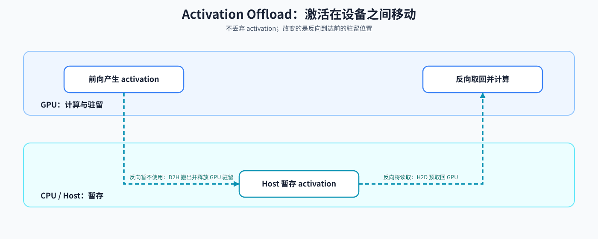
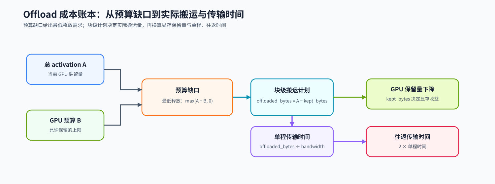
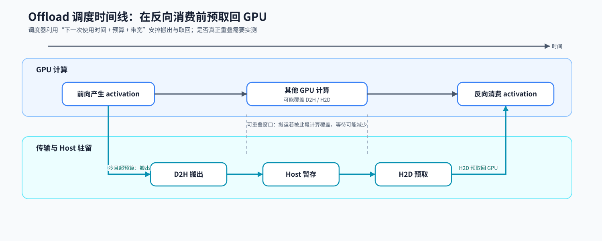

# 42. Activation Offload | 激活卸载

**难度：** Hard | **环境：** [CPU 主线，GPU 可选](#runtime-environment) | **标签：** `显存优化`, `激活值`, `Offload` | **目标人群：** 显存优化学习者

> 🚀 **云端运行环境**
>
> 本章节的实战代码可以点击以下链接在免费 GPU 算力平台上直接运行：
>
> [](https://colab.research.google.com/github/datawhalechina/llm-algo-leetcode/blob/main/02_PyTorch_Algorithms/42_Activation_Offload.ipynb)
> [](https://modelscope.cn/my/mynotebook) *(国内推荐：魔搭社区免费实例)*


---

## 本节导读

训练前向会在 GPU 上产生供反向使用的 activation。当这些中间状态接近显存预算时，activation offload 可以把暂时不用的状态移到 CPU 或 host memory，并在反向需要时取回；GPU 显存压力因而下降，但数据搬运进入训练关键路径。

本节从 activation 的设备间生命周期出发，先判断哪些状态值得搬出，再将搬运量换算为传输时间，最后完成一个预算与策略判断的 CPU 实现。可选 GPU 复测会在固定 workload 下记录显存、搬运量、时间与梯度一致性；跨对象的统一训练内存账本留到 43 节。

**关键词：** `offload`, `transfer`, `bandwidth`

---

<a id="runtime-environment"></a>

## 运行环境

- **基础练习：** 默认使用 [`BASE-CPU`](../guide.md#base-cpu)，运行 [Step 4 的题目与测试](#mechanism-practice)。
- **框架核对：** 使用 [`TRAIN-CPU`](../topic_discussion/backpropagation_training_mechanism/quickstart.md#train-cpu-quickstart)，完成 Step 4 后运行 [框架一致性核对](#framework-check)。
- **GPU 实测：** 使用 `TRAIN-CUDA-MECHANISM`，按 [Step 5](#gpu-experiment) 的说明配置并运行。

---
## 前置阅读

**导语：** 阅读本节前，先确认你能说清 activation 为什么会在反向阶段被使用，以及 checkpoint 如何以重算减少 activation 驻留；本节将在同一训练链路中把代价从额外计算改为设备间搬运。

- [09. Activation and Loss Backward | 激活与损失反向](./09_Activation_and_Loss_Backward.md)：理解 activation 如何参与反向传播。
- [19. Activation Checkpointing | 激活检查点](./19_Activation_Checkpointing.md)：对照另一条“以重算换驻留”的激活策略。
- [Part 01 · 03. GPU 物理架构与内存层级](../01_Hardware_Math_and_Systems/03_GPU_Architecture_and_Memory.md)：回顾 GPU 与 host 之间的数据路径和带宽层级。

---
## Step 1：Activation Offload 如何改变激活的生命周期

Activation offload 处理的是“反向仍需要、当前暂不使用”的 activation：前向后将它从 GPU 移到 CPU 或 host memory，反向到达对应位置时再取回 GPU。activation 在整个训练过程中仍可供反向读取，变化的是它从 GPU 到 host、再回到 GPU 的驻留位置。

以一个连续模型 Block 串为例，前向产生的 activation 先位于 GPU。这里的“冷”指反向再次读取它之前，还会经过较长一段计算；被选中的冷 activation 因而可以在等待期间暂存于 host。下表对照两条降低 GPU 驻留的路径，主图呈现 offload 的设备间移动。

| 生命周期阶段 | Checkpointing：以重算换驻留 | Offload：以搬运换驻留 | 主要代价 |
| --- | --- | --- | --- |
| 前向产生后 | 保存 segment 边界 | 将冷 activation 从 GPU 搬到 host | GPU 驻留下降；D2H 搬运 |
| 等待反向时 | 区段内部 activation 不驻留 | activation 暂存在 host | 重算范围；host 内存占用 |
| 反向需要时 | 重算对应 segment | 将 activation 预取回 GPU | 重算计算量；H2D 与等待 |



## Step 2：搬运量如何转化为时间代价

Offload 是否值得，先取决于必须释放多少 GPU 空间，再取决于搬出和搬回这些状态会暴露多少等待。设当前 activation 总驻留量为 $C_{total}$、GPU activation 预算为 $C_{budget}$，最低释放量为

$$
C_{release}=\max(C_{total}-C_{budget},0).
$$

实际策略通常按 activation 块选择对象，因此实际搬运量 $D$ 可能大于 $C_{release}$。若有效单向带宽为 $W$ 字节每秒、可被计算覆盖的时间为 $T_{overlap}$，理论往返时间和暴露时间为

$$
T_{round}=\frac{2D}{W},\qquad
T_{exposed}=\max(T_{round}-T_{overlap},0).
$$

容量账本用 $C_{release}$ 和 $D$ 判断能否回到预算内，时间账本用 $T_{round}$ 与 $T_{exposed}$ 区分总搬运代价和真正落在关键路径上的等待。真实值还会受到同步、预取时机和链路波动影响。

| 账本量 | 计算关系 | 它说明什么 | 后续用途 |
| --- | --- | --- | --- |
| 最低释放量 $C_{release}$ | $\max(C_{total}-C_{budget},0)$ | 至少需要释放多少 GPU 空间 | 判断是否需要改变 activation 驻留 |
| 实际搬运量 $D$ | 被选中 activation 块的容量之和 | 当前计划实际移走多少状态 | 核对容量可行性并估算传输时间 |
| 往返时间 $T_{round}$ | $2D/W$ | 不考虑重叠时的搬出与搬回代价 | 与可重叠计算窗口比较 |
| 暴露时间 $T_{exposed}$ | $\max(T_{round}-T_{overlap},0)$ | 可能进入训练关键路径的等待 | 与显存收益共同参与策略判断 |



## Step 3：如何选择驻留对象并做预算决策

真实训练中的 offload 调度器会结合状态何时再被反向读取、链路带宽和可用 host 内存，决定何时搬出、何时预取回 GPU，并尽量让搬运与计算重叠。本节先从可搬运且距下一次使用较远的 activation 中选择候选，再检查搬出后是否回到 GPU 预算内；`reuse_delay_layers` 只是近似冷热程度的教学字段。

预算可行不等于值得采用：还要将节省比例与理论传输时间一起判断。下面的表格把候选选择、容量核对、搬运估算和策略输出组织为同一条决策链。

| 决策环节 | 需要回答的问题 | 本题中的观察量 | 读数如何解释 |
| --- | --- | --- | --- |
| 选择对象 | 哪些激活距离下一次使用较远，且允许搬运？ | 激活冷热程度、是否允许搬运 | 越冷越适合优先评估，但不等于真实调度顺序 |
| 计算容量 | 搬出后 GPU 是否回到预算内？ | 保留量、超预算量 | 仍然超预算表示当前计划不可行 |
| 计算搬运 | 为释放空间需要搬多少数据、多久？ | 搬运量、单程与往返理论时间 | 不包含重叠、同步与真实链路波动 |
| 输出策略 | 节省比例和传输代价是否达到教学阈值？ | 可行性、节省比例、策略判断 | 输出当前预算模型下的 `accept / tune / reject` |



<a id="mechanism-practice"></a>

## Step 4：实现 activation 选择与搬运预算

题目区提供激活块、候选排序和 checkpoint 对照骨架。学习者完成实际搬出量、理论往返时间和 offload 策略三个机制；测试分别覆盖容量预算、单位换算、非法带宽以及 `accept / tune / reject`。

| TODO / 函数 | 学习者完成的机制 | 必须满足的约束 | 测试证据 |
|---|---|---|---|
| TODO 1 · `summarize_activation_offload` | 计算预算下实际搬出的 activation 字节数 | 搬出量来自总驻留量与保留量之差 | 预算可行性、候选顺序与尾部压力 |
| TODO 2 · `estimate_round_trip_transfer_ms` | 将搬运字节和带宽换算为往返时间 | 统一 GiB/s 与 ms，拒绝非法带宽 | 零值、单位换算与异常输入 |
| TODO 3 · `recommend_offload_policy` | 联合容量收益与搬运代价形成策略 | 先判断预算可行性，再区分采用、调优和拒绝 | 三类决策及阈值边界 |

```python
from dataclasses import dataclass
```


```python
@dataclass
class ActivationChunkSpec:
    """描述一个用于预算模拟的激活块。

    这里只记录选择依据和理论大小，不代表真实 CUDA tensor，也不包含 pinned memory、
    异步拷贝或实际生命周期。"""
    name: str  # 激活块名称，便于解释最终搬出/保留了谁
    bytes_: int  # 激活块大小，单位 byte
    reuse_delay_layers: int  # 距离下一次使用的预计层数，越大越冷
    offloadable: bool = True  # 是否允许本策略搬出

@dataclass
class ActivationOffloadSummary:
    """记录一次 offload 预算计划的容量、传输和可行性结果。

    `transfer_ms` 是单程理论时间；真实训练还要测量搬回、同步和重叠。
    `feasible` 只表示当前不可搬运状态没有超过 GPU 激活预算。"""
    total_bytes: int
    gpu_budget_bytes: int
    kept_bytes: int
    offloaded_bytes: int
    transfer_ms: float
    pressure_ratio: float
    saved_ratio: float
    offloaded_names: list
    kept_names: list
    feasible: bool
    overflow_bytes: int


def summarize_activation_offload(chunks, gpu_budget_bytes, bandwidth_gbps=12.0):
    """汇总一次 activation offload 预算计划，不执行真实 tensor 搬运。

    Args:
        chunks: ActivationChunkSpec 或等价 dict 的序列。
        gpu_budget_bytes: 允许保留在 GPU 的 activation 预算，单位 byte。
        bandwidth_gbps: 理论有效带宽，代码按 GiB/s 解释。

    Returns:
        ActivationOffloadSummary；feasible 表示不可搬运对象也没有超预算。
    """
    if gpu_budget_bytes <= 0:
        raise ValueError("gpu_budget_bytes must be positive")
    if bandwidth_gbps <= 0:
        raise ValueError("bandwidth_gbps must be positive")

    normalized = []
    for c in chunks:
        if isinstance(c, ActivationChunkSpec):
            normalized.append(c)
        elif isinstance(c, dict):
            normalized.append(ActivationChunkSpec(**c))
        else:
            raise TypeError("chunks must contain ActivationChunkSpec or dict")

    names = [c.name for c in normalized]
    if len(names) != len(set(names)):
        raise ValueError("chunk names must be unique")
    if any(c.bytes_ < 0 for c in normalized):
        raise ValueError("chunk bytes must be non-negative")
    if any(c.reuse_delay_layers < 0 for c in normalized):
        raise ValueError("reuse_delay_layers must be non-negative")

    total_bytes = sum(c.bytes_ for c in normalized)
    kept_bytes = total_bytes
    offloaded_names = []

    candidates = sorted(
        [c for c in normalized if c.offloadable],
        key=lambda c: (-c.reuse_delay_layers, -c.bytes_, c.name),
    )

    for chunk in candidates:
        if kept_bytes <= gpu_budget_bytes:
            break
        kept_bytes -= chunk.bytes_
        offloaded_names.append(chunk.name)

    kept_names = [c.name for c in normalized if c.name not in offloaded_names]

    # ==========================================
    # TODO 1：计算实际搬出量
    # 作用：用搬出前后的 GPU 驻留量得到本次计划转移的字节数。
    # offloaded_bytes = ???  # total_bytes 与 kept_bytes 的差
    # ==========================================
    overflow_bytes = max(kept_bytes - gpu_budget_bytes, 0)
    feasible = overflow_bytes == 0
    raise NotImplementedError("TODO 1：请计算 offloaded_bytes")
    transfer_ms = offloaded_bytes / (bandwidth_gbps * (1024 ** 3)) * 1000 if offloaded_bytes else 0.0
    pressure_ratio = total_bytes / gpu_budget_bytes
    saved_ratio = offloaded_bytes / total_bytes if total_bytes else 0.0

    return ActivationOffloadSummary(
        total_bytes=total_bytes,
        gpu_budget_bytes=gpu_budget_bytes,
        kept_bytes=kept_bytes,
        offloaded_bytes=offloaded_bytes,
        transfer_ms=round(transfer_ms, 2),
        pressure_ratio=round(pressure_ratio, 3),
        saved_ratio=round(saved_ratio, 3),
        offloaded_names=offloaded_names,
        kept_names=kept_names,
        feasible=feasible,
        overflow_bytes=overflow_bytes,
    )


def estimate_round_trip_transfer_ms(offloaded_bytes: int, bandwidth_gbps: float):
    """估算 activation 搬出 GPU 再搬回的理论时间，不执行真实 copy。

    Args:
        offloaded_bytes: 单次搬运的数据量，单位 byte。
        bandwidth_gbps: 假设有效带宽，代码按 GiB/s 解释。

    Returns:
        搬出加搬回的理论时间，单位 ms；不包含同步和重叠效果。"""
    if offloaded_bytes < 0:
        raise ValueError("offloaded_bytes must be non-negative")
    if bandwidth_gbps <= 0:
        raise ValueError("bandwidth_gbps must be positive")

    # ==========================================
    # TODO 2: 计算往返搬运时间
    # 作用：把一次搬出和一次搬回的理论代价合并为毫秒。
    # 输入：offloaded_bytes（单程数据量，byte）和 bandwidth_gbps（按 GiB/s 解释）。
    # 计算：单程为 bytes / (bandwidth_gbps * 2**30)，往返乘以 2；输入为 0 时返回 0.0。
    # one_way_ms = ???  # 单程理论时间，单位 ms
    # return_ms = ???   # 搬出加搬回的理论时间，单位 ms
    # ==========================================
    return round(return_ms, 2)


def recommend_offload_policy(summary: ActivationOffloadSummary, min_saved_ratio=0.25, max_transfer_ms=60.0):
    """根据教学阈值返回策略建议。

    Args:
        summary: summarize_activation_offload 返回的预算摘要。
        min_saved_ratio: 教学用最低显存节省比例。
        max_transfer_ms: 教学用单程理论传输时间上限。

    Returns:
        'accept'、'tune' 或 'reject'；不代表真实工程决策。
    """
    if summary.offloaded_bytes <= 0:
        return "reject"
    if min_saved_ratio < 0 or max_transfer_ms < 0:
        raise ValueError("policy thresholds must be non-negative")

    if not summary.feasible:
        return "reject"
    # ==========================================
    # TODO 3: 补全策略判断逻辑
    # 作用：根据预算可行性、显存节省比例和理论传输时间输出策略建议。
    # 顺序：先 reject 不可行或无收益方案；再判断严格阈值 accept；最后判断放宽阈值 tune，其余 reject。
    # 输出：只能是 accept、tune 或 reject；这是教学决策，不是真实 GPU 结论。
    # ==========================================
    # meets_strict = ???  # 同时满足节省比例与单程传输时间的严格阈值
    # meets_relaxed = ??? # 同时满足放宽后节省比例与传输时间阈值
    # if meets_strict:
    #     return "accept"
    # if meets_relaxed:
    #     return "tune"

    return "reject"


def compare_offload_vs_checkpointing(offload_summary: ActivationOffloadSummary, checkpoint_saved_bytes, checkpoint_extra_ms):
    """用理论节省字节数除以理论额外代价做教学比较。

    Args:
        offload_summary: offload 预算摘要。
        checkpoint_saved_bytes: checkpoint 理论节省字节数。
        checkpoint_extra_ms: checkpoint 理论额外时间，单位 ms。

    Returns:
        包含两种 score 和 preferred 的字典；不替代真实 benchmark。
    """
    if checkpoint_saved_bytes < 0 or checkpoint_extra_ms < 0:
        raise ValueError("checkpoint values must be non-negative")
    # 对照函数已完整给出：它只统一两条路线的教学成本口径。
    offload_score = offload_summary.offloaded_bytes / max(offload_summary.transfer_ms, 1e-6)
    checkpoint_score = checkpoint_saved_bytes / max(checkpoint_extra_ms, 1e-6)
    preferred = "offload" if offload_score >= checkpoint_score else "checkpointing"
    return {
        "offload_score": round(offload_score, 3),
        "checkpoint_score": round(checkpoint_score, 3),
        "preferred": preferred,
    }

```

## 测试

运行下方 CPU 机制测试，检查 offload 候选选择、预算与传输账本、策略判断和 checkpoint 对照是否一致。

```python
# 测试设计：以同一组 activation 元数据验证四段机制链。
# TODO 1 容量变化 → TODO 2 往返时间 → TODO 3 策略分支；最后检查完整给出的 checkpoint 对照。


def build_activation_fixture():
    """返回所有机制测试共用的 activation 元数据。"""
    return [
        ActivationChunkSpec("embed", 256 * 1024 * 1024, 0),
        ActivationChunkSpec("mid_a", 192 * 1024 * 1024, 2),
        ActivationChunkSpec("mid_b", 160 * 1024 * 1024, 3),
        ActivationChunkSpec("tail", 128 * 1024 * 1024, 1),
    ]


def test_offload_ledger(chunks):
    """TODO 1：验证候选顺序、容量账本与输入契约。"""
    summary = summarize_activation_offload(
        chunks, gpu_budget_bytes=384 * 1024 * 1024, bandwidth_gbps=8.0
    )
    assert summary.total_bytes == 736 * 1024 * 1024
    assert summary.offloaded_bytes == 352 * 1024 * 1024
    assert summary.kept_bytes == 384 * 1024 * 1024
    assert summary.offloaded_names == ["mid_b", "mid_a"]
    assert summary.kept_names == ["embed", "tail"]
    assert 42.0 < summary.transfer_ms < 44.0
    assert summary.pressure_ratio == 1.917
    assert 0.47 < summary.saved_ratio < 0.49

    zero_total = summarize_activation_offload([], gpu_budget_bytes=1024, bandwidth_gbps=8.0)
    assert zero_total.total_bytes == 0
    assert zero_total.pressure_ratio == 0.0
    assert zero_total.saved_ratio == 0.0

    blocked = summarize_activation_offload(
        [ActivationChunkSpec("fixed", 512 * 1024 * 1024, 0, offloadable=False)],
        gpu_budget_bytes=256 * 1024 * 1024,
        bandwidth_gbps=8.0,
    )
    assert blocked.feasible is False
    assert blocked.overflow_bytes == 256 * 1024 * 1024

    invalid_specs = [
        [ActivationChunkSpec("bad", -1, 0)],
        [ActivationChunkSpec("bad", 1, -1)],
        [ActivationChunkSpec("dup", 1, 0), ActivationChunkSpec("dup", 1, 1)],
    ]
    for invalid in invalid_specs:
        try:
            summarize_activation_offload(invalid, gpu_budget_bytes=1, bandwidth_gbps=1.0)
        except ValueError:
            pass
        else:
            raise AssertionError("invalid activation metadata should be rejected")
    return summary, blocked


def test_round_trip_cost(summary):
    """TODO 2：验证单程字节量到往返时间的换算。"""
    assert estimate_round_trip_transfer_ms(summary.offloaded_bytes, 8.0) == 85.94
    assert estimate_round_trip_transfer_ms(0, 8.0) == 0.0
    for args in [(-1, 8.0), (1, 0.0)]:
        try:
            estimate_round_trip_transfer_ms(*args)
        except ValueError:
            pass
        else:
            raise AssertionError("invalid transfer input should be rejected")


def test_offload_policy(chunks, summary, blocked):
    """TODO 3：验证 accept、tune、reject 三条策略分支。"""
    assert recommend_offload_policy(summary) == "accept"
    assert recommend_offload_policy(blocked) == "reject"

    tuned = summarize_activation_offload(
        chunks, gpu_budget_bytes=384 * 1024 * 1024, bandwidth_gbps=4.0
    )
    rejected = summarize_activation_offload(
        chunks, gpu_budget_bytes=384 * 1024 * 1024, bandwidth_gbps=1.0
    )
    empty = summarize_activation_offload(
        chunks, gpu_budget_bytes=1024 * 1024 * 1024, bandwidth_gbps=8.0
    )
    assert recommend_offload_policy(tuned) == "tune"
    assert recommend_offload_policy(rejected) == "reject"
    assert empty.offloaded_bytes == 0
    assert recommend_offload_policy(empty) == "reject"

    for kwargs in [{"min_saved_ratio": -0.1}, {"max_transfer_ms": -1.0}]:
        try:
            recommend_offload_policy(summary, **kwargs)
        except ValueError:
            pass
        else:
            raise AssertionError("negative policy thresholds should be rejected")


def test_offload_vs_checkpointing(summary):
    """验证完整给出的对照函数采用同一教学成本口径。"""
    better_offload = compare_offload_vs_checkpointing(
        summary, checkpoint_saved_bytes=300 * 1024 * 1024, checkpoint_extra_ms=80.0
    )
    better_ckpt = compare_offload_vs_checkpointing(
        summary, checkpoint_saved_bytes=500 * 1024 * 1024, checkpoint_extra_ms=20.0
    )
    assert better_offload["preferred"] == "offload"
    assert better_ckpt["preferred"] == "checkpointing"

    for args in [(summary, -1, 10.0), (summary, 100, -1.0)]:
        try:
            compare_offload_vs_checkpointing(*args)
        except ValueError:
            pass
        else:
            raise AssertionError("negative checkpoint values should be rejected")


def run_activation_offload_tests():
    """按机制顺序运行容量、传输、策略和路线对照测试。"""
    try:
        chunks = build_activation_fixture()
        summary, blocked = test_offload_ledger(chunks)
        test_round_trip_cost(summary)
        test_offload_policy(chunks, summary, blocked)
        test_offload_vs_checkpointing(summary)
    except NotImplementedError:
        print("请先完成 TODO 部分的代码！")
        raise
    except Exception as error:
        print(f"❌ 测试失败: {error}")
        raise
    print("✅ CPU 机制测试通过：容量账本、传输时间、策略分支与 checkpoint 对照均符合预期。")


run_activation_offload_tests()
```

## 参考代码与解析

### 代码

```python
@dataclass
class ActivationChunkSpec:
    name: str  # 激活块名称，便于解释最终搬出/保留了谁
    bytes_: int  # 激活块大小，单位 byte
    reuse_delay_layers: int  # 距离下一次使用的预计层数，越大越冷
    offloadable: bool = True  # 是否允许本策略搬出

@dataclass
class ActivationOffloadSummary:
    """记录一次 offload 预算计划的容量、传输和可行性结果。

    `transfer_ms` 是单程理论时间；真实训练还要测量搬回、同步和重叠。
    `feasible` 只表示当前不可搬运状态没有超过 GPU 激活预算。"""
    total_bytes: int
    gpu_budget_bytes: int
    kept_bytes: int
    offloaded_bytes: int
    transfer_ms: float
    pressure_ratio: float
    saved_ratio: float
    offloaded_names: list
    kept_names: list
    feasible: bool
    overflow_bytes: int


def summarize_activation_offload(chunks, gpu_budget_bytes, bandwidth_gbps=12.0):
    """汇总一次 activation offload 预算计划，不执行真实 tensor 搬运。

    Args:
        chunks: ActivationChunkSpec 或等价 dict 的序列。
        gpu_budget_bytes: GPU activation 预算，单位 byte。
        bandwidth_gbps: 理论有效带宽，代码按 GiB/s 解释。

    Returns:
        ActivationOffloadSummary；feasible 表示最终保留量未超过预算。
    """
    if gpu_budget_bytes <= 0:
        raise ValueError("gpu_budget_bytes must be positive")
    if bandwidth_gbps <= 0:
        raise ValueError("bandwidth_gbps must be positive")

    normalized = []
    for c in chunks:
        if isinstance(c, ActivationChunkSpec):
            normalized.append(c)
        elif isinstance(c, dict):
            normalized.append(ActivationChunkSpec(**c))
        else:
            raise TypeError("chunks must contain ActivationChunkSpec or dict")

    names = [c.name for c in normalized]
    if len(names) != len(set(names)):
        raise ValueError("chunk names must be unique")
    if any(c.bytes_ < 0 for c in normalized):
        raise ValueError("chunk bytes must be non-negative")
    if any(c.reuse_delay_layers < 0 for c in normalized):
        raise ValueError("reuse_delay_layers must be non-negative")

    total_bytes = sum(c.bytes_ for c in normalized)
    kept_bytes = total_bytes
    offloaded_names = []

    candidates = sorted(
        [c for c in normalized if c.offloadable],
        key=lambda c: (-c.reuse_delay_layers, -c.bytes_, c.name),
    )

    for chunk in candidates:
        if kept_bytes <= gpu_budget_bytes:
            break
        kept_bytes -= chunk.bytes_
        offloaded_names.append(chunk.name)

    kept_names = [c.name for c in normalized if c.name not in offloaded_names]

    # ==========================================
    # TODO 1（容量变化）：计算选择前后减少的 GPU 驻留字节。
    overflow_bytes = max(kept_bytes - gpu_budget_bytes, 0)
    feasible = overflow_bytes == 0
    # TODO 1：计算实际搬出的 activation 字节数。
    offloaded_bytes = total_bytes - kept_bytes
    transfer_ms = offloaded_bytes / (bandwidth_gbps * (1024 ** 3)) * 1000 if offloaded_bytes else 0.0
    pressure_ratio = total_bytes / gpu_budget_bytes
    saved_ratio = offloaded_bytes / total_bytes if total_bytes else 0.0

    return ActivationOffloadSummary(
        total_bytes=total_bytes,
        gpu_budget_bytes=gpu_budget_bytes,
        kept_bytes=kept_bytes,
        offloaded_bytes=offloaded_bytes,
        transfer_ms=round(transfer_ms, 2),
        pressure_ratio=round(pressure_ratio, 3),
        saved_ratio=round(saved_ratio, 3),
        offloaded_names=offloaded_names,
        kept_names=kept_names,
        feasible=feasible,
        overflow_bytes=overflow_bytes,
    )


def estimate_round_trip_transfer_ms(offloaded_bytes: int, bandwidth_gbps: float):
    """估算 activation 搬出 GPU 再搬回的理论时间，不执行真实 copy。

    Args:
        offloaded_bytes: 单次搬运的数据量，单位 byte。
        bandwidth_gbps: 假设有效带宽，代码按 GiB/s 解释。

    Returns:
        搬出加搬回的理论时间，单位 ms；不包含同步和重叠效果。"""
    if offloaded_bytes < 0:
        raise ValueError("offloaded_bytes must be non-negative")
    if bandwidth_gbps <= 0:
        raise ValueError("bandwidth_gbps must be positive")
    # TODO 2: 计算往返搬运时间
    # 先计算单程时间，再将搬出和搬回两次代价合并为 return_ms。
    one_way_ms = offloaded_bytes / (bandwidth_gbps * (1024 ** 3)) * 1000
    # TODO 2：合并一次搬出与一次搬回的理论时间。
    return_ms = 2 * one_way_ms
    return round(return_ms, 2)


def recommend_offload_policy(summary: ActivationOffloadSummary, min_saved_ratio=0.25, max_transfer_ms=60.0):
    """根据教学阈值返回策略建议。

    Args:
        summary: summarize_activation_offload 返回的预算摘要。
        min_saved_ratio: 教学用最低显存节省比例。
        max_transfer_ms: 教学用单程理论传输时间上限。

    Returns:
        'accept'、'tune' 或 'reject'；不代表真实工程决策。
    """
    if summary.offloaded_bytes <= 0:
        return "reject"
    if min_saved_ratio < 0 or max_transfer_ms < 0:
        raise ValueError("policy thresholds must be non-negative")

    # ==========================================
    # TODO 3: 补全策略判断逻辑
    # 顺序：先 reject 不可行或无收益方案，再判断严格阈值 accept，最后判断放宽阈值 tune。
    # ==========================================
    if not summary.feasible:
        return "reject"
    # TODO 3：判断是否同时满足节省比例与单程传输时间的严格阈值。
    meets_strict = (
        summary.kept_bytes <= summary.gpu_budget_bytes
        and summary.saved_ratio >= min_saved_ratio
        and summary.transfer_ms <= max_transfer_ms
    )
    if meets_strict:
        return "accept"
    # TODO 3：判断收益或传输代价接近阈值的待调优方案。
    meets_relaxed = summary.saved_ratio >= min_saved_ratio / 2 and summary.transfer_ms <= max_transfer_ms * 2
    if meets_relaxed:
        return "tune"

    return "reject"


def compare_offload_vs_checkpointing(offload_summary: ActivationOffloadSummary, checkpoint_saved_bytes, checkpoint_extra_ms):
    """用理论节省字节数除以理论额外代价做教学比较。

    Args:
        offload_summary: offload 预算摘要。
        checkpoint_saved_bytes: checkpoint 理论节省字节数。
        checkpoint_extra_ms: checkpoint 理论额外时间，单位 ms。

    Returns:
        包含两种 score 和 preferred 的字典；不替代真实 benchmark。
    """
    if checkpoint_saved_bytes < 0 or checkpoint_extra_ms < 0:
        raise ValueError("checkpoint values must be non-negative")
    # 完整对照：比较两条路线的“理论节省字节数 / 理论额外时间” score。
    # 该 score 仅用于当前模拟配置排序，不等于真实吞吐或端到端收益。
    offload_score = offload_summary.offloaded_bytes / max(offload_summary.transfer_ms, 1e-6)
    checkpoint_score = checkpoint_saved_bytes / max(checkpoint_extra_ms, 1e-6)
    preferred = "offload" if offload_score >= checkpoint_score else "checkpointing"
    return {
        "offload_score": round(offload_score, 3),
        "checkpoint_score": round(checkpoint_score, 3),
        "preferred": preferred,
    }
```

### 解析

#### TODO 1：计算实际搬出量

- 用 `total_bytes - kept_bytes` 得到本次计划搬出的 activation 字节数。
- 单程 `transfer_ms`、预算压力和节省比例由骨架统一计算，学习者只负责选择结果对应的容量变化。

#### TODO 2：估算往返搬运时间

- 单程时间由字节数除以 GiB/s 带宽得到，搬出与搬回各发生一次，因此往返时间约为单程的两倍。
- 这里不包含 pinned memory、异步 copy、传输重叠或同步调度。

#### TODO 3：形成预算策略

- 先拒绝没有搬出 activation 或仍超预算的计划，再用节省比例与理论传输时间区分 `accept`、`tune` 与 `reject`。

#### Checkpoint 对照：统一成本口径

- 两条路线均使用“理论节省字节数 / 理论额外时间”的分数排序。
- 该分数用于比较当前配置下的容量—时间交换，不单独决定最终采用策略。
<a id="framework-check"></a>

## 框架一致性核对（可选）

下面在同一输入和计算图上比较普通反向与 PyTorch `saved_tensors_hooks` 替换路径，核对保存张量是否经过 pack/unpack，以及替换后输出和梯度是否保持一致。

| 核对对象 | 本节实现 | 成熟框架入口 | 通过条件 |
| --- | --- | --- | --- |
| 保存状态入口 | activation 候选与搬运账本 | `torch.autograd.graph.saved_tensors_hooks` | 至少捕获一个反向保存张量，且 pack/unpack 次数一致 |
| 保存容量 | activation 字节数汇总 | hook 中的 `numel × element_size` | 捕获字节数为正，并与记录逐项求和一致 |
| 计算语义 | resident 路径输出与梯度 | hook 替换保存张量后的输出与梯度 | 相同输入下输出和输入梯度一致 |

```python
from importlib.metadata import version

import torch


def check_activation_offload_framework_conformance():
    """核对 saved-tensor hook 的保存入口、字节账本与反向语义。"""
    torch.manual_seed(42)
    weight = torch.randn(8, 8)
    resident_input = torch.randn(4, 8, requires_grad=True)
    hooked_input = resident_input.detach().clone().requires_grad_(True)

    def workload(value):
        hidden = torch.tanh(value @ weight)
        return hidden.square().mean()

    resident_loss = workload(resident_input)
    resident_loss.backward()

    packed_bytes = []
    unpacked_bytes = []

    def pack_hook(tensor):
        byte_count = tensor.numel() * tensor.element_size()
        packed_bytes.append(byte_count)
        return tensor.detach().cpu().clone()

    def unpack_hook(payload):
        unpacked_bytes.append(payload.numel() * payload.element_size())
        return payload

    with torch.autograd.graph.saved_tensors_hooks(pack_hook, unpack_hook):
        hooked_loss = workload(hooked_input)
        hooked_loss.backward()

    checks = {
        'saved_tensors_observed': len(packed_bytes) > 0,
        'pack_unpack_count_match': len(packed_bytes) == len(unpacked_bytes),
        'saved_bytes_match': sorted(packed_bytes) == sorted(unpacked_bytes) and sum(packed_bytes) > 0,
        'output_match': bool(torch.allclose(resident_loss, hooked_loss, atol=1e-7, rtol=1e-6)),
        'input_gradient_match': bool(torch.allclose(resident_input.grad, hooked_input.grad, atol=1e-7, rtol=1e-6)),
    }
    failed = [name for name, passed in checks.items() if not passed]
    if failed:
        raise AssertionError(f'框架一致性核对失败：{failed}')
    return {
        'status': 'passed',
        'check_kind': 'framework_conformance',
        'versions': {'torch': version('torch')},
        'checks': checks,
        'saved_tensor_count': len(packed_bytes),
        'saved_bytes': sum(packed_bytes),
    }


framework_check = check_activation_offload_framework_conformance()
framework_check
```

<a id="gpu-experiment"></a>

## Step 5：可选 GPU 实验——Activation Offload 显存—时间对照

CPU 题目确认容量账本、传输时间和策略门槛；GPU 实验进一步比较 activation 驻留与 saved-tensor hook 搬运路径的梯度、峰值显存、传输量和训练 step 时间。

| 学习问题 | CPU 已确认 | GPU 要确认与后续使用 |
| --- | --- | --- |
| 激活卸载能否用可接受的搬运时间降低真实 GPU 峰值 | 可卸载容量、理论往返时间和策略门槛 | 保存状态是否真实发生 D2H/H2D、输出/梯度是否一致，以及容量收益是否覆盖同步搬运代价；结果可进入组合策略复测 |

#### 5.1 环境与固定工作负载

本实验使用 `TRAIN-CUDA-MECHANISM`。首次运行先完成[专题 Quickstart](../topic_discussion/backpropagation_training_mechanism/quickstart.md#train-cuda-mechanism-quickstart)，已有环境需先通过同名 Profile 预检。本页下载固定的 Qwen2.5-0.5B checkpoint，以固定文本构造训练批次，不下载外部数据集。

| 配置层 | 本节固定口径 | 修改规则 |
| --- | --- | --- |
| 运行环境 | 单张 CUDA GPU；`TRAIN-CUDA-MECHANISM`；CPU 可接收卸载张量 | Profile 预检未返回 `status=ok` 时停止实验 |
| 资源档位 | 建议至少 8 GiB GPU 与 16 GiB 主机内存 | resident 与 offload 都必须成功；显存或内存不足时依次减小序列长度和 batch，并使用新标签 |
| 工作负载 | `Qwen/Qwen2.5-0.5B`；batch 2；序列长度 512 | 改变模型、commit、长度或重复次数后使用新的运行标签 |
| 配对变量 | GPU 驻留 → 非参数反向保存张量同步卸载到 CPU | 共用模型状态、输入、dtype、损失和随机种子 |
| 测量方法 | loss/全局梯度范数差异；D2H/H2D；step median/P95；峰值显存 | 先过正确性门槛，再解释容量与搬运代价 |
| 结果资产 | `benchmarks/results/train_activation_offload/<semantic_id>_<run_label>.json` | 正式复测使用唯一标签并保留旧结果 |


```python
RUN_MODE = "dry_run"  # 默认值 dry_run：只核对配置；改为 real_gpu 执行真实 GPU 矩阵。
RUN_LABEL = "default"  # 默认值 default；正式复测改为唯一标签，已验证结果使用 b2s512_default1。
PROFILE_ID = "TRAIN-CUDA-MECHANISM"  # 默认环境 Profile；本节不支持与其他专题环境混装。
SEMANTIC_ID = "TRAIN-OFFLOAD"  # 默认稳定机制 ID；结果聚合与跨页引用均使用该值。
MODEL_ID = "Qwen/Qwen2.5-0.5B"  # 默认真实模型；四节共用同一 checkpoint。
MODEL_REVISION = "main"  # 默认请求主分支；5.2 会解析并记录不可变 commit。
LOCAL_FILES_ONLY = False  # 默认值 False：允许首次下载；确认相同 commit 已缓存后可改为 True。
GPU_CONFIG = {
    "dtype": "bfloat16", # 默认值 bfloat16；降低直接 FP16 反向的溢出风险。
    "batch_size": 2,      # 默认值 2；与序列 512 共同放大保存状态压力。
    "seq_len": 512,       # 默认值 512 Token；用于观察同步卸载的容量—时间交换。
    "warmup": 1,          # 默认值 1；不计入统计的预热轮数。
    "repeats": 20,        # 默认值 20；用于稳定比较 median 与 P95。
    "min_memory_reduction_mb": 32.0,  # 至少减少 32 MB，排除 allocator 微小波动。
    "min_memory_reduction_ratio": 0.01, # 至少降低 1%，才视为可用容量收益。
    "max_median_time_ratio": 2.0,       # 候选 median 不超过基线 2 倍，才通过性能门槛。
    "seed": 42,           # 默认值 42；固定模型初始化与输入。
    "prompts": ["Explain activation offload between GPU and CPU."],  # 固定训练文本。
}
RESULTS_RELATIVE_DIR = "benchmarks/results/train_activation_offload"  # 默认结果目录；正式结果按 RUN_LABEL 分文件保存。

```

#### 5.2 执行并保存 JSON

运行下方单元会从同一 Qwen checkpoint 分别加载 GPU 驻留与 CPU offload 路径。参数存储保持在 GPU，候选只搬运其余反向保存张量；loss、全局梯度范数、搬运张量数、双向字节量和资源指标写入同一结果 JSON。


```python
from pathlib import Path
import gc
import json
import torch
from tools.project_runtime import resolve_project_root
from tools.training_mechanism_runtime import (
    cuda_hardware_snapshot, gradient_l2_norm, load_causal_lm, median_and_p95, move_batch, prepare_causal_lm_batch,
)

REPO_ROOT = resolve_project_root()
RESULTS_DIR = REPO_ROOT / RESULTS_RELATIVE_DIR

if RUN_MODE == "real_gpu":
    if not torch.cuda.is_available():
        raise RuntimeError('需要 CUDA GPU；无 GPU 时保持 RUN_MODE="dry_run"。')
    DEVICE = torch.device("cuda")
    dtype_map = {"float16": torch.float16, "bfloat16": torch.bfloat16, "float32": torch.float32}
    DTYPE = dtype_map[GPU_CONFIG["dtype"]]
    if DTYPE == torch.bfloat16 and not torch.cuda.is_bf16_supported():
        raise RuntimeError("当前 GPU 不支持 BF16；请改用 float16 或 float32。")
    torch.manual_seed(GPU_CONFIG["seed"])
    torch.cuda.manual_seed_all(GPU_CONFIG["seed"])
    prepared = prepare_causal_lm_batch(
        MODEL_ID, MODEL_REVISION, GPU_CONFIG["prompts"], GPU_CONFIG["batch_size"], GPU_CONFIG["seq_len"],
        local_files_only=LOCAL_FILES_ONLY,
    )
    resolved_commit = prepared.pop("resolved_model_commit")
    resolution_source = prepared.pop("revision_resolution_source")
    tokenizer_class = prepared.pop("tokenizer_class")
    class SavedTensorTransferCounter:
        """搬运非参数的反向保存张量，并记录双向字节数。

        这是教学 hook：同步 copy 便于观察字节与时间，不代表生产 offload 调度。
        """
        def __init__(self, parameter_storage_ptrs):
            self.parameter_storage_ptrs = set(parameter_storage_ptrs)
            self.d2h_bytes = 0
            self.h2d_bytes = 0
            self.offloaded_tensors = 0

        def pack(self, tensor):
            storage_ptr = tensor.untyped_storage().data_ptr()
            if not tensor.is_cuda or tensor.is_leaf or storage_ptr in self.parameter_storage_ptrs:
                return ('resident', tensor, tensor.device, 0)
            bytes_ = tensor.numel() * tensor.element_size()
            self.d2h_bytes += bytes_
            self.offloaded_tensors += 1
            return ('offloaded', tensor.detach().to("cpu", non_blocking=False), tensor.device, bytes_)

        def unpack(self, packed):
            placement, saved_tensor, device, bytes_ = packed
            if placement == 'resident':
                return saved_tensor
            self.h2d_bytes += bytes_
            return saved_tensor.to(device, non_blocking=False)

    def _run_offload_gpu_step(model, batch, use_offload):
        model.zero_grad(set_to_none=True)
        parameter_storage_ptrs = {parameter.untyped_storage().data_ptr() for parameter in model.parameters()}
        counter = SavedTensorTransferCounter(parameter_storage_ptrs)
        torch.cuda.synchronize(DEVICE)
        torch.cuda.reset_peak_memory_stats(DEVICE)
        start, end = torch.cuda.Event(enable_timing=True), torch.cuda.Event(enable_timing=True)
        start.record()
        if use_offload:
            with torch.autograd.graph.saved_tensors_hooks(counter.pack, counter.unpack):
                loss = model(**batch).loss
                loss.backward()
        else:
            loss = model(**batch).loss
            loss.backward()
        end.record()
        torch.cuda.synchronize(DEVICE)
        peak_allocated_mb = torch.cuda.max_memory_allocated(DEVICE) / 2**20
        peak_reserved_mb = torch.cuda.max_memory_reserved(DEVICE) / 2**20
        gradient_norm = gradient_l2_norm(model.parameters())
        return {
            "loss": float(loss.detach()),
            "gradient_l2_norm": gradient_norm,
            "gradient_is_finite": bool(torch.isfinite(torch.tensor(gradient_norm)).item()),
            "step_ms": start.elapsed_time(end),
            "peak_allocated_mb": peak_allocated_mb,
            "peak_reserved_mb": peak_reserved_mb,
            "d2h_mb": counter.d2h_bytes / 2**20,
            "h2d_mb": counter.h2d_bytes / 2**20,
            "offloaded_tensors": counter.offloaded_tensors,
        }

    def _measure_offload_gpu_path(label, use_offload):
        model = load_causal_lm(
            MODEL_ID, resolved_commit, DEVICE, parameter_dtype=DTYPE, local_files_only=LOCAL_FILES_ONLY,
        )
        model.train()
        batch = move_batch(prepared, DEVICE)
        for _ in range(GPU_CONFIG["warmup"]):
            _run_offload_gpu_step(model, batch, use_offload)
        samples = [_run_offload_gpu_step(model, batch, use_offload) for _ in range(GPU_CONFIG["repeats"])]
        last = samples[-1]
        median_ms, p95_ms = median_and_p95([item["step_ms"] for item in samples])
        result = {
            "label": label,
            "step_median_ms": median_ms,
            "step_p95_ms": p95_ms,
            "peak_allocated_mb": max(item["peak_allocated_mb"] for item in samples),
            "peak_reserved_mb": max(item["peak_reserved_mb"] for item in samples),
            "d2h_mb": max(item["d2h_mb"] for item in samples),
            "h2d_mb": max(item["h2d_mb"] for item in samples),
            "offloaded_tensors": max(item["offloaded_tensors"] for item in samples),
            "loss": last["loss"],
            "gradient_l2_norm": last["gradient_l2_norm"],
            "gradient_is_finite": last["gradient_is_finite"],
        }
        del model, batch
        gc.collect(); torch.cuda.empty_cache()
        return result

    GPU_RESULTS = {
        "GPU 驻留": _measure_offload_gpu_path("GPU 驻留", use_offload=False),
        "CPU offload": _measure_offload_gpu_path("CPU offload", use_offload=True),
    }
    baseline, offload = GPU_RESULTS["GPU 驻留"], GPU_RESULTS["CPU offload"]
    loss_abs_diff = abs(baseline["loss"] - offload["loss"])
    gradient_norm_abs_diff = abs(baseline["gradient_l2_norm"] - offload["gradient_l2_norm"])
    for result in GPU_RESULTS.values():
        print(f"{result['label']}: median={result['step_median_ms']:.2f} ms, p95={result['step_p95_ms']:.2f} ms, allocated={result['peak_allocated_mb']:.1f} MB, reserved={result['peak_reserved_mb']:.1f} MB, D2H={result['d2h_mb']:.1f} MB, H2D={result['h2d_mb']:.1f} MB, tensors={result['offloaded_tensors']}")

    def _offload_metrics(result):
        keys = ("step_median_ms", "step_p95_ms", "peak_allocated_mb", "peak_reserved_mb", "d2h_mb", "h2d_mb")
        metrics = {key: round(float(result[key]), 4) for key in keys}
        metrics["offloaded_tensors"] = int(result["offloaded_tensors"])
        metrics["loss"] = round(float(result["loss"]), 6)
        metrics["gradient_l2_norm"] = round(float(result["gradient_l2_norm"]), 6)
        metrics["gradient_is_finite"] = result["gradient_is_finite"]
        return metrics

    memory_reduction_mb = baseline["peak_allocated_mb"] - offload["peak_allocated_mb"]
    memory_reduction_ratio = memory_reduction_mb / max(baseline["peak_allocated_mb"], 1e-12)
    resource_gate_passed = (
        memory_reduction_mb >= GPU_CONFIG["min_memory_reduction_mb"]
        and memory_reduction_ratio >= GPU_CONFIG["min_memory_reduction_ratio"]
    )
    gradient_norm_relative_diff = gradient_norm_abs_diff / max(abs(baseline["gradient_l2_norm"]), 1e-12)
    correctness_passed = (
        baseline["gradient_is_finite"]
        and offload["gradient_is_finite"]
        and loss_abs_diff <= 5e-3
        and gradient_norm_relative_diff <= 1e-3
    )
    transfer_gate_passed = (
        offload["offloaded_tensors"] > 0
        and offload["d2h_mb"] > 0
        and offload["h2d_mb"] > 0
    )
    median_time_ratio = offload["step_median_ms"] / max(baseline["step_median_ms"], 1e-12)
    performance_gate_passed = median_time_ratio <= GPU_CONFIG["max_median_time_ratio"]
    record = {
        "schema_version": "training-mechanism-gpu/v4",
        "semantic_id": SEMANTIC_ID,
        "profile_id": PROFILE_ID,
        "run_label": RUN_LABEL,
        "model": {"id": MODEL_ID, "requested_revision": MODEL_REVISION, "resolved_commit": resolved_commit, "resolution_source": resolution_source, "tokenizer_class": tokenizer_class},
        "workload": GPU_CONFIG,
        "hardware": cuda_hardware_snapshot(),
        "metrics": {"baseline": _offload_metrics(baseline), "candidate": _offload_metrics(offload)},
        "correctness": {"loss_abs_diff": loss_abs_diff, "gradient_norm_abs_diff": gradient_norm_abs_diff, "gradient_norm_relative_diff": gradient_norm_relative_diff, "passed": correctness_passed},
        "transfer_gate": {"offloaded_tensors": offload["offloaded_tensors"], "d2h_mb": offload["d2h_mb"], "h2d_mb": offload["h2d_mb"], "passed": transfer_gate_passed},
        "resource_gate": {"memory_reduction_mb": memory_reduction_mb, "memory_reduction_ratio": memory_reduction_ratio, "passed": resource_gate_passed},
        "performance_gate": {"median_time_ratio": median_time_ratio, "max_median_time_ratio": GPU_CONFIG["max_median_time_ratio"], "passed": performance_gate_passed},
        "failure": None,
        "evidence_level": "real_model_mechanism_benchmark",
        "decision": "accept" if correctness_passed and transfer_gate_passed and resource_gate_passed and performance_gate_passed else ("tune" if correctness_passed and transfer_gate_passed else "reject"),
    }
    RESULTS_DIR.mkdir(parents=True, exist_ok=True)
    RESULT_PATH = RESULTS_DIR / f"{SEMANTIC_ID.lower()}_{RUN_LABEL}.json"
    RESULT_PATH.write_text(json.dumps(record, ensure_ascii=False, indent=2, allow_nan=False), encoding="utf-8")
    print(f"结果已保存：{RESULT_PATH}")
else:
    print('GPU 实验默认关闭；完成 Profile 预检后设置 RUN_MODE="real_gpu"。')

```

#### 5.3 读取结果

读取同一 `RUN_LABEL` 的稳定结果文件；本单元不重新执行模型。先核对证据等级和数值一致性，再比较显存、step time 与 D2H/H2D 搬运量。


```python
if RUN_MODE == "real_gpu":
    result_path = RESULTS_DIR / f"{SEMANTIC_ID.lower()}_{RUN_LABEL}.json"
    if not Path(result_path).is_file():
        raise FileNotFoundError(f"未找到结果，请先运行 5.2：{result_path}")
    record = json.loads(Path(result_path).read_text(encoding="utf-8"))
    baseline_metrics = record["metrics"]["baseline"]
    candidate_metrics = record["metrics"]["candidate"]
    print(f"resident: median={baseline_metrics['step_median_ms']:.2f} ms, p95={baseline_metrics['step_p95_ms']:.2f} ms, {baseline_metrics['peak_allocated_mb']:.1f} MB")
    print(f"offload: median={candidate_metrics['step_median_ms']:.2f} ms, p95={candidate_metrics['step_p95_ms']:.2f} ms, {candidate_metrics['peak_allocated_mb']:.1f} MB, D2H={candidate_metrics['d2h_mb']:.1f} MB, H2D={candidate_metrics['h2d_mb']:.1f} MB")
    print(f"correctness={record['correctness']} | transfer_gate={record['transfer_gate']} | resource_gate={record['resource_gate']}")
    print(f"performance_gate={record['performance_gate']}")
    print(f"decision={record['decision']} | evidence={record['evidence_level']}")
else:
    print("dry_run：没有读取 GPU 结果。")

```

#### 5.4 解释证据与决策

`b2s512_default1` 已在 RTX 5070 Ti Laptop GPU 上完成配对复测。GPU 驻留与同步 CPU offload 的 loss、全局梯度范数完全一致；候选搬运 584 个保存张量，D2H 与 H2D 各约 2949.9 MB，allocated 峰值从 4222.1 MB 降至 2775.6 MB。

同步卸载把 median step 时间从 154.0 ms 增至 904.3 ms，约为基线 5.87 倍，未通过 2 倍性能门槛。因此本工作负载判定为 `tune`：容量机制成立，但需要筛选卸载对象、pinned memory、异步 copy 与计算重叠后再复测。

| 观察项 | 读取字段 | 当前结果 | 解释与动作 |
| --- | --- | --- | --- |
| 运行与口径 | `failure`、`profile_id`、`workload` | 无失败；Qwen2.5-0.5B，batch 2 × 512，BF16 | 改变模型、shape、dtype 或链路后使用新标签 |
| 机制与路径 | `offloaded_tensors`、`d2h_mb`、`h2d_mb` | 584；2949.9 / 2949.9 MB | 保存状态确实完成同步往返搬运 |
| 正确性 | loss、全局梯度范数 | 差异均为 0，检查通过 | 当前确定性工作负载下未观察到语义漂移 |
| 资源与性能 | allocated 峰值、step median/P95 | 峰值 −34.3%；median 5.87×；P95 6.01× | 容量收益显著，但同步搬运暴露时间过高 |
| 证据与决策 | 三道机制 gate、性能 gate、`decision` | 机制 gate 通过；性能 gate 失败；`tune` | 优先优化搬运与重叠，再进入组合项目复测 |

## 相关阅读

Offload 适合放回显存预算和性能证据链中理解：先看设备间传输机制，再用真实 workload 判断显存收益是否值得时延代价。

- [PyTorch `saved_tensors_hooks` 官方文档](https://pytorch.org/docs/stable/autograd.html#saved-tensors-hooks)
- [ZeRO-Infinity 原论文：状态分层与 Offload 扩展](https://arxiv.org/abs/2104.07857)
- [DeepSpeed Activation Checkpointing 文档：与重算路线对照](https://deepspeed.readthedocs.io/en/latest/activation-checkpointing.html)
- [Part 01 · 07. CPU/GPU 异构调度](../01_Hardware_Math_and_Systems/07_CPU_GPU_Heterogeneous_Scheduling.md)
- [19. 激活检查点](./19_Activation_Checkpointing.md)
- [73. 训练性能分析](./73_Training_Performance_Analysis.md)
- [75. 显存预算压缩项目](./75_Memory_Budget_Compression_Project.md)
- [76. Checkpoint 与 Offload 对比项目](./76_Activation_Checkpoint_Offload_Benchmark.md)
