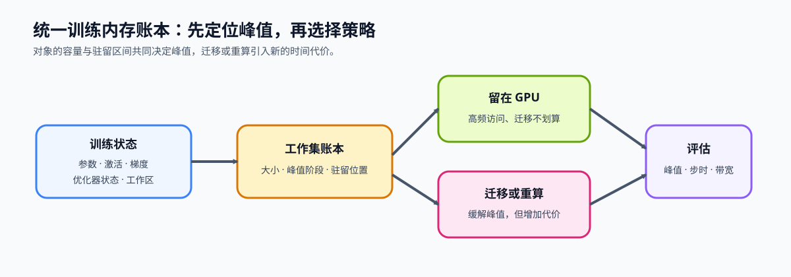

# 43. Unified Training Memory Ledger | 统一训练内存账本

**难度：** Medium | **环境：** [CPU 主线](#runtime-environment) | **标签：** `反向传播`, `训练内存`, `生命周期` | **目标人群：** 训练机制学习者

> 🚀 **云端运行环境**
>
> 本章节的实战代码可以点击以下链接在免费 GPU 算力平台上直接运行：
>
> [](https://colab.research.google.com/github/datawhalechina/llm-algo-leetcode/blob/main/02_PyTorch_Algorithms/43_Unified_Training_Memory_Ledger.ipynb)
> [](https://modelscope.cn/my/mynotebook) *(国内推荐：魔搭社区免费实例)*


## 本节导读

训练峰值不是所有状态容量的机械相加，而是某个阶段仍驻留在设备上的状态发生重叠。参数、activation、梯度、优化器状态、workspace 和通信缓冲区有不同的产生与释放时机；只有把它们放到同一条训练时间轴，才能解释峰值为什么出现。

梯度累积、checkpoint 和 offload 分别改变梯度保留、activation 保存与设备驻留。本节把这些局部变化映射到统一生命周期字段，定位峰值阶段及其主要贡献对象。

**关键词：** `lifecycle`, `residency`, `peak overlap`, `working set`

<a id="runtime-environment"></a>

## 运行环境

- **基础练习：** 默认使用 [`BASE-CPU`](../guide.md#base-cpu)，运行 [Step 4 的题目与测试](#mechanism-practice)。
- **框架核对：** 使用 [`TRAIN-CPU`](../topic_discussion/backpropagation_training_mechanism/quickstart.md#train-cpu-quickstart)，完成 Step 4 后运行 [框架一致性核对](#framework-check)。

---
## 前置阅读

先理解梯度累积怎样延长梯度保留窗口、checkpoint 怎样改变 activation 保存方式，以及 offload 怎样改变 activation 的驻留设备，再把这些局部变化放回统一时间轴。

- [11. Gradient Accumulation | 梯度累积](./11_Gradient_Accumulation.md)
- [19. Activation Checkpointing | 激活检查点](./19_Activation_Checkpointing.md)
- [42. Activation Offload | 激活卸载](./42_Activation_Offload.md)

## Step 1：训练状态在什么时候产生和释放

一条训练记录必须同时说明对象容量和驻留区间。下面按稳态训练 step 描述：优化器状态在第一次 update 后创建，从后续 step 开始通常长期驻留；activation、梯度和临时工作集则只覆盖部分阶段。普通 activation 是前向产生的中间结果，saved tensors 是 autograd 为局部 VJP 明确保留到反向的子集；第 10 节的 $Q/K/V/P$ 就是这一关系的 Attention 实例。

| 状态 | 产生时机 | 使用阶段 | 释放或更新时间 | 生命周期特征 |
|:---|:---|:---|:---|:---|
| 参数 / master weights | 模型加载 | forward、backward、update | 训练结束 | 长期驻留 |
| 普通 activation | forward | 后续 forward 或输出 | 最后一次消费者完成 | 不一定需要保留到 backward |
| saved tensors | forward 中由 autograd 保存 | 对应 backward VJP | 局部 backward 完成或重算后释放 | 是 activation 中真正跨越到反向的子集 |
| gradient | backward | accumulation、update | `zero_grad` | 跨 micro-batch 保留 |
| optimizer state | 首次 update | 后续 update | 训练结束 | 延迟创建、随后长期驻留 |
| workspace | kernel 执行 | 当前算子 | 算子结束或缓存复用 | 短期驻留 |
| 通信缓冲区 | collective 启动 | 同步或通信 | collective 结束 | 通信窗口内驻留 |


## Step 2：怎样从生命周期计算阶段显存

对每个阶段，只汇总该阶段仍驻留在 GPU 上的状态。设状态 $j$ 的容量为 $m_j$，其在阶段 $p$ 的 GPU 驻留指示量为 $I_{j,p}\in\{0,1\}$，则阶段总量和理论峰值为

$$
M_p=\sum_j m_j I_{j,p},\qquad M_{peak}=\max_p M_p.
$$

$M_p$ 回答某一阶段有哪些状态重叠，$M_{peak}$ 回答理论峰值出现在哪里。每条状态记录至少需要表达对象身份、容量、驻留设备、开始阶段、结束阶段和是否跨 step 长期存在；起止阶段都计入驻留区间。阶段总量解释“此刻有多少状态仍在设备上”，贡献对象解释“峰值由谁形成”。理论账本不包含 allocator 额外预留、未知 workspace 或其他进程，这些差异仍需 GPU memory snapshot 或 profiler 解释。

| 账本信息 | 回答的问题 | 示例 |
|:---|:---|:---|
| 对象身份与类别 | 哪个训练状态占用容量 | layer activations / activation |
| 容量 | 当前驻留设备上占用多少空间 | 512 MiB |
| 起止阶段 | 状态从何时存在到何时可释放 | forward → backward |
| 驻留设备 | 容量计入 GPU 还是 CPU 账本 | GPU 或 CPU |
| 跨步属性 | 状态是否在多个训练 step 间持续存在 | 参数和稳态优化器状态长期驻留 |



## Step 3：不同策略改变生命周期的哪一部分

策略只有改变峰值阶段的驻留对象、容量或驻留区间，才可能降低理论峰值。设候选策略得到新的容量 $m'_j$ 和驻留指示量 $I'_{j,p}$，其理论节省量为

$$
\Delta M_{peak}=M_{peak}-\max_p\sum_j m'_j I'_{j,p}.
$$

$\Delta M_{peak}>0$ 只说明候选账本的理论峰值下降；重算、传输、通信和数值代价仍需单独测量。下表说明常见策略首先改变账本中的哪一部分。

| 策略 | 生命周期变化 | 保持不变的状态 | 需要另行测量的代价 |
|:---|:---|:---|:---|
| 梯度累积 | 减少单个 micro-batch 的 activation；梯度跨多个 micro-batch 保留 | 参数和 optimizer state | 更多 forward/backward、更新频率 |
| Checkpoint | 不长期保存部分区段内部 activation | 参数、梯度和 optimizer state | backward 重算时间 |
| Offload | 部分 activation 的设备从 GPU 改为 CPU，反向前再取回 | 状态的训练语义 | D2H/H2D、同步和 host 容量 |
| ZeRO / 分片 | 减少单设备持有的参数、梯度或 optimizer state | 全局参数更新语义 | 通信、重建和同步 |
| 混合精度 | 改变部分状态的单元素字节数 | 状态的依赖关系 | 数值稳定性和硬件路径 |

<a id="mechanism-practice"></a>

## Step 4：实现生命周期账本与峰值分析

题目区先检查状态记录能否落到训练时间轴，再按阶段汇总 GPU 驻留量并找出峰值，最后比较基线与候选账本的峰值变化。策略怎样生成候选账本由上游机制决定，本节只比较同一时间轴上的状态变化。

| TODO / 函数 | 学习者完成的机制 | 必须满足的约束 | 测试证据 |
|:---|:---|:---|:---|
| TODO 1 · `validate_state_lifecycle` | 校验状态类别、容量、设备与起止阶段 | 容量非负，阶段合法且区间不倒置 | 负容量、未知阶段与倒置区间 |
| TODO 2 · `summarize_phase_memory` | 汇总每个阶段仍驻留在 GPU 的状态 | CPU 状态不计入 GPU 峰值，区间端点按约定计入 | 分阶段容量与活跃对象 |
| TODO 3 · `find_peak_overlap` | 找出峰值阶段、容量和贡献对象 | 并列峰值取最早阶段，贡献按容量排序 | 峰值、并列顺序与贡献排序 |
| TODO 4 · `compare_peak_candidates` | 比较基线与多个候选账本 | 每个候选独立汇总；节省量使用同一理论口径 | 候选峰值、峰值阶段与理论节省量 |


```python
from typing import Dict, List

PHASES = ['load', 'forward', 'loss', 'backward', 'update', 'zero_grad']
VALID_CATEGORIES = {
    'parameter', 'master_weight', 'activation', 'gradient',
    'optimizer_state', 'workspace', 'communication_buffer',
}

```


```python
def validate_state_lifecycle(state: Dict[str, object]) -> None:
    """校验一条训练状态记录能否落到统一阶段时间轴。"""
    required = {'name', 'category', 'size_mb', 'start_phase', 'end_phase', 'device', 'persistent'}
    missing = sorted(required - set(state))
    if missing:
        raise KeyError(f'状态记录缺少字段: {missing}')

    if not isinstance(state['size_mb'], (int, float)) or isinstance(state['size_mb'], bool):
        raise TypeError('size_mb 必须是数值')
    if float(state['size_mb']) < 0:
        raise ValueError('size_mb 不能为负数')
    if state['category'] not in VALID_CATEGORIES:
        raise ValueError(f"未知状态类别: {state['category']}")
    if state['device'] not in {'cpu', 'gpu'}:
        raise ValueError('device 必须是 cpu 或 gpu')
    if state['start_phase'] not in PHASES or state['end_phase'] not in PHASES:
        raise ValueError('start_phase / end_phase 必须属于统一阶段表')

    # ==========================================
    # TODO 1：判断生命周期区间是否有效
    # 作用：保证状态的开始阶段不会晚于结束阶段。
    # phase_order_is_valid = ???  # 比较 start_phase 与 end_phase 在 PHASES 中的位置
    # ==========================================
    raise NotImplementedError('TODO 1：请判断 phase_order_is_valid')
    if not phase_order_is_valid:
        raise ValueError('start_phase 不能晚于 end_phase')
    if not isinstance(state['persistent'], bool):
        raise TypeError('persistent 必须是布尔值')


def summarize_phase_memory(states: List[Dict[str, object]]) -> List[Dict[str, object]]:
    """按训练阶段汇总 GPU 上仍驻留的状态与容量。"""
    for state in states:
        validate_state_lifecycle(state)

    records = []
    for phase_index, phase in enumerate(PHASES):
        # ==========================================
        # TODO 2：选择当前阶段仍驻留在 GPU 的状态
        # 作用：只保留 device 为 gpu，且生命周期覆盖 phase_index 的对象。
        # active = ???  # 当前阶段参与显存汇总的状态列表
        # ==========================================
        raise NotImplementedError('TODO 2：请选择 active states')
        records.append({
            'phase': phase,
            'total_mb': sum(float(state['size_mb']) for state in active),
            'active_states': [str(state['name']) for state in active],
            'state_sizes_mb': {str(state['name']): float(state['size_mb']) for state in active},
        })
    return records


def find_peak_overlap(phase_records: List[Dict[str, object]]) -> Dict[str, object]:
    """返回最早出现的峰值阶段、容量和按容量降序排列的贡献对象。"""
    if not phase_records:
        raise ValueError('phase_records 不能为空')

    # ==========================================
    # TODO 3：选择最早出现的峰值记录
    # 作用：利用 PHASES 的现有顺序，在并列峰值时保留最早阶段。
    # peak = ???  # total_mb 最大的阶段记录
    # ==========================================
    raise NotImplementedError('TODO 3：请选择 peak record')
    sizes = peak.get('state_sizes_mb', {})
    contributors = sorted(sizes, key=lambda name: (-float(sizes[name]), name))
    return {
        'peak_phase': peak['phase'],
        'peak_mb': float(peak['total_mb']),
        'contributors': contributors,
    }


def compare_peak_candidates(
    baseline_states: List[Dict[str, object]],
    candidate_states: Dict[str, List[Dict[str, object]]],
) -> Dict[str, object]:
    """用同一阶段口径比较基线与多个候选账本的理论峰值。"""
    if not candidate_states:
        raise ValueError('candidate_states 不能为空')
    baseline_peak = find_peak_overlap(summarize_phase_memory(baseline_states))

    # ==========================================
    # TODO 4：比较候选账本与基线峰值
    # 作用：逐个汇总候选峰值，并计算 baseline_peak - candidate_peak。
    # comparisons = ???  # 候选名称到峰值、阶段和理论节省量的映射
    # ==========================================
    raise NotImplementedError('TODO 4：请比较 candidate peaks')
    return {'baseline': baseline_peak, 'candidates': comparisons}

```

## 测试

```python
# 测试设计：分别验证输入契约、阶段驻留和峰值贡献，不使用项目 JSON。

def _sample_states() -> List[Dict[str, object]]:
    return [
        {'name': 'parameters', 'category': 'parameter', 'size_mb': 800.0, 'start_phase': 'load', 'end_phase': 'zero_grad', 'device': 'gpu', 'persistent': True},
        {'name': 'optimizer_state', 'category': 'optimizer_state', 'size_mb': 600.0, 'start_phase': 'load', 'end_phase': 'zero_grad', 'device': 'gpu', 'persistent': True},
        {'name': 'activations', 'category': 'activation', 'size_mb': 300.0, 'start_phase': 'forward', 'end_phase': 'backward', 'device': 'gpu', 'persistent': False},
        {'name': 'gradients', 'category': 'gradient', 'size_mb': 400.0, 'start_phase': 'backward', 'end_phase': 'update', 'device': 'gpu', 'persistent': False},
        {'name': 'forward_workspace', 'category': 'workspace', 'size_mb': 200.0, 'start_phase': 'forward', 'end_phase': 'forward', 'device': 'gpu', 'persistent': False},
        {'name': 'collective_buffer', 'category': 'communication_buffer', 'size_mb': 100.0, 'start_phase': 'backward', 'end_phase': 'backward', 'device': 'gpu', 'persistent': False},
        {'name': 'offloaded_activation', 'category': 'activation', 'size_mb': 250.0, 'start_phase': 'forward', 'end_phase': 'backward', 'device': 'cpu', 'persistent': False},
    ]


def test_lifecycle_contract() -> None:
    """验证训练状态的大小、生命周期和阶段字段契约。"""
    valid = _sample_states()[0]
    validate_state_lifecycle(valid)
    invalid_states = [
        {**valid, 'size_mb': -1.0},
        {**valid, 'category': 'unknown'},
        {**valid, 'device': 'tpu'},
        {**valid, 'start_phase': 'backward', 'end_phase': 'forward'},
    ]
    for state in invalid_states:
        try:
            validate_state_lifecycle(state)
        except (TypeError, ValueError):
            continue
        raise AssertionError('非法生命周期记录应明确拒绝')


def test_phase_residency() -> None:
    """验证 forward、backward 与 update 的驻留状态汇总。"""
    records = {item['phase']: item for item in summarize_phase_memory(_sample_states())}
    assert records['forward']['total_mb'] == 1900.0
    assert records['backward']['total_mb'] == 2200.0
    assert records['update']['total_mb'] == 1800.0
    assert 'offloaded_activation' not in records['backward']['active_states']
    assert 'activations' not in records['update']['active_states']


def test_peak_overlap() -> None:
    """验证峰值阶段、峰值容量与主要贡献对象。"""
    peak = find_peak_overlap(summarize_phase_memory(_sample_states()))
    assert peak['peak_phase'] == 'backward'
    assert peak['peak_mb'] == 2200.0
    assert peak['contributors'] == ['parameters', 'optimizer_state', 'gradients', 'activations', 'collective_buffer']


def test_candidate_peak_comparison() -> None:
    """验证候选账本使用同一阶段口径计算峰值和理论节省量。"""
    baseline = _sample_states()
    checkpoint = [
        {**state, 'end_phase': 'forward'} if state['name'] == 'activations' else dict(state)
        for state in baseline
    ]
    offload = [
        {**state, 'device': 'cpu'} if state['name'] == 'activations' else dict(state)
        for state in baseline
    ]
    report = compare_peak_candidates(baseline, {'checkpoint': checkpoint, 'offload': offload})
    assert report['baseline']['peak_mb'] == 2200.0
    assert report['candidates']['checkpoint'] == {
        'peak_phase': 'forward', 'peak_mb': 1900.0, 'memory_saving_mb': 300.0,
    }
    assert report['candidates']['offload'] == {
        'peak_phase': 'backward', 'peak_mb': 1900.0, 'memory_saving_mb': 300.0,
    }


def run_unified_memory_tests() -> None:
    test_lifecycle_contract()
    test_phase_residency()
    test_peak_overlap()
    test_candidate_peak_comparison()
    print('✅ 生命周期、阶段驻留、峰值重叠与候选对照测试通过')


run_unified_memory_tests()

```

---

🛑 **STOP HERE** 🛑

> 请先完成题目区并运行测试，再查看参考代码。

---
## 参考代码与解析

### 代码


```python
def validate_state_lifecycle(state: Dict[str, object]) -> None:
    """校验一条训练状态记录能否落到统一阶段时间轴。"""
    required = {'name', 'category', 'size_mb', 'start_phase', 'end_phase', 'device', 'persistent'}
    missing = sorted(required - set(state))
    if missing:
        raise KeyError(f'状态记录缺少字段: {missing}')
    if not isinstance(state['size_mb'], (int, float)) or isinstance(state['size_mb'], bool):
        raise TypeError('size_mb 必须是数值')
    if float(state['size_mb']) < 0:
        raise ValueError('size_mb 不能为负数')
    if state['category'] not in VALID_CATEGORIES:
        raise ValueError(f"未知状态类别: {state['category']}")
    if state['device'] not in {'cpu', 'gpu'}:
        raise ValueError('device 必须是 cpu 或 gpu')
    if state['start_phase'] not in PHASES or state['end_phase'] not in PHASES:
        raise ValueError('start_phase / end_phase 必须属于统一阶段表')
    # TODO 1：判断生命周期区间是否有效。
    if PHASES.index(state['start_phase']) > PHASES.index(state['end_phase']):
        raise ValueError('start_phase 不能晚于 end_phase')
    if not isinstance(state['persistent'], bool):
        raise TypeError('persistent 必须是布尔值')


def summarize_phase_memory(states: List[Dict[str, object]]) -> List[Dict[str, object]]:
    """按训练阶段汇总 GPU 上仍驻留的状态与容量。"""
    for state in states:
        validate_state_lifecycle(state)
    records = []
    for phase_index, phase in enumerate(PHASES):
        # TODO 2：选择当前阶段仍驻留在 GPU 的状态。
        active = [
            state for state in states
            if state['device'] == 'gpu'
            and PHASES.index(state['start_phase']) <= phase_index <= PHASES.index(state['end_phase'])
        ]
        records.append({
            'phase': phase,
            'total_mb': sum(float(state['size_mb']) for state in active),
            'active_states': [str(state['name']) for state in active],
            'state_sizes_mb': {str(state['name']): float(state['size_mb']) for state in active},
        })
    return records


def find_peak_overlap(phase_records: List[Dict[str, object]]) -> Dict[str, object]:
    """返回最早出现的峰值阶段、容量和按容量降序排列的贡献对象。"""
    if not phase_records:
        raise ValueError('phase_records 不能为空')
    # TODO 3：选择最早出现的峰值记录。
    peak = max(phase_records, key=lambda item: float(item['total_mb']))
    sizes = peak.get('state_sizes_mb', {})
    contributors = sorted(sizes, key=lambda name: (-float(sizes[name]), name))
    return {
        'peak_phase': peak['phase'],
        'peak_mb': float(peak['total_mb']),
        'contributors': contributors,
    }


def compare_peak_candidates(
    baseline_states: List[Dict[str, object]],
    candidate_states: Dict[str, List[Dict[str, object]]],
) -> Dict[str, object]:
    """用同一阶段口径比较基线与多个候选账本的理论峰值。"""
    if not candidate_states:
        raise ValueError('candidate_states 不能为空')
    baseline_peak = find_peak_overlap(summarize_phase_memory(baseline_states))
    comparisons = {}
    for name, states in candidate_states.items():
        if not name:
            raise ValueError('候选名称不能为空')
        candidate_peak = find_peak_overlap(summarize_phase_memory(states))
        comparisons[name] = {
            'peak_phase': candidate_peak['peak_phase'],
            'peak_mb': candidate_peak['peak_mb'],
            'memory_saving_mb': baseline_peak['peak_mb'] - candidate_peak['peak_mb'],
        }
    return {'baseline': baseline_peak, 'candidates': comparisons}

```

### 解析

#### TODO 1：验证生命周期区间

起止阶段必须使用同一份有序阶段表，才能比较先后关系。开始位置晚于结束位置意味着状态没有合法驻留区间；区间端点保留为闭区间，表示状态在起止阶段都可用。

#### TODO 2：汇总阶段驻留量

每个阶段只选择设备为 GPU 且生命周期覆盖当前阶段的对象，再同时记录总容量、对象名称和单项容量。CPU 上的 offload 状态不计入 GPU 峰值，但仍可作为完整账本中的对象保留。

#### TODO 3：定位峰值及贡献对象

阶段记录按训练顺序生成，`max` 在容量并列时保留首个记录，因此结果对应最早峰值。贡献对象按容量降序排列，只用于解释理论峰值来源；allocator 保留和未知 workspace 仍需真实测量补充。

#### TODO 4：比较候选峰值

基线与每个候选都重新经过阶段汇总和峰值定位，再用同一容量口径相减。该结果只比较传入账本的理论峰值；候选账本是否准确表达 Checkpoint、Offload 或分片机制，仍由对应机制页和真实实验负责。
<a id="framework-check"></a>

## 框架一致性核对（可选）

下面用同一段受控 CPU 计算比较本节生命周期账本与 PyTorch profiler：账本负责区分 CPU/GPU 驻留，profiler 负责确认阶段范围和真实内存活动。

| 核对对象 | 本节实现 | 成熟框架入口 | 通过条件 |
| --- | --- | --- | --- |
| 阶段顺序 | `PHASES` 中的 forward / backward | `record_function` 阶段事件 | 两个阶段均被记录，且 forward 早于 backward |
| 设备账本 | CPU 状态不计入 GPU 阶段总量 | `profile(profile_memory=True)` | profiler 记录 CPU 内存活动，本节 GPU 汇总保持为零 |
| 对象容量 | `size_mb` 容量字段 | `numel × element_size` 与 profiler 内存事件 | 张量字节数为正，profiler 正向分配量不少于该张量容量 |

```python
from importlib.metadata import version

import torch
from torch.profiler import ProfilerActivity, profile, record_function


def check_memory_ledger_framework_conformance():
    """核对阶段事件、CPU 内存活动与本节设备账本边界。"""
    with profile(activities=[ProfilerActivity.CPU], profile_memory=True, record_shapes=True) as prof:
        with record_function('forward_phase'):
            value = torch.ones((128, 128), requires_grad=True)
            loss = value.square().sum()
        with record_function('backward_phase'):
            loss.backward()

    events = list(prof.events())
    forward_events = [event for event in events if event.name == 'forward_phase']
    backward_events = [event for event in events if event.name == 'backward_phase']
    positive_cpu_bytes = sum(max(int(event.cpu_memory_usage), 0) for event in events)
    tensor_bytes = value.numel() * value.element_size()
    cpu_state = {
        'name': 'profiled_cpu_tensor',
        'category': 'activation',
        'size_mb': tensor_bytes / (1024 ** 2),
        'start_phase': 'forward',
        'end_phase': 'backward',
        'device': 'cpu',
        'persistent': False,
    }
    gpu_records = summarize_phase_memory([cpu_state])
    phase_order_ok = bool(
        forward_events
        and backward_events
        and forward_events[0].time_range.start < backward_events[0].time_range.start
    )
    checks = {
        'phase_ranges_present_and_ordered': phase_order_ok,
        'cpu_memory_activity_reported': positive_cpu_bytes >= tensor_bytes > 0,
        'cpu_state_excluded_from_gpu_ledger': all(record['total_mb'] == 0 for record in gpu_records),
        'backward_gradient_present': value.grad is not None and bool(torch.isfinite(value.grad).all()),
    }
    failed = [name for name, passed in checks.items() if not passed]
    if failed:
        raise AssertionError(f'框架一致性核对失败：{failed}')
    return {
        'status': 'passed',
        'check_kind': 'framework_conformance',
        'versions': {'torch': version('torch')},
        'checks': checks,
        'tensor_bytes': tensor_bytes,
        'profiled_positive_cpu_bytes': positive_cpu_bytes,
    }


framework_check = check_memory_ledger_framework_conformance()
framework_check
```

## 相关阅读

统一生命周期账本用于解释峰值来源；真实策略收益继续交给固定 workload 的训练性能项目。

- [PyTorch CUDA 内存管理文档](https://pytorch.org/docs/stable/notes/cuda.html#cuda-memory-management)
- [ZeRO: Memory Optimizations Toward Training Trillion Parameter Models](https://arxiv.org/abs/1910.02054)
- [73. Training Performance Analysis | 训练性能分析](./73_Training_Performance_Analysis.md)
- [76. Activation Checkpoint / Offload Benchmark | 激活检查点与卸载对比](./76_Activation_Checkpoint_Offload_Benchmark.md)
- [性能优化 · 训练状态与后训练资源账本](../topic_discussion/performance_optimization/03_training_memory_ledger.md)
