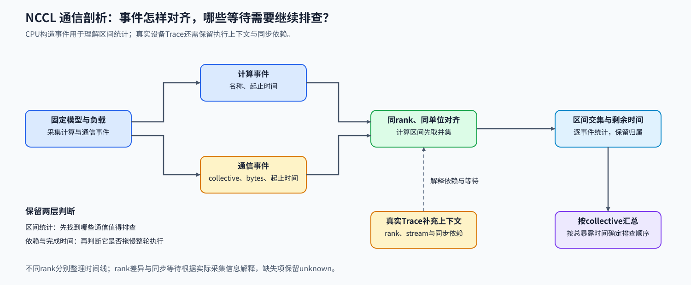
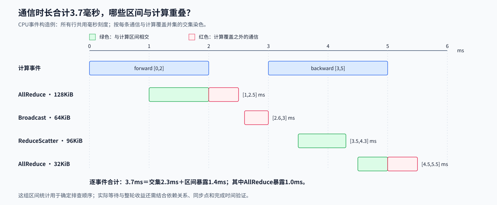

# 47. Communication Profiling with NCCL | NCCL 通信剖析
**难度：** Hard | **环境：** CPU-first | **标签：** `并行通信`, `NCCL`, `性能剖析` | **目标人群：** 并行通信学习者

> 🚀 **云端运行环境**
>
> 本章节的实战代码可以点击以下链接在免费 GPU 算力平台上直接运行：
>
> [](https://colab.research.google.com/github/datawhalechina/llm-algo-leetcode/blob/main/02_PyTorch_Algorithms/47_Communication_Profiling_with_NCCL.ipynb)
> [](https://modelscope.cn/my/mynotebook) *(国内推荐：魔搭社区免费实例)*


---

## 本节导读

ZeRO、Pipeline Parallelism 和 Tensor Parallelism 都会让多个 rank 协同完成一次训练或推理。随后需要回答的便是：通信究竟花在了哪里，哪些时间真正暴露在关键路径上。

本节从通信时间线出发，学习如何区分计算与 collective、计算有效 overlap，并用暴露通信时间定位应优先处理的热点。你将把零散的事件记录收敛为一条可解释的通信瓶颈分析链路。

**关键词：** `nccl`, `all-reduce`, `communication profiling`, `overlap`

---

<a id="runtime-environment"></a>

## 运行环境

- **基础练习：** 使用 [`BASE-CPU`](../guide.md#base-cpu)，运行 [Step 4 的题目与测试](#mechanism-practice)。
- **框架核对：** 使用 [`PAR-CPU`](../topic_discussion/communication_parallelism/quickstart.md#par-cpu-quickstart)；完成 Step 4 后运行 [框架一致性核对](#framework-check)。
- **多 GPU 实测：** 使用 `PAR-CUDA-MECHANISM`；环境、运行配置与固定工作负载见 [Step 5](#gpu-experiment)。

---
## 前置阅读

**导语：** 先了解常见 collective 如何在多卡间传输数据；阅读本节时，再把这些 collective 放回 compute—communication 时间线中观察。

- [P1: 05. Communication Topologies | 通信拓扑与分布式基石](../01_Hardware_Math_and_Systems/05_Communication_Topologies.md)
- [P1: 20. NCCL and AllReduce Basics | NCCL 与 AllReduce 基础](../01_Hardware_Math_and_Systems/20_NCCL_and_AllReduce_Basics.md)
- [29. Tensor Parallelism Sim | Tensor 并行模拟（可选回顾）](./29_Tensor_Parallelism_Sim.md)

---
## Step 1：通信为什么会进入关键路径

多卡训练或推理中，单独观察 GPU 利用率不能判断系统是否被通信限制：某些 rank 可能在等待 collective 完成，另一些 rank 仍在计算。把计算与 collective 放到同一时间线上，才能判断通信是否正在延长一个训练 step 或请求的完成时间。

通信剖析需要建立三类证据：

- **通信对象**：all-reduce、broadcast、reduce-scatter，还是其他 collective；
- **时间与传输量**：每类 collective 花了多久、搬了多少 bytes，以及不同 rank 是否存在差异；
- **关键路径位置**：通信与 forward / backward 等 compute 区间在时间线上如何相对出现。

在进入时间线前，先用 $\alpha$– $\beta$ 模型统一解释成本。令 $n$ 为单次有效载荷 byte 数， $\alpha$ 为启动延迟， $\beta$ 为每 byte 传输时间，重复 $K$ 次的简化成本为

$$
T_{\mathrm{comm}}\approx K(\alpha+n\beta).
$$

小载荷更容易被 $K\alpha$ 主导，大载荷更容易被 $Kn\beta$ 主导。真实 collective 还受算法、拓扑、竞争和进程到达时间影响，因此该式只用于提出剖析假设。

| Collective | 常见 payload | 语义 | 首先检查 |
|---|---|---|---|
| AllReduce | 梯度或部分输出 | 所有 rank 得到聚合结果 | payload、同步次数、拓扑 |
| AllGather | 参数/激活分片 | 收集各 rank 分片 | shard 大小、峰值与等待 |
| ReduceScatter | 梯度或部分和 | 聚合后保留本 rank 分片 | 分片均衡、后续依赖 |
| All-to-All | token / expert payload | 各 rank 按目的地交换数据 | 负载偏斜、跨节点流量 |



## Step 2：通信时间线需要记录什么

真实 NCCL、PyTorch Profiler 或 Nsight Systems 的输出形式不同，但都能整理为统一的时间线事件。本节 CPU 事件的 `start / end / duration` 统一使用毫秒；接入真实 Trace 时必须先完成单位归一化。以下四类字段共同描述发生了什么、持续多久、传输了多少，以及哪些时间没有被计算隐藏。

| 证据 | 典型字段 | 用途 |
|------|----------|------|
| 计算区间 | `name`、`start`、`end` | 标出 forward、backward 等可覆盖通信的时间段 |
| 通信区间 | `collective`、`start`、`end`、`bytes` | 判断是哪种 collective 在何时搬运了多少数据 |
| 执行上下文 | `rank`、`stream`、同步点 | 辅助解释某个 rank 为什么等待或无法重叠 |
| 聚合指标 | `count`、`time`、`exposed_time` | 比较各 collective 的频率、总成本和关键路径成本 |

## Step 3：时间重叠、暴露通信时间与热点归因

一段通信若完全位于计算区间左侧或右侧，就不会重叠；其余情况存在时间交集。真正用于性能判断的不是“是否重叠”这个布尔值，而是这段交集究竟覆盖了多少通信时间。

从时间线判断通信代价时，关注四个概念：

- **通信总时长**：所有 collective 持续时间的总和；
- **有效重叠时间**：通信实际落在计算覆盖范围内的时长；
- **重叠比例**：有效重叠时间在通信总时长中的占比，用于判断可隐藏的程度；
- **暴露通信时间**：未被计算覆盖的通信时间，用于决定优先检查哪个 collective。

有效重叠时间来自通信区间与计算区间的交集，暴露通信时间则是通信中未被覆盖的剩余部分。若多个计算区间相互重叠，不能重复累计同一段通信；因此要先合并覆盖范围，再判断可隐藏时间。

令通信区间总长度为 $T_{\mathrm{comm}}$，其与合并后计算区间的交集长度为 $T_{\mathrm{overlap}}$，则

$$
T_{\mathrm{exposed}}=\max(0,T_{\mathrm{comm}}-T_{\mathrm{overlap}}),
\qquad
\rho_{\mathrm{overlap}}=\frac{T_{\mathrm{overlap}}}{\max(T_{\mathrm{comm}},\varepsilon)}.
$$

$\varepsilon>0$ 只用于空时间线的数值保护；多个计算区间必须先求并集，避免重复计算覆盖时长。



<a id="mechanism-practice"></a>

## Step 4：CPU 机制实现——从时间线到热点

题目区提供通信成本估算、事件记录和时间线导出的骨架。你需要完成四个机制判断：估算单类 collective 的理论成本、计算有效 overlap、按 collective 汇总暴露时间、从汇总结果找出优先热点。

| TODO / 函数 | 学习者完成的机制 | 必须满足的约束 | 测试证据 |
|:---|:---|:---|:---|
| TODO 1：估算通信成本<br>`NCCLProfilerSim.estimate_collective_time` | 合并启动、传输和同步次数成本 | 输入单位一致，非法带宽明确失败 | 检查小载荷、零同步与非法参数 |
| TODO 2：合并覆盖区间<br>`NCCLProfilerSim._overlap_duration` | 计算通信被计算区间覆盖的并集时长 | 重叠计算区间不能重复计数 | 检查多段覆盖与无交集时间线 |
| TODO 3：汇总 collective<br>`NCCLProfilerSim.summarize` | 按操作累计次数、时长、字节和暴露时间 | 总时长等于覆盖与暴露之和 | 检查同类多事件聚合与时间守恒 |
| TODO 4：选择优先热点<br>`NCCLProfilerSim.find_priority_hotspot` | 找出暴露通信最大的操作 | 依据暴露时间而非通信总时长排序 | 检查热点操作及其证据字段 |


```python
from dataclasses import dataclass
from typing import Any, Dict, List

```


```python
@dataclass
class CommEvent:
    """一条 CPU 时间线事件；start / end 的单位统一为毫秒。"""
    op: str
    start: float
    end: float
    bytes: int
    overlap_with_compute: bool = False

    @property
    def duration(self) -> float:
        return max(self.end - self.start, 0.0)


class NCCLProfilerSim:
    """极简版 NCCL 通信 profiling 模拟器。"""

    def __init__(self):
        self.events: List[CommEvent] = []
        self.compute_events: List[Dict[str, float]] = []

    @staticmethod
    def estimate_collective_time(payload_bytes: int, startup_latency: float, bandwidth_bytes_per_s: float, sync_count: int = 1) -> float:
        """估算重复 collective 的总时间；时间单位与 `startup_latency` 一致。"""
        if payload_bytes < 0 or startup_latency < 0 or bandwidth_bytes_per_s <= 0 or sync_count < 0:
            raise ValueError("payload/latency/sync_count 必须非负，bandwidth 必须为正")
        # ==========================================
        # TODO 1: 计算启动成本与 payload / bandwidth 的传输成本，并乘同步次数。
        # 提示：先计算一次 collective 的时间，再由 sync_count 累积。
        # ==========================================
        # single_collective_time = ???
        raise NotImplementedError

    def add_compute(self, name: str, start: float, end: float) -> None:
        """记录一个 compute 区间；`name` 只用于时间线解释。"""
        self.compute_events.append({"name": name, "start": start, "end": end})

    def add_comm(self, op: str, start: float, end: float, bytes: int) -> None:
        """记录一个 collective；`bytes` 是该次 collective 的传输量。"""
        event = CommEvent(op=op, start=start, end=end, bytes=bytes)
        event.overlap_with_compute = self._has_overlap(event.start, event.end)
        self.events.append(event)

    def _has_overlap(self, start: float, end: float) -> bool:
        return any(not (end <= c["start"] or start >= c["end"]) for c in self.compute_events)

    def _overlap_duration(self, start: float, end: float) -> float:
        """返回通信区间被 compute 覆盖的有效时长，避免多段 compute 重复计数。"""
        intersections = sorted(
            (max(start, c["start"]), min(end, c["end"]))
            for c in self.compute_events
            if max(start, c["start"]) < min(end, c["end"])
        )
        if not intersections:
            return 0.0
        # ==========================================
        # TODO 2: 合并重叠的交集区间，得到有效 overlap 时长。
        # 提示：依次比较当前区间的 start 与已合并最后区间的 end；
        # 相交就扩展 end，否则开始一个新区间。
        # ==========================================
        # merged = ???
        raise NotImplementedError

    def summarize(self) -> Dict[str, Any]:
        total_comm_time = sum(e.duration for e in self.events)
        overlap_time = sum(self._overlap_duration(e.start, e.end) for e in self.events)
        by_op: Dict[str, Dict[str, float]] = {}
        for e in self.events:
            exposed_time = e.duration - self._overlap_duration(e.start, e.end)
            # ==========================================
            # TODO 3: 按 collective 汇总 count、time、bytes 和 exposed_time。
            # 提示：先用 setdefault 取得统计桶，再在同一个桶上累加四个字段；
            # exposed_time 代表该 op 未被 compute 隐藏的时间。
            # ==========================================
            # item = ???
            raise NotImplementedError
        return {
            "num_comm_events": len(self.events),
            "total_comm_time": total_comm_time,
            "overlap_time": overlap_time,
            "overlap_ratio": min(overlap_time, total_comm_time) / max(total_comm_time, 1e-8),
            "exposed_comm_time": max(total_comm_time - overlap_time, 0.0),
            "by_op": by_op,
        }

    @staticmethod
    def export_hotspot_events(summary: Dict[str, Any]) -> List[Dict[str, Any]]:
        """将本节汇总转换为第 48 节可直接消费的热点事件字段。"""
        events: List[Dict[str, Any]] = []
        for collective, item in summary["by_op"].items():
            total_comm_ms = float(item["time"])
            exposed_comm_ms = float(item["exposed_time"])
            hidden_comm_ms = max(total_comm_ms - exposed_comm_ms, 0.0)
            events.append({
                "collective": collective,
                "sync_count": int(item["count"]),
                "total_comm_ms": total_comm_ms,
                "exposed_comm_ms": exposed_comm_ms,
                "payload_bytes": int(item["bytes"]),
                "overlap_ratio": hidden_comm_ms / max(total_comm_ms, 1e-8),
                "rank_imbalance_ratio": None,
                "rank_imbalance_observed": False,
            })
        return events

    def find_priority_hotspot(self, summary: Dict[str, Any]) -> Dict[str, Any]:
        """从按 op 汇总的证据中找出最优先处理的 exposed communication hotspot。"""
        # ==========================================
        # TODO 4: 选择 exposed_time 最大的 collective，并返回 op、exposed_time 与 bytes。
        # 提示：`summary["by_op"]` 的键是 collective 名称，值是统计桶。
        # ==========================================
        # op, item = ???
        raise NotImplementedError

    def timeline(self) -> List[Dict[str, Any]]:
        records = []
        for e in sorted(self.events, key=lambda x: (x.start, x.end, x.op)):
            records.append({"op": e.op, "start": e.start, "end": e.end, "duration": e.duration, "bytes": e.bytes, "overlap": e.overlap_with_compute})
        return records

```


```python
# 测试你的实现：成本模型、时间线、归因和边界条件分别验证。
def test_collective_cost_model():
    try:
        estimated = NCCLProfilerSim.estimate_collective_time(100, 0.1, 1000.0, sync_count=3)
        assert round(estimated, 6) == 0.6
        assert NCCLProfilerSim.estimate_collective_time(100, 0.1, 1000.0, sync_count=0) == 0.0
        try:
            NCCLProfilerSim.estimate_collective_time(100, 0.1, 0.0)
            raise AssertionError('bandwidth 为零时应拒绝估算')
        except ValueError:
            pass
    except NotImplementedError as e:
        raise NotImplementedError('请先完成 TODO 1：通信成本模型。') from e

def _build_profiler_fixture():
    profiler = NCCLProfilerSim()
    profiler.add_compute('forward', 0.0, 2.0)
    profiler.add_comm('all_reduce', 1.0, 2.5, 128 * 1024)
    profiler.add_comm('broadcast', 2.6, 3.0, 64 * 1024)
    profiler.add_compute('backward', 3.0, 5.0)
    profiler.add_comm('reduce_scatter', 3.5, 4.3, 96 * 1024)
    profiler.add_comm('all_reduce', 4.5, 5.5, 32 * 1024)
    return profiler

def test_nccl_event_timeline():
    try:
        profiler = _build_profiler_fixture()
        timeline = profiler.timeline()
        assert len(timeline) == 4
        assert timeline[0]['op'] == 'all_reduce'
        assert timeline[0]['overlap'] is True
        assert timeline[1]['overlap'] is False
    except NotImplementedError as e:
        raise NotImplementedError('请先完成 TODO 代码！') from e
    except (AttributeError, NameError, TypeError, ValueError, AssertionError) as e:
        raise NotImplementedError('请先完成 TODO 代码！') from e

def test_nccl_summary_contract():
    try:
        summary = _build_profiler_fixture().summarize()
        assert summary['num_comm_events'] == 4
        assert round(summary['total_comm_time'], 6) == 3.7
        assert round(summary['overlap_time'], 6) == 2.3
        assert round(summary['exposed_comm_time'], 6) == 1.4
        assert summary['by_op']['all_reduce']['count'] == 2
        assert summary['by_op']['all_reduce']['bytes'] == 160 * 1024
        hotspot = _build_profiler_fixture().find_priority_hotspot(summary)
        assert hotspot['op'] == 'all_reduce'
        assert round(hotspot['exposed_time'], 6) == 1.0
        exported = NCCLProfilerSim.export_hotspot_events(summary)
        all_reduce = next(item for item in exported if item['collective'] == 'all_reduce')
        assert all_reduce['sync_count'] == 2
        assert all_reduce['payload_bytes'] == 160 * 1024
        assert round(all_reduce['total_comm_ms'], 6) == 2.5
        assert round(all_reduce['exposed_comm_ms'], 6) == 1.0
        assert all_reduce['rank_imbalance_ratio'] is None
        assert all_reduce['rank_imbalance_observed'] is False
    except NotImplementedError as e:
        raise NotImplementedError('请先完成 TODO 代码！') from e
    except (AttributeError, NameError, TypeError, ValueError, AssertionError) as e:
        raise NotImplementedError('请先完成 TODO 代码！') from e


def test_overlap_duration_does_not_double_count_compute():
    try:
        profiler = NCCLProfilerSim()
        profiler.add_compute('forward', 0.0, 3.0)
        profiler.add_compute('backward', 2.0, 4.0)
        assert profiler._overlap_duration(1.0, 5.0) == 3.0
        assert profiler._overlap_duration(4.0, 5.0) == 0.0
    except NotImplementedError:
        raise
    except (AttributeError, NameError, TypeError, ValueError, AssertionError) as e:
        raise NotImplementedError('请先完成 TODO 代码！') from e

test_collective_cost_model()
test_nccl_event_timeline()
test_nccl_summary_contract()
test_overlap_duration_does_not_double_count_compute()
print('✅ NCCLProfilerSim 测试通过')

```

---

🛑 **STOP HERE** 🛑
<br><br><br><br><br><br><br><br><br><br>
> 请先尝试自己完成代码并跑通测试。<br>
> 如果你正在 Colab 中运行，并且遇到困难没有思路，可以向下滚动查看参考答案。
<br><br><br><br><br><br><br><br><br><br>

---

## 参考代码与解析

### 代码


```python
# TODO：下面是题目区的参考实现。

@dataclass
class CommEvent:
    """一条 CPU 时间线事件；start / end 的单位统一为毫秒。"""
    op: str
    start: float
    end: float
    bytes: int
    overlap_with_compute: bool = False

    @property
    def duration(self) -> float:
        return max(self.end - self.start, 0.0)


class NCCLProfilerSim:
    """极简版 NCCL 通信 profiling 模拟器。"""

    def __init__(self):
        self.events: List[CommEvent] = []
        self.compute_events: List[Dict[str, float]] = []

    @staticmethod
    def estimate_collective_time(payload_bytes: int, startup_latency: float, bandwidth_bytes_per_s: float, sync_count: int = 1) -> float:
        """估算重复 collective 的总时间；时间单位与 `startup_latency` 一致。"""
        if payload_bytes < 0 or startup_latency < 0 or bandwidth_bytes_per_s <= 0 or sync_count < 0:
            raise ValueError("payload/latency/sync_count 必须非负，bandwidth 必须为正")
        # ==========================================
        # TODO 1: 计算启动成本与 payload / bandwidth 的传输成本，并乘同步次数。
        # 提示：先计算一次 collective 的时间，再由 sync_count 累积。
        # ==========================================
        # single_collective_time = ???
        single_collective_time = startup_latency + payload_bytes / bandwidth_bytes_per_s
        return sync_count * single_collective_time

    def add_compute(self, name: str, start: float, end: float) -> None:
        """记录一个 compute 区间；`name` 只用于时间线解释。"""
        self.compute_events.append({"name": name, "start": start, "end": end})

    def add_comm(self, op: str, start: float, end: float, bytes: int) -> None:
        """记录一个 collective；`bytes` 是该次 collective 的传输量。"""
        event = CommEvent(op=op, start=start, end=end, bytes=bytes)
        event.overlap_with_compute = self._has_overlap(event.start, event.end)
        self.events.append(event)

    def _has_overlap(self, start: float, end: float) -> bool:
        return any(not (end <= c["start"] or start >= c["end"]) for c in self.compute_events)

    def _overlap_duration(self, start: float, end: float) -> float:
        """返回通信区间被 compute 覆盖的有效时长，避免多段 compute 重复计数。"""
        intersections = sorted(
            (max(start, c["start"]), min(end, c["end"]))
            for c in self.compute_events
            if max(start, c["start"]) < min(end, c["end"])
        )
        if not intersections:
            return 0.0
        # ==========================================
        # TODO 2: 合并重叠的交集区间，得到有效 overlap 时长。
        # 提示：依次比较当前区间的 start 与已合并最后区间的 end；
        # 相交就扩展 end，否则开始一个新区间。
        # ==========================================
        # merged = ???
        merged = [list(intersections[0])]
        for seg_start, seg_end in intersections[1:]:
            if seg_start <= merged[-1][1]:
                merged[-1][1] = max(merged[-1][1], seg_end)
            else:
                merged.append([seg_start, seg_end])
        return sum(seg_end - seg_start for seg_start, seg_end in merged)

    def summarize(self) -> Dict[str, Any]:
        total_comm_time = sum(e.duration for e in self.events)
        overlap_time = sum(self._overlap_duration(e.start, e.end) for e in self.events)
        by_op: Dict[str, Dict[str, float]] = {}
        for e in self.events:
            exposed_time = e.duration - self._overlap_duration(e.start, e.end)
            # ==========================================
            # TODO 3: 按 collective 汇总 count、time、bytes 和 exposed_time。
            # 提示：先用 setdefault 取得统计桶，再在同一个桶上累加四个字段；
            # exposed_time 代表该 op 未被 compute 隐藏的时间。
            # ==========================================
            # item = ???
            item = by_op.setdefault(e.op, {"count": 0, "time": 0.0, "bytes": 0, "exposed_time": 0.0})
            item["count"] += 1
            item["time"] += e.duration
            item["bytes"] += e.bytes
            item["exposed_time"] += exposed_time
        return {
            "num_comm_events": len(self.events),
            "total_comm_time": total_comm_time,
            "overlap_time": overlap_time,
            "overlap_ratio": min(overlap_time, total_comm_time) / max(total_comm_time, 1e-8),
            "exposed_comm_time": max(total_comm_time - overlap_time, 0.0),
            "by_op": by_op,
        }

    @staticmethod
    def export_hotspot_events(summary: Dict[str, Any]) -> List[Dict[str, Any]]:
        """将本节汇总转换为第 48 节可直接消费的热点事件字段。"""
        events: List[Dict[str, Any]] = []
        for collective, item in summary["by_op"].items():
            total_comm_ms = float(item["time"])
            exposed_comm_ms = float(item["exposed_time"])
            hidden_comm_ms = max(total_comm_ms - exposed_comm_ms, 0.0)
            events.append({
                "collective": collective,
                "sync_count": int(item["count"]),
                "total_comm_ms": total_comm_ms,
                "exposed_comm_ms": exposed_comm_ms,
                "payload_bytes": int(item["bytes"]),
                "overlap_ratio": hidden_comm_ms / max(total_comm_ms, 1e-8),
                "rank_imbalance_ratio": None,
                "rank_imbalance_observed": False,
            })
        return events

    def find_priority_hotspot(self, summary: Dict[str, Any]) -> Dict[str, Any]:
        """从按 op 汇总的证据中找出最优先处理的 exposed communication hotspot。"""
        # ==========================================
        # TODO 4: 选择 exposed_time 最大的 collective，并返回 op、exposed_time 与 bytes。
        # 提示：`summary["by_op"]` 的键是 collective 名称，值是统计桶。
        # ==========================================
        # op, item = ???
        op, item = max(summary["by_op"].items(), key=lambda pair: pair[1]["exposed_time"])
        return {"op": op, "exposed_time": item["exposed_time"], "bytes": item["bytes"]}

    def timeline(self) -> List[Dict[str, Any]]:
        records = []
        for e in sorted(self.events, key=lambda x: (x.start, x.end, x.op)):
            records.append({"op": e.op, "start": e.start, "end": e.end, "duration": e.duration, "bytes": e.bytes, "overlap": e.overlap_with_compute})
        return records

```

### 解析

本题先用 latency–bandwidth 模型估算通信成本，再把观测事件整理为时间线，依次计算有效重叠、按 collective 归因，并选择应优先检查的通信热点。答案代码保留题目区的数据流，只补全四个机制判断。

**TODO 1：估算 collective 成本**

- 一次通信由固定启动延迟和 `payload / effective_bandwidth` 两部分组成。
- `sync_count` 让学习者看到：单次通信不慢并不代表高频同步的总成本低。

**TODO 2：合并有效重叠区间**

- 先裁剪通信区间与每段计算区间的交集，再合并彼此相交的片段。
- 这样多段 compute 覆盖同一段通信时，不会把可隐藏时间重复计算。

**TODO 3：按 collective 汇总暴露时间**

- 对同一种 collective 累加出现次数、总时长、传输量和未被计算覆盖的时间。
- 总时长较大不必然最影响吞吐；暴露时间才是比较关键路径代价的直接证据。

**TODO 4：选择优先热点**

- 从各 collective 的汇总结果中选择暴露时间最大的对象。
- 时间线仍用于解释该对象为何暴露，例如缺少可重叠计算或某些 rank 到达较晚。

<a id="framework-check"></a>

## 框架一致性核对（可选）

下面用 PyTorch Distributed 的 Gloo 后端执行两进程 `all_reduce`，并用 PyTorch Profiler 检查真实 collective 事件。该核对验证 API、跨进程归约与事件采集路径，不代表 NCCL、GPU 带宽或扩展效率。

| 核对项 | 对比内容 | 通过条件 |
|:---|:---|:---|
| collective 语义 | 两进程 Gloo `all_reduce` 的输入与输出 | 两个进程都得到全局求和 |
| Profiler 事件 | PyTorch Profiler 事件名 | 捕获到 All-Reduce 相关事件 |
| 本节时间线 | `NCCLProfilerSim` 汇总 | 暴露时间与重叠关系满足不变量 |

```python
import torch
import torch.distributed as dist
from torch.profiler import ProfilerActivity, profile

from tools.parallel_cpu_conformance import run_local_gloo_world


def _collective_profiler_framework_worker(rank, world_size):
    tensor = torch.tensor([float(rank + 1)])
    with profile(activities=[ProfilerActivity.CPU]) as prof:
        dist.all_reduce(tensor)
    event_names = [event.key.lower() for event in prof.key_averages()]
    return {"rank": rank, "sum": float(tensor.item()), "event_names": event_names}


def check_communication_profiler_framework_conformance():
    """核对两进程 Distributed collective、Profiler 事件与本节时间线不变量。"""
    results = run_local_gloo_world(_collective_profiler_framework_worker, world_size=2)
    simulator = NCCLProfilerSim()
    simulator.add_compute("backward", 0.0, 6.0)
    simulator.add_comm("all_reduce", 4.0, 10.0, 4)
    summary = simulator.summarize()
    checks = {
        "collective_result_match": all(item["sum"] == 3.0 for item in results),
        "profiler_captured_all_reduce": all(
            any("allreduce" in name or "all_reduce" in name for name in item["event_names"])
            for item in results
        ),
        "exposed_time_match": abs(summary["exposed_comm_time"] - 4.0) < 1e-8,
        "overlap_time_match": abs(summary["overlap_time"] - 2.0) < 1e-8,
        "time_conservation": abs(summary["total_comm_time"] - summary["overlap_time"] - summary["exposed_comm_time"]) < 1e-8,
    }
    failed = [name for name, passed in checks.items() if not passed]
    if failed:
        raise AssertionError(f"框架一致性核对失败：{failed}")
    return {
        "status": "passed", "versions": {"torch": torch.__version__},
        "checks": checks, "world_size": 2,
        "rank_results": results, "timeline_summary": summary,
    }


framework_check = check_communication_profiler_framework_conformance()
framework_check
```

<a id="gpu-experiment"></a>

### Step 5：可选 GPU 复测——NCCL collective 规模基准

先用 CPU 实验理解“什么时间会暴露在关键路径上”，再在真实多卡环境中比较 collective 随 payload 增长的时间与有效带宽，并区分请求的 NCCL 算法与日志中实际观察到的算法。

| 学习问题 | CPU 已确认 | GPU 要确认与后续使用 |
| --- | --- | --- |
| collective 类型、payload 与算法选择如何改变通信成本 | 时间区间、有效 overlap、按 op 聚合与优先热点 | 比较 All-Reduce、显式 Reduce-Scatter + All-Gather、其他 collective 及 Auto/Ring/Tree，再到 48、79 对照真实 workload trace |

#### 5.1 环境与固定 workload

安装与双卡预检见通信专题 Quickstart。本单元只固定这次比较使用的 world size、dtype、payload 梯度、warmup、重复次数和运行标签。

| 类别 | 固定并记录的字段 | 用途 |
| --- | --- | --- |
| 运行环境 | GPU 数、PyTorch / CUDA、NCCL、world size | 确认 collective 可启动 |
| workload | backend、每 rank payload、warmup、repeats | 固定通信规模与运行方式 |
| 算法证据 | `algorithm_requested`、`algorithm_observed`、NCCL 日志 | 请求值不等于实际执行证据 |
| 对照矩阵 | collective × payload × Auto/Ring/Tree | 区分启动延迟区、带宽主导区和算法适用区 |
| 输出 | 每种算法独立 JSON 与日志、默认关闭开关 | 保存指标、failure 与算法证据 |

```python
from pathlib import Path

RUN_MODE = 'dry_run'  # 默认 dry_run；双卡 Profile 预检通过后改为 real_gpu。
RUN_LABEL = 'default'  # 默认 default；正式复测改为唯一标签并保留历史 JSON。
ENVIRONMENT_PROFILE = 'PAR-CUDA-MECHANISM'  # 通信机制页统一使用的双卡环境。
WORKLOAD_ID = 'par-nccl-collective-matrix'  # collective × payload × NCCL 算法配对矩阵。
WORLD_SIZE = 2  # 真实 NCCL collective 最少需要两个 rank。
BACKEND = 'nccl'  # GPU collective 使用 NCCL。
NCCL_ALGORITHMS = ['Auto', 'Ring', 'Tree']  # Auto 不设置 NCCL_ALGO；其余候选显式请求。
DTYPE = 'float32'  # 固定元素类型，避免 payload 字节数随候选变化。
PAYLOAD_ELEMENTS = [256 * 1024, 1024 * 1024, 4 * 1024 * 1024]  # 每 rank 的元素数梯度。
WARMUP = 5  # 每个候选的预热轮数，不进入统计。
REPEATS = 20  # 每个候选的正式重复轮数，用于 median / P95。
from tools.project_runtime import resolve_project_root
RESULTS_DIR = resolve_project_root() / 'benchmarks/results/47_communication_profiling'
TRACE_PATHS = {name: RESULTS_DIR / f'gpu_nccl_{name.lower()}_{RUN_LABEL}.json' for name in NCCL_ALGORITHMS}
LOG_PATHS = {name: RESULTS_DIR / f'gpu_nccl_{name.lower()}_{RUN_LABEL}.log' for name in NCCL_ALGORITHMS}
TORCHRUN_BASE = [
    'torchrun', '--standalone', '--nproc_per_node', str(WORLD_SIZE),
    'tools/run_parallel_mechanism_benchmark.py', '--mode', 'collective_matrix',
    '--payload-elements', ','.join(map(str, PAYLOAD_ELEMENTS)), '--dtype', DTYPE,
    '--warmup', str(WARMUP), '--repeats', str(REPEATS),
]
print({'run_mode': RUN_MODE, 'profile': ENVIRONMENT_PROFILE, 'world_size': WORLD_SIZE, 'algorithms': NCCL_ALGORITHMS, 'payload_elements': PAYLOAD_ELEMENTS, 'results': {k: str(v) for k, v in TRACE_PATHS.items()}})
```

#### 5.2 执行 collective 并保存结果

每个算法候选单独启动一次 `torchrun`。rank 0 写入 JSON，父进程保留 NCCL 日志并扫描 Ring/Tree 证据；若日志没有明确算法，`algorithm_observed` 保持 `unconfirmed`，不能用请求值替代观察值。

```python
if RUN_MODE == 'real_gpu':
    import json
    import os
    import re
    import subprocess
    import torch
    if torch.cuda.device_count() < WORLD_SIZE:
        raise RuntimeError(f'需要至少 {WORLD_SIZE} 张 CUDA GPU，当前只有 {torch.cuda.device_count()} 张。')
    RESULTS_DIR.mkdir(parents=True, exist_ok=True)
    for algorithm in NCCL_ALGORITHMS:
        env = os.environ.copy()
        env['NCCL_DEBUG'] = 'INFO'
        if algorithm == 'Auto':
            env.pop('NCCL_ALGO', None)
        else:
            env['NCCL_ALGO'] = algorithm
        command = TORCHRUN_BASE + [
            '--run-label', RUN_LABEL, '--workload-id', WORKLOAD_ID,
            '--output', str(TRACE_PATHS[algorithm]),
        ]
        completed = subprocess.run(command, env=env, text=True, capture_output=True)
        log_text = completed.stdout + '\n' + completed.stderr
        LOG_PATHS[algorithm].write_text(log_text, encoding='utf-8')
        if completed.returncode != 0:
            raise RuntimeError(f'{algorithm} benchmark 失败；查看 {LOG_PATHS[algorithm]}')
        record = json.loads(TRACE_PATHS[algorithm].read_text(encoding='utf-8'))
        observed = sorted({item.title() for item in re.findall(r'(?i)\b(ring|tree)\b', log_text)})
        record['workload']['algorithm_observed'] = observed if observed else 'unconfirmed'
        record['artifacts'] = {'nccl_log': str(LOG_PATHS[algorithm])}
        TRACE_PATHS[algorithm].write_text(json.dumps(record, ensure_ascii=False, indent=2), encoding='utf-8')
else:
    print('dry_run：完成配置检查后，将 RUN_MODE 改为 real_gpu 再执行 5.2。')
```

#### 5.3 读取结果

读取每种请求算法的结果和日志证据，并按 `collective` 与 payload 展开原始行。解释和决策集中放在 5.4。

```python
import json

available = {name: path for name, path in TRACE_PATHS.items() if path.exists()}
if not available:
    print(f'尚无 GPU 结果：先运行 5.2，预期目录为 {RESULTS_DIR}')
else:
    for algorithm, path in available.items():
        record = json.loads(path.read_text(encoding='utf-8'))
        workload = record.get('workload', {})
        print({
            'algorithm_requested': workload.get('algorithm_requested'),
            'algorithm_observed': workload.get('algorithm_observed'),
            'decision': record.get('decision'),
            'evidence_level': record.get('evidence_level'),
            'failure': record.get('failure'),
            'rows': record.get('metrics', {}).get('rows', []),
        })
```

#### 5.4 解释证据并形成决策

小 payload 更容易暴露 collective 启动成本，大 payload 更能反映链路带宽。显式 Reduce-Scatter + All-Gather 用于验证两阶段语义，不代表 NCCL 内部一定选择 Ring；请求算法只有得到日志或 Profiler 支持时才能写成观察到的执行路径。

| 观察项 | 读取字段 | 当前结果 | 解释与动作 |
| --- | --- | --- | --- |
| 运行与可比性 | `failure`、`world_size`、`dtype`、`warmup`、`repeats` | 运行后填写 | 失败时保留日志，不比较耗时 |
| 算法路径 | `algorithm_requested`、`algorithm_observed` | 运行后填写 | 未观察到时标记 `unconfirmed`，不以请求值代替 |
| 启动与带宽区间 | `collective`、`payload_bytes_per_rank`、`median_max_rank_ms`、`p95_max_rank_ms`、`effective_payload_gbps` | 运行后填写 | 找到 payload 增长后的延迟拐点和带宽平台 |
| 下一步 | `evidence_level`、`decision` | 运行后填写 | 通过后进入 48，验证真实调度中的暴露通信 |
## 相关阅读

想把本节的时间线判断用于真实工作负载，可继续查看 profiler 工具、通信热点归因与多卡项目证据。

- [NCCL 官方仓库](https://github.com/NVIDIA/nccl)
- [PyTorch Profiler 文档](https://pytorch.org/docs/stable/profiler.html)
- [NVIDIA Nsight Systems 文档](https://docs.nvidia.com/nsight-systems/)
- [48. Communication Hotspots and Mitigation | 通信热点与缓解策略](./48_Communication_Hotspots_and_Mitigation.md)
- [46. MoE Expert Parallel | MoE 专家并行](./46_MoE_Expert_Parallel.md)
- [79. Distributed Parallel Benchmark | 分布式并行 Benchmark](./79_Distributed_Parallel_Benchmark.md)
