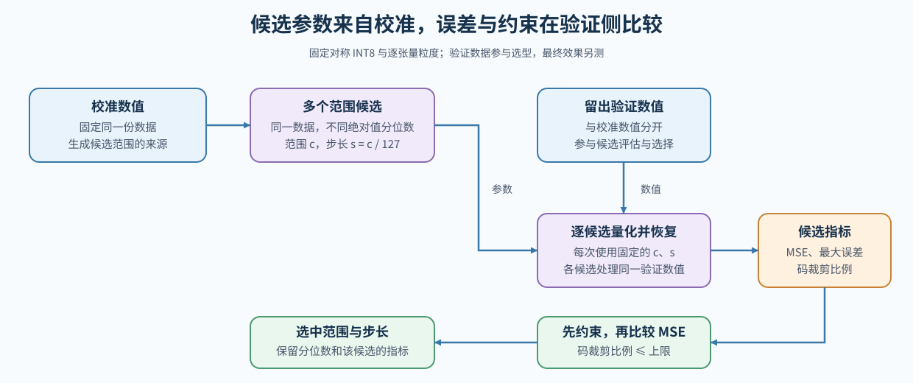
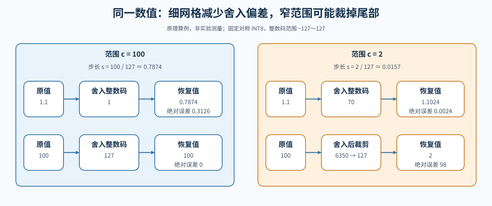

# 52. Quantization Calibration and Error | 量化校准范围与裁剪

**难度：** Medium | **环境：** [CPU 主线](#runtime-environment) | **标签：** `量化`, `校准范围`, `clipping`, `误差` | **目标人群：** 理解整数表示、需要选择量化范围的读者

> 🚀 **云端运行环境**
>
> 本章节的实战代码可以点击以下链接在免费 GPU 算力平台上直接运行：
>
> [](https://colab.research.google.com/github/datawhalechina/llm-algo-leetcode/blob/main/02_PyTorch_Algorithms/52_Quantization_Calibration_and_Error.ipynb)
> [](https://modelscope.cn/my/mynotebook) *(国内推荐：魔搭社区免费实例)*


## 本节导读

少数异常值会把量化范围拉大，让常见数值使用的网格变粗；缩小范围虽然能细化网格，却可能把尾部值裁到端点。同一组数据，哪种范围的恢复误差更小，需要把这两种影响放在一起比较。

本节从校准数据生成范围候选，在另一组验证数据上计算恢复误差和整数码裁剪比例，再选择满足比例上限的低误差候选。验证数据会参与选择；确定范围后，还可以在最终测试负载上检查效果。

**关键词：** `校准数据`, `验证数据`, `裁剪分位数`, `舍入误差`, `饱和率`

<a id="runtime-environment"></a>

## 运行环境

- **基础练习与框架核对：** 使用 [`BASE-CPU`](../guide.md#base-cpu)，运行 [Step 4](#mechanism-practice) 后继续完成 [框架一致性核对](#framework-check)。

---
## 前置阅读

先掌握整数码、缩放因子和粒度，再学习如何从校准数据生成范围候选，并在独立验证数据上选择裁剪分位数。

- [Part 01 · 21 Quantization Theory | 量化理论与 INT4/INT8](../01_Hardware_Math_and_Systems/21_Quantization_Theory_and_INT4_INT8.md)
- [Part 02 · 25 W8A16 Quantization | W8A16 表示与粒度](./25_Quantization_W8A16.md)

## Step 1：校准范围为什么会改变量化网格

先固定对称 INT8 和逐张量粒度。用绝对值最大值估计范围时，若校准数值落在 `[-2, 2]`，量化步长约为 `2 / 127`；加入一个 `100` 的异常值后，步长扩大为约 `100 / 127`。格式和整数码数量保持相同，但常见数值附近的网格明显变粗。

校准还可以使用绝对值的分位数：分位数为 1 时采用完整范围，较低分位数允许缩小范围。每个分位数得到一个候选范围 $c$ 和步长 $s$；候选参数来自校准数据，验证数值只用这些参数量化和恢复。分别记录候选的误差及饱和率后，再判断哪一个更合适。

| 校准条件 | 估计范围 | 近似步长 | 对普通值的影响 |
|:---|:---|:---|:---|
| 数值落在 `[-2, 2]`，取最大绝对值 | 2 | 0.0157 | 网格较细 |
| 加入异常值 `100`，仍取最大绝对值 | 100 | 0.7874 | 网格变粗，舍入偏差可能增大 |
| 对同一校准集合降低分位数 | 不大于完整范围 | 随候选分位数变化 | 网格可能变细，同时需检查尾部裁剪 |



## Step 2：区分恢复总误差与整数码裁剪比例

候选范围 $c>0$ 决定步长 $s(c)$。本页取对称整数码上限 $q_{\max}=127$；先舍入得到未裁剪码 $u_i(c)$，再把超界码裁到端点，最后恢复为 $\hat x_i(c)$：

$$
s(c)=\frac{c}{q_{\max}},\qquad
u_i(c)=\mathrm{round}\left(\frac{x_i}{s(c)}\right),\qquad
q_i(c)=\mathrm{clip}(u_i(c),-q_{\max},q_{\max}),\qquad
\hat x_i(c)=s(c)q_i(c).
$$

均方误差 MSE 汇总所有验证元素的恢复偏差，包含舍入和裁剪的共同影响。这里的饱和率专指“舍入后整数码仍超界、因而需要裁剪的比例”，不是原值超过 $c$ 的比例。例如 $c=127$、 $s=1$ 时，127.4 舍入为 127，无需裁剪；127.6 舍入为 128，需要裁到 127。设验证元素数为 $N$，两项指标为

$$
\mathrm{MSE}(c)=\frac1N\sum_{i=1}^N(x_i-\hat x_i(c))^2,
\qquad
\rho_{\mathrm{sat}}(c)=\frac1N\sum_{i=1}^N\mathbf 1\big(|u_i(c)|>q_{\max}\big).
$$

| 影响 | 怎样发生 | 对恢复结果的影响 | 可检查的调整 |
|:---|:---|:---|:---|
| 舍入 | 数值落在两个网格点之间 | 恢复到邻近网格点，普通值也可能产生偏差 | 比较不同范围或更细粒度 |
| 裁剪 | 舍入后整数码超出上下限 | 恢复值停在端点，尾部偏差可能很大 | 适当扩大范围并重新评估 |
| 分布变化 | 校准数值未覆盖验证负载特征 | 候选在验证侧的误差或裁剪比例升高 | 检查校准覆盖并补充样本 |



## Step 3：先限制码裁剪比例，再选择低误差范围

每个候选范围只能由校准数值生成，再用未参与范围估计的验证数值测量误差和饱和率。令 $\mathcal C$ 为范围候选集合， $\tau$ 为允许的最大饱和比例，范围选择写为

$$
c^{\ast}=\arg\min_{c\in\mathcal C}\mathrm{MSE}(c)
\quad\text{s.t.}\quad \rho_{\mathrm{sat}}(c)\le\tau.
$$

先排除饱和率超限的候选，再按验证 MSE 选择；MSE 相同时优先较高分位数。若全部候选超限，就调整候选或约束后重新比较。验证数据与校准数据分开，但已参与范围选择，最终负载的测试应另外保留。

| 搜索阶段 | 使用的数据 | 输出 |
|:---|:---|:---|
| 生成候选 | 校准数值 | 分位数、范围、缩放因子 |
| 验证候选 | 验证数值 | MSE、最大误差、饱和率 |
| 应用约束 | 验证指标 | 满足最大饱和率的可行集合 |
| 选择范围 | 可行集合 | 验证 MSE 最低的裁剪候选 |

<a id="mechanism-practice"></a>

## Step 4：实现裁剪候选评估与范围搜索

题目区固定对称 INT8 和逐张量粒度。骨架负责输入检查、误差汇总和结果字段；你需要从校准数值估计缩放因子，用该缩放因子量化独立验证数值，并完成带饱和率约束的分位数搜索。

| TODO / 函数 | 学习者完成的机制 | 必须满足的约束 | 测试证据 |
|:---|:---|:---|:---|
| TODO 1：估计对称缩放因子<br>`calibrate_symmetric_scale` | 从校准数值的绝对值分位数估计对称缩放因子 | 分位数合法，缩放因子有限且为正 | 最大范围、80% 分位数与全零张量 |
| TODO 2：评估裁剪候选<br>`evaluate_clipping_candidate` | 用校准范围量化并评估独立验证数值 | 缩放因子不得从验证数值重估，误差和饱和率只在验证侧计算 | 校准/验证隔离、恢复误差，以及 127.4／127.6 的码裁剪边界 |
| TODO 3：选择裁剪候选<br>`select_clipping_candidate` | 在饱和率约束下选择误差最低的分位数 | 先淘汰超限候选；MSE 平局时优先更高分位数 | 无可行候选、候选平局与最佳范围 |


```python
import torch

```


```python
def calibrate_symmetric_scale(
    values: torch.Tensor, qmax: int = 127, clipping_quantile: float = 1.0
) -> torch.Tensor:
    """使用绝对值分位数估计对称量化范围，并返回正缩放因子。"""
    if values.numel() == 0 or qmax <= 0:
        raise ValueError("values must be non-empty and qmax must be positive")
    if not 0.0 < clipping_quantile <= 1.0:
        raise ValueError("clipping_quantile must be in (0, 1]")
    # ==========================================
    # TODO 1：估计对称步长
    # ==========================================
    # abs_values = ???  # 脱离计算图并展平的校准绝对值。
    # calibrated_range = ???  # 指定绝对值分位数对应的候选范围。
    # scale = ???  # 范围与整数码上限对应的正步长，全零范围也须得到正值。
    raise NotImplementedError("TODO 1：请完成估计对称步长")
    return scale


def quantize_dequantize_symmetric(
    values: torch.Tensor, scale: torch.Tensor, qmax: int = 127
) -> tuple[torch.Tensor, torch.Tensor, float]:
    """返回对称量化码、恢复值及舍入后超界码的比例。"""
    if qmax <= 0 or scale.numel() != 1 or scale.item() <= 0:
        raise ValueError("scale must be a positive scalar and qmax must be positive")
    raw_codes = torch.round(values / scale)
    saturation_rate = float((raw_codes.abs() > qmax).float().mean())
    codes = torch.clamp(raw_codes, -qmax, qmax).to(torch.int8)
    reconstructed = codes.to(values.dtype) * scale
    return codes, reconstructed, saturation_rate


def evaluate_clipping_candidate(
    calibration_values: torch.Tensor, validation_values: torch.Tensor, clipping_quantile: float
) -> dict[str, float]:
    """只用校准估计缩放因子，并在验证上测量误差。"""
    if calibration_values.numel() == 0 or validation_values.numel() == 0:
        raise ValueError("calibration and validation values must be non-empty")
    # ==========================================
    # TODO 2：在验证数值上评估候选
    # ==========================================
    # scale = ???  # 只由 calibration_values 与候选分位数估计的步长。
    # quantized_validation = ???  # 使用该步长处理 validation_values 的量化、恢复及码裁剪结果。
    raise NotImplementedError("TODO 2：请完成在验证数值上评估候选")
    _, reconstructed, saturation_rate = quantized_validation
    delta = validation_values.float() - reconstructed.float()
    return {
        "quantile": float(clipping_quantile), "scale": float(scale.item()),
        "mse": float(delta.square().mean()),
        "max_abs_error": float(delta.abs().max()),
        "saturation_rate": saturation_rate,
    }


def select_clipping_candidate(
    calibration_values: torch.Tensor, validation_values: torch.Tensor,
    quantile_candidates: list[float], max_saturation_rate: float,
) -> dict[str, float]:
    """从满足饱和率约束的候选中选择验证 MSE 最低者。"""
    if not quantile_candidates or not 0.0 <= max_saturation_rate <= 1.0:
        raise ValueError("quantiles must be non-empty and saturation limit must be in [0, 1]")
    candidates = [evaluate_clipping_candidate(
        calibration_values, validation_values, quantile
    ) for quantile in quantile_candidates]
    # ==========================================
    # TODO 3：筛选并选择范围
    # ==========================================
    # feasible = ???  # 满足给定码裁剪比例上限的候选列表。
    # selected = ???  # 验证 MSE 最低的可行候选；平局按分位数选择，空集合暂记 None。
    raise NotImplementedError("TODO 3：请完成筛选并选择范围")
    if not feasible:
        raise RuntimeError("no feasible clipping candidate")
    return selected

```

## 测试

分别核对步长估计、校准／验证分工、码裁剪边界、比例约束及分位数平局选择；另用数值断言复核图中的恢复算例。


```python
def test_clipping_scale_contract() -> None:
    """TODO 1：较低分位数缩小异常值主导的范围，全零输入仍保持正缩放因子。"""
    values = torch.tensor([-100.0, -1.0, 0.0, 1.0, 2.0])
    full_scale = calibrate_symmetric_scale(values, clipping_quantile=1.0)
    clipped_scale = calibrate_symmetric_scale(values, clipping_quantile=0.8)
    assert clipped_scale < full_scale
    assert calibrate_symmetric_scale(torch.zeros(4)).item() > 0


def test_candidate_uses_calibration_scale_on_validation() -> None:
    """TODO 2：候选缩放因子来自校准，指标只在验证上计算。"""
    calibration = torch.tensor([-2.0, -1.0, 0.0, 1.0, 100.0])
    validation = torch.tensor([-2.0, -1.0, 0.0, 1.0, 2.0])
    candidate = evaluate_clipping_candidate(calibration, validation, 0.8)
    expected_scale = calibrate_symmetric_scale(calibration, clipping_quantile=0.8)
    assert candidate["scale"] == float(expected_scale)
    assert candidate["quantile"] == 0.8
    assert {"mse", "max_abs_error", "saturation_rate"} <= set(candidate)
    assert 0.0 <= candidate["saturation_rate"] <= 1.0


def test_clipping_search_selects_lowest_feasible_mse() -> None:
    """TODO 3：先满足饱和率约束，再选择验证 MSE 最低候选。"""
    calibration = torch.tensor([-8.0, -2.0, -1.0, 0.0, 1.0, 2.0, 8.0])
    validation = torch.tensor([-3.0, -2.0, -1.0, 0.0, 1.0, 2.0, 3.0])
    quantiles = [1.0, 0.9, 0.7]
    candidates = [evaluate_clipping_candidate(calibration, validation, q) for q in quantiles]
    feasible = [item for item in candidates if item["saturation_rate"] <= 0.30]
    selected = select_clipping_candidate(calibration, validation, quantiles, 0.30)
    assert selected == min(feasible, key=lambda item: (item["mse"], -item["quantile"]))


def test_no_feasible_clipping_candidate() -> None:
    """所有候选饱和率超限时必须明确失败。"""
    try:
        select_clipping_candidate(
            torch.tensor([0.0, 1.0, 100.0]), torch.tensor([-100.0, 100.0]),
            [0.5], max_saturation_rate=0.0,
        )
    except RuntimeError as exc:
        assert "clipping candidate" in str(exc)
    else:
        raise AssertionError("no feasible clipping candidate must fail")


def test_saturation_counts_rounded_codes() -> None:
    """舍入后超界才计入饱和率，原值超出范围并不总会触发码裁剪。"""
    calibration = torch.tensor([-127.0, 127.0])
    validation = torch.tensor([-127.6, -127.4, 0.0, 127.4, 127.6])
    scale = calibrate_symmetric_scale(calibration)
    codes, restored, saturation = quantize_dequantize_symmetric(validation, scale)
    torch.testing.assert_close(scale, torch.tensor(1.0))
    torch.testing.assert_close(codes, torch.tensor([-127, -127, 0, 127, 127], dtype=torch.int8))
    torch.testing.assert_close(restored, codes.float())
    assert abs(saturation - 2 / 5) < 1e-7
    range_exceedance = float((validation.abs() > 127).float().mean())
    assert abs(range_exceedance - 4 / 5) < 1e-7
    selected = select_clipping_candidate(
        calibration, validation, [1.0], max_saturation_rate=0.5,
    )
    assert abs(selected["saturation_rate"] - 2 / 5) < 1e-7


def test_clipping_tie_prefers_higher_quantile() -> None:
    """验证误差相同时优先更高分位数，且不受候选输入顺序影响。"""
    calibration = torch.tensor([-1.0, 1.0])
    validation = torch.zeros(3)
    for quantiles in ([0.5, 1.0], [1.0, 0.5]):
        selected = select_clipping_candidate(calibration, validation, quantiles, 0.0)
        assert selected["quantile"] == 1.0 and selected["mse"] == 0.0


def test_wide_narrow_range_illustration() -> None:
    """图示中的原值、整数码和恢复值须与实际计算一致。"""
    values = torch.tensor([1.1, 100.0])
    wide_scale = calibrate_symmetric_scale(torch.tensor([-100.0, 100.0]))
    narrow_scale = calibrate_symmetric_scale(torch.tensor([-2.0, 2.0]))
    wide_codes, wide_restored, wide_saturation = quantize_dequantize_symmetric(values, wide_scale)
    narrow_codes, narrow_restored, narrow_saturation = quantize_dequantize_symmetric(values, narrow_scale)
    torch.testing.assert_close(wide_codes, torch.tensor([1, 127], dtype=torch.int8))
    torch.testing.assert_close(narrow_codes, torch.tensor([70, 127], dtype=torch.int8))
    torch.testing.assert_close(wide_restored, torch.tensor([100 / 127, 100.0]))
    torch.testing.assert_close(narrow_restored, torch.tensor([140 / 127, 2.0]))
    assert wide_saturation == 0.0 and narrow_saturation == 0.5
    assert abs(float(narrow_restored[0] - values[0])) < abs(float(wide_restored[0] - values[0]))
    assert abs(float(narrow_restored[1] - values[1])) > abs(float(wide_restored[1] - values[1]))


for test in (
    test_clipping_scale_contract,
    test_saturation_counts_rounded_codes,
    test_clipping_tie_prefers_higher_quantile,
    test_wide_narrow_range_illustration,
    test_candidate_uses_calibration_scale_on_validation,
    test_clipping_search_selects_lowest_feasible_mse,
    test_no_feasible_clipping_candidate,
):
    test()
print("✅ 7 项测试通过：步长、数据分工、码裁剪边界、图示算例与候选选择。")

```

---

🛑 **STOP HERE** 🛑
<br><br><br><br><br><br><br><br><br><br>
> 请先尝试自己完成代码并跑通测试。<br>
> 如果遇到困难，再向下查看参考代码与解析。
<br><br><br><br><br><br><br><br><br><br>

---
## 参考代码与解析

### 代码


```python
def calibrate_symmetric_scale(
    values: torch.Tensor, qmax: int = 127, clipping_quantile: float = 1.0
) -> torch.Tensor:
    """使用绝对值分位数估计对称量化范围，并返回正缩放因子。"""
    if values.numel() == 0 or qmax <= 0:
        raise ValueError("values must be non-empty and qmax must be positive")
    if not 0.0 < clipping_quantile <= 1.0:
        raise ValueError("clipping_quantile must be in (0, 1]")
    # TODO 1：估计对称步长
    abs_values = values.detach().float().abs().flatten()
    calibrated_range = torch.quantile(abs_values, clipping_quantile)
    scale = calibrated_range.clamp_min(torch.finfo(torch.float32).eps) / qmax
    return scale


def quantize_dequantize_symmetric(
    values: torch.Tensor, scale: torch.Tensor, qmax: int = 127
) -> tuple[torch.Tensor, torch.Tensor, float]:
    """返回对称量化码、恢复值及舍入后超界码的比例。"""
    if qmax <= 0 or scale.numel() != 1 or scale.item() <= 0:
        raise ValueError("scale must be a positive scalar and qmax must be positive")
    raw_codes = torch.round(values / scale)
    saturation_rate = float((raw_codes.abs() > qmax).float().mean())
    codes = torch.clamp(raw_codes, -qmax, qmax).to(torch.int8)
    reconstructed = codes.to(values.dtype) * scale
    return codes, reconstructed, saturation_rate


def evaluate_clipping_candidate(
    calibration_values: torch.Tensor, validation_values: torch.Tensor, clipping_quantile: float
) -> dict[str, float]:
    """只用校准估计缩放因子，并在验证上测量误差。"""
    if calibration_values.numel() == 0 or validation_values.numel() == 0:
        raise ValueError("calibration and validation values must be non-empty")
    # TODO 2：在验证数值上评估候选
    scale = calibrate_symmetric_scale(calibration_values, clipping_quantile=clipping_quantile)
    quantized_validation = quantize_dequantize_symmetric(validation_values, scale)
    _, reconstructed, saturation_rate = quantized_validation
    delta = validation_values.float() - reconstructed.float()
    return {
        "quantile": float(clipping_quantile), "scale": float(scale.item()),
        "mse": float(delta.square().mean()),
        "max_abs_error": float(delta.abs().max()),
        "saturation_rate": saturation_rate,
    }


def select_clipping_candidate(
    calibration_values: torch.Tensor, validation_values: torch.Tensor,
    quantile_candidates: list[float], max_saturation_rate: float,
) -> dict[str, float]:
    """从满足饱和率约束的候选中选择验证 MSE 最低者。"""
    if not quantile_candidates or not 0.0 <= max_saturation_rate <= 1.0:
        raise ValueError("quantiles must be non-empty and saturation limit must be in [0, 1]")
    candidates = [evaluate_clipping_candidate(
        calibration_values, validation_values, quantile
    ) for quantile in quantile_candidates]
    # TODO 3：筛选并选择范围
    feasible = [candidate for candidate in candidates
                if candidate["saturation_rate"] <= max_saturation_rate]
    selected = min(feasible, key=lambda item: (item["mse"], -item["quantile"]), default=None)
    if not feasible:
        raise RuntimeError("no feasible clipping candidate")
    return selected

```

### 解析

#### TODO 1：估计对称步长

- 对绝对值取分位数范围，再除以正整数码上限。全零输入需要正范围下限，实现采用 FP32 epsilon。
- 最大范围、80% 分位数与全零用例核对范围变化及正步长；图示算例额外验证范围 100 与 2 对应的恢复值。

#### TODO 2：在验证数值上评估候选

- 步长由校准数值生成，随后固定用于验证侧量化与恢复；MSE 统计总恢复误差，饱和率统计舍入后需要裁剪的码。
- 测试用不同的校准／验证集合核对步长来源，再用正负 127.4 与 127.6 区分“原值超出范围”和“整数码需要裁剪”。

#### TODO 3：筛选后再排序

- 先满足饱和率上限，再选择验证 MSE 最低者；误差平局时优先较高分位数，全部超限时明确失败。
- 测试分别覆盖比例约束、没有可行候选及相反输入顺序下的平局。码裁剪边界用例还检查实际比例 0.4 在上限 0.5 下可以通过。

<a id="framework-check"></a>

## 框架一致性核对（可选）

给定同一组校准和验证数值，用 PyTorch `MinMaxObserver` 与逐张量伪量化算子核对最大范围候选的步长、零点和恢复值。码裁剪比例按 Step 2 定义另作显式计算。

| 核对对象 | Step 4 教学实现 | 成熟框架 CPU 路径 | 共同输入与通过条件 |
|:---|:---|:---|:---|
| 最大范围步长 | `calibrate_symmetric_scale(..., 1.0)` | `MinMaxObserver.calculate_qparams` | 相同校准数值及码范围 −127～127，步长一致且框架零点为零 |
| 验证恢复值 | `quantize_dequantize_symmetric` | `torch.fake_quantize_per_tensor_affine` | 同一验证数值和量化参数，各恢复元素在容差内一致 |


```python
from torch.ao.quantization.observer import MinMaxObserver


def check_calibration_framework_conformance():
    """核对最大范围校准与 PyTorch Observer、伪量化语义。"""
    calibration = torch.tensor([-4.0, -0.8, 0.0, 1.5, 3.2], dtype=torch.float32)
    validation = torch.tensor([-5.0, -0.4, 0.6, 2.0, 4.5], dtype=torch.float32)
    local_scale = calibrate_symmetric_scale(calibration, clipping_quantile=1.0)

    observer = MinMaxObserver(
        dtype=torch.qint8,
        qscheme=torch.per_tensor_symmetric,
        quant_min=-127,
        quant_max=127,
    )
    observer(calibration)
    framework_scale, framework_zero_point = observer.calculate_qparams()
    _, local_restored, local_saturation = quantize_dequantize_symmetric(validation, local_scale)
    framework_restored = torch.fake_quantize_per_tensor_affine(
        validation, float(framework_scale.item()), int(framework_zero_point.item()), -127, 127
    )
    expected_saturation = float((torch.round(validation / local_scale).abs() > 127).float().mean())
    checks = {
        "scale_match": bool(torch.isclose(local_scale, framework_scale[0], atol=1e-7, rtol=1e-6)),
        "zero_point_is_zero": int(framework_zero_point.item()) == 0,
        "reconstruction_match": bool(torch.allclose(local_restored, framework_restored, atol=1e-7, rtol=1e-6)),
        "saturation_match": abs(local_saturation - expected_saturation) < 1e-8,
    }
    failed = [name for name, passed in checks.items() if not passed]
    if failed:
        raise AssertionError(f"框架一致性核对失败：{failed}")
    return {
        "status": "passed",
        "versions": {"torch": torch.__version__},
        "checks": checks,
        "scale": float(local_scale.item()),
        "saturation_rate": local_saturation,
    }


framework_check = check_calibration_framework_conformance()
framework_check
```

## 相关阅读

- [25. W8A16 Quantization | W8A16 表示基础](./25_Quantization_W8A16.md)
- [40. GPTQ and AWQ | GPTQ / AWQ 权重量化](./40_GPTQ_and_AWQ_Weight_Quantization.md)
- [53. Activation Quantization and SmoothQuant | 激活量化与 SmoothQuant](./53_Activation_Quantization_and_SmoothQuant.md)
- [Hugging Face Transformers: Quantization](https://huggingface.co/docs/transformers/main/quantization/overview)
