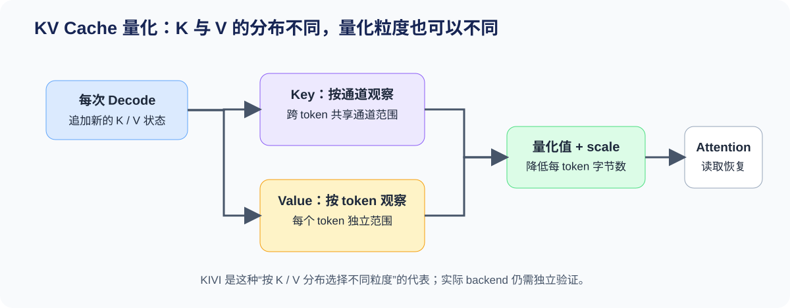
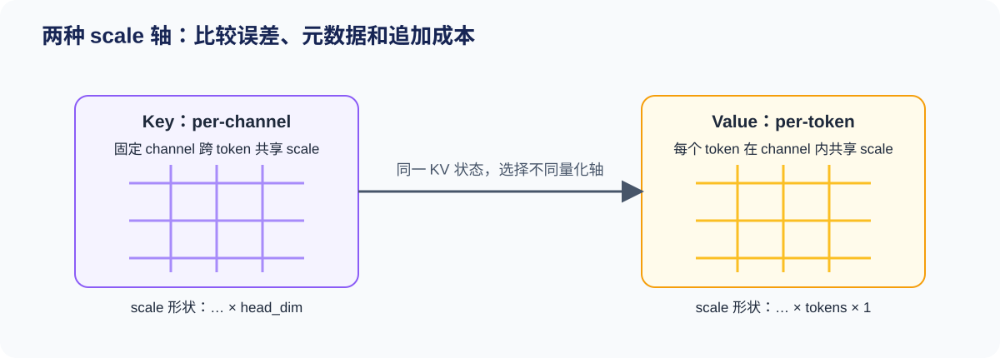

# 54. KV Cache Quantization Strategies | KV Cache 量化策略

**难度：** Hard | **环境：** [CPU 主线，GPU 可选](#runtime-environment) | **标签：** `量化`、`KV Cache`、`KIVI` | **目标人群：** 理解注意力与量化缩放的读者

> 🚀 **云端运行环境**
>
> 本章节的实战代码可以点击以下链接在免费 GPU 算力平台上直接运行：
>
> [](https://colab.research.google.com/github/datawhalechina/llm-algo-leetcode/blob/main/02_PyTorch_Algorithms/54_KV_Cache_Quantization_Strategies.ipynb)
> [](https://modelscope.cn/my/mynotebook) *(国内推荐：魔搭社区免费实例)*


## 本节导读

模型已经能够装入显存，为什么对话变长后仍可能耗尽空间？每生成一个新词元，就要为它保存后续注意力会读取的键和值状态。长上下文与高并发会让 KV Cache 成为推理显存和带宽的持续成本。K 和 V 虽然一起参与 Attention，却不必共享同一种量化轴。以 KIVI 为代表的方法从二者的分布差异出发，分别选择更合适的缩放粒度。

本节比较 K/V 量化轴、高精度残留窗口、恢复误差和缓存容量，解释为什么缓存更小，生成每个词元却未必更快。
<a id="runtime-environment"></a>

## 运行环境

- **基础练习：** 使用 [`BASE-CPU`](../guide.md#base-cpu)，运行 [Step 4 的题目与测试](#mechanism-practice)。
- **框架核对：** 使用 [`Q-CPU`](../topic_discussion/quantization_compression/quickstart.md#q-cpu-quickstart)，运行 [框架一致性核对](#framework-check)。
- **GPU 实测：** 使用 `Q-CUDA-MECHANISM`；实验环境、运行配置与固定工作负载见 [Step 5](#gpu-experiment)。

---
## 前置阅读

先了解 KV Cache 为什么随请求增长，再区分分页管理与量化：前者决定状态如何分配和复用，后者改变每个状态的表示与字节数。

- [Part 01 · 11 KV Cache 与显存增长](../01_Hardware_Math_and_Systems/11_KV_Cache_and_Memory_Growth.md)
- [52. 量化校准与误差控制](./52_Quantization_Calibration_and_Error.md)
- [22. vLLM PagedAttention](./22_vLLM_PagedAttention.md)

## Step 1：为什么 K 和 V 可以采用不同量化策略

每个 Decode 步都会追加新的 Key（键状态，K）和 Value（值状态，V），并在后续 Attention 中被反复读取。若统一采用一种全局缩放因子，既可能放大量化误差，也可能忽略 K 与 V 的不同分布。Key 与当前 Query（查询，Q）的点积决定关注位置，Value 再按注意力权重汇聚。KIVI 根据观察到的分布差异，采用 Key 逐通道、Value 逐词元的分组量化；量化轴说明哪些数值共用范围，不是说两侧需要相同的缩放值。

| 状态 | 在 Attention 中的作用 | 量化时关注 | 典型收益 |
|---|---|---|---|
| Key | 参与与 Query 的匹配 | 通道范围、历史 token 的聚合 | 更低缓存容量与读取带宽 |
| Value（值状态） | 参与加权汇聚 | 每个 Token 的局部范围 | 更稳定的恢复误差 |
| 分页 / 前缀复用 | 管理状态的分配与复用 | 页、前缀与驻留策略 | 与量化互补，不改变位宽 |


## Step 2：两种量化轴如何决定缩放因子形状

本节采用 `[batch, heads, tokens, head_dim]` 的教学形状。Key 逐通道在 Token 维聚合范围，得到每个通道的缩放因子；Value 逐 Token 在 `head_dim` 维聚合范围，得到每个 Token 的缩放因子。两者都要求缩放因子能与量化张量正确广播。

令 $K,V\in\mathbb R^{B\times H\times L\times D}$。Key 逐通道缩放在 Token 维 $L$ 上归约，Value 逐 Token 缩放在 每个头的通道维 $D$ 上归约：

$$
s^K_{b,h,1,d}=\frac{\max_l|K_{b,h,l,d}|}{q_{\max}},\qquad
s^V_{b,h,l,1}=\frac{\max_d|V_{b,h,l,d}|}{q_{\max}}.
$$

这里 $s$ 是恢复尺度：编码时计算 $q=\operatorname{clip}(\operatorname{round}(x/s),-q_{\max},q_{\max})$，恢复时用 $\hat x=sq$；全零范围用正下限保护。$B,H,L,D$ 分别表示批大小、KV Head 数、缓存 Token 数和 Head 维度；保留长度为 1 的归约维度可广播回原张量。真实分组方案还限制统计覆盖的长度；这两个公式以一段输入为一组，使用对称码值，不复现 KIVI 的非对称零点、完整分组和打包内核。

| 方案 | 归约维度 | 缩放因子形状 | 适合回答的问题 |
|---|---|---|---|
| Key 逐通道 | Token 维 | `[..., 1, head_dim]` | 历史 Token 上同一通道如何共享范围 |
| Value 逐 Token | `head_dim` 维 | `[..., tokens, 1]` | 一个 Token 内各通道如何共享范围 |
| 单一分组策略 | 固定大小局部组 | 依 group 而定 | 实现简单，但未必适配 K/V 分布 |


## Step 3：追加、转存与读取分别增加什么成本

新词元先进入高精度残留窗口，即尚未量化的最近一段状态；这段窗口不是丢弃旧历史的滑动注意力窗口。超过上限时，可以只量化本轮溢出的旧状态，保留已有量化段不变；也可以在累计到阈值后恢复并重新量化整个前缀。两种更新规则的恢复误差、转存频率和元数据数量不同，不能用同一个窗口长度推断相同代价。按当前环境锁定版本的实现，Transformers／HQQ 首次追加即建立量化基段，后续保留新增状态，到阈值时重新量化完整前缀。

读取时需要按历史顺序恢复各段，再接上高精度尾部。若先显式恢复整段浮点 K/V，临时张量和拼接仍会产生内存与时间成本；融合内核则可能边读取边恢复。忽略元数据时，量化前缀容量约为 $2BHL_qD\,b/8$，高精度尾部另占 $2BHRD\,b_h/8$，其中 $L_q$、$R$ 是两段长度，$b$、$b_h$ 是各自位宽。实际账本还要计入缩放、零点、打包填充及底层存储；一个小切片仍可能引用完整大张量。目标是同时比较缓存驻留、恢复开销、生成速度与质量，而非只比较名义位宽。

| 状态或成本 | 更新或读取方式 | 需要检查的对象 |
|---|---|---|
| 量化前缀 | 增量分段或到阈值重新量化 | 历史顺序、重写范围、分段数与缩放字节 |
| 高精度窗口 | 追加最新状态，到阈值转存 | 实际残留长度、转存时点、切片底层存储 |
| Attention 读取 | 恢复历史并接上高精度尾部，或融合恢复 | 完整 K/V 的形状、顺序、误差与临时分配 |
| 生成代价 | 统计、量化、恢复、拼接与计算 | 独立 Decode 计时及固定轨迹质量；整段平均时间另记 |

<a id="mechanism-practice"></a>

## Step 4：实现 K/V 异轴量化与追加状态

题目区用形状为 `[batch, heads, tokens, head_dim]` 的 K/V 状态复现异轴量化与多轮追加生命周期。骨架已经提供量化码生成、恢复、分段状态和实际容器与理论打包字节；你需要补全 Key 量化轴、Value 量化轴，以及每轮应该从高精度窗口转存多少旧 Token。

| TODO / 函数 | 待实现机制 | 必须满足的约束 | 测试证据 |
|:---|:---|:---|:---|
| TODO 1：按通道量化 Key<br>`quantize_key_per_channel` | 沿 Token 维估计 Key 的逐通道范围并生成量化码 | 缩放因子形状为 `[..., 1, head_dim]`，全零通道仍有限 | 形状、全零输入与恢复误差 |
| TODO 2：按 Token 量化 Value<br>`quantize_value_per_token` | 沿头维估计 Value 的逐 Token 范围并生成量化码 | 缩放因子形状为 `[..., tokens, 1]`，每个 Token 独立 | 形状、全零输入与恢复误差 |
| TODO 3：转存溢出高精度窗口的状态<br>`append_and_partition` | 计算本轮从高精度窗口转存的旧 Token 数 | 未溢出时为零，已量化前缀不重写，Token 总数守恒，读取顺序不变 | 连续追加、旧分段保持、完整读取与驻留账本 |


```python
from math import isfinite
import torch
```


```python
class KVQuantizationStrategies:
    """模拟异轴对称量化与增量分段，不复现完整 KIVI 或 HQQ。

    输入形状为 [batch, heads, tokens, head_dim]。Key 沿 token 维聚合范围，
    V 沿 `head_dim` 聚合范围；最新 token 保留在高精度残留窗口中。
    """

    def __init__(self, qmax: int = 7, eps: float = 1e-8):
        # qmax=7 表示有符号 4-bit 的教学数值范围；张量仍以 int8 容器保存。
        if type(qmax) is not int or not 1 <= qmax <= 127:
            raise ValueError('qmax must be an integer in [1, 127] for the INT8 container.')
        if not isfinite(eps) or not torch.finfo(torch.float32).tiny <= eps <= torch.finfo(torch.float32).max:
            raise ValueError('eps must be finite and within the positive normal FP32 range.')
        self.qmax = qmax
        self.code_bits = qmax.bit_length() + 1
        self.eps = eps

    @staticmethod
    def _validate_tensor(x, *, allow_empty=False):
        """检查单层缓存形状以及 FP32 教学计算所需的有限输入。"""
        if x.ndim != 4 or any(x.shape[d] <= 0 for d in (0, 1, 3)) or (not allow_empty and x.shape[-2] == 0):
            raise ValueError('cache must have nonempty [batch, heads, tokens, head_dim] dimensions.')
        if not x.is_floating_point() or not bool(torch.isfinite(x.float()).all()):
            raise ValueError('cache input must be floating point and finite in FP32.')

    def _validate_pair(self, key, value, *, allow_empty=False):
        """K/V 使用相同形状、设备和高精度类型。"""
        self._validate_tensor(key, allow_empty=allow_empty)
        self._validate_tensor(value, allow_empty=allow_empty)
        if key.shape != value.shape or key.device != value.device or key.dtype != value.dtype:
            raise ValueError('K/V must share shape, device and dtype.')

    def _validate_state(self, state):
        """同一状态必须保持量化配置、成对分段与 Token 账本。"""
        if not isinstance(state, dict) or state.get('quantization_config') != (self.qmax, self.eps):
            raise ValueError('state quantization configuration does not match this strategy.')
        self._validate_pair(state['key_residual'], state['value_residual'], allow_empty=True)
        counts = [len(state[name]) for name in ('key_q_segments', 'key_scale_segments', 'value_q_segments', 'value_scale_segments')]
        if len(set(counts)) != 1:
            raise ValueError('quantized segments and scales must be paired.')
        key_tokens = sum(t.shape[-2] for t in state['key_q_segments'])
        value_tokens = sum(t.shape[-2] for t in state['value_q_segments'])
        if key_tokens != value_tokens or state.get('total_tokens') != key_tokens + state['key_residual'].shape[-2]:
            raise ValueError('state token ledger is inconsistent.')

    def _quantize(self, x: torch.Tensor, scale: torch.Tensor):
        """除以恢复尺度，生成有符号码值；不进行低位打包。"""
        return torch.clamp(torch.round(x.float() / scale), -self.qmax, self.qmax).to(torch.int8)

    def restore(self, quantized: torch.Tensor, scale: torch.Tensor):
        """用与量化轴兼容的缩放因子恢复浮点近似值。"""
        if not bool(torch.isfinite(scale).all()) or not bool((scale > 0).all()):
            raise ValueError('restore scale must be finite and positive.')
        return quantized.to(scale.dtype) * scale

    def quantize_key_per_channel(self, key: torch.Tensor):
        """沿 token 维估计每个通道的范围，得到 [..., 1, head_dim] 缩放因子。"""
        self._validate_tensor(key)
        # TODO 1（Key 量化轴）：沿 token 维保留维度地聚合 absmax，再生成可广播缩放因子。
        # 注意：全零通道的缩放因子仍需有限；不要沿 head_dim 聚合。
        # key_absmax = ???  # 沿 token 维聚合并保留维度。
        # key_scale = ???   # absmax/qmax 并设置正下限；恢复时乘此尺度。
        # key_q = ???       # INT8 Key 量化码。
        raise NotImplementedError("TODO 1: quantize Key per channel")

    def quantize_value_per_token(self, value: torch.Tensor):
        """沿 head_dim 聚合每个 token 的范围，得到 [..., tokens, 1] 缩放因子。"""
        self._validate_tensor(value)
        # TODO 2（V 量化轴）：沿 head_dim 保留维度地聚合 absmax，再生成可广播缩放因子。
        # 注意：每个 token 保留独立缩放因子；不要沿 token 维聚合。
        # value_absmax = ???  # 沿 head_dim 聚合并保留维度。
        # value_scale = ???   # 每个 token 的 absmax/qmax，并设置正下限。
        # value_q = ???       # INT8 V 量化码。
        raise NotImplementedError("TODO 2: quantize Value per token")

    def append_and_partition(self, state: dict | None, new_key: torch.Tensor,
                             new_value: torch.Tensor, residual_length: int):
        """追加新状态，只量化本轮从高精度窗口溢出的旧 Token。"""
        if type(residual_length) is not int or residual_length <= 0:
            raise ValueError('residual_length must be a positive integer.')
        self._validate_pair(new_key, new_value)
        new_key, new_value = new_key.detach(), new_value.detach()
        if state is not None:
            self._validate_state(state)
            old = state['key_residual']
            if old.shape[:-2] + old.shape[-1:] != new_key.shape[:-2] + new_key.shape[-1:] or old.device != new_key.device or old.dtype != new_key.dtype:
                raise ValueError('cache batch, heads, head_dim, dtype and device must stay fixed.')
            if state['residual_length'] != residual_length:
                raise ValueError('residual_length must stay fixed within one cache.')

        if state is None:
            empty_shape = new_key.shape[:-2] + (0, new_key.shape[-1])
            state = {
                "key_q_segments": [], "key_scale_segments": [],
                "value_q_segments": [], "value_scale_segments": [],
                "key_residual": new_key.new_empty(empty_shape),
                "value_residual": new_value.new_empty(empty_shape),
            }

        key_residual_all = torch.cat((state["key_residual"], new_key), dim=-2)
        value_residual_all = torch.cat((state["value_residual"], new_value), dim=-2)
        # TODO 3（窗口转存机制）：只计算本轮超过 residual_length 的旧 Token 数。
        # flush_tokens = ???  # 未溢出时为 0；不要把已量化分段重新计入。
        raise NotImplementedError("TODO 3: compute newly flushed token count")

        key_flush = key_residual_all[..., :flush_tokens, :]
        value_flush = value_residual_all[..., :flush_tokens, :]
        key_residual = key_residual_all[..., flush_tokens:, :].clone()
        value_residual = value_residual_all[..., flush_tokens:, :].clone()
        key_q_segments = list(state["key_q_segments"])
        key_scale_segments = list(state["key_scale_segments"])
        value_q_segments = list(state["value_q_segments"])
        value_scale_segments = list(state["value_scale_segments"])
        if flush_tokens:
            key_q, key_scale = self.quantize_key_per_channel(key_flush)
            value_q, value_scale = self.quantize_value_per_token(value_flush)
            key_q_segments.append(key_q)
            key_scale_segments.append(key_scale)
            value_q_segments.append(value_q)
            value_scale_segments.append(value_scale)

        quantized_tokens = sum(segment.shape[-2] for segment in key_q_segments)
        return {
            "key_q_segments": key_q_segments,
            "key_scale_segments": key_scale_segments,
            "value_q_segments": value_q_segments,
            "value_scale_segments": value_scale_segments,
            "key_residual": key_residual,
            "value_residual": value_residual,
            "quantization_config": (self.qmax, self.eps),
            "residual_length": residual_length,
            "flushed_tokens": flush_tokens,
            "quantized_tokens": quantized_tokens,
            "total_tokens": quantized_tokens + key_residual.shape[-2],
        }

    def read_state(self, state):
        """按追加顺序恢复全部前缀并拼接尾部；临时完整浮点 K/V 不计入持久账本。"""
        self._validate_state(state)
        keys = [self.restore(q, scale) for q, scale in zip(state['key_q_segments'], state['key_scale_segments'])]
        values = [self.restore(q, scale) for q, scale in zip(state['value_q_segments'], state['value_scale_segments'])]
        return (torch.cat(keys + [state['key_residual'].float()], dim=-2),
                torch.cat(values + [state['value_residual'].float()], dim=-2))

    def state_bytes(self, state):
        """统计当前状态的张量、元数据及独立底层存储；不含 Python 对象或分配器缓存。"""
        self._validate_state(state)
        codes = state['key_q_segments'] + state['value_q_segments']
        scales = state['key_scale_segments'] + state['value_scale_segments']
        residuals = [state['key_residual'], state['value_residual']]
        tensors = codes + scales + residuals
        storage_bytes = {}
        for tensor in tensors:
            storage = tensor.untyped_storage()
            storage_bytes[(str(tensor.device), storage.data_ptr())] = storage.nbytes()
        metadata_bytes = sum(t.numel() * t.element_size() for t in scales)
        residual_bytes = sum(t.numel() * t.element_size() for t in residuals)
        code_bytes = sum(t.numel() * t.element_size() for t in codes)
        return {'code_bits': self.code_bits, 'metadata_bytes': metadata_bytes,
                'residual_bytes': residual_bytes, 'container_code_bytes': code_bytes,
                'logical_state_bytes': code_bytes + metadata_bytes + residual_bytes,
                'physical_storage_bytes': sum(storage_bytes.values()),
                'minimum_packed_state_bytes': sum((t.numel() * self.code_bits + 7) // 8 for t in codes) + metadata_bytes + residual_bytes}

    def compare(self, key: torch.Tensor, value: torch.Tensor):
        """返回两种量化状态的形状、字节与恢复误差。"""
        self._validate_pair(key, value)
        key_q, key_scale = self.quantize_key_per_channel(key)
        value_q, value_scale = self.quantize_value_per_token(value)
        key_restored = self.restore(key_q, key_scale)
        value_restored = self.restore(value_q, value_scale)
        return {
            "key_scale_shape": tuple(key_scale.shape),
            "value_scale_shape": tuple(value_scale.shape),
            "key_mse": torch.mean((key.float() - key_restored) ** 2),
            "value_mse": torch.mean((value.float() - value_restored) ** 2),
            "code_bits": self.code_bits,
            "packing_implemented": False,
            "raw_bytes": key.numel() * key.element_size() + value.numel() * value.element_size(),
            "container_quantized_bytes": (key_q.numel() * key_q.element_size()
                                          + value_q.numel() * value_q.element_size()
                                          + key_scale.numel() * key_scale.element_size()
                                          + value_scale.numel() * value_scale.element_size()),
            "packed_quantized_bytes": (((key_q.numel() * self.code_bits + 7) // 8)
                                       + ((value_q.numel() * self.code_bits + 7) // 8)
                                       + key_scale.numel() * key_scale.element_size()
                                       + value_scale.numel() * value_scale.element_size()),
        }

```

## 测试

测试分别验证 K/V 量化轴、全零范围、多轮追加、已量化分段保持不变、高精度窗口边界和逻辑字节与实际存储；三个机制 TODO 均有独立测试入口。


```python
# 机制测试：K/V 量化轴、追加状态、高精度残留窗口与容量账本。
def test_key_per_channel_scale_shape():
    """TODO 1：Key 缩放因子在 token 维为 1，并保留 head_dim。"""
    key = torch.randn(1, 2, 5, 8)
    key_q, key_scale = KVQuantizationStrategies().quantize_key_per_channel(key)
    assert key_q.shape == key.shape
    assert key_scale.shape == (1, 2, 1, 8)


def test_value_per_token_scale_shape():
    """TODO 2：数值缩放因子为每个 token 保留一个标量。"""
    value = torch.randn(1, 2, 5, 8)
    value_q, value_scale = KVQuantizationStrategies().quantize_value_per_token(value)
    assert value_q.shape == value.shape
    assert value_scale.shape == (1, 2, 5, 1)


def test_append_state_contract():
    """骨架契约：追加后 K/V token 总数守恒。"""
    strategy = KVQuantizationStrategies()
    key = torch.randn(1, 2, 3, 8)
    value = torch.randn(1, 2, 3, 8)
    new_key = torch.randn(1, 2, 2, 8)
    new_value = torch.randn(1, 2, 2, 8)
    state = strategy.append_and_partition(None, key, value, residual_length=4)
    state = strategy.append_and_partition(state, new_key, new_value, residual_length=4)
    assert state["total_tokens"] == 5
    assert state["quantized_tokens"] + state["key_residual"].shape[-2] == 5
    assert state["quantized_tokens"] + state["value_residual"].shape[-2] == 5


def test_residual_window_partition_contract():
    """TODO 3：超过窗口的旧前缀量化，最新 token 保持高精度。"""
    key = torch.randn(1, 2, 3, 8)
    value = torch.randn(1, 2, 3, 8)
    new_key = torch.randn(1, 2, 2, 8)
    new_value = torch.randn(1, 2, 2, 8)
    strategy = KVQuantizationStrategies()
    state = strategy.append_and_partition(None, key, value, residual_length=2)
    state = strategy.append_and_partition(state, new_key, new_value, residual_length=2)
    assert state["quantized_tokens"] == 3
    assert sum(segment.shape[-2] for segment in state["key_q_segments"]) == 3
    assert state["key_residual"].shape[-2] == 2
    assert state["value_residual"].shape[-2] == 2


def test_previous_quantized_segments_are_not_rewritten():
    """TODO 3：连续追加只增加新分段，不重写已量化前缀。"""
    strategy = KVQuantizationStrategies()
    state = strategy.append_and_partition(
        None, torch.randn(1, 1, 3, 4), torch.randn(1, 1, 3, 4), residual_length=2
    )
    first_segment = state["key_q_segments"][0].clone()
    state = strategy.append_and_partition(
        state, torch.randn(1, 1, 2, 4), torch.randn(1, 1, 2, 4), residual_length=2
    )
    assert len(state["key_q_segments"]) == 2
    assert torch.equal(state["key_q_segments"][0], first_segment)
    assert state["flushed_tokens"] == 2


def test_window_without_overflow_contract():
    """TODO 3 边界：缓存尚未超过窗口时，不应伪造量化前缀。"""
    key = torch.randn(1, 1, 1, 4)
    value = torch.randn(1, 1, 1, 4)
    new_key = torch.randn(1, 1, 1, 4)
    new_value = torch.randn(1, 1, 1, 4)
    strategy = KVQuantizationStrategies()
    state = strategy.append_and_partition(None, key, value, residual_length=4)
    state = strategy.append_and_partition(state, new_key, new_value, residual_length=4)
    assert state["quantized_tokens"] == 0
    assert state["flushed_tokens"] == 0
    assert state["key_residual"].shape[-2] == 2


def test_restore_and_budget_contract():
    """两种状态可恢复为有限值，并把缩放因子元数据计入字节账本。"""
    torch.manual_seed(0)
    key, value = torch.randn(1, 2, 7, 8), torch.randn(1, 2, 7, 8)
    result = KVQuantizationStrategies().compare(key, value)
    assert torch.isfinite(result["key_mse"]) and torch.isfinite(result["value_mse"])
    assert result["packed_quantized_bytes"] < result["raw_bytes"]
    assert result["packed_quantized_bytes"] < result["container_quantized_bytes"]


def test_zero_range_scale_is_finite():
    """TODO 1/2 边界：全零 K/V 不能产生无穷缩放因子。"""
    strategy = KVQuantizationStrategies()
    zeros = torch.zeros(1, 1, 3, 4)
    _, key_scale = strategy.quantize_key_per_channel(zeros)
    _, value_scale = strategy.quantize_value_per_token(zeros)
    assert torch.isfinite(key_scale).all() and torch.isfinite(value_scale).all()


def test_scale_formula_and_separate_packing():
    """尺度方向与公式一致，位数按码值推导，K/V 分别向整字节取整。"""
    x = torch.tensor([[[[-14.0], [3.0]]]])
    strategy = KVQuantizationStrategies(qmax=7)
    _, scale = strategy.quantize_key_per_channel(x)
    torch.testing.assert_close(scale, torch.full_like(scale, 2.0))
    _, value_scale = strategy.quantize_value_per_token(torch.tensor([[[[3.0, -4.0]]]]))
    torch.testing.assert_close(value_scale, torch.full_like(value_scale, 4.0 / 7.0))
    for qmax, bits in ((1, 2), (7, 4), (127, 8)):
        row = KVQuantizationStrategies(qmax=qmax).compare(torch.ones(1, 1, 1, 1), torch.ones(1, 1, 1, 1))
        assert row['code_bits'] == bits and row['packing_implemented'] is False
        assert row['packed_quantized_bytes'] == 2 + 8
        wide = torch.ones(1, 1, 1, 8)
        row = KVQuantizationStrategies(qmax=qmax).compare(wide, wide)
        assert row['packed_quantized_bytes'] == 2 * bits + 36


def test_full_read_order_and_owned_residual_storage():
    """多轮读取保持历史顺序；尾部不引用转存前的大缓冲区，也不保留梯度图。"""
    strategy = KVQuantizationStrategies()
    full_key = torch.arange(1, 13, dtype=torch.float32).reshape(1, 1, 6, 2).requires_grad_()
    full_value = -full_key.detach()
    state = None
    for start, end in ((0, 3), (3, 4), (4, 6)):
        state = strategy.append_and_partition(state, full_key[..., start:end, :], full_value[..., start:end, :], 2)
    key, value = strategy.read_state(state)
    expected_key = torch.cat([strategy.restore(q, s) for q, s in zip(state['key_q_segments'], state['key_scale_segments'])] + [full_key[..., -2:, :].detach()], dim=-2)
    expected_value = torch.cat([strategy.restore(q, s) for q, s in zip(state['value_q_segments'], state['value_scale_segments'])] + [full_value[..., -2:, :]], dim=-2)
    torch.testing.assert_close(key, expected_key)
    torch.testing.assert_close(value, expected_value)
    assert key.shape[-2] == state['total_tokens'] == 6 and not key.requires_grad
    offset = 0
    for segment, scale in zip(state['key_q_segments'], state['key_scale_segments']):
        length = segment.shape[-2]
        original = full_key.detach()[..., offset:offset + length, :]
        assert bool(((key[..., offset:offset + length, :] - original).abs() <= scale / 2 + 1e-6).all())
        offset += length
    assert torch.equal(key[..., -2:, :], full_key[..., -2:, :])
    for name in ('key_residual', 'value_residual'):
        tail = state[name]
        assert tail.untyped_storage().nbytes() == tail.numel() * tail.element_size()
    ledger = strategy.state_bytes(state)
    assert ledger['physical_storage_bytes'] == ledger['logical_state_bytes']
    assert ledger['minimum_packed_state_bytes'] <= ledger['logical_state_bytes']
    full_key.detach().fill_(999)
    assert torch.equal(strategy.read_state(state)[0], key)


def test_recovery_error_bounds_and_small_segment_metadata():
    """不同形状的恢复误差受半个尺度约束；小分段不保证节省容量。"""
    torch.manual_seed(3)
    strategy = KVQuantizationStrategies()
    for shape in ((1, 1, 1, 3), (2, 3, 5, 7)):
        x = torch.randn(shape)
        for quantize in (strategy.quantize_key_per_channel, strategy.quantize_value_per_token):
            codes, scale = quantize(x)
            assert bool(((strategy.restore(codes, scale) - x).abs() <= scale / 2 + 1e-6).all())
    x = torch.ones(1, 1, 1, 1)
    row = strategy.compare(x, x)
    assert row['container_quantized_bytes'] > row['raw_bytes']


def test_invalid_inputs_and_cache_identity():
    """拒绝非法码值、输入、窗口以及跨配置或跨形状的状态续用。"""
    strategy = KVQuantizationStrategies()
    x = torch.ones(1, 1, 3, 2)
    state = strategy.append_and_partition(None, x, x, 2)
    calls = [lambda: KVQuantizationStrategies(qmax=0), lambda: KVQuantizationStrategies(qmax=128),
             lambda: KVQuantizationStrategies(eps=float('nan')),
             lambda: strategy.compare(torch.empty(1, 1, 0, 2), torch.empty(1, 1, 0, 2)),
             lambda: strategy.compare(torch.full_like(x, float('nan')), x),
             lambda: strategy.append_and_partition(None, x, x, 1.5),
             lambda: strategy.append_and_partition(state, x.double(), x.double(), 2),
             lambda: strategy.append_and_partition(state, x, x, 3),
             lambda: KVQuantizationStrategies(qmax=3).append_and_partition(state, x, x, 2)]
    for call in calls:
        try:
            call()
        except ValueError:
            pass
        else:
            raise AssertionError('invalid input or incompatible cache must fail')


def run_kv_strategy_tests():
    """汇总 K/V 异轴量化、追加状态与窗口边界的十二组测试。"""
    for test in (test_key_per_channel_scale_shape, test_value_per_token_scale_shape,
                 test_append_state_contract, test_residual_window_partition_contract,
                 test_previous_quantized_segments_are_not_rewritten,
                 test_window_without_overflow_contract,
                 test_restore_and_budget_contract, test_zero_range_scale_is_finite,
                 test_scale_formula_and_separate_packing, test_full_read_order_and_owned_residual_storage,
                 test_recovery_error_bounds_and_small_segment_metadata, test_invalid_inputs_and_cache_identity):
        test()
    print("✅ KV Cache 策略测试通过：量化轴、追加状态、窗口边界与字节账本均已验证。")


run_kv_strategy_tests()

```

---

🛑 **STOP HERE** 🛑
<br><br><br><br><br><br><br><br><br><br>
> 请先尝试自己完成代码并跑通测试。<br>
> 如果遇到困难，再向下查看参考代码与解析。
<br><br><br><br><br><br><br><br><br><br>

---
## 参考代码与解析

### 代码

```python
class KVQuantizationStrategies:
    """模拟异轴对称量化与增量分段，不复现完整 KIVI 或 HQQ。

    输入形状为 [batch, heads, tokens, head_dim]。Key 沿 token 维聚合范围，
    V 沿 `head_dim` 聚合范围；最新 token 保留在高精度残留窗口中。
    """

    def __init__(self, qmax: int = 7, eps: float = 1e-8):
        # qmax=7 表示有符号 4-bit 的教学数值范围；张量仍以 int8 容器保存。
        if type(qmax) is not int or not 1 <= qmax <= 127:
            raise ValueError('qmax must be an integer in [1, 127] for the INT8 container.')
        if not isfinite(eps) or not torch.finfo(torch.float32).tiny <= eps <= torch.finfo(torch.float32).max:
            raise ValueError('eps must be finite and within the positive normal FP32 range.')
        self.qmax = qmax
        self.code_bits = qmax.bit_length() + 1
        self.eps = eps

    @staticmethod
    def _validate_tensor(x, *, allow_empty=False):
        """检查单层缓存形状以及 FP32 教学计算所需的有限输入。"""
        if x.ndim != 4 or any(x.shape[d] <= 0 for d in (0, 1, 3)) or (not allow_empty and x.shape[-2] == 0):
            raise ValueError('cache must have nonempty [batch, heads, tokens, head_dim] dimensions.')
        if not x.is_floating_point() or not bool(torch.isfinite(x.float()).all()):
            raise ValueError('cache input must be floating point and finite in FP32.')

    def _validate_pair(self, key, value, *, allow_empty=False):
        """K/V 使用相同形状、设备和高精度类型。"""
        self._validate_tensor(key, allow_empty=allow_empty)
        self._validate_tensor(value, allow_empty=allow_empty)
        if key.shape != value.shape or key.device != value.device or key.dtype != value.dtype:
            raise ValueError('K/V must share shape, device and dtype.')

    def _validate_state(self, state):
        """同一状态必须保持量化配置、成对分段与 Token 账本。"""
        if not isinstance(state, dict) or state.get('quantization_config') != (self.qmax, self.eps):
            raise ValueError('state quantization configuration does not match this strategy.')
        self._validate_pair(state['key_residual'], state['value_residual'], allow_empty=True)
        counts = [len(state[name]) for name in ('key_q_segments', 'key_scale_segments', 'value_q_segments', 'value_scale_segments')]
        if len(set(counts)) != 1:
            raise ValueError('quantized segments and scales must be paired.')
        key_tokens = sum(t.shape[-2] for t in state['key_q_segments'])
        value_tokens = sum(t.shape[-2] for t in state['value_q_segments'])
        if key_tokens != value_tokens or state.get('total_tokens') != key_tokens + state['key_residual'].shape[-2]:
            raise ValueError('state token ledger is inconsistent.')

    def _quantize(self, x: torch.Tensor, scale: torch.Tensor):
        """除以恢复尺度，生成有符号码值；不进行低位打包。"""
        return torch.clamp(torch.round(x.float() / scale), -self.qmax, self.qmax).to(torch.int8)

    def restore(self, quantized: torch.Tensor, scale: torch.Tensor):
        """用与量化轴兼容的缩放因子恢复浮点近似值。"""
        if not bool(torch.isfinite(scale).all()) or not bool((scale > 0).all()):
            raise ValueError('restore scale must be finite and positive.')
        return quantized.to(scale.dtype) * scale

    def quantize_key_per_channel(self, key: torch.Tensor):
        """沿 token 维估计每个通道的范围，得到 [..., 1, head_dim] 缩放因子。"""
        self._validate_tensor(key)
        # TODO 1（Key 量化轴）：沿 token 维保留维度地聚合 absmax，再生成可广播缩放因子。
        # 注意：全零通道的缩放因子仍需有限；不要沿 head_dim 聚合。
        # key_absmax = ???  # 沿 token 维聚合并保留维度。
        # key_scale = ???   # absmax/qmax 并设置正下限；恢复时乘此尺度。
        # key_q = ???       # INT8 Key 量化码。
        key_absmax = key.float().abs().amax(dim=-2, keepdim=True)
        key_scale = (key_absmax / self.qmax).clamp_min(self.eps)
        key_q = self._quantize(key, key_scale)
        return key_q, key_scale

    def quantize_value_per_token(self, value: torch.Tensor):
        """沿 head_dim 聚合每个 token 的范围，得到 [..., tokens, 1] 缩放因子。"""
        self._validate_tensor(value)
        # TODO 2（V 量化轴）：沿 head_dim 保留维度地聚合 absmax，再生成可广播缩放因子。
        # 注意：每个 token 保留独立缩放因子；不要沿 token 维聚合。
        # value_absmax = ???  # 沿 head_dim 聚合并保留维度。
        # value_scale = ???   # 每个 token 的 absmax/qmax，并设置正下限。
        # value_q = ???       # INT8 V 量化码。
        value_absmax = value.float().abs().amax(dim=-1, keepdim=True)
        value_scale = (value_absmax / self.qmax).clamp_min(self.eps)
        value_q = self._quantize(value, value_scale)
        return value_q, value_scale

    def append_and_partition(self, state: dict | None, new_key: torch.Tensor,
                             new_value: torch.Tensor, residual_length: int):
        """追加新状态，只量化本轮从高精度窗口溢出的旧 Token。"""
        if type(residual_length) is not int or residual_length <= 0:
            raise ValueError('residual_length must be a positive integer.')
        self._validate_pair(new_key, new_value)
        new_key, new_value = new_key.detach(), new_value.detach()
        if state is not None:
            self._validate_state(state)
            old = state['key_residual']
            if old.shape[:-2] + old.shape[-1:] != new_key.shape[:-2] + new_key.shape[-1:] or old.device != new_key.device or old.dtype != new_key.dtype:
                raise ValueError('cache batch, heads, head_dim, dtype and device must stay fixed.')
            if state['residual_length'] != residual_length:
                raise ValueError('residual_length must stay fixed within one cache.')

        if state is None:
            empty_shape = new_key.shape[:-2] + (0, new_key.shape[-1])
            state = {
                "key_q_segments": [], "key_scale_segments": [],
                "value_q_segments": [], "value_scale_segments": [],
                "key_residual": new_key.new_empty(empty_shape),
                "value_residual": new_value.new_empty(empty_shape),
            }

        key_residual_all = torch.cat((state["key_residual"], new_key), dim=-2)
        value_residual_all = torch.cat((state["value_residual"], new_value), dim=-2)
        # TODO 3（窗口转存机制）：只计算本轮超过 residual_length 的旧 Token 数。
        flush_tokens = max(key_residual_all.shape[-2] - residual_length, 0)

        key_flush = key_residual_all[..., :flush_tokens, :]
        value_flush = value_residual_all[..., :flush_tokens, :]
        key_residual = key_residual_all[..., flush_tokens:, :].clone()
        value_residual = value_residual_all[..., flush_tokens:, :].clone()
        key_q_segments = list(state["key_q_segments"])
        key_scale_segments = list(state["key_scale_segments"])
        value_q_segments = list(state["value_q_segments"])
        value_scale_segments = list(state["value_scale_segments"])
        if flush_tokens:
            key_q, key_scale = self.quantize_key_per_channel(key_flush)
            value_q, value_scale = self.quantize_value_per_token(value_flush)
            key_q_segments.append(key_q)
            key_scale_segments.append(key_scale)
            value_q_segments.append(value_q)
            value_scale_segments.append(value_scale)

        quantized_tokens = sum(segment.shape[-2] for segment in key_q_segments)
        return {
            "key_q_segments": key_q_segments,
            "key_scale_segments": key_scale_segments,
            "value_q_segments": value_q_segments,
            "value_scale_segments": value_scale_segments,
            "key_residual": key_residual,
            "value_residual": value_residual,
            "quantization_config": (self.qmax, self.eps),
            "residual_length": residual_length,
            "flushed_tokens": flush_tokens,
            "quantized_tokens": quantized_tokens,
            "total_tokens": quantized_tokens + key_residual.shape[-2],
        }

    def read_state(self, state):
        """按追加顺序恢复全部前缀并拼接尾部；临时完整浮点 K/V 不计入持久账本。"""
        self._validate_state(state)
        keys = [self.restore(q, scale) for q, scale in zip(state['key_q_segments'], state['key_scale_segments'])]
        values = [self.restore(q, scale) for q, scale in zip(state['value_q_segments'], state['value_scale_segments'])]
        return (torch.cat(keys + [state['key_residual'].float()], dim=-2),
                torch.cat(values + [state['value_residual'].float()], dim=-2))

    def state_bytes(self, state):
        """统计当前状态的张量、元数据及独立底层存储；不含 Python 对象或分配器缓存。"""
        self._validate_state(state)
        codes = state['key_q_segments'] + state['value_q_segments']
        scales = state['key_scale_segments'] + state['value_scale_segments']
        residuals = [state['key_residual'], state['value_residual']]
        tensors = codes + scales + residuals
        storage_bytes = {}
        for tensor in tensors:
            storage = tensor.untyped_storage()
            storage_bytes[(str(tensor.device), storage.data_ptr())] = storage.nbytes()
        metadata_bytes = sum(t.numel() * t.element_size() for t in scales)
        residual_bytes = sum(t.numel() * t.element_size() for t in residuals)
        code_bytes = sum(t.numel() * t.element_size() for t in codes)
        return {'code_bits': self.code_bits, 'metadata_bytes': metadata_bytes,
                'residual_bytes': residual_bytes, 'container_code_bytes': code_bytes,
                'logical_state_bytes': code_bytes + metadata_bytes + residual_bytes,
                'physical_storage_bytes': sum(storage_bytes.values()),
                'minimum_packed_state_bytes': sum((t.numel() * self.code_bits + 7) // 8 for t in codes) + metadata_bytes + residual_bytes}

    def compare(self, key: torch.Tensor, value: torch.Tensor):
        """返回两种量化状态的形状、字节与恢复误差。"""
        self._validate_pair(key, value)
        key_q, key_scale = self.quantize_key_per_channel(key)
        value_q, value_scale = self.quantize_value_per_token(value)
        key_restored = self.restore(key_q, key_scale)
        value_restored = self.restore(value_q, value_scale)
        return {
            "key_scale_shape": tuple(key_scale.shape),
            "value_scale_shape": tuple(value_scale.shape),
            "key_mse": torch.mean((key.float() - key_restored) ** 2),
            "value_mse": torch.mean((value.float() - value_restored) ** 2),
            "code_bits": self.code_bits,
            "packing_implemented": False,
            "raw_bytes": key.numel() * key.element_size() + value.numel() * value.element_size(),
            "container_quantized_bytes": (key_q.numel() * key_q.element_size()
                                          + value_q.numel() * value_q.element_size()
                                          + key_scale.numel() * key_scale.element_size()
                                          + value_scale.numel() * value_scale.element_size()),
            "packed_quantized_bytes": (((key_q.numel() * self.code_bits + 7) // 8)
                                       + ((value_q.numel() * self.code_bits + 7) // 8)
                                       + key_scale.numel() * key_scale.element_size()
                                       + value_scale.numel() * value_scale.element_size()),
        }

```

### 解析

#### TODO 1：按通道量化 Key

- Key 沿 Token 维聚合范围，使每个头维通道保留独立缩放因子。
- 答案生成形状为 `[..., 1, head_dim]` 的恢复尺度；编码除以它，恢复乘以它。形状、公式、全零输入与半尺度误差断言共同检查量化轴。

#### TODO 2：按 Token 量化 Value

- Value 沿头维聚合范围，使每个 Token 保留独立缩放因子。
- 答案生成形状为 `[..., tokens, 1]` 的缩放因子；形状、全零输入和恢复误差测试证明每个 Token 独立。

#### TODO 3：转存溢出高精度窗口的状态

- 每轮只转存高精度尾部超出残留窗口的旧 Token，已有量化分段不得重写，Token 总数必须守恒。
- 答案计算本轮溢出量并追加新分段；连续追加、未溢出和旧分段保留测试证明生命周期不变量成立；完整读取测试核对顺序，独立尾部存储避免切片继续占用完整缓冲区。

<a id="framework-check"></a>

## 框架一致性核对（可选）

下面让 Step 4 状态机与 Transformers `QuantizedCache` 共享两次 K/V 追加和同一残留上限。两条路径的分段时机不同：教学实现越过上限后转存最旧 Token，HQQ 路径从第一次更新开始建立量化基段，并把后续新增 Token 留在残留段；因此核对共同生命周期不变量，不要求尺度或恢复值相等。HQQ 在残留段达到阈值时恢复并重新量化完整前缀，与教学路径保留旧分段不同；当前核对覆盖共享输入的两次追加，尚未覆盖该阈值重写。

| 核对对象 | Step 4 教学实现 | 成熟框架 CPU 路径 | 共同输入与通过条件 |
|:---|:---|:---|:---|
| Token 守恒 | `append_and_partition` 汇总量化分段与高精度尾部 | Transformers `QuantizedCache.get_seq_length` | 依次追加 3 个和 2 个 Token；两条路径最终都记录 5 个 Token |
| 量化基段与残留段 | 超出上限后转存最旧 Token，并保留最新固定窗口 | HQQ 首次更新建立量化基段，后续新增 Token 进入残留段 | 使用相同两次追加；两条路径最终都同时存在量化状态与高精度残留状态 |
| 残留段与恢复结果 | 高精度尾部长度不超过上限 | HQQ `keys` / `values` 保存当前残留段，`update` 返回恢复后的完整状态 | 残留长度均不超过 4；两侧恢复 K/V 形状覆盖全部 Token 且数值有限；最新高精度尾部保持输入值 |

```python
import importlib.metadata

from transformers import LlamaConfig, QuantizedCache


def check_kv_cache_framework_conformance():
    """比较教学状态机与 Transformers HQQ 缓存的追加生命周期不变量。"""
    torch.manual_seed(2)
    residual_length = 4
    key_first = torch.randn(1, 2, 3, 8)
    value_first = torch.randn_like(key_first)
    key_second = torch.randn(1, 2, 2, 8)
    value_second = torch.randn_like(key_second)

    local = KVQuantizationStrategies()
    local_state = local.append_and_partition(
        None, key_first, value_first, residual_length
    )
    local_quantized_before = sum(segment.shape[-2] for segment in local_state["key_q_segments"])
    local_state = local.append_and_partition(
        local_state, key_second, value_second, residual_length
    )
    local_quantized_after = sum(segment.shape[-2] for segment in local_state["key_q_segments"])
    local_key, local_value = local.read_state(local_state)
    local_residual = local_state["key_residual"].shape[-2]
    local_total = local_quantized_after + local_residual

    config = LlamaConfig(
        vocab_size=32, hidden_size=16, intermediate_size=32,
        num_hidden_layers=1, num_attention_heads=2, num_key_value_heads=2,
        head_dim=8, max_position_embeddings=64,
    )
    framework_cache = QuantizedCache(
        backend="hqq", config=config, nbits=4,
        axis_key=1, axis_value=1, q_group_size=8,
        residual_length=residual_length,
    )
    framework_cache.update(key_first, value_first, 0)
    framework_layer = framework_cache.layers[0]
    framework_quantized_before = hasattr(framework_layer, "_quantized_keys")
    restored_key, restored_value = framework_cache.update(
        key_second, value_second, 0
    )
    framework_quantized_after = hasattr(framework_layer, "_quantized_keys")
    framework_residual = framework_layer.keys.shape[-2]

    checks = {
        "local_tokens_are_conserved": local_total == 5,
        "framework_tokens_are_conserved": framework_cache.get_seq_length() == 5,
        "local_crosses_quantization_threshold": local_quantized_before == 0 and local_quantized_after > 0,
        "framework_has_quantized_base": framework_quantized_before and framework_quantized_after,
        "framework_keeps_new_tokens_as_residual": framework_residual == key_second.shape[-2],
        "both_residuals_are_bounded": local_residual <= residual_length and framework_residual <= residual_length,
        "framework_restore_shape_is_complete": restored_key.shape == restored_value.shape == (1, 2, 5, 8),
        "local_restore_shape_is_complete": local_key.shape == local_value.shape == (1, 2, 5, 8),
        "local_restore_is_finite": bool(torch.isfinite(local_key).all() and torch.isfinite(local_value).all()),
        "local_latest_tail_is_unchanged": bool(torch.equal(local_key[..., -2:, :], key_second) and torch.equal(local_value[..., -2:, :], value_second)),
        "framework_latest_tail_is_unchanged": bool(torch.equal(restored_key[..., -2:, :], key_second) and torch.equal(restored_value[..., -2:, :], value_second)),
        "framework_restore_is_finite": bool(torch.isfinite(restored_key).all() and torch.isfinite(restored_value).all()),
    }
    failed = [name for name, passed in checks.items() if not passed]
    if failed:
        raise AssertionError(f"框架一致性核对失败：{failed}")
    return {
        "status": "passed",
        "check_kind": "shared_input_lifecycle_invariants",
        "quantization_algorithm_equivalence_claimed": False,
        "versions": {
            "torch": torch.__version__,
            "transformers": importlib.metadata.version("transformers"),
            "hqq": importlib.metadata.version("hqq"),
        },
        "checks": checks,
        "partition_observation": {
            "teaching_residual_tokens": local_residual,
            "transformers_residual_tokens": framework_residual,
        },
    }


framework_check = check_kv_cache_framework_conformance()
framework_check
```

<a id="gpu-experiment"></a>

## Step 5：可选 GPU 实验——用 Transformers 比较浮点与量化 KV Cache

CPU 题目使用异轴对称量化与增量分段；GPU 实验让 Transformers 的真实 `DynamicCache` 与 `QuantizedCache` 在同一模型快照下配对运行：上下文矩阵观察容量随长度的变化，残留窗口矩阵比较不同窗口下的整段生成代价。当前矩阵没有逐次记录转存事件。

| 学习问题 | CPU 已确认 | GPU 要确认 |
|---|---|---|
| 缓存量化何时值得启用 | 量化轴、追加状态、残留窗口与容量账本 | 真实缓存路径的增量峰值、固定轨迹质量、生成代价与残留窗口差异 |

### 5.1 固定环境、模型与缓存候选矩阵

本实验使用 `Q-CUDA-MECHANISM`。首次运行先完成[量化机制 GPU 环境 Quickstart](../topic_discussion/quantization_compression/quickstart.md#q-cuda-mechanism-quickstart)，已有环境执行 Profile 预检后再启动 JupyterLab。HQQ 只承担 Transformers 缓存量化机制，不代表 vLLM 或 SGLang 的 Serving 后端。

容量矩阵固定残留窗口，只改变上下文长度；窗口矩阵固定上下文和生成长度，只改变残留窗口。当前候选为 HQQ 的 K/V 都选择 `axis=1`，这是本实验配置，不是 HQQ 仅支持这一轴。该矩阵比较同轴缓存的容量、质量和生成代价，没有比较 K/V 异轴策略是否更优。改变模型、矩阵或缓存位宽时，使用新的运行标签与工作负载版本。

| 配置层 | 本节固定口径 | 修改规则 |
|---|---|---|
| 环境 | `Q-CUDA-MECHANISM`；Transformers + HQQ；单张 NVIDIA GPU | 不与 vLLM/SGLang 环境混装 |
| 模型与输入 | `Qwen/Qwen2.5-0.5B-Instruct`；固定提示并扩展到目标长度 | 模型或提示改变后新建运行记录 |
| 容量矩阵 | 512 / 2048 / 4096 Token；生成 64 Token；残留窗口固定 128 | 每次只改变上下文长度和缓存实现 |
| 窗口矩阵 | 512 Token 上下文；生成 128 Token；残留窗口 16 / 32 / 64 | 每次只改变缓存实现与残留窗口 |
| 候选配置 | HQQ 4 位；分组大小 64；K/V 均使用 `axis=1` | 只形成 HQQ 同轴缓存证据，不替代 KIVI 异轴实现 |
| 测量指标 | 增量峰值、生成平均毫秒/Token、固定轨迹 NLL、Top-k 重合率、生成分歧 | 不把整段平均耗时解释为 TTFT 或 TPOT |
| 准入门槛 | NLL 平均增量 ≤ 0.50；Top-5 平均重合率 ≥ 0.60；延迟比 ≤ 2.00 | NLL ratio 与贪心一致率仅作诊断 |
| 结果资产 | 配对矩阵 JSON | 正式复测使用唯一 `RUN_LABEL` |


```python
# 5.1 只定义模型、缓存策略与测量口径；默认不下载模型、不占用 GPU。
import os
from pathlib import Path

# 学习者入口：普通复测通常只修改这两项。
RUN_MODE = "dry_run"  # 默认值 dry_run：只登记计划；确认环境后改为 real_gpu。
RUN_LABEL = "default18"  # 默认值 default18；正式复测改为唯一标签，避免覆盖旧结果。

# 模型来源：main 会在 5.2 自动解析为本次运行使用的不可变 commit。
MODEL_ID = "Qwen/Qwen2.5-0.5B-Instruct"  # 单卡机制基线；换模型后不得合并旧结果。
MODEL_REVISION = "main"  # 可填写分支、标签或 commit hash。
HF_HUB_CACHE = os.getenv("HF_HUB_CACHE")  # 可选模型缓存环境变量；未设置时使用默认目录。
MODEL_CACHE_DIR = Path(HF_HUB_CACHE) if HF_HUB_CACHE else None  # 传给模型加载器的缓存路径。
LOCAL_FILES_ONLY = False  # 首次运行允许下载；模型已缓存且需离线复测时改为 True。

# 固定实验身份：协议改变时递增版本，不把版本编码进稳定 ID。
ENVIRONMENT_PROFILE = "Q-CUDA-MECHANISM"  # 运行前必须通过同名 Profile 预检。
WORKLOAD_ID = "quant-kv-runtime"  # 浮点缓存与量化缓存的配对矩阵。
WORKLOAD_VERSION = "v5"  # v5 使用 NLL 绝对增量准入，并按绝对显存节省选择候选。

# 工作负载与候选矩阵：改变下列内容时递增 WORKLOAD_VERSION。
PROMPT = "Explain why KV Cache grows with context length."  # 重复分词结果以构造精确上下文长度。
CONTEXT_LENGTHS = (512, 2048, 4096)  # 容量矩阵：从短上下文推进到缓存容量开始主导的区间。
CONTEXT_MATRIX_NEW_TOKENS = 64  # 容量矩阵固定生成长度，只比较上下文增长。
FIXED_RESIDUAL_LENGTH = 128  # 容量矩阵固定高精度残留窗口。
WINDOW_CONTEXT_LENGTH = 512  # 窗口矩阵固定上下文，避免与容量变量混杂。
WINDOW_MATRIX_NEW_TOKENS = 128  # 必须大于最大残留窗口，使窗口转存真实发生。
MODEL_DTYPE = "bfloat16"  # 与量化专题其他真实模型实验保持同一浮点基线。
CACHE_BACKEND = "hqq"  # Transformers QuantizedCache 支持的量化执行后端。
KV_NBITS = 4  # 历史 K/V 的目标位宽。
Q_GROUP_SIZE = 64  # HQQ 量化分组大小；改变后需要新建工作负载版本。
RESIDUAL_LENGTHS = (16, 32, 64)  # 窗口矩阵覆盖多次转存、较少转存与边界转存。
WARMUP_STEPS = 1  # 每种缓存候选正式计时前的预热次数。
REPEAT_STEPS = 3  # 每种缓存候选重复生成次数。
QUALITY_TOKENS = 16  # 固定轨迹质量评估使用的 continuation 长度。
TOP_K = 5  # 比较每步候选分布中前 K 个 Token 的集合重合率。
MAX_MEAN_NLL_DELTA = 0.50  # 候选平均 NLL 减去浮点基线平均 NLL 的最高允许增量。
MIN_TOPK_OVERLAP = 0.60  # 候选与浮点基线每步 Top-k 集合的最低平均重合率。
MAX_LATENCY_RATIO = 2.00  # 候选整段生成耗时最多为浮点基线的 2 倍；不是严格 TPOT 门槛。
SEED = 42  # 固定 greedy 生成与输入构造。

OUTPUT_RELATIVE_PATH = (  # 5.2 写入的仓库相对结果路径。
    f"benchmarks/results/54_transformers_quantized_cache_matrix_{RUN_LABEL}.json"
)

```

### 5.2 执行浮点 / 量化缓存配对实验

真实运行复用同一个模型。容量矩阵固定残留窗口并改变上下文长度，同时在固定 continuation 上比较 NLL 与 Top-k；窗口矩阵固定上下文并生成 128 Token，使 16 / 32 / 64 三种窗口发生不同次数的状态转存。HQQ 使用 K/V 的 `axis=1`，依赖或后端失败会写入 JSON，不会被记成量化收益。


```python
# 5.2 使用 Transformers 的真实缓存实现执行配对实验，并保存可复测 JSON。
from tools.notebook_runtime import package_version, resolve_model_commit
from tools.project_runtime import resolve_project_root

import hashlib
import importlib.metadata
import json
import platform
import statistics
import time

import torch
import torch.nn.functional as F

REPO_ROOT = resolve_project_root()
OUTPUT_PATH = REPO_ROOT / OUTPUT_RELATIVE_PATH


def synchronize():
    """在 CUDA 计时边界同步设备，避免只测到异步提交时间。"""
    if torch.cuda.is_available():
        torch.cuda.synchronize()


result = {
    "schema_version": "quantization-mechanism-gpu/v7",
    "chapter": "54",
    "run_mode": RUN_MODE,
    "run_label": RUN_LABEL,
    "environment_profile": ENVIRONMENT_PROFILE,
    "framework": {
        "python": platform.python_version(),
        "torch": torch.__version__,
        "transformers": package_version("transformers"),
        "hqq": package_version("hqq"),
    },
    "hardware": {
        "cuda_available": torch.cuda.is_available(),
        "cuda": torch.version.cuda,
        "device": torch.cuda.get_device_name(0) if torch.cuda.is_available() else None,
        "total_memory_bytes": torch.cuda.get_device_properties(0).total_memory if torch.cuda.is_available() else None,
        "compute_capability": list(torch.cuda.get_device_capability(0)) if torch.cuda.is_available() else None,
    },
    "workload": {
        "workload_id": WORKLOAD_ID,
        "workload_version": WORKLOAD_VERSION,
        "model_id": MODEL_ID,
        "model_revision": MODEL_REVISION,
        "resolved_model_commit": None,
        "revision_resolution_source": None,
        "cache_dir": str(MODEL_CACHE_DIR) if MODEL_CACHE_DIR else None,
        "context_lengths": list(CONTEXT_LENGTHS),
        "context_matrix_new_tokens": CONTEXT_MATRIX_NEW_TOKENS,
        "fixed_residual_length": FIXED_RESIDUAL_LENGTH,
        "window_context_length": WINDOW_CONTEXT_LENGTH,
        "window_matrix_new_tokens": WINDOW_MATRIX_NEW_TOKENS,
        "model_dtype": MODEL_DTYPE,
        "residual_lengths": list(RESIDUAL_LENGTHS),
        "warmup_steps": WARMUP_STEPS,
        "repeat_steps": REPEAT_STEPS,
        "quality_tokens": QUALITY_TOKENS,
        "top_k": TOP_K,
        "max_mean_nll_delta": MAX_MEAN_NLL_DELTA,
        "min_topk_overlap": MIN_TOPK_OVERLAP,
        "max_latency_ratio": MAX_LATENCY_RATIO,
        "seed": SEED,
        "run_label": RUN_LABEL,
        "prompt_sha256": hashlib.sha256(PROMPT.encode("utf-8")).hexdigest(),
    },
    "baseline": {"name": "dynamic_cache"},
    "candidate_family": {
        "name": "quantized_cache",
        "backend": CACHE_BACKEND,
        "nbits": KV_NBITS,
        "q_group_size": Q_GROUP_SIZE,
        "residual_lengths": list(RESIDUAL_LENGTHS),
    },
    "measurement_matrix": [],
    "mechanism_metrics": {},
    "failure": None,
    "evidence_level": "environment_preflight",
    "decision": "ready_to_measure",
}

if RUN_MODE == "real_gpu":
    try:
        if not torch.cuda.is_available():
            raise RuntimeError("RUN_MODE=real_gpu 但 CUDA 不可用")

        from transformers import AutoModelForCausalLM, AutoTokenizer

        resolved_commit, resolution_source = resolve_model_commit(
            MODEL_ID, MODEL_REVISION, MODEL_CACHE_DIR, LOCAL_FILES_ONLY
        )
        result["workload"]["resolved_model_commit"] = resolved_commit
        result["workload"]["revision_resolution_source"] = resolution_source
        model_dtype = {"bfloat16": torch.bfloat16, "float16": torch.float16}[MODEL_DTYPE]

        torch.manual_seed(SEED)
        tokenizer = AutoTokenizer.from_pretrained(
            MODEL_ID, revision=resolved_commit, cache_dir=MODEL_CACHE_DIR,
            local_files_only=LOCAL_FILES_ONLY, use_fast=True,
        )
        model = AutoModelForCausalLM.from_pretrained(
            MODEL_ID,
            revision=resolved_commit,
            cache_dir=MODEL_CACHE_DIR,
            local_files_only=LOCAL_FILES_ONLY,
            dtype=model_dtype,
        ).to("cuda").eval()

        def build_input_ids(token_count):
            """用真实文本 token 构造精确长度的上下文。"""
            token_ids = tokenizer(PROMPT, add_special_tokens=False)["input_ids"]
            if not token_ids:
                token_ids = [tokenizer.eos_token_id]
            repeated = (token_ids * ((token_count + len(token_ids) - 1) // len(token_ids)))[:token_count]
            return torch.tensor([repeated], device="cuda", dtype=torch.long)

        def run_cache(input_ids, cache_implementation, max_new_tokens, cache_config=None):
            """测量一种缓存实现的增量显存、同步延迟与输出 token。"""
            attention_mask = torch.ones_like(input_ids)
            base_generate_kwargs = {
                "input_ids": input_ids,
                "attention_mask": attention_mask,
                "max_new_tokens": max_new_tokens,
                "min_new_tokens": max_new_tokens,
                "do_sample": False,
                "use_cache": True,
                "cache_implementation": cache_implementation,
                "pad_token_id": tokenizer.eos_token_id,
            }
            expected_cache_config = dict(cache_config) if cache_config is not None else None

            def generate_once():
                """为单次生成复制缓存配置，隔离 Transformers 的原地修改。"""
                call_kwargs = dict(base_generate_kwargs)
                if expected_cache_config is not None:
                    call_kwargs["cache_config"] = dict(expected_cache_config)
                return model.generate(**call_kwargs)

            with torch.inference_mode():
                for _ in range(WARMUP_STEPS):
                    generate_once()

                torch.cuda.empty_cache()
                synchronize()
                base_allocated = torch.cuda.memory_allocated()
                base_reserved = torch.cuda.memory_reserved()
                torch.cuda.reset_peak_memory_stats()
                timings_ms = []
                generated = None
                for _ in range(REPEAT_STEPS):
                    synchronize()
                    started = time.perf_counter()
                    generated = generate_once()
                    synchronize()
                    timings_ms.append((time.perf_counter() - started) * 1000.0)

            if cache_config is not None and cache_config != expected_cache_config:
                raise RuntimeError("cache_config 在生成过程中发生了原地修改")

            generated_tokens = generated[:, input_ids.shape[1]:].detach().cpu()
            return {
                "median_latency_ms": statistics.median(timings_ms),
                "min_latency_ms": min(timings_ms),
                "generated_tokens": int(generated_tokens.shape[1]),
                "generation_ms_per_token": statistics.median(timings_ms) / max(1, generated_tokens.shape[1]),
                "base_allocated_bytes": int(base_allocated),
                "base_reserved_bytes": int(base_reserved),
                "peak_allocated_bytes": int(torch.cuda.max_memory_allocated()),
                "peak_reserved_bytes": int(torch.cuda.max_memory_reserved()),
                "incremental_peak_allocated_bytes": int(
                    max(0, torch.cuda.max_memory_allocated() - base_allocated)
                ),
                "incremental_peak_reserved_bytes": int(
                    max(0, torch.cuda.max_memory_reserved() - base_reserved)
                ),
                "output_token_ids": generated_tokens.tolist(),
            }

        from transformers import DynamicCache, QuantizedCache

        axis = 1 if CACHE_BACKEND == "hqq" else 0

        def build_cache_config(residual_length):
            """返回可独立传入生成或质量评估路径的量化缓存配置。"""
            return {
                "backend": CACHE_BACKEND,
                "nbits": KV_NBITS,
                "axis_key": axis,
                "axis_value": axis,
                "q_group_size": Q_GROUP_SIZE,
                "residual_length": residual_length,
            }

        def evaluate_fixed_continuation(input_ids, continuation_ids, cache_implementation, cache_config=None):
            """在固定 continuation 上计算平均 NLL 和逐步 Top-k，避免生成分歧累积。"""
            if cache_implementation == "dynamic":
                cache = DynamicCache(config=model.config)
            else:
                cache = QuantizedCache(config=model.config, **dict(cache_config))
            nll_sum = 0.0
            topk_token_ids = []
            with torch.inference_mode():
                outputs = model(input_ids=input_ids, past_key_values=cache, use_cache=True)
                for step in range(continuation_ids.shape[1]):
                    logits = outputs.logits[:, -1, :].float()
                    target = continuation_ids[:, step]
                    nll_sum += float(F.cross_entropy(logits, target, reduction="sum").item())
                    topk_token_ids.append(logits.topk(TOP_K, dim=-1).indices[0].tolist())
                    if step + 1 < continuation_ids.shape[1]:
                        outputs = model(
                            input_ids=target[:, None],
                            past_key_values=outputs.past_key_values,
                            use_cache=True,
                        )
            return {
                "mean_nll": nll_sum / max(1, continuation_ids.shape[1]),
                "evaluated_tokens": int(continuation_ids.shape[1]),
                "topk_token_ids": topk_token_ids,
            }

        def compare_outputs(baseline_output, candidate_output):
            """返回贪心生成分歧诊断；该指标不作为唯一质量门槛。"""
            width = max(1, min(len(baseline_output), len(candidate_output)))
            matches = [left == right for left, right in zip(baseline_output, candidate_output)]
            return {
                "greedy_output_exact_match": baseline_output == candidate_output,
                "token_agreement_rate": sum(matches) / width,
                "first_divergence_index": next(
                    (index for index, matched in enumerate(matches) if not matched), None
                ),
            }

        capacity_baselines = {}
        capacity_rows = []
        fixed_cache_config = build_cache_config(FIXED_RESIDUAL_LENGTH)
        for context_length in CONTEXT_LENGTHS:
            input_ids = build_input_ids(context_length)
            baseline_metrics = run_cache(
                input_ids, "dynamic", CONTEXT_MATRIX_NEW_TOKENS
            )
            baseline_output = baseline_metrics.pop("output_token_ids")[0]
            continuation = torch.tensor(
                [baseline_output[:QUALITY_TOKENS]], device="cuda", dtype=torch.long
            )
            baseline_quality = evaluate_fixed_continuation(
                input_ids, continuation, "dynamic"
            )
            baseline_topk = baseline_quality.pop("topk_token_ids")
            candidate_metrics = run_cache(
                input_ids, "quantized", CONTEXT_MATRIX_NEW_TOKENS, fixed_cache_config
            )
            candidate_output = candidate_metrics.pop("output_token_ids")[0]
            candidate_quality = evaluate_fixed_continuation(
                input_ids, continuation, "quantized", fixed_cache_config
            )
            candidate_topk = candidate_quality.pop("topk_token_ids")
            topk_overlap = statistics.mean(
                len(set(left) & set(right)) / TOP_K
                for left, right in zip(baseline_topk, candidate_topk)
            )
            nll_delta = candidate_quality["mean_nll"] - baseline_quality["mean_nll"]
            nll_ratio = candidate_quality["mean_nll"] / max(1e-9, baseline_quality["mean_nll"])
            peak_saved_bytes = (
                baseline_metrics["incremental_peak_allocated_bytes"]
                - candidate_metrics["incremental_peak_allocated_bytes"]
            )
            peak_reduction = 1.0 - (
                candidate_metrics["incremental_peak_allocated_bytes"]
                / max(1, baseline_metrics["incremental_peak_allocated_bytes"])
            )
            latency_ratio = candidate_metrics["median_latency_ms"] / max(
                1e-9, baseline_metrics["median_latency_ms"]
            )
            capacity_baselines[str(context_length)] = {
                "performance": baseline_metrics,
                "quality": baseline_quality,
            }
            capacity_rows.append({
                "matrix_role": "context_capacity",
                "context_length": context_length,
                "max_new_tokens": CONTEXT_MATRIX_NEW_TOKENS,
                "residual_length": FIXED_RESIDUAL_LENGTH,
                "nbits": KV_NBITS,
                "q_group_size": Q_GROUP_SIZE,
                "axis_key": axis,
                "axis_value": axis,
                "baseline": baseline_metrics,
                "candidate": candidate_metrics,
                "baseline_quality": baseline_quality,
                "candidate_quality": candidate_quality,
                "fixed_continuation_nll_delta": nll_delta,
                "fixed_continuation_nll_ratio": nll_ratio,
                "mean_topk_overlap": topk_overlap,
                "incremental_peak_saved_bytes": peak_saved_bytes,
                "incremental_peak_reduction_ratio": peak_reduction,
                "latency_ratio_candidate_over_baseline": latency_ratio,
                **compare_outputs(baseline_output, candidate_output),
            })
            del input_ids, continuation

        window_input_ids = build_input_ids(WINDOW_CONTEXT_LENGTH)
        window_baseline = run_cache(
            window_input_ids, "dynamic", WINDOW_MATRIX_NEW_TOKENS
        )
        window_baseline_output = window_baseline.pop("output_token_ids")[0]
        window_rows = []
        for residual_length in RESIDUAL_LENGTHS:
            cache_config = build_cache_config(residual_length)
            candidate_metrics = run_cache(
                window_input_ids, "quantized", WINDOW_MATRIX_NEW_TOKENS, cache_config
            )
            candidate_output = candidate_metrics.pop("output_token_ids")[0]
            window_rows.append({
                "matrix_role": "residual_window",
                "context_length": WINDOW_CONTEXT_LENGTH,
                "max_new_tokens": WINDOW_MATRIX_NEW_TOKENS,
                "residual_length": residual_length,
                "expected_decode_window_flushes": WINDOW_MATRIX_NEW_TOKENS // residual_length,
                "nbits": KV_NBITS,
                "q_group_size": Q_GROUP_SIZE,
                "axis_key": axis,
                "axis_value": axis,
                "baseline": window_baseline,
                "candidate": candidate_metrics,
                "incremental_peak_saved_bytes": (
                    window_baseline["incremental_peak_allocated_bytes"]
                    - candidate_metrics["incremental_peak_allocated_bytes"]
                ),
                "incremental_peak_reduction_ratio": 1.0 - (
                    candidate_metrics["incremental_peak_allocated_bytes"]
                    / max(1, window_baseline["incremental_peak_allocated_bytes"])
                ),
                "latency_ratio_candidate_over_baseline": (
                    candidate_metrics["median_latency_ms"]
                    / max(1e-9, window_baseline["median_latency_ms"])
                ),
                **compare_outputs(window_baseline_output, candidate_output),
            })
        del window_input_ids

        memory_reduction_onset = next((
            row["context_length"] for row in capacity_rows
            if row["incremental_peak_reduction_ratio"] > 0
        ), None)
        eligible_rows = [
            row for row in capacity_rows
            if row["incremental_peak_reduction_ratio"] > 0
            and row["fixed_continuation_nll_delta"] <= MAX_MEAN_NLL_DELTA
            and row["mean_topk_overlap"] >= MIN_TOPK_OVERLAP
            and row["latency_ratio_candidate_over_baseline"] <= MAX_LATENCY_RATIO
        ]
        eligible_crossover = next((row["context_length"] for row in eligible_rows), None)
        selected = max(eligible_rows, key=lambda row: row["incremental_peak_saved_bytes"], default=None)

        result.update({
            "baseline": {
                "name": "dynamic_cache",
                "capacity_by_context": capacity_baselines,
                "residual_window": window_baseline,
            },
            "measurement_matrix": capacity_rows + window_rows,
            "mechanism_metrics": {
                "memory_reduction_onset_context": memory_reduction_onset,
                "eligible_crossover_context": eligible_crossover,
                "backend_axis": axis,
                "eligible_candidate_count": len(eligible_rows),
                "selected_candidate": ({
                    "context_length": selected["context_length"],
                    "residual_length": selected["residual_length"],
                    "incremental_peak_saved_bytes": selected["incremental_peak_saved_bytes"],
                    "incremental_peak_reduction_ratio": selected["incremental_peak_reduction_ratio"],
                    "latency_ratio_candidate_over_baseline": selected["latency_ratio_candidate_over_baseline"],
                    "fixed_continuation_nll_delta": selected["fixed_continuation_nll_delta"],
                    "fixed_continuation_nll_ratio": selected["fixed_continuation_nll_ratio"],
                    "mean_topk_overlap": selected["mean_topk_overlap"],
                } if selected else None),
            },
            "evidence_level": "matched_transformers_quantized_cache_context_window_matrix",
            "decision": "accept_local_cache_candidate" if selected else "tune_cache_policy",
        })
        del model
        torch.cuda.empty_cache()
    except Exception as exc:
        result.update({
            "failure": {
                "stage": "cache_execution",
                "type": type(exc).__name__,
                "message": str(exc),
            },
            "evidence_level": "failed_real_gpu_attempt",
            "decision": "reject_until_cache_configuration_fixed",
        })

OUTPUT_PATH.parent.mkdir(parents=True, exist_ok=True)
OUTPUT_PATH.write_text(json.dumps(result, ensure_ascii=False, indent=2), encoding="utf-8")
print({
    "result_path": OUTPUT_PATH.relative_to(REPO_ROOT).as_posix(),
    "failure": result.get("failure"),
    "evidence_level": result.get("evidence_level"),
    "decision": result.get("decision"),
})

```

### 5.3 读取配对实验结果

结果读取与模型执行分开。先按 `matrix_role` 区分上下文容量和残留窗口，再复核增量显存、固定轨迹质量、生成分歧、失败原因和证据等级。


```python
# 5.3 只读取 5.2 保存的 JSON，并按运行身份、配对矩阵、候选决策分层展示。
if OUTPUT_PATH.exists():
    saved = json.loads(OUTPUT_PATH.read_text(encoding="utf-8"))
    workload = saved.get("workload", {})
    print("运行身份与决策")
    print({
        "run_label": saved.get("run_label"),
        "model_id": workload.get("model_id"),
        "resolved_model_commit": workload.get("resolved_model_commit"),
        "failure": saved.get("failure"),
        "evidence_level": saved.get("evidence_level"),
        "decision": saved.get("decision"),
    })
    rows = saved.get("measurement_matrix", [])
    print(f"\n缓存候选摘要（{len(rows)} 个）")
    for row in rows:
        print({
            "matrix_role": row.get("matrix_role"),
            "context_length": row.get("context_length"),
            "max_new_tokens": row.get("max_new_tokens"),
            "residual_length": row.get("residual_length"),
            "peak_saved_bytes": row.get("incremental_peak_saved_bytes"),
            "peak_reduction_ratio": row.get("incremental_peak_reduction_ratio"),
            "latency_ratio": row.get("latency_ratio_candidate_over_baseline"),
            "nll_delta": row.get("fixed_continuation_nll_delta"),
            "nll_ratio_diagnostic": row.get("fixed_continuation_nll_ratio"),
            "topk_overlap": row.get("mean_topk_overlap"),
            "token_agreement_rate": row.get("token_agreement_rate"),
            "first_divergence_index": row.get("first_divergence_index"),
        })
    print("\n容量起点、准入交叉点与候选决策")
    print(saved.get("mechanism_metrics", {}))
else:
    print(f"等待配对实验结果：{OUTPUT_PATH}")

```

### 5.4 解释容量、代价与输出变化

判断顺序是：先确认模型 commit 与真实缓存路径，再用固定轨迹 NLL 绝对增量和 Top-k 重合率检查局部质量，随后比较容量收益和生成代价，最后比较不同残留窗口的整段生成时间。当前矩阵没有逐次记录转存事件，不能从窗口长度直接计算实测转存频率。NLL ratio 与贪心 Token 一致率只用于诊断，不参与候选准入。

`memory_reduction_onset_context` 只表示首次观察到正显存收益；`eligible_crossover_context` 还要求固定轨迹质量与延迟同时通过。当前结果覆盖 Transformers + HQQ 的缓存机制路径；vLLM/SGLang 需要使用相同模型与请求矩阵重新测量 TPOT、并发容量和失败率。

`default18` 在 RTX 5070 Ti Laptop 12 GiB 上完成了六组配对实验。512 Token 已出现约 18.1% 的增量峰值下降；2048 Token 节省约 17.3 MiB、延迟增加约 28.5%、固定轨迹 NLL 增量为 0.375、Top-5 重合率为 0.70，因此成为当前门槛下按节省字节排序的本地候选。4096 Token 虽节省约 34.5 MiB，但 NLL 增量升至 0.973、Top-5 重合率降至 0.55，未通过质量准入，说明上下文更长和显存节省更多都不能单独决定接受候选。

这里的容量是生成过程增量峰值，不是直接遍历缓存张量得到的驻留字节；计时包含 Prefill 与生成，除以生成词元数后的平均值不是独立 TPOT。固定轨迹仅有 16 个词元且取自单个提示，不能替代独立任务集。

残留窗口从 16 增至 64 时，延迟比从 1.60 降至 1.25，而本次小模型实验观察到的增量峰值近似相同。低贪心 Token 一致率和较早分歧位置继续作为风险诊断；2048 Token 候选同时通过当前容量、质量和延迟门槛，可在目标推理后端中复测，但尚不能证明开放式生成质量等价或部署可用。

| 观察项 | 读取字段 | 本地应形成的结论 | 不能外推到 |
|---|---|---|---|
| 运行身份 | `resolved_model_commit`、`failure`、`evidence_level` | 是否真实进入固定模型快照的量化缓存路径 | 其他 Transformers/HQQ 版本 |
| 缓存容量收益 | `incremental_peak_saved_bytes`、`incremental_peak_reduction_ratio` | 哪个上下文开始降低增量峰值；通过准入后按绝对节省排序 | 模型常驻权重或整机显存 |
| 生成代价 | `generation_ms_per_token`、`latency_ratio_candidate_over_baseline` | 容量收益增加了多少整段平均生成时间 | 严格 TTFT、TPOT 与并发吞吐 |
| 固定轨迹质量 | `fixed_continuation_nll_delta`、`mean_topk_overlap` | 相同历史下候选分布是否通过准入 | 完整任务质量与开放式生成质量 |
| 生成分歧 | `token_agreement_rate`、`first_divergence_index` | 贪心轨迹从哪里开始分离 | 独立质量门槛 |
| 交叉点与决策 | `memory_reduction_onset_context`、`eligible_crossover_context`、`selected_candidate` | 区分开始省显存和真正通过准入 | Serving 后端可用性与生产部署 |

## 相关阅读

- [Transformers：KV Cache strategies](https://huggingface.co/docs/transformers/main/kv_cache)
- [KIVI 原论文](https://arxiv.org/abs/2402.02750)
- [KIVI 开源实现](https://github.com/jy-yuan/KIVI)
- [41. FP8 Runtime Low-Precision Paths | FP8 运行时低精度路径](./41_FP8_Runtime_Low_Precision_Paths.md)
- [24. Prefix Cache 匹配与复用](./24_Prefix_Cache_Matching_and_Reuse.md)
