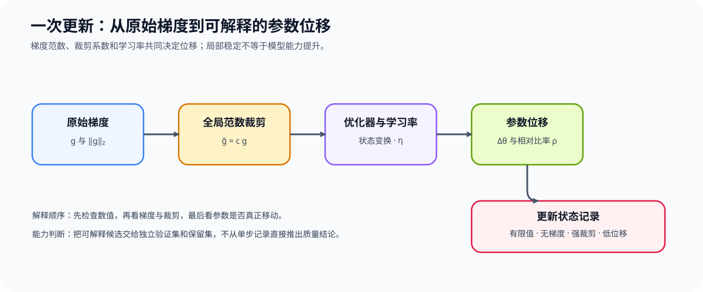
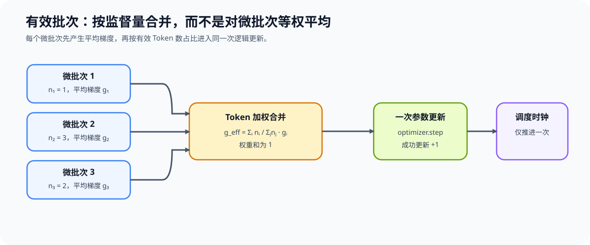

# 55. Training Update Dynamics | 训练更新动力学

**难度：** Hard | **环境：** [CPU 主线，GPU 可选](#runtime-environment) | **标签：** `训练控制`, `学习率`, `梯度裁剪`, `有效批次`, `更新动力学` | **目标人群：** 已理解梯度累积和调度时钟、希望解释一次更新为何过大或停滞的学习者

> 🚀 **云端运行环境**
>
> 本章节的实战代码可以点击以下链接在免费 GPU 算力平台上直接运行：
>
> [](https://colab.research.google.com/github/datawhalechina/llm-algo-leetcode/blob/main/02_PyTorch_Algorithms/55_Training_Update_Dynamics.ipynb)
> [](https://modelscope.cn/my/mynotebook) *(国内推荐：魔搭社区免费实例)*


---

## 本节导读

学习率、有效批次、梯度范数、裁剪和调度器不会分别决定训练是否稳定；它们共同决定一次成功更新实际把参数移动多远。本节把这些量连接为“梯度信号 → 变换后的更新 → 可观测状态”的链路。完成后，你应能区分梯度很大、更新很大和模型能力提升这三个不同判断。

**关键词：** `effective batch`, `gradient norm`, `gradient clipping`, `parameter update`, `update ratio`
<a id="runtime-environment"></a>

## 运行环境

- **基础练习：** 默认使用 [`BASE-CPU`](../guide.md#base-cpu)，运行 [Step 4 的题目与测试](#mechanism-practice)。
- **框架核对：** 使用 [`TRAIN-CPU`](../topic_discussion/backpropagation_training_mechanism/quickstart.md#train-cpu-quickstart)，完成 Step 4 后运行 [框架一致性核对](#framework-check)。
- **GPU 实测：** 使用 `TRAIN-CUDA-MECHANISM`，按 [Step 5](#gpu-experiment) 的说明配置并运行。

---
## 前置阅读

**导语：** 先确认多个微批次如何构成一次有效更新，以及调度器为什么只随成功更新推进；再用本节解释同一条梯度在不同学习率和裁剪条件下会形成怎样的参数变化。

- [Part 02 · 11 Gradient Accumulation | 梯度累积](./11_Gradient_Accumulation.md)
- [Part 02 · 12 Optimizer Updates and Learning Rate Scheduling | 优化器更新与学习率调度](./12_Optimizer_Updates_and_Learning_Rate_Scheduling.md)
- [Part 02 · TRAIN-MIXED-PRECISION-BACKWARD Mixed Precision Backward | 混合精度反向](./TRAIN-MIXED-PRECISION-BACKWARD_Mixed_Precision_Backward.md)

---
## Step 1：裁剪与学习率如何共同决定参数位移

一次参数更新不是把原始梯度直接写入权重，而是先限制异常尺度，再由学习率和优化器状态把梯度转换为参数位移。下图先给出这条因果链，随后用最简单的 SGD 情形明确各个量的关系。



设原始梯度向量为 $g$、裁剪阈值为 $m$。全局范数裁剪系数 $c$、裁剪后梯度 $\tilde g$ 和 SGD 参数位移 $\Delta\theta$ 可写为

$$
c=\min\left(1,\frac{m}{\lVert g\rVert_2}\right),\qquad
\tilde g=cg,\qquad
\Delta\theta=-\eta\tilde g.
$$

为了比较不同参数组或不同 checkpoint 的相对更新幅度，再用当前参数向量 $\theta$ 归一化参数位移：

$$
\rho=\frac{\lVert\Delta\theta\rVert_2}{\lVert\theta\rVert_2+\varepsilon}.
$$

| 符号 | 含义 | 在更新链中的作用 | 不能单独说明什么 |
|:---|:---|:---|:---|
| $g$、$\lVert g\rVert_2$ | 原始梯度及其全局 L2 范数 | 给出本轮未经裁剪的方向和尺度 | 参数最终移动多远 |
| $m$、$c$ | 裁剪阈值与 $[0,1]$ 内的裁剪系数 | 只在梯度范数超过阈值时缩小梯度 | 模型质量是否提升 |
| $\tilde g$ | 裁剪后的有效梯度 | 作为最简 SGD 更新方向 | 动量或逐坐标缩放的影响 |
| $\eta$ | 当前成功更新步使用的学习率 | 控制参数位移的全局尺度 | 梯度信号是否可靠 |
| $\theta$、$\Delta\theta$ | 更新前参数与本轮参数变化 | 描述参数实际写回结果 | 泛化或遗忘程度 |
| $\rho$、$\varepsilon$ | 相对更新比率与防止除零的小正数 | 跨参数规模比较更新幅度 | 独立任务上的能力变化 |
## Step 2：微批次梯度如何合并为一次有效更新

梯度累积只有在监督权重保持一致时，才等价于一个完整逻辑批次。若第 $i$ 个微批次包含 $n_i$ 个有效目标，并产生按有效目标平均的梯度 $g_i$，则逻辑批次梯度应按目标数加权：

$$
g_{eff}=\sum_i\frac{n_i}{\sum_j n_j}g_i.
$$

这里 $i$ 和 $j$ 都表示微批次索引，$n_i$ 是第 $i$ 个微批次的有效监督 Token 数，$g_i$ 是该微批次的平均梯度，$\sum_j n_j$ 是逻辑批次的总有效目标数，$g_{eff}$ 是一次参数更新实际使用的合并梯度。下图说明不同长度的微批次如何共享一次更新边界。



| 固定条件 | 改变项 | 会改变的量 | 必须保持的比较条件 |
|:---|:---|:---|:---|
| 单次逻辑更新 | 微批次切分 | 单次 activation 峰值与反向次数 | 样本、有效 Token 权重和一次更新总量 |
| 固定 Token 预算 | 有效批次大小 | 更新次数与调度器步数 | 数据顺序、总 Token 和调度定义 |
| 固定学习率 | 有效批次大小 | 梯度估计噪声与参数轨迹 | 不能把不同更新次数当成同一训练过程 |
## Step 3：有限值、裁剪与参数位移如何定位异常

一次训练记录至少应同时保留 loss、梯度范数、裁剪系数、参数位移、有限值状态和成功更新步。组合观察这些量，才能区分“原始梯度较大但已受控”“梯度存在但参数几乎未移动”和“数值已经失效”三类情况。

| 观察组合 | 先检查什么 | 可以得出的局部结论 | 下一步 |
|:---|:---|:---|:---|
| 非有限 loss、梯度或参数 | dtype、缩放、输入和最近更新 | 本次更新不可信 | 停止候选比较，定位首个非有限值 |
| 梯度范数为零 | 监督掩码、冻结参数和计算图 | 当前参数组没有收到训练信号 | 核对标签范围与 `requires_grad` |
| 梯度范数高，裁剪系数远小于 1 | 阈值和学习率 | 原始梯度经常被压缩 | 联合比较阈值、学习率和任务评测 |
| 梯度有限，参数位移接近零 | 学习率、optimizer state、冻结参数 | 写回幅度可能不足 | 核对参数组与调度器阶段 |
| 更新记录稳定但评测未提升 | 独立评测与数据分布 | 更新稳定不等于能力提升 | 转入训练项目的质量与保留集评测 |
<a id="mechanism-practice"></a>

## Step 4：实现梯度合并、裁剪与更新诊断

题目区用向量梯度模拟一次逻辑更新。学习者需要完成全局裁剪、按有效目标数合并微批次梯度，以及根据有限值、梯度范数、裁剪系数和参数位移形成状态记录。

| TODO / 函数 | 学习者完成的机制 | 必须满足的约束 | 测试证据 |
| --- | --- | --- | --- |
| TODO 1：计算全局裁剪系数<br>`global_clip_scale` | 将梯度范数与阈值映射为 $[0,1]$ 内的缩放系数 | 阈值和梯度范数必须有限；零梯度不放大；超过阈值才缩小 | 阈值内返回 1，阈值外返回 $m/\lVert g\rVert_2$ |
| TODO 2：合并有效监督梯度<br>`merge_token_weighted_gradients` | 按每个微批次的有效目标数构造逻辑批次平均梯度 | 目标数为正；张量形状一致；权重和为 1 | 不等长微批次的结果与完整逻辑批次平均一致 |
| TODO 3：记录更新状态<br>`summarize_update_state` | 按优先级解释数值、梯度、裁剪和参数位移 | 指标范围合法；非有限优先阻断；稳定状态不写成质量结论 | 区分无梯度、强裁剪、低位移和可继续评测 |

```python
import math
import torch

```


```python
# 题目设计：将原始梯度、有效监督权重和参数写回结果组织成一次可诊断的更新记录。

def global_clip_scale(gradient: torch.Tensor, max_norm: float) -> float:
    """返回全局范数裁剪系数；不直接修改输入梯度。"""
    # TODO 1：验证阈值与梯度范数，并计算 [0, 1] 内的缩放系数。
    raise NotImplementedError

def merge_token_weighted_gradients(gradient_parts: list[torch.Tensor], valid_target_counts: list[int]) -> torch.Tensor:
    """按有效监督 Token 数合并多个微批次的平均梯度。"""
    # TODO 2：验证输入并构造一次逻辑更新对应的加权平均梯度。
    raise NotImplementedError

def summarize_update_state(*, finite: bool, gradient_norm: float, clip_scale: float, parameter_delta_norm: float) -> dict:
    """把一次更新的局部状态转换为下一步检查建议，而不判断模型能力。"""
    # TODO 3：验证指标范围，再按非有限、无梯度、强裁剪和低位移的顺序判断。
    raise NotImplementedError

```

## 测试

```python
# 每个测试函数都验证一个机制不变量或诊断优先级。

def test_global_clip_scale():
    """裁剪系数在零梯度、阈值内和阈值外保持正确边界。"""
    assert global_clip_scale(torch.tensor([0.0, 0.0]), 1.0) == 1.0
    assert global_clip_scale(torch.tensor([3.0, 4.0]), 5.0) == 1.0
    assert math.isclose(global_clip_scale(torch.tensor([3.0, 4.0]), 2.5), 0.5)
    for gradient, max_norm in [(torch.tensor([1.0]), -1.0), (torch.tensor([float('inf')]), 1.0)]:
        try:
            global_clip_scale(gradient, max_norm)
        except ValueError:
            continue
        raise AssertionError('非法阈值或非有限梯度必须被拒绝')

def test_token_weighted_gradient_merge():
    """不同长度微批次必须按有效监督 Token 数，而非平均分配权重。"""
    merged = merge_token_weighted_gradients([torch.tensor([2.0, 4.0]), torch.tensor([8.0, 10.0])], [1, 3])
    assert torch.allclose(merged, torch.tensor([6.5, 8.5]))
    try:
        merge_token_weighted_gradients([torch.tensor([1.0]), torch.tensor([1.0, 2.0])], [1, 1])
    except ValueError:
        pass
    else:
        raise AssertionError('不同形状不能合并')

def test_update_state_priority():
    """非有限状态优先；其余状态按梯度、裁剪和参数位移解释。"""
    assert summarize_update_state(finite=False, gradient_norm=1.0, clip_scale=1.0, parameter_delta_norm=0.1)['state'] == 'blocked_nonfinite'
    assert summarize_update_state(finite=True, gradient_norm=0.0, clip_scale=1.0, parameter_delta_norm=0.0)['state'] == 'no_gradient'
    assert summarize_update_state(finite=True, gradient_norm=20.0, clip_scale=0.02, parameter_delta_norm=0.1)['state'] == 'heavily_clipped'
    assert summarize_update_state(finite=True, gradient_norm=1.0, clip_scale=1.0, parameter_delta_norm=0.0)['state'] == 'low_parameter_motion'
    assert summarize_update_state(finite=True, gradient_norm=1.0, clip_scale=1.0, parameter_delta_norm=0.1)['state'] == 'observe_with_evaluation'
    try:
        summarize_update_state(finite=True, gradient_norm=1.0, clip_scale=1.5, parameter_delta_norm=0.1)
    except ValueError:
        pass
    else:
        raise AssertionError('裁剪系数超出 [0, 1] 必须被拒绝')

test_global_clip_scale()
test_token_weighted_gradient_merge()
test_update_state_priority()
print('✅ 更新动力学机制测试通过')

```

---

🛑 **STOP HERE** 🛑

> 请先完成题目区并运行测试，再查看参考代码。

---
## 参考代码与解析

### 代码

```python
# 参考实现：保留题目区的函数、参数和 TODO 位置，只补全机制规则。

def global_clip_scale(gradient: torch.Tensor, max_norm: float) -> float:
    """返回全局范数裁剪系数；不直接修改输入梯度。"""
    # TODO 1：验证阈值与梯度范数，并计算 [0, 1] 内的缩放系数。
    if not math.isfinite(max_norm) or max_norm < 0:
        raise ValueError('max_norm 必须是有限非负数')
    gradient_norm = float(torch.linalg.vector_norm(gradient.detach().float()))
    if not math.isfinite(gradient_norm):
        raise ValueError('梯度范数必须有限')
    if gradient_norm == 0.0 or gradient_norm <= max_norm:
        return 1.0
    return max_norm / gradient_norm

def merge_token_weighted_gradients(gradient_parts: list[torch.Tensor], valid_target_counts: list[int]) -> torch.Tensor:
    """按有效监督 Token 数合并多个微批次的平均梯度。"""
    # TODO 2：验证输入并构造一次逻辑更新对应的加权平均梯度。
    if not gradient_parts or len(gradient_parts) != len(valid_target_counts):
        raise ValueError('梯度与有效目标数必须一一对应且非空')
    if any(count <= 0 for count in valid_target_counts):
        raise ValueError('有效目标数必须为正')
    reference_shape = gradient_parts[0].shape
    if any(part.shape != reference_shape for part in gradient_parts):
        raise ValueError('所有微批次梯度形状必须一致')
    total_targets = sum(valid_target_counts)
    return sum(part * (count / total_targets) for part, count in zip(gradient_parts, valid_target_counts))

def summarize_update_state(*, finite: bool, gradient_norm: float, clip_scale: float, parameter_delta_norm: float) -> dict:
    """把一次更新的局部状态转换为下一步检查建议，而不判断模型能力。"""
    # TODO 3：验证指标范围，再按非有限、无梯度、强裁剪和低位移的顺序判断。
    if not finite:
        return {'state': 'blocked_nonfinite', 'next_check': '检查输入、dtype、缩放和首个非有限值'}
    values = (gradient_norm, clip_scale, parameter_delta_norm)
    if not all(math.isfinite(value) for value in values):
        raise ValueError('更新指标必须有限')
    if gradient_norm < 0 or parameter_delta_norm < 0 or not 0.0 <= clip_scale <= 1.0:
        raise ValueError('更新指标超出合法范围')
    if gradient_norm == 0.0:
        return {'state': 'no_gradient', 'next_check': '核对监督掩码、冻结参数和计算图'}
    if clip_scale < 0.1:
        return {'state': 'heavily_clipped', 'next_check': '核对学习率、裁剪阈值和梯度来源'}
    if parameter_delta_norm <= 1e-12:
        return {'state': 'low_parameter_motion', 'next_check': '核对学习率、冻结参数和优化器状态'}
    return {'state': 'observe_with_evaluation', 'next_check': '进入独立评测，不把局部稳定性当成能力提升'}

```

### 解析

#### TODO 1：计算全局裁剪系数

先计算脱离计算图的 FP32 全局范数，再与阈值比较。零梯度和阈值内梯度都返回 1，避免裁剪过程放大原始信号；非有限阈值或梯度范数没有可解释的缩放比例，因此直接拒绝。

#### TODO 2：合并有效监督梯度

每个微批次的平均梯度按有效监督 Token 数加权，权重之和为 1。这样改变微批次切分不会改变同一逻辑批次的平均梯度；空输入、非正目标数和形状不一致都无法定义该合并。

#### TODO 3：形成更新状态

状态判断先处理非有限更新，再确认指标范围，随后依次识别无梯度、强裁剪和低参数位移。最后的可继续观察只表示局部更新链可解释，模型能力仍需独立评测。
<a id="framework-check"></a>

## 框架一致性核对（可选）

下面在同一参数和梯度上比较本节更新账本与 PyTorch 原生全局范数裁剪、SGD 参数写回。

| 核对对象 | 本节实现 | 成熟框架入口 | 通过条件 |
| --- | --- | --- | --- |
| 全局梯度范数 | `global_clip_scale` 使用的 L2 范数 | `clip_grad_norm_` 返回值 | 裁剪前全局范数一致 |
| 裁剪后梯度 | 原梯度乘本节裁剪系数 | `clip_grad_norm_` 写回的梯度 | 逐元素一致 |
| 参数位移 | 学习率乘裁剪后梯度 | PyTorch SGD 写回前后参数差 | 位移方向与大小一致 |

```python
from importlib.metadata import version


def check_update_dynamics_framework_conformance():
    """核对裁剪系数和参数位移是否符合 PyTorch 原生裁剪与 SGD 写回。"""
    initial = torch.tensor([3.0, 4.0])
    raw_gradient = torch.tensor([6.0, 8.0])
    max_norm = 5.0
    local_scale = global_clip_scale(raw_gradient, max_norm)
    parameter = torch.nn.Parameter(initial.clone())
    parameter.grad = raw_gradient.clone()
    framework_norm = torch.nn.utils.clip_grad_norm_([parameter], max_norm=max_norm)
    clipped_gradient = parameter.grad.detach().clone()
    optimizer = torch.optim.SGD([parameter], lr=0.1)
    optimizer.step()
    parameter_delta = parameter.detach() - initial
    checks = {
        'gradient_norm_match': math.isclose(float(framework_norm), float(torch.linalg.vector_norm(raw_gradient))),
        'clip_scale_match': bool(torch.allclose(clipped_gradient, raw_gradient * local_scale)),
        'parameter_delta_match': bool(torch.allclose(parameter_delta, -0.1 * clipped_gradient)),
    }
    failed = [name for name, passed in checks.items() if not passed]
    if failed:
        raise AssertionError(f'框架一致性核对失败：{failed}')
    return {
        'status': 'passed',
        'check_kind': 'framework_conformance',
        'versions': {'torch': version('torch')},
        'checks': checks,
    }


framework_check = check_update_dynamics_framework_conformance()
framework_check
```

<a id="gpu-experiment"></a>

## Step 5：可选 GPU 实验——更新幅度与稳定性对照

CPU 题目确认裁剪、Token 加权和诊断优先级；GPU 实验在真实模型计算图上比较同一批数据、不同学习率与裁剪组合的梯度范数、参数增量、有限值、峰值显存和单步时间。它不评判模型能力，也不替代训练项目的独立评测。

| 学习问题 | CPU 已确认 | GPU 要确认与后续使用 |
| --- | --- | --- |
| 学习率和裁剪怎样共同改变一次真实更新 | 裁剪系数、Token 加权和状态优先级 | 局部更新是否有限、裁剪是否频繁触发、参数增量和单步资源如何变化；结果供训练项目选择候选配置 |

#### 5.1 环境与固定工作负载

本实验使用 `TRAIN-CUDA-MECHANISM`。首次运行先完成[专题 Quickstart](../topic_discussion/backpropagation_training_mechanism/quickstart.md#train-cuda-mechanism-quickstart)，并通过同名 Profile 预检。

| 配置层 | 本节固定条件 | 修改规则 |
| --- | --- | --- |
| 运行环境 | 单张 CUDA GPU；`TRAIN-CUDA-MECHANISM` | 预检未返回 `status=ok` 时停止 |
| 工作负载 | `Qwen/Qwen2.5-0.5B`；batch 2；长度 128；8 次测量更新 | 模型、commit、batch 或长度改变后使用新 `RUN_LABEL` |
| 对照变量 | `reference`、`high_lr_no_clip`、`high_lr_clipped` | 只改变学习率与全局裁剪阈值 |
| 固定条件 | 初始权重、输入顺序、dtype、优化器、种子和更新次数 | 任何固定条件改变都不能与旧结果直接比较 |
| 测量 | loss、梯度范数、裁剪系数、参数增量、有限值、step median/P95、峰值显存 | 不以同一训练批次的 loss 下降判断能力提升 |
| 结果资产 | `benchmarks/results/train_update_dynamics/<semantic_id>_<run_label>.json` | 保存后在 5.3 读取，不覆盖旧结果 |

```python
RUN_MODE = 'dry_run'  # 默认 dry_run；改为 real_gpu 执行真实模型对照。
RUN_LABEL = 'default'  # 正式复测改为唯一标签，避免覆盖旧结果。
PROFILE_ID = 'TRAIN-CUDA-MECHANISM'
SEMANTIC_ID = 'TRAIN-UPDATE-DYNAMICS'
MODEL_ID = 'Qwen/Qwen2.5-0.5B'
MODEL_REVISION = 'main'
LOCAL_FILES_ONLY = False  # 缓存完成后可改为 True 做离线复测。
GPU_CONFIG = {
    'parameter_dtype': 'float32',
    'batch_size': 2,
    'seq_len': 128,
    'warmup_steps': 1,
    'repeat_steps': 8,
    'seed': 42,
    'prompts': ['Explain why gradient clipping changes an update.', 'Compare learning rate and parameter delta.'],
    'candidates': [
        {'name': 'reference', 'learning_rate': 1e-4, 'max_grad_norm': 1.0},
        {'name': 'high_lr_no_clip', 'learning_rate': 2e-3, 'max_grad_norm': None},
        {'name': 'high_lr_clipped', 'learning_rate': 2e-3, 'max_grad_norm': 1.0},
    ],
}
RESULTS_RELATIVE_DIR = 'benchmarks/results/train_update_dynamics'

```

#### 5.2 执行并保存 JSON

每个候选都从同一不可变 checkpoint 重新加载。预热不计入统计；每次测量更新记录梯度范数、实际裁剪系数和参数探针增量。

```python
from pathlib import Path
import gc
import json
import math
import statistics
import torch
from tools.project_runtime import resolve_project_root
from tools.training_mechanism_runtime import cuda_hardware_snapshot, gradient_l2_norm, load_causal_lm, median_and_p95, move_batch, prepare_causal_lm_batch

REPO_ROOT = resolve_project_root()
RESULTS_DIR = REPO_ROOT / RESULTS_RELATIVE_DIR

if RUN_MODE == 'real_gpu':
    if PROFILE_ID != 'TRAIN-CUDA-MECHANISM':
        raise RuntimeError('本页只接受 TRAIN-CUDA-MECHANISM。')
    if not torch.cuda.is_available():
        raise RuntimeError('需要 CUDA GPU；无 GPU 时保持 RUN_MODE=\'dry_run\'。')
    dtype_map = {'float32': torch.float32, 'float16': torch.float16, 'bfloat16': torch.bfloat16}
    parameter_dtype = dtype_map[GPU_CONFIG['parameter_dtype']]
    device = torch.device('cuda')
    torch.manual_seed(GPU_CONFIG['seed'])
    torch.cuda.manual_seed_all(GPU_CONFIG['seed'])
    prepared = prepare_causal_lm_batch(MODEL_ID, MODEL_REVISION, GPU_CONFIG['prompts'], GPU_CONFIG['batch_size'], GPU_CONFIG['seq_len'], local_files_only=LOCAL_FILES_ONLY)
    resolved_commit = prepared.pop('resolved_model_commit')
    resolution_source = prepared.pop('revision_resolution_source')
    tokenizer_class = prepared.pop('tokenizer_class')
    batch = move_batch(prepared, device)

    def one_update(model, optimizer, max_grad_norm):
        optimizer.zero_grad(set_to_none=True)
        loss = model(**batch).loss
        loss.backward()
        raw_norm = gradient_l2_norm(model.parameters())
        if max_grad_norm is None:
            clip_scale = 1.0
        else:
            clip_scale = min(1.0, max_grad_norm / raw_norm) if raw_norm else 1.0
            torch.nn.utils.clip_grad_norm_(model.parameters(), max_grad_norm)
        finite = bool(torch.isfinite(loss).item()) and math.isfinite(raw_norm)
        optimizer.step()
        return float(loss.detach()), raw_norm, clip_scale, finite

    metrics = []
    for candidate in GPU_CONFIG['candidates']:
        model = load_causal_lm(MODEL_ID, resolved_commit, device, parameter_dtype=parameter_dtype, local_files_only=LOCAL_FILES_ONLY)
        model.train()
        optimizer = torch.optim.SGD(model.parameters(), lr=candidate['learning_rate'])
        probe_name, probe = next((name, parameter) for name, parameter in model.named_parameters() if parameter.requires_grad)
        for _ in range(GPU_CONFIG['warmup_steps']):
            one_update(model, optimizer, candidate['max_grad_norm'])
        step_ms, peak_mb, losses, grad_norms, clip_scales, deltas, finite_flags = [], [], [], [], [], [], []
        for _ in range(GPU_CONFIG['repeat_steps']):
            probe_before = probe.detach().float().reshape(-1)[:4096].cpu().clone()
            torch.cuda.empty_cache()
            torch.cuda.synchronize(device)
            torch.cuda.reset_peak_memory_stats(device)
            start, end = torch.cuda.Event(enable_timing=True), torch.cuda.Event(enable_timing=True)
            start.record()
            loss, grad_norm, clip_scale, finite = one_update(model, optimizer, candidate['max_grad_norm'])
            end.record()
            torch.cuda.synchronize(device)
            step_ms.append(start.elapsed_time(end))
            peak_mb.append(torch.cuda.max_memory_allocated(device) / 2**20)
            losses.append(loss)
            grad_norms.append(grad_norm)
            clip_scales.append(clip_scale)
            deltas.append(float(torch.linalg.vector_norm(probe.detach().float().reshape(-1)[:4096].cpu() - probe_before)))
            finite_flags.append(finite)
        median_ms, p95_ms = median_and_p95(step_ms)
        metrics.append({
            'name': candidate['name'], 'learning_rate': candidate['learning_rate'], 'max_grad_norm': candidate['max_grad_norm'],
            'loss_start': losses[0], 'loss_end': losses[-1], 'gradient_norm_median': statistics.median(grad_norms),
            'clip_scale_median': statistics.median(clip_scales), 'parameter_delta_norm_median': statistics.median(deltas),
            'finite_all': all(finite_flags), 'median_step_ms': median_ms, 'p95_step_ms': p95_ms, 'peak_allocated_mb': max(peak_mb),
            'probe_parameter': probe_name,
        })
        del optimizer, model
        gc.collect()
        torch.cuda.empty_cache()
    record = {
        'schema_version': 'training-update-dynamics/v1', 'semantic_id': SEMANTIC_ID, 'environment_profile': PROFILE_ID,
        'run_mode': RUN_MODE, 'run_label': RUN_LABEL, 'workload': {**GPU_CONFIG, 'model_id': MODEL_ID, 'requested_revision': MODEL_REVISION, 'resolved_commit': resolved_commit, 'revision_resolution_source': resolution_source, 'tokenizer_class': tokenizer_class},
        'hardware': cuda_hardware_snapshot(), 'metrics': metrics, 'evidence_level': 'local_mechanism_benchmark',
        'decision': 'observe_with_independent_evaluation',
    }
    RESULTS_DIR.mkdir(parents=True, exist_ok=True)
    result_path = RESULTS_DIR / f'{SEMANTIC_ID.lower()}_{RUN_LABEL}.json'
    result_path.write_text(json.dumps(record, ensure_ascii=False, indent=2), encoding='utf-8')
    print(json.dumps({'result_path': str(result_path), 'candidates': [item['name'] for item in metrics]}, ensure_ascii=False, indent=2))
else:
    print('dry_run：已核对固定工作负载；改 RUN_MODE 后执行真实 GPU 对照。')

```

#### 5.3 读取结果

读取同一 `RUN_LABEL` 的结果文件，不重新执行训练；先查看有限值和裁剪触发，再比较参数增量、峰值显存与时间。

```python
if RUN_MODE == 'real_gpu':
    result_path = RESULTS_DIR / f'{SEMANTIC_ID.lower()}_{RUN_LABEL}.json'
    if not result_path.is_file():
        raise FileNotFoundError(f'未找到结果，请先运行 5.2：{result_path}')
    record = json.loads(result_path.read_text(encoding='utf-8'))
    for item in record['metrics']:
        print(f"{item['name']} | finite={item['finite_all']} | grad={item['gradient_norm_median']:.3e} | clip={item['clip_scale_median']:.3f} | delta={item['parameter_delta_norm_median']:.3e} | median={item['median_step_ms']:.2f} ms | peak={item['peak_allocated_mb']:.1f} MB")
    print(f"decision={record['decision']} | evidence={record['evidence_level']}")
else:
    print('dry_run：没有读取 GPU 结果。')

```

#### 5.4 解释证据与决策

先确认三条路径使用同一模型 commit、输入、更新次数和 dtype；再检查 `finite_all`。出现非有限值时，该候选只能进入故障定位，不能与其他路径比较。若高学习率路径频繁裁剪，应解释原始梯度和实际参数位移的差别；若参数增量接近零，应回看学习率、冻结参数或优化器状态。

本页的 `decision` 固定为 `observe_with_independent_evaluation`：局部更新稳定只说明这组条件下的更新可继续观察，不说明模型在独立任务上更好。将候选带入 Part 02 · 62 或后续持续预训练项目后，还必须比较验证集、保留集与可恢复性。
## 相关阅读

- [Part 02 · 12 Optimizer Updates and Learning Rate Scheduling | 优化器更新与学习率调度](./12_Optimizer_Updates_and_Learning_Rate_Scheduling.md)
- [Part 02 · TRAIN-MIXED-PRECISION-BACKWARD Mixed Precision Backward | 混合精度反向](./TRAIN-MIXED-PRECISION-BACKWARD_Mixed_Precision_Backward.md)
- [PyTorch `clip_grad_norm_` 文档](https://docs.pytorch.org/docs/stable/generated/torch.nn.utils.clip_grad_norm_.html)
- [后训练优化专题：训练控制](../topic_discussion/post_training_optimization/03_training_control.md)
