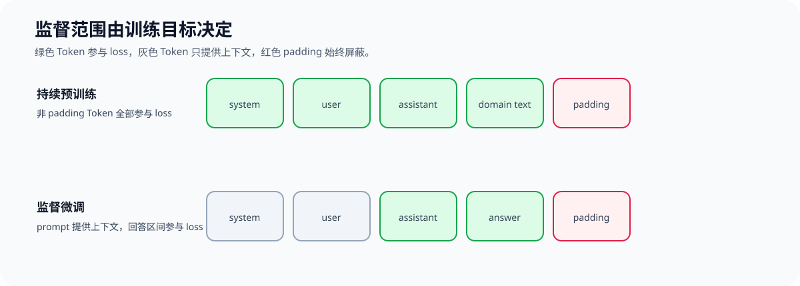
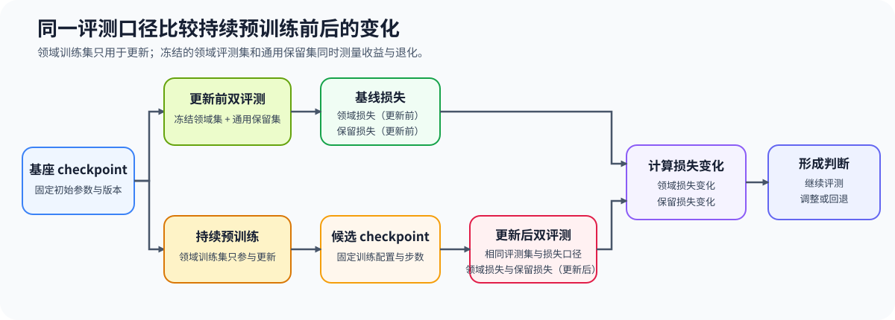

# 56. Continual Pretraining and Retention | 持续预训练与能力保留

**难度：** Hard | **环境：** [CPU 主线，GPU 可选](#runtime-environment) | **标签：** `持续预训练`, `全序列监督`, `域内评测`, `能力保留`, `checkpoint` | **目标人群：** 需要判断领域续训是否值得继续、而不是只比较训练 loss 的学习者

> 🚀 **云端运行环境**
>
> 本章节的实战代码可以点击以下链接在免费 GPU 算力平台上直接运行：
>
> [](https://colab.research.google.com/github/datawhalechina/llm-algo-leetcode/blob/main/02_PyTorch_Algorithms/56_Continual_Pretraining_and_Retention.ipynb)
> [](https://modelscope.cn/my/mynotebook) *(国内推荐：魔搭社区免费实例)*


---

## 本节导读

持续预训练用新领域文本继续训练已有语言模型，目标是改变模型对该领域 token 序列的概率分布。它通常使用全序列监督：每个非 padding token 都参与下一个 token 预测。这与 SFT 的 response-only mask 不同，后者只监督助手回答部分。本节把领域数据、独立领域评测、通用保留集和可恢复 checkpoint 放入同一判断链路。

**关键词：** `continual pretraining`, `full-sequence supervision`, `domain evaluation`, `retention set`, `checkpoint recovery`
<a id="runtime-environment"></a>

## 运行环境

- **基础练习：** 默认使用 [`BASE-CPU`](../guide.md#base-cpu)，运行 [Step 4 的题目与测试](#mechanism-practice)。
- **框架核对：** 使用 [`TRAIN-CPU`](../topic_discussion/backpropagation_training_mechanism/quickstart.md#train-cpu-quickstart)，完成 Step 4 后运行 [框架一致性核对](#framework-check)。
- **GPU 实测：** 使用 `TRAIN-CUDA-MECHANISM`，按 [Step 5](#gpu-experiment) 的说明配置并运行。

---
## 前置阅读

**导语：** 先理解一次有效更新怎样由梯度和状态组成；再区分全序列监督与 SFT 的监督范围，最后用独立领域集和保留集判断继续训练的代价。

- [Part 02 · 55 Training Update Dynamics | 训练更新动力学](./55_Training_Update_Dynamics.md)
- [Part 02 · 13 SFT Training Loop | SFT 训练循环](./13_SFT_Training_Loop.md)
- [后训练优化 · 01 SFT 数据与监督契约](../topic_discussion/post_training_optimization/01_sft_data_and_loss.md)

---
## Step 1：哪些 Token 参与持续预训练损失

持续预训练沿用自回归语言建模目标：序列中的每个非 padding Token 都为下一 Token 预测提供监督。它与只监督回答区间的 SFT 使用不同标签掩码，下图先对照两种监督范围。



设有效预测位置集合为 $\mathcal V$，持续预训练的平均自回归损失为

$$
L_{CLM}=-\frac{1}{|\mathcal V|}\sum_{t\in\mathcal V}\log p_\theta(x_{t+1}\mid x_{\le t}).
$$

| 符号 | 含义 | 在目标函数中的作用 |
|:---|:---|:---|
| $\mathcal V$、$|\mathcal V|$ | 非 padding 的有效预测位置集合及其大小 | 决定哪些位置参与平均 |
| $t$ | 当前预测位置索引 | 枚举每个有效监督位置 |
| $x_{\le t}$、$x_{t+1}$ | 当前及以前的上下文、下一 Token 目标 | 定义一次因果语言建模预测 |
| $p_\theta$ | 参数为 $\theta$ 的当前模型分布 | 给出目标 Token 的条件概率 |
| $L_{CLM}$ | 有效位置上的平均负对数似然 | 作为持续预训练的优化目标 |
## Step 2：如何用领域集与保留集测量收益和退化

训练 loss 只能说明模型对参与更新的数据拟合得怎样。要判断持续预训练是否值得，需要把领域训练集、独立领域评测集和通用保留集按样本身份隔离，并在更新前后使用相同评测口径。

设领域评测损失和通用保留损失在训练前后的变化分别为

$$
\Delta_{domain}=L^{after}_{domain}-L^{before}_{domain},\qquad
\Delta_{retain}=L^{after}_{retain}-L^{before}_{retain}.
$$

其中 $L^{before}_{domain}$、$L^{after}_{domain}$ 是更新前后的领域评测损失，$L^{before}_{retain}$、$L^{after}_{retain}$ 是通用保留损失；$\Delta_{domain}<0$ 表示域内损失降低，$\Delta_{retain}>0$ 表示保留集退化。若允许的最大保留损失增量为 $\tau_{retain}\ge0$，最小接受门槛可写为 $\Delta_{domain}<0$ 且 $\Delta_{retain}\le\tau_{retain}$。



| 数据切分 | 是否参与参数更新 | 它回答的问题 | 不允许的混用 |
|:---|:---|:---|:---|
| 领域训练集 | 是 | 新领域 Token 让模型看到什么 | 直接兼作领域评测 |
| 领域评测集 | 否 | 域内损失或任务指标是否改善 | 回流为训练样本 |
| 通用保留集 | 否 | 原有通用能力是否明显退化 | 由领域训练文本派生 |
## Step 3：何时继续、调低或回退持续预训练

领域收益和保留代价只有在更新数值有效、数据切分独立且 checkpoint 可恢复时才可解释。判断顺序应先处理不可恢复和非有限状态，再检查保留阈值，最后确认领域评测是否改善。

| 检查顺序 | 通过时说明什么 | 失败时的处理 |
|:---|:---|:---|
| checkpoint 包含模型、优化器、调度器、随机数状态和全局步 | 中断后可从同一训练状态继续 | 补齐状态，暂不接受候选 |
| 更新及两类损失变化均为有限值 | 本轮参数写回和指标可解释 | 定位数值或输入问题 |
| $\Delta_{retain}\le\tau_{retain}$ | 通用能力退化未超过预设上限 | 降低步数或学习率，或回退 checkpoint |
| $\Delta_{domain}<0$ | 独立领域集上的语言建模损失降低 | 调整数据配比或训练日程 |
| 全部通过 | 候选可进入更完整的任务评测 | 继续观察，不直接宣称能力提升 |
<a id="mechanism-practice"></a>

## Step 4：实现全序列损失、切分审计与继续训练判断

题目区用 Token ID、logits 和样本 ID 建立最小持续预训练判断。学习者先构造全序列标签并按有效 Token 归约下一 Token 损失，再审计三份数据切分，最后根据领域收益、保留退化和恢复清单形成顺序判断。

| TODO / 函数 | 学习者完成的机制 | 必须满足的约束 | 测试证据 |
| --- | --- | --- | --- |
| TODO 1：构造全序列标签<br>`build_continual_pretraining_labels` | 保留全部非 padding Token，屏蔽 padding | 输入与掩码形状一致；掩码只能取 0 或 1 | 非 padding 标签保持原 Token，padding 标签为 `-100` |
| TODO 2：归约全序列损失<br>`continual_pretraining_loss` | 位移 logits 与标签，只平均有效预测位置 | batch、序列维对齐；至少存在一个有效目标 | 与手工有效 Token 平均一致；全忽略输入被拒绝 |
| TODO 3：审计数据切分<br>`audit_continual_splits` | 检查训练、领域评测和保留集的样本身份 | 三个集合均非空；任意两集合不得重叠 | 清洁切分返回各组数量，污染切分被拒绝 |
| TODO 4：形成继续训练判断<br>`decide_continual_pretraining` | 按恢复、数值、保留阈值和领域收益依次判断 | 阈值非负；损失变化有限；不可恢复优先阻断 | 区分阻断、回退、调整数据日程和继续评测 |

```python
import math
import torch
```


```python
# 题目设计：用标签、样本身份和可恢复状态建立持续预训练的最小判断。

def build_continual_pretraining_labels(input_ids: torch.Tensor, attention_mask: torch.Tensor) -> torch.Tensor:
    """构造全序列监督标签，仅屏蔽 padding。"""
    # TODO 1：检查形状和二值掩码，并把 padding 位置写为 -100。
    raise NotImplementedError

def continual_pretraining_loss(logits: torch.Tensor, labels: torch.Tensor) -> torch.Tensor:
    """位移因果语言模型目标，并按有效 Token 数平均损失。"""
    # TODO 2：对齐下一 Token 目标，忽略 -100，并按有效位置归约。
    raise NotImplementedError

def audit_continual_splits(train_ids: set[str], domain_eval_ids: set[str], retention_ids: set[str]) -> dict:
    """审计领域训练、领域评测和通用保留集之间的样本身份。"""
    # TODO 3：拒绝空集合与任意集合交叠，并返回每组大小。
    raise NotImplementedError

def decide_continual_pretraining(*, update_finite: bool, domain_loss_change: float, retention_loss_change: float, max_retention_increase: float, checkpoint_fields: set[str]) -> dict:
    """在恢复、更新和两类独立评测都具备后给出继续、调低或阻断建议。"""
    # TODO 4：验证阈值和指标，再按不可恢复、非有限、保留退化与领域收益判断。
    raise NotImplementedError

```

## 测试

```python
# 每个测试都针对监督范围、数据隔离或决策优先级。

def test_full_sequence_labels():
    """持续预训练保留所有非 padding Token，并拒绝非法掩码。"""
    labels = build_continual_pretraining_labels(torch.tensor([[5, 6, 7, 0]]), torch.tensor([[1, 1, 1, 0]]))
    assert labels.tolist() == [[5, 6, 7, -100]]
    invalid_inputs = [
        (torch.ones(1, 2, dtype=torch.long), torch.ones(1, 3, dtype=torch.long)),
        (torch.ones(1, 2, dtype=torch.long), torch.tensor([[1, 2]])),
    ]
    for input_ids, attention_mask in invalid_inputs:
        try:
            build_continual_pretraining_labels(input_ids, attention_mask)
        except ValueError:
            continue
        raise AssertionError('形状不一致或非二值掩码必须被拒绝')

def test_effective_token_loss():
    """下一 Token 损失只按非 -100 的有效目标位置平均。"""
    torch.manual_seed(7)
    logits = torch.randn(1, 4, 10, dtype=torch.double)
    labels = torch.tensor([[2, 4, 6, -100]])
    actual = continual_pretraining_loss(logits, labels)
    log_probs = torch.log_softmax(logits[:, :-1], dim=-1)
    expected = -torch.stack([log_probs[0, 0, 4], log_probs[0, 1, 6]]).mean()
    assert torch.allclose(actual, expected, atol=1e-10)
    try:
        continual_pretraining_loss(logits, torch.full_like(labels, -100))
    except ValueError:
        pass
    else:
        raise AssertionError('没有有效下一 Token 目标时必须被拒绝')

def test_continual_split_audit():
    """三类数据集必须非空且按样本身份隔离。"""
    report = audit_continual_splits({'train-1'}, {'domain-1'}, {'retain-1'})
    assert report == {'clean': True, 'counts': {'train': 1, 'domain_eval': 1, 'retention': 1}}
    try:
        audit_continual_splits({'shared'}, {'shared'}, {'retain-1'})
    except ValueError:
        pass
    else:
        raise AssertionError('训练和领域评测重叠必须被拒绝')

def test_continual_decision_priority():
    """恢复与数值前提优先于领域 loss 的短期改善。"""
    fields = {'model', 'optimizer', 'scheduler', 'rng', 'global_step'}
    assert decide_continual_pretraining(update_finite=True, domain_loss_change=-0.2, retention_loss_change=0.01, max_retention_increase=0.05, checkpoint_fields=fields)['decision'] == 'continue_with_evaluation'
    assert decide_continual_pretraining(update_finite=True, domain_loss_change=-0.2, retention_loss_change=0.08, max_retention_increase=0.05, checkpoint_fields=fields)['decision'] == 'tune_or_rollback'
    assert decide_continual_pretraining(update_finite=True, domain_loss_change=0.01, retention_loss_change=0.0, max_retention_increase=0.05, checkpoint_fields=fields)['decision'] == 'tune_data_or_schedule'
    assert decide_continual_pretraining(update_finite=True, domain_loss_change=-0.2, retention_loss_change=0.0, max_retention_increase=0.05, checkpoint_fields={'model'})['decision'] == 'blocked_unrecoverable'
    assert decide_continual_pretraining(update_finite=True, domain_loss_change=float('nan'), retention_loss_change=0.0, max_retention_increase=0.05, checkpoint_fields=fields)['decision'] == 'blocked_nonfinite'

test_full_sequence_labels()
test_effective_token_loss()
test_continual_split_audit()
test_continual_decision_priority()
print('✅ 持续预训练机制测试通过')

```

---

🛑 **STOP HERE** 🛑

> 请先完成题目区并运行测试，再查看参考代码。

---
## 参考代码与解析

### 代码

```python
# 参考实现：保留题目区的函数、参数和 TODO 位置，只补全机制规则。

def build_continual_pretraining_labels(input_ids: torch.Tensor, attention_mask: torch.Tensor) -> torch.Tensor:
    """构造全序列监督标签，仅屏蔽 padding。"""
    # TODO 1：检查形状和二值掩码，并把 padding 位置写为 -100。
    if input_ids.shape != attention_mask.shape:
        raise ValueError('input_ids 与 attention_mask 形状必须一致')
    if not bool(torch.all((attention_mask == 0) | (attention_mask == 1))):
        raise ValueError('attention_mask 只能包含 0 或 1')
    labels = input_ids.clone()
    labels[attention_mask == 0] = -100
    return labels

def continual_pretraining_loss(logits: torch.Tensor, labels: torch.Tensor) -> torch.Tensor:
    """位移因果语言模型目标，并按有效 Token 数平均损失。"""
    # TODO 2：对齐下一 Token 目标，忽略 -100，并按有效位置归约。
    if logits.ndim != 3 or labels.ndim != 2:
        raise ValueError('logits 必须为 [batch, seq, vocab]，labels 必须为 [batch, seq]')
    if logits.shape[:2] != labels.shape or logits.size(1) < 2:
        raise ValueError('logits 与 labels 的 batch/序列维必须一致，且序列长度至少为 2')
    shift_logits = logits[:, :-1].contiguous()
    shift_labels = labels[:, 1:].contiguous()
    valid_count = int(shift_labels.ne(-100).sum().item())
    if valid_count == 0:
        raise ValueError('至少需要一个有效的下一 Token 目标')
    loss_sum = torch.nn.functional.cross_entropy(
        shift_logits.view(-1, shift_logits.size(-1)),
        shift_labels.view(-1),
        ignore_index=-100,
        reduction='sum',
    )
    return loss_sum / valid_count

def audit_continual_splits(train_ids: set[str], domain_eval_ids: set[str], retention_ids: set[str]) -> dict:
    """审计领域训练、领域评测和通用保留集之间的样本身份。"""
    # TODO 3：拒绝空集合与任意集合交叠，并返回每组大小。
    groups = {'train': train_ids, 'domain_eval': domain_eval_ids, 'retention': retention_ids}
    if any(not ids for ids in groups.values()):
        raise ValueError('三类数据集都必须非空')
    overlaps = {
        'train_domain_eval': train_ids & domain_eval_ids,
        'train_retention': train_ids & retention_ids,
        'domain_eval_retention': domain_eval_ids & retention_ids,
    }
    if any(overlaps.values()):
        raise ValueError(f'数据切分存在样本重叠：{overlaps}')
    return {'clean': True, 'counts': {name: len(ids) for name, ids in groups.items()}}

def decide_continual_pretraining(*, update_finite: bool, domain_loss_change: float, retention_loss_change: float, max_retention_increase: float, checkpoint_fields: set[str]) -> dict:
    """在恢复、更新和两类独立评测都具备后给出继续、调低或阻断建议。"""
    # TODO 4：验证阈值和指标，再按不可恢复、非有限、保留退化与领域收益判断。
    if not math.isfinite(max_retention_increase) or max_retention_increase < 0:
        raise ValueError('max_retention_increase 必须是有限非负数')
    required_fields = {'model', 'optimizer', 'scheduler', 'rng', 'global_step'}
    if not required_fields.issubset(checkpoint_fields):
        return {'decision': 'blocked_unrecoverable', 'missing_fields': sorted(required_fields - checkpoint_fields)}
    metric_values = (domain_loss_change, retention_loss_change)
    if not update_finite or not all(math.isfinite(value) for value in metric_values):
        return {'decision': 'blocked_nonfinite'}
    if retention_loss_change > max_retention_increase:
        return {'decision': 'tune_or_rollback'}
    if domain_loss_change >= 0:
        return {'decision': 'tune_data_or_schedule'}
    return {'decision': 'continue_with_evaluation'}

```

### 解析

#### TODO 1：构造全序列标签

- 持续预训练监督所有非 padding Token，因此输入和掩码必须同形，且掩码只能表达保留或屏蔽；response-only mask 不能直接复用。
- 答案复制 `input_ids` 并把 padding 位置写成 `-100`；`test_full_sequence_labels` 在 CPU 上同时验证正常标签和两类非法掩码。

#### TODO 2：归约全序列损失

- 因果语言模型用位置 $t$ 的 logits 预测位置 $t+1$ 的标签，平均分母只能包含非 `-100` 的有效目标。
- 答案完成时间位移，以 `sum / valid_count` 归约并拒绝全忽略输入；`test_effective_token_loss` 在 CPU 上用手工 log-prob 平均核对数值和空分母边界。

#### TODO 3：审计数据切分

- 领域训练、领域评测和通用保留集必须非空且两两不相交，否则更新后的损失变化无法区分训练记忆、领域收益和通用退化。
- 答案显式计算三组交集并返回样本计数；`test_continual_split_audit` 在 CPU 上验证清洁切分和训练—评测污染，但不能替代真实数据的版本与来源审计。

#### TODO 4：形成继续训练判断

- 恢复字段和有限值是解释收益的前提，随后才比较保留阈值与领域损失变化；短期领域改善不能覆盖不可恢复或非有限状态。
- 答案按不可恢复、非有限、保留退化、领域无收益的顺序返回状态；`test_continual_decision_priority` 在 CPU 上覆盖四条失败分支和继续评测分支，但不证明真实领域能力已经提升。
<a id="framework-check"></a>

## 框架一致性核对（可选）

下面使用 Transformers 的微型随机 Causal LM 核对全序列标签、下一 Token 位移和有效位置平均；该核对不下载模型。

| 核对对象 | 本节实现 | 成熟框架入口 | 通过条件 |
| --- | --- | --- | --- |
| 全序列标签 | `build_continual_pretraining_labels` | Transformers Causal LM 标签接口 | 非 padding Token 保留，padding 写为 `-100` |
| 下一 Token 损失 | `continual_pretraining_loss` | `AutoModelForCausalLM` 内置 loss | 相同 logits、labels 和有效位置下损失一致 |

```python
from importlib.metadata import version

try:
    from transformers import AutoModelForCausalLM, GPT2Config
except ImportError:
    framework_check = {
        'status': 'skipped',
        'reason': '请使用 TRAIN-CPU 环境运行本单元',
    }
else:
    def check_continual_pretraining_framework_conformance():
        """核对全序列标签及其下一 Token 损失是否符合 Transformers Causal LM。"""
        input_ids = torch.tensor([[1, 5, 7, 2, 0], [1, 8, 9, 4, 2]])
        attention_mask = torch.tensor([[1, 1, 1, 1, 0], [1, 1, 1, 1, 1]])
        labels = build_continual_pretraining_labels(input_ids, attention_mask)
        torch.manual_seed(42)
        model = AutoModelForCausalLM.from_config(GPT2Config(
            vocab_size=16, n_positions=8, n_ctx=8, n_embd=24, n_layer=1, n_head=2,
            bos_token_id=1, eos_token_id=2, pad_token_id=0,
        )).eval()
        with torch.no_grad():
            output = model(input_ids=input_ids, attention_mask=attention_mask, labels=labels)
            local_loss = continual_pretraining_loss(output.logits, labels)
        checks = {
            'padding_ignored': bool(torch.all(labels[attention_mask == 0] == -100)),
            'non_padding_supervised': bool(torch.equal(labels[attention_mask == 1], input_ids[attention_mask == 1])),
            'causal_loss_match': bool(torch.allclose(local_loss, output.loss, atol=1e-6, rtol=1e-6)),
        }
        failed = [name for name, passed in checks.items() if not passed]
        if failed:
            raise AssertionError(f'框架一致性核对失败：{failed}')
        return {
            'status': 'passed',
            'check_kind': 'framework_conformance',
            'versions': {'torch': version('torch'), 'transformers': version('transformers')},
            'checks': checks,
        }

    framework_check = check_continual_pretraining_framework_conformance()

framework_check
```

<a id="gpu-experiment"></a>

## Step 5：可选 GPU 实验——领域收益与保留代价

CPU 题目确认监督范围、样本隔离和决策顺序；GPU 实验在同一真实模型上比较更新前后独立领域文本与通用保留文本的 token loss。实验使用内置小型文本集来验证方法，不把它当作真实领域语料的性能结论。

| 学习问题 | CPU 已确认 | GPU 要确认与后续使用 |
| --- | --- | --- |
| 少量领域续训是否同时带来领域变化与可接受保留代价 | 标签、切分、判断优先级和恢复字段 | 更新前后领域 / 保留 token loss、有限值、step 时间、峰值显存与 checkpoint 状态；真实项目必须换成任务数据和独立保留集 |

#### 5.1 环境与固定工作负载

本实验使用 `TRAIN-CUDA-MECHANISM`，首次运行先完成[专题 Quickstart](../topic_discussion/backpropagation_training_mechanism/quickstart.md#train-cuda-mechanism-quickstart)。

| 配置层 | 本节固定条件 | 修改规则 |
| --- | --- | --- |
| 运行环境 | 单张 CUDA GPU；`TRAIN-CUDA-MECHANISM` | Profile 预检失败时停止 |
| 模型与精度 | `Qwen/Qwen2.5-0.5B`；FP32 | 改动模型或 commit 使用新 `RUN_LABEL` |
| 数据角色 | 内置领域训练、独立领域评测、通用保留文本 | 任何文本不得跨角色复用 |
| 对照变量 | `base` 0 更新 → `continual` 固定更新步 | 只改变是否执行全序列领域更新 |
| 结果字段 | 三组 token loss、有限值、更新记录、checkpoint 字段、step median/P95、峰值 | 内置文本结果仅验证测量链，不外推为领域能力 |

```python
RUN_MODE = 'dry_run'
RUN_LABEL = 'default'
PROFILE_ID = 'TRAIN-CUDA-MECHANISM'
SEMANTIC_ID = 'TRAIN-CONTINUAL-PRETRAIN'
MODEL_ID = 'Qwen/Qwen2.5-0.5B'
MODEL_REVISION = 'main'
LOCAL_FILES_ONLY = False
GPU_CONFIG = {
    'parameter_dtype': 'float32', 'seq_len': 128, 'train_steps': 8, 'warmup_steps': 1, 'repeat_steps': 5, 'learning_rate': 1e-4, 'seed': 42,
    'domain_train_texts': ['A vector database stores embeddings for semantic retrieval.', 'Retrieval pipelines rank documents before generating an answer.'],
    'domain_eval_texts': ['Embedding indexes support nearest-neighbor search for retrieved context.'],
    'retention_texts': ['A small function returns the sum of two integers.'],
}
RESULTS_RELATIVE_DIR = 'benchmarks/results/train_continual_pretrain'

```

#### 5.2 执行并保存 JSON

下方单元在固定 commit 上测量三类文本的 token loss，再执行全序列领域更新并复测。模型、优化器、随机数状态和全局步记录到结果中，便于下一层项目接管。

```python
from pathlib import Path
import gc
import json
import statistics
import torch
from tools.project_runtime import resolve_project_root
from tools.training_mechanism_runtime import cuda_hardware_snapshot, gradient_l2_norm, load_causal_lm, median_and_p95
from tools.notebook_runtime import resolve_model_commit
from transformers import AutoTokenizer

REPO_ROOT = resolve_project_root()
RESULTS_DIR = REPO_ROOT / RESULTS_RELATIVE_DIR

if RUN_MODE == 'real_gpu':
    if PROFILE_ID != 'TRAIN-CUDA-MECHANISM' or not torch.cuda.is_available():
        raise RuntimeError('需要通过 TRAIN-CUDA-MECHANISM 预检的 CUDA GPU。')
    device = torch.device('cuda')
    torch.manual_seed(GPU_CONFIG['seed'])
    torch.cuda.manual_seed_all(GPU_CONFIG['seed'])
    commit, resolution_source = resolve_model_commit(MODEL_ID, MODEL_REVISION, local_files_only=LOCAL_FILES_ONLY)
    tokenizer = AutoTokenizer.from_pretrained(MODEL_ID, revision=commit, local_files_only=LOCAL_FILES_ONLY)
    if tokenizer.pad_token_id is None:
        tokenizer.pad_token = tokenizer.eos_token

    def encode(texts):
        encoded = tokenizer(texts, padding=True, truncation=True, max_length=GPU_CONFIG['seq_len'], return_tensors='pt')
        encoded['labels'] = encoded['input_ids'].clone()
        encoded['labels'][encoded['attention_mask'] == 0] = -100
        return {key: value.to(device) for key, value in encoded.items()}

    def mean_loss(model, texts):
        model.eval()
        with torch.no_grad():
            return float(model(**encode(texts)).loss)

    model = load_causal_lm(MODEL_ID, commit, device, parameter_dtype=torch.float32, local_files_only=LOCAL_FILES_ONLY)
    optimizer = torch.optim.AdamW(model.parameters(), lr=GPU_CONFIG['learning_rate'])
    before = {'domain_eval_loss': mean_loss(model, GPU_CONFIG['domain_eval_texts']), 'retention_loss': mean_loss(model, GPU_CONFIG['retention_texts'])}
    train_batch = encode(GPU_CONFIG['domain_train_texts'])
    for _ in range(GPU_CONFIG['warmup_steps']):
        optimizer.zero_grad(set_to_none=True); model.train(); model(**train_batch).loss.backward(); optimizer.step()
    step_ms, peaks, losses, norms, finite_flags = [], [], [], [], []
    for _ in range(GPU_CONFIG['train_steps']):
        optimizer.zero_grad(set_to_none=True); torch.cuda.empty_cache(); torch.cuda.synchronize(device); torch.cuda.reset_peak_memory_stats(device)
        start, end = torch.cuda.Event(enable_timing=True), torch.cuda.Event(enable_timing=True)
        start.record(); model.train(); loss = model(**train_batch).loss; loss.backward(); norm = gradient_l2_norm(model.parameters()); finite = bool(torch.isfinite(loss).item()) and torch.isfinite(torch.tensor(norm)).item(); optimizer.step(); end.record(); torch.cuda.synchronize(device)
        step_ms.append(start.elapsed_time(end)); peaks.append(torch.cuda.max_memory_allocated(device) / 2**20); losses.append(float(loss.detach())); norms.append(norm); finite_flags.append(bool(finite))
    after = {'domain_eval_loss': mean_loss(model, GPU_CONFIG['domain_eval_texts']), 'retention_loss': mean_loss(model, GPU_CONFIG['retention_texts'])}
    median_ms, p95_ms = median_and_p95(step_ms)
    record = {
        'schema_version': 'continual-pretraining-mechanism/v1', 'semantic_id': SEMANTIC_ID, 'environment_profile': PROFILE_ID, 'run_mode': RUN_MODE, 'run_label': RUN_LABEL,
        'workload': {**GPU_CONFIG, 'model_id': MODEL_ID, 'requested_revision': MODEL_REVISION, 'resolved_commit': commit, 'revision_resolution_source': resolution_source},
        'metrics': {'before': before, 'after': after, 'domain_loss_change': after['domain_eval_loss'] - before['domain_eval_loss'], 'retention_loss_change': after['retention_loss'] - before['retention_loss'], 'train_loss_start': losses[0], 'train_loss_end': losses[-1], 'gradient_norm_median': statistics.median(norms), 'finite_all': all(finite_flags), 'median_step_ms': median_ms, 'p95_step_ms': p95_ms, 'peak_allocated_mb': max(peaks)},
        'checkpoint_fields': ['model', 'optimizer', 'scheduler', 'rng', 'global_step'], 'hardware': cuda_hardware_snapshot(), 'evidence_level': 'local_mechanism_benchmark', 'decision': 'observe_with_domain_and_retention_evaluation',
    }
    RESULTS_DIR.mkdir(parents=True, exist_ok=True)
    result_path = RESULTS_DIR / f'{SEMANTIC_ID.lower()}_{RUN_LABEL}.json'
    result_path.write_text(json.dumps(record, ensure_ascii=False, indent=2), encoding='utf-8')
    print(json.dumps({'result_path': str(result_path), 'metrics': record['metrics']}, ensure_ascii=False, indent=2))
    del optimizer, model
    gc.collect(); torch.cuda.empty_cache()
else:
    print('dry_run：已核对数据角色、固定工作负载和结果字段；改 RUN_MODE 后执行真实 GPU 对照。')

```

#### 5.3 读取结果

先查看领域与保留文本是否确实独立，再读取更新前后 loss 变化、有限值、时间和峰值。

```python
if RUN_MODE == 'real_gpu':
    result_path = RESULTS_DIR / f'{SEMANTIC_ID.lower()}_{RUN_LABEL}.json'
    if not result_path.is_file():
        raise FileNotFoundError(f'未找到结果，请先运行 5.2：{result_path}')
    record = json.loads(result_path.read_text(encoding='utf-8'))
    metrics = record['metrics']
    print(f"domain Δloss={metrics['domain_loss_change']:.4f} | retention Δloss={metrics['retention_loss_change']:.4f} | finite={metrics['finite_all']}")
    print(f"median={metrics['median_step_ms']:.2f} ms | peak={metrics['peak_allocated_mb']:.1f} MB | decision={record['decision']}")
else:
    print('dry_run：没有读取 GPU 结果。')

```

#### 5.4 解释证据与决策

先检查 `finite_all` 和 `checkpoint_fields`；任一失败时，不解释 loss 变化。接着比较 `domain_loss_change` 与 `retention_loss_change`：前者为负才表示这组独立领域文本上的 token loss 降低，后者为正表示保留文本损失增加。内置文本只验证“领域收益—保留代价—恢复字段”的测量链，不足以决定真实领域训练是否采用。真实项目应替换为版本化领域语料、独立领域任务和预先声明阈值。
## 相关阅读

- [Part 02 · 13 SFT Training Loop | SFT 训练循环](./13_SFT_Training_Loop.md)
- [Part 02 · 55 Training Update Dynamics | 训练更新动力学](./55_Training_Update_Dynamics.md)
- [后训练优化 · 01 SFT 数据与监督契约](../topic_discussion/post_training_optimization/01_sft_data_and_loss.md)
- [后训练优化 · 10 独立评测与采用决策](../topic_discussion/post_training_optimization/10_evaluation_and_adoption_decision.md)
