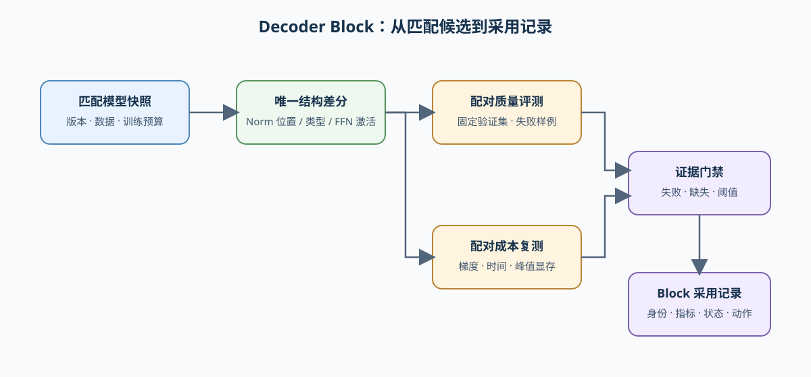
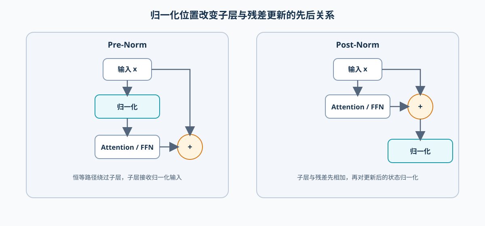

# 60. Decoder Block Stability Benchmark | Decoder Block 稳定性基准

**难度：** Hard

> 🚀 **云端运行环境**
>
> 本章节的实战代码可以点击以下链接在免费 GPU 算力平台上直接运行：
>
> [](https://colab.research.google.com/github/datawhalechina/llm-algo-leetcode/blob/main/02_PyTorch_Algorithms/60_Decoder_Block_Stability_Benchmark.ipynb)
> [](https://modelscope.cn/my/mynotebook) *(国内推荐：魔搭社区免费实例)*

**环境：** CPU-first；GPU 可选
**标签：** `模型架构`, `Decoder Block`, `Pre-Norm`, `RMSNorm`, `SwiGLU`, `Benchmark`
**目标人群：** 已理解 Decoder Block 组件，准备比较结构变体的学习者

---

## 本节导读

现代 Decoder Block 通常由 Norm、Attention、FFN 与两条 residual 路径组成。组件名称相同，不代表训练行为相同：Norm 放置、Norm 类型和 FFN 激活都会改变梯度路径、激活尺度与参数成本。本节把这些选择写成单变量候选，在固定输入和深度下先做 CPU 稳定性检查；有匹配 checkpoint 时，再用 GPU 记录质量、step time 与峰值显存。
## 前置阅读

**导语：** 先理解 hidden state 如何经过 Norm、Attention、FFN 与 residual 形成一个 Decoder Block，再比较同一骨架中一个结构选择改变后会影响什么。

- [01. RMSNorm Tutorial | RMSNorm 教程](./01_RMSNorm_Tutorial.md)
- [02. SwiGLU Activation | SwiGLU 激活](./02_SwiGLU_Activation.md)
- [05. LLaMA3 Block Tutorial | LLaMA3 Block 组装](./05_LLaMA3_Block_Tutorial.md)
- [模型架构演进 · Block 与 Residual 主干](../topic_discussion/llm_architecture_evolution/06_block_residual_path.md)
### Step 1：从匹配模型快照到 Block 采用记录

项目接收一对训练流程一致、仅改变一个 Block 结构字段的模型快照。每个候选先满足独立结构契约：Norm 位置、Norm 类型和 FFN 激活属于支持集合，模型宽度与 FFN 宽度为正，SwiGLU 的门控和值分支保持等宽。随后核对两份候选只有一个声明字段变化，模型宽度、层数、数据、训练预算和随机性控制保持一致。

| 项目阶段 | 输入 | 操作 | 输出 |
| --- | --- | --- | --- |
| 候选核对 | 模型快照、结构配置、训练清单 | 先检查各自结构合法性，再确认只有 Norm 位置、Norm 类型或 FFN 激活发生变化 | 受控候选对 |
| 配对复测 | 固定验证集、batch、长度、数据类型与重复次数 | 对两个候选执行相同质量评测和训练步回放 | 原始质量与成本记录 |
| 证据门禁 | 质量、梯度、时间、显存与失败记录 | 拒绝不可比、失败或越界候选 | `accept / tune / reject` |
| 项目交付 | 模型身份、工作负载、指标和决策 | 保存可追溯 companion | Block 采用记录 |


### Step 2：稳定性来自 residual 路径与尺度控制

Pre-Norm 先把 hidden state 调整到可控尺度，再送入 Attention 或 FFN，子层输出通过 residual 回到主干；Post-Norm 则在 residual 相加后再归一化。RMSNorm 和 LayerNorm 都控制尺度，但 LayerNorm 还会重新中心化。它们不是“谁一定更好”的结论，而是不同深度、学习率和数据条件下需要复测的候选。

| 机制 | 直接改变 | 为什么检查梯度或质量 | 为什么检查成本 |
| --- | --- | --- | --- |
| Norm 位置 | 子层输入与 residual 的顺序 | 深层梯度经过的恒等路径不同 | 归一化与子层执行顺序改变 |
| Norm 类型 | 是否减均值与缩放方式 | 激活中心和尺度控制不同 | 统计计算与参数略有差异 |
| FFN 激活 | 通道门控与非线性 | 表达路径和输出尺度不同 | 投影宽度与逐元素计算不同 |


### Step 3：质量、稳定性与成本分别记录

一次 Block benchmark 至少保留三类证据。工作负载身份不同、任一候选运行失败属于硬失败；验证损失、梯度范数、训练步时间或峰值显存缺失时只能补证据。证据完整后，验证损失、训练步时间和峰值显存按上限检查，梯度范数按下限检查。质量变好而成本超预算，或成本下降而质量失守，都不能采用候选。

| 证据层 | 最少字段 | 用于回答的问题 |
| --- | --- | --- |
| 结构契约 | baseline、candidate、唯一变化字段、固定条件 | 比较是否真的只改了一个设计 |
| CPU 稳定性代理 | finite、loss、input grad norm、activation std、参数量 | 结构是否可运行、梯度是否可达 |
| GPU 实测 | checkpoint、eval metric、step time、peak memory、失败记录 | 候选能否在真实训练中保留 |
| 决策 | 质量上限、梯度下限、时间上限、显存上限、`accept / tune / reject` | 失败则 `reject`，缺证据则 `tune`，全部过门槛才 `accept` |
### Step 4：实现比较契约、配对证据与采用门禁

题目提供两个模型清单和一组简化的配对运行结果。学习者需要核对唯一结构差分、确认工作负载配对、保留全部门禁失败项，并只从合格候选中形成采用判断。字段读取和结果装配由骨架提供。

| 任务与目的 | 已知条件 | 完成标准 | 测试验证 |
| --- | --- | --- | --- |
| TODO 1：校验单个 Block 规格 | Norm 位置、Norm 类型、FFN 激活和宽度 | 支持的结构字段与合法维度同时成立 | 合法规格、未知类型和非法宽度 |
| TODO 2：核对唯一结构差分 | 两份合法规格和声明字段 | 只有一个允许字段变化，宽度预算不变 | 单变量、多变量和声明错配 |
| TODO 3：核对配对结果 | baseline/candidate 运行记录 | 工作负载一致，并分开记录硬失败与缺失证据 | 工作负载错配、完整记录与缺失字段 |
| TODO 4：形成采用判断 | 配对结果和四类指标门槛 | 按失败、缺失、阈值的顺序返回项目状态 | `accept`、`tune` 和 `reject` |

```python
from __future__ import annotations

from dataclasses import dataclass
from typing import Any, Dict


```


```python
@dataclass(frozen=True)
class BlockSpec:
    """A single Decoder Block design under a fixed width and FFN budget."""

    norm_position: str
    norm_kind: str
    activation: str
    d_model: int = 16
    d_ff: int = 32


# TODO 1：校验 Block 规格。
def validate_block_spec(spec: BlockSpec) -> Dict[str, Any]:
    """Return a ready flag and issues for one Block candidate.

    Variables to determine:
    # norm_position = ???  # pre_norm / post_norm
    # norm_kind = ???      # rmsnorm / layernorm
    # activation = ???     # swiglu / gelu
    # issues = ???         # include invalid dimensions or incompatible FFN width
    """
    raise NotImplementedError('请先完成 TODO 1')


# TODO 2：确认基线与候选只改变一个结构字段。
def validate_single_block_change(baseline: BlockSpec, candidate: BlockSpec, declared_field: str) -> Dict[str, Any]:
    """Return the changed field only when the comparison is controlled.

    Variables to determine:
    # changed_fields = ???  # compare norm_position / norm_kind / activation
    # ready = ???           # exactly one changed field and it equals declared_field
    # return {'ready': ready, 'changed_fields': changed_fields, 'issues': issues}
    """
    raise NotImplementedError('请先完成 TODO 2')


# TODO 3：核对 baseline 与 candidate 的工作负载和项目证据。
def validate_paired_block_results(baseline: Dict[str, Any], candidate: Dict[str, Any]) -> Dict[str, Any]:
    """返回全部配对问题；缺失质量证据单独记录，不伪装成运行失败。

    Variables to determine:
    # workload_match = ???  # workload_id 必须相同
    # failures = ???        # 汇总两个候选的运行失败
    # missing = ???         # validation_loss / peak_memory_mb / step_time_ms
    """
    raise NotImplementedError('请先完成 TODO 3')


# TODO 4：按质量、稳定性和成本门槛形成项目状态。
def decide_block_candidate(pair: Dict[str, Any], limits: Dict[str, float]) -> Dict[str, str]:
    """硬失败返回 reject，缺证据返回 tune，完整证据过门槛才 accept。

    Variables to determine:
    # decision = ???  # 先失败，再缺失，最后检查质量、梯度、时间和显存
    # reason = ???    # 指向首要失败类别
    """
    raise NotImplementedError('请先完成 TODO 4')

```


```python
# Tests are split by responsibility: contract, controlled change, paired evidence, and decision.
def test_block_spec_contract():
    baseline = BlockSpec('pre_norm', 'rmsnorm', 'swiglu')
    assert validate_block_spec(baseline)['ready']
    assert not validate_block_spec(BlockSpec('unknown', 'rmsnorm', 'swiglu'))['ready']
    assert not validate_block_spec(BlockSpec('pre_norm', 'rmsnorm', 'swiglu', d_model=16, d_ff=31))['ready']
    return baseline


def test_single_change_contract(baseline):
    candidate = BlockSpec('post_norm', 'rmsnorm', 'swiglu')
    result = validate_single_block_change(baseline, candidate, 'norm_position')
    assert result['ready'] and result['changed_fields'] == ['norm_position']
    invalid = validate_single_block_change(baseline, BlockSpec('post_norm', 'layernorm', 'swiglu'), 'norm_position')
    assert not invalid['ready']
    return candidate


def test_paired_results():
    baseline = {'workload_id': 'block-v1', 'validation_loss': 1.0, 'grad_norm': 0.8, 'step_time_ms': 10.0, 'peak_memory_mb': 4000, 'failures': []}
    candidate = {'workload_id': 'block-v1', 'validation_loss': 0.98, 'grad_norm': 0.9, 'step_time_ms': 10.5, 'peak_memory_mb': 4200, 'failures': []}
    pair = validate_paired_block_results(baseline, candidate)
    assert pair['comparable'] and pair['missing_evidence'] == []
    mismatch = validate_paired_block_results(baseline, {**candidate, 'workload_id': 'other'})
    assert not mismatch['comparable'] and 'workload_mismatch' in mismatch['gate_failures']
    return pair


def test_block_decision(pair):
    limits = {'max_validation_loss': 1.05, 'min_grad_norm': 0.1, 'max_step_time_ms': 12.0, 'max_peak_memory_mb': 5000}
    assert decide_block_candidate(pair, limits)['decision'] == 'accept'
    missing = {**pair, 'missing_evidence': ['validation_loss']}
    assert decide_block_candidate(missing, limits)['decision'] == 'tune'
    failed = {**pair, 'gate_failures': ['runtime_failure']}
    assert decide_block_candidate(failed, limits)['decision'] == 'reject'


_base = test_block_spec_contract()
_candidate = test_single_change_contract(_base)
_pair = test_paired_results()
test_block_decision(_pair)
print('测试通过：Block 契约、单变量比较、配对证据与项目门禁一致。')

```

---

🛑 **STOP HERE**

先完成题目区并运行测试，再查看参考实现。

---
## 参考代码与解析

### 代码

```python
from dataclasses import dataclass
from typing import Any, Dict

@dataclass(frozen=True)
class BlockSpec:
    """A single Decoder Block design under a fixed width and FFN budget."""

    norm_position: str
    norm_kind: str
    activation: str
    d_model: int = 16
    d_ff: int = 32


def validate_block_spec(spec: BlockSpec) -> Dict[str, Any]:
    """TODO 1：校验 Block 的结构字段与 FFN 宽度契约。"""
    issues = []
    if spec.norm_position not in {'pre_norm', 'post_norm'}:
        issues.append('norm_position must be pre_norm or post_norm')
    if spec.norm_kind not in {'rmsnorm', 'layernorm'}:
        issues.append('norm_kind must be rmsnorm or layernorm')
    if spec.activation not in {'swiglu', 'gelu'}:
        issues.append('activation must be swiglu or gelu')
    if min(spec.d_model, spec.d_ff) <= 0:
        issues.append('d_model and d_ff must be positive')
    if spec.activation == 'swiglu' and spec.d_ff % 2:
        issues.append('swiglu d_ff must be even for a balanced gate/value split')
    return {'ready': not issues, 'issues': issues}


def validate_single_block_change(baseline: BlockSpec, candidate: BlockSpec, declared_field: str) -> Dict[str, Any]:
    """TODO 2：只接受一个声明字段与真实差分一致的候选。"""
    fields = ('norm_position', 'norm_kind', 'activation')
    changed_fields = [field for field in fields if getattr(baseline, field) != getattr(candidate, field)]
    issues = []
    if not validate_block_spec(baseline)['ready'] or not validate_block_spec(candidate)['ready']:
        issues.append('baseline or candidate spec is invalid')
    if baseline.d_model != candidate.d_model or baseline.d_ff != candidate.d_ff:
        issues.append('width and FFN budget must stay fixed')
    if len(changed_fields) != 1:
        issues.append(f'expected one structure change, got: {changed_fields}')
    elif declared_field != changed_fields[0]:
        issues.append(f'declared_field should be {changed_fields[0]}')
    return {'ready': not issues, 'changed_fields': changed_fields, 'issues': issues}


def validate_paired_block_results(baseline: Dict[str, Any], candidate: Dict[str, Any]) -> Dict[str, Any]:
    """TODO 3：核对工作负载身份并保留全部失败与缺失证据。"""
    failures = list(baseline.get('failures', [])) + list(candidate.get('failures', []))
    if baseline.get('workload_id') != candidate.get('workload_id'):
        failures.append('workload_mismatch')
    required = ('validation_loss', 'grad_norm', 'step_time_ms', 'peak_memory_mb')
    missing = [f'{role}.{field}' for role, record in (('baseline', baseline), ('candidate', candidate)) for field in required if record.get(field) is None]
    return {
        'baseline': baseline, 'candidate': candidate,
        'comparable': 'workload_mismatch' not in failures,
        'gate_failures': failures, 'missing_evidence': missing,
    }


def decide_block_candidate(pair: Dict[str, Any], limits: Dict[str, float]) -> Dict[str, str]:
    """TODO 4：按质量、稳定性和成本门槛形成项目状态。"""
    if pair['gate_failures']:
        return {'decision': 'reject', 'reason': 'paired execution or workload contract failed'}
    if pair['missing_evidence']:
        return {'decision': 'tune', 'reason': 'paired evidence is incomplete'}
    candidate = pair['candidate']
    checks = (
        candidate['validation_loss'] <= limits['max_validation_loss'],
        candidate['grad_norm'] >= limits['min_grad_norm'],
        candidate['step_time_ms'] <= limits['max_step_time_ms'],
        candidate['peak_memory_mb'] <= limits['max_peak_memory_mb'],
    )
    if not all(checks):
        return {'decision': 'reject', 'reason': 'quality, stability, or cost threshold failed'}
    return {'decision': 'accept', 'reason': 'paired quality, stability, and cost evidence passed'}

```

### 解析

- **TODO 1** 先排除无法公平比较的规格：SwiGLU 的门和值必须等宽，候选不能偷偷改变模型宽度或 FFN 预算。
- **TODO 2** 将“只改一个结构选择”写成可验证契约；如果同时替换 Norm 位置和类型，结果不能归因。
- **TODO 3** 核对配对运行是否使用同一工作负载，并把运行失败与缺失质量、梯度、时间或显存证据分开记录；测试覆盖正常配对和工作负载错配。
- **TODO 4** 先处理硬失败，再处理缺失证据，最后按质量、梯度、时间和显存各自的指标方向检查门槛；测试覆盖 `accept`、`tune` 和 `reject`。
### Step 5（项目实验）：复测匹配的解码块候选

本实验接收两个本地模型快照，使用固定形状的随机词元测量前向与反向耗时、峰值显存和梯度范数。随机词元上的运行损失用于检查数值，不代替独立验证集质量；快照的训练条件与单变量差异也需另行确认。模型资产尚未准备好时，`prepare` 只报告缺失项。

#### 5.1 环境与固定工作负载

本实验使用 [`ARCH-CUDA-MECHANISM`](../gpu_environment_assets.md#arch-cuda-mechanism)。首次运行先完成[模型架构实验 Quickstart](../topic_discussion/llm_architecture_evolution/quickstart.md#arch-cuda-mechanism-quickstart)；已有环境只需激活、通过 Profile 预检，并从同一解释器启动 JupyterLab。页面、输入清单和结果状态见[模型架构实验资产表](../topic_discussion/llm_architecture_evolution/experiment_assets.md)。普通复测只修改 `RUN_LABEL` 与 `RUN_STAGE`。

| 配置层 | 本节固定条件 | 修改规则 |
|:---|:---|:---|
| 运行环境 | `ARCH-CUDA-MECHANISM`；单张 NVIDIA GPU；参考显存 8 GiB | 预检失败时停止 `measure`，不向环境追加 vLLM 或 SGLang |
| 模型资产 | 一对训练流程一致的 baseline / candidate 本地快照 | 在 5.2 的输入清单登记路径；两组只改变声明的 Block 字段 |
| 工作负载 | batch 1；长度 128；FP16；3 次重复；seed 7 | 普通复测保持不变；改变后另建实验标签并更新输入记录 |
| 配对变量 | `changed_field`，默认检查 `norm_kind` | 模型宽度、层数、数据、训练预算和评测输入保持一致 |
| 实测指标 | 随机词元运行损失、前向与反向时间、峰值显存、首个有梯度参数的范数 | 不包含优化器更新；缺少匹配质量与结构对照时保持 `tune` |
| 结果资产 | `benchmarks/results/60_decoder_block_stability/60_decoder_block_<run_label>.json` | 正式复测使用唯一标签，避免覆盖已有结果 |

`prepare` 只检查环境和输入资产，`measure` 执行配对 GPU 实验，`close` 根据已保存结果形成决策。


```python
# 学习者入口：普通复测通常只修改这两项。
RUN_LABEL = 'replace_with_unique_label'  # 正式复测改为唯一标签，避免覆盖同名结果。
RUN_STAGE = 'prepare'  # 按 prepare → measure → close 顺序运行。

```

#### 5.2 固定输入与环境预检

本单元读取 `ARCH-CUDA-MECHANISM` 环境配置和模型快照清单，检查 CUDA、Transformers 与目标结果路径。它不安装依赖、不下载模型，也不创建实验结果；预检未通过时保持 `RUN_STAGE='prepare'`，按 5.1 链接的 Quickstart 完成环境或资产准备。


```python
from pathlib import Path
import json
import os
import subprocess
import sys
from datetime import datetime, timezone

SEMANTIC_ID = 'ARCH-BLOCK-STABILITY'
RESULT_SCHEMA = 'architecture-evaluation/v1'
ENVIRONMENT_PROFILE = 'ARCH-CUDA-MECHANISM'
INPUT_MANIFEST_RELATIVE_PATH = Path('benchmarks/project_inputs/60_block_stability.json')
BLOCK_REVISION = 'main'
BLOCK_DTYPE = 'float16'
BLOCK_BATCH_SIZE = 1
BLOCK_SEQ_LEN = 128
BLOCK_REPEATS = 3
BLOCK_SEED = 7
BLOCK_RESULT_DIR = Path('benchmarks/results/60_decoder_block_stability')

if RUN_STAGE not in {'prepare', 'measure', 'close'}:
    raise ValueError(f'未知 RUN_STAGE: {RUN_STAGE}')
if RUN_STAGE != 'prepare' and RUN_LABEL == 'replace_with_unique_label':
    raise ValueError('measure / close 需要唯一 RUN_LABEL。')

repository_root = next(
    (item for item in (Path.cwd(), *Path.cwd().parents) if (item / 'tools' / 'project_runtime.py').is_file()),
    None,
)
if repository_root is None:
    raise RuntimeError('未找到项目根目录。')
manifest_path = repository_root / INPUT_MANIFEST_RELATIVE_PATH
input_manifest = json.loads(manifest_path.read_text(encoding='utf-8'))
BLOCK_BASELINE_MODEL = input_manifest.get('baseline_model', '')
BLOCK_CANDIDATE_MODEL = input_manifest.get('candidate_model', '')
BLOCK_CHANGED_FIELD = input_manifest.get('changed_field', 'norm_kind')
BLOCK_REVISION = input_manifest.get('revision', BLOCK_REVISION)
output_path = repository_root / BLOCK_RESULT_DIR / f'60_decoder_block_{RUN_LABEL}.json'

profile_process = subprocess.run(
    [sys.executable, str(repository_root / 'tools/environment_preflight.py'), '--profile', ENVIRONMENT_PROFILE],
    cwd=repository_root, capture_output=True, text=True,
)
try:
    profile_report = json.loads(profile_process.stdout)
except json.JSONDecodeError:
    profile_report = {
        'ready': False,
        'reasons': [profile_process.stderr.strip() or '环境预检没有返回 JSON'],
    }

import torch
issues = []
if not profile_report.get('ready'):
    issues.extend(profile_report.get('reasons', ['架构实验环境预检未通过']))
if not BLOCK_BASELINE_MODEL or not BLOCK_CANDIDATE_MODEL:
    issues.append('输入清单尚未登记匹配的 baseline/candidate 模型快照')
if RUN_STAGE == 'measure' and not torch.cuda.is_available():
    issues.append('measure 阶段需要 CUDA')
if RUN_STAGE == 'measure':
    try:
        from transformers import AutoConfig, AutoModelForCausalLM
    except ImportError:
        issues.append('measure 阶段需要 transformers')
if RUN_STAGE == 'measure' and output_path.exists():
    issues.append(f'结果已存在，请更换 RUN_LABEL: {output_path}')
preflight = {
    'stage': RUN_STAGE,
    'environment_profile': ENVIRONMENT_PROFILE,
    'environment_ready': profile_report.get('ready', False),
    'manifest': str(INPUT_MANIFEST_RELATIVE_PATH),
    'issues': issues,
    'ready': not issues,
}
print(preflight)
if RUN_STAGE == 'measure' and issues:
    raise RuntimeError('；'.join(issues))

```

#### 5.3 对照合同与工作负载

输入形状、精度、随机种子和重复次数保持一致。清单中的解码块字段是计划比较的变量；当前探针加载完整checkpoint，尚未自动核对其他结构与训练条件，因此结果按观察性比较记录。


```python
GPU_WORKLOAD = {
    'batch_size': BLOCK_BATCH_SIZE,
    'seq_len': BLOCK_SEQ_LEN,
    'dtype': BLOCK_DTYPE,
    'repeats': BLOCK_REPEATS,
    'seed': BLOCK_SEED,
    'quality_metric': 'validation_loss_from_matched_eval',
}
print(GPU_WORKLOAD)

print({'baseline': BLOCK_BASELINE_MODEL, 'candidate': BLOCK_CANDIDATE_MODEL, 'changed_field': BLOCK_CHANGED_FIELD, 'output': str(output_path)})

```

#### 5.4 采集匹配测量

`measure` 分别加载两个本地模型快照并保存原始测量；其他阶段跳过 GPU。


```python
if RUN_STAGE == 'measure':
    import time

    def _dtype_from_name(name: str) -> torch.dtype:
        return {'float16': torch.float16, 'bfloat16': torch.bfloat16, 'float32': torch.float32}[name]

    def _run_checkpoint_probe(model_id: str) -> dict:
        torch.manual_seed(BLOCK_SEED)
        dtype = _dtype_from_name(BLOCK_DTYPE)
        model = AutoModelForCausalLM.from_pretrained(model_id, revision=BLOCK_REVISION, torch_dtype=dtype, local_files_only=True).cuda().train()
        vocab_size = int(getattr(model.config, 'vocab_size', 32000))
        inputs = torch.randint(0, vocab_size, (BLOCK_BATCH_SIZE, BLOCK_SEQ_LEN), device='cuda')
        torch.cuda.reset_peak_memory_stats()
        for _ in range(1):
            model.zero_grad(set_to_none=True)
            model(input_ids=inputs, labels=inputs).loss.backward()
        torch.cuda.synchronize()
        elapsed_ms = []
        grad_norm = 0.0
        for _ in range(BLOCK_REPEATS):
            model.zero_grad(set_to_none=True)
            started = time.perf_counter()
            loss = model(input_ids=inputs, labels=inputs).loss
            loss.backward()
            torch.cuda.synchronize()
            elapsed_ms.append((time.perf_counter() - started) * 1000)
            grad_norm = float(next(parameter.grad.norm() for parameter in model.parameters() if parameter.grad is not None).item())
        result = {
            'checkpoint': model_id,
            'runtime_loss': float(loss.detach().item()),
            'step_time_ms_median': sorted(elapsed_ms)[len(elapsed_ms) // 2],
            'peak_memory_mb': round(torch.cuda.max_memory_allocated() / 1024**2, 2),
            'grad_norm_first_parameter': grad_norm,
            'quality': {'validation_loss': None, 'status': 'runtime_only'},
        }
        del model
        torch.cuda.empty_cache()
        return result

    baseline_result = _run_checkpoint_probe(BLOCK_BASELINE_MODEL)
    candidate_result = _run_checkpoint_probe(BLOCK_CANDIDATE_MODEL)
    import sys
    repository_root = next((item for item in (Path.cwd(), *Path.cwd().parents) if (item / 'tools' / 'project_runtime.py').is_file()), None)
    if repository_root is None:
        raise RuntimeError('未找到项目根目录。')
    if str(repository_root) not in sys.path:
        sys.path.insert(0, str(repository_root))
    from tools.project_runtime import save_json_record_once
    output_dir = repository_root / BLOCK_RESULT_DIR
    output_path = output_dir / f'60_decoder_block_{RUN_LABEL}.json'
    save_json_record_once(output_path, {
        'schema_version': RESULT_SCHEMA, 'semantic_id': SEMANTIC_ID, 'run_label': RUN_LABEL,
        'project': '60_decoder_block_stability',
        'changed_field': BLOCK_CHANGED_FIELD,
        'workload': GPU_WORKLOAD,
        'baseline': baseline_result,
        'candidate': candidate_result,
        'evidence_level': 'observational_gpu_benchmark',
    })
    BLOCK_RESULT_PATH = output_path
    print(f'Saved: {BLOCK_RESULT_PATH}')

else:
    print(f'跳过 GPU 测量：RUN_STAGE={RUN_STAGE}')

```

#### 5.5 核对测量结果

读取当前标签的原始结果，核对模型身份、工作负载和质量证据。本单元不加载模型、不写文件。


```python
result_path = output_path if output_path.is_file() else None
if result_path is None:
    record = None
    print({'status': 'pending', 'expected_result': str(output_path)})
else:
    record = json.loads(result_path.read_text(encoding='utf-8'))
    evidence_review = {
        'semantic_id': record.get('semantic_id'),
        'run_label': record.get('run_label'),
        'changed_field': record.get('changed_field'),
        'workload': record.get('workload'),
        'quality_status': record.get('candidate', {}).get('quality', {}).get('status'),
        'ready_for_decision': record.get('semantic_id') == SEMANTIC_ID,
    }
    print(evidence_review)

```

#### 5.6 形成架构证据

`close` 根据当前项目与标签的原始结果生成观察性记录。两侧运行数值有限、耗时与显存为正时保留 `tune`；异常数值判为 `reject`。采用结构变体还需要相同评测集、质量门槛和其他条件一致的对照，不能由候选填写一个验证损失就升级为 `accept`。


```python
def review_checkpoint_pair_for_close(record, expected_label):
    """核对双侧运行数值；完整checkpoint探针保留为观察性比较。"""
    import math
    if record.get('semantic_id') != 'ARCH-BLOCK-STABILITY' or record.get('run_label') != expected_label:
        raise ValueError('原始结果的项目或运行标签不匹配')
    runtime_ok = all(
        type(record.get(role, {}).get(key)) in (int, float)
        and math.isfinite(record[role][key])
        and record[role][key] >= 0
        and (key not in ('peak_memory_mb', 'step_time_ms_median') or record[role][key] > 0)
        for role in ('baseline', 'candidate')
        for key in ('runtime_loss', 'grad_norm_first_parameter', 'step_time_ms_median', 'peak_memory_mb')
    )
    quality_ready = all(
        type(record.get(role, {}).get('quality', {}).get('validation_loss')) in (int, float)
        and math.isfinite(record[role]['quality']['validation_loss'])
        and record[role]['quality']['validation_loss'] >= 0
        for role in ('baseline', 'candidate')
    )
    return {'runtime_ok': runtime_ok, 'quality_ready': quality_ready,
            'decision': 'tune' if runtime_ok else 'reject'}

if RUN_STAGE == 'close' and result_path is not None:
    record = json.loads(Path(result_path).read_text(encoding='utf-8'))
    review = review_checkpoint_pair_for_close(record, RUN_LABEL)
    quality_ready, runtime_ok, decision = review['quality_ready'], review['runtime_ok'], review['decision']
    next_action = 'verify single-variable checkpoint differences and matched independent quality before adoption'

    # 定位仓库工具；兼容从仓库根目录或章节目录启动 Notebook。
    import sys
    repository_root = next(
        (path for path in (Path.cwd(), *Path.cwd().parents) if (path / 'tools' / 'architecture_result_schema.py').is_file()),
        None,
    )
    if repository_root is None:
        raise RuntimeError('未找到 tools/architecture_result_schema.py，请从教程仓库中运行本节。')
    if str(repository_root) not in sys.path:
        sys.path.insert(0, str(repository_root))

    from tools.architecture_result_schema import make_producer_record, save_record

    companion = make_producer_record(
        semantic_id='ARCH-BLOCK-STABILITY',
        comparison_mode='observational',
        source={
            'notebook': '02_PyTorch_Algorithms/60_Decoder_Block_Stability_Benchmark.ipynb',
            'raw_result_path': str(result_path),
        },
        runtime={
            'framework': 'transformers',
            'device': 'cuda',
            'dtype': BLOCK_DTYPE,
            'model_revision': BLOCK_REVISION,
        },
        workload=record['workload'],
        baseline={'name': 'baseline', 'checkpoint': record['baseline']['checkpoint']},
        candidates=[{'name': 'candidate', 'checkpoint': record['candidate']['checkpoint']}],
        quality={
            'metric': 'validation_loss',
            'baseline': record['baseline']['quality'].get('validation_loss'),
            'candidate': record['candidate']['quality'].get('validation_loss'),
            'status': record['candidate']['quality']['status'],
        },
        cost={
            role: {
                'step_time_ms_median': record[role]['step_time_ms_median'],
                'peak_memory_mb': record[role]['peak_memory_mb'],
            }
            for role in ('baseline', 'candidate')
        },
        mechanism={
            'changed_field': record['changed_field'],
            'runtime_loss': {role: record[role]['runtime_loss'] for role in ('baseline', 'candidate')},
            'gradient_norm_first_parameter': {
                role: record[role]['grad_norm_first_parameter'] for role in ('baseline', 'candidate')
            },
        },
        evidence_level='observational_gpu_benchmark',
        decision={'status': decision, 'reason': 'matched quality evidence is required before adoption', 'next_action': next_action},
    )
    companion_path = Path(result_path).with_name(Path(result_path).stem + '_architecture.json')
    if companion_path.exists():
        print(f'Companion already exists and was not overwritten: {companion_path}')
    else:
        save_record(companion_path, companion)
        print(f'Saved companion: {companion_path}')
    print({'decision': decision, 'next_action': next_action})

elif RUN_STAGE == 'close':
    raise FileNotFoundError(f'找不到当前标签的原始结果：{output_path}')
else:
    print(f'跳过收口：RUN_STAGE={RUN_STAGE}')

```

## 相关阅读

- [On Layer Normalization in the Transformer Architecture](https://arxiv.org/abs/2002.04745)
- [Root Mean Square Layer Normalization](https://arxiv.org/abs/1910.07467)
- [GLU Variants Improve Transformer](https://arxiv.org/abs/2002.05202)
- [模型架构演进 · 归一化演化](../topic_discussion/llm_architecture_evolution/03_norm_evolution.md)
- [模型架构演进 · Block 与 Residual 主干](../topic_discussion/llm_architecture_evolution/06_block_residual_path.md)
- [61. Model Architecture Exploration | 架构验证项目](./61_Model_Architecture_Exploration.md)：将本节的专项证据汇入架构审计。
