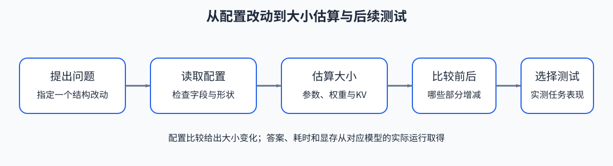
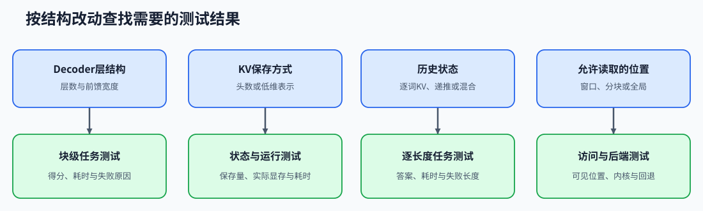

# 61. Model Architecture Exploration | 模型架构审计

**难度：** Hard | **环境：** [CPU 主线](#runtime-environment) | **标签：** `模型结构`、`配置比较`、`架构选择` | **目标人群：** 理解Decoder组成、希望比较结构改动的读者

> 🚀 **云端运行环境**
>
> 本章节的实战代码可以点击以下链接在免费 GPU 算力平台上直接运行：
>
> [](https://colab.research.google.com/github/datawhalechina/llm-algo-leetcode/blob/main/02_PyTorch_Algorithms/61_Model_Architecture_Exploration.ipynb)
> [](https://modelscope.cn/my/mynotebook) *(国内推荐：魔搭社区免费实例)*


## 本节导读

一个模型使用16个查询头、4个KV头。如果把KV头减为2个，哪些参数矩阵会变小，每个词元需要保存的缓存又会减少多少？配置文件能帮助估算这些变化，但回答是否变差、请求是否更快，还需要对应模型的实际测试。

本项目先比较基线与改动后的配置，记录改了哪个字段、参数与缓存大小怎样变化，再查找对应实验的结果。把这些信息整理在同一份报告中，就是这里的架构审计：逐项说明哪些已经核对，哪些还需要测试。

<a id="runtime-environment"></a>
## 运行环境

CPU部分使用Python标准库，读取配置、估算大小并检查结果记录。可选的配置实验使用本地模型文件，不加载权重；准备方式见[模型架构专题项目环境入口](../topic_discussion/llm_architecture_evolution/quickstart.md#项目与推理服务环境)。

## 前置阅读

先理解一个Decoder层中注意力、前馈网络和残差连接的位置，再比较配置变化会影响哪些部分。

- [05. LLaMA3 Block Tutorial | LLaMA3 Block教程](05_LLaMA3_Block_Tutorial.md)：核对Decoder层的组成与数据流。
- [08. Architecture Tricks | 架构技巧](08_Architecture_Tricks.md)：理解常见结构改动怎样改变计算和状态。

MLA与混合记忆的具体保存方式，可按Step 2中的比较对象进入对应页面。

## Step 1：确定要比较的结构改动

先选一个已有配置作为基线，再提出一个具体改动，例如减少KV头数，或增大前馈网络宽度。记录改动前后的数值，再逐项检查其他结构字段，确认这次到底改变了什么。改配置文件本身不会产生对应权重；后续运行需要使用与新结构匹配的模型。

| 比较内容 | 需要记录什么 | 用来做什么 |
| --- | --- | --- |
| 基线 | 模型版本与结构配置 | 给参数和缓存变化一个参照 |
| 本次改动 | 字段、前后取值和修改原因 | 明确准备检查哪种作用 |
| 其他条件 | 训练数据、分词器、数据类型、请求与测试方法 | 区分结构变化和其他差异 |
| 后续测试 | 配置检查、模型运行或任务评测 | 找出仍需测量的指标 |



## Step 2：估算改动影响的参数和缓存

先根据配置计算参数个数和缓存形状，再乘每个元素的字节数，得到存储大小估算。减少KV头数会改变KV投影与历史缓存；前馈网络变宽会增加相应参数；窗口访问和递推状态则改变历史怎样被保存或读取。本题的参数估算针对稠密Decoder，专家参数与完整MLA实现还需由对应项目检查。

| 结构改动 | 直接影响 | 先检查什么 | 再到哪里测试 |
| --- | --- | --- | --- |
| KV头数或压缩表示 | KV投影与历史缓存 | 每个词元的状态形状和字节数 | [71 MLA与KV结构基准](71_MLA_KV_Cache_Architecture_Benchmark.md) |
| 前馈宽度或层数 | 参数量与计算量 | 各层参数和权重大小 | [60 Decoder层稳定性项目](60_Decoder_Block_Stability_Benchmark.md) |
| 窗口或稀疏访问 | 允许读取的历史位置 | 哪些位置可见，任务需要的信息是否仍保留 | [78 注意力访问模式基准](78_Attention_Access_Pattern_Benchmark.md) |
| 注意力与递推层排列 | 保存对象与状态增长 | 各类层的状态形状及排列 | [77 长序列记忆架构基准](77_Long_Sequence_Memory_Architecture_Benchmark.md) |
| 专家数量与路由 | 专家参数、词元分组与通信 | 专家分配、容量与丢弃词元 | [80 MoE专家并行基准](80_MoE_Expert_Parallel_Benchmark.md) |

## Step 3：结合配置与任务结果判断下一步

配置估算回答参数和缓存可能怎样变化；读取实际模型的配置，可以确认它使用了什么结构；运行固定任务，才能比较答案、耗时和显存。按改动对象找到对应实验，将结果文件与当前模型版本、请求和运行条件核对，再形成判断。比较条件以实际配置和运行记录为依据；系列名称与变化声明用于识别候选。

| 已取得的记录 | 可以判断什么 | 下一步 |
| --- | --- | --- |
| 参数和状态大小估算 | 在本题结构假设下，哪些部分增大或减小 | 读取对应模型的实际配置 |
| 实际模型配置 | 该模型是否使用所比较的结构 | 查找同版本、同任务的运行记录 |
| 训练和运行条件匹配的测量 | 当前任务下的质量与资源是否满足要求 | 在这些条件下评估是否采用 |
| 多个条件同时变化的模型测试 | 各模型在当前请求下分别表现怎样 | 列出差异，继续寻找匹配模型或保留各自结果 |




```python
from typing import Dict, List
```

## Step 4：汇总结构改动、大小估算与测试结果

题目给出两组配置及简化测试记录。提取结构字段、核对变化，分别计算参数与缓存大小，再按改动选择测试入口并给出下一步动作。

| 任务与目的 | 已知条件 | 完成标准 | 测试验证 |
| --- | --- | --- | --- |
| TODO 1：读取结构配置 | 原始Decoder配置 | 隐藏宽度、查询头、KV头和层数满足形状要求 | MHA、GQA、MQA与非法维度 |
| TODO 2：核对本次改动 | 基线、候选及声明字段 | 实际只改一项，且与声明一致 | 单项与多项改动 |
| TODO 3：估算参数与缓存 | 已检查的结构配置、数据类型和长度 | 分别计算注意力、前馈参数与KV缓存大小 | GQA与MHA的参数和缓存差异 |
| TODO 4：汇总比较记录 | 配置改动、大小估算和对应测试结果 | 选择相应项目，保存所需结果字段 | 不同改动的入口、结果尚缺失 |
| TODO 5：决定下一步 | 参数预算、任务得分和运行开销 | 区分结构错误、超预算、缺测试和指标达标 | `accept`、`tune`、`reject` |

```python
def extract_architecture_profile(config: Dict[str, object]) -> Dict[str, object]:
    """TODO 1：提取并校验 Decoder 的核心结构字段。"""
    # hidden_size = ???
    # attention_type = ???
    raise NotImplementedError('请先完成 TODO 1')


def validate_single_variable_candidate(baseline: Dict[str, object], candidate: Dict[str, object]) -> Dict[str, object]:
    """TODO 2：检查候选声明的 changed_field 是否与真实结构差分一致。"""
    # changed_fields = ???
    # ready = ???
    raise NotImplementedError('请先完成 TODO 2')


def build_architecture_ledger(profile: Dict[str, object], dtype_bytes: int = 2, seq_len: int = 1024) -> Dict[str, object]:
    """TODO 3：估算参数、权重与每词元KV状态大小。"""
    # attention_params = ???
    # kv_bytes_per_token = ???
    raise NotImplementedError('请先完成 TODO 3')


def build_architecture_audit_card(
    baseline: Dict[str, object], candidate: Dict[str, object], evidence: Dict[str, object] | None = None
) -> Dict[str, object]:
    """TODO 4：汇总结构改动、大小估算和对应测试入口。"""
    # comparison = ???
    # evidence_record = ???  # workload / quality / cost / failure / evidence_level
    # required_evidence = ???
    raise NotImplementedError('请先完成 TODO 4')


def recommend_audit_action(card: Dict[str, object], *, max_param_delta: int) -> Dict[str, object]:
    """TODO 5：按参数预算和证据状态返回 accept、tune 或 reject。"""
    # decision = ???
    # next_action = ???
    raise NotImplementedError('请先完成 TODO 5')
```

## 测试


```python
# 每个测试只验证一个审计机制，便于定位 TODO 的责任。
def test_profile_contract():
    """检查头数关系、结构维度及非法配置。"""
    mha = extract_architecture_profile({'hidden_size': 16, 'num_hidden_layers': 2, 'num_attention_heads': 4, 'num_key_value_heads': 4, 'intermediate_size': 32, 'vocab_size': 100})
    gqa = extract_architecture_profile({**mha, 'num_key_value_heads': 2})
    mqa = extract_architecture_profile({**mha, 'num_key_value_heads': 1})
    assert mha['attention_type'] == 'MHA'
    assert gqa['attention_type'] == 'GQA'
    assert mqa['attention_type'] == 'MQA'
    assert not extract_architecture_profile({**mha, 'num_key_value_heads': 3})['ready']
    return mha, gqa


def test_single_variable_change(mha, gqa):
    """逐项比较结构值，拒绝声明外的额外改动。"""
    candidate = {**gqa, 'changed_field': 'num_key_value_heads'}
    assert validate_single_variable_candidate(mha, candidate)['ready']
    assert not validate_single_variable_candidate(mha, {**candidate, 'intermediate_size': 48})['ready']
    for field, value in (('hidden_size', 32), ('num_attention_heads', 8), ('vocab_size', 200)):
        assert not validate_single_variable_candidate(mha, {**candidate, field: value})['ready']


def test_architecture_ledger(mha, gqa):
    """比较同形状条件下KV头数对参数和缓存的影响。"""
    mha_ledger = build_architecture_ledger(mha, seq_len=64)
    gqa_ledger = build_architecture_ledger(gqa, seq_len=64)
    assert gqa_ledger['kv_bytes_per_token'] < mha_ledger['kv_bytes_per_token']
    assert gqa_ledger['attention_params'] < mha_ledger['attention_params']


def test_audit_card_evidence_contract(mha, gqa):
    """按结构改动选择对应测试项目。"""
    card = build_architecture_audit_card(mha, {**gqa, 'changed_field': 'num_key_value_heads'})
    assert card['required_evidence']['primary_project'] == '71_MLA_KV_Cache_Architecture_Benchmark'
    assert set(card['required_evidence']['fields']) == {'workload', 'quality', 'cost', 'failure', 'evidence_level'}
    assert card['evidence']['evidence_level'] == 'cpu_structure_ledger'
    block_card = build_architecture_audit_card(mha, {**mha, 'intermediate_size': 48, 'changed_field': 'intermediate_size'})
    assert block_card['required_evidence']['primary_project'] == '60_Decoder_Block_Stability_Benchmark'
    moe_candidate = {**mha, 'num_local_experts': 8, 'changed_field': 'num_local_experts'}
    moe_card = build_architecture_audit_card(mha, moe_candidate)
    assert moe_card['required_evidence']['primary_project'] == '80_MoE_Expert_Parallel_Benchmark'
    assert recommend_audit_action(card, max_param_delta=0)['decision'] == 'tune'


def test_audit_decision(mha, gqa):
    """测试预算、简化结果与失败记录对下一步的影响。"""
    candidate = {**gqa, 'changed_field': 'num_key_value_heads'}
    evidence = {
        'workload': {'context_length': 4096, 'prompt_template': 'fixed'},
        'quality': {'metric': 'retrieval_accuracy', 'value': 0.92, 'threshold': 0.90, 'passed': True},
        'cost': {'prefill_ms': 12.0, 'tpot_ms': 1.1, 'peak_memory_mb': 512.0, 'passed': True},
        'failure': None,
        'evidence_level': 'same_family_benchmark',
    }
    accepted = build_architecture_audit_card(mha, candidate, evidence)
    assert recommend_audit_action(accepted, max_param_delta=0)['decision'] == 'accept'
    failed = build_architecture_audit_card(mha, candidate, {**evidence, 'failure': 'cache interface unavailable'})
    assert recommend_audit_action(failed, max_param_delta=0)['decision'] == 'tune'


mha_profile, gqa_profile = test_profile_contract()
test_single_variable_change(mha_profile, gqa_profile)
test_architecture_ledger(mha_profile, gqa_profile)
test_audit_card_evidence_contract(mha_profile, gqa_profile)
test_audit_decision(mha_profile, gqa_profile)
print('✅ 模型架构项目：配置比较、大小估算和选择规则通过测试。')

```

## 参考代码与解析

### 代码


```python
def extract_architecture_profile(config: Dict[str, object]) -> Dict[str, object]:
    """TODO 1：提取并校验 Decoder 的核心结构字段。"""
    required = ('hidden_size', 'num_hidden_layers', 'num_attention_heads', 'intermediate_size', 'vocab_size')
    missing = [key for key in required if key not in config]
    if missing:
        return {'ready': False, 'issues': [f'missing: {key}' for key in missing]}
    hidden_size = int(config['hidden_size'])
    attention_heads = int(config['num_attention_heads'])
    kv_heads = int(config.get('num_key_value_heads', attention_heads))
    issues = []
    if min(hidden_size, attention_heads, kv_heads, int(config['num_hidden_layers']), int(config['intermediate_size']), int(config['vocab_size'])) <= 0:
        issues.append('all dimensions must be positive')
    if not issues and hidden_size % attention_heads:
        issues.append('hidden_size must divide num_attention_heads')
    if not issues and attention_heads % kv_heads:
        issues.append('num_attention_heads must divide num_key_value_heads')
    attention_type = 'MHA' if kv_heads == attention_heads else ('MQA' if kv_heads == 1 else 'GQA')
    return {
        'ready': not issues, 'issues': issues, 'hidden_size': hidden_size,
        'num_hidden_layers': int(config['num_hidden_layers']), 'num_attention_heads': attention_heads,
        'num_key_value_heads': kv_heads, 'intermediate_size': int(config['intermediate_size']),
        'vocab_size': int(config['vocab_size']), 'head_dim': hidden_size // attention_heads if attention_heads else 0,
        'attention_type': attention_type, 'attention_pattern': str(config.get('attention_pattern', 'dense')),
        'state_representation': str(config.get('state_representation', 'kv_cache')),
        'num_local_experts': int(config.get('num_local_experts', config.get('num_experts', 0)) or 0),
        'num_experts_per_tok': int(config.get('num_experts_per_tok', config.get('top_k', 0)) or 0),
        'capacity_factor': float(config.get('capacity_factor', 0.0) or 0.0),
    }


def validate_single_variable_candidate(baseline: Dict[str, object], candidate: Dict[str, object]) -> Dict[str, object]:
    """TODO 2：检查候选声明的 changed_field 是否与真实结构差分一致。"""
    fields = ('hidden_size', 'num_attention_heads', 'vocab_size', 'num_key_value_heads', 'intermediate_size', 'num_hidden_layers', 'attention_pattern', 'state_representation', 'num_local_experts', 'num_experts_per_tok', 'capacity_factor')
    changes = [field for field in fields if baseline.get(field) != candidate.get(field)]
    declared = str(candidate.get('changed_field', ''))
    issues = []
    if not candidate.get('ready', False):
        issues.append('candidate profile is invalid')
    if len(changes) != 1:
        issues.append(f'expected exactly one structural change, got: {changes}')
    elif declared != changes[0]:
        issues.append(f'changed_field should be {changes[0]}')
    return {'ready': not issues, 'issues': issues, 'changed_fields': changes}


def build_architecture_ledger(profile: Dict[str, object], dtype_bytes: int = 2, seq_len: int = 1024) -> Dict[str, object]:
    """TODO 3：估算参数、权重与每词元KV状态大小。"""
    if not profile.get('ready', False) or dtype_bytes <= 0 or seq_len <= 0:
        raise ValueError('profile、dtype_bytes 或 seq_len 不合法')
    h, layers, heads, kv_heads = (int(profile[key]) for key in ('hidden_size', 'num_hidden_layers', 'num_attention_heads', 'num_key_value_heads'))
    head_dim, intermediate, vocab = int(profile['head_dim']), int(profile['intermediate_size']), int(profile['vocab_size'])
    attention_per_layer = h * h + 2 * h * kv_heads * head_dim + h * h
    attention_params = layers * attention_per_layer
    mlp_params = layers * 3 * h * intermediate
    embedding_params = vocab * h
    norm_params = layers * 2 * h
    total_params = attention_params + mlp_params + embedding_params + norm_params
    kv_bytes_per_token = 2 * layers * kv_heads * head_dim * dtype_bytes if profile['state_representation'] == 'kv_cache' else 0
    return {'attention_params': attention_params, 'mlp_params': mlp_params, 'embedding_params': embedding_params, 'norm_params': norm_params, 'total_params': total_params, 'weight_bytes': total_params * dtype_bytes, 'kv_bytes_per_token': kv_bytes_per_token, 'state_bytes_at_seq_len': kv_bytes_per_token * seq_len, 'evidence_level': 'cpu_structure_ledger'}


def build_architecture_audit_card(
    baseline: Dict[str, object], candidate: Dict[str, object], evidence: Dict[str, object] | None = None
) -> Dict[str, object]:
    """TODO 4：汇总结构改动、大小估算和对应测试入口。"""
    comparison = validate_single_variable_candidate(baseline, candidate)
    if not comparison['ready']:
        return {'ready': False, 'issues': comparison['issues']}
    baseline_ledger = build_architecture_ledger(baseline)
    candidate_ledger = build_architecture_ledger(candidate)
    changed_field = comparison['changed_fields'][0]
    primary_project = {
        'intermediate_size': '60_Decoder_Block_Stability_Benchmark',
        'num_hidden_layers': '60_Decoder_Block_Stability_Benchmark',
        'num_key_value_heads': '71_MLA_KV_Cache_Architecture_Benchmark',
        'attention_pattern': '78_Attention_Access_Pattern_Benchmark',
        'state_representation': '77_Long_Sequence_Memory_Architecture_Benchmark',
        'num_local_experts': '80_MoE_Expert_Parallel_Benchmark',
        'num_experts_per_tok': '80_MoE_Expert_Parallel_Benchmark',
        'capacity_factor': '80_MoE_Expert_Parallel_Benchmark',
    }.get(changed_field, 'workload_specific_training_or_inference_benchmark')
    evidence = dict(evidence or {})
    evidence_record = {
        'workload': dict(evidence.get('workload', {})),
        'quality': dict(evidence.get('quality', {})),
        'cost': dict(evidence.get('cost', {})),
        'failure': evidence.get('failure'),
        'evidence_level': str(evidence.get('evidence_level', 'cpu_structure_ledger')),
    }
    return {
        'ready': True,
        'changed_field': changed_field,
        'baseline_ledger': baseline_ledger,
        'candidate_ledger': candidate_ledger,
        'param_delta': candidate_ledger['total_params'] - baseline_ledger['total_params'],
        'required_evidence': {
            'primary_project': primary_project,
            'fields': ('workload', 'quality', 'cost', 'failure', 'evidence_level'),
        },
        'evidence': evidence_record,
    }


def recommend_audit_action(card: Dict[str, object], *, max_param_delta: int) -> Dict[str, object]:
    """TODO 5：按参数预算和专项证据返回 accept、tune 或 reject。"""
    if not card.get('ready', False):
        return {'decision': 'reject', 'reason': '结构配置或实际改动不符合要求', 'next_action': 'repair_candidate'}
    if int(card['param_delta']) > max_param_delta:
        return {'decision': 'reject', 'reason': '参数增量超过预算', 'next_action': 'reduce_structure_change'}
    evidence = card.get('evidence', {})
    if evidence.get('failure'):
        return {'decision': 'tune', 'reason': f"专项证据存在失败：{evidence['failure']}", 'next_action': card['required_evidence']['primary_project']}
    if evidence.get('evidence_level') != 'same_family_benchmark':
        return {'decision': 'tune', 'reason': '缺少训练和请求条件匹配的任务结果', 'next_action': card['required_evidence']['primary_project']}
    if not evidence.get('quality', {}).get('passed') or not evidence.get('cost', {}).get('passed'):
        return {'decision': 'tune', 'reason': '质量与成本尚未同时满足目标', 'next_action': 'expand_or_remeasure'}
    return {'decision': 'accept', 'reason': '配置改动与预算符合要求，已有质量和资源检查均通过', 'next_action': 'document_adoption'}

```

### 解析

#### TODO 1：读取结构配置

- 隐藏宽度、查询头数、KV头数和层数必须能组成合法的张量形状；查询头数与KV头数的关系区分MHA、GQA和MQA。
- `test_profile_contract` 检查三种头数安排，并用不能整除的KV头数检查错误输入。

#### TODO 2：核对实际结构变化

- 对本题列出的结构字段逐项比较，实际变化应只有一项，并与声明的字段一致。系列名称或说明文字不参与替代这个检查。
- `test_single_variable_change` 先只改KV头数，再同时改变前馈宽度、隐藏宽度或查询头数，检查多处变化能否被识别。

#### TODO 3：估算参数与缓存

- 注意力投影、前馈网络、词嵌入和归一化参数分别计算后相加；每词元缓存按各层KV头数与头维度计算。
- `test_architecture_ledger` 使用相同隐藏宽度和长度，对比减少KV头数前后的注意力参数和缓存字节数。

#### TODO 4：选择测试入口并汇总记录

- 根据改动对象选择后续项目，同时保存任务、质量、运行开销和失败原因。CPU估算本身不能填成实际测量结果。
- `test_audit_card_evidence_contract` 检查KV、前馈和专家数量改动分别指向相应项目，未提供测试结果时保持需要继续测试。

#### TODO 5：检查预算与已有结果

- 结构不合法或参数增量超过预算时拒绝；已有记录失败、缺测试或质量与运行开销未同时达标时，继续测试。
- `test_audit_decision` 使用已经核对的简化结果测试选择规则，再注入缓存接口失败，检查是否退回修复与复测。真实文件是否匹配在Step 5另行核对。

## Step 5（项目实验）：读取并汇总架构测试结果

先读取两个模型的配置差异，再按差分类型核对 60、78、71 或 77 的专项结果。配置差分和对应测试结果都通过后才形成架构审计结论。

#### 5.1 本次运行配置

填写唯一标签和阶段，按 `prepare → audit → close` 运行。模型和上游证据路径从固定输入清单读取。


```python
RUN_LABEL = 'replace_with_unique_label'
RUN_STAGE = 'prepare'  # prepare / audit / close

```

#### 5.2 固定输入与配置预检

读取模型配置和 结果文件清单。`prepare` 只报告缺失项；`audit` 只读取配置，不加载模型权重。


```python
import json
import sys
from pathlib import Path
from typing import Dict

SEMANTIC_ID = 'ARCH-MODEL-AUDIT'
RESULT_SCHEMA = 'architecture-evaluation/v1'
INPUT_MANIFEST_RELATIVE_PATH = Path('benchmarks/project_inputs/61_architecture_audit.json')
root = next((item for item in (Path.cwd(), *Path.cwd().parents) if (item / 'tools' / 'project_runtime.py').is_file()), None)
if root is None:
    raise RuntimeError('未找到项目根目录。')
manifest = json.loads((root / INPUT_MANIFEST_RELATIVE_PATH).read_text(encoding='utf-8'))
ARCH_CONFIG_AUDIT = {
    'baseline_model': manifest.get('baseline_model', ''),
    'candidate_model': manifest.get('candidate_model', ''),
    'revision': manifest.get('revision', 'main'),
    'changed_field': manifest.get('changed_field', 'num_key_value_heads'),
    'producer_results': manifest.get('producer_results', {}),
}
ARCH_CONFIG_AUDIT_PATH = root / 'benchmarks/results/61_architecture_exploration' / f'config_audit_{RUN_LABEL}.json'
if RUN_STAGE not in {'prepare', 'audit', 'close'}:
    raise ValueError(f'未知 RUN_STAGE: {RUN_STAGE}')
if RUN_STAGE != 'prepare' and RUN_LABEL == 'replace_with_unique_label':
    raise ValueError('audit / close 需要唯一 RUN_LABEL。')
missing_models = [key for key in ('baseline_model', 'candidate_model') if not ARCH_CONFIG_AUDIT[key]]
print({'stage': RUN_STAGE, 'manifest': str(INPUT_MANIFEST_RELATIVE_PATH), 'missing_models': missing_models})
if RUN_STAGE == 'audit' and missing_models:
    raise ValueError(f'固定输入清单缺少模型：{missing_models}')

if RUN_STAGE != 'audit':
    print(f'跳过配置审计：RUN_STAGE={RUN_STAGE}')
else:
    from transformers import AutoConfig
    missing = [key for key in ('baseline_model', 'candidate_model') if not ARCH_CONFIG_AUDIT[key]]
    if missing:
        raise ValueError(f'请先配置 checkpoint：{missing}')

    def profile_from_hf_config(model_id: str) -> Dict[str, object]:
        """读取常见 Decoder config 字段；缺失字段会在 profile 契约中暴露。"""
        config = AutoConfig.from_pretrained(model_id, revision=ARCH_CONFIG_AUDIT['revision'], local_files_only=True)
        raw = {
            'hidden_size': getattr(config, 'hidden_size', None),
            'num_hidden_layers': getattr(config, 'num_hidden_layers', None),
            'num_attention_heads': getattr(config, 'num_attention_heads', None),
            'num_key_value_heads': getattr(config, 'num_key_value_heads', getattr(config, 'num_attention_heads', None)),
            'intermediate_size': getattr(config, 'intermediate_size', None),
            'vocab_size': getattr(config, 'vocab_size', None),
            'attention_pattern': getattr(config, 'attention_pattern', 'dense'),
            'state_representation': 'recurrent_state' if 'mamba' in str(getattr(config, 'model_type', '')).lower() else 'kv_cache',
            'num_local_experts': getattr(config, 'num_local_experts', getattr(config, 'num_experts', 0)),
            'num_experts_per_tok': getattr(config, 'num_experts_per_tok', getattr(config, 'top_k', 0)),
            'capacity_factor': getattr(config, 'capacity_factor', 0.0),
        }
        profile = extract_architecture_profile(raw)
        profile['model_id'] = model_id
        profile['model_type'] = getattr(config, 'model_type', None)
        return profile

    baseline_profile = profile_from_hf_config(ARCH_CONFIG_AUDIT['baseline_model'])
    candidate_profile = profile_from_hf_config(ARCH_CONFIG_AUDIT['candidate_model'])
    candidate_profile['changed_field'] = ARCH_CONFIG_AUDIT['changed_field']
    card = build_architecture_audit_card(
        baseline_profile, candidate_profile,
        evidence={'workload': {'model_revision': ARCH_CONFIG_AUDIT['revision']}, 'evidence_level': 'checkpoint_config_audit'}
    )
    result = {
        'provenance': {'revision': ARCH_CONFIG_AUDIT['revision'], 'mode': 'checkpoint_config_audit'},
        'baseline': baseline_profile,
        'candidate': candidate_profile,
        'audit_card': card,
        'decision': recommend_audit_action(card, max_param_delta=0),
    }
    import sys
    root = next((item for item in (Path.cwd(), *Path.cwd().parents) if (item / 'tools' / 'project_runtime.py').is_file()), None)
    if root is None:
        raise RuntimeError('未找到项目根目录。')
    if str(root) not in sys.path:
        sys.path.insert(0, str(root))
    from tools.project_runtime import save_json_record_once
    result_dir = root / 'benchmarks' / 'results' / '61_architecture_exploration'
    ARCH_CONFIG_AUDIT_PATH = result_dir / f'config_audit_{RUN_LABEL}.json'
    result.update({'schema_version': RESULT_SCHEMA, 'semantic_id': SEMANTIC_ID, 'run_label': RUN_LABEL})
    save_json_record_once(ARCH_CONFIG_AUDIT_PATH, result)
    print(f'Saved config audit: {ARCH_CONFIG_AUDIT_PATH}')

```

#### 5.3 核对配置差异

读取当前标签的配置审计结果，确认唯一变化字段以及需要的对应测试结果。


```python
result_path = ARCH_CONFIG_AUDIT_PATH if ARCH_CONFIG_AUDIT_PATH.is_file() else None
if result_path is None:
    record = None
    print({'status': 'pending', 'expected_result': str(ARCH_CONFIG_AUDIT_PATH)})
else:
    record = json.loads(result_path.read_text(encoding='utf-8'))
    card, decision = record['audit_card'], record['decision']
    print({'changed_field': card.get('changed_field'), 'evidence_project': card.get('required_evidence', {}).get('primary_project'), 'decision': decision})

```

#### 5.4 读取对应项目的结果路径

从固定输入清单读取 对应项目的结果文件；不复制或改写已有指标。


```python
import sys

ARCH_REPOSITORY_ROOT = next(
    (path for path in (Path.cwd(), *Path.cwd().parents) if (path / 'tools' / 'architecture_result_schema.py').is_file()),
    None,
)
if ARCH_REPOSITORY_ROOT is None:
    raise RuntimeError('未找到 tools/architecture_result_schema.py，请从教程仓库中运行本节。')
if str(ARCH_REPOSITORY_ROOT) not in sys.path:
    sys.path.insert(0, str(ARCH_REPOSITORY_ROOT))

from tools.architecture_result_schema import (
    decide_audit, make_audit_record, make_evidence_reference, save_record, validate_record,
    verify_evidence_reference,
)

ARCH_PROJECT_TO_SEMANTIC_ID = {
    '60_Decoder_Block_Stability_Benchmark': 'ARCH-BLOCK-STABILITY',
    '71_MLA_KV_Cache_Architecture_Benchmark': 'ARCH-MLA-KV',
    '77_Long_Sequence_Memory_Architecture_Benchmark': 'ARCH-LONG-SEQUENCE-MEMORY',
    '78_Attention_Access_Pattern_Benchmark': 'ARCH-ATTENTION-ACCESS',
}

```

#### 5.5 核对来源、哈希与状态

检查各份记录的 `schema_version`、项目ID、记录类型和文件哈希。失败或缺失来源需要先修复或补齐。


```python
ARCH_PRODUCER_REFERENCES = []
ARCH_PRODUCER_RECORDS = {}
ARCH_REFERENCE_ISSUES = []
for semantic_id, configured_path in ARCH_CONFIG_AUDIT['producer_results'].items():
    if not configured_path:
        continue
    producer_path = (ARCH_REPOSITORY_ROOT / configured_path).resolve()
    producer_path.relative_to(ARCH_REPOSITORY_ROOT)
    try:
        producer_record = json.loads(producer_path.read_text(encoding='utf-8'))
    except (OSError, json.JSONDecodeError) as exc:
        ARCH_REFERENCE_ISSUES.append(f'{semantic_id}: unreadable result: {exc}')
        continue
    record_errors = validate_record(producer_record)
    if producer_record.get('semantic_id') != semantic_id:
        record_errors.append('configured semantic_id does not match producer record')
    if producer_record.get('role') != 'producer':
        record_errors.append('record role is not producer')
    if record_errors:
        ARCH_REFERENCE_ISSUES.extend(f'{semantic_id}: {error}' for error in record_errors)
        continue
    reference = make_evidence_reference(semantic_id=semantic_id, result_path=producer_path)
    reference_errors = verify_evidence_reference(reference)
    if reference_errors:
        ARCH_REFERENCE_ISSUES.extend(f'{semantic_id}: {error}' for error in reference_errors)
        continue
    ARCH_PRODUCER_REFERENCES.append(reference)
    ARCH_PRODUCER_RECORDS[semantic_id] = producer_record

print({'valid_references': [item['semantic_id'] for item in ARCH_PRODUCER_REFERENCES]})
if ARCH_REFERENCE_ISSUES:
    print({'reference_issues': ARCH_REFERENCE_ISSUES})

```

#### 5.6 形成架构审计记录

`close` 根据配置差异和所需测试结果生成最终审计记录；其他阶段不写最终报告。


```python
if RUN_STAGE == 'close':
    if result_path is None:
        print('No config audit result; architecture audit record was not created.')
    else:
        config_record = json.loads(Path(result_path).read_text(encoding='utf-8'))
        config_card = config_record['audit_card']
        config_decision = config_record['decision']
        required_project = config_card.get('required_evidence', {}).get('primary_project')
        required_semantic_id = ARCH_PROJECT_TO_SEMANTIC_ID.get(required_project)
        external_required = required_project is not None and required_semantic_id is None
        producer_decisions = {
            semantic_id: record.get('decision', {}).get('status', 'pending')
            for semantic_id, record in ARCH_PRODUCER_RECORDS.items()
        }
        audit_gate = decide_audit(
            config_decision=config_decision,
            required_semantic_id=required_semantic_id,
            producer_records=ARCH_PRODUCER_RECORDS,
            reference_issues=ARCH_REFERENCE_ISSUES,
            external_required=external_required,
        )
        final_decision, final_reason = audit_gate['status'], audit_gate['reason']

        if not ARCH_PRODUCER_REFERENCES:
            print({'decision': 'tune', 'reason': '尚未登记有效的架构 上游证据记录'})
        else:
            audit_record = make_audit_record(
                source={
                    'notebook': '02_PyTorch_Algorithms/61_Model_Architecture_Exploration.ipynb',
                    'config_audit_path': str(result_path),
                },
                runtime={'mode': 'offline_architecture_audit'},
                workload=config_card.get('evidence', {}).get('workload') or {'model_revision': ARCH_CONFIG_AUDIT['revision']},
                baseline=config_record['baseline'],
                candidates=[config_record['candidate']],
                quality={'producer_decisions': producer_decisions},
                cost={'referenced_producer_count': len(ARCH_PRODUCER_REFERENCES)},
                references=ARCH_PRODUCER_REFERENCES,
                audit={
                    'changed_field': config_card.get('changed_field'),
                    'required_project': required_project,
                    'required_semantic_id': required_semantic_id,
                    'reference_issues': ARCH_REFERENCE_ISSUES,
                    'config_decision': config_decision,
                },
                evidence_level='aggregate_audit',
                decision={
                    'status': final_decision,
                    'reason': final_reason,
                    'next_action': required_project if final_decision != 'accept' else 'register architecture decision',
                },
            )
            audit_path = Path(result_path).with_name(Path(result_path).stem + '_architecture.json')
            if audit_path.exists():
                print(f'Audit companion already exists and was not overwritten: {audit_path}')
            else:
                save_record(audit_path, audit_record)
                print(f'Saved architecture audit: {audit_path}')
            print({'decision': final_decision, 'reason': final_reason})
else:
    print(f'跳过收口：RUN_STAGE={RUN_STAGE}')

```

## 相关阅读

- [Attention Is All You Need](https://arxiv.org/abs/1706.03762)：Transformer 的基础结构。
- [LLaMA](https://arxiv.org/abs/2302.13971)：现代 Decoder 的 RMSNorm、SwiGLU 与 RoPE 组合。
- [Hugging Face Transformers AutoConfig](https://huggingface.co/docs/transformers/main_classes/configuration)：读取 checkpoint 结构字段的官方接口。
- [60. Decoder Block Stability Benchmark](./60_Decoder_Block_Stability_Benchmark.md)：Block 变体的稳定性、质量与成本专项对照。
- [71. MLA / KV Cache Architecture Benchmark](./71_MLA_KV_Cache_Architecture_Benchmark.md)：KV 表示与容量专项对照。
- [77. Long-Sequence Memory Architecture Benchmark](./77_Long_Sequence_Memory_Architecture_Benchmark.md)：显式 KV、递推状态与混合记忆的长度阶梯对照。
- [78. Attention Access Pattern Benchmark](./78_Attention_Access_Pattern_Benchmark.md)：全局、窗口、块稀疏与选择性稀疏访问的专项证据。
- [80. MoE Expert Parallel Benchmark](./80_MoE_Expert_Parallel_Benchmark.md)：MoE 容量、overflow、dispatch 与跨卡通信证据；本节只引用其结论。
