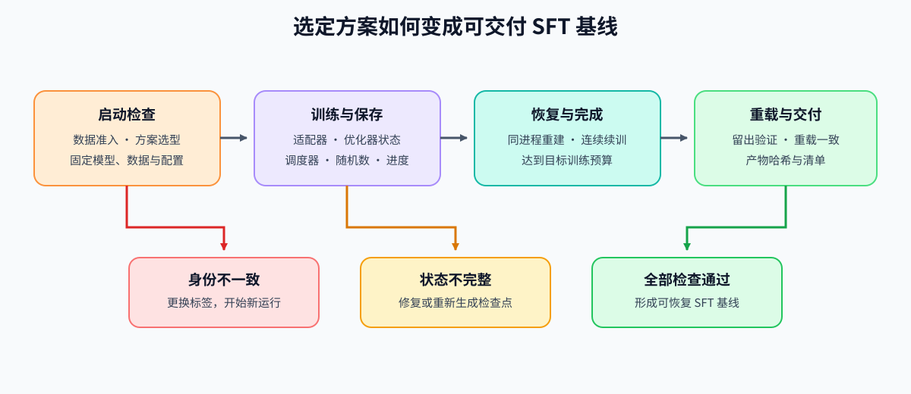
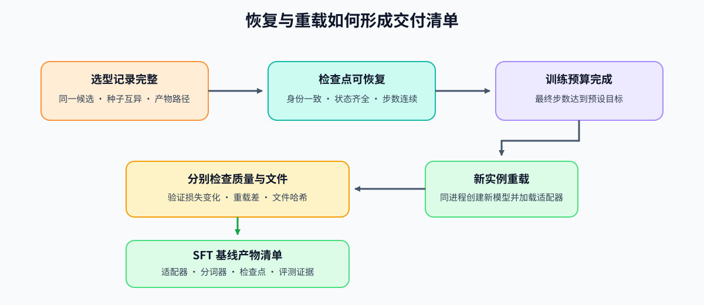

# 62. Instruction Fine Tuning Project | SFT 训练交付项目

**难度：** Hard | **环境：** [CPU 主线，GPU 可选](#runtime-environment) | **标签：** `监督微调`, `断点恢复`, `adapter 交付` | **目标人群：** 理解微调流程、需要保存和恢复训练的读者

> 🚀 **云端运行环境**
>
> 本章节的实战代码可以点击以下链接在免费 GPU 算力平台上直接运行：
>
> [](https://colab.research.google.com/github/datawhalechina/llm-algo-leetcode/blob/main/02_PyTorch_Algorithms/62_Instruction_Fine_Tuning_Project.ipynb)
> [](https://modelscope.cn/my/mynotebook) *(国内推荐：魔搭社区免费实例)*


---

## 本节导读

选好了 LoRA 配置，训练到一半保存的文件能否接着训练？最终保存的适配器，换一个模型实例加载后，能否得到相同的验证损失？这两件事分别依赖完整的训练状态和正确的模型保存方式。

本节沿用 63 节选中的配置及其引用的 64 节数据，完成保存、重建、续训和重载检查。通过后得到带文件哈希的 SFT 基线清单，可供后续偏好训练读取；同时分清训练完成、验证质量与重载一致性各自说明什么。

**关键词：** `SFT`, `检查点恢复`, `适配器`, `产物清单`

---

<a id="runtime-environment"></a>

## 运行环境

- **CPU 练习：** 使用 [BASE-CPU](../guide.md#base-cpu)，运行摘要检查、测试与参考答案。
- **GPU 实验：** 使用[后训练优化 Quickstart](../topic_discussion/post_training_optimization/quickstart.md)中的 `PT-SFT-CUDA`；准备与登记阶段使用 CPU，`measure` 才加载模型。

## 前置阅读

先理解一次微调怎样产生适配器，再确认数据切分和所选配置。

- [15 端到端微调实验](./15_End_to_End_Fine_Tuning_Experiment.md)：核对训练、保存与加载的基本流程。
- [64 SFT 数据质量项目](./64_SFT_Data_Quality_Project.md)：确认训练与验证样本、分词方式及数据清单。
- [63 LoRA 变体选型项目](./63_LoRA_Variants_Benchmark.md)：准备本页读取的配置和选型结果。

## Step 1：从选定配置走到可重载的训练产物

SFT（监督微调）用输入及目标回答更新模型；本项目通过 LoRA 适配器保存可训练的低秩参数，基础模型保持冻结。开始前固定基础模型提交、数据切分、适配器配置和训练步数，使后续保存与恢复都对应同一次训练。

检查点（checkpoint）保存继续训练所需的参数、优化器、调度器、随机数和进度；最终适配器主要用于加载训练后的模型。产物清单（manifest）记录这些文件的位置与哈希，哈希用于检查文件内容是否变化。验证数据与训练数据分开，但也参与了 63 节配置选择，因此这里继续观察的是同一留出验证集。

| 阶段 | 输入 | 关键问题 | 输出 |
|:---|:---|:---|:---|
| 启动检查 | 数据清单与方案选型结果 | 模型、数据、配置能否对应起来 | 本次训练的固定条件 |
| 训练与保存 | 固定配置和目标步数 | 更新数值是否有限，续训状态是否保存 | 阶段检查点与更新摘要 |
| 重建与续训 | 检查点和剩余步数 | 是否从保存位置继续并达到目标步数 | 训练完成的适配器 |
| 重载与交付 | 适配器和留出验证集 | 新模型实例能否复现保存前的验证损失 | SFT 基线清单 |



## Step 2：把恢复训练视为同一次训练的延续

优化器状态决定下一步怎样使用已有梯度统计，调度器状态决定学习率进度，随机数状态影响随机操作。只有适配器参数而缺少这些状态时，重新开始的更新可能与原训练不同。恢复时先核对模型提交、数据和配置，再读取全部状态及下一条样本的位置。

本项目在同一进程中重新创建模型、优化器与调度器，然后从检查点续训。例如保存于第 12 步，恢复后的首个更新应为第 13 步，最终完成第 24 步。这里检验状态读取和步数连续；与不中断训练逐参数对齐，以及退出进程后的重启恢复，需要各自增加对照。

| 恢复条件 | 使用的记录 | 通过条件 | 失败后的处理 |
|:---|:---|:---|:---|
| 模型、数据与配置 | 三项标识及哈希 | 与当前训练相同 | 改用新运行标签 |
| 续训状态 | 适配器、优化器、调度器与随机数 | 状态存在且可读取 | 补齐或重新生成检查点 |
| 保存进度 | 保存步数与目标步数 | 保存步位于起点和目标步之间 | 检查保存时机与进度 |
| 续训首步 | 保存步与恢复后的首步 | 首步等于保存步加一 | 检查训练循环和步数记录 |
| 预算完成 | 最终步数与目标步数 | 达到原定目标 | 完成剩余更新后再评测 |

## Step 3：分别检查更新、验证损失与重载结果

训练损失受到样本顺序和模型随机操作影响；判断参数是否更新，应直接观察参数差值。本项目保存梯度范数，并抽取首个可训练张量的前 4096 个元素计算参数变化，同时在每步更新后检查全部可训练参数是否有限。参数差值探针说明这一部分参数的变化，全参数有限值检查说明数值状态，两者作用不同。

完成训练后，先在留出验证集上比较初始与最终损失，再在新模型实例中加载基础模型与适配器，比较重载前后的验证损失。前者观察当前任务质量，后者检查保存与加载是否一致；最终独立测试及通用能力评测可以在确定配置后另行开展。交付要求各项门槛同时通过。

| 交付门槛 | 检查记录 | 通过条件 | 失败后的处理 |
|:---|:---|:---|:---|
| 执行状态 | 运行状态 | 训练正常结束 | 定位失败步骤后重跑 |
| 恢复位置 | 保存步、续训起点和首步 | 对应且连续 | 检查进度和状态读取 |
| 训练预算 | 最终步数与目标步数 | 完成固定更新预算 | 继续剩余训练 |
| 更新过程 | 全参数有限值、梯度范数和参数探针 | 数值有限，摘要完整 | 检查梯度与更新异常 |
| 验证质量 | 初始与最终验证损失 | 损失增加量不超过上限 | 回查数据、配置和训练预算 |
| 重载一致性 | 保存前与新实例重载后的损失差 | 绝对差不超过容差 | 检查保存文件、加载与精度 |
| 产物完整性 | 适配器、分词器、检查点与哈希 | 文件存在且内容与清单对应 | 补齐产物并重新核对 |



## Step 4：实现选型检查、连续恢复与交付判断

补全三个函数，依次判断选型清单是否完整、检查点能否用于当前训练、训练结果是否满足交付门槛。输入均为摘要记录；真实文件读取、训练与重载在 Step 5 执行。

| 任务与目的 | 已知条件 | 完成标准 | 测试验证 |
|:---|:---|:---|:---|
| TODO 1：验证选型结果能否用于训练 | 唯一配置、重复运行与适配器路径 | 各次运行属于同一候选，种子合法且互异 | 状态失败、候选混入、重复不足与字段缺失 |
| TODO 2：检查恢复是否延续原训练 | 模型、数据、配置、状态及步数 | 标识相同、状态齐全、保存步合法且首步连续 | 数据变化、状态缺失与恢复错位 |
| TODO 3：判断结果能否交付 | 验证损失、更新摘要、目标步数、重载差与产物哈希 | 预算完成且各项数值门槛同时通过 | 步数不足、质量退化、重载偏差与产物缺失 |


```python
from typing import Any, Dict, List
import math

def finite_number(value, *, minimum=0.0):
    """拒绝布尔值、非数、NaN、Inf 及小于合法下界的输入。"""
    return type(value) in (int, float) and math.isfinite(value) and value >= minimum

def valid_selected_config(config):
    """候选身份不止名称；检查可训练配置的数值与模块集合。"""
    return (isinstance(config, dict) and isinstance(config.get('name'), str)
            and bool(config['name'].strip())
            and type(config.get('rank')) is int and config['rank'] > 0
            and type(config.get('alpha')) is int and config['alpha'] > 0
            and finite_number(config.get('dropout')) and config['dropout'] < 1
            and isinstance(config.get('target_modules'), list) and bool(config['target_modules'])
            and all(isinstance(x, str) and x.strip() for x in config['target_modules'])
            and len(set(config['target_modules'])) == len(config['target_modules']))

```


```python
# ==========================================
# TODO 1：校验上游选型清单
# ==========================================
def validate_selection_manifest(manifest: Dict[str, Any]) -> Dict[str, Any]:
    """检查已接受的唯一配置、复测证据和 artifact 是否完整。"""
    required_config = {"name", "rank", "alpha", "dropout", "target_modules"}
    selected_config = manifest.get("selected_config", {})
    repeat_results = manifest.get("repeat_results", [])
    selected_name = selected_config.get("name")
    repeat_seeds = [item.get("seed") for item in repeat_results]
    checks = {
        "accepted": manifest.get("decision") == "accept",
        "config_complete": required_config.issubset(selected_config) and valid_selected_config(selected_config),
        "repeat_complete": len(repeat_results) >= 2 and all(item.get("status") == "ok" for item in repeat_results),
        "same_candidate": False,
        "independent_seeds": False,
        "artifact_present": bool(manifest.get("artifact", {}).get("adapter_path")),
    }

    # 同名但 config 漂移也必须失败（简化输入可省略 config）。
    # checks["same_candidate"] = ???  # 每次复测必须属于 selected_config 指定的候选。
    # checks["independent_seeds"] = ???  # 随机种子必须存在且不能重复。
    # failed_checks, consumable = ???  # 保留失败原因；无失败项时才能进入训练。
    raise NotImplementedError("TODO 1：请验证候选身份、复测独立性与训练输入条件")
    return {"consumable": consumable, "failed_checks": failed_checks}


# ==========================================
# TODO 2：检查检查点恢复条件
# ==========================================
def check_resume_contract(checkpoint: Dict[str, Any], expected: Dict[str, Any]) -> Dict[str, Any]:
    """检查训练身份、状态文件和恢复步数。"""
    identity_keys = ("model_commit", "data_hash", "config_hash")
    state_complete = all(checkpoint.get(key) is True for key in ("adapter_present", "optimizer_state_present", "scheduler_state_present", "rng_state_present"))
    progress_valid = (type(checkpoint.get("global_step")) is int and type(expected.get("total_steps")) is int
                      and 0 < checkpoint["global_step"] < expected["total_steps"])
    identity_matches = False
    continuation_valid = False

    # identity_matches = ???  # 模型、数据和配置身份必须全部与当前训练一致。
    # continuation_valid = ???  # 恢复后的第一步必须紧接检查点保存步。
    # resumable = ???  # 身份、状态、进度和步数连续性必须同时成立。
    raise NotImplementedError("TODO 2：请验证检查点身份与连续恢复关系")
    return {"resumable": resumable, "identity_matches": identity_matches, "state_complete": state_complete, "progress_valid": progress_valid, "continuation_valid": continuation_valid}


# ==========================================
# TODO 3：判断 SFT 产物能否交付
# ==========================================
def decide_sft_delivery(evidence: Dict[str, Any], gates: Dict[str, float]) -> Dict[str, Any]:
    """依据恢复、独立评测、重载一致性和产物哈希形成交付决策。"""
    checks = {
        "execution": evidence.get("status") == "ok",
        "resume": type(evidence.get("checkpoint", {}).get("saved_step")) is int and 0 < evidence["checkpoint"]["saved_step"] < evidence["target_step"] and evidence["checkpoint"]["saved_step"] == evidence["checkpoint"].get("resumed_from_step"),
        "completed_budget": type(evidence["final_step"]) is int and type(evidence["target_step"]) is int and evidence["target_step"] > 0 and evidence["final_step"] == evidence["target_step"],
        "finite_metrics": all(finite_number(evidence.get(key)) for key in ("initial_eval_loss", "final_eval_loss", "reload_loss_abs_diff")) and all(finite_number(gates.get(key)) for key in ("maximum_eval_loss_regression", "maximum_reload_loss_abs_diff")),
        "quality": evidence["final_eval_loss"] <= evidence["initial_eval_loss"] + gates["maximum_eval_loss_regression"],
        "reload": evidence["reload_loss_abs_diff"] <= gates["maximum_reload_loss_abs_diff"],
        "update_dynamics": evidence.get("update_dynamics", {}).get("finite_all") is True,
        "artifact": bool(evidence.get("artifact", {}).get("sha256")),
    }

    # 任一硬门槛失败都不能交付；返回失败字段供下一轮修复。
    # decision = ???  # 任一交付门槛失败都应拒绝。
    raise NotImplementedError("TODO 3：请形成 SFT 交付决策")
    return {"decision": decision, "failed_checks": [name for name, passed in checks.items() if not passed]}
```

## 测试

分别改变比较条件、状态或数值门槛，检查对应的失败项与最终决定。


```python
def test_selection_manifest_contract():
    """验证同一候选的独立复测和产物信息缺一不可。"""
    selection = {
        "decision": "accept",
        "selected_config": {"name": "rank8", "rank": 8, "alpha": 16, "dropout": 0.0, "target_modules": ["q_proj", "v_proj"]},
        "repeat_results": [{"name": "rank8", "seed": 42, "status": "ok"}, {"name": "rank8", "seed": 43, "status": "ok"}],
        "artifact": {"adapter_path": "adapter"},
    }
    assert validate_selection_manifest(selection)["consumable"]
    assert not validate_selection_manifest({**selection, "repeat_results": [{"name": "rank8", "seed": 42, "status": "ok"}]})["consumable"]
    mixed = {**selection, "repeat_results": [{"name": "rank8", "seed": 42, "status": "ok"}, {"name": "rank16", "seed": 43, "status": "ok"}]}
    assert validate_selection_manifest(mixed)["failed_checks"] == ["same_candidate"]
    duplicated_seed = {**selection, "repeat_results": [{"name": "rank8", "seed": 42, "status": "ok"}, {"name": "rank8", "seed": 42, "status": "ok"}]}
    assert validate_selection_manifest(duplicated_seed)["failed_checks"] == ["independent_seeds"]


def test_resume_contract():
    """验证恢复身份、状态文件和训练步连续性。"""
    expected = {"model_commit": "m1", "data_hash": "d1", "config_hash": "c1", "total_steps": 20, "first_resumed_step": 11}
    checkpoint = {**expected, "adapter_present": True, "optimizer_state_present": True, "scheduler_state_present": True, "rng_state_present": True, "global_step": 10}
    assert check_resume_contract(checkpoint, expected)["resumable"]
    assert not check_resume_contract({**checkpoint, "data_hash": "d2"}, expected)["resumable"]
    assert not check_resume_contract({**checkpoint, "scheduler_state_present": False}, expected)["resumable"]
    assert not check_resume_contract(checkpoint, {**expected, "first_resumed_step": 12})["continuation_valid"]


def test_sft_delivery_decision():
    """验证预算、质量、重载和产物门槛采用合取关系。"""
    gates = {"maximum_eval_loss_regression": 0.0, "maximum_reload_loss_abs_diff": 1e-4}
    evidence = {
        "status": "ok", "initial_eval_loss": 1.9, "final_eval_loss": 1.8, "final_step": 20, "target_step": 20, "reload_loss_abs_diff": 1e-6,
        "checkpoint": {"saved_step": 10, "resumed_from_step": 10},
        "update_dynamics": {"finite_all": True},
        "artifact": {"sha256": "abc"},
    }
    assert decide_sft_delivery(evidence, gates)["decision"] == "accept"
    assert decide_sft_delivery({**evidence, "reload_loss_abs_diff": 0.01}, gates)["decision"] == "reject"
    assert decide_sft_delivery({**evidence, "artifact": {}}, gates)["decision"] == "reject"


test_selection_manifest_contract()
test_resume_contract()
test_sft_delivery_decision()
print("所有测试通过！")
def test_sft_fail_closed_boundaries():
    expected = {'total_steps': 20, 'first_resumed_step': 11}
    checkpoint = {'global_step': 10, **{key: True for key in ('adapter_present', 'optimizer_state_present', 'scheduler_state_present', 'rng_state_present')}}
    assert not check_resume_contract(checkpoint, expected)['resumable']
    e = {'status': 'ok', 'initial_eval_loss': 1.9, 'final_eval_loss': 1.8, 'final_step': 20, 'target_step': 20, 'reload_loss_abs_diff': 0.0, 'checkpoint': {'saved_step': 10, 'resumed_from_step': 10}, 'update_dynamics': {'finite_all': True}, 'artifact': {'sha256': 'abc'}}
    gates = {'maximum_eval_loss_regression': 0.0, 'maximum_reload_loss_abs_diff': 1e-4}
    for change in ({'checkpoint': {}}, {'reload_loss_abs_diff': -1}, {'final_eval_loss': float('nan')}, {'initial_eval_loss': float('inf')}, {'target_step': True}):
        assert decide_sft_delivery({**e, **change}, gates)['decision'] == 'reject'
    for key in gates:
        assert decide_sft_delivery(e, {**gates, key: float('inf')})['decision'] == 'reject'
    cfg = {'name': 'r8', 'rank': 8, 'alpha': 16, 'dropout': 0., 'target_modules': ['q_proj']}
    m = {'decision': 'accept', 'selected_config': cfg, 'repeat_results': [{'name': 'r8', 'seed': 1, 'status': 'ok'}, {'name': 'r8', 'seed': 2, 'status': 'ok'}], 'artifact': {'adapter_path': 'a'}}
    assert validate_selection_manifest(m)['consumable']
    for repeats in ([m['repeat_results'][0]] * 2, [{**x, 'config': {**cfg, 'rank': 16}} for x in m['repeat_results']]):
        assert not validate_selection_manifest({**m, 'repeat_results': repeats})['consumable']

test_sft_fail_closed_boundaries()

def _load_visible_run_gate():
    """仅编译页面纯函数，禁止执行 GPU、导出和结果登记单元。"""
    import ast
    import json
    from pathlib import Path
    filename = '62_Instruction_Fine_Tuning_Project.ipynb'
    choices = [Path('02_PyTorch_Algorithms') / filename, Path(filename)]
    path = next(path for path in choices if path.is_file())
    cells = json.loads(path.read_text(encoding='utf-8'))['cells']
    tree = ast.parse(''.join(next(cell['source'] for cell in cells if cell['id'] == '2ababa5c')))
    functions = ast.Module(body=[node for node in tree.body if isinstance(node, ast.FunctionDef)], type_ignores=[])
    scope = dict(globals())
    scope.update(SEEDS=(17, 29, 43), QUALITY_TOLERANCE=.1, MAX_STEP_TIME_REGRESSION_RATIO=.15, MIN_MEMORY_SAVING_RATIO=.1)
    exec(compile(functions, 'visible_run_gate', 'exec'), scope)
    return scope['decide_sft_delivery_for_run']

def test_visible_sft_run_gate():
    gate = _load_visible_run_gate()
    e = {'measurement_version': 'sft-delivery-recovery/v4', 'status': 'ok', 'initial_eval_loss': 1.9, 'final_eval_loss': 1.8, 'reload_loss_abs_diff': 0., 'checkpoint': {'saved_step': 12, 'resumed_from_step': 12, 'completed_step': 24, 'training_update_count': 24, 'optimizer_state_present': True, 'scheduler_state_present': True, 'rng_state_present': True, 'identity_verified': True, 'files_sha256_verified': True, 'sample_cursor_verified': True}, 'update_dynamics': {'finite_all': True}, 'artifact': {'sha256': 'abc'}}
    limits = {'maximum_eval_loss': 2., 'maximum_eval_loss_regression': 0., 'maximum_reload_loss_abs_diff': 1e-4}
    assert gate(e, limits, 24)['decision'] == 'accept'
    assert gate(e, limits, 30)['decision'] == 'reject'
    for value in (float('nan'), float('inf'), -1):
        assert gate({**e, 'reload_loss_abs_diff': value}, limits, 24)['decision'] == 'reject'
    for key in ('scheduler_state_present', 'rng_state_present', 'identity_verified', 'files_sha256_verified', 'sample_cursor_verified'):
        assert gate({**e, 'checkpoint': {**e['checkpoint'], key: False}}, limits, 24)['decision'] == 'reject'

test_visible_sft_run_gate()

```

---

🛑 **STOP HERE** 🛑
<br><br><br><br><br><br><br><br><br><br>
> 请先尝试自己完成代码并跑通测试。<br>
> 如果你正在 Colab 中运行，并且遇到困难没有思路，可以向下滚动查看参考答案。
<br><br><br><br><br><br><br><br><br><br>

---

## 参考代码与解析

### 代码


```python
# TODO 1：校验上游选型清单
def validate_selection_manifest(manifest: Dict[str, Any]) -> Dict[str, Any]:
    """检查已接受的唯一配置、复测证据和产物是否完整。"""
    required_config = {"name", "rank", "alpha", "dropout", "target_modules"}
    selected_config = manifest.get("selected_config", {})
    repeat_results = manifest.get("repeat_results", [])
    selected_name = selected_config.get("name")
    repeat_seeds = [item.get("seed") for item in repeat_results]
    checks = {
        "accepted": manifest.get("decision") == "accept",
        "config_complete": required_config.issubset(selected_config) and valid_selected_config(selected_config),
        "repeat_complete": len(repeat_results) >= 2 and all(item.get("status") == "ok" for item in repeat_results),
        "same_candidate": False,
        "independent_seeds": False,
        "artifact_present": bool(manifest.get("artifact", {}).get("adapter_path")),
    }
    checks["same_candidate"] = bool(selected_name) and all(item.get("name") == selected_name and ("config" not in item or item["config"] == selected_config) for item in repeat_results)
    checks["independent_seeds"] = all(type(seed) is int and seed >= 0 for seed in repeat_seeds) and len(repeat_seeds) == len(set(repeat_seeds))
    failed_checks = [name for name, passed in checks.items() if not passed]
    consumable = not failed_checks
    return {"consumable": consumable, "failed_checks": failed_checks}


# TODO 2：检查检查点恢复条件
def check_resume_contract(checkpoint: Dict[str, Any], expected: Dict[str, Any]) -> Dict[str, Any]:
    """检查训练身份、状态文件和恢复步数。"""
    identity_keys = ("model_commit", "data_hash", "config_hash")
    state_complete = all(checkpoint.get(key) is True for key in ("adapter_present", "optimizer_state_present", "scheduler_state_present", "rng_state_present"))
    progress_valid = (type(checkpoint.get("global_step")) is int and type(expected.get("total_steps")) is int
                      and 0 < checkpoint["global_step"] < expected["total_steps"])
    identity_matches = all(isinstance(expected.get(key), str) and bool(expected[key].strip()) and checkpoint.get(key) == expected[key] for key in identity_keys)
    continuation_valid = progress_valid and type(expected.get("first_resumed_step")) is int and expected["first_resumed_step"] == checkpoint["global_step"] + 1
    resumable = identity_matches and state_complete and progress_valid and continuation_valid
    return {"resumable": resumable, "identity_matches": identity_matches, "state_complete": state_complete, "progress_valid": progress_valid, "continuation_valid": continuation_valid}


# TODO 3：判断 SFT 产物能否交付
def decide_sft_delivery(evidence: Dict[str, Any], gates: Dict[str, float]) -> Dict[str, Any]:
    """依据恢复、独立评测、重载一致性和产物哈希形成交付决策。"""
    checks = {
        "execution": evidence.get("status") == "ok",
        "resume": type(evidence.get("checkpoint", {}).get("saved_step")) is int and 0 < evidence["checkpoint"]["saved_step"] < evidence["target_step"] and evidence["checkpoint"]["saved_step"] == evidence["checkpoint"].get("resumed_from_step"),
        "completed_budget": type(evidence["final_step"]) is int and type(evidence["target_step"]) is int and evidence["target_step"] > 0 and evidence["final_step"] == evidence["target_step"],
        "finite_metrics": all(finite_number(evidence.get(key)) for key in ("initial_eval_loss", "final_eval_loss", "reload_loss_abs_diff")) and all(finite_number(gates.get(key)) for key in ("maximum_eval_loss_regression", "maximum_reload_loss_abs_diff")),
        "quality": evidence["final_eval_loss"] <= evidence["initial_eval_loss"] + gates["maximum_eval_loss_regression"],
        "reload": evidence["reload_loss_abs_diff"] <= gates["maximum_reload_loss_abs_diff"],
        "update_dynamics": evidence.get("update_dynamics", {}).get("finite_all") is True,
        "artifact": bool(evidence.get("artifact", {}).get("sha256")),
    }
    decision = "accept" if all(checks.values()) else "reject"
    return {"decision": decision, "failed_checks": [name for name, passed in checks.items() if not passed]}
```

### 解析

#### TODO 1：核对选型清单

- 配置通过选型后，复测仍需属于同一候选且来自不同随机种子；否则一份重复记录也可能被误算成多次复测。
- 汇总配置完整性、运行状态、候选归属、种子互异和产物路径。测试分别混入其他候选、重复种子或删除字段，检查失败项是否保留。

#### TODO 2：检查保存位置与续训首步

- 模型、数据和配置必须与检查点对应；保存步还要位于起点和目标之间，续训首步等于保存步加一。
- 分别计算标识、状态和进度检查。测试改变数据哈希、删除调度器状态或错置首步，验证具体哪项阻止恢复。

#### TODO 3：合并交付条件

- 运行成功、续训起点正确、完成目标步数、更新有限、验证损失变化及重载差达标、产物有哈希，均是独立条件。
- 用合取保留每项检查结果。测试在正常结果中分别增加重载偏差、删去产物哈希或减少步数，验证失败条件会改变最终决定。

## Step 5：真实 SFT 训练交付

CPU 题目区验证选型、恢复和交付条件；GPU 实验读取 63 节的 LoRA 选型清单，执行“训练到中点 → 保存恢复状态 → 重建模型、优化器与调度器 → 继续训练 → 保存并重载适配器”的完整训练。

| 对照层 | 输入 | 主要证据 | 输出与证据边界 |
|:---|:---|:---|:---|
| CPU 交付状态机 | 人工构造的选型、检查点与评测摘要 | 选型一致性、恢复连续性、采用状态 | 只确认交付逻辑，不证明真实训练完成 |
| 真实 SFT 交付 | 已接受的数据和 LoRA 选型清单 | 中断恢复、更新动力学、相对评测、重载一致性与产物哈希 | 输出 SFT 基线清单；不证明偏好、安全或通用能力保留 |
### 5.1 运行意图与配置

按[后训练优化 Quickstart](../topic_discussion/post_training_optimization/quickstart.md#pt-sft-cuda-quickstart)准备 `PT-SFT-CUDA` 环境。固定实验使用 Qwen2.5-0.5B、长度 256 和 LoRA。先以 `prepare` 核对输入，再使用唯一标签运行 `measure`；采集完成后切换到 `close`，重新读取并登记。准备和登记在 CPU 上完成。


```python
RUN_LABEL = "replace_with_unique_label"  # 测量或登记前设置唯一标签。
RUN_STAGE = "prepare"  # prepare：只读准备；measure：GPU训练；close：读取并登记。

```

### 5.2 预检环境与选型清单

从注册表加载[固定交付合同](../../benchmarks/contracts/sft_delivery_v4.json)，核对63节选型清单及其扫描、64节数据清单的 SHA256。当前合同固定使用历史 v2 选型配置，交付训练从基座重新开始；新的恢复测量版本为 v4。历史绝对引用按合同中的仓库相对路径定位。只有测量阶段检查 GPU 和训练依赖。


```python
import hashlib
import importlib
import json
import re
from pathlib import Path
from tools.project_runtime import bootstrap_project_root
import tools.post_training_project_runtime as project_runtime

project_runtime = importlib.reload(project_runtime)
PROJECT_ROOT = bootstrap_project_root()
if RUN_STAGE not in {"prepare", "measure", "close"}:
    raise ValueError("阶段必须为prepare、measure或close")
if not re.fullmatch(r"[A-Za-z0-9][A-Za-z0-9_-]{0,95}", RUN_LABEL):
    raise ValueError("运行标签只允许字母、数字、下划线和连字符")
if RUN_STAGE != "prepare" and RUN_LABEL == "replace_with_unique_label":
    raise ValueError("测量或登记前请设置唯一标签")
registry = json.loads((PROJECT_ROOT / "benchmarks/project_registry/part02.json").read_text(encoding="utf-8"))
entry = next(item for item in registry["projects"] if item["semantic_id"] == "PT-SFT-DELIVERY")
CONTRACT = json.loads((PROJECT_ROOT / entry["default_experiment_contract"]).read_text(encoding="utf-8"))
selection_manifest, selection_scan, data_manifest = project_runtime.read_sft_delivery_inputs(PROJECT_ROOT, CONTRACT)
RESULTS_DIR = PROJECT_ROOT / "benchmarks/results/62_sft_delivery"
EVIDENCE_PATH = RESULTS_DIR / f"sft_delivery_evidence_{RUN_LABEL}.json"
REPORT_PATH = RESULTS_DIR / f"sft_delivery_report_{RUN_LABEL}.json"
MANIFEST_PATH = RESULTS_DIR / f"sft_delivery_manifest_{RUN_LABEL}.json"
RECEIPT_PATH = RESULTS_DIR / f"sft_delivery_registration_{RUN_LABEL}.json"
CHECKPOINT_DIR = RESULTS_DIR / f"checkpoint_{RUN_LABEL}"
ARTIFACT_DIR = RESULTS_DIR / f"adapter_{RUN_LABEL}"
if RUN_STAGE == "measure":
    if any(path.exists() for path in (EVIDENCE_PATH, REPORT_PATH, MANIFEST_PATH, RECEIPT_PATH, CHECKPOINT_DIR, ARTIFACT_DIR)):
        raise FileExistsError("同名记录或训练目录已存在；完成采集后使用close，重新训练需新标签")
    import torch
    from tools.project_runtime import environment_preflight
    preflight = environment_preflight(
        torch, required_packages=("transformers", "peft", "datasets", "huggingface_hub"),
        require_gpu=True, environment_profile=CONTRACT["environment_profile"],
    )
    if not preflight["ready"]:
        raise RuntimeError(preflight["reasons"])
if RUN_STAGE == "close" and not EVIDENCE_PATH.is_file():
    raise FileNotFoundError(f"缺少原始训练记录：{EVIDENCE_PATH}")
print({"stage": RUN_STAGE, "profile": CONTRACT["environment_profile"],
       "selection_label": selection_manifest["run_label"], "evidence_path": str(EVIDENCE_PATH)})

```

### 5.3 固定恢复与交付门槛

训练按列表顺序逐条取样，有效 batch 为单卡 micro-batch 1、累积 1。检查点同时记录模型提交、实际分词后的样本顺序摘要、LoRA 配置与下一条样本位置，重建前核对文件哈希。恢复范围是同进程中重建模型、优化器和调度器；保存的状态包括 Torch CPU/单卡 CUDA 随机数及常数学习率调度器。

评测先计算每条样本回答部分（含保留 EOS，排除提示与 padding）的平均 token loss，再对样本等权平均。梯度范数覆盖全部梯度，参数增量探测首个可训练张量的前4096个元素；有限性检查覆盖每次更新后的全部可训练参数。

| 检查 | 固定条件 | 失败结果 |
|:---|:---|:---|
| 检查点身份 | 模型、数据顺序、配置与下一条样本位置匹配 | 禁止恢复 |
| 可恢复状态 | 适配器、优化器、调度器、随机数和进度文件齐全且哈希匹配 | 禁止恢复 |
| 训练进度 | 从检查点继续至完整预算，更新总数完整 | `reject` |
| 更新过程 | 损失、梯度范数、参数增量和更新后参数有限 | `reject` |
| 留出验证 | 满足绝对损失门槛且相对初始评测不退化 | `reject` |
| 重载一致性 | 保存前后损失差异不超过容差 | `reject` |
| 本地产物 | 检查点、适配器和目录哈希匹配 | `reject` |


```python
MODEL_ID = CONTRACT["model"]["id"]
MODEL_COMMIT = CONTRACT["model"]["resolved_commit"]
WORKLOAD = CONTRACT["workload"]
GATES = CONTRACT["gates"]
CONTRACT_SHA256 = hashlib.sha256(project_runtime.json_record_bytes(CONTRACT)).hexdigest()
if not 0 < WORKLOAD["checkpoint_step"] < WORKLOAD["total_steps"]:
    raise ValueError("检查点必须位于完整训练预算中间")
print({"model": CONTRACT["model"], "selected_config": selection_manifest["selected_config"],
       "workload": WORKLOAD, "gates": GATES, "recovery_scope": CONTRACT["recovery_scope"]})

```

### 5.4 执行恢复训练并保存原始记录

`measure` 加载固定数据切分，先确认实际样本与数据检查记录对应，再完成训练、保存、重建、续训和重载评测。原始记录保存后，转入读取阶段；报告和基线清单由 `close` 生成。训练中断而未形成完整原始记录时，保留现场，重新测量使用新标签。


```python
if RUN_STAGE == "measure":
    from datasets import load_dataset
    from transformers import AutoTokenizer

    selection_manifest, selection_scan, data_manifest = project_runtime.read_sft_delivery_inputs(PROJECT_ROOT, CONTRACT)
    model_commit = MODEL_COMMIT
    dataset_info = data_manifest["dataset"]
    source_count = data_manifest["workload"]["sample_count"]
    dataset = load_dataset(dataset_info["id"], split=f"train[:{source_count}]", revision=dataset_info["resolved_commit"])
    snapshot = data_manifest["snapshot"]
    train_records = [dict(dataset[index]) for index in snapshot["train_record_indices"][:WORKLOAD["train_examples"]]]
    evaluation_records = [dict(dataset[index]) for index in snapshot["evaluation_record_indices"][:WORKLOAD["evaluation_examples"]]]
    if len(train_records) != WORKLOAD["train_examples"] or len(evaluation_records) != WORKLOAD["evaluation_examples"]:
        raise RuntimeError("64 节准入快照不足以满足固定训练/评测工作负载")
    for split, records in (("train", train_records), ("evaluation", evaluation_records)):
        sample_ids = [project_runtime.stable_text_hash((row["instruction"], row.get("input", ""), row["output"])) for row in records]
        if sample_ids != snapshot[f"{split}_sample_ids"][:len(records)]:
            raise RuntimeError(f"{split} 实际样本与数据审计快照不一致")
    tokenizer = AutoTokenizer.from_pretrained(MODEL_ID, revision=model_commit)
    run_evidence = project_runtime.run_lora_delivery(
        model_id=MODEL_ID, revision=model_commit, tokenizer=tokenizer,
        train_records=train_records, evaluation_records=evaluation_records,
        lora_config=selection_manifest["selected_config"], max_length=WORKLOAD["max_length"],
        total_steps=WORKLOAD["total_steps"], checkpoint_step=WORKLOAD["checkpoint_step"],
        learning_rate=WORKLOAD["learning_rate"], seed=WORKLOAD["seed"], dtype_name=WORKLOAD["dtype"],
        checkpoint_directory=CHECKPOINT_DIR, artifact_directory=ARTIFACT_DIR,
    )
    record = {
        **{key: CONTRACT[key] for key in ("schema_version", "semantic_id", "measurement_version",
            "environment_profile", "evaluation_reduction", "sequence_protocol", "model", "workload", "gates")},
        "run_mode": "real_gpu", "run_label": RUN_LABEL, "contract_sha256": CONTRACT_SHA256,
        "selection_manifest": CONTRACT["selection_manifest"],
        "selection_manifest_sha256": CONTRACT["selection_manifest_sha256"],
        "data": {"manifest": CONTRACT["upstream_manifest"], "sample_ids_hash": data_manifest["audit"]["sample_ids_hash"]},
        "selected_config": selection_manifest["selected_config"], "evidence": run_evidence,
    }
    project_runtime.publish_json_record(EVIDENCE_PATH, record)
    print({"evidence_path": str(EVIDENCE_PATH), "artifact": run_evidence["artifact"]})
else:
    print({"stage": RUN_STAGE, "training": "skipped"})

```

### 5.5 读取结果并核对恢复、质量与重载

从磁盘重新读取原始记录，核对标签、合同摘要、模型、负载、上游来源及本地检查点和适配器文件，再按以下规则计算交付决策。读取过程不训练、不改写原始记录。


```python
def decide_sft_delivery_for_run(evidence, gates, target_steps):
    """依据恢复、评测、重载和产物哈希形成交付决策。"""
    from math import isfinite
    def finite_metric(value):
        """Reject bool, non-finite and negative metrics."""
        return type(value) in (int, float) and isfinite(value) and value >= 0
    checkpoint = evidence.get('checkpoint', {})
    checks = {
        "finite_metrics": all(finite_metric(evidence.get(key)) for key in ("initial_eval_loss", "final_eval_loss", "reload_loss_abs_diff")) and all(finite_metric(gates.get(key)) for key in ("maximum_eval_loss", "maximum_eval_loss_regression", "maximum_reload_loss_abs_diff")),
        "recovery_protocol": evidence.get("measurement_version") == "sft-delivery-recovery/v4",
        "recovery_checks": all(checkpoint.get(key) is True for key in ("identity_verified", "files_sha256_verified", "sample_cursor_verified")),
        "target_budget": type(target_steps) is int and target_steps > 0 and type(checkpoint.get('completed_step')) is int and checkpoint['completed_step'] == target_steps,
        "valid_resume_step": type(checkpoint.get('saved_step')) is int and type(target_steps) is int and 0 < checkpoint['saved_step'] < target_steps,

        "execution": evidence.get("status") == "ok",
        "resume": evidence.get("checkpoint", {}).get("saved_step") == evidence.get("checkpoint", {}).get("resumed_from_step"),
        "completed_budget": type(checkpoint.get("completed_step")) is int and type(checkpoint.get("resumed_from_step")) is int and checkpoint["completed_step"] > checkpoint["resumed_from_step"] and evidence.get("checkpoint", {}).get("training_update_count") == evidence.get("checkpoint", {}).get("completed_step"),
        "recovery_state": all(evidence.get("checkpoint", {}).get(key) is True for key in ("optimizer_state_present", "scheduler_state_present", "rng_state_present")),
        "quality_absolute": evidence["final_eval_loss"] <= gates["maximum_eval_loss"],
        "quality_relative": evidence["final_eval_loss"] - evidence["initial_eval_loss"] <= gates["maximum_eval_loss_regression"],
        "reload": evidence["reload_loss_abs_diff"] <= gates["maximum_reload_loss_abs_diff"],
        "update_dynamics": evidence.get("update_dynamics", {}).get("finite_all") is True,
        "artifact": bool(evidence.get("artifact", {}).get("sha256")),
    }
    decision = "accept" if all(checks.values()) else "reject"
    return {"decision": decision, "failed_checks": [name for name, passed in checks.items() if not passed]}

if RUN_STAGE in {"measure", "close"}:
    record, decision = project_runtime.read_sft_delivery(PROJECT_ROOT, EVIDENCE_PATH, CONTRACT, RUN_LABEL, decide_sft_delivery_for_run)
    print({"decision": decision, "final_eval_loss": record["evidence"]["final_eval_loss"],
           "reload_loss_abs_diff": record["evidence"]["reload_loss_abs_diff"],
           "recovery_scope": record["evidence"]["checkpoint"]["recovery_scope"]})
else:
    print({"stage": RUN_STAGE, "evidence_read": "skipped"})

```

### 5.6 形成 SFT 基线产物清单

`close` 重新核对5.5的记录，生成报告和含来源文件、检查点及适配器哈希的登记回执；全部门槛通过才生成供84／85节加载的基线清单。同一标签和相同内容可重复登记，缺失的报告或清单可补齐；已有不同内容时停止。

`sft_delivery_v2_1` 保留旧交付链的恢复、质量和重载结果。新的 v4 记录会在重建前核对检查点文件、模型提交、实际分词后的样本顺序、训练配置和下一条样本位置，并检查每次更新后的全部可训练参数是否有限；历史记录缺少这些字段，因此按历史协议解读。当前恢复仍在同一进程中重建模型、优化器和调度器，v4 尚待真实 GPU 运行验证。旧记录用于查看已完成的运行，当前协议通过情况由新标签单独登记。


| 决策项 | 实测证据 | 结果 | 后续动作 |
|:---|:---|:---|:---|
| 恢复连续性 | 适配器、优化器、调度器、随机数状态和训练步连续 | 新运行读取 5.5 结果 | 任一缺失时拒绝交付 |
| 更新过程 | `finite_all`、梯度范数、参数增量和学习率摘要 | 新运行读取 5.5 结果 | 非有限时先定位，不生成基线 |
| 质量与重载 | 留出验证损失变化与重载差值 | 新运行读取 5.5 结果 | 固定 SFT 基线前必须通过 |
| 项目决策 | 全部硬门槛 | 新运行读取 5.5 结果 | `accept` 后才交给 84 / 85 |

**当前登记结果**

| 字段 | 登记内容 |
| --- | --- |
| 项目与标签 | 62 节 SFT 交付；`sft_delivery_v2_1` |
| 运行条件 | Qwen2.5-0.5B（Base，按证据 model.id）；保存后同进程重建续训与新实例重载检查 |
| 原始证据 | 训练、恢复和评测记录保存在正式证据中 |
| 正式证据 | [SFT 证据](../../benchmarks/results/62_sft_delivery/sft_delivery_evidence_sft_delivery_v2_1.json) |
| 清单与交接 | [交付清单](../../benchmarks/results/62_sft_delivery/sft_delivery_manifest_sft_delivery_v2_1.json)；本地 adapter 与 checkpoint 由清单记录 |
| 结论 | 历史协议已通过；当前 v4 的恢复与更新检查待新标签实测 |

```python
if RUN_STAGE == "close":
    registration = project_runtime.close_sft_delivery(
        PROJECT_ROOT, EVIDENCE_PATH, REPORT_PATH, MANIFEST_PATH, RECEIPT_PATH,
        CONTRACT, RUN_LABEL, decide_sft_delivery_for_run,
    )
    print(registration)
else:
    print({"stage": RUN_STAGE, "registration": "skipped"})

```

## 相关阅读

保存可用产物后，可核对框架文件格式，再进入偏好训练。

- [PEFT checkpoint 格式](https://huggingface.co/docs/peft/developer_guides/checkpoint)：查看适配器配置与权重各保存哪些信息。
- [84 DPO 偏好优化项目](./84_DPO_Preference_Project.md)：读取 SFT 基线，比较偏好训练前后的质量。
- [85 GRPO 在线奖励优化项目](./85_GRPO_Groupwise_Alignment_Project.md)：观察同一初始基线怎样进入带采样与奖励的训练。
