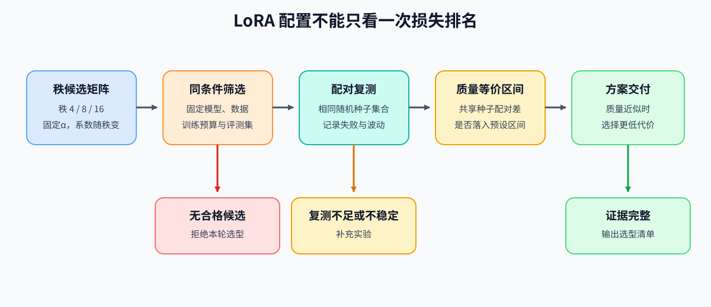
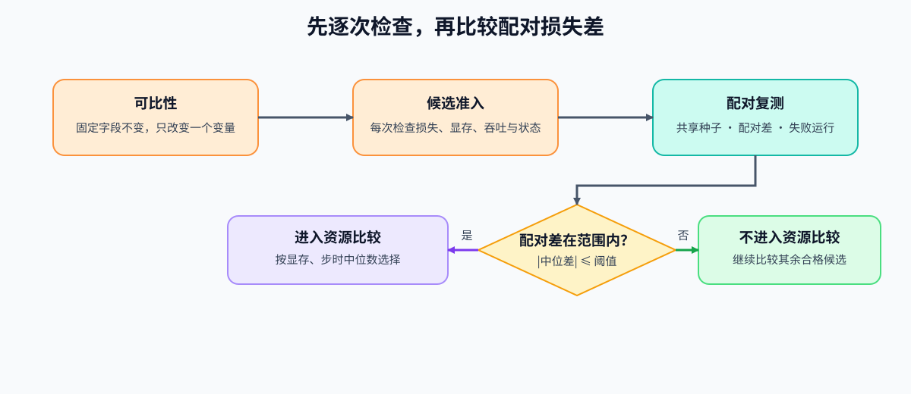

# 63. LoRA Variants Benchmark | LoRA 变体选型项目

**难度：** Hard | **环境：** [CPU 主线，GPU 可选](#runtime-environment) | **标签：** `监督微调`, `LoRA`, `候选选型` | **目标人群：** 理解LoRA、需要比较微调配置的读者

> 🚀 **云端运行环境**
>
> 本章节的实战代码可以点击以下链接在免费 GPU 算力平台上直接运行：
>
> [](https://colab.research.google.com/github/datawhalechina/llm-algo-leetcode/blob/main/02_PyTorch_Algorithms/63_LoRA_Variants_Benchmark.ipynb)
> [](https://modelscope.cn/my/mynotebook) *(国内推荐：魔搭社区免费实例)*


---

## 本节导读

增大LoRA的秩会增加可训练参数，却不保证在当前数据和训练步数下得到更好的回答。若同时调整缩放或目标层，即使评测损失下降，也难以判断哪项变化起了作用；很小的损失差还可能随随机种子改变。

本节在同一模型、数据和更新预算下比较秩配置，先检查每次运行的质量与资源，再用共享随机种子比较损失差。若差异落入预先规定的允许范围，就优先选择显存和步时更低的配置。数据来自已通过检查的固定清单，选中的配置与适配器供后续训练项目复用。

**关键词：** `LoRA`, `秩与缩放`, `共享随机种子`, `配对损失差`, `资源比较`

---

<a id="runtime-environment"></a>

## 运行环境

- **CPU练习：** 使用 [BASE-CPU](../guide.md#base-cpu)，运行Step4、测试与参考代码。
- **真实候选对照：** 使用 [PT-SFT-CUDA](../topic_discussion/post_training_optimization/quickstart.md#pt-sft-cuda-quickstart) 的单卡环境；模型、数据与训练预算见Step5。CPU练习不加载模型或占用GPU。

## 前置阅读

先理解低秩分支、缩放与参数数量，再确认用于比较的数据已经去重并与评测任务分开。

- [Part 02 · 14 低秩适配教程](./14_LoRA_Tutorial.md)：回看低秩分支、缩放与零初始化。
- [Part 02 · 31 LoRA变体缩放与预算](./31_LoRA_Variants_Theory.md)：区分相同秩与相同参数上限的比较。
- [Part 02 · 64 SFT数据质量项目](./64_SFT_Data_Quality_Project.md)：读取通过检查的样本与固定切分。

## Step 1：固定训练条件，比较不同秩配置

本项目固定模型版本、数据切分、训练步数、学习率、目标层和随机种子集合，只改变LoRA秩这一配置字段。秩控制低秩分支的宽度；标准LoRA的增量还乘以缩放系数 $s=\alpha/r$。例如固定 $\alpha=16$ 时，秩4、8、16对应的系数分别为4、2、1。因此本次比较同时包含参数数量与派生缩放的变化，回答的是“哪份秩配置适合这次训练”，而不是孤立测量容量的作用。

每份配置都从同一基座重新训练，得到独立评测损失、显存与步时；通过检查后才比较资源。这里的训练预算是相同样本顺序、每步一条样本和相同更新次数，不能据此推断更长训练后的排名。

| 比较对象 | 本次条件 | 为什么需要记录 |
| --- | --- | --- |
| 秩与缩放 | 秩4／8／16，缩放超参数固定16 | 实际系数随秩变化，不能只解释为参数增加 |
| 模型与数据 | 相同基座提交、训练／评测成员、分词与最大长度 | 排除输入或起点变化 |
| 训练预算 | 相同学习率、样本顺序和更新次数 | 比较相同短训练预算下的结果 |
| 适配范围 | 相同目标层和随机失活率 | 避免同时改变更新位置与正则化 |
| 重复运行 | 每个候选使用同一组随机种子 | 按同一个种子对应两份运行，比较损失差 |



## Step 2：怎样比较评测损失、显存与吞吐

本项目的评测先对每条样本的有效监督词元取平均损失，再对全部评测样本取平均。设样本 $i$ 的损失总和为 $S_i$、有效目标数为 $N_i>0$，样本总数为 $M$，则 $L_{\mathrm{example}}=\frac1M\sum_i S_i/N_i$。它让每条样本权重相同，与13／15节的全词元平均 $\sum_i S_i/\sum_i N_i$ 不同。例如两条回答分别有2、6个目标，平均损失为1、3，则本项目指标为2，全词元平均为2.5。比较候选必须使用同一种计算方法和同一批评测样本。

损失、显存是上限，吞吐是下限，每一项都要通过。监督词元吞吐按训练更新计时窗口计算，包含前向、反向和优化器更新；不包含模型加载、评测和适配器保存。峰值分配显存则包含训练及训练后的评测，因而不是“纯训练峰值”。每次重复都检查这些指标，不能只凭候选摘要通过就跳过原始运行。

| 检查对象 | 通过条件 | 不通过时 |
| --- | --- | --- |
| 固定条件 | 声明的共同条件相同，没有未声明的配置变化 | 修正比较条件后再运行 |
| 运行状态 | 所需运行全部成功，指标有限且非负 | 保留失败记录，修复或补测 |
| 独立评测损失 | 每次重复均不超过上限 | 排除该候选 |
| 峰值分配显存 | 每次重复均不超过预算 | 排除该候选 |
| 监督词元吞吐 | 每次重复均不低于下限 | 排除该候选 |
| 指标余量 | 分别记录距离各自门槛还有多少 | 按失败原因调整配置，不合成加权总分 |

## Step 3：按共享种子比较损失差，再选择低代价配置

配对是把同一个随机种子下的两份运行对应起来。每个候选需要相同种子集合，种子不能重复，运行次数达到下限；缺一份运行就先补齐。随后检查同一候选损失的最大值与最小值之差，避免把波动过大的结果用于细小差异的比较。

先找出重复损失中位数最低的候选作为参考，再逐种子相减，取差值的中位数。其绝对值不超过预设允许偏差的候选，进入资源比较；这里的“质量等价”指满足这条数值规则，不是统计检验或所有任务质量相同。在这些候选中，依次比较重复运行的峰值显存中位数、步时中位数，最后用名称消除完全相同情况下的顺序差异。

| 判断 | 使用的结果 | 后续动作 |
| --- | --- | --- |
| 种子缺失、重复或运行失败 | 无法组成完整配对 | `tune`：补测或修复，暂不选择 |
| 单次质量或资源未达标 | 候选摘要及逐次运行指标 | 排除该候选；全部排除则`reject` |
| 重复损失波动过大 | 最大损失减最小损失超过上限 | `tune`：先检查波动原因 |
| 配对损失差在允许范围内 | 逐种子损失差中位数的绝对值不超过阈值 | 进入显存、步时比较 |
| 选出配置 | 所有检查通过后选择代价较低者 | `accept`：推荐当前负载下的配置；真实交接还需核对适配器文件 |



## Step 4：实现候选检查与配对选择

题目给出基线配置、候选摘要和逐种子的质量／资源记录。骨架提供输入校验、变化字段、逐次门槛、配对组织、损失差及排序；你将补全可比条件、门槛组合和配对损失差判断。测试包含未声明的配置变化、非法数值、摘要通过但重复运行失败，以及“逐种子差的中位数”与“两个中位数相减”不同的反例。

| 任务与目的 | 已知条件 | 完成标准 | 测试验证 |
| --- | --- | --- | --- |
| TODO 1：检查候选是否真正可比 | 固定字段变化、候选字段变化与未声明变化 | 固定字段不变、恰有一个声明字段变化，且无其他变化 | 步数变化、多个字段变化、漏列的长度变化与零变化 |
| TODO 2：逐项检查质量与资源 | 运行、损失、显存和吞吐的检查结果 | 全部通过才允许继续 | 质量更好也不能抵消显存超限，阈值等号与非法数值分别检查 |
| TODO 3：判断配对损失差是否落入允许范围 | 逐种子损失差的中位数与允许偏差 | 按绝对偏差判断，等号计入 | 配对中位数反例、阈值内外和输入顺序变化 |


```python
import math
import statistics
from typing import Any, Dict, List

```


```python
def _validate_lora_gates(gates: Dict[str, float]) -> None:
    """检查门槛的方向、有限值及最少配对次数。"""
    for key in (
        "maximum_eval_loss", "maximum_peak_allocated_bytes",
        "minimum_tokens_per_second", "maximum_repeat_eval_loss_spread",
        "quality_equivalence_band",
    ):
        value = gates[key]
        if type(value) not in (int, float) or not math.isfinite(value) or value < 0:
            raise ValueError(f"{key}必须为非负有限数")
    if type(gates["minimum_repeat_count"]) is not int or gates["minimum_repeat_count"] < 2:
        raise ValueError("minimum_repeat_count必须为至少2的整数")


def _validate_lora_measurement(candidate: Dict[str, Any]) -> None:
    """在门槛比较前检查名称、运行状态及质量和资源数值。"""
    if not isinstance(candidate["name"], str) or not candidate["name"].strip():
        raise ValueError("候选名称不能为空")
    if not isinstance(candidate["status"], str) or not candidate["status"].strip():
        raise ValueError("运行状态不能为空")
    for key in ("final_eval_loss", "peak_allocated_bytes",
                "supervised_tokens_per_second", "median_step_time_ms"):
        value = candidate[key]
        if type(value) not in (int, float) or not math.isfinite(value) or value < 0:
            raise ValueError(f"{key}必须为非负有限数")
    if candidate["median_step_time_ms"] == 0:
        raise ValueError("完成一步训练的时间必须大于0")


def check_candidate_comparability(
    baseline: Dict[str, Any],
    candidate: Dict[str, Any],
    fixed_fields: List[str],
    allowed_variant_fields: List[str],
) -> Dict[str, Any]:
    """列出固定条件、候选配置及未声明字段的变化。"""
    for fields in (fixed_fields, allowed_variant_fields):
        if (not isinstance(fields, list) or not fields
                or any(not isinstance(field, str) or not field for field in fields)
                or len(fields) != len(set(fields))):
            raise ValueError("字段列表必须非空、无重复且使用字段名")
    if set(fixed_fields) & set(allowed_variant_fields):
        raise ValueError("固定字段与候选字段不能重叠")
    tracked = set(fixed_fields) | set(allowed_variant_fields)
    if not tracked <= baseline.keys() or not tracked <= candidate.keys():
        raise ValueError("基线或候选缺少需要比较的字段")
    fixed_mismatches = [field for field in fixed_fields if baseline[field] != candidate[field]]
    changed_variant_fields = [
        field for field in allowed_variant_fields if baseline[field] != candidate[field]
    ]
    missing = object()
    untracked_changes = [
        field for field in sorted((baseline.keys() | candidate.keys()) - tracked - {"name"})
        if baseline.get(field, missing) != candidate.get(field, missing)
    ]
    # TODO 1：检查候选是否真正可比
    # comparable = ???  # bool；固定条件未变、恰有一个候选字段变化，且没有未声明的变化。
    raise NotImplementedError("TODO 1：检查候选是否真正可比")
    return {
        "comparable": comparable,
        "fixed_mismatches": fixed_mismatches,
        "changed_variant_fields": changed_variant_fields,
        "untracked_changes": untracked_changes,
    }


def evaluate_lora_candidate(candidate: Dict[str, Any], gates: Dict[str, float]) -> Dict[str, Any]:
    """逐项比较损失、显存上限与吞吐下限，保留失败项和余量。"""
    _validate_lora_gates(gates)
    _validate_lora_measurement(candidate)
    checks = {
        "execution": candidate["status"] == "ok",
        "quality": candidate["final_eval_loss"] <= gates["maximum_eval_loss"],
        "memory": candidate["peak_allocated_bytes"] <= gates["maximum_peak_allocated_bytes"],
        "throughput": candidate["supervised_tokens_per_second"] >= gates["minimum_tokens_per_second"],
    }
    margins = {
        "quality": gates["maximum_eval_loss"] - candidate["final_eval_loss"],
        "memory": gates["maximum_peak_allocated_bytes"] - candidate["peak_allocated_bytes"],
        "throughput": candidate["supervised_tokens_per_second"] - gates["minimum_tokens_per_second"],
    }
    # TODO 2：逐项检查质量与资源
    # eligible = ???  # bool；执行、损失、显存与吞吐检查是否同时通过。
    raise NotImplementedError("TODO 2：逐项检查质量与资源")
    return {
        "name": candidate["name"], "eligible": eligible,
        "failed_checks": [name for name, passed in checks.items() if not passed],
        "margins": margins,
    }


def select_lora_candidate(
    candidates: List[Dict[str, Any]],
    repeat_results: List[Dict[str, Any]],
    gates: Dict[str, float],
) -> Dict[str, Any]:
    """检查逐种子损失及资源，再比较损失差和重复波动。"""
    _validate_lora_gates(gates)
    if not candidates:
        raise ValueError("候选列表不能为空")
    evaluations = [evaluate_lora_candidate(candidate, gates) for candidate in candidates]
    names = [candidate["name"] for candidate in candidates]
    if len(names) != len(set(names)):
        raise ValueError("候选名称不能重复")
    if any(record["name"] not in names for record in repeat_results):
        raise ValueError("重复运行包含未声明的候选")
    if any(type(record["seed"]) is not int or record["seed"] < 0 for record in repeat_results):
        raise ValueError("随机种子必须为非负整数")
    eligible_names = {item["name"] for item in evaluations if item["eligible"]}
    eligible = [candidate for candidate in candidates if candidate["name"] in eligible_names]
    if not eligible:
        return {"decision": "reject", "selected": None, "evaluations": evaluations,
                "failed_checks": ["no_eligible_candidate"]}

    relevant_repeats = [item for item in repeat_results if item["name"] in eligible_names]
    if any(item["status"] != "ok" for item in relevant_repeats):
        return {"decision": "tune", "selected": None, "evaluations": evaluations,
                "failed_checks": ["repeat_execution_failure"]}
    records_by_candidate = {}
    for candidate in eligible:
        records = [item for item in relevant_repeats if item["name"] == candidate["name"]]
        seeds = [item["seed"] for item in records]
        if len(seeds) != len(set(seeds)):
            return {"decision": "tune", "selected": None, "evaluations": evaluations,
                    "failed_checks": ["duplicate_repeat_seed"]}
        if len(seeds) < gates["minimum_repeat_count"]:
            return {"decision": "tune", "selected": None, "evaluations": evaluations,
                    "failed_checks": ["paired_repeat_incomplete"]}
        records_by_candidate[candidate["name"]] = records

    seed_sets = [{record["seed"] for record in records} for records in records_by_candidate.values()]
    if any(seeds != seed_sets[0] for seeds in seed_sets[1:]):
        return {"decision": "tune", "selected": None, "evaluations": evaluations,
                "failed_checks": ["paired_repeat_incomplete"]}
    shared_seeds = sorted(seed_sets[0])
    summaries = []
    losses_by_candidate = {}
    for candidate in eligible:
        records = records_by_candidate[candidate["name"]]
        repeated_checks = [evaluate_lora_candidate(record, gates) for record in records]
        failed = sorted({name for check in repeated_checks for name in check["failed_checks"]})
        if failed:
            evaluation = next(item for item in evaluations if item["name"] == candidate["name"])
            evaluation["eligible"] = False
            evaluation["failed_checks"].extend(f"repeat_{name}" for name in failed)
            continue
        losses_by_candidate[candidate["name"]] = {item["seed"]: item["final_eval_loss"] for item in records}
        losses = list(losses_by_candidate[candidate["name"]].values())
        summaries.append({
            **candidate,
            "repeat_median_loss": statistics.median(losses),
            "repeat_spread": max(losses) - min(losses),
            "peak_allocated_bytes": statistics.median(item["peak_allocated_bytes"] for item in records),
            "median_step_time_ms": statistics.median(item["median_step_time_ms"] for item in records),
        })
    if not summaries:
        return {"decision": "reject", "selected": None, "evaluations": evaluations,
                "failed_checks": ["no_eligible_candidate"]}
    if any(item["repeat_spread"] > gates["maximum_repeat_eval_loss_spread"] for item in summaries):
        return {"decision": "tune", "selected": None, "evaluations": evaluations,
                "failed_checks": ["repeat_instability"]}

    best = min(summaries, key=lambda item: (item["repeat_median_loss"], item["name"]))
    best_losses = losses_by_candidate[best["name"]]
    equivalent = []
    for item in summaries:
        deltas = [losses_by_candidate[item["name"]][seed] - best_losses[seed] for seed in shared_seeds]
        item["paired_delta_median"] = statistics.median(deltas)
        # TODO 3：判断配对损失差是否落入允许范围
        # quality_equivalent = ???  # bool；逐种子损失差的中位数是否位于允许偏差内，等号计入。
        raise NotImplementedError("TODO 3：判断配对损失差是否落入允许范围")
        if quality_equivalent:
            equivalent.append(item)
    selected = min(equivalent, key=lambda item: (
        item["peak_allocated_bytes"], item["median_step_time_ms"], item["name"],
    ))
    return {"decision": "accept", "selected": selected, "evaluations": evaluations,
            "repeat_summaries": summaries, "shared_seeds": shared_seeds, "failed_checks": []}

```

## 测试

先运行题目区再执行这些用例；核对固定条件、逐次门槛与损失差计算，而不要求某个秩在真实训练中必然获胜。


```python
def _lora_selection_fixture():
    """构造候选、门槛和配对复测的共享样例。"""
    baseline = {
        "model_commit": "m1", "data_commit": "d1", "steps": 12, "seed": 42,
        "rank": 8, "alpha": 16, "dropout": 0.0, "target_modules": ["q_proj", "v_proj"],
    }
    gates = {
        "maximum_eval_loss": 1.30,
        "maximum_peak_allocated_bytes": 3_000,
        "minimum_tokens_per_second": 100.0,
        "minimum_repeat_count": 2,
        "maximum_repeat_eval_loss_spread": 0.02,
        "quality_equivalence_band": 0.03,
    }
    candidates = [
        {"name": "rank4", "status": "ok", "final_eval_loss": 1.24, "peak_allocated_bytes": 2_000, "supervised_tokens_per_second": 130.0, "median_step_time_ms": 50.0},
        {"name": "rank8", "status": "ok", "final_eval_loss": 1.18, "peak_allocated_bytes": 2_500, "supervised_tokens_per_second": 120.0, "median_step_time_ms": 55.0},
        {"name": "rank16", "status": "ok", "final_eval_loss": 1.10, "peak_allocated_bytes": 3_500, "supervised_tokens_per_second": 110.0, "median_step_time_ms": 60.0},
    ]
    repeats = [
        {"name": "rank4", "seed": 11, "status": "ok", "final_eval_loss": 1.20},
        {"name": "rank4", "seed": 29, "status": "ok", "final_eval_loss": 1.21},
        {"name": "rank8", "seed": 11, "status": "ok", "final_eval_loss": 1.18},
        {"name": "rank8", "seed": 29, "status": "ok", "final_eval_loss": 1.19},
    ]
    by_name = {candidate["name"]: candidate for candidate in candidates}
    repeats = [{**by_name[item["name"]], **item} for item in repeats]
    return baseline, gates, candidates, repeats


def test_candidate_comparability():
    """验证单变量变化通过，固定预算漂移被拒绝。"""
    baseline, _, _, _ = _lora_selection_fixture()
    rank16 = {**baseline, "rank": 16}
    report = check_candidate_comparability(
        baseline, rank16,
        fixed_fields=["model_commit", "data_commit", "steps", "seed"],
        allowed_variant_fields=["rank", "alpha", "dropout", "target_modules"],
    )
    assert report["comparable"] and report["changed_variant_fields"] == ["rank"]
    assert not check_candidate_comparability(
        baseline, {**rank16, "steps": 20},
        ["model_commit", "data_commit", "steps", "seed"],
        ["rank", "alpha", "dropout", "target_modules"],
    )["comparable"]
    assert not check_candidate_comparability(
        baseline, {**baseline, "rank": 16, "alpha": 32},
        ["model_commit", "data_commit", "steps", "seed"],
        ["rank", "alpha", "dropout", "target_modules"],
    )["comparable"]


def test_candidate_hard_gates():
    """验证资源失败不能被更好的质量值抵消。"""
    _, gates, candidates, _ = _lora_selection_fixture()
    assert evaluate_lora_candidate(candidates[2], gates)["failed_checks"] == ["memory"]
    boundary = {**candidates[0], "final_eval_loss": gates["maximum_eval_loss"],
                "peak_allocated_bytes": gates["maximum_peak_allocated_bytes"],
                "supervised_tokens_per_second": gates["minimum_tokens_per_second"]}
    checked = evaluate_lora_candidate(boundary, gates)
    assert checked["eligible"] and all(value == 0 for value in checked["margins"].values())
    assert not evaluate_lora_candidate({**boundary, "status": "failed"}, gates)["eligible"]


def test_quality_equivalent_selection():
    """验证共享种子配对、失败处理和质量等价带内的资源选择。"""
    _, gates, candidates, repeats = _lora_selection_fixture()
    selection = select_lora_candidate(candidates, repeats, gates)
    assert selection["decision"] == "accept"
    assert selection["selected"]["name"] == "rank4"
    assert selection["shared_seeds"] == [11, 29]
    assert select_lora_candidate([{**candidates[0], "status": "failed"}], [], gates)["decision"] == "reject"
    missing_pair = [item for item in repeats if not (item["name"] == "rank8" and item["seed"] == 29)]
    assert select_lora_candidate(candidates, missing_pair, gates)["failed_checks"] == ["paired_repeat_incomplete"]
    failed_repeat = [{**item, "status": "failed"} if item["name"] == "rank8" and item["seed"] == 29 else item for item in repeats]
    assert select_lora_candidate(candidates, failed_repeat, gates)["failed_checks"] == ["repeat_execution_failure"]
    unstable = [
        {**repeats[0], "final_eval_loss": 1.10}, {**repeats[1], "final_eval_loss": 1.20},
        {**repeats[2], "final_eval_loss": 1.08}, {**repeats[3], "final_eval_loss": 1.18},
    ]
    assert select_lora_candidate(candidates, unstable, gates)["failed_checks"] == ["repeat_instability"]


def test_undeclared_changes_and_input_validation():
    """检查未列入比较表的配置变化、重复名称和非法门槛。"""
    baseline, gates, candidates, repeats = _lora_selection_fixture()
    fixed = ["model_commit", "data_commit", "steps", "seed"]
    variants = ["rank", "alpha", "dropout", "target_modules"]
    report = check_candidate_comparability(
        {**baseline, "max_length": 256}, {**baseline, "rank": 16, "max_length": 512},
        fixed, variants,
    )
    assert not report["comparable"] and report["untracked_changes"] == ["max_length"]
    assert not check_candidate_comparability(baseline, baseline, fixed, variants)["comparable"]
    invalid_calls = [
        lambda: check_candidate_comparability(baseline, baseline, fixed + ["steps"], variants),
        lambda: check_candidate_comparability(baseline, baseline, fixed, ["rank", "steps"]),
        lambda: select_lora_candidate(candidates + [candidates[0]], repeats, gates),
        lambda: select_lora_candidate(candidates, repeats + [{**repeats[0], "name": "unknown"}], gates),
        lambda: select_lora_candidate(candidates, [{**repeats[0], "seed": True}] + repeats[1:], gates),
    ]
    for field in ("final_eval_loss", "peak_allocated_bytes", "supervised_tokens_per_second", "median_step_time_ms"):
        for value in (float("nan"), float("inf"), -1):
            invalid_calls.append(lambda field=field, value=value: evaluate_lora_candidate(
                {**candidates[0], field: value}, gates,
            ))
    invalid_calls.extend([
        lambda: evaluate_lora_candidate(candidates[0], {**gates, "minimum_repeat_count": 1.5}),
        lambda: evaluate_lora_candidate(candidates[0], {**gates, "quality_equivalence_band": float("nan")}),
        lambda: select_lora_candidate(candidates, [{**repeats[0], "final_eval_loss": float("nan")}] + repeats[1:], gates),
    ])
    for call in invalid_calls:
        try:
            call()
        except ValueError:
            pass
        else:
            raise AssertionError("非法事实或配置不能进入排名")


def test_repeated_measurements_cannot_bypass_gates():
    """候选摘要通过时，每条重复运行仍须通过损失、显存与吞吐门槛。"""
    _, gates, candidates, repeats = _lora_selection_fixture()
    for field, value, failed_check in (
        ("final_eval_loss", 2.0, "repeat_quality"),
        ("peak_allocated_bytes", 4_000, "repeat_memory"),
        ("supervised_tokens_per_second", 1.0, "repeat_throughput"),
    ):
        changed = [{**item, field: value} if item["name"] == "rank4" else item for item in repeats]
        selection = select_lora_candidate(candidates, changed, gates)
        assert selection["selected"]["name"] == "rank8"
        evaluation = next(item for item in selection["evaluations"] if item["name"] == "rank4")
        assert failed_check in evaluation["failed_checks"]
    resource_changed = [
        {**item, "peak_allocated_bytes": 2_800} if item["name"] == "rank4" else item
        for item in repeats
    ]
    assert select_lora_candidate(candidates, resource_changed, gates)["selected"]["name"] == "rank8"
    duplicate = repeats + [repeats[0]]
    assert select_lora_candidate(candidates, duplicate, gates)["failed_checks"] == ["duplicate_repeat_seed"]
    wrong_seeds = [
        {**item, "seed": 30} if item["name"] == "rank8" and item["seed"] == 29 else item
        for item in repeats
    ]
    assert select_lora_candidate(candidates, wrong_seeds, gates)["failed_checks"] == ["paired_repeat_incomplete"]


def test_paired_differences_and_inclusive_band():
    """用非线性中位数反例区分逐种子差与两个独立中位数之差。"""
    _, gates, candidates, repeats = _lora_selection_fixture()
    gates = {**gates, "minimum_repeat_count": 3, "maximum_repeat_eval_loss_spread": 3.0,
             "maximum_eval_loss": 3.0, "quality_equivalence_band": 0.0}
    base = {item["name"]: item for item in candidates}
    rows = []
    for name, losses, memory in (("rank4", [0.0, 0.0, 2.0], 2_500),
                                ("rank8", [0.0, 1.0, 1.0], 2_000)):
        rows.extend({**base[name], "seed": seed, "final_eval_loss": loss,
                     "peak_allocated_bytes": memory} for seed, loss in enumerate(losses))
    selection = select_lora_candidate(candidates, rows, gates)
    assert selection["selected"]["name"] == "rank8"
    assert selection["selected"]["paired_delta_median"] == 0.0
    assert statistics.median([0, 1, 1]) - statistics.median([0, 0, 2]) == 1
    asymmetric = []
    for name, losses, memory in (("rank4", [1.0, 1.0, 11.0], 2_500),
                                ("rank8", [0.0, 2.0, 10.0], 2_000)):
        asymmetric.extend({**base[name], "seed": seed, "final_eval_loss": loss,
                           "peak_allocated_bytes": memory} for seed, loss in enumerate(losses))
    absolute_gates = {**gates, "maximum_eval_loss": 12.0,
                      "maximum_repeat_eval_loss_spread": 12.0}
    assert select_lora_candidate(candidates, asymmetric, absolute_gates)["selected"]["name"] == "rank4"
    _, gates, candidates, repeats = _lora_selection_fixture()
    boundary = [{**item, "final_eval_loss": 1.25 if item["name"] == "rank4" else 1.125} for item in repeats]
    assert select_lora_candidate(candidates, boundary, {**gates, "quality_equivalence_band": 0.125})["selected"]["name"] == "rank4"
    assert select_lora_candidate(candidates, boundary, {**gates, "quality_equivalence_band": 0.124})["selected"]["name"] == "rank8"
    reversed_selection = select_lora_candidate(list(reversed(candidates)), list(reversed(boundary)),
                                              {**gates, "quality_equivalence_band": 0.125})
    assert reversed_selection["selected"]["name"] == "rank4"

test_candidate_comparability()
test_candidate_hard_gates()
test_quality_equivalent_selection()
test_undeclared_changes_and_input_validation()
test_repeated_measurements_cannot_bypass_gates()
test_paired_differences_and_inclusive_band()
print("LoRA配置比较、逐次门槛与配对选择测试通过。")
```

---

🛑 **STOP HERE** 🛑
<br><br><br><br><br><br><br><br><br><br>
> 请先尝试自己完成代码并跑通测试。<br>
> 如果你正在 Colab 中运行，并且遇到困难没有思路，可以向下滚动查看参考答案。
<br><br><br><br><br><br><br><br><br><br>

---

## 参考代码与解析

### 代码


```python
def _validate_lora_gates(gates: Dict[str, float]) -> None:
    """检查门槛的方向、有限值及最少配对次数。"""
    for key in (
        "maximum_eval_loss", "maximum_peak_allocated_bytes",
        "minimum_tokens_per_second", "maximum_repeat_eval_loss_spread",
        "quality_equivalence_band",
    ):
        value = gates[key]
        if type(value) not in (int, float) or not math.isfinite(value) or value < 0:
            raise ValueError(f"{key}必须为非负有限数")
    if type(gates["minimum_repeat_count"]) is not int or gates["minimum_repeat_count"] < 2:
        raise ValueError("minimum_repeat_count必须为至少2的整数")


def _validate_lora_measurement(candidate: Dict[str, Any]) -> None:
    """在门槛比较前检查名称、运行状态及质量和资源数值。"""
    if not isinstance(candidate["name"], str) or not candidate["name"].strip():
        raise ValueError("候选名称不能为空")
    if not isinstance(candidate["status"], str) or not candidate["status"].strip():
        raise ValueError("运行状态不能为空")
    for key in ("final_eval_loss", "peak_allocated_bytes",
                "supervised_tokens_per_second", "median_step_time_ms"):
        value = candidate[key]
        if type(value) not in (int, float) or not math.isfinite(value) or value < 0:
            raise ValueError(f"{key}必须为非负有限数")
    if candidate["median_step_time_ms"] == 0:
        raise ValueError("完成一步训练的时间必须大于0")


def check_candidate_comparability(
    baseline: Dict[str, Any],
    candidate: Dict[str, Any],
    fixed_fields: List[str],
    allowed_variant_fields: List[str],
) -> Dict[str, Any]:
    """列出固定条件、候选配置及未声明字段的变化。"""
    for fields in (fixed_fields, allowed_variant_fields):
        if (not isinstance(fields, list) or not fields
                or any(not isinstance(field, str) or not field for field in fields)
                or len(fields) != len(set(fields))):
            raise ValueError("字段列表必须非空、无重复且使用字段名")
    if set(fixed_fields) & set(allowed_variant_fields):
        raise ValueError("固定字段与候选字段不能重叠")
    tracked = set(fixed_fields) | set(allowed_variant_fields)
    if not tracked <= baseline.keys() or not tracked <= candidate.keys():
        raise ValueError("基线或候选缺少需要比较的字段")
    fixed_mismatches = [field for field in fixed_fields if baseline[field] != candidate[field]]
    changed_variant_fields = [
        field for field in allowed_variant_fields if baseline[field] != candidate[field]
    ]
    missing = object()
    untracked_changes = [
        field for field in sorted((baseline.keys() | candidate.keys()) - tracked - {"name"})
        if baseline.get(field, missing) != candidate.get(field, missing)
    ]
    # TODO 1：检查候选是否真正可比
    comparable = not fixed_mismatches and len(changed_variant_fields) == 1 and not untracked_changes
    return {
        "comparable": comparable,
        "fixed_mismatches": fixed_mismatches,
        "changed_variant_fields": changed_variant_fields,
        "untracked_changes": untracked_changes,
    }


def evaluate_lora_candidate(candidate: Dict[str, Any], gates: Dict[str, float]) -> Dict[str, Any]:
    """逐项比较损失、显存上限与吞吐下限，保留失败项和余量。"""
    _validate_lora_gates(gates)
    _validate_lora_measurement(candidate)
    checks = {
        "execution": candidate["status"] == "ok",
        "quality": candidate["final_eval_loss"] <= gates["maximum_eval_loss"],
        "memory": candidate["peak_allocated_bytes"] <= gates["maximum_peak_allocated_bytes"],
        "throughput": candidate["supervised_tokens_per_second"] >= gates["minimum_tokens_per_second"],
    }
    margins = {
        "quality": gates["maximum_eval_loss"] - candidate["final_eval_loss"],
        "memory": gates["maximum_peak_allocated_bytes"] - candidate["peak_allocated_bytes"],
        "throughput": candidate["supervised_tokens_per_second"] - gates["minimum_tokens_per_second"],
    }
    # TODO 2：逐项检查质量与资源
    eligible = all(checks.values())
    return {
        "name": candidate["name"], "eligible": eligible,
        "failed_checks": [name for name, passed in checks.items() if not passed],
        "margins": margins,
    }


def select_lora_candidate(
    candidates: List[Dict[str, Any]],
    repeat_results: List[Dict[str, Any]],
    gates: Dict[str, float],
) -> Dict[str, Any]:
    """检查逐种子损失及资源，再比较损失差和重复波动。"""
    _validate_lora_gates(gates)
    if not candidates:
        raise ValueError("候选列表不能为空")
    evaluations = [evaluate_lora_candidate(candidate, gates) for candidate in candidates]
    names = [candidate["name"] for candidate in candidates]
    if len(names) != len(set(names)):
        raise ValueError("候选名称不能重复")
    if any(record["name"] not in names for record in repeat_results):
        raise ValueError("重复运行包含未声明的候选")
    if any(type(record["seed"]) is not int or record["seed"] < 0 for record in repeat_results):
        raise ValueError("随机种子必须为非负整数")
    eligible_names = {item["name"] for item in evaluations if item["eligible"]}
    eligible = [candidate for candidate in candidates if candidate["name"] in eligible_names]
    if not eligible:
        return {"decision": "reject", "selected": None, "evaluations": evaluations,
                "failed_checks": ["no_eligible_candidate"]}

    relevant_repeats = [item for item in repeat_results if item["name"] in eligible_names]
    if any(item["status"] != "ok" for item in relevant_repeats):
        return {"decision": "tune", "selected": None, "evaluations": evaluations,
                "failed_checks": ["repeat_execution_failure"]}
    records_by_candidate = {}
    for candidate in eligible:
        records = [item for item in relevant_repeats if item["name"] == candidate["name"]]
        seeds = [item["seed"] for item in records]
        if len(seeds) != len(set(seeds)):
            return {"decision": "tune", "selected": None, "evaluations": evaluations,
                    "failed_checks": ["duplicate_repeat_seed"]}
        if len(seeds) < gates["minimum_repeat_count"]:
            return {"decision": "tune", "selected": None, "evaluations": evaluations,
                    "failed_checks": ["paired_repeat_incomplete"]}
        records_by_candidate[candidate["name"]] = records

    seed_sets = [{record["seed"] for record in records} for records in records_by_candidate.values()]
    if any(seeds != seed_sets[0] for seeds in seed_sets[1:]):
        return {"decision": "tune", "selected": None, "evaluations": evaluations,
                "failed_checks": ["paired_repeat_incomplete"]}
    shared_seeds = sorted(seed_sets[0])
    summaries = []
    losses_by_candidate = {}
    for candidate in eligible:
        records = records_by_candidate[candidate["name"]]
        repeated_checks = [evaluate_lora_candidate(record, gates) for record in records]
        failed = sorted({name for check in repeated_checks for name in check["failed_checks"]})
        if failed:
            evaluation = next(item for item in evaluations if item["name"] == candidate["name"])
            evaluation["eligible"] = False
            evaluation["failed_checks"].extend(f"repeat_{name}" for name in failed)
            continue
        losses_by_candidate[candidate["name"]] = {item["seed"]: item["final_eval_loss"] for item in records}
        losses = list(losses_by_candidate[candidate["name"]].values())
        summaries.append({
            **candidate,
            "repeat_median_loss": statistics.median(losses),
            "repeat_spread": max(losses) - min(losses),
            "peak_allocated_bytes": statistics.median(item["peak_allocated_bytes"] for item in records),
            "median_step_time_ms": statistics.median(item["median_step_time_ms"] for item in records),
        })
    if not summaries:
        return {"decision": "reject", "selected": None, "evaluations": evaluations,
                "failed_checks": ["no_eligible_candidate"]}
    if any(item["repeat_spread"] > gates["maximum_repeat_eval_loss_spread"] for item in summaries):
        return {"decision": "tune", "selected": None, "evaluations": evaluations,
                "failed_checks": ["repeat_instability"]}

    best = min(summaries, key=lambda item: (item["repeat_median_loss"], item["name"]))
    best_losses = losses_by_candidate[best["name"]]
    equivalent = []
    for item in summaries:
        deltas = [losses_by_candidate[item["name"]][seed] - best_losses[seed] for seed in shared_seeds]
        item["paired_delta_median"] = statistics.median(deltas)
        # TODO 3：判断配对损失差是否落入允许范围
        quality_equivalent = abs(item["paired_delta_median"]) <= gates["quality_equivalence_band"]
        if quality_equivalent:
            equivalent.append(item)
    selected = min(equivalent, key=lambda item: (
        item["peak_allocated_bytes"], item["median_step_time_ms"], item["name"],
    ))
    return {"decision": "accept", "selected": selected, "evaluations": evaluations,
            "repeat_summaries": summaries, "shared_seeds": shared_seeds, "failed_checks": []}

```

### 解析

#### TODO 1：检查候选是否真正可比

- 固定条件必须相同，只有一个声明的候选字段变化，未列入比较表的其他字段也不能悄悄改变。名称只是记录标识，不作为训练配置差异。
- 将三个条件同时满足作为可比条件。测试在改变秩的同时，把未列入字段表的最大长度从256改为512，确认不能因为表内只变了秩就放行。

#### TODO 2：逐项检查质量与资源

- 损失和显存不超过上限、吞吐不低于下限，而且运行成功，四项必须同时成立。比较前先拒绝非有限值、负数等非法事实。
- 质量最好的候选仍可能因显存超限被排除。重复运行再次调用同一检查：即使摘要合格，某次损失或资源不达标也会排除候选；排序使用重复运行的资源中位数。

#### TODO 3：判断配对损失差是否落入允许范围

- 对同一种子的损失先相减，再取中位数，最后比较绝对差是否不超过允许偏差。两个候选各自取中位数再相减，不是同一种计算。
- 反例中两组损失为`[0,0,2]`和`[0,1,1]`：逐种子差为`[0,1,-1]`、中位数为0，两个独立中位数之差却为1。阈值等号与输入顺序测试另外确认边界和稳定选择。

## Step 5：真实 LoRA 候选选型

CPU 题目区验证候选可比性、质量等价带和资源排序；真实实验在固定模型、数据、更新预算与共享随机种子下比较三个 LoRA 秩候选。

| 对照层 | 输入 | 主要证据 | 输出与证据边界 |
|:---|:---|:---|:---|
| CPU 选型器 | 人工构造的候选与重复结果 | 可比性、质量等价区间、资源排序 | 只确认选型规则，不判断真实候选 |
| 真实候选矩阵 | 固定数据、模型与多组配对随机种子 | 评测损失分布、显存、步时、吞吐与适配器 | 输出选型清单；不外推到其他模型或任务 |

合法阶段为`prepare → measure → close`。准备只核对合同和本地数据清单；测量保存原始矩阵与适配器；交接重新读取文件，生成报告和回执。修改5.1后按六层顺序运行。

### 5.1 运行意图与配置

按[后训练优化 Quickstart](../topic_discussion/post_training_optimization/quickstart.md#pt-sft-cuda-quickstart)准备 `PT-SFT-CUDA` 环境。12 GB 单卡使用 Qwen2.5-0.5B、长度 256、三个秩候选和相同更新预算。

```python
RUN_LABEL = "replace_with_unique_label"  # 新运行的唯一标签；历史标签只在5.6登记。
RUN_STAGE = "prepare"  # prepare只检查，measure采集，close读取并交接。

```

### 5.2 环境与输入预检

准备与收尾在CPU上读取固定合同和已归档数据清单；只有`measure`检查PT-SFT-CUDA并加载真实模型。上游清单绑定SHA256、分词器提交和样本成员，不依赖历史绝对路径。


```python
import hashlib
import importlib
import json
import re
from pathlib import Path
from tools.project_runtime import bootstrap_project_root
import tools.post_training_project_runtime as project_runtime

project_runtime = importlib.reload(project_runtime)
PROJECT_ROOT = bootstrap_project_root()
if RUN_STAGE not in {"prepare", "measure", "close"}:
    raise ValueError("阶段必须为prepare、measure或close")
if not re.fullmatch(r"[A-Za-z0-9][A-Za-z0-9_-]{0,95}", RUN_LABEL):
    raise ValueError("运行标签只允许字母、数字、下划线和连字符")
if RUN_STAGE != "prepare" and RUN_LABEL == "replace_with_unique_label":
    raise ValueError("采集或交接前请设置唯一标签")
registry = json.loads((PROJECT_ROOT / "benchmarks/project_registry/part02.json").read_text(encoding="utf-8"))
entry = next(item for item in registry["projects"] if item["semantic_id"] == "PT-LORA-VARIANTS")
CONTRACT = json.loads((PROJECT_ROOT / entry["default_experiment_contract"]).read_text(encoding="utf-8"))
upstream = project_runtime.read_lora_data_manifest(PROJECT_ROOT, CONTRACT)
RESULTS_DIR = PROJECT_ROOT / "benchmarks/results/63_lora_variants"
SWEEP_PATH = RESULTS_DIR / f"lora_variant_sweep_{RUN_LABEL}.json"
REPORT_PATH = RESULTS_DIR / f"lora_variant_report_{RUN_LABEL}.json"
DELIVERY_PATH = RESULTS_DIR / f"lora_variant_delivery_{RUN_LABEL}.json"
RECEIPT_PATH = RESULTS_DIR / f"lora_variant_registration_{RUN_LABEL}.json"
ADAPTERS_DIR = RESULTS_DIR / f"adapters_{RUN_LABEL}"
if RUN_STAGE == "measure":
    if any(path.exists() for path in (SWEEP_PATH, REPORT_PATH, DELIVERY_PATH, RECEIPT_PATH, ADAPTERS_DIR)):
        raise FileExistsError("同名证据或适配器已存在；完成采集后使用close，重新采集需新标签")
    import torch
    from tools.project_runtime import environment_preflight
    preflight = environment_preflight(
        torch, required_packages=("transformers", "peft", "datasets", "huggingface_hub"),
        require_gpu=True, environment_profile=CONTRACT["environment_profile"],
    )
    if not preflight["ready"]:
        raise RuntimeError(preflight["reasons"])
if RUN_STAGE == "close" and not SWEEP_PATH.is_file():
    raise FileNotFoundError(f"缺少原始扫描证据：{SWEEP_PATH}")
print({"stage": RUN_STAGE, "profile": CONTRACT["environment_profile"],
       "upstream_label": upstream["run_label"], "sweep_path": str(SWEEP_PATH)})

```

### 5.3 固定候选与门槛

| 项目 | 固定条件 |
|:---|:---|
| 上游数据 | 64 节 `accept` 数据准入清单及其数据集提交哈希 |
| 候选变量 | 仅改变秩（`rank`），其余LoRA字段固定；实际系数按 `alpha/r` 随秩变化 |
| 比较预算 | 相同样本、更新步数、学习率、长度和配对随机种子集合 |
| 硬门槛 | 每次执行成功，评测损失、峰值显存和监督词元吞吐通过 |
| 稳定性 | 每个候选重复次数达标，评测损失极差不超过阈值 |
| 选择规则 | 先进入最佳质量的等价带，再比较显存和步时 |

```python
MODEL_ID = CONTRACT["model"]["id"]
MODEL_COMMIT = CONTRACT["model"]["resolved_commit"]
MAX_LENGTH = CONTRACT["workload"]["max_length"]
TRAIN_EXAMPLES = CONTRACT["workload"]["train_examples"]
EVALUATION_EXAMPLES = CONTRACT["workload"]["evaluation_examples"]
UPDATE_STEPS = CONTRACT["workload"]["update_steps"]
LEARNING_RATE = CONTRACT["workload"]["learning_rate"]
DTYPE = CONTRACT["workload"]["dtype"]
RUN_SEEDS = CONTRACT["workload"]["run_seeds"]
CANDIDATES = CONTRACT["candidates"]
GATES = CONTRACT["gates"]
SCHEMA_VERSION = CONTRACT["schema_version"]
SEMANTIC_ID = CONTRACT["semantic_id"]
CONTRACT_SHA256 = hashlib.sha256(project_runtime.json_record_bytes(CONTRACT)).hexdigest()
if len({item["name"] for item in CANDIDATES}) != len(CANDIDATES):
    raise ValueError("候选名称重复")
for item in CANDIDATES:
    if (not re.fullmatch(r"rank[0-9]+", item["name"]) or type(item["rank"]) is not int
            or item["rank"] <= 0 or any(item[key] != CANDIDATES[0][key]
            for key in ("alpha", "dropout", "target_modules"))):
        raise ValueError("候选只能改变秩，其他LoRA条件须相同")

def select_lora_candidate_for_run(results, gates, expected_names, expected_seeds):
    """核对候选与共享种子矩阵，再按质量等价和资源成本选择候选。"""
    import statistics

    import math
    if (not expected_names or len(expected_names) != len(set(expected_names))
            or not expected_seeds or len(expected_seeds) != len(set(expected_seeds))
            or any(type(seed) is not int or seed < 0 for seed in expected_seeds)):
        raise ValueError("候选名称与种子必须非空且唯一，种子为非负整数")
    for key, value in gates.items():
        if type(value) not in (int, float) or not math.isfinite(value) or value < 0:
            raise ValueError("门槛必须为非负有限数")
    if type(gates["minimum_repeat_count"]) is not int or gates["minimum_repeat_count"] < 2:
        raise ValueError("配对次数至少为2")
    for result in results:
        if type(result["run_seed"]) is not int or result["run_seed"] < 0:
            raise ValueError("运行种子必须为非负整数")
        if result["status"] == "ok":
            for key in ("final_eval_loss", "peak_allocated_bytes", "supervised_tokens_per_second", "median_step_time_ms"):
                value = result[key]
                if type(value) not in (int, float) or not math.isfinite(value) or value < 0:
                    raise ValueError("运行指标必须为非负有限数")
            if result["median_step_time_ms"] == 0:
                raise ValueError("步时必须大于0")
    grouped = {}
    for result in results:
        grouped.setdefault(result["name"], []).append(result)
    if set(grouped) != set(expected_names):
        return {"decision": "tune", "selected": None, "failed_checks": ["candidate_set_mismatch"], "summaries": []}

    summaries = []
    losses_by_candidate = {}
    for name in expected_names:
        repeats = grouped[name]
        successful = [item for item in repeats if item["status"] == "ok"]
        seeds = [item["run_seed"] for item in successful]
        if len(successful) != len(repeats):
            return {"decision": "tune", "selected": None, "failed_checks": ["repeat_execution_failure"], "summaries": summaries}
        if len(seeds) != len(set(seeds)) or set(seeds) != set(expected_seeds):
            return {"decision": "tune", "selected": None, "failed_checks": ["paired_repeat_incomplete"], "summaries": summaries}
        losses_by_candidate[name] = {item["run_seed"]: item["final_eval_loss"] for item in successful}
        losses = [item["final_eval_loss"] for item in successful]
        checks = {
            "repeat_count": len(successful) >= gates["minimum_repeat_count"],
            "quality": bool(losses) and all(loss <= gates["maximum_eval_loss"] for loss in losses),
            "memory": bool(successful) and all(item["peak_allocated_bytes"] <= gates["maximum_peak_allocated_bytes"] for item in successful),
            "throughput": bool(successful) and all(item["supervised_tokens_per_second"] >= gates["minimum_tokens_per_second"] for item in successful),
        }
        summaries.append({
            "name": name, "eligible": all(checks.values()),
            "failed_checks": [key for key, passed in checks.items() if not passed],
            "repeat_count": len(successful), "repeat_seeds": sorted(seeds),
            "median_eval_loss": statistics.median(losses) if losses else None,
            "eval_loss_spread": max(losses) - min(losses) if len(losses) >= 2 else None,
            "median_peak_allocated_bytes": statistics.median(item["peak_allocated_bytes"] for item in successful) if successful else None,
            "median_step_time_ms": statistics.median(item["median_step_time_ms"] for item in successful) if successful else None,
        })
    eligible = [item for item in summaries if item["eligible"]]
    if not eligible:
        return {"decision": "reject", "selected": None, "failed_checks": ["no_eligible_candidate"], "summaries": summaries}
    if any(item["eval_loss_spread"] > gates["maximum_repeat_eval_loss_spread"] for item in eligible):
        return {"decision": "tune", "selected": None, "failed_checks": ["repeat_instability"], "summaries": summaries}
    best = min(eligible, key=lambda item: (item["median_eval_loss"], item["name"]))
    best_losses = losses_by_candidate[best["name"]]
    for item in eligible:
        deltas = [losses_by_candidate[item["name"]][seed] - best_losses[seed] for seed in expected_seeds]
        item["paired_delta_median"] = statistics.median(deltas)
    equivalent = [item for item in eligible if abs(item["paired_delta_median"]) <= gates["quality_equivalence_band"]]
    selected = min(equivalent, key=lambda item: (item["median_peak_allocated_bytes"], item["median_step_time_ms"], item["name"]))
    return {"decision": "accept", "selected": selected, "failed_checks": [], "shared_seeds": list(expected_seeds), "quality_floor": best["median_eval_loss"], "equivalent_candidates": [item["name"] for item in equivalent], "summaries": summaries}

print({"candidates": CANDIDATES, "workload": CONTRACT["workload"],
       "loss_reduction": CONTRACT["evaluation_reduction"], "contract_sha256": CONTRACT_SHA256})

```

### 5.4 测量并保存原始证据

每个候选从同一基座提交开始，使用相同训练／评测样本与随机种子。首个种子保存适配器，并在该运行记录中绑定路径与哈希；其余重复保存质量和资源指标。此阶段不生成最终清单。


```python
if RUN_STAGE == "measure":
    from datasets import load_dataset
    from transformers import AutoTokenizer

    dataset = load_dataset(upstream["dataset"]["id"],
                           split=f"train[:{upstream['workload']['sample_count']}]",
                           revision=upstream["dataset"]["resolved_commit"])
    snapshot = upstream["snapshot"]
    train_records = [dict(dataset[index]) for index in snapshot["train_record_indices"][:TRAIN_EXAMPLES]]
    evaluation_records = [dict(dataset[index]) for index in snapshot["evaluation_record_indices"][:EVALUATION_EXAMPLES]]
    for split, records in (("train", train_records), ("evaluation", evaluation_records)):
        ids = [project_runtime.stable_text_hash(tuple(
            project_runtime.normalized_text(row.get(field)) for field in ("instruction", "input", "output")
        )) for row in records]
        if ids != snapshot[f"{split}_sample_ids"][:len(records)]:
            raise ValueError("实际数据内容与已审计样本不匹配")
    tokenizer = AutoTokenizer.from_pretrained(MODEL_ID, revision=MODEL_COMMIT)
    candidate_results = []
    for candidate in CANDIDATES:
        for repeat_index, run_seed in enumerate(RUN_SEEDS):
            save_directory = ADAPTERS_DIR / candidate["name"] if repeat_index == 0 else None
            result = project_runtime.run_lora_candidate(
                model_id=MODEL_ID, revision=MODEL_COMMIT, tokenizer=tokenizer,
                train_records=train_records, evaluation_records=evaluation_records,
                candidate=candidate, max_length=MAX_LENGTH, update_steps=UPDATE_STEPS,
                learning_rate=LEARNING_RATE, seed=run_seed, dtype_name=DTYPE,
                save_directory=save_directory,
            )
            result["run_seed"] = run_seed
            result["artifact"] = (
                {"path": save_directory.relative_to(PROJECT_ROOT).as_posix(),
                 "sha256": project_runtime.hash_directory(save_directory)}
                if save_directory is not None else None
            )
            candidate_results.append(result)
    sweep = {key: CONTRACT[key] for key in (
        "schema_version", "semantic_id", "measurement_version", "environment_profile",
        "evaluation_reduction", "sequence_protocol", "model", "workload", "gates",
        "upstream_manifest", "upstream_manifest_sha256",
    )}
    sweep.update({"run_mode": "real_gpu", "run_label": RUN_LABEL, "contract_sha256": CONTRACT_SHA256,
                  "upstream_sample_ids_hash": upstream["audit"]["sample_ids_hash"],
                  "candidates": candidate_results})
    project_runtime.publish_json_record(SWEEP_PATH, sweep)
    print({"sweep_path": str(SWEEP_PATH), "runs": len(candidate_results)})
else:
    print({"stage": RUN_STAGE, "measurement": "skipped"})

```

### 5.5 独立读取并核对扫描结果

从JSON重新核对标签、合同、来源、完整候选矩阵、逐次指标与适配器哈希，再按配对损失差选择配置。收尾可在新Kernel中按5.1–5.6运行，不依赖测量单元留下的变量。


```python
if RUN_STAGE in {"measure", "close"}:
    sweep, selection = project_runtime.read_lora_selection(
        PROJECT_ROOT, SWEEP_PATH, CONTRACT, RUN_LABEL, select_lora_candidate_for_run,
    )
    print({"decision": selection["decision"], "selected": selection["selected"],
           "failed_checks": selection["failed_checks"], "summaries": selection["summaries"]})
else:
    print({"stage": RUN_STAGE, "evidence_read": "skipped"})

```

### 5.6 形成选型清单并保存适配器配置

`close`保存项目报告与登记回执，仅`accept`生成交接清单；所选适配器明确绑定保存它的种子，候选质量摘要则来自全部重复。报告或清单缺失时可补齐，内容一致时复用，同名内容冲突时停止。

| 决策项 | 实测证据 | 结果 | 后续动作 |
|:---|:---|:---|:---|
| 配对重复 | rank 4 / 8 / 16 均使用种子 42、123、2024 | 通过 | 保留完整 3 × 3 矩阵 |
| 质量等价 | 三个候选的配对损失差中位数均位于 0.01 等价带内 | 通过 | 再比较资源成本 |
| 资源排序 | rank 4 的峰值分配显存和中位步时最低 | 选中 rank 4 | 交给 62 正式训练 |
| 项目决策 | 候选矩阵、适配器与哈希完整 | `accept` | 保存选型清单 |

以下为旧协议归档，新v3合同尚无真实采集记录。以下归档使用逐样本平均评测损失、固定α下的秩配置和12次更新，三个候选满足预设0.01损失偏差规则。它支持当前短预算下的配置选择，未使用13／15节的全词元加权指标；切换损失算法时应重新定义门槛并用新标签复测。

**当前登记结果**

| 字段 | 登记内容 |
| --- | --- |
| 项目与标签 | 63 节 LoRA 秩选型；`lora_variant_selection_v2` |
| 运行条件 | rank 4 / 8 / 16；共享种子 42、123、2024；固定模型、数据和更新预算 |
| 原始证据 | [候选扫描](../../benchmarks/results/63_lora_variants/lora_variant_sweep_lora_variant_selection_v2.json) |
| 正式证据 | 候选扫描内保存配对质量、稳定性、吞吐和显存指标 |
| 清单与交接 | [选型清单](../../benchmarks/results/63_lora_variants/lora_variant_delivery_lora_variant_selection_v2.json)；本地 adapters 由清单记录 |
| 结论 | `accept`：当前固定负载选择 rank 4，交给 62 节正式训练 |

```python
if RUN_STAGE == "close":
    registration = project_runtime.close_lora_selection(
        PROJECT_ROOT, SWEEP_PATH, REPORT_PATH, DELIVERY_PATH, RECEIPT_PATH,
        CONTRACT, RUN_LABEL, select_lora_candidate_for_run,
    )
    print(registration)
else:
    print({"stage": RUN_STAGE, "registration": "skipped"})

```

## 相关阅读

理解固定预算下的秩配置选择后，可继续核对框架实现，再检查更长训练中的保存、重载与恢复。

- [PEFT LoRA接口](https://huggingface.co/docs/peft/package_reference/lora)：对照秩、缩放、目标层及适配器配置。
- [Part 02 · 65 QLoRA低资源选型](./65_QLoRA_Selection_Project.md)：把底座精度、质量与容量约束加入比较。
- [Part 02 · 62 指令微调项目](./62_Instruction_Fine_Tuning_Project.md)：使用所选配置完成训练并核对产物重载。
