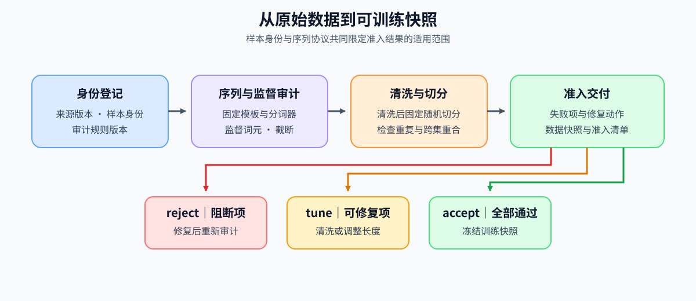
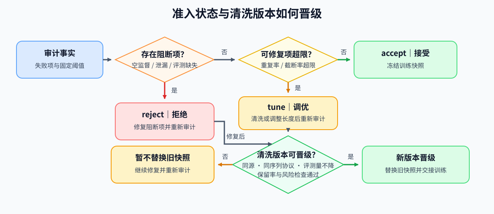

# 64. SFT Data Quality Project | SFT 数据质量项目

**难度：** Hard | **环境：** [CPU 主线](#runtime-environment) | **标签：** `监督微调`, `数据准入`, `独立评测` | **目标人群：** 后训练项目学习者

> 🚀 **云端运行环境**
>
> 本章节的实战代码可以点击以下链接在免费 GPU 算力平台上直接运行：
>
> [](https://colab.research.google.com/github/datawhalechina/llm-algo-leetcode/blob/main/02_PyTorch_Algorithms/64_SFT_Data_Quality_Project.ipynb)
> [](https://modelscope.cn/my/mynotebook) *(国内推荐：魔搭社区免费实例)*


---

## 本节导读

一批示范能成功加载，并不意味着可以用来训练：空回答可能只剩结束标记参与监督，重复记录会改变样本权重，训练与评测包含同一任务又会使成绩失去独立性。数据准入需要同时看这些风险，而不是依靠平均长度或一个质量总分。

本节固定数据集版本、分词器、模板和训练／评测切分，统计空回答、重复、截断和评测任务重合，再判断这批数据能否用于训练。通过后保存具体样本及处理配置，后续LoRA或QLoRA选型就能读取同一批数据。

**关键词：** `SFT`, `数据准入`, `切分泄漏`, `有效监督词元`, `数据准入清单`

---
<a id="runtime-environment"></a>

## 运行环境

- **CPU练习：** 使用 [BASE-CPU](../guide.md#base-cpu)，运行Step 4与测试。
- **真实数据审计：** 复用 [PT-SFT-CUDA](../topic_discussion/post_training_optimization/quickstart.md#pt-sft-cuda-quickstart) 的数据与分词依赖；本实验不加载模型权重、不调用GPU，环境与输入配置见Step 5。

---

## 前置阅读

先确定监督目标、窗口处理和记录身份，再审计完整数据版本。

- [Part 02 · 13 SFT监督边界与损失](./13_SFT_Training_Loop.md)
- [Part 02 · 30 长上下文微调机制](./30_Long_Context_Fine_Tuning.md)
- [Part 02 · 32 SFT数据契约与泄漏审计](./32_Data_Engineering_for_SFT.md)

---
## Step 1：从候选数据到可训练快照

检查一批数据时，先记录数据集版本与样本编号，再按固定模板、分词器和最大长度统计回答中还有多少词元参与损失计算。随后检查重复记录及训练／评测任务重合，决定是否允许训练。通过检查后固定下来的样本集合称为训练快照；数据清单记录来源提交、分词器、长度、切分成员及其哈希，使后续实验能找到同一集合。

原始候选的审计与清洗后快照的审计分别保留。即使最终集合通过，原始空回答、删除数量和清洗规则仍有助于解释数据如何变化。

| 阶段 | 输入 | 要回答的问题 | 输出 |
|:---|:---|:---|:---|
| 记录来源 | 固定来源、原始样本与源索引 | 检查对应哪批记录 | 数据版本、样本编号与源索引 |
| 监督审计 | 固定模板、分词器与最大长度 | 回答是否完整、有效目标是否保留 | 空监督、重复与截断事实 |
| 清洗与切分 | 保留记录及固定随机种子 | 训练与评测能否复现且任务隔离 | 两个成员集合及哈希 |
| 判断能否训练 | 审计指标与预设门槛 | 允许训练还是继续修复 | 判断结果、失败原因与数据清单 |



## Step 2：固定分词与截断方式，统计重复和监督数量

本项目登记的序列采用手工指令模板：提示与回答分别分词，回答追加结束标记，再拼接并按最大长度截断。审计与后续训练使用同一构造方式，因此监督计数可以对应训练标签。它与“使用模型对话模板、整体分词后定位回答”是不同协议；切换构造方式时，需要重新审计长度与监督，不能沿用原计数。

原始顺序也属于所选来源版本的一部分：先固定提交与源索引，清洗后再用固定种子划分集合。哈希是内容或成员清单的稳定摘要，用来核对身份；任务输入哈希只含指令与上下文，完整样本哈希还包含回答。例如同一问题换一个回答，不算完整样本重复，却仍可能跨切分泄漏。

| 审计指标 | 计算对象 | 对准入的影响 |
|:---|:---|:---|
| 空指令、空回答 | 规范化后的文本字段 | 直接阻断；只有结束标记不等于有有效示范回答 |
| 零监督词元 | 拼接与截断后保留的回答及结束标记 | 没有可学习目标时阻断 |
| 训练／评测任务重合 | 指令与上下文的联合身份 | 重合时阻断独立评测 |
| 完整样本重复率 | 指令、上下文与回答的联合身份 | 超限时清洗后重审 |
| 截断率 | 同一分词器与长度协议下的完整序列 | 超限时检查示范长度与窗口策略 |
| 评测样本数 | 固定切分后的评测成员 | 少于下限时补齐；数量本身不代表任务类型覆盖完整 |

## Step 3：判断数据能否训练、清洗版本能否替换

空指令、空回答、零监督、切分泄漏或缺少评测会阻止训练，状态为拒绝（`reject`）；只有重复率或截断率超限时，状态为待修复（`tune`）。所有门槛通过才接受（`accept`）并冻结快照。状态决定能否继续，全部失败项决定先修什么；一种风险的改善不能抵消另一种风险。

首次形成合格快照与替换已有版本是两个判断。替换时，数据来源、处理规则、分词器版本与最大长度必须相同；评测样本数不能减少，清洗后保留的样本比例须达到下限，原有问题也必须解决。评测数量相同不等于成员相同：若成员重新划分，应登记新清单，不能声称后续质量对照沿用了同一冻结评测集。

| 状态或判断 | 触发条件 | 能否进入训练 | 下一动作 |
|:---|:---|:---|:---|
| 拒绝 | 存在监督、泄漏或评测阻断项 | 否 | 修复阻断项并重审 |
| 待修复 | 无阻断项，重复或截断超限 | 否 | 清洗或调整策略后重审 |
| 接受 | 全部门槛通过 | 是 | 冻结成员与序列协议，交付数据清单 |
| 清洗版本替换 | 来源与处理配置相同、评测样本数不减、保留率达标，原问题已解决且新版本通过全部检查 | 新版本通过时可用 | 满足全部替换条件才采用新版本；否则保留旧版本的原状态 |
| 无可交付快照 | 没有同时接受、清单完整且无失败项的候选 | 否 | 补齐证据或修复后重审 |



## Step 4：实现数据准入与版本交接

本题给出数据检查结果、清洗前后版本与候选样本集合。骨架提供输入校验、失败原因和排序；你将判断多个问题同时出现时能否训练、清洗后的版本能否替换旧版本，以及哪些候选可以用于训练。测试包含阈值等号、非法比例、仅解决重复问题、分词配置变化和清单缺失等情况。

| 任务与目的 | 已知条件 | 完成标准 | 测试验证 |
|:---|:---|:---|:---|
| TODO 1：判断数据准入状态 | 阻断项与可修复项的完整清单 | 阻断优先，全部通过才接受 | 组合风险、阈值等号与非法事实 |
| TODO 2：判断清洗版本能否替换 | 来源、规则、分词器、长度、保留量及风险变化 | 来源与处理配置相同、原问题已解决、评测样本数不减且保留率达标 | 仅解决重复问题也可替换；来源或分词配置变化、新问题和样本保留不足阻止替换 |
| TODO 3：筛选可用于训练的数据版本 | 准入状态、清单完整性与失败项 | 三者一致才进入骨架提供的排序 | 大样本不掩盖风险，缺失清单排除，重复版本拒绝 |


```python
import math
from typing import Any, Dict, List

```


```python
def _validate_admission_inputs(audit: Dict[str, Any], limits: Dict[str, float]) -> None:
    """在比较门槛前拒绝非法计数、非有限比例及无效阈值。"""
    for name in ("empty_instruction_count", "empty_response_count", "zero_supervision_count", "split_leakage_count", "evaluation_count"):
        if type(audit[name]) is not int or audit[name] < 0:
            raise ValueError(f"{name} 必须为非负整数")
    for name in ("duplicate_ratio", "truncation_ratio"):
        if not math.isfinite(audit[name]) or not 0 <= audit[name] <= 1:
            raise ValueError(f"{name} 必须为[0, 1]内的有限比例")
    count = limits["minimum_evaluation_count"]
    if type(count) is not int or count <= 0:
        raise ValueError("最低评测样本数必须为正整数")
    for name in ("maximum_duplicate_ratio", "maximum_truncation_ratio"):
        if not math.isfinite(limits[name]) or not 0 <= limits[name] <= 1:
            raise ValueError(f"{name} 必须为[0, 1]内的有限比例")


def decide_data_admission(audit: Dict[str, Any], limits: Dict[str, float]) -> Dict[str, Any]:
    """根据审计事实决定能否冻结训练快照，并保留全部失败原因。"""
    _validate_admission_inputs(audit, limits)
    hard_failures = {
        "empty_instruction": audit["empty_instruction_count"] > 0,
        "empty_response": audit["empty_response_count"] > 0,
        "zero_supervision": audit["zero_supervision_count"] > 0,
        "split_leakage": audit["split_leakage_count"] > 0,
        "missing_evaluation": audit["evaluation_count"] < limits["minimum_evaluation_count"],
    }
    soft_failures = {
        "duplicate_ratio": audit["duplicate_ratio"] > limits["maximum_duplicate_ratio"],
        "truncation_ratio": audit["truncation_ratio"] > limits["maximum_truncation_ratio"],
    }
    hard_failure_names = [name for name, failed in hard_failures.items() if failed]
    soft_failure_names = [name for name, failed in soft_failures.items() if failed]
    # ==========================================
    # TODO 1：判断数据准入状态
    # ==========================================
    # decision = ???  # reject/tune/accept；阻断项优先，所有失败都解除后才允许训练。
    raise NotImplementedError("TODO 1：判断数据准入状态")
    actions = {
        "reject": "repair_blockers_and_reaudit",
        "tune": "clean_and_reaudit",
        "accept": "freeze_training_snapshot",
    }
    return {
        "decision": decision, "next_action": actions[decision],
        "hard_failures": hard_failure_names, "soft_failures": soft_failure_names,
    }


def check_cleaned_snapshot_transition(
    before: Dict[str, Any], after: Dict[str, Any], minimum_retained_ratio: float,
) -> Dict[str, Any]:
    """检查同一来源和序列协议下，风险是否解除且保留了足够数据。"""
    if not math.isfinite(minimum_retained_ratio) or not 0 <= minimum_retained_ratio <= 1:
        raise ValueError("最低保留率必须为[0, 1]内的有限数")
    for snapshot in (before, after):
        for name in ("sample_count", "evaluation_count", "max_length"):
            if type(snapshot[name]) is not int or snapshot[name] < 0:
                raise ValueError(f"{name} 必须为非负整数")
        if snapshot["sample_count"] == 0 or snapshot["max_length"] == 0:
            raise ValueError("样本总数与最大长度必须大于零")
        if snapshot["evaluation_count"] > snapshot["sample_count"]:
            raise ValueError("评测样本数不能大于总样本数")
        if snapshot["decision"] not in {"reject", "tune", "accept"}:
            raise ValueError("未知准入状态")
        if any(not snapshot[name] for name in ("source_revision", "rule_version", "tokenizer_revision")):
            raise ValueError("数据来源、规则与分词器版本必须完整")
    if after["sample_count"] > before["sample_count"]:
        raise ValueError("清洗不能增加来源样本，扩充数据应另建版本")
    same_lineage = before["source_revision"] == after["source_revision"]
    same_rules = (
        before["rule_version"] == after["rule_version"]
        and before["tokenizer_revision"] == after["tokenizer_revision"]
        and before["max_length"] == after["max_length"]
    )
    evaluation_preserved = after["evaluation_count"] >= before["evaluation_count"]
    retained_ratio = after["sample_count"] / before["sample_count"]
    before_failures = set(before.get("hard_failures", [])) | set(before.get("soft_failures", []))
    after_failures = set(after.get("hard_failures", [])) | set(after.get("soft_failures", []))
    resolved_failures = before_failures - after_failures
    introduced_failures = after_failures - before_failures
    stage_transition = before["decision"] != "accept" and after["decision"] == "accept"
    # ==========================================
    # TODO 2：判断清洗版本能否替换
    # ==========================================
    # identity_compatible = ???  # bool；数据来源、处理规则、分词器版本和最大长度相同。
    # risks_repaired = ???  # bool；确实解除旧风险，而且新版本没有剩余风险。
    # eligible = ???  # bool；来源与分词配置相同、旧问题已解决、评测样本数不减且保留率达标，新版本通过检查。
    raise NotImplementedError("TODO 2：判断清洗版本能否替换")
    return {
        "eligible": eligible, "same_lineage": same_lineage, "same_rules": same_rules,
        "evaluation_preserved": evaluation_preserved, "retained_ratio": retained_ratio,
        "resolved_failures": sorted(resolved_failures),
        "introduced_failures": sorted(introduced_failures),
    }


def select_training_snapshot(candidates: List[Dict[str, Any]]) -> Dict[str, Any]:
    """筛选有完整清单且无失败项的版本，再按样本量及版本稳定选择。"""
    eligible = []
    seen_revisions = set()
    for candidate in candidates:
        if not isinstance(candidate["revision"], str) or not candidate["revision"].strip():
            raise ValueError("快照版本标识必须非空")
        if candidate["revision"] in seen_revisions:
            raise ValueError("候选版本标识重复，无法唯一交接")
        seen_revisions.add(candidate["revision"])
        if type(candidate["manifest_complete"]) is not bool:
            raise ValueError("清单完整性必须为布尔值")
        if type(candidate["sample_count"]) is not int or candidate["sample_count"] <= 0:
            raise ValueError("快照样本数必须为正整数")
        failures = candidate.get("hard_failures", []) + candidate.get("soft_failures", [])
        # ==========================================
        # TODO 3：筛选可用于训练的数据版本
        # ==========================================
        # handoff_allowed = ???  # bool；准入状态、清单完整性与失败清单一致。
        raise NotImplementedError("TODO 3：筛选可用于训练的数据版本")
        if handoff_allowed:
            eligible.append(candidate)
    if not eligible:
        raise ValueError("没有通过准入且清单完整的数据版本")
    return sorted(eligible, key=lambda item: (-item["sample_count"], item["revision"]))[0]

```

## 测试

检查准入优先级、清洗风险解除、身份可比性和交接资格；同时覆盖非法事实与边界值。


```python
def _data_admission_fixture():
    """构造无阻断项的数据审计与固定门槛。"""
    limits = {
        "minimum_evaluation_count": 2,
        "maximum_duplicate_ratio": 0.02,
        "maximum_truncation_ratio": 0.10,
    }
    clean = {
        "empty_instruction_count": 0,
        "empty_response_count": 0,
        "zero_supervision_count": 0,
        "split_leakage_count": 0,
        "evaluation_count": 16,
        "duplicate_ratio": 0.01,
        "truncation_ratio": 0.05,
    }
    return clean, limits


def test_data_admission_priority():
    """验证硬失败、软失败和通过状态的优先级。"""
    clean, limits = _data_admission_fixture()
    clean_result = decide_data_admission(clean, limits)
    assert (clean_result["decision"], clean_result["next_action"]) == ("accept", "freeze_training_snapshot")

    duplicate_risk = {**clean, "duplicate_ratio": 0.03}
    assert decide_data_admission(duplicate_risk, limits)["next_action"] == "clean_and_reaudit"
    assert decide_data_admission({**clean, "zero_supervision_count": 1}, limits)["decision"] == "reject"
    assert decide_data_admission({**clean, "split_leakage_count": 1}, limits)["decision"] == "reject"


def test_cleaned_snapshot_transition():
    """验证清洗前后来源相同、评测样本数不减且样本保留率达标。"""
    before = {
        "source_revision": "source-a",
        "rule_version": "rules-v1",
        "decision": "reject",
        "tokenizer_revision": "tokenizer-a",
        "max_length": 256,
        "sample_count": 100,
        "evaluation_count": 20,
        "hard_failures": ["split_leakage"],
    }
    after = {**before, "decision": "accept", "sample_count": 92, "hard_failures": []}
    assert check_cleaned_snapshot_transition(before, after, 0.90)["eligible"]
    assert not check_cleaned_snapshot_transition(before, {**after, "source_revision": "source-b"}, 0.90)["eligible"]
    assert not check_cleaned_snapshot_transition(before, {**after, "evaluation_count": 19}, 0.90)["eligible"]
    assert not check_cleaned_snapshot_transition(before, {**after, "sample_count": 89}, 0.90)["eligible"]
    assert not check_cleaned_snapshot_transition(before, {**after, "hard_failures": ["zero_supervision"]}, 0.90)["eligible"]


def test_training_snapshot_selection():
    """验证仅从完整准入版本选择，并稳定处理并列。"""
    selected = select_training_snapshot([
        {"revision": "v2", "decision": "accept", "manifest_complete": True, "sample_count": 90},
        {"revision": "v1", "decision": "accept", "manifest_complete": True, "sample_count": 90},
        {"revision": "v3", "decision": "tune", "manifest_complete": True, "sample_count": 120},
    ])
    assert selected["revision"] == "v1"

    try:
        select_training_snapshot([{"revision": "v0", "decision": "reject", "manifest_complete": True, "sample_count": 100}])
    except ValueError:
        pass
    else:
        raise AssertionError("无 accept 候选时必须失败")


test_data_admission_priority()
test_cleaned_snapshot_transition()
test_training_snapshot_selection()
print("所有测试通过！")

def _assert_value_error(callback):
    """确认无效事实或无法交付的版本被显式拒绝。"""
    try:
        callback()
    except ValueError:
        return
    raise AssertionError("预期ValueError")


def test_soft_only_cleaning_can_advance():
    """重复或截断风险解除后也能晋级，不要求旧版本存在阻断项。"""
    before = {
        "source_revision": "source-a", "rule_version": "rules-v1",
        "tokenizer_revision": "tokenizer-a", "max_length": 256,
        "decision": "tune", "sample_count": 100, "evaluation_count": 20,
        "hard_failures": [], "soft_failures": ["duplicate_ratio"],
    }
    after = {**before, "decision": "accept", "sample_count": 90, "soft_failures": []}
    assert check_cleaned_snapshot_transition(before, after, 0.9)["eligible"]
    assert not check_cleaned_snapshot_transition(before, {**after, "tokenizer_revision": "tokenizer-b"}, 0.9)["eligible"]
    assert not check_cleaned_snapshot_transition(before, {**after, "max_length": 512}, 0.9)["eligible"]
    assert not check_cleaned_snapshot_transition(before, {**after, "soft_failures": ["truncation_ratio"]}, 0.9)["eligible"]
    _assert_value_error(lambda: check_cleaned_snapshot_transition({**before, "sample_count": 0}, after, 0.9))
    _assert_value_error(lambda: check_cleaned_snapshot_transition(before, after, float("nan")))


def test_all_failures_and_threshold_boundaries():
    """门槛等号通过，同时发生阻断与可修复风险时保留两类原因。"""
    clean, limits = _data_admission_fixture()
    boundary = {**clean, "evaluation_count": 2, "duplicate_ratio": 0.02, "truncation_ratio": 0.10}
    assert decide_data_admission(boundary, limits)["decision"] == "accept"
    result = decide_data_admission({**clean, "empty_response_count": 1, "duplicate_ratio": 0.03}, limits)
    assert result["decision"] == "reject"
    assert result["hard_failures"] == ["empty_response"]
    assert result["soft_failures"] == ["duplicate_ratio"]
    for ratio in (float("nan"), float("inf"), -0.1, 1.1):
        _assert_value_error(lambda: decide_data_admission({**clean, "duplicate_ratio": ratio}, limits))
    _assert_value_error(lambda: decide_data_admission({**clean, "evaluation_count": 1.5}, limits))


def test_handoff_excludes_inconsistent_and_incomplete_candidates():
    """更大的候选不能用样本量抵消失败项或清单缺失。"""
    valid = {"revision": "v1", "decision": "accept", "manifest_complete": True, "sample_count": 90}
    bad = {**valid, "revision": "v2", "sample_count": 120, "soft_failures": ["duplicate_ratio"]}
    incomplete = {**valid, "revision": "v3", "sample_count": 130, "manifest_complete": False}
    for pool in ([valid, bad, incomplete], [incomplete, bad, valid]):
        assert select_training_snapshot(pool)["revision"] == "v1"
    _assert_value_error(lambda: select_training_snapshot([bad, incomplete]))
    _assert_value_error(lambda: select_training_snapshot([valid, dict(valid)]))


test_soft_only_cleaning_can_advance()
test_all_failures_and_threshold_boundaries()
test_handoff_excludes_inconsistent_and_incomplete_candidates()

```

🛑 **STOP HERE** 🛑

## 参考代码与解析

### 代码


```python
def _validate_admission_inputs(audit: Dict[str, Any], limits: Dict[str, float]) -> None:
    """在比较门槛前拒绝非法计数、非有限比例及无效阈值。"""
    for name in ("empty_instruction_count", "empty_response_count", "zero_supervision_count", "split_leakage_count", "evaluation_count"):
        if type(audit[name]) is not int or audit[name] < 0:
            raise ValueError(f"{name} 必须为非负整数")
    for name in ("duplicate_ratio", "truncation_ratio"):
        if not math.isfinite(audit[name]) or not 0 <= audit[name] <= 1:
            raise ValueError(f"{name} 必须为[0, 1]内的有限比例")
    count = limits["minimum_evaluation_count"]
    if type(count) is not int or count <= 0:
        raise ValueError("最低评测样本数必须为正整数")
    for name in ("maximum_duplicate_ratio", "maximum_truncation_ratio"):
        if not math.isfinite(limits[name]) or not 0 <= limits[name] <= 1:
            raise ValueError(f"{name} 必须为[0, 1]内的有限比例")


def decide_data_admission(audit: Dict[str, Any], limits: Dict[str, float]) -> Dict[str, Any]:
    """根据审计事实决定能否冻结训练快照，并保留全部失败原因。"""
    _validate_admission_inputs(audit, limits)
    hard_failures = {
        "empty_instruction": audit["empty_instruction_count"] > 0,
        "empty_response": audit["empty_response_count"] > 0,
        "zero_supervision": audit["zero_supervision_count"] > 0,
        "split_leakage": audit["split_leakage_count"] > 0,
        "missing_evaluation": audit["evaluation_count"] < limits["minimum_evaluation_count"],
    }
    soft_failures = {
        "duplicate_ratio": audit["duplicate_ratio"] > limits["maximum_duplicate_ratio"],
        "truncation_ratio": audit["truncation_ratio"] > limits["maximum_truncation_ratio"],
    }
    hard_failure_names = [name for name, failed in hard_failures.items() if failed]
    soft_failure_names = [name for name, failed in soft_failures.items() if failed]
    # TODO 1：判断数据准入状态
    decision = "reject" if hard_failure_names else "tune" if soft_failure_names else "accept"
    actions = {
        "reject": "repair_blockers_and_reaudit",
        "tune": "clean_and_reaudit",
        "accept": "freeze_training_snapshot",
    }
    return {
        "decision": decision, "next_action": actions[decision],
        "hard_failures": hard_failure_names, "soft_failures": soft_failure_names,
    }


def check_cleaned_snapshot_transition(
    before: Dict[str, Any], after: Dict[str, Any], minimum_retained_ratio: float,
) -> Dict[str, Any]:
    """检查同一来源和序列协议下，风险是否解除且保留了足够数据。"""
    if not math.isfinite(minimum_retained_ratio) or not 0 <= minimum_retained_ratio <= 1:
        raise ValueError("最低保留率必须为[0, 1]内的有限数")
    for snapshot in (before, after):
        for name in ("sample_count", "evaluation_count", "max_length"):
            if type(snapshot[name]) is not int or snapshot[name] < 0:
                raise ValueError(f"{name} 必须为非负整数")
        if snapshot["sample_count"] == 0 or snapshot["max_length"] == 0:
            raise ValueError("样本总数与最大长度必须大于零")
        if snapshot["evaluation_count"] > snapshot["sample_count"]:
            raise ValueError("评测样本数不能大于总样本数")
        if snapshot["decision"] not in {"reject", "tune", "accept"}:
            raise ValueError("未知准入状态")
        if any(not snapshot[name] for name in ("source_revision", "rule_version", "tokenizer_revision")):
            raise ValueError("数据来源、规则与分词器版本必须完整")
    if after["sample_count"] > before["sample_count"]:
        raise ValueError("清洗不能增加来源样本，扩充数据应另建版本")
    same_lineage = before["source_revision"] == after["source_revision"]
    same_rules = (
        before["rule_version"] == after["rule_version"]
        and before["tokenizer_revision"] == after["tokenizer_revision"]
        and before["max_length"] == after["max_length"]
    )
    evaluation_preserved = after["evaluation_count"] >= before["evaluation_count"]
    retained_ratio = after["sample_count"] / before["sample_count"]
    before_failures = set(before.get("hard_failures", [])) | set(before.get("soft_failures", []))
    after_failures = set(after.get("hard_failures", [])) | set(after.get("soft_failures", []))
    resolved_failures = before_failures - after_failures
    introduced_failures = after_failures - before_failures
    stage_transition = before["decision"] != "accept" and after["decision"] == "accept"
    # TODO 2：判断清洗版本能否替换
    identity_compatible = same_lineage and same_rules
    risks_repaired = bool(resolved_failures) and not after_failures
    eligible = (
        identity_compatible and risks_repaired and evaluation_preserved
        and retained_ratio >= minimum_retained_ratio and stage_transition
    )
    return {
        "eligible": eligible, "same_lineage": same_lineage, "same_rules": same_rules,
        "evaluation_preserved": evaluation_preserved, "retained_ratio": retained_ratio,
        "resolved_failures": sorted(resolved_failures),
        "introduced_failures": sorted(introduced_failures),
    }


def select_training_snapshot(candidates: List[Dict[str, Any]]) -> Dict[str, Any]:
    """筛选有完整清单且无失败项的版本，再按样本量及版本稳定选择。"""
    eligible = []
    seen_revisions = set()
    for candidate in candidates:
        if not isinstance(candidate["revision"], str) or not candidate["revision"].strip():
            raise ValueError("快照版本标识必须非空")
        if candidate["revision"] in seen_revisions:
            raise ValueError("候选版本标识重复，无法唯一交接")
        seen_revisions.add(candidate["revision"])
        if type(candidate["manifest_complete"]) is not bool:
            raise ValueError("清单完整性必须为布尔值")
        if type(candidate["sample_count"]) is not int or candidate["sample_count"] <= 0:
            raise ValueError("快照样本数必须为正整数")
        failures = candidate.get("hard_failures", []) + candidate.get("soft_failures", [])
        # TODO 3：筛选可用于训练的数据版本
        handoff_allowed = candidate["decision"] == "accept" and candidate["manifest_complete"] and not failures
        if handoff_allowed:
            eligible.append(candidate)
    if not eligible:
        raise ValueError("没有通过准入且清单完整的数据版本")
    return sorted(eligible, key=lambda item: (-item["sample_count"], item["revision"]))[0]

```

### 解析

#### TODO 1：判断数据准入状态

- 空监督、切分泄漏或缺少评测会阻止训练；重复与截断超限需要清洗后重审。两类风险同时出现时，状态取拒绝，但原因不能只保留一类。
- 答案按阻断、可修复、无失败的优先级选择状态；动作由骨架绑定。优先级与阈值测试覆盖组合风险、等号边界和非有限事实。

#### TODO 2：判断清洗版本能否替换

- 清洗前后的来源、处理规则、分词器版本和最大长度须相同；评测样本数不能减少，保留的样本比例须达到下限，旧问题须全部解决。原来只有重复率超限的版本，去重后也可以满足替换条件。
- 将上述条件同时满足作为替换条件。仅去重的正例与更换分词器、改变最大长度、新增问题的反例，可以区分“已清洗”和“可以替换”；其他用例继续核对来源、评测样本数和保留率。

#### TODO 3：筛选可用于训练的数据版本

- 准入状态为接受、清单完整和没有失败项必须同时成立。样本更多不能弥补其中任何一项缺失。
- 先用这三个条件筛选，排序由骨架完成。测试给出“状态写着接受但仍有失败项”和“清单缺失”的候选，确认两者都被排除；反转输入顺序后，选出的版本仍相同。
## Step 5：真实数据准入实验

CPU 题目区验证准入状态机；真实数据实验固定数据来源、分词器版本、切分规则和最大长度，记录重复率、跨切分泄漏、截断率、有效监督词元和样本身份，并生成供 LoRA 或 QLoRA 选型使用的数据准入清单。

| 对照层 | 输入 | 主要证据 | 输出与证据边界 |
|:---|:---|:---|:---|
| CPU 状态机 | 人工构造的审计摘要 | 门槛优先级、版本替换、相同输入下的确定性选择 | 只确认准入逻辑，不判断真实数据 |
| 真实数据准入 | 固定数据与分词器快照 | 重复、泄漏、截断、监督词元、身份哈希 | 输出数据准入清单；不证明训练后模型质量 |

合法阶段为`prepare → collect → close`：准备只读合同与依赖状态，采集保存事实，交接重新读取并校验。修改5.1后按六层顺序运行；准备阶段可在基础CPU环境执行。

### 5.1 运行意图与配置

先按[后训练优化 Quickstart](../topic_discussion/post_training_optimization/quickstart.md#pt-sft-cuda-quickstart)准备 `PT-SFT-CUDA` 环境。实验读取真实数据并执行分词、切分和审计，不更新模型参数；后续 LoRA、QLoRA 和 SFT 训练可继续使用该环境。

```python
RUN_LABEL = "replace_with_unique_label"  # 新审计使用唯一标签；历史标签只用于登记与读取。
RUN_STAGE = "prepare"  # prepare：只检查；collect：采集数据事实；close：校验并交接。

```

### 5.2 预检依赖与数据身份

准备与读取阶段使用CPU；采集阶段复用 [PT-SFT-CUDA](../topic_discussion/post_training_optimization/quickstart.md#pt-sft-cuda-quickstart) 的数据集与分词器依赖，不加载模型权重。固定合同从项目注册表读取；数据集和分词器的请求版本在采集时解析为不可变提交。


```python
import hashlib
import importlib
import importlib.util
import json
import re
from pathlib import Path

from tools.project_runtime import bootstrap_project_root
import tools.post_training_project_runtime as data_runtime

data_runtime = importlib.reload(data_runtime)
PROJECT_ROOT = bootstrap_project_root()
registry = json.loads((PROJECT_ROOT / "benchmarks/project_registry/part02.json").read_text(encoding="utf-8"))
project_entry = next(item for item in registry["projects"] if item["semantic_id"] == "PT-SFT-DATA-QUALITY")
CONTRACT = json.loads((PROJECT_ROOT / project_entry["default_experiment_contract"]).read_text(encoding="utf-8"))
if RUN_STAGE not in {"prepare", "collect", "close"}:
    raise ValueError("RUN_STAGE 必须为 prepare、collect 或 close")
if not re.fullmatch(r"[A-Za-z0-9][A-Za-z0-9_-]{0,95}", RUN_LABEL):
    raise ValueError("标签只允许字母、数字、下划线与连字符，最多96个字符")
if RUN_STAGE != "prepare" and RUN_LABEL == "replace_with_unique_label":
    raise ValueError("采集或交接前请设置唯一 RUN_LABEL")
RESULTS_DIR = PROJECT_ROOT / "benchmarks/results/64_sft_data_quality"
RESULT_PATH = RESULTS_DIR / f"sft_data_admission_{RUN_LABEL}.json"
MANIFEST_PATH = RESULTS_DIR / f"sft_data_manifest_{RUN_LABEL}.json"
RECEIPT_PATH = RESULTS_DIR / f"sft_data_registration_{RUN_LABEL}.json"
required_packages = ("datasets", "transformers", "huggingface_hub")
missing_packages = [name for name in required_packages if importlib.util.find_spec(name) is None]
if RUN_STAGE == "collect":
    if missing_packages:
        raise ModuleNotFoundError(f"缺少依赖：{missing_packages}；请执行 PT-SFT-CUDA Quickstart")
    if any(path.exists() for path in (RESULT_PATH, MANIFEST_PATH, RECEIPT_PATH)):
        raise FileExistsError("同名资产已存在；完成采集后使用close，重新采集需更换标签")
if RUN_STAGE == "close" and not RESULT_PATH.is_file():
    raise FileNotFoundError(f"缺少本次采集证据：{RESULT_PATH}")
print({"stage": RUN_STAGE, "profile": CONTRACT["environment_profile"],
       "collection_dependencies_missing": missing_packages, "contract": project_entry["default_experiment_contract"],
       "result_path": str(RESULT_PATH), "formal_assets_written": False})

```

### 5.3 固定准入门槛

| 门槛 | 条件 | 失败状态 |
|:---|:---|:---|
| 有效监督 | 空回答数、零监督词元数均为 0 | `reject` |
| 独立评测 | 跨切分输入重合为 0，评测样本数达标 | `reject` |
| 重复风险 | 完整样本重复率不超过阈值 | `tune` |
| 长度风险 | 分词器截断率不超过阈值 | `tune` |

```python
DATASET_ID = CONTRACT["dataset"]["id"]
DATASET_REVISION = CONTRACT["dataset"]["requested_revision"]
MODEL_ID = CONTRACT["tokenizer"]["id"]
MODEL_REVISION = CONTRACT["tokenizer"]["requested_revision"]
SAMPLE_COUNT = CONTRACT["workload"]["sample_count"]
TRAIN_COUNT = CONTRACT["workload"]["train_count"]
MAX_LENGTH = CONTRACT["workload"]["max_length"]
SEED = CONTRACT["workload"]["seed"]
LIMITS = CONTRACT["limits"]
SCHEMA_VERSION = CONTRACT["schema_version"]
SEMANTIC_ID = CONTRACT["semantic_id"]
PROFILE_ID = CONTRACT["environment_profile"]
CONTRACT_SHA256 = hashlib.sha256(data_runtime.json_record_bytes(CONTRACT)).hexdigest()
if not (0 < TRAIN_COUNT < SAMPLE_COUNT and MAX_LENGTH >= 8
        and 0 < LIMITS["minimum_evaluation_count"] <= SAMPLE_COUNT - TRAIN_COUNT
        and all(0 <= LIMITS[key] <= 1 for key in ("maximum_duplicate_ratio", "maximum_truncation_ratio"))):
    raise ValueError("固定合同中的规模或门槛无效")

def apply_data_admission_limits(audit, limits):
    """将真实审计事实映射为固定的 reject、tune 或 accept。"""
    hard_failures = {
        "empty_instruction": audit["empty_instruction_count"] > 0,
        "empty_response": audit["empty_response_count"] > 0,
        "zero_supervision": audit["zero_supervision_count"] > 0,
        "split_leakage": audit["split_leakage_count"] > 0,
        "missing_evaluation": audit["evaluation_count"] < limits["minimum_evaluation_count"],
    }
    soft_failures = {
        "duplicate_ratio": audit["duplicate_ratio"] > limits["maximum_duplicate_ratio"],
        "truncation_ratio": audit["truncation_ratio"] > limits["maximum_truncation_ratio"],
    }
    hard_gate_passed = not any(hard_failures.values())
    soft_gate_passed = not any(soft_failures.values())
    decision = "reject" if not hard_gate_passed else "accept" if soft_gate_passed else "tune"
    return {
        "decision": decision,
        "hard_gate_passed": hard_gate_passed,
        "soft_gate_passed": soft_gate_passed,
        "hard_failures": [name for name, failed in hard_failures.items() if failed],
        "soft_failures": [name for name, failed in soft_failures.items() if failed],
    }

print({"workload": CONTRACT["workload"], "limits": LIMITS,
       "sequence_protocol": CONTRACT["sequence_protocol"], "contract_sha256": CONTRACT_SHA256})

```

### 5.4 执行真实数据审计并保存原始证据

`collect` 从缓存或远程仓库读取固定规模的数据与分词器。清洗后使用固定种子打乱保留样本，再切分训练与评测集合；原始审计与清洗后审计一并保存，包含源索引、样本身份和切分哈希。此阶段只保存采集证据。


```python
if RUN_STAGE == "collect":
    from datasets import load_dataset
    from huggingface_hub import HfApi
    from transformers import AutoTokenizer

    dataset_commit = HfApi().dataset_info(DATASET_ID, revision=DATASET_REVISION).sha
    model_commit = HfApi().model_info(MODEL_ID, revision=MODEL_REVISION).sha
    dataset = load_dataset(DATASET_ID, split=f"train[:{SAMPLE_COUNT}]", revision=dataset_commit)
    records = [dict(row) for row in dataset]
    tokenizer = AutoTokenizer.from_pretrained(
        MODEL_ID,
        revision=model_commit,
        local_files_only=False,
    )
    raw_audit = data_runtime.audit_sft_records(records, tokenizer, max_length=MAX_LENGTH, train_count=TRAIN_COUNT)
    raw_admission = apply_data_admission_limits(raw_audit, LIMITS)

    import random

    accepted_rows = []
    seen_sample_ids = set()
    for source_index, row in enumerate(records):
        instruction = data_runtime.normalized_text(row.get("instruction"))
        context = data_runtime.normalized_text(row.get("input"))
        response = data_runtime.normalized_text(row.get("output"))
        sample_id = data_runtime.stable_text_hash((instruction, context, response))
        if not instruction or not response or sample_id in seen_sample_ids:
            continue
        seen_sample_ids.add(sample_id)
        accepted_rows.append((source_index, row, sample_id))

    random.Random(SEED).shuffle(accepted_rows)
    cleaned_records = [row for _, row, _ in accepted_rows]
    cleaned_train_count = min(
        TRAIN_COUNT, len(cleaned_records) - int(LIMITS["minimum_evaluation_count"]),
    )
    if cleaned_train_count <= 0:
        raise RuntimeError("清洗后样本不足，无法同时保留训练样本和最低数量的评测样本")
    audit = data_runtime.audit_sft_records(
        cleaned_records, tokenizer, max_length=MAX_LENGTH, train_count=cleaned_train_count,
    )
    admission = apply_data_admission_limits(audit, LIMITS)
    accepted_indices = [source_index for source_index, _, _ in accepted_rows]
    accepted_sample_ids = [sample_id for _, _, sample_id in accepted_rows]
    train_sample_ids = accepted_sample_ids[:cleaned_train_count]
    evaluation_sample_ids = accepted_sample_ids[cleaned_train_count:]
    record = {
        "schema_version": SCHEMA_VERSION,
        "semantic_id": SEMANTIC_ID,
        "environment_profile": PROFILE_ID,
        "run_mode": "real_data",
        "run_label": RUN_LABEL,
        "source_revision": dataset_commit,
        "rule_version": CONTRACT["rule_version"],
        "measurement_version": CONTRACT["measurement_version"],
        "sequence_protocol": CONTRACT["sequence_protocol"],
        "contract_sha256": CONTRACT_SHA256,
        "dataset": {"id": DATASET_ID, "requested_revision": DATASET_REVISION, "resolved_commit": dataset_commit},
        "tokenizer": {"id": MODEL_ID, "requested_revision": MODEL_REVISION, "resolved_commit": model_commit},
        "workload": dict(CONTRACT["workload"]),
        "limits": LIMITS,
        "raw_audit": raw_audit,
        "raw_admission": raw_admission,
        "cleaning": {
            "rule": "drop_empty_instruction_response_and_exact_duplicates",
            "removed_count": len(records) - len(cleaned_records),
            "retained_ratio": len(cleaned_records) / len(records),
        },
        "snapshot": {
            "train_record_indices": accepted_indices[:cleaned_train_count],
            "evaluation_record_indices": accepted_indices[cleaned_train_count:],
            "train_sample_ids": train_sample_ids,
            "evaluation_sample_ids": evaluation_sample_ids,
            "train_sample_ids_hash": data_runtime.stable_text_hash(train_sample_ids),
            "evaluation_sample_ids_hash": data_runtime.stable_text_hash(evaluation_sample_ids),
        },
        "audit": audit,
        "quality": {"independent_evaluation": admission["hard_gate_passed"]},
        "decision": admission["decision"],
        "decision_details": admission,
        "admission": admission,
    }
    data_runtime.validate_sft_admission_record(record, CONTRACT, RUN_LABEL, apply_data_admission_limits)
    data_runtime.publish_json_record(RESULT_PATH, record)
    print({"result_path": str(RESULT_PATH), "decision": admission["decision"]})
else:
    print({"stage": RUN_STAGE, "collection": "skipped"})
```

### 5.5 独立读取结果并核对证据

重新读取原始JSON，按固定合同核对运行标签、来源提交、序列协议、计数与比例、切分成员和哈希，再从保存的事实复算准入状态与全部失败项。`close` 可以在新Kernel中按5.1–5.6顺序运行，无需复用采集单元的变量。


```python
if RUN_STAGE in {"collect", "close"}:
    evidence = data_runtime.read_sft_admission_record(
        RESULT_PATH, CONTRACT, RUN_LABEL, apply_data_admission_limits,
    )
    print({"run_label": evidence["run_label"], "decision": evidence["decision"],
           "failed_checks": evidence["admission"]["hard_failures"] + evidence["admission"]["soft_failures"],
           "raw_sample_count": evidence["raw_audit"]["sample_count"],
           "cleaned_sample_count": evidence["audit"]["sample_count"],
           "evaluation_count": evidence["audit"]["evaluation_count"],
           "truncation_ratio": evidence["audit"]["truncation_ratio"],
           "minimum_supervised_tokens": evidence["audit"]["minimum_supervised_tokens"]})
else:
    print({"stage": RUN_STAGE, "evidence_read": "skipped"})

```

### 5.6 形成决策、登记结果与交接

`accept` 表示该数据快照可以进入 LoRA 或 QLoRA 选型；`tune` 表示需要先清洗重复样本或调整长度策略；`reject` 表示需要先修复监督数据或训练—评测隔离。数据准入清单保存采用状态与快照身份，完整审计指标保存在独立证据文件中。

| 决策项 | 实测证据 | 结果 | 后续动作 |
|:---|:---|:---|:---|
| 有效监督 | 移除 1 条空回答后保留 511 条；零监督样本为 0 | 通过 | 使用清洗后的快照 |
| 切分隔离 | 448 条训练、63 条评测；跨切分重合为 0 | 通过 | 固定切分哈希 |
| 重复与长度 | 重复率 0；截断率 1.17% | 通过 | 保留当前长度策略 |
| 项目决策 | 样本 ID、源索引、随机种子与切分哈希完整 | `accept` | 交给 65 的 1.5B QLoRA 容量分支 |

下表为v1协议的归档结果，使用手工指令模板与分段分词协议；v2合同的真实采集结果尚未登记。63节继续读取已归档的0.5B清单，65节容量分支读取下表1.5B清单；二者不能混为同一比较身份。

只有`close`写登记回执，`accept`才生成下游清单。回执绑定证据与清单的SHA256；同一证据重复交接复用文件，中断后可补齐缺失清单或回执，同名不同内容停止。

**当前登记结果**

| 字段 | 登记内容 |
| --- | --- |
| 项目与标签 | 64 节 SFT 数据准入；`alpaca_qwen25_15b_v1` |
| 运行条件 | Qwen2.5-1.5B tokenizer；512 条原始记录；固定训练/评测切分 |
| 原始证据 | [数据审计](../../benchmarks/results/64_sft_data_quality/sft_data_admission_alpaca_qwen25_15b_v1.json) |
| 正式证据 | 数据审计内保存重复、截断、监督和跨切分隔离指标 |
| 清单与交接 | [数据清单](../../benchmarks/results/64_sft_data_quality/sft_data_manifest_alpaca_qwen25_15b_v1.json) |
| 结论 | `accept`：允许进入 65 节 1.5B QLoRA 容量分支 |

```python
if RUN_STAGE == "close":
    registration = data_runtime.close_sft_admission(
        PROJECT_ROOT, RESULT_PATH, MANIFEST_PATH, RECEIPT_PATH,
        CONTRACT, RUN_LABEL, apply_data_admission_limits,
    )
    print(registration)
else:
    print({"stage": RUN_STAGE, "registration": "skipped"})

```

## 相关阅读

通过准入后，继续比较更新方案与资源约束；数据清单不是训练质量结论，还需要固定评测上的模型实验。

- [Part 02 · 63 LoRA变体选型](./63_LoRA_Variants_Benchmark.md)：复用同一数据身份比较秩配置。
- [Part 02 · 65 QLoRA低资源选型](./65_QLoRA_Selection_Project.md)：比较同一任务下的容量与质量。
- [Hugging Face Datasets文档](https://huggingface.co/docs/datasets)：对照数据版本、选择和切分接口。
- [LIMA论文](https://arxiv.org/abs/2305.11206)：进一步阅读示范质量与指令微调表现的关系。
