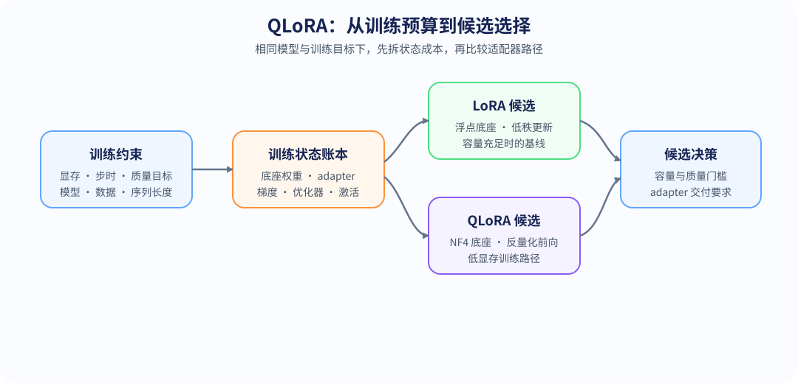
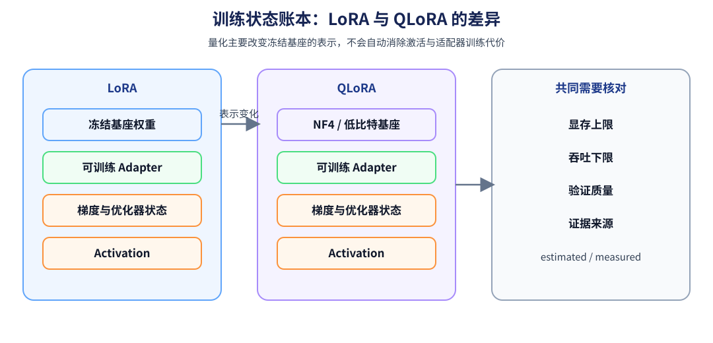
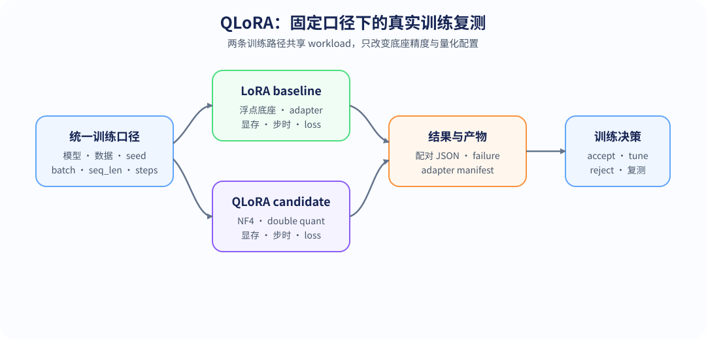

# 65. QLoRA Selection Project | QLoRA 选型项目

**难度：** Hard | **环境：** CPU + 单卡 GPU | **标签：** `量化压缩`, `QLoRA`, `选型` | **目标人群：** 项目决策练习者

> 🚀 **云端运行环境**
>
> 本章节的实战代码可以点击以下链接在免费 GPU 算力平台上直接运行：
>
> [](https://colab.research.google.com/github/datawhalechina/llm-algo-leetcode/blob/main/02_PyTorch_Algorithms/65_QLoRA_Selection_Project.ipynb)
> [](https://modelscope.cn/my/mynotebook) *(国内推荐：魔搭社区免费实例)*


---

## 本节导读

当显存有限、又不能明显牺牲验证质量时，NF4 QLoRA 能否替代 BF16 LoRA？本节固定数据准入结果、模型提交、LoRA 配置与有效 batch，只改变冻结底座表示；再用显存、训练速度、独立验证与 adapter 产物判断低比特路径是否值得采用。

CPU 题目区先验证身份、预算与证据是否足以比较；GPU 实验再生成可复测的 QLoRA 选型记录。输出包括固定 workload、两条训练路径的测量、低比特生效状态、adapter 哈希与 `accept / tune / reject` 决策。

**关键词：** QLoRA、NF4、冻结底座、有效 batch、训练产物

---
## 前置阅读

**导语：** 进入本项目前，先能说明 LoRA、有效 batch 和低比特权重如何组合，再在预算约束下判断是否采用 QLoRA。
- [14. LoRA Tutorial | LoRA 教程](./14_LoRA_Tutorial.md)
- [11. Gradient Accumulation | 梯度累积](./11_Gradient_Accumulation.md)
- [15. End-to-End Fine-Tuning Experiment | 端到端微调实验](./15_End_to_End_Fine_Tuning_Experiment.md)
- [26. QLoRA and 4bit Quantization | QLoRA 与 4-bit 量化](./26_QLoRA_and_4bit_Quantization.md)
---

### Step 1：固定任务与预算，明确要比较什么

输入是 64 节的数据准入 manifest、固定模型提交和相同 LoRA 配置（分别训练 adapter）。问题不是“QLoRA 是否更省显存”这一孤立事实，而是它能否在给定显存上限内保留可接受的验证质量，并生成可定位的 adapter。

| 输入或约束 | 固定内容 | 产生的判断 |
|:---|:---|:---|
| 数据准入 | 样本 ID、训练/验证切分与 template | 两条路径是否学习同一任务 |
| 更新语义 | rank、alpha、target modules、学习率与有效 batch | 差异能否归因于冻结底座表示 |
| 资源预算 | 峰值显存上限、最小可行 micro-batch | 候选能否进入真实训练 |
| 交付要求 | 独立验证、低比特生效、adapter 与哈希 | 结果能否被后续实验复测 |



### Step 2：保持更新语义，只改变冻结底座表示

BF16 LoRA 与 NF4 QLoRA 使用同一模型提交、相同数据切分、相同随机种子组、相同 LoRA 配置和有效 batch。目标是对照冻结底座表示；真实 NF4 路径还包含 k-bit preparation，需同时记录其 dtype 与梯度检查点行为，不能将全部差异归因于表示。

| 比较对象 | 必须固定 | 主要变化 | 观察字段 |
|:---|:---|:---|:---|
| 模型与数据 | revision、tokenizer、数据 manifest、种子组 | 无 | 独立验证损失与样本身份 |
| 训练路径 | rank、alpha、target modules、学习率、有效 batch | 无 | 可训练参数与更新次数 |
| 冻结底座 | 相同模型权重 | BF16 / NF4 + double quant | 峰值、保留显存与低比特生效状态 |
| 容量测量 | seq_len、步数、OOM 处理 | micro-batch 阶梯 | 最大可行 micro-batch |

### Step 3：从资源账本走到可交付训练证据

账本只能估计容量；真实训练还必须确认 NF4 是否加载、生效的训练路径、峰值显存、独立验证、失败运行和 adapter 哈希。只有这些证据处于同一 workload，才允许给出低资源选型结论。

| 证据 | 最少记录 | 可以作出的判断 |
|:---|:---|:---|
| CPU 账本 | 冻结底座、adapter、梯度、优化器、激活与量化元数据 | 候选是否值得进入 GPU 对照 |
| GPU 配对重复 | 峰值、步时、吞吐、独立验证、失败运行 | 固定 workload 下的资源与质量差异 |
| 容量阶梯 | 每档 micro-batch 的成功或 OOM | 低比特路径是否扩大可行规模 |
| artifact | 模型提交、LoRA 配置、adapter 哈希、结果 JSON | 候选能否被定位与复测 |



### Step 4（CPU 代码练习）：核对比较身份、证据与交付动作

题目区不模拟训练速度，也不为候选编造总分。它依次检查两条路径是否属于同一 workload、QLoRA 证据是否达到可比较条件，以及结果应进入交付、调参还是拒绝。

| 类型 | 函数 | 学习者需要完成的内容 | 测试关注点 |
|:---|:---|:---|:---|
| 辅助函数 | `validate_qlora_candidate` / `validate_budget_and_quality` | 检查字段、数值与预算 | 缺失、非法和非有限值 |
| TODO 1 | `same_workload_identity` | 比较模型、数据、adapter 与有效 batch 身份 | 单个字段漂移必须阻断比较 |
| TODO 2 | `candidate_passes_gates` | 将真实证据、低比特生效、质量和容量合成硬门槛 | 估算或单次 smoke 不能进入交付 |
| TODO 3 | `choose_qlora_action` | 从两条可比较路径的证据决定交付动作 | `accept / tune / reject` 与失败原因 |

```python
from typing import Dict, List

```


```python
# 题目区只挖空三项选型机制：比较身份、门槛判断与策略决策。
# 输入校验、失败原因和报告字段由骨架提供；每个 TODO 都能由对应测试独立验证。

import math

def build_memory_ledger(base_weight_mb: float, trainable_param_mb: float, gradient_mb: float, optimizer_state_mb: float, activation_mb: float, quant_metadata_mb: float = 0.0, peak_memory_mb: float = None, peak_reserved_mb: float = None, evidence: str = 'estimated') -> Dict[str, object]:
    """汇总训练显存对象，并区分账本估算与 CUDA 峰值。"""
    values = {
        'base_weight_mb': base_weight_mb, 'trainable_param_mb': trainable_param_mb,
        'gradient_mb': gradient_mb, 'optimizer_state_mb': optimizer_state_mb,
        'activation_mb': activation_mb, 'quant_metadata_mb': quant_metadata_mb,
    }
    if any(type(value) not in (int, float) or not math.isfinite(value) or value < 0 for value in values.values()):
        raise ValueError('显存账本中的各项不能为负数。')
    if any(value is not None and (type(value) not in (int, float) or not math.isfinite(value) or value < 0) for value in (peak_memory_mb, peak_reserved_mb)):
        raise ValueError('CUDA 峰值必须是有限非负数。')
    estimated_total_mb = sum(float(value) for value in values.values())
    report = {**values, 'estimated_total_mb': round(estimated_total_mb, 3), 'evidence': evidence}
    if peak_memory_mb is not None:
        report['peak_memory_mb'] = float(peak_memory_mb)
        report['reconciliation_gap_mb'] = round(float(peak_memory_mb) - estimated_total_mb, 3)
    if peak_reserved_mb is not None:
        report['peak_reserved_mb'] = float(peak_reserved_mb)
    return report

def validate_qlora_candidate(candidate: Dict[str, object]) -> List[str]:
    """检查候选是否具备进入预算筛选的完整测量与证据字段。"""
    errors = []
    required = ('name', 'strategy', 'quantization', 'evidence', 'memory_mb', 'max_micro_batch', 'tokens_per_s', 'val_loss')
    for key in required:
        if key not in candidate:
            errors.append(f'missing:{key}')
    if errors:
        return errors
    for key in ('memory_mb', 'max_micro_batch', 'tokens_per_s', 'val_loss'):
        if type(candidate[key]) not in (int, float):
            errors.append(f'non_numeric:{key}')
            continue
        try:
            value = float(candidate[key])
        except (TypeError, ValueError):
            errors.append(f'non_numeric:{key}')
            continue
        if not math.isfinite(value):
            errors.append(f'non_finite:{key}')
        if value < 0:
            errors.append(f'negative:{key}')
    if type(candidate['max_micro_batch']) is not int:
        errors.append('non_integer:max_micro_batch')
    for key in ('strategy', 'quantization', 'evidence'):
        if not str(candidate[key]).strip():
            errors.append(f'empty:{key}')
    return errors

def validate_budget_and_quality(budget: Dict[str, float], quality_floor: Dict[str, float]) -> Dict[str, object]:
    """检查显存上限、吞吐下限和验证损失上限是否完整。"""
    required_budget_keys = ['memory_cap_mb', 'min_micro_batch', 'min_tokens_per_s']
    required_quality_keys = ['max_val_loss']
    missing_keys = [key for key in required_budget_keys if key not in budget]
    missing_keys += [key for key in required_quality_keys if key not in quality_floor]
    for key in required_budget_keys:
        if key in budget:
            if type(budget[key]) not in (int, float):
                missing_keys.append(f'non_numeric:{key}')
                continue
            try:
                value = float(budget[key])
            except (TypeError, ValueError):
                missing_keys.append(f'non_numeric:{key}')
                continue
            if not math.isfinite(value) or value <= 0:
                missing_keys.append(f'invalid:{key}')
    if 'max_val_loss' in quality_floor and type(quality_floor['max_val_loss']) not in (int, float):
        missing_keys.append('non_numeric:max_val_loss')
    elif 'max_val_loss' in quality_floor:
        try:
            value = float(quality_floor['max_val_loss'])
        except (TypeError, ValueError):
            missing_keys.append('non_numeric:max_val_loss')
        else:
            if not math.isfinite(value) or value < 0:
                missing_keys.append('invalid:max_val_loss')
    return {'is_valid': len(missing_keys) == 0, 'missing_keys': missing_keys}

def _candidate_failure_reasons(candidate: Dict[str, object], budget: Dict[str, float], quality_floor: Dict[str, float]) -> List[str]:
    """给出候选未通过的门槛；报告字段由骨架统一生成。"""
    reasons = []
    if candidate['memory_mb'] > budget['memory_cap_mb']:
        reasons.append('memory')
    if candidate['max_micro_batch'] < budget['min_micro_batch']:
        reasons.append('scale')
    if candidate['tokens_per_s'] < budget['min_tokens_per_s']:
        reasons.append('throughput')
    if candidate['val_loss'] > quality_floor['max_val_loss']:
        reasons.append('quality')
    return reasons


def same_workload_identity(baseline: Dict[str, object], candidate: Dict[str, object]) -> bool:
    """确认两条训练路径只在冻结底座表示上不同。"""
    baseline_identity = baseline.get('identity', {})
    candidate_identity = candidate.get('identity', {})
    required = ('model_commit', 'data_manifest_hash', 'adapter_signature', 'effective_batch', 'max_length', 'update_steps', 'seed_set')
    # TODO 1（比较身份）：每个必需字段都存在且完全一致，才允许比较两条训练路径。
    # 变量提示：baseline_identity、candidate_identity、required。
    raise NotImplementedError('TODO 1：请验证两条路径的 workload identity')


def candidate_passes_gates(candidate: Dict[str, object], budget: Dict[str, float], quality_floor: Dict[str, float]) -> bool:
    """判断候选是否达到进入 GPU 对照的资源与质量门槛。"""
    if validate_qlora_candidate(candidate) or not validate_budget_and_quality(budget, quality_floor)['is_valid']:
        return False
    memory_ok = candidate['memory_mb'] <= budget['memory_cap_mb']
    scale_ok = candidate['max_micro_batch'] >= budget['min_micro_batch']
    throughput_ok = candidate['tokens_per_s'] >= budget['min_tokens_per_s']
    quality_ok = candidate['val_loss'] <= quality_floor['max_val_loss']
    # TODO 2（候选准入）：只有资源、规模、速度和质量同时通过，候选才可进入 GPU 对照。
    # 变量提示：memory_ok、scale_ok、throughput_ok、quality_ok。
    raise NotImplementedError('TODO 2：请判断候选是否通过四项门槛')


def candidate_rank_key(candidate: Dict[str, object]) -> tuple[float, float, float, float]:
    """定义可行候选的比较顺序：更省显存，再更大可行规模、更高吞吐和更低损失。"""
    return (candidate['memory_mb'], -candidate['max_micro_batch'], -candidate['tokens_per_s'], candidate['val_loss'])


def choose_qlora_action(summary: Dict[str, object]) -> str:
    """根据身份、实测证据和 QLoRA 候选状态选择交付动作。"""
    qlora_evaluation = summary.get('qlora_evaluation')
    # TODO 3（交付决策）：没有可行候选 -> reject；身份不一致或不是配对 GPU 实测 -> tune；
    # QLoRA 可行、低比特已生效且资源最优 -> accept；其余 -> tune。
    # 变量提示：summary['feasible_count']、summary['identity_match']、summary['best_strategy']、qlora_evaluation。
    raise NotImplementedError('TODO 3：请完成 QLoRA 策略决策')


def evaluate_qlora_candidate(candidate: Dict[str, object], budget: Dict[str, float], quality_floor: Dict[str, float]) -> Dict[str, object]:
    """调用门槛机制，并由骨架生成候选评估记录。"""
    errors = validate_qlora_candidate(candidate)
    if errors:
        raise ValueError(f'非法 QLoRA 候选 {candidate.get("name", "unknown")}: {errors}')
    quality_ok = candidate['val_loss'] <= quality_floor['max_val_loss']
    return {
        'name': candidate['name'],
        'strategy': candidate['strategy'],
        'max_micro_batch': candidate['max_micro_batch'],
        'feasible': candidate_passes_gates(candidate, budget, quality_floor),
        'failure_reasons': _candidate_failure_reasons(candidate, budget, quality_floor),
        'quality_failed': not quality_ok,
    }


def summarize_low_resource_candidates(candidates: List[Dict[str, object]], budget: Dict[str, float], quality_floor: Dict[str, float]) -> Dict[str, object]:
    """汇总低比特训练候选并保留 QLoRA 对照结果；报告字段由骨架提供。"""
    if not validate_budget_and_quality(budget, quality_floor)['is_valid']:
        raise ValueError('非法预算或质量门槛')
    evaluations = [evaluate_qlora_candidate(candidate, budget, quality_floor) for candidate in candidates]
    feasible = [candidate for candidate, evaluation in zip(candidates, evaluations) if evaluation['feasible']]
    feasible.sort(key=candidate_rank_key)
    rejected = [
        {'name': evaluation['name'], 'reasons': evaluation['failure_reasons']}
        for evaluation in evaluations if not evaluation['feasible']
    ]
    qlora_evaluation = next((item for item in evaluations if item['strategy'] == 'qlora'), None)
    baseline = next((item for item in candidates if item['strategy'] == 'lora'), None)
    qlora_candidate = next((item for item in candidates if item['strategy'] == 'qlora'), None)
    return {
        'pair_complete': (sum(item['strategy'] == 'lora' for item in candidates) == 1 and sum(item['strategy'] == 'qlora' for item in candidates) == 1 and len({item['name'] for item in candidates}) == len(candidates)),
        'baseline_evidence_level': baseline.get('evidence') if baseline else None,
        'qlora_quantization': qlora_candidate.get('quantization') if qlora_candidate else None,
        'candidate_count': len(candidates),
        'feasible_count': len(feasible),
        'best_candidate': feasible[0]['name'] if feasible else None,
        'best_strategy': feasible[0]['strategy'] if feasible else None,
        'quality_failed_count': sum(item['quality_failed'] for item in evaluations),
        'feasible_names': [item['name'] for item in feasible],
        'rejected': rejected,
        'evaluations': evaluations,
        'qlora_evaluation': qlora_evaluation,
        'identity_match': bool(baseline and qlora_candidate and same_workload_identity(baseline, qlora_candidate)),
        'qlora_evidence_level': qlora_candidate.get('evidence') if qlora_candidate else None,
        'qlora_low_bit_active': bool(qlora_candidate and qlora_candidate.get('low_bit_active') is True),
    }


def decide_qlora_project(summary: Dict[str, object]) -> Dict[str, object]:
    """将策略机制转换成项目报告；这部分不是题目挖空。"""
    decision = choose_qlora_action(summary)
    details = {
        'accept': ('qlora_is_best_feasible_option', 'promote_to_training_run'),
        'tune': ('qlora_needs_rank_or_quant_tuning', 'adjust_rank_or_quantization_bits'),
        'reject': ('no_candidate_meets_budget_and_quality', 'relax_budget_or_improve_quality'),
    }
    reason, next_action = details[decision]
    return {'decision': decision, 'reason': reason, 'next_action': next_action}

```


```python
# 测试目标：分别验证门槛组合、候选排序和项目决策；最后再检查完整链路。
# 这些测试复用题目区的输入契约与结果接口，不依赖 GPU 或真实模型加载。

def _budget():
    return {'memory_cap_mb': 12000.0, 'min_micro_batch': 1, 'min_tokens_per_s': 18.0}


def _quality_floor():
    return {'max_val_loss': 1.20}


def _selection_fixtures():
    return [
        {'name': 'lora_bf16', 'strategy': 'lora', 'quantization': 'bf16', 'evidence': 'real_gpu_paired_repeat', 'memory_mb': 14500.0, 'max_micro_batch': 1, 'tokens_per_s': 20.0, 'val_loss': 1.10, 'low_bit_active': False, 'identity': {'model_commit': 'm1', 'data_manifest_hash': 'd1', 'adapter_signature': 'r8-qv', 'effective_batch': 2, 'max_length': 256, 'update_steps': 12, 'seed_set': '42,123,2024'}},
        {'name': 'qlora_nf4', 'strategy': 'qlora', 'quantization': 'nf4', 'evidence': 'real_gpu_paired_repeat', 'memory_mb': 9800.0, 'max_micro_batch': 2, 'tokens_per_s': 19.0, 'val_loss': 1.16, 'low_bit_active': True, 'identity': {'model_commit': 'm1', 'data_manifest_hash': 'd1', 'adapter_signature': 'r8-qv', 'effective_batch': 2, 'max_length': 256, 'update_steps': 12, 'seed_set': '42,123,2024'}},
    ]


def test_memory_ledger_contract():
    ledger = build_memory_ledger(100.0, 10.0, 10.0, 40.0, 200.0, quant_metadata_mb=5.0, peak_memory_mb=380.0, peak_reserved_mb=420.0)
    assert ledger['estimated_total_mb'] == 365.0
    assert ledger['reconciliation_gap_mb'] == 15.0
    try:
        build_memory_ledger(-1.0, 0.0, 0.0, 0.0, 0.0)
    except ValueError:
        return
    raise AssertionError('显存账本不应接受负数')


def test_candidate_validation_contract():
    errors = validate_qlora_candidate({'name': 'broken', 'memory_mb': -1})
    assert 'missing:strategy' in errors
    invalid = validate_qlora_candidate({'name': 'bad', 'strategy': 'qlora', 'quantization': 'nf4', 'evidence': 'estimated', 'memory_mb': float('nan'), 'max_micro_batch': 1, 'tokens_per_s': 1.0, 'val_loss': 1.0})
    assert 'non_finite:memory_mb' in invalid
    assert validate_budget_and_quality(_budget(), _quality_floor())['is_valid'] is True


def test_workload_identity_mechanism():
    baseline, qlora = _selection_fixtures()
    assert same_workload_identity(baseline, qlora) is True
    drifted = {**qlora, 'identity': {**qlora['identity'], 'max_length': 512}}
    assert same_workload_identity(baseline, drifted) is False


def test_gate_mechanism():
    qlora = _selection_fixtures()[-1]
    assert candidate_passes_gates(qlora, _budget(), _quality_floor()) is True
    too_small = {**_selection_fixtures()[0], 'memory_mb': 11000.0, 'max_micro_batch': 0}
    assert candidate_passes_gates(too_small, _budget(), _quality_floor()) is False


def test_candidate_ranking_mechanism():
    candidates = [
        {'name': 'qlora_rank_16', 'strategy': 'qlora', 'quantization': 'nf4', 'evidence': 'estimated', 'memory_mb': 9600.0, 'max_micro_batch': 1, 'tokens_per_s': 20.0, 'val_loss': 1.18},
        {'name': 'qlora_rank_32', 'strategy': 'qlora', 'quantization': 'nf4', 'evidence': 'estimated', 'memory_mb': 9800.0, 'max_micro_batch': 2, 'tokens_per_s': 23.0, 'val_loss': 1.12},
    ]
    summary = summarize_low_resource_candidates(candidates, _budget(), _quality_floor())
    assert summary['best_candidate'] == 'qlora_rank_16'
    assert candidate_rank_key(candidates[0]) < candidate_rank_key(candidates[1])


def test_project_decision_mechanism():
    accepted = summarize_low_resource_candidates(_selection_fixtures(), _budget(), _quality_floor())
    assert choose_qlora_action(accepted) == 'accept'
    tuning = summarize_low_resource_candidates([
        {'name': 'lora_bf16', 'strategy': 'lora', 'quantization': 'bf16', 'evidence': 'estimated', 'memory_mb': 11000.0, 'max_micro_batch': 1, 'tokens_per_s': 19.0, 'val_loss': 1.10},
        {'name': 'qlora_nf4', 'strategy': 'qlora', 'quantization': 'nf4', 'evidence': 'estimated', 'memory_mb': 10000.0, 'max_micro_batch': 2, 'tokens_per_s': 20.0, 'val_loss': 1.28},
    ], _budget(), _quality_floor())
    assert choose_qlora_action(tuning) == 'tune'
    rejected = summarize_low_resource_candidates([
        {'name': 'qlora_nf4', 'strategy': 'qlora', 'quantization': 'nf4', 'evidence': 'estimated', 'memory_mb': 13000.0, 'max_micro_batch': 0, 'tokens_per_s': 17.0, 'val_loss': 1.28},
    ], _budget(), _quality_floor())
    assert choose_qlora_action(rejected) == 'reject'


def test_qlora_selection_integration():
    summary = summarize_low_resource_candidates(_selection_fixtures(), _budget(), _quality_floor())
    result = decide_qlora_project(summary)
    assert summary['qlora_evaluation']['feasible'] is True
    assert result['decision'] == 'accept'
    assert result['next_action'] == 'promote_to_training_run'


def run_qlora_selection_tests():
    for test in (
        test_memory_ledger_contract,
        test_candidate_validation_contract,
        test_workload_identity_mechanism,
        test_gate_mechanism,
        test_candidate_ranking_mechanism,
        test_project_decision_mechanism,
        test_qlora_selection_integration,
    ):
        test()
    print('✅ QLoRA 选型机制测试通过：门槛、排序、策略决策与完整链路均已验证。')


run_qlora_selection_tests()

def test_qlora_fail_closed_boundaries():
    baseline, candidate = _selection_fixtures()
    budget, quality = _budget(), _quality_floor()
    for change in ({'memory_mb': float('nan')}, {'val_loss': float('inf')}, {'val_loss': -1}, {'max_micro_batch': 1.5}, {'memory_mb': '1'}):
        assert not candidate_passes_gates({**candidate, **change}, budget, quality)
    for candidates in ([{**baseline, 'evidence': 'estimated'}, candidate], [baseline, {**candidate, 'quantization': 'fp32'}], [baseline, candidate, {**candidate, 'name': 'duplicate'}], [candidate]):
        assert choose_qlora_action(summarize_low_resource_candidates(candidates, budget, quality)) != 'accept'
    assert candidate_passes_gates({**candidate, 'memory_mb': budget['memory_cap_mb'], 'max_micro_batch': budget['min_micro_batch'], 'tokens_per_s': budget['min_tokens_per_s'], 'val_loss': quality['max_val_loss']}, budget, quality)
    for key in budget:
        assert not candidate_passes_gates(candidate, {**budget, key: float('nan')}, quality)
    for key, value in [('memory_mb', budget['memory_cap_mb'] + 1), ('tokens_per_s', budget['min_tokens_per_s'] - 1), ('val_loss', quality['max_val_loss'] + .01)]:
        assert not candidate_passes_gates({**candidate, key: value}, budget, quality)

test_qlora_fail_closed_boundaries()

def _load_visible_run_gate():
    """仅编译页面纯函数，禁止执行 GPU、导出和结果登记单元。"""
    import ast
    import json
    from pathlib import Path
    filename = '65_QLoRA_Selection_Project.ipynb'
    choices = [Path('02_PyTorch_Algorithms') / filename, Path(filename)]
    path = next(path for path in choices if path.is_file())
    cells = json.loads(path.read_text(encoding='utf-8'))['cells']
    tree = ast.parse(''.join(next(cell for cell in cells if cell['id'] == '65gpu53code')['source']))
    functions = ast.Module(body=[node for node in tree.body if isinstance(node, ast.FunctionDef) and node.name == '_compare_reports'], type_ignores=[])
    scope = dict(globals())
    scope.update(SEEDS=(17, 29, 43), QUALITY_TOLERANCE=.1, MAX_STEP_TIME_REGRESSION_RATIO=.15, MIN_MEMORY_SAVING_RATIO=.1)
    exec(compile(functions, 'visible_run_gate', 'exec'), scope)
    return scope['_compare_reports']

def test_visible_qlora_comparison_gate():
    compare = _load_visible_run_gate()
    b = {'val_loss_median': 1., 'peak_memory_mb_median': 100., 'step_time_s_median': 1., 'supervised_tokens_per_s_median': 100., 'seeds': [17,29,43], 'all_low_bit_active': False}
    c = {**b, 'val_loss_median': 1.05, 'peak_memory_mb_median': 80., 'step_time_s_median': 1.65, 'all_low_bit_active': True, 'all_artifacts_hashed': True}
    scale = {'status': 'completed', 'reports': [{'label': 'lora_baseline', 'max_micro_batch': 4}, {'label': 'qlora_candidate', 'max_micro_batch': 8}]}
    result = compare(b, c, scale)
    assert result['decision'] == 'accept' and result['selection_scope'] == 'capacity_limited' and not result['speed_ok']
    for reports in (scale['reports'][1:], [scale['reports'][1]] * 2, []):
        assert compare(b, c, {**scale, 'reports': reports})['decision'] != 'accept'
    for key in ('val_loss_median', 'step_time_s_median', 'peak_memory_mb_median', 'supervised_tokens_per_s_median'):
        for value in (float('nan'), float('inf'), -1):
            assert compare(b, {**c, key: value}, scale)['decision'] != 'accept'
    assert compare({**b, 'val_loss_median': float('inf')}, {**c, 'val_loss_median': float('inf')}, scale)['decision'] != 'accept'
    fast = compare(b, {**c, 'step_time_s_median': 1.}, {})
    assert fast['decision'] == 'accept' and fast['selection_scope'] == 'fixed_workload'

test_visible_qlora_comparison_gate()

```

🛑 **STOP HERE** 🛑

## 参考代码与解析

### 代码


```python
import math

def build_memory_ledger(base_weight_mb: float, trainable_param_mb: float, gradient_mb: float, optimizer_state_mb: float, activation_mb: float, quant_metadata_mb: float = 0.0, peak_memory_mb: float = None, peak_reserved_mb: float = None, evidence: str = 'estimated') -> Dict[str, object]:
    """汇总训练显存对象，并区分估算值与 CUDA 峰值。"""
    values = {
        'base_weight_mb': base_weight_mb, 'trainable_param_mb': trainable_param_mb,
        'gradient_mb': gradient_mb, 'optimizer_state_mb': optimizer_state_mb,
        'activation_mb': activation_mb, 'quant_metadata_mb': quant_metadata_mb,
    }
    if any(type(value) not in (int, float) or not math.isfinite(value) or value < 0 for value in values.values()):
        raise ValueError('显存账本中的各项不能为负数。')
    if any(value is not None and (type(value) not in (int, float) or not math.isfinite(value) or value < 0) for value in (peak_memory_mb, peak_reserved_mb)):
        raise ValueError('CUDA 峰值必须是有限非负数。')
    estimated_total_mb = sum(float(value) for value in values.values())
    report = {**values, 'estimated_total_mb': round(estimated_total_mb, 3), 'evidence': evidence}
    if peak_memory_mb is not None:
        report['peak_memory_mb'] = float(peak_memory_mb)
        report['reconciliation_gap_mb'] = round(float(peak_memory_mb) - estimated_total_mb, 3)
    if peak_reserved_mb is not None:
        report['peak_reserved_mb'] = float(peak_reserved_mb)
    return report

def validate_qlora_candidate(candidate: Dict[str, object]) -> List[str]:
    """检查候选是否具备进入预算筛选的完整测量与证据字段。"""
    errors = []
    required = ('name', 'strategy', 'quantization', 'evidence', 'memory_mb', 'max_micro_batch', 'tokens_per_s', 'val_loss')
    for key in required:
        if key not in candidate:
            errors.append(f'missing:{key}')
    if errors:
        return errors
    for key in ('memory_mb', 'max_micro_batch', 'tokens_per_s', 'val_loss'):
        if type(candidate[key]) not in (int, float):
            errors.append(f'non_numeric:{key}')
            continue
        try:
            value = float(candidate[key])
        except (TypeError, ValueError):
            errors.append(f'non_numeric:{key}')
            continue
        if not math.isfinite(value):
            errors.append(f'non_finite:{key}')
        if value < 0:
            errors.append(f'negative:{key}')
    if type(candidate['max_micro_batch']) is not int:
        errors.append('non_integer:max_micro_batch')
    for key in ('strategy', 'quantization', 'evidence'):
        if not str(candidate[key]).strip():
            errors.append(f'empty:{key}')
    return errors

def validate_budget_and_quality(budget: Dict[str, float], quality_floor: Dict[str, float]) -> Dict[str, object]:
    """检查显存、可行规模、吞吐和验证损失门槛是否完整。"""
    required_budget_keys = ['memory_cap_mb', 'min_micro_batch', 'min_tokens_per_s']
    required_quality_keys = ['max_val_loss']
    missing_keys = [key for key in required_budget_keys if key not in budget]
    missing_keys += [key for key in required_quality_keys if key not in quality_floor]
    for key in required_budget_keys:
        if key in budget:
            if type(budget[key]) not in (int, float):
                missing_keys.append(f'non_numeric:{key}')
                continue
            try:
                value = float(budget[key])
            except (TypeError, ValueError):
                missing_keys.append(f'non_numeric:{key}')
                continue
            if not math.isfinite(value) or value <= 0:
                missing_keys.append(f'invalid:{key}')
    if 'max_val_loss' in quality_floor and type(quality_floor['max_val_loss']) not in (int, float):
        missing_keys.append('non_numeric:max_val_loss')
    elif 'max_val_loss' in quality_floor:
        try:
            value = float(quality_floor['max_val_loss'])
        except (TypeError, ValueError):
            missing_keys.append('non_numeric:max_val_loss')
        else:
            if not math.isfinite(value) or value < 0:
                missing_keys.append('invalid:max_val_loss')
    return {'is_valid': len(missing_keys) == 0, 'missing_keys': missing_keys}

def _candidate_failure_reasons(candidate: Dict[str, object], budget: Dict[str, float], quality_floor: Dict[str, float]) -> List[str]:
    """给出候选未通过的门槛；报告字段由骨架统一生成。"""
    reasons = []
    if candidate['memory_mb'] > budget['memory_cap_mb']:
        reasons.append('memory')
    if candidate['max_micro_batch'] < budget['min_micro_batch']:
        reasons.append('scale')
    if candidate['tokens_per_s'] < budget['min_tokens_per_s']:
        reasons.append('throughput')
    if candidate['val_loss'] > quality_floor['max_val_loss']:
        reasons.append('quality')
    return reasons


def same_workload_identity(baseline: Dict[str, object], candidate: Dict[str, object]) -> bool:
    """确认两条训练路径只在冻结底座表示上不同。"""
    baseline_identity = baseline.get('identity', {})
    candidate_identity = candidate.get('identity', {})
    required = ('model_commit', 'data_manifest_hash', 'adapter_signature', 'effective_batch', 'max_length', 'update_steps', 'seed_set')
    # TODO 1（比较身份）：所有身份字段存在且完全一致才允许比较。
    return all(baseline_identity.get(key) not in (None, '', [], {}) and baseline_identity.get(key) == candidate_identity.get(key) for key in required)


def candidate_passes_gates(candidate: Dict[str, object], budget: Dict[str, float], quality_floor: Dict[str, float]) -> bool:
    """判断候选是否达到进入 GPU 对照的资源与质量门槛。"""
    if validate_qlora_candidate(candidate) or not validate_budget_and_quality(budget, quality_floor)['is_valid']:
        return False
    memory_ok = candidate['memory_mb'] <= budget['memory_cap_mb']
    scale_ok = candidate['max_micro_batch'] >= budget['min_micro_batch']
    throughput_ok = candidate['tokens_per_s'] >= budget['min_tokens_per_s']
    quality_ok = candidate['val_loss'] <= quality_floor['max_val_loss']
    # TODO 2（候选准入）：资源、规模、速度和质量同时通过，候选才可进入 GPU 对照。
    return memory_ok and scale_ok and throughput_ok and quality_ok


def candidate_rank_key(candidate: Dict[str, object]) -> tuple[float, float, float, float]:
    """定义可行候选的比较顺序：更省显存，再更大可行规模、更高吞吐和更低损失。"""
    # 只对已通过硬门槛的候选使用该稳定排序。
    return (candidate['memory_mb'], -candidate['max_micro_batch'], -candidate['tokens_per_s'], candidate['val_loss'])


def choose_qlora_action(summary: Dict[str, object]) -> str:
    """根据身份、实测证据和 QLoRA 候选状态选择交付动作。"""
    qlora_evaluation = summary.get('qlora_evaluation')
    # TODO 3（交付决策）：估算或单次 smoke 只能保留为 tune，不能写成选型结论。
    if summary['feasible_count'] == 0:
        return 'reject'
    if not summary.get('pair_complete') or summary.get('baseline_evidence_level') != 'real_gpu_paired_repeat' or summary.get('qlora_quantization') != 'nf4':
        return 'tune'
    if not summary.get('identity_match') or not qlora_evaluation or not qlora_evaluation['feasible']:
        return 'tune'
    if summary.get('qlora_evidence_level') != 'real_gpu_paired_repeat' or not summary.get('qlora_low_bit_active'):
        return 'tune'
    return 'accept' if summary['best_strategy'] == 'qlora' else 'tune'


def evaluate_qlora_candidate(candidate: Dict[str, object], budget: Dict[str, float], quality_floor: Dict[str, float]) -> Dict[str, object]:
    """调用门槛机制，并由骨架生成候选评估记录。"""
    errors = validate_qlora_candidate(candidate)
    if errors:
        raise ValueError(f'非法 QLoRA 候选 {candidate.get("name", "unknown")}: {errors}')
    quality_ok = candidate['val_loss'] <= quality_floor['max_val_loss']
    return {
        'name': candidate['name'],
        'strategy': candidate['strategy'],
        'max_micro_batch': candidate['max_micro_batch'],
        'feasible': candidate_passes_gates(candidate, budget, quality_floor),
        'failure_reasons': _candidate_failure_reasons(candidate, budget, quality_floor),
        'quality_failed': not quality_ok,
    }


def summarize_low_resource_candidates(candidates: List[Dict[str, object]], budget: Dict[str, float], quality_floor: Dict[str, float]) -> Dict[str, object]:
    """汇总低比特训练候选并保留 QLoRA 对照结果；报告字段由骨架提供。"""
    if not validate_budget_and_quality(budget, quality_floor)['is_valid']:
        raise ValueError('非法预算或质量门槛')
    evaluations = [evaluate_qlora_candidate(candidate, budget, quality_floor) for candidate in candidates]
    feasible = [candidate for candidate, evaluation in zip(candidates, evaluations) if evaluation['feasible']]
    feasible.sort(key=candidate_rank_key)
    rejected = [
        {'name': evaluation['name'], 'reasons': evaluation['failure_reasons']}
        for evaluation in evaluations if not evaluation['feasible']
    ]
    qlora_evaluation = next((item for item in evaluations if item['strategy'] == 'qlora'), None)
    baseline = next((item for item in candidates if item['strategy'] == 'lora'), None)
    qlora_candidate = next((item for item in candidates if item['strategy'] == 'qlora'), None)
    return {
        'pair_complete': (sum(item['strategy'] == 'lora' for item in candidates) == 1 and sum(item['strategy'] == 'qlora' for item in candidates) == 1 and len({item['name'] for item in candidates}) == len(candidates)),
        'baseline_evidence_level': baseline.get('evidence') if baseline else None,
        'qlora_quantization': qlora_candidate.get('quantization') if qlora_candidate else None,
        'candidate_count': len(candidates),
        'feasible_count': len(feasible),
        'best_candidate': feasible[0]['name'] if feasible else None,
        'best_strategy': feasible[0]['strategy'] if feasible else None,
        'quality_failed_count': sum(item['quality_failed'] for item in evaluations),
        'feasible_names': [item['name'] for item in feasible],
        'rejected': rejected,
        'evaluations': evaluations,
        'qlora_evaluation': qlora_evaluation,
        'identity_match': bool(baseline and qlora_candidate and same_workload_identity(baseline, qlora_candidate)),
        'qlora_evidence_level': qlora_candidate.get('evidence') if qlora_candidate else None,
        'qlora_low_bit_active': bool(qlora_candidate and qlora_candidate.get('low_bit_active') is True),
    }


def decide_qlora_project(summary: Dict[str, object]) -> Dict[str, object]:
    """将策略机制转换成项目报告；这部分不是题目挖空。"""
    decision = choose_qlora_action(summary)
    details = {
        'accept': ('qlora_is_best_feasible_option', 'promote_to_training_run'),
        'tune': ('qlora_needs_rank_or_quant_tuning', 'adjust_rank_or_quantization_bits'),
        'reject': ('no_candidate_meets_budget_and_quality', 'relax_budget_or_improve_quality'),
    }
    reason, next_action = details[decision]
    return {'decision': decision, 'reason': reason, 'next_action': next_action}

```

### 解析

题目区的三处 TODO 分别对应项目比较中的身份、准入和交付判断；字段校验、失败原因和报告结构由骨架提供。

**TODO 1：比较身份一致性**

- 两条路径必须使用相同模型提交、数据 manifest、LoRA 配置、有效 batch、长度、更新步数与种子组。
- 任一字段漂移都会改变训练语义或 workload，因此不能把测量差异归因于 NF4。

**TODO 2：候选准入**

- 显存、可行 micro-batch、吞吐和验证质量必须同时通过，候选才值得进入 GPU 配对复测。
- 这里的通过只代表“可以测”；最终 GPU 交付仍要求低比特路径生效、配对重复和 artifact 证据；CPU 简化摘要不核验磁盘 artifact。

**TODO 3：QLoRA 交付决策**

- 没有可行候选时 `reject`；身份不一致、仅有估算或单次 smoke 时 `tune`；只有 QLoRA 通过配对 GPU 重复、低比特已生效且资源最优时才 `accept`。
- `tune` 的下一步是补齐身份、容量、重复或量化路径证据，而不是直接扩大结论。

同策略重复候选或同名候选不能用 first-match 静默选取；最终配对采用必须具有唯一 LoRA 与 QLoRA、双侧配对实测标签和真实 NF4 状态。容量采用与速度采用是不同判断，不能以资源排序替代速度收益。

### Step 5：QLoRA 配对 GPU 实验与低资源交付

#### 5.1 运行意图与配置

使用[后训练 Quickstart 的 Q-QLORA 环境](../topic_discussion/post_training_optimization/quickstart.md)，需要 NVIDIA GPU 和 bitsandbytes。先用 `prepare` 核对合同与来源，再以唯一标签运行 `measure`；完成后用 `close` 读取并登记。准备和登记阶段不加载模型、不占用GPU。

本实验读取 64 节已经准入的数据快照，按同一模型提交、数据切分、LoRA 配置、有效 batch、训练步数和随机种子，配对比较 BF16 LoRA 与 NF4 QLoRA。容量阶梯单独回答能否扩大 micro-batch，不能替代固定 workload 的质量比较。

| 实验要素 | LoRA baseline | QLoRA candidate |
|---|---|---|
| 模型、数据与适配器 | 固定提交与 64 节切分；同一 LoRA 配置 | 与 baseline 相同 |
| 固定训练条件 | effective batch、seq_len、steps、seeds 固定 | 与 baseline 相同 |
| 主要变化变量 | BF16 冻结底座 | NF4 + double quant 冻结底座 |
| 配对证据 | 峰值显存、步时、监督词元/s、独立评测 loss | 与 baseline 对照 |



| 层级 | CPU 验证 | 真实实验补充 | 交付边界 |
|---|---|---|---|
| 选型 | 身份、数值门槛、候选唯一性与证据状态 | 配对训练、独立评测、显存及容量阶梯 | 来源清单，不是 62 当前入口可直接读取的 SFT 基线 |

Q-QLORA 环境与单卡硬件要求见[后训练 Quickstart](../topic_discussion/post_training_optimization/quickstart.md)。本页现有 dry_run / real_gpu 入口尚未拆为 prepare / collect / close；dry_run 仅适合预检，5.6 当前仍可能从已有证据写结果，不应视为全流程无副作用阶段。


```python
RUN_LABEL = "replace_with_unique_label"  # 测量或登记前设置唯一标签。
RUN_STAGE = "prepare"  # prepare：只读准备；measure：配对训练；close：读取并登记。

```

#### 5.2 环境与数据预检

从注册表加载[固定实验合同](../../benchmarks/contracts/qlora_selection_v2.json)，核对64节数据清单的SHA256、模型提交、切分成员与长度。只有测量阶段检查 `Q-QLORA` 的训练依赖和GPU；同名结果或适配器目录已存在时，改用新标签，已有完整原始记录则进入登记阶段。


```python
import hashlib
import importlib
import importlib.metadata as metadata
import json
import platform
import re
from pathlib import Path
from tools.project_runtime import bootstrap_project_root
import tools.post_training_project_runtime as project_runtime

project_runtime = importlib.reload(project_runtime)
REPO_ROOT = bootstrap_project_root()
if RUN_STAGE not in {"prepare", "measure", "close"}:
    raise ValueError("阶段必须为prepare、measure或close")
if not re.fullmatch(r"[A-Za-z0-9][A-Za-z0-9_-]{0,95}", RUN_LABEL):
    raise ValueError("运行标签只允许字母、数字、下划线和连字符")
if RUN_STAGE != "prepare" and RUN_LABEL == "replace_with_unique_label":
    raise ValueError("测量或登记前请设置唯一标签")
registry = json.loads((REPO_ROOT / "benchmarks/project_registry/part02.json").read_text(encoding="utf-8"))
entry = next(row for row in registry["projects"] if row["semantic_id"] == "PT-QLORA-SELECTION")
CONTRACT = json.loads((REPO_ROOT / entry["default_experiment_contract"]).read_text(encoding="utf-8"))
UPSTREAM_DATA_MANIFEST = REPO_ROOT / CONTRACT["upstream_manifest"]
admitted_manifest = project_runtime.read_lora_data_manifest(REPO_ROOT, CONTRACT)
RESULTS_DIR = REPO_ROOT / "benchmarks/results/65_qlora_selection"
RAW_RESULT_PATH = RESULTS_DIR / f"qlora_selection_raw_{RUN_LABEL}.json"
RESULT_PATH = RESULTS_DIR / f"qlora_selection_{RUN_LABEL}.json"
ARTIFACT_MANIFEST_PATH = RESULTS_DIR / f"qlora_artifact_manifest_{RUN_LABEL}.json"
RECEIPT_PATH = RESULTS_DIR / f"qlora_registration_{RUN_LABEL}.json"
if RUN_STAGE == "measure":
    if any(p.exists() for p in (RAW_RESULT_PATH, RESULT_PATH, ARTIFACT_MANIFEST_PATH, RECEIPT_PATH)) or list(RESULTS_DIR.glob(f"{RUN_LABEL}_*_adapter")):
        raise FileExistsError("同名记录或adapter已存在；采集完成使用close，重新采集需新标签")
    import torch
    from tools.project_runtime import environment_preflight
    preflight = environment_preflight(
        torch, required_packages=("transformers", "datasets", "peft", "bitsandbytes"),
        require_gpu=True, environment_profile=CONTRACT["environment_profile"],
    )
    if not preflight["ready"]:
        raise RuntimeError(preflight["reasons"])
if RUN_STAGE == "close" and not RAW_RESULT_PATH.is_file():
    raise FileNotFoundError(f"缺少原始配对记录：{RAW_RESULT_PATH}")
print({"stage": RUN_STAGE, "profile": CONTRACT["environment_profile"], "raw_result": str(RAW_RESULT_PATH)})

```

#### 5.3 固定配对条件与指标

同一随机种子对应两条训练路径，配对顺序在种子间交替。两侧都关闭梯度检查点；QLoRA仍使用k-bit训练准备，包括部分非量化参数的精度处理，所以测量比较的是完整训练流程。容量阶梯扩大micro-batch时也改变有效batch，独立于固定负载的质量与速度比较。

监督词元吞吐使用实际训练批次中移位后、未被忽略的标签数，除以同步边界之间的训练总时长。计时包含Trainer训练启动和计数开销，排除独立评测和导出；峰值显存覆盖训练与评测。评测每批一条样本，先求每条回答的平均token loss，再对样本等权平均。

| 对象 | 固定条件 | 读取时检查 |
| --- | --- | --- |
| 配对训练 | 模型、数据、LoRA配置、步数和种子 | 两侧成员齐全，预算匹配 |
| 低比特路径 | NF4与double quant，梯度检查点关闭 | 4-bit实际激活 |
| 实际吞吐 | Trainer消费批次的监督标签计数 | 计数、训练时长和吞吐相互一致 |
| 独立评测 | 同一切分，每批一条 | 损失分母一致、指标有限 |
| 容量阶梯 | 固定档位和短训步数 | 按序完成，或最后一档记录OOM |
| 适配器 | 每个配对成员独立保存 | 路径、种子和目录哈希匹配 |


```python
MODEL_ID = CONTRACT["model"]["id"]
MODEL_REVISION = CONTRACT["model"]["resolved_commit"]
PROFILE_ID = CONTRACT["environment_profile"]
SEMANTIC_ID = CONTRACT["semantic_id"]
SCHEMA_VERSION = CONTRACT["schema_version"]
WORKLOAD = CONTRACT["workload"]
MAX_LENGTH = WORKLOAD["max_length"]
TRAIN_EXAMPLE_COUNT = WORKLOAD["train_examples"]
EVALUATION_EXAMPLE_COUNT = WORKLOAD["evaluation_examples"]
MAX_STEPS = WORKLOAD["steps"]
FIXED_MICRO_BATCH = WORKLOAD["fixed_micro_batch"]
SEEDS = tuple(WORKLOAD["seeds"])
MICRO_BATCH_CANDIDATES = tuple(CONTRACT["capacity_probe"]["micro_batches"])
RUN_CAPACITY_LADDER = CONTRACT["capacity_probe"]["enabled"]
CAPACITY_PROBE_STEPS = CONTRACT["capacity_probe"]["steps"]
QUALITY_TOLERANCE = CONTRACT["gates"]["quality_tolerance"]
MAX_STEP_TIME_REGRESSION_RATIO = CONTRACT["gates"]["maximum_step_time_regression_ratio"]
MIN_MEMORY_SAVING_RATIO = CONTRACT["gates"]["minimum_memory_saving_ratio"]
SAVE_ARTIFACTS = True
LOCAL_FILES_ONLY = False
CONTRACT_SHA256 = hashlib.sha256(project_runtime.json_record_bytes(CONTRACT)).hexdigest()

# 5.2：只检查环境和依赖；不会下载模型或启动训练。
def _package_version(name):
    try:
        return metadata.version(name)
    except metadata.PackageNotFoundError:
        return 'not-installed'


def _require_gpu_dependencies():
    import torch
    if not torch.cuda.is_available():
        raise RuntimeError("未检测到 CUDA GPU；请使用prepare并检查Q-QLORA环境。")
    from datasets import load_dataset
    from transformers import AutoModelForCausalLM, AutoTokenizer, Trainer, TrainingArguments
    from peft import LoraConfig, get_peft_model
    return torch, AutoModelForCausalLM, AutoTokenizer, Trainer, TrainingArguments, LoraConfig, get_peft_model


def _environment_snapshot(torch):
    return {
        'gpu': torch.cuda.get_device_name(0), 'torch': torch.__version__,
        'cuda': torch.version.cuda, 'python': platform.python_version(),
        'transformers': _package_version('transformers'), 'peft': _package_version('peft'),
        'bitsandbytes': _package_version('bitsandbytes'), 'datasets': _package_version('datasets'),
    }


# 5.3：从 64 节准入清单重建数据，并定义一组可复跑的训练。
def _record_sample_id(record):
    from tools.post_training_project_runtime import normalized_text, stable_text_hash
    return stable_text_hash((normalized_text(record.get('instruction')), normalized_text(record.get('input')), normalized_text(record.get('output'))))


def load_admitted_workload():
    """按 64 节登记的源索引与样本 ID 重建本项目的固定子 workload。"""
    from datasets import load_dataset
    manifest = project_runtime.read_lora_data_manifest(REPO_ROOT, CONTRACT)
    if manifest.get('decision') != 'accept':
        raise RuntimeError('64 节数据准入不是 accept；不能启动 QLoRA 对照。')
    if manifest['tokenizer']['id'] != MODEL_ID or manifest['workload']['max_length'] != MAX_LENGTH:
        raise RuntimeError('65 的模型或 max_length 与 64 的数据审计身份不一致。')
    snapshot = manifest['snapshot']
    train_indices = snapshot['train_record_indices'][:TRAIN_EXAMPLE_COUNT]
    evaluation_indices = snapshot['evaluation_record_indices'][:EVALUATION_EXAMPLE_COUNT]
    if len(train_indices) != TRAIN_EXAMPLE_COUNT or len(evaluation_indices) != EVALUATION_EXAMPLE_COUNT:
        raise RuntimeError('64 节准入快照不足以构成当前固定 workload。')
    dataset = load_dataset(
        manifest['dataset']['id'], split=f"train[:{manifest['workload']['sample_count']}]",
        revision=manifest['dataset']['resolved_commit'],
    )
    train_records = [dict(dataset[index]) for index in train_indices]
    evaluation_records = [dict(dataset[index]) for index in evaluation_indices]
    if [_record_sample_id(row) for row in train_records] != snapshot['train_sample_ids'][:TRAIN_EXAMPLE_COUNT]:
        raise RuntimeError('重建后的训练样本 ID 与 64 节准入快照不一致。')
    if [_record_sample_id(row) for row in evaluation_records] != snapshot['evaluation_sample_ids'][:EVALUATION_EXAMPLE_COUNT]:
        raise RuntimeError('重建后的评测样本 ID 与 64 节准入快照不一致。')
    return manifest, train_records, evaluation_records


def _tokenize_examples(tokenizer, records):
    return project_runtime.build_causal_sft_examples(records, tokenizer, max_length=MAX_LENGTH)


class _ListDataset:
    def __init__(self, rows): self.rows = rows
    def __len__(self): return len(self.rows)
    def __getitem__(self, index): return self.rows[index]


def _collate(tokenizer, rows):
    import torch
    return {key: torch.tensor([row[key] for row in rows], dtype=torch.long) for key in ('input_ids', 'attention_mask', 'labels')}


def run_qlora_variant(label, qlora, torch, AutoModelForCausalLM, AutoTokenizer, Trainer, TrainingArguments, LoraConfig, get_peft_model, *, model_commit, train_records, evaluation_records, seed, micro_batch_size=FIXED_MICRO_BATCH, update_steps=MAX_STEPS, save_artifact=SAVE_ARTIFACTS):
    import time
    from transformers import BitsAndBytesConfig
    from peft import prepare_model_for_kbit_training
    from tools.post_training_project_runtime import hash_directory
    torch.manual_seed(seed); torch.cuda.manual_seed_all(seed)
    tokenizer = AutoTokenizer.from_pretrained(MODEL_ID, revision=model_commit, local_files_only=LOCAL_FILES_ONLY)
    if tokenizer.pad_token is None: tokenizer.pad_token = tokenizer.eos_token
    compute_dtype = torch.bfloat16 if torch.cuda.is_bf16_supported() else torch.float16
    model_kwargs = {'torch_dtype': compute_dtype, 'device_map': 'auto'}
    if qlora:
        model_kwargs['quantization_config'] = BitsAndBytesConfig(
            load_in_4bit=True, bnb_4bit_quant_type='nf4',
            bnb_4bit_use_double_quant=True, bnb_4bit_compute_dtype=compute_dtype,
        )
    model = AutoModelForCausalLM.from_pretrained(MODEL_ID, revision=model_commit, local_files_only=LOCAL_FILES_ONLY, **model_kwargs)
    low_bit_active = bool(getattr(model, 'is_loaded_in_4bit', False))
    if qlora and not low_bit_active: raise RuntimeError('QLoRA candidate 未激活 4-bit 冻结底座。')
    if qlora: model = prepare_model_for_kbit_training(model, use_gradient_checkpointing=False)
    model = get_peft_model(model, LoraConfig(
        r=CONTRACT['adapter']['rank'], lora_alpha=CONTRACT['adapter']['alpha'], lora_dropout=CONTRACT['adapter']['dropout'], bias='none',
        target_modules=CONTRACT['adapter']['target_modules'], task_type='CAUSAL_LM',
    ))
    train_rows = _tokenize_examples(tokenizer, train_records)
    evaluation_rows = _tokenize_examples(tokenizer, evaluation_records)
    dataset, eval_dataset = _ListDataset(train_rows), _ListDataset(evaluation_rows)
    args = TrainingArguments(
        output_dir=f'/tmp/65_{label}', per_device_train_batch_size=micro_batch_size,
        gradient_accumulation_steps=1, learning_rate=WORKLOAD['learning_rate'], max_steps=update_steps,
        per_device_eval_batch_size=1, gradient_checkpointing=False,
        logging_steps=1, save_strategy='no', report_to='none', seed=seed,
        remove_unused_columns=False, fp16=compute_dtype == torch.float16,
        bf16=compute_dtype == torch.bfloat16,
    )
    class CountingTrainer(Trainer):
        """Count supervised targets in batches actually consumed for training."""
        supervised_tokens_seen = 0

        def compute_loss(self, model, inputs, return_outputs=False, **kwargs):
            if model.training:
                self.supervised_tokens_seen += project_runtime.causal_supervised_token_count(inputs["labels"])
            return super().compute_loss(model, inputs, return_outputs=return_outputs, **kwargs)

    trainer = CountingTrainer(model=model, args=args, train_dataset=dataset, eval_dataset=eval_dataset,
                      data_collator=lambda batch_rows: _collate(tokenizer, batch_rows))
    torch.cuda.empty_cache(); torch.cuda.reset_peak_memory_stats(); torch.cuda.synchronize()
    start = time.perf_counter(); trainer.train(); torch.cuda.synchronize()
    elapsed = time.perf_counter() - start
    eval_report = trainer.evaluate()
    logs = [item for item in trainer.state.log_history if 'loss' in item]
    artifact_path = RESULTS_DIR / f'{RUN_LABEL}_{label}_seed{seed}_adapter'
    if save_artifact:
        if artifact_path.exists(): raise FileExistsError(f'产物已存在，请修改 RUN_LABEL：{artifact_path}')
        model.save_pretrained(artifact_path)
    return {
        'label': label, 'model_id': MODEL_ID, 'quantization': 'nf4' if qlora else 'bf16',
        'fixed_micro_batch': micro_batch_size, 'train_examples': len(train_rows), 'evaluation_examples': len(evaluation_rows),
        'compute_dtype': str(compute_dtype), 'steps': int(trainer.state.global_step), 'seed': seed,
        'preparation': 'kbit_no_gradient_checkpointing' if qlora else 'bf16_default',
        'gradient_checkpointing': bool(getattr(model, 'is_gradient_checkpointing', False)),
        'supervised_tokens_seen': trainer.supervised_tokens_seen, 'elapsed_training_s': elapsed,
        'step_time_s': elapsed / update_steps,
        'supervised_tokens_per_s': trainer.supervised_tokens_seen / elapsed,
        'peak_memory_mb': round(torch.cuda.max_memory_allocated() / 2**20, 3),
        'peak_memory_scope': 'train_and_eval',
        'peak_reserved_mb': round(torch.cuda.max_memory_reserved() / 2**20, 3),
        'last_train_loss': logs[-1].get('loss') if logs else None,
        'val_loss': eval_report.get('eval_loss'),
        'low_bit_active': low_bit_active,
        'artifact_path': str(artifact_path) if save_artifact else None,
        'artifact_hash': hash_directory(artifact_path) if save_artifact else None,
        'evidence_level': 'real_gpu_pair_member',
    }


def summarize_variant(reports):
    import statistics
    if len(reports) != len(SEEDS):
        raise RuntimeError('缺少配对重复，不能汇总为项目级证据。')
    return {
        'label': reports[0]['label'], 'seed_reports': reports, 'seeds': [report['seed'] for report in reports],
        'peak_memory_mb_median': statistics.median(report['peak_memory_mb'] for report in reports),
        'step_time_s_median': statistics.median(report['step_time_s'] for report in reports),
        'supervised_tokens_per_s_median': statistics.median(report['supervised_tokens_per_s'] for report in reports),
        'val_loss_median': statistics.median(report['val_loss'] for report in reports),
        'all_low_bit_active': all(report['low_bit_active'] for report in reports),
        'all_artifacts_hashed': all(report['artifact_hash'] for report in reports),
    }

def _compare_reports(baseline, candidate, scale_probe):
    # 校验读取到的事实；容量路线也不能绕过 NaN/Inf、缺失对照或重复候选。
    import math
    metric_keys = ('val_loss_median', 'peak_memory_mb_median', 'step_time_s_median', 'supervised_tokens_per_s_median')
    finite_metrics = all(type(report.get(key)) in (int, float) and math.isfinite(report[key]) and report[key] >= 0 for report in (baseline, candidate) for key in metric_keys)
    positive_denominators = all(type(baseline.get(key)) in (int, float) and baseline[key] > 0 for key in ('peak_memory_mb_median', 'step_time_s_median'))
    thresholds_valid = all(type(value) in (int, float) and math.isfinite(value) and value >= 0 for value in (QUALITY_TOLERANCE, MAX_STEP_TIME_REGRESSION_RATIO, MIN_MEMORY_SAVING_RATIO))
    seed_contract = len(SEEDS) >= 2 and all(type(seed) is int and seed >= 0 for seed in SEEDS) and len(set(SEEDS)) == len(SEEDS)
    if not (finite_metrics and positive_denominators and thresholds_valid and seed_contract):
        return {'decision': 'tune', 'failed_checks': ['invalid_metrics_thresholds_or_seeds'], 'selection_scope': 'none', 'next_action': 'repair_evidence_before_comparison'}
    baseline_loss, candidate_loss = baseline.get('val_loss_median'), candidate.get('val_loss_median')
    quality_ok = baseline_loss is not None and candidate_loss is not None and candidate_loss <= baseline_loss + QUALITY_TOLERANCE
    memory_delta_mb = candidate['peak_memory_mb_median'] - baseline['peak_memory_mb_median']
    memory_saving_ratio = -memory_delta_mb / baseline['peak_memory_mb_median']
    memory_saved = memory_delta_mb < 0
    step_time_regression_ratio = candidate['step_time_s_median'] / baseline['step_time_s_median'] - 1
    speed_ok = step_time_regression_ratio <= MAX_STEP_TIME_REGRESSION_RATIO
    capacity_reports = scale_probe.get('reports', [])
    capacity_valid = (len(capacity_reports) == 2 and {item.get('label') for item in capacity_reports} == {'lora_baseline', 'qlora_candidate'} and all(type(item.get('max_micro_batch')) is int and item['max_micro_batch'] > 0 for item in capacity_reports))
    capacity = {item['label']: item['max_micro_batch'] for item in capacity_reports} if capacity_valid else {}
    capacity_benefit = None if scale_probe.get('status') != 'completed' or not capacity_valid else capacity.get('qlora_candidate', 0) > capacity.get('lora_baseline', 0)
    resource_benefit = capacity_benefit is True or memory_saving_ratio >= MIN_MEMORY_SAVING_RATIO
    paired = baseline.get('seeds') == candidate.get('seeds') == list(SEEDS)
    low_bit_verified = candidate.get('all_low_bit_active') is True and baseline.get('all_low_bit_active') is False
    artifact_complete = candidate.get('all_artifacts_hashed') is True
    evidence_complete = paired and low_bit_verified and artifact_complete
    fixed_workload_accept = quality_ok and memory_saved and resource_benefit and speed_ok and evidence_complete
    capacity_limited_accept = quality_ok and memory_saved and capacity_benefit is True and evidence_complete
    decision = 'accept' if fixed_workload_accept or capacity_limited_accept else 'tune'
    return {
        'peak_memory_delta_mb': round(memory_delta_mb, 3), 'memory_saving_ratio': round(memory_saving_ratio, 4),
        'step_time_delta_s': round(candidate['step_time_s_median'] - baseline['step_time_s_median'], 4),
        'supervised_tokens_per_s_delta': round(candidate['supervised_tokens_per_s_median'] - baseline['supervised_tokens_per_s_median'], 3),
        'val_loss_delta': round(candidate_loss - baseline_loss, 6) if quality_ok else None,
        'quality_tolerance': QUALITY_TOLERANCE, 'quality_ok': quality_ok,
        'memory_saved': memory_saved, 'capacity_benefit': capacity_benefit, 'resource_benefit': resource_benefit,
        'step_time_regression_ratio': round(step_time_regression_ratio, 4), 'speed_ok': speed_ok,
        'paired': paired, 'low_bit_verified': low_bit_verified, 'artifact_complete': artifact_complete,
        'fixed_workload_accept': fixed_workload_accept, 'capacity_limited_accept': capacity_limited_accept,
        'selection_scope': 'both' if fixed_workload_accept and capacity_limited_accept else 'fixed_workload' if fixed_workload_accept else 'capacity_limited' if capacity_limited_accept else 'none',
        'decision': decision,
        'next_action': 'use_qlora_for_capacity_limited_training_and_keep_bf16_lora_for_speed_sensitive_runs' if capacity_limited_accept and not fixed_workload_accept else 'use_qlora_branch_for_low_resource_delivery' if decision == 'accept' else 'increase_model_or_sequence_before_retesting_qlora',
    }


def _build_artifact_manifest(gpu_result):
    baseline, candidate = gpu_result['baseline'], gpu_result['candidate']
    return {
        'schema_version': 'qlora-artifact/v2', 'semantic_id': SEMANTIC_ID, 'project': '65',
        'run_label': gpu_result['run_label'], 'run_mode': gpu_result['run_mode'], 'environment_profile': PROFILE_ID,
        'manifest_role': 'training_provenance_only', 'artifact_type': 'peft_adapter',
        'base_model_id': MODEL_ID, 'model_revision': gpu_result['model']['resolved_commit'], 'tokenizer_path': MODEL_ID,
        'upstream_data_manifest': str(UPSTREAM_DATA_MANIFEST), 'data_identity': gpu_result['workload'],
        'baseline_summary': baseline, 'candidate_summary': candidate,
        'artifacts': [{'seed': report['seed'], 'path': report['artifact_path'], 'sha256': report['artifact_hash']} for report in candidate['seed_reports']], 'artifact_format': 'peft_adapter',
        'training_config': {'workload': CONTRACT['workload'], 'adapter': CONTRACT['adapter'], 'preparation': CONTRACT['preparation']},
        'quantization_config': {'base_model': 'nf4 + double quant', 'compute_dtype': candidate['seed_reports'][0]['compute_dtype'], 'low_bit_active': candidate['all_low_bit_active']},
        'adapter_config': {'r': CONTRACT['adapter']['rank'], 'lora_alpha': CONTRACT['adapter']['alpha'], 'target_modules': CONTRACT['adapter']['target_modules'], 'lora_dropout': CONTRACT['adapter']['dropout']},
        'quality_report': {'baseline_val_loss_median': baseline['val_loss_median'], 'candidate_val_loss_median': candidate['val_loss_median'], 'quality_tolerance': QUALITY_TOLERANCE},
        'scale_probe': gpu_result.get('scale_probe'),
        'environment': gpu_result['environment'], 'result_json': str(RESULT_PATH),
        'status': 'ready' if candidate['all_artifacts_hashed'] and candidate['all_low_bit_active'] else 'pending_artifact_export',
        'evidence_level': gpu_result['evidence_level'],
        'next_project': 'optional_low_resource_training_reference',
        'quantization_artifact_note': '此 adapter 不能替代 GPTQ/AWQ/GGUF 量化 artifact。',
    }


print({"workload": WORKLOAD, "gates": CONTRACT["gates"], "preparation": CONTRACT["preparation"]})

```

#### 5.4 执行训练并保存 JSON

每个 seed 依次运行 LoRA baseline 与 QLoRA candidate，保证数据、步数和随机性一一对应。完成三组配对后，再用一个固定 seed 跑容量阶梯；OOM 是容量证据，不会覆盖已完成的质量比较。

```python
# 5.4：按同一上游快照运行 3 个种子的 LoRA / QLoRA 配对重复。
if RUN_STAGE == 'measure':
    collisions = [path for path in (RAW_RESULT_PATH, RESULT_PATH, ARTIFACT_MANIFEST_PATH) if path.exists()]
    if collisions:
        raise FileExistsError(f'当前 RUN_LABEL 已有结果，请更换标签：{collisions}')
    try:
        deps = _require_gpu_dependencies()
        torch = deps[0]
        environment = _environment_snapshot(torch)
        upstream_manifest, train_records, evaluation_records = load_admitted_workload()
        model_commit = upstream_manifest['tokenizer']['resolved_commit']
        paired_reports = {'lora_baseline': [], 'qlora_candidate': []}
        for pair_index, seed in enumerate(SEEDS):
            order = [('lora_baseline', False), ('qlora_candidate', True)]
            if pair_index % 2:
                order.reverse()
            for label, use_qlora in order:
                paired_reports[label].append(run_qlora_variant(label, use_qlora, *deps, model_commit=model_commit, train_records=train_records, evaluation_records=evaluation_records, seed=seed))
                torch.cuda.empty_cache()
        baseline, candidate = summarize_variant(paired_reports['lora_baseline']), summarize_variant(paired_reports['qlora_candidate'])
        scale_probe = {'status': 'not_run', 'candidates': list(MICRO_BATCH_CANDIDATES), 'reports': []}
        if RUN_CAPACITY_LADDER:
            scale_probe['status'] = 'completed'
            for label, use_qlora in [('lora_baseline', False), ('qlora_candidate', True)]:
                attempts = []
                for micro_batch in MICRO_BATCH_CANDIDATES:
                    try:
                        attempts.append(run_qlora_variant(f'{label}_mb{micro_batch}', use_qlora, *deps, model_commit=model_commit, train_records=train_records, evaluation_records=evaluation_records, seed=SEEDS[0], micro_batch_size=micro_batch, update_steps=CAPACITY_PROBE_STEPS, save_artifact=False))
                    except RuntimeError as error:
                        if 'out of memory' not in str(error).lower():
                            raise
                        torch.cuda.empty_cache()
                        attempts.append({'label': f'{label}_mb{micro_batch}', 'fixed_micro_batch': micro_batch, 'status': 'oom', 'error': str(error)})
                        break
                max_micro_batch = max((item['fixed_micro_batch'] for item in attempts if item.get('status') != 'oom'), default=0)
                scale_probe['reports'].append({'label': label, 'max_micro_batch': max_micro_batch, 'attempts': attempts})
        payload = {
            **{key: CONTRACT[key] for key in ("schema_version", "semantic_id", "measurement_version",
                "environment_profile", "evaluation_reduction", "timing_scope", "sequence_protocol",
                "model", "workload", "adapter", "preparation", "capacity_probe", "gates",
                "upstream_manifest", "upstream_manifest_sha256")},
            "run_label": RUN_LABEL, "run_mode": "real_gpu", "contract_sha256": CONTRACT_SHA256,
            "data_sample_ids_hash": upstream_manifest["audit"]["sample_ids_hash"],
            "baseline": baseline, "candidate": candidate, "environment": environment,
            "paired_reports": paired_reports, "scale_probe": scale_probe, "failure": None, "status": "ok",
            "evidence_level": "real_gpu_paired_repeat",
        }
        project_runtime.publish_json_record(RAW_RESULT_PATH, payload)
        print({'raw_result_json': str(RAW_RESULT_PATH), 'groups': list(paired_reports), 'seeds': list(SEEDS)})
    except Exception as exc:
        failure = {
            **{key: CONTRACT[key] for key in ("schema_version", "semantic_id", "measurement_version",
                "environment_profile", "evaluation_reduction", "timing_scope", "sequence_protocol",
                "model", "workload", "adapter", "preparation", "capacity_probe", "gates",
                "upstream_manifest", "upstream_manifest_sha256")},
            "run_label": RUN_LABEL, "run_mode": "real_gpu", "contract_sha256": CONTRACT_SHA256,
            "data_sample_ids_hash": admitted_manifest["audit"]["sample_ids_hash"],
            "status": "failed", "failure": {"error_type": type(exc).__name__, "error": str(exc)},
        }
        if not RAW_RESULT_PATH.exists():
            project_runtime.publish_json_record(RAW_RESULT_PATH, failure)
        raise
else:
    print({'stage': RUN_STAGE, 'training': 'skipped'})

```

#### 5.5 读取并核对配对记录

重新读取原始记录，核对运行标签、合同、上游数据、两侧种子矩阵和逐成员指标，再由逐成员记录重算中位数。实际监督词元数、训练时长、吞吐与适配器目录哈希逐项核对；本阶段只读，不生成来源清单。


```python
if RUN_STAGE in {"measure", "close"}:
    saved_gpu_result, comparison = project_runtime.read_qlora_selection(
        REPO_ROOT, RAW_RESULT_PATH, CONTRACT, RUN_LABEL, summarize_variant, _compare_reports,
    )
    print({"status": saved_gpu_result["status"], "comparison": comparison})
else:
    print({"stage": RUN_STAGE, "evidence_read": "skipped"})

```

#### 5.6 解释结果与形成决策

`close` 重新核对原始记录后，保存比较报告和登记回执；选型通过才生成训练来源清单。相同内容可重复登记，缺失文件可补齐，已有不同内容时停止。速度优先时要求控制步时回退；容量受限路径则要求质量通过、显存下降且容量扩大。

以下表格保留历史协议结果。新v2协议修正了实际监督词元计数、评测批大小和梯度检查点控制，尚未采集新的GPU结果，不能直接沿用历史通过结论。

| 决策项 | `rtx5070ti_qlora_15b_capacity_v1` 实测证据 | 结果 | 使用条件 |
|:---|:---|:---|:---|
| 配对与身份 | 三个共享随机种子；64 的 1.5B 数据清单、模型提交和 LoRA 配置一致 | 通过 | 不与 0.5B LoRA 选型混合比较 |
| 显存与容量 | QLoRA 中位峰值分配显存 4,572.63 MiB，对照为 5,968.06 MiB（低 23.4%）；最大 micro-batch 4 → 8 | 通过 | 目标是扩大可行 batch 时可采用 |
| 质量与速度 | 验证损失差 +0.0386，处于 0.1 容忍带内；中位步时 +65.2% | 质量通过，速度未通过 | 速度敏感负载继续使用 BF16 LoRA |
| 项目决策 | NF4 状态、adapter 哈希、容量阶梯和三种子证据完整 | `accept` | 仅作为 1.5B、12 GB、容量受限训练路径 |

**当前登记结果**

| 字段 | 登记内容 |
| --- | --- |
| 项目与标签 | 65 节 QLoRA 容量选型；`rtx5070ti_qlora_15b_capacity_v1` |
| 运行条件 | RTX 5070 Ti Laptop GPU；Qwen2.5-1.5B；BF16 LoRA 与 NF4 QLoRA 三种子配对 |
| 原始证据 | [选型结果](../../benchmarks/results/65_qlora_selection/qlora_selection_rtx5070ti_qlora_15b_capacity_v1.json) |
| 正式证据 | 选型结果内保存质量、步时、显存、容量阶梯和 NF4 状态 |
| 清单与交接 | [产物清单](../../benchmarks/results/65_qlora_selection/qlora_artifact_manifest_rtx5070ti_qlora_15b_capacity_v1.json)；本地 adapters 由清单记录 |
| 结论 | `accept`：仅用于 1.5B、12 GB、容量受限路径；速度敏感负载保留 BF16 LoRA |

```python
if RUN_STAGE == "close":
    registration = project_runtime.close_qlora_selection(
        REPO_ROOT, RAW_RESULT_PATH, RESULT_PATH, ARTIFACT_MANIFEST_PATH, RECEIPT_PATH,
        CONTRACT, RUN_LABEL, summarize_variant, _compare_reports, _build_artifact_manifest,
    )
    print(registration)
else:
    print({"stage": RUN_STAGE, "registration": "skipped"})

```

## 相关阅读

以下资料按“低比特微调论文 → 开源实现 → 量化部署项目”排列，用于把预算、质量和低比特 kernel 约束连接到真实部署。

- [QLoRA 原论文：Efficient Finetuning of Quantized Language Models](https://arxiv.org/abs/2305.14314)
- [bitsandbytes 官方仓库](https://github.com/bitsandbytes-foundation/bitsandbytes)
- [67. Quantized Inference and Deployment | 量化推理与部署](./67_Quantized_Inference_and_Deployment.md)
- [76. Activation Checkpoint Offload Benchmark | 显存策略与预算敏感性](./76_Activation_Checkpoint_Offload_Benchmark.md)
