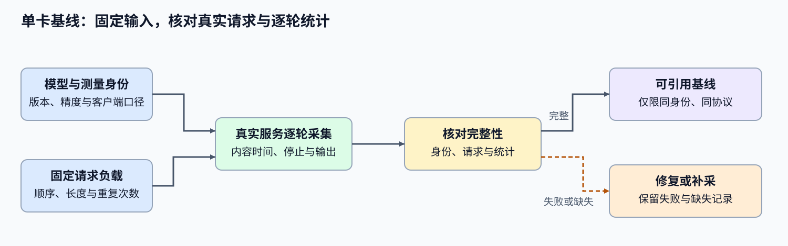
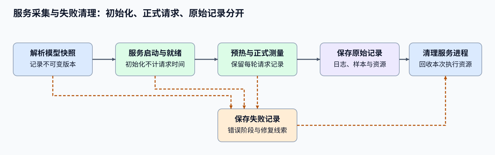

# 66. Inference Performance Comparison | 推理性能对比实验

**难度：** Hard | **环境：** CPU-first | **标签：** `推理优化`, `基准对比`, `性能对比` | **目标人群：** 项目决策练习者

> 🚀 **云端运行环境**
>
> 本章节的实战代码可以点击以下链接在免费 GPU 算力平台上直接运行：
>
> [](https://colab.research.google.com/github/datawhalechina/llm-algo-leetcode/blob/main/02_PyTorch_Algorithms/66_Inference_Performance_Comparison.ipynb)
> [](https://modelscope.cn/my/mynotebook) *(国内推荐：魔搭社区免费实例)*


---

## 本节导读

本节带你完成一次可复核的推理性能对比：围绕同一组请求和运行条件，比较 baseline 与候选方案在延迟、吞吐、显存和失败状态上的差异。
学习过程中，你会先建立可比较的实验条件，再理解 TTFT、TPOT、端到端延迟和吞吐分别反映什么，最后把这些证据转化为面向场景的选择：低延迟、高吞吐，或显存受限。完成后的基线记录交给 72 汇总部署候选；本节不负责组合缓存、调度或量化策略。


**关键词：** `benchmark`, `TTFT`, `TPOT`, `throughput`, `KV cache`

---
## 前置阅读

**导语：** 开始前先了解一次请求如何经历解码、KV Cache 如何增长，以及推理后端如何组织服务。阅读这些材料时，关注它们对输入处理、逐 token 生成和缓存占用的影响；这些概念随后会转化为本节可以测量的 workload 和指标。
- [21. Decoding Strategies | 解码策略](./21_Decoding_Strategies.md)
- [22. vLLM PagedAttention | vLLM 分页注意力](./22_vLLM_PagedAttention.md)
- [20. FlashAttention Sim | FlashAttention 模拟](./20_FlashAttention_Sim.md)
- [P1: 11. KV Cache and Memory Growth | KV Cache 与显存增长](../01_Hardware_Math_and_Systems/11_KV_Cache_and_Memory_Growth.md)

---
### Step 1：固定模型、请求集与执行条件

推理基线由模型快照、分词器、请求集、执行后端和测量过程共同定义。baseline 与 candidate 必须使用同一请求顺序、输入与输出长度约束、预热次数和重复次数，并明确唯一变化字段。若同时改变后端、数据类型和并发，结果只能作为新配置记录，不能归因于某一项策略。

| 项目阶段 | 输入 | 操作 | 输出 |
| --- | --- | --- | --- |
| 基准契约 | 模型与分词器版本、请求集、后端、数据类型、并发、预热和重复次数 | 核对不可变身份与唯一变化字段 | 可配对运行清单 |
| 请求测量 | 到达、首词元、完成时间、输出词元数与失败 | 从请求事件计算指标分布 | 请求级原始记录与汇总 |
| 配对比较 | baseline/candidate、质量与资源预算 | 检查失败、缺失、SLO 和收益 | `accept / tune / reject` |
| 项目交付 | 配置、原始样本、汇总、硬件与决策 | 保存不可变结果 | 后续 68/69/70/72 可复用的基线 |



### Step 2：从请求事件计算延迟分布与吞吐

每条成功请求至少记录到达时间、首词元时间、完成时间和输出词元数。TTFT 是首词元时间减到达时间；E2E 是完成时间减到达时间；输出多于一个词元时，TPOT 用首词元之后的时间除以后续词元数。吞吐使用整个测量窗口内成功输出的词元总数，失败请求不能从失败率中删除后又计入吞吐。延迟应保留样本并汇总中位数与 P95，不能只保存一次平均值。

| 指标 | 请求级定义 | 汇总方式 |
| --- | --- | --- |
| TTFT | `first_token_ms - arrival_ms` | 成功请求的 P50 / P95 |
| TPOT | `(completed_ms - first_token_ms) / (output_tokens - 1)` | 输出词元数大于 1 的请求 P50 / P95 |
| E2E | `completed_ms - arrival_ms` | 成功请求的 P50 / P95 |
| 输出吞吐 | 成功输出词元总数 / 整体测量窗口 | token/s |
| 成功率 | 成功请求数 / 总请求数 | 比例与失败原因分布 |

### Step 3：按失败、SLO 与收益形成项目状态

比较前先核对基准契约与唯一变化字段。模型、请求集或测量过程不一致时结果不可比；运行失败、OOM 或质量门槛失守时 `reject`；原始样本、峰值显存或质量证据缺失时 `tune`。证据完整后，再根据服务目标检查 TTFT、TPOT、E2E、吞吐和显存：交互服务优先满足 TTFT/P95，批处理服务可以用更高等待换取吞吐，但必须显式记录采用的目标。

| 状态 | 触发条件 | 下一动作 |
| --- | --- | --- |
| `reject` | 基准不可比、运行失败、质量或硬性资源门槛失守 | 修复配置或放弃候选 |
| `tune` | 样本、质量、显存或执行证据不完整；有收益但未满足目标 SLO | 补证据或调整单一变量 |
| `accept` | 配对证据完整，质量不退化，并满足目标 SLO 与资源预算 | 登记为专项项目的共享 baseline |

### Step 4：实现基准契约、请求汇总与采用门禁

题目提供简化的运行清单与请求事件。学习者需要核对基准身份和唯一变化字段，从原始事件计算延迟分布、吞吐与成功率，建立配对比较，最后按失败、缺失、SLO 和收益顺序形成项目状态。调度波次与瓶颈分类分别由 70 和性能分析专题承担，不在本页重复挖空。

| 任务与目的 | 已知条件 | 完成标准 | 测试验证 |
| --- | --- | --- | --- |
| TODO 1：核对基准契约 | baseline/candidate 运行清单 | 固定字段一致，且只有声明字段变化 | 合法单变量、身份错配和多变量变化 |
| TODO 2：汇总请求事件 | 请求时间戳、输出词元数与失败状态 | 返回 TTFT/TPOT/E2E 的 P50/P95、吞吐与成功率 | 单词元、失败请求与分位数 |
| TODO 3：建立配对证据 | 两个汇总结果、质量和峰值显存 | 分开保留硬失败与缺失证据 | 完整结果、缺失显存和运行失败 |
| TODO 4：形成采用状态 | 服务目标与 SLO/资源门槛 | 按失败、缺失、质量和性能顺序决策 | `accept`、`tune`、`reject` |

```python
import math
import time
```


```python
# 题目区挖空基准契约、请求汇总、配对证据和采用门禁。

def validate_benchmark_contract(baseline, candidate):
    """Check fixed benchmark fields and the declared single change."""
    # TODO 1：模型、版本、请求集和测量过程必须一致；真实差分只能等于 declared_change。
    # mismatches = ???
    # changed_fields = ???
    raise NotImplementedError('TODO 1：请核对推理基准契约')


def summarize_request_events(events):
    """Summarize request timestamps without hiding failed requests."""
    # TODO 2：从成功请求计算 TTFT/TPOT/E2E 的 P50/P95 和整体吞吐，同时保留成功率。
    # successful = ???
    # measurement_window_ms = ???
    # percentile = ???
    raise NotImplementedError('TODO 2：请汇总请求事件')


def build_paired_inference_evidence(contract, baseline, candidate):
    """Keep contract failures, runtime failures and missing evidence separate."""
    # TODO 3：合并配对结果；运行失败进入 gate_failures，质量/显存/样本缺失进入 missing_evidence。
    # gate_failures = ???
    # missing_evidence = ???
    raise NotImplementedError('TODO 3：请建立配对推理证据')


def decide_inference_candidate(evidence, limits, service_goal='interactive'):
    """Apply failure, completeness, quality, SLO and resource gates in order."""
    # TODO 4：interactive 检查 TTFT P95；batch 检查吞吐收益；两者都检查质量、TPOT、显存和成功率。
    # decision = ???
    # reason = ???
    raise NotImplementedError('TODO 4：请形成推理候选状态')
```


```python
# 测试分别验证基准契约、请求指标、配对证据和采用门禁。

def _baseline_metrics():
    """构造固定请求事件的基线指标。"""
    events = [
        {'arrival_ms': 0.0, 'first_token_ms': 20.0, 'completed_ms': 80.0, 'output_tokens': 4, 'failure': None},
        {'arrival_ms': 5.0, 'first_token_ms': 30.0, 'completed_ms': 95.0, 'output_tokens': 4, 'failure': None},
    ]
    return {**summarize_request_events(events), 'quality_passed': True, 'peak_memory_mb': 4200.0}


def _candidate_metrics():
    """构造固定请求事件的候选指标。"""
    events = [
        {'arrival_ms': 0.0, 'first_token_ms': 18.0, 'completed_ms': 68.0, 'output_tokens': 4, 'failure': None},
        {'arrival_ms': 5.0, 'first_token_ms': 27.0, 'completed_ms': 78.0, 'output_tokens': 4, 'failure': None},
    ]
    return {**summarize_request_events(events), 'quality_passed': True, 'peak_memory_mb': 3900.0}


def test_benchmark_contract():
    """验证单变量基准契约及多变量反例。"""
    baseline = {'model_id': 'm', 'revision': 'r', 'tokenizer_revision': 't', 'request_set_id': 'w', 'warmup': 2, 'repeats': 5, 'backend': 'a', 'dtype': 'bf16', 'concurrency': 1, 'batch_size': 1, 'cache_policy': 'default'}
    candidate = {**baseline, 'backend': 'b', 'declared_change': 'backend'}
    assert validate_benchmark_contract(baseline, candidate)['ready']
    assert not validate_benchmark_contract(baseline, {**candidate, 'dtype': 'fp16'})['ready']


def test_request_event_summary():
    """验证请求分位数与单词元 TPOT 边界。"""
    result = _baseline_metrics()
    assert result['ttft_ms'] == {'p50': 20.0, 'p95': 25.0}
    assert result['tpot_ms']['p50'] == 20.0
    one_token = summarize_request_events([{'arrival_ms': 0.0, 'first_token_ms': 5.0, 'completed_ms': 5.0, 'output_tokens': 1, 'failure': None}])
    assert one_token['tpot_ms']['p50'] is None


def test_paired_evidence():
    """验证完整证据与缺失显存分支。"""
    contract = {'ready': True, 'issues': []}
    evidence = build_paired_inference_evidence(contract, _baseline_metrics(), _candidate_metrics())
    assert evidence['gate_failures'] == [] and evidence['missing_evidence'] == []
    missing = build_paired_inference_evidence(contract, _baseline_metrics(), {**_candidate_metrics(), 'peak_memory_mb': None})
    assert 'candidate.peak_memory_mb' in missing['missing_evidence']


def test_candidate_decision():
    """验证采用、调优与拒绝状态。"""
    evidence = build_paired_inference_evidence({'ready': True, 'issues': []}, _baseline_metrics(), _candidate_metrics())
    limits = {'min_success_rate': 1.0, 'max_peak_memory_mb': 5000.0, 'max_tpot_p95_ms': 25.0, 'max_ttft_p95_ms': 30.0, 'min_throughput_gain': 0.05}
    assert decide_inference_candidate(evidence, limits, 'interactive')['decision'] == 'accept'
    assert decide_inference_candidate(evidence, limits, 'batch')['decision'] == 'accept'
    failed = {**evidence, 'gate_failures': ['oom']}
    assert decide_inference_candidate(failed, limits)['decision'] == 'reject'


def run_inference_tests():
    """Run benchmark-contract tests in a fixed order."""
    for test in (test_benchmark_contract, test_request_event_summary, test_paired_evidence, test_candidate_decision):
        test()
    print('✅ 推理基线项目：契约、请求指标、配对证据与采用门禁均已验证。')


run_inference_tests()
```

---

🛑 **STOP HERE** 🛑
<br><br><br><br><br><br><br><br><br><br>
> 请先尝试自己完成代码并跑通测试。<br>
> 如果你正在 Colab 中运行，并且遇到困难没有思路，可以向下滚动查看参考答案。
<br><br><br><br><br><br><br><br><br><br>

---
## 参考代码与解析

### 代码

```python
import math

def validate_benchmark_contract(baseline, candidate):
    """TODO 1：核对固定字段与唯一声明变化。"""
    fixed = ('model_id', 'revision', 'tokenizer_revision', 'request_set_id', 'warmup', 'repeats')
    mismatches = [field for field in fixed if baseline.get(field) != candidate.get(field)]
    variable_fields = ('backend', 'dtype', 'concurrency', 'batch_size', 'cache_policy')
    changed = [field for field in variable_fields if baseline.get(field) != candidate.get(field)]
    declared = candidate.get('declared_change')
    issues = [f'fixed.{field}' for field in mismatches]
    if changed != [declared]:
        issues.append(f'changed_fields:{changed}')
    return {'ready': not issues, 'issues': issues, 'changed_fields': changed}

def summarize_request_events(events):
    """TODO 2：从原始请求事件计算分位数、吞吐和成功率。"""
    if not events:
        raise ValueError('events 不能为空')
    successful = [event for event in events if not event.get('failure')]
    def percentile(values, q):
        if not values:
            return None
        ordered = sorted(float(value) for value in values)
        index = max(0, math.ceil(q * len(ordered)) - 1)
        return ordered[index]
    ttft = [event['first_token_ms'] - event['arrival_ms'] for event in successful]
    e2e = [event['completed_ms'] - event['arrival_ms'] for event in successful]
    tpot = [(event['completed_ms'] - event['first_token_ms']) / (event['output_tokens'] - 1) for event in successful if event['output_tokens'] > 1]
    window_ms = max(event['completed_ms'] for event in successful) - min(event['arrival_ms'] for event in events) if successful else 0.0
    output_tokens = sum(event['output_tokens'] for event in successful)
    return {
        'request_count': len(events), 'successful_count': len(successful),
        'success_rate': len(successful) / len(events), 'raw_events_present': True,
        'ttft_ms': {'p50': percentile(ttft, 0.50), 'p95': percentile(ttft, 0.95)},
        'tpot_ms': {'p50': percentile(tpot, 0.50), 'p95': percentile(tpot, 0.95)},
        'e2e_ms': {'p50': percentile(e2e, 0.50), 'p95': percentile(e2e, 0.95)},
        'output_throughput_tps': output_tokens / (window_ms / 1000.0) if window_ms > 0 else 0.0,
        'failures': [event.get('failure') for event in events if event.get('failure')],
    }

def build_paired_inference_evidence(contract, baseline, candidate):
    """TODO 3：分开保留硬失败和缺失证据。"""
    failures = list(contract.get('issues', [])) + list(baseline.get('failures', [])) + list(candidate.get('failures', []))
    required = ('raw_events_present', 'quality_passed', 'peak_memory_mb')
    missing = [f'{role}.{field}' for role, record in (('baseline', baseline), ('candidate', candidate)) for field in required if record.get(field) is None]
    return {'contract': contract, 'baseline': baseline, 'candidate': candidate, 'gate_failures': failures, 'missing_evidence': missing}

def decide_inference_candidate(evidence, limits, service_goal='interactive'):
    """TODO 4：按失败、缺失、质量、SLO 和资源顺序决策。"""
    if evidence['gate_failures']:
        return {'decision': 'reject', 'reason': '基准契约或运行失败'}
    if evidence['missing_evidence']:
        return {'decision': 'tune', 'reason': '原始样本、质量或显存证据不完整'}
    candidate = evidence['candidate']
    baseline = evidence['baseline']
    if not candidate['quality_passed'] or candidate['success_rate'] < limits['min_success_rate'] or candidate['peak_memory_mb'] > limits['max_peak_memory_mb']:
        return {'decision': 'reject', 'reason': '质量、成功率或显存硬门槛失守'}
    if candidate['tpot_ms']['p95'] > limits['max_tpot_p95_ms']:
        return {'decision': 'reject', 'reason': 'TPOT P95 超过服务目标'}
    if service_goal == 'interactive':
        passed = candidate['ttft_ms']['p95'] <= limits['max_ttft_p95_ms']
    elif service_goal == 'batch':
        gain = candidate['output_throughput_tps'] / baseline['output_throughput_tps'] - 1.0
        passed = gain >= limits['min_throughput_gain']
    else:
        raise ValueError('service_goal 必须是 interactive 或 batch')
    return {'decision': 'accept' if passed else 'tune', 'reason': '目标 SLO 已满足' if passed else '候选可运行但尚未满足目标 SLO'}
```

### 解析

#### TODO 1：核对基准契约

固定模型、版本、分词器、请求集和测量过程，只允许声明字段发生变化；多变量变化不能进入因果比较。

#### TODO 2：汇总请求事件

指标从请求事件推导。单词元请求没有可定义的 TPOT 样本；失败请求保留在成功率和失败列表中，不进入成功延迟分布。

#### TODO 3：建立配对证据

配对证据把契约或运行失败与证据缺失分开。前者阻止采用，后者要求补测，不能把缺失值当成通过。

#### TODO 4：形成采用状态

交互服务检查 TTFT P95，批处理服务检查吞吐收益；二者都必须通过质量、成功率、TPOT 和显存门槛。
### Step 5（可选）：建立共享单卡推理基线

本页只采集无专项策略的 vLLM G0。量化、投机解码、前缀缓存和调度分别在后续项目中以这份基线为参照；跨后端比较由 72 消费同一基线。
| CPU 已验证 | 单卡 GPU 补充 | 本页输出 |
|:---|:---|:---|
| 比较契约、请求指标与证据门禁 | 固定模型和请求集上的 vLLM 延迟、吞吐、输出与显存记录 | 可供 67–70 与 72 引用的浮点 G0 |
#### 5.1 环境、固定工作负载与结果路径

使用 `INF-VLLM-011-CU128` Profile，硬件下限为单张 12 GB NVIDIA GPU。首次运行先按[推理优化 Quickstart](../topic_discussion/inference_optimization/quickstart.md#inf-vllm-quickstart)创建环境。所有可编辑配置集中在下一单元；后续单元只派生契约、执行和读取结果。

```python
# 5.1：唯一可编辑配置。正式复测使用新的 RUN_LABEL，保留历史 JSON。
RUN_REAL_BACKEND = False  # 改为 True 后 5.4 才启动 vLLM。
WRITE_BASELINE_POINTER = False  # 仅当 5.6 判定 ready 时，可改为 True 写共享入口。
RUN_LABEL = 'rtx5070ti_vllm_g0_v4'  # v3 起自动记录设备总占用峰值。
SEMANTIC_ID = 'INF-FLOAT-BASELINE'
SCHEMA_VERSION = 'inference-benchmark/v1'
PROFILE_ID = 'INF-VLLM-011-CU128'
MODEL_ID = 'Qwen/Qwen2.5-0.5B-Instruct'
MODEL_SOURCE = 'auto'
MODEL_CACHE_DIR = 'model_cache'
DTYPE = 'bfloat16'
MAX_MODEL_LEN = 2048
GPU_MEMORY_UTILIZATION = 0.80
ENFORCE_EAGER = True
WORKLOAD_PATH = 'benchmarks/workloads/fixed.jsonl'
NUM_PROMPTS = 30
MAX_TOKENS = 64
BATCH_SIZE = 1
CONCURRENCY = 1
WARMUP = 5
REPEATS = 3
MEASURE_DEVICE_PEAK_MEMORY = True  # benchmark 期间自动采集 GPU 0 总占用峰值。
PEAK_MEMORY_MB = None  # 可选人工覆盖；保持 None 时使用自动采集值。
RAW_RESULT_PATH = f'benchmarks/results/66_g0_vllm_raw_{RUN_LABEL}.json'
RESULT_PATH = f'benchmarks/results/66_g0_vllm_{RUN_LABEL}.json'
BASELINE_POINTER_PATH = 'benchmarks/results/66_g0_vllm_baseline.json'
```

#### 5.2 环境与输入预检

只检查当前 Kernel、GPU、vLLM 命令和 workload，不下载模型、不启动服务。

```python
# 5.2：只读预检；真实运行前必须同时满足 GPU、vLLM 与 workload 条件。
import json
import shutil
import sys
from pathlib import Path
import torch
from tools.inference_project_runtime import locate_repo_root

REPO_ROOT = locate_repo_root()
WORKLOAD_FILE = REPO_ROOT / WORKLOAD_PATH
preflight = {
    'profile_id': PROFILE_ID, 'python': sys.executable,
    'torch': torch.__version__, 'torch_cuda': torch.version.cuda,
    'cuda_available': torch.cuda.is_available(),
    'gpu': torch.cuda.get_device_name(0) if torch.cuda.is_available() else None,
    'gpu_memory_gb': (round(torch.cuda.get_device_properties(0).total_memory / 1024**3, 2)
                      if torch.cuda.is_available() else None),
    'vllm_command': shutil.which('vllm'), 'workload_exists': WORKLOAD_FILE.is_file(),
}
if RUN_REAL_BACKEND and (not preflight['cuda_available'] or not preflight['vllm_command'] or not preflight['workload_exists']):
    raise RuntimeError(f'真实基线预检失败：{preflight}')
print(json.dumps(preflight, ensure_ascii=False, indent=2))
```

#### 5.3 G0 身份与可复用契约

本单元确认本页没有启用专项策略，并从 5.1 派生统一身份和结果路径。

```python
# 5.3：G0 不改变缓存、调度、量化或投机策略。
if any(value <= 0 for value in (NUM_PROMPTS, MAX_TOKENS, CONCURRENCY, REPEATS)) or WARMUP < 0:
    raise ValueError('请求数、生成长度、并发和重复次数必须为正，预热不能为负')
BASELINE_CONTRACT = {
    'schema_version': 'inference-baseline/v2', 'project': '66', 'group': 'G0',
    'role': 'baseline', 'profile_id': PROFILE_ID, 'backend': 'vllm',
    'model_id': MODEL_ID, 'dtype': DTYPE, 'workload_path': WORKLOAD_PATH,
    'num_prompts': NUM_PROMPTS, 'max_tokens': MAX_TOKENS,
    'batch': BATCH_SIZE, 'concurrency': CONCURRENCY,
    'warmup': WARMUP, 'repeats': REPEATS, 'strategies': [],
    'result_path': RESULT_PATH,
}
print(json.dumps(BASELINE_CONTRACT, ensure_ascii=False, indent=2))
```

#### 5.4 执行真实服务并保存原始证据

顺序完成模型解析、vLLM 启动、固定请求测量和进程清理。逐请求结果用于检查输出完整性；启动、请求或落盘失败也写入同一路径。



```python
# 5.4：执行一次无专项策略的 vLLM G0，并保存成功或失败证据。
from tools.inference_project_runtime import start_optional_vllm, stop_optional_vllm, run_backend_benchmark
from tools.project_runtime import save_json_record_once

raw_output_path = REPO_ROOT / RAW_RESULT_PATH
output_path = REPO_ROOT / RESULT_PATH
output_path.parent.mkdir(parents=True, exist_ok=True)
if RUN_REAL_BACKEND:
    collisions = [path for path in (raw_output_path, output_path) if path.exists()]
    if collisions:
        raise FileExistsError(f'当前 RUN_LABEL 已有结果，请更换标签：{collisions}')
    server = log_handle = None
    try:
        server, log_handle, port, selected_dtype, model_path = start_optional_vllm(
            model_id=MODEL_ID, model_source=MODEL_SOURCE, cache_dir=MODEL_CACHE_DIR,
            dtype=DTYPE, max_model_len=MAX_MODEL_LEN,
            gpu_memory_utilization=GPU_MEMORY_UTILIZATION,
            enforce_eager=ENFORCE_EAGER, served_model_name=MODEL_ID,
            scheduling_policy='fcfs',
            log_path=REPO_ROOT / f'benchmarks/results/66_backend_{RUN_LABEL}.log',
        )
        report = run_backend_benchmark(
            project='66', base_url=f'http://127.0.0.1:{port}', model=MODEL_ID,
            label='g0_vllm_baseline', output=raw_output_path, workload=WORKLOAD_PATH,
            num_prompts=NUM_PROMPTS, max_tokens=MAX_TOKENS,
            concurrency=CONCURRENCY, warmup=WARMUP, repeats=REPEATS,
            backend='vllm', dtype=selected_dtype, batch=BATCH_SIZE,
            role='baseline', peak_memory_mb=PEAK_MEMORY_MB,
            measure_device_peak_memory=MEASURE_DEVICE_PEAK_MEMORY, include_requests=True,
        )
        metrics = report.get('metrics', {})
        requests = report.get('results') or []
        report.update({'schema_version': SCHEMA_VERSION, 'semantic_id': SEMANTIC_ID, 'run_label': RUN_LABEL, 'run_mode': 'real_backend', 'raw_result_path': str(raw_output_path)})
        report['baseline_contract'] = BASELINE_CONTRACT
        report['model_identity'] = {
            'requested_id': MODEL_ID, 'resolved_snapshot': Path(model_path).name,
            'selected_dtype': selected_dtype,
        }
        report['quality'] = {
            'status': ('passed' if metrics.get('successful_requests') == NUM_PROMPTS
                       and metrics.get('failed_requests') == 0
                       and all(item.get('output_text', '').strip() for item in requests if item.get('ok'))
                       else 'failed'),
            'check': 'all_requests_succeeded_and_output_nonempty',
        }
        save_json_record_once(output_path, report)
    except Exception as exc:
        failure = {
            'schema_version': SCHEMA_VERSION, 'semantic_id': SEMANTIC_ID, 'run_label': RUN_LABEL,
            'run_mode': 'real_backend', 'baseline_contract': BASELINE_CONTRACT,
            'status': 'failed', 'failure': {'type': type(exc).__name__, 'message': str(exc)},
        }
        if not output_path.exists():
            save_json_record_once(output_path, failure)
        raise
    finally:
        if server is not None:
            stop_optional_vllm(server, log_handle)
else:
    print('实验未启动：确认 5.1 后将 RUN_REAL_BACKEND 改为 True。')
```

#### 5.5 读取原始基线

只读 5.4 保存的 G0 JSON，核对模型身份、请求指标、输出检查、峰值显存和失败状态。缺失字段保持缺失。

```python
# 5.5：只读 G0；不启动服务、不修改结果。
result_path = REPO_ROOT / RESULT_PATH
if not result_path.is_file():
    baseline_evidence = {'status': 'missing', 'path': str(result_path)}
else:
    baseline_report = json.loads(result_path.read_text(encoding='utf-8'))
    baseline_evidence = {
        'status': 'failed' if baseline_report.get('failure') else 'ok',
        'path': str(result_path), 'report': baseline_report,
        'contract': baseline_report.get('baseline_contract', {}),
        'model_identity': baseline_report.get('model_identity', {}),
        'metrics': baseline_report.get('metrics', {}),
        'quality': baseline_report.get('quality', {}),
        'failure': baseline_report.get('failure'),
    }
print(json.dumps({key: value for key, value in baseline_evidence.items() if key != 'report'}, ensure_ascii=False, indent=2))
```

#### 5.6 判断共享基线是否可引用

本页不评价优化候选。只有运行成功、模型快照可追溯、请求指标完整、输出检查通过并登记峰值显存时，G0 才标为 `ready`；可选的共享指针只在 `ready` 后写入。

**当前登记结果**

| 字段 | 登记内容 |
| --- | --- |
| 项目与标签 | 66 节共享浮点 G0；`rtx5070ti_vllm_g0_v4` |
| 运行条件 | RTX 5070 Ti Laptop GPU；Qwen2.5-1.5B-Instruct；vLLM；30 个固定请求 |
| 原始证据 | [backend 日志](../../benchmarks/results/66_backend_rtx5070ti_vllm_g0_v4.log) |
| 正式证据 | [G0 结果](../../benchmarks/results/66_g0_vllm_rtx5070ti_vllm_g0_v4.json) |
| 清单与交接 | 无；本节结果由后续项目按模型、workload 与 backend 身份引用 |
| 结论 | 30/30 请求成功，状态为 `ready`；只作为同条件共享基线 |

```python
# 5.6：形成基线状态；仅在显式允许且 ready 时写共享入口。
def decide_baseline_readiness(evidence):
    """按失败、身份、请求指标、输出与资源证据判断 G0 是否可引用。"""
    if evidence.get('status') == 'missing':
        return {'status': 'tune', 'reason': '尚无 G0 JSON', 'next_action': '执行 5.4'}
    if evidence.get('status') != 'ok':
        return {'status': 'reject', 'reason': 'G0 运行失败', 'next_action': '修复 failure 后使用新标签复测'}
    if not (evidence.get('model_identity') or {}).get('resolved_snapshot'):
        return {'status': 'tune', 'reason': '缺少 resolved snapshot', 'next_action': '重新采集模型身份'}
    metrics = evidence.get('metrics') or {}
    required = ((metrics.get('ttft_ms') or {}).get('p95'),
                (metrics.get('tpot_ms') or {}).get('p95'),
                (metrics.get('e2e_ms') or {}).get('p95'),
                metrics.get('output_token_throughput_per_s'))
    if any(value is None for value in required):
        return {'status': 'tune', 'reason': '请求性能字段不完整', 'next_action': '补齐请求指标'}
    if (evidence.get('quality') or {}).get('status') != 'passed':
        return {'status': 'reject', 'reason': '请求完成率或输出检查失败', 'next_action': '检查逐请求结果'}
    if metrics.get('peak_memory_mb') is None:
        return {'status': 'tune', 'reason': '缺少服务峰值显存', 'next_action': '采集服务进程峰值显存后复测'}
    return {'status': 'ready', 'reason': '身份、请求指标、输出与显存证据完整',
            'next_action': '供 67–70 与 72 引用'}

baseline_readiness = decide_baseline_readiness(baseline_evidence)
if WRITE_BASELINE_POINTER and baseline_readiness['status'] == 'ready':
    pointer_path = REPO_ROOT / BASELINE_POINTER_PATH
    pointer_payload = dict(baseline_evidence['report'])
    pointer_payload['baseline_pointer'] = {
        'schema_version': 'inference-baseline-pointer/v1',
        'source_result': str(REPO_ROOT / RESULT_PATH), 'status': 'ready',
    }
    pointer_path.write_text(json.dumps(pointer_payload, ensure_ascii=False, indent=2) + '\n', encoding='utf-8')
print(json.dumps(baseline_readiness, ensure_ascii=False, indent=2))
```

## 相关阅读

完成本节后，可以沿着“机制 → 引擎 → 评测规范”继续阅读：先看推理引擎如何实现请求服务，再回到论文和官方文档核对 benchmark 中的指标含义。
- [68. Speculative Decoding Benchmark | 投机解码基准](./68_Speculative_Decoding_Benchmark.md)
- [67. Quantized Inference and Deployment | 量化推理与部署](./67_Quantized_Inference_and_Deployment.md)
- [vLLM Documentation | vLLM 官方文档](https://docs.vllm.ai/en/latest/)
- [SGLang Documentation | SGLang 官方文档](https://docs.sglang.ai/)
- [Efficient Memory Management for Large Language Model Serving with PagedAttention | PagedAttention 论文](https://arxiv.org/abs/2309.06180)
- [Efficiently Scaling Transformer Inference](https://arxiv.org/abs/2211.05102)
