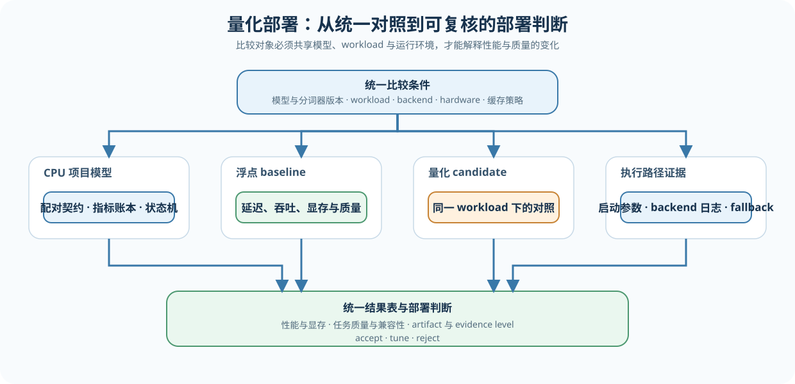
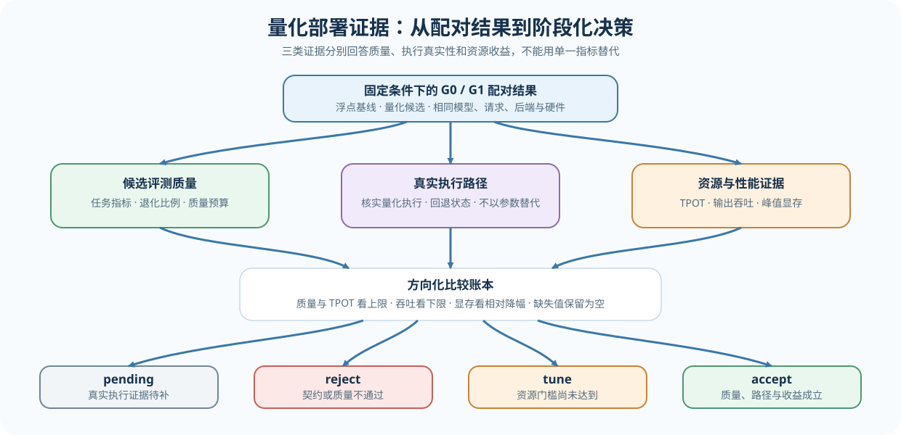

# 67. Quantized Inference and Deployment | 量化推理与部署

**难度：** Hard | **环境：** [CPU 主线，GPU 可选](#runtime-environment) | **标签：** `量化压缩`、`部署` | **目标人群：** 掌握推理指标与量化基础的读者

> 🚀 **云端运行环境**
>
> 本章节的实战代码可以点击以下链接在免费 GPU 算力平台上直接运行：
>
> [](https://colab.research.google.com/github/datawhalechina/llm-algo-leetcode/blob/main/02_PyTorch_Algorithms/67_Quantized_Inference_and_Deployment.ipynb)
> [](https://modelscope.cn/my/mynotebook) *(国内推荐：魔搭社区免费实例)*


---

## 本节导读

一个量化产物通过文件、质量和加载门禁后，还不能直接进入服务配置。它需要与同一模型的浮点基线使用相同请求、后端和硬件完成配对运行，才能判断低精度路径是否在目标工作负载下成立。

本节先用 CPU 记录练习配对契约、指标方向和部署状态，再使用 vLLM 依次运行浮点基线与量化候选。最终把配对结果和量化执行证据交给部署门禁；通过后，83再检验不同请求压力下能否达到服务目标。

**关键词：** `量化产物`, `配对基准`, `执行路径`, `部署决策`

---

## 运行环境

- **CPU 练习：** [BASE-CPU](../topic_discussion/inference_optimization/quickstart.md)，验证配对身份、指标方向与部署判断。
- **真实实验：** [INF-VLLM-011-CU128](../topic_discussion/inference_optimization/quickstart.md)，需要 NVIDIA GPU 和已准备好的量化产物；创建与检查命令见 Quickstart。
- **结果入口：** Step 5 按 `prepare → measure → close` 运行；prepare／close只检查磁盘证据，不启动后端。

## 前置阅读

- [82. 量化产物评估项目](./82_Quantization_Artifact_Evaluation_Project.md)：提供本节唯一必需的合格产物引用。
- [66. 推理性能对比实验](./66_Inference_Performance_Comparison.md)：需要复用既有浮点结果时选读；本节也可以自行运行匹配的浮点基线。

## Step 1：从合格产物进入配对部署

部署比较从已经通过产物门禁的候选开始。浮点基线与量化候选依次运行，避免单卡同时驻留两个模型；两组固定模型版本、分词器、请求负载、后端和硬件，只改变加载的权重产物与量化启动路径。

| 阶段 | 输入 | 关键动作 | 阶段证据 |
|:---|:---|:---|:---|
| 产物准入 | 82 的稳定引用 | 读取产物身份、质量与加载结论 | 合格候选及其血缘 |
| 浮点基线 G0 | 原始模型版本 | 运行固定请求负载 | 浮点延迟、吞吐与失败记录 |
| 量化候选 G1 | 同一模型的量化产物 | 使用目标量化路径运行相同请求 | 量化延迟、吞吐与执行路径 |
| 部署判断 | G0/G1 配对结果 | 检查质量、兼容性与资源变化 | 部署 companion 与稳定引用 |



## Step 2：固定配对实验的可比条件

配对实验只有在模型语义、请求压力和运行环境一致时才能解释收益。浮点基线与量化候选固定模型和分词器版本、请求负载、执行后端、硬件与缓存策略，只改变权重产物和对应的低精度执行路径。

| 可比条件 | G0 浮点基线 | G1 量化候选 | 判断方式 |
|:---|:---|:---|:---|
| 模型身份 | 基座模型与不可变版本 | 来自同一基座模型 | 模型版本与分词器版本一致 |
| 文本处理 | 固定分词器版本 | 与 G0 相同 | 编码规则与特殊 Token 一致 |
| 请求负载 | 固定提示、请求数、并发与生成上限 | 与 G0 相同 | 使用同一份已版本化的请求集 |
| 运行环境 | 固定后端、GPU 与缓存策略 | 与 G0 相同 | 环境快照一致 |
| 执行对象 | 浮点模型 | 82 已准入的量化产物 | 仅产物和量化启动路径改变 |

## Step 3：把执行证据转换为部署判断

加载成功只说明产物能够进入后端。部署判断还需要候选评测质量证据、实际低精度执行路径，以及当前工作负载下的延迟、吞吐或容量变化。指标方向不同，不能用同一个“大于”或“小于”规则处理。

| 证据 | 比较方向 | 不能通过时的含义 |
|:---|:---|:---|
| 候选评测质量 | 候选退化比例不得超过上限 | `reject`：返回量化机制或重新生成产物 |
| TPOT | 候选/基线比值不得超过上限 | `tune`：当前生成阶段没有达到目标 |
| 输出吞吐 | 候选/基线比值不得低于下限 | `tune`：当前批量或后端配置不合适 |
| 峰值显存 | 候选相对基线的降幅越大越好 | 作为容量收益；缺失时不得伪造为零 |
| 执行路径 | 量化加载参数、后端日志和 fallback 必须可追溯 | `pending` 或 `tune`：不能仅凭格式名声明低精度执行 |



## Step 4：实现配对契约、指标账本与部署状态机

题目区使用简化记录复现真实项目中的三个判断动作。配对契约决定两组结果能否比较，指标账本统一不同方向的量纲，部署状态机再区分证据待补、质量拒绝、配置调整和候选接受。

| 任务与目的 | 已知条件 | 完成标准 | 测试验证 |
|:---|:---|:---|:---|
| TODO 1（项目机制）：组合配对契约 | 已提取的门禁、产物血缘和固定字段漂移 | 血缘门禁成立且固定字段无漂移 | 硬件漂移与模型 revision 漂移 |
| TODO 2（项目机制）：汇总配对指标 | G0/G1 的 TPOT、吞吐、显存和质量 | 输出方向明确的比值与降幅，缺失显存保留为空 | 数值方向和缺失值 |
| TODO 3（项目机制）：形成部署状态 | 已提取的执行路径、质量和三类资源目标 | 正确组合证据、质量与至少一项资源收益 | 四类状态路径 |


```python
from typing import Any, Dict

from tools.quantization_project_runtime import _finite_number, _positive_int, _text

```


```python
FIXED_PAIR_FIELDS = (
    "model_revision", "tokenizer_revision", "workload_id",
    "backend", "hardware_id", "cache_policy",
)


def _positive_ratio(candidate_value: float, baseline_value: float) -> float:
    """计算正数指标的候选/基线比值。"""
    if not _finite_number(baseline_value, positive=True) or not _finite_number(candidate_value) or candidate_value < 0:
        raise ValueError("指标必须满足 baseline > 0 且 candidate >= 0")
    return candidate_value / baseline_value


def validate_deployment_pair(
    gate: Dict[str, Any], baseline: Dict[str, Any], candidate: Dict[str, Any]
) -> Dict[str, Any]:
    """检查产物门禁与 G0/G1 是否构成可比较的部署配对。"""
    # 给定实现：提取门禁、产物血缘和固定字段漂移等原子事实。
    gate_ready = gate.get("decision") == "accept"
    artifact_matches = _text(candidate.get("artifact_id")) and candidate.get("artifact_id") == gate.get("artifact_id")
    model_revision_matches = _text(candidate.get("model_revision")) and candidate.get("model_revision") == gate.get("model_revision")
    fixed_mismatches = [
        field for field in FIXED_PAIR_FIELDS if not _text(baseline.get(field)) or baseline.get(field) != candidate.get(field)
    ]
    # TODO 1（项目机制：配对契约）：组合血缘门禁与固定条件。
    # lineage_ready = ???  # 82 已接受，且产物 ID、模型 revision 与 G1 一致。
    # fixed_fields_ready = ???  # G0/G1 的固定字段不能发生漂移。
    if not all(name in locals() for name in ("lineage_ready", "fixed_fields_ready")):
        raise NotImplementedError("TODO 1：请完成血缘门禁与固定条件判断")
    issues = []
    if not gate_ready:
        issues.append("artifact_gate_not_accepted")
    if not artifact_matches:
        issues.append("artifact_id_mismatch")
    if not model_revision_matches:
        issues.append("model_revision_mismatch")
    issues.extend(f"fixed_field_mismatch:{field}" for field in fixed_mismatches)
    return {
        "ready": lineage_ready and fixed_fields_ready,
        "issues": issues,
        "fixed_mismatches": fixed_mismatches,
    }


def summarize_deployment_pair(
    baseline: Dict[str, Any], candidate: Dict[str, Any]
) -> Dict[str, Any]:
    """把延迟、吞吐、显存和质量转换成方向明确的配对指标。"""
    # TODO 2（项目机制：指标账本）：比值小于 1 的 TPOT 更好，比值大于 1 的吞吐更好。
    # tpot_ratio = ???  # candidate tpot / baseline tpot。
    # throughput_ratio = ???  # candidate throughput / baseline throughput。
    # memory_reduction_ratio = ???  # 显存缺失时保留 None。
    # quality_ratio = ???  # candidate quality / baseline quality。
    if not all(name in locals() for name in ("tpot_ratio", "throughput_ratio", "memory_reduction_ratio", "quality_ratio")):
        raise NotImplementedError("TODO 2：请完成四项配对指标")
    return {
        "tpot_ratio": round(tpot_ratio, 6),
        "throughput_ratio": round(throughput_ratio, 6),
        "memory_reduction_ratio": None if memory_reduction_ratio is None else round(memory_reduction_ratio, 6),
        "quality_ratio": round(quality_ratio, 6),
    }


def decide_quantized_deployment(
    contract: Dict[str, Any], comparison: Dict[str, Any], evidence: Dict[str, Any],
    *, max_tpot_ratio: float = 1.20, min_throughput_ratio: float = 0.90,
    min_memory_reduction_ratio: float = 0.20, max_quality_ratio: float = 1.10,
) -> Dict[str, str]:
    """根据配对结果和真实执行证据形成阶段化部署决策。"""
    if not all(_finite_number(v) and v >= 0 for v in (max_tpot_ratio, min_throughput_ratio, min_memory_reduction_ratio, max_quality_ratio)):
        raise ValueError('部署门槛必须是有限非负数')
    if any(not _finite_number(comparison.get(k)) or comparison[k] < 0 for k in ('tpot_ratio', 'throughput_ratio', 'quality_ratio')):
        return {'decision': 'pending', 'reason': '部署比较缺少有效数值'}
    memory_gain = comparison.get("memory_reduction_ratio")
    # 给定实现：从真实记录中提取执行路径与三类资源目标。
    backend_observed = evidence.get("real_backend") is True
    quantized_path_observed = evidence.get("quantized_path") is True
    no_fallback = evidence.get("fallback") is False
    latency_ready = comparison.get("tpot_ratio", float("inf")) <= max_tpot_ratio
    throughput_ready = comparison.get("throughput_ratio", 0.0) >= min_throughput_ratio
    memory_ready = memory_gain is not None and memory_gain >= min_memory_reduction_ratio
    # TODO 3（项目机制：部署状态机）：组合执行、质量和资源门槛。
    # evidence_ready = ???  # 后端、量化路径和无回退证据必须同时成立。
    # quality_ready = ???  # 质量比值不能超过当前预算。
    # resource_ready = ???  # 延迟、吞吐、显存三个目标至少达到一个。
    if not all(name in locals() for name in ("evidence_ready", "quality_ready", "resource_ready")):
        raise NotImplementedError("TODO 3：请完成三个部署状态判断")
    if not contract.get("ready"):
        return {"decision": "reject", "reason": "配对契约不一致"}
    if not evidence_ready:
        return {"decision": "pending", "reason": "真实量化执行证据尚未完整"}
    if not quality_ready:
        return {"decision": "reject", "reason": "候选评测质量退化超过预算"}
    if not resource_ready:
        return {"decision": "tune", "reason": "当前工作负载尚未达到资源或性能门槛"}
    return {"decision": "accept", "reason": "固定工作负载下质量、执行路径和资源门槛均成立"}

```

### 测试


```python
def _pair_records():
    """构造同模型、同负载和同环境的门禁、G0 与 G1 记录。"""
    gate = {
        "decision": "accept",
        "artifact_id": "qwen-awq-r1",
        "model_revision": "abc123",
    }
    fixed = {
        "model_revision": "abc123", "tokenizer_revision": "abc123",
        "workload_id": "fixed-chat-v1", "backend": "vllm-0.11",
        "hardware_id": "gpu-a", "cache_policy": "default",
    }
    baseline = {
        **fixed, "artifact_id": "qwen-float-r1", "tpot_ms": 20.0,
        "throughput_tps": 50.0, "peak_memory_mb": 8000.0, "quality": 10.0,
    }
    candidate = {
        **fixed, "artifact_id": "qwen-awq-r1", "tpot_ms": 18.0,
        "throughput_tps": 56.0, "peak_memory_mb": 5600.0, "quality": 10.4,
    }
    return gate, baseline, candidate


def test_deployment_pair_contract():
    """验证门禁、产物身份和固定字段漂移会被分别识别。"""
    gate, baseline, candidate = _pair_records()
    assert validate_deployment_pair(gate, baseline, candidate)["ready"]
    drifted = {**candidate, "hardware_id": "gpu-b"}
    result = validate_deployment_pair(gate, baseline, drifted)
    assert not result["ready"] and result["fixed_mismatches"] == ["hardware_id"]
    wrong_lineage = {**gate, "model_revision": "other-revision"}
    result = validate_deployment_pair(wrong_lineage, baseline, candidate)
    assert not result["ready"] and "model_revision_mismatch" in result["issues"]
    missing = {**baseline, 'workload_id': None}
    assert not validate_deployment_pair(gate, missing, {**candidate, 'workload_id': None})['ready']


def test_paired_metric_ledger():
    """验证延迟、吞吐、显存和质量使用正确方向，缺失显存保持为空。"""
    _, baseline, candidate = _pair_records()
    summary = summarize_deployment_pair(baseline, candidate)
    assert summary == {
        "tpot_ratio": 0.9, "throughput_ratio": 1.12,
        "memory_reduction_ratio": 0.3, "quality_ratio": 1.04,
    }
    assert summarize_deployment_pair(baseline, {**candidate, "peak_memory_mb": None})["memory_reduction_ratio"] is None
    for value in (float('nan'), float('inf'), True):
        try:
            _positive_ratio(value, 1.0)
        except ValueError:
            continue
        raise AssertionError('非法指标不应进入部署比值')


def test_deployment_state_machine():
    """验证缺证据、质量失败、待调优和接受四条项目路径。"""
    gate, baseline, candidate = _pair_records()
    contract = validate_deployment_pair(gate, baseline, candidate)
    comparison = summarize_deployment_pair(baseline, candidate)
    real_evidence = {"real_backend": True, "quantized_path": True, "fallback": False}
    assert decide_quantized_deployment(contract, comparison, real_evidence)["decision"] == "accept"
    assert decide_quantized_deployment(contract, comparison, {**real_evidence, "real_backend": False})["decision"] == "pending"
    assert decide_quantized_deployment(contract, {**comparison, "quality_ratio": 1.3}, real_evidence)["decision"] == "reject"
    weak = {**comparison, "tpot_ratio": 1.4, "throughput_ratio": 0.7, "memory_reduction_ratio": 0.05}
    assert decide_quantized_deployment(contract, weak, real_evidence)["decision"] == "tune"


def run_quantized_deployment_tests():
    """按项目执行顺序运行配对契约、指标账本与状态机测试。"""
    test_deployment_pair_contract()
    test_paired_metric_ledger()
    test_deployment_state_machine()
    print("✅ 配对契约、指标方向和部署状态机均已验证。")


run_quantized_deployment_tests()

```

---

## 参考代码与解析

### 代码


```python
FIXED_PAIR_FIELDS = (
    "model_revision", "tokenizer_revision", "workload_id",
    "backend", "hardware_id", "cache_policy",
)


def _positive_ratio(candidate_value: float, baseline_value: float) -> float:
    """计算正数指标的候选/基线比值。"""
    if not _finite_number(baseline_value, positive=True) or not _finite_number(candidate_value) or candidate_value < 0:
        raise ValueError("指标必须满足 baseline > 0 且 candidate >= 0")
    return candidate_value / baseline_value


def validate_deployment_pair(
    gate: Dict[str, Any], baseline: Dict[str, Any], candidate: Dict[str, Any]
) -> Dict[str, Any]:
    """检查产物门禁与 G0/G1 是否构成可比较的部署配对。"""
    # 给定实现：提取门禁、产物血缘和固定字段漂移等原子事实。
    gate_ready = gate.get("decision") == "accept"
    artifact_matches = _text(candidate.get("artifact_id")) and candidate.get("artifact_id") == gate.get("artifact_id")
    model_revision_matches = _text(candidate.get("model_revision")) and candidate.get("model_revision") == gate.get("model_revision")
    fixed_mismatches = [
        field for field in FIXED_PAIR_FIELDS if not _text(baseline.get(field)) or baseline.get(field) != candidate.get(field)
    ]
    # TODO 1（项目机制：配对契约）：组合血缘门禁与固定条件。
    lineage_ready = gate_ready and artifact_matches and model_revision_matches
    fixed_fields_ready = not fixed_mismatches
    issues = []
    if not gate_ready:
        issues.append("artifact_gate_not_accepted")
    if not artifact_matches:
        issues.append("artifact_id_mismatch")
    if not model_revision_matches:
        issues.append("model_revision_mismatch")
    issues.extend(f"fixed_field_mismatch:{field}" for field in fixed_mismatches)
    return {
        "ready": lineage_ready and fixed_fields_ready,
        "issues": issues,
        "fixed_mismatches": fixed_mismatches,
    }


def summarize_deployment_pair(
    baseline: Dict[str, Any], candidate: Dict[str, Any]
) -> Dict[str, Any]:
    """把延迟、吞吐、显存和质量转换成方向明确的配对指标。"""
    # TODO 2（项目机制：指标账本）：比值小于 1 的 TPOT 更好，比值大于 1 的吞吐更好。
    tpot_ratio = _positive_ratio(float(candidate["tpot_ms"]), float(baseline["tpot_ms"]))
    throughput_ratio = _positive_ratio(float(candidate["throughput_tps"]), float(baseline["throughput_tps"]))
    if baseline.get("peak_memory_mb") is None or candidate.get("peak_memory_mb") is None:
        memory_reduction_ratio = None
    else:
        memory_reduction_ratio = 1.0 - _positive_ratio(float(candidate["peak_memory_mb"]), float(baseline["peak_memory_mb"]))
    quality_ratio = _positive_ratio(float(candidate["quality"]), float(baseline["quality"]))
    return {
        "tpot_ratio": round(tpot_ratio, 6),
        "throughput_ratio": round(throughput_ratio, 6),
        "memory_reduction_ratio": None if memory_reduction_ratio is None else round(memory_reduction_ratio, 6),
        "quality_ratio": round(quality_ratio, 6),
    }


def decide_quantized_deployment(
    contract: Dict[str, Any], comparison: Dict[str, Any], evidence: Dict[str, Any],
    *, max_tpot_ratio: float = 1.20, min_throughput_ratio: float = 0.90,
    min_memory_reduction_ratio: float = 0.20, max_quality_ratio: float = 1.10,
) -> Dict[str, str]:
    """根据配对结果和真实执行证据形成阶段化部署决策。"""
    if not all(_finite_number(v) and v >= 0 for v in (max_tpot_ratio, min_throughput_ratio, min_memory_reduction_ratio, max_quality_ratio)):
        raise ValueError('部署门槛必须是有限非负数')
    if any(not _finite_number(comparison.get(k)) or comparison[k] < 0 for k in ('tpot_ratio', 'throughput_ratio', 'quality_ratio')):
        return {'decision': 'pending', 'reason': '部署比较缺少有效数值'}
    memory_gain = comparison.get("memory_reduction_ratio")
    # 给定实现：从真实记录中提取执行路径与三类资源目标。
    backend_observed = evidence.get("real_backend") is True
    quantized_path_observed = evidence.get("quantized_path") is True
    no_fallback = evidence.get("fallback") is False
    latency_ready = comparison.get("tpot_ratio", float("inf")) <= max_tpot_ratio
    throughput_ready = comparison.get("throughput_ratio", 0.0) >= min_throughput_ratio
    memory_ready = memory_gain is not None and memory_gain >= min_memory_reduction_ratio
    # TODO 3（项目机制：部署状态机）：组合执行、质量和资源门槛。
    evidence_ready = backend_observed and quantized_path_observed and no_fallback
    quality_ready = comparison.get("quality_ratio", float("inf")) <= max_quality_ratio
    resource_ready = latency_ready or throughput_ready or memory_ready
    if not contract.get("ready"):
        return {"decision": "reject", "reason": "配对契约不一致"}
    if not evidence_ready:
        return {"decision": "pending", "reason": "真实量化执行证据尚未完整"}
    if not quality_ready:
        return {"decision": "reject", "reason": "候选评测质量退化超过预算"}
    if not resource_ready:
        return {"decision": "tune", "reason": "当前工作负载尚未达到资源或性能门槛"}
    return {"decision": "accept", "reason": "固定工作负载下质量、执行路径和资源门槛均成立"}

```

### 解析

配对条件决定指标是否可比，指标方向与执行证据共同决定部署状态。

#### TODO 1：检查部署配对契约

- 骨架先提取 82 的接受状态、产物 ID、模型 revision 和 G0/G1 固定字段漂移；TODO 只组合血缘门禁与固定条件。
- `test_deployment_pair_contract` 分别注入硬件与模型 revision 漂移，验证环境变化或错误血缘不会被当成量化收益。

#### TODO 2：建立方向明确的指标账本

- TPOT 和质量使用候选/基线比值，越小越好；吞吐比值越大越好；显存使用相对降幅。
- `test_paired_metric_ledger` 还检查缺失显存不会被错误写成零收益。

#### TODO 3：形成阶段化部署状态

- 后端、量化路径和无回退必须同时成立；延迟、吞吐和显存三个资源目标则至少满足一个。
- `test_deployment_state_machine` 覆盖 `pending / reject / tune / accept` 四条路径。

## Step 5：比较浮点与量化部署

| 路径 | 验证对象 | 输出 |
|---|---|---|
| CPU | 固定身份、指标方向和准入状态 | 决策规则与边界测试 |
| GPU／真实后端 | 同版本浮点与量化产物，交替顺序的三轮配对 | 原始请求结果、后端日志及运行身份 |
| 登记与交接 | 重读来源、哈希、固定调用与完整性 | 报告、回执；仅accept生成83可消费引用 |

量化启动参数和加载成功不是实际量化内核取证。默认适配器保存完整日志及配对请求结果，执行路径尚未核实时保持pending，不自动宣称加速或交接。

使用 **INF-VLLM-011-CU128**，环境创建与检查见[推理优化Quickstart](../topic_discussion/inference_optimization/quickstart.md)。默认prepare，模型、请求和门槛由5.2加载固定合同。

### 5.1 本次运行配置

填写本次唯一标签、阶段和82的结果标签；固定模型版本必须已准备到本地缓存，预检不会下载模型。


```python
RUN_LABEL = 'replace_with_unique_label'  # 本次唯一标签；不覆盖既有结果。
RUN_STAGE = 'prepare'  # prepare / measure / close；默认只读预检。
UPSTREAM_RUN_LABEL = 'replace_with_upstream_label'  # 82准入已接受结果的唯一标签。

```

### 5.2 环境与唯一上游预检

从82准入引用读取来源，核对SHA256、接受状态、嵌入的候选清单、实际产物文件与固定请求集。只有首次measure会检查GPU环境；prepare、close和已有测量的读取不初始化GPU。


```python
import importlib
import json

from tools.project_runtime import resolve_project_root
import tools.quantized_deployment_runtime as deployment_runtime

deployment_runtime = importlib.reload(deployment_runtime)
plan = deployment_runtime.project_plan(resolve_project_root(), '67', RUN_LABEL, UPSTREAM_RUN_LABEL, RUN_STAGE)
prepared = deployment_runtime.preflight_project(plan)
print({'ready': prepared['ready'], 'issues': prepared['issues'],
       'profile': plan['contract']['environment_profile'], 'inputs': prepared.get('snapshot')})

```

### 5.3 检查配对合同与门槛

固定分词与模型版本、后端、精度、请求、缓存和硬件；只改变浮点／量化产物。三轮顺序为G0→G1、G1→G0、G0→G1，比较配对比值的中位数。质量沿用上游候选选择评测，不是新的独立测试。


```python
print({'fixed_contract': plan['contract'],
       'artifact': prepared.get('artifact'),
       'quality_source': '82_candidate_selection_evaluation'})

```

### 5.4 真实执行并保存原始证据

measure按固定矩阵执行，逐项保存来源身份、原始请求结果、完整日志和失败。完整成员可在中断后复用；后端输出已存在但成员记录未完成时保留现场并使用新标签，避免覆盖。此处不生成稳定引用。


```python
if RUN_STAGE == 'measure':
    if not prepared['ready']:
        raise RuntimeError('预检未通过：' + '; '.join(prepared['issues']))
    measured = deployment_runtime.measure_project(plan)
    print({'status': measured['status'], 'decision': measured['decision']})
else:
    print({'status': 'skipped', 'stage': RUN_STAGE})

```

### 5.5 只读核对已保存证据

重新定位本标签的记录，逐项检查来源、固定合同、成员数量、身份、实际请求数及文件哈希，再重算决策。已有报告、交接和回执必须与原始证据一致；读取不会启动后端或补写结果。


```python
if prepared['ready']:
    checked = deployment_runtime.read_project(plan)
else:
    checked = {'status': 'blocked', 'decision': {'decision': 'pending'}, 'issues': prepared['issues']}
print({'status': checked['status'], 'decision': checked['decision'],
       'profiles': checked.get('report', {}).get('profile_decisions'),
       'issues': checked.get('issues', [])})

```

### 5.6 形成决策、登记与交接

close只消费已保存证据，生成报告和SHA256回执；内容一致时复用，中断时补齐缺失资产，冲突时停止。仅accept生成67部署引用，交给83。

| 已核对证据 | 决策 | 下一动作 |
|---|---|---|
| 缺少测量、请求失败或量化执行未核实 | pending | 补齐证据；失败复测使用新标签 |
| 配对身份不一致或候选质量退化超限 | reject | 保留报告，修复比较条件 |
| 质量与执行有效但当前性能门槛未达 | tune | 调整后用新标签复测 |
| 质量、实际执行与至少一项资源门槛通过 | accept | 生成引用，进入83压力实验 |

**当前登记结果**：尚无本页新协议的真实GPU结果；临时目录CPU测试不作为实测登记。进度见[实验资产表](../topic_discussion/quantization_compression/experiment_assets.md)。


```python
if RUN_STAGE == 'close':
    closed = deployment_runtime.close_project(plan) if prepared['ready'] else checked
    print(closed)
else:
    print({'status': 'skipped', 'stage': RUN_STAGE})

```

## 相关阅读

- [vLLM Quantization](https://docs.vllm.ai/en/latest/features/quantization/)：确认量化格式、硬件和执行后端的支持情况。
- [vLLM Benchmarking](https://docs.vllm.ai/en/latest/contributing/benchmarks.html)：核对服务请求与性能指标的测量入口。
- [GPTQ](https://arxiv.org/abs/2210.17323) 与 [AWQ](https://arxiv.org/abs/2306.00978)：理解本节所消费产物的算法来源。
