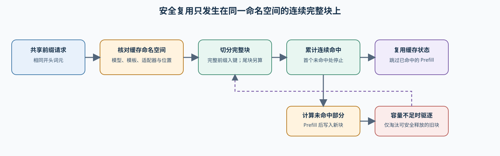

# 69. Prefix Caching Benchmark | 前缀缓存基准

**难度：** Hard | **环境：** [CPU 主线，GPU 可选](#runtime-environment) | **标签：** `推理优化`、`前缀缓存`、`基准对比` | **目标人群：** 理解缓存复用、需要比较服务方案的学习者

> 🚀 **云端运行环境**
>
> 本章节的实战代码可以点击以下链接在免费 GPU 算力平台上直接运行：
>
> [](https://colab.research.google.com/github/datawhalechina/llm-algo-leetcode/blob/main/02_PyTorch_Algorithms/69_Prefix_Caching_Benchmark.ipynb)
> [](https://modelscope.cn/my/mynotebook) *(国内推荐：魔搭社区免费实例)*


## 本节导读

重复的系统提示可能省下大量预填充，也可能因为实际命中不足而没有收益。保留更多缓存还会占用容量，影响新请求。要判断是否开启缓存，需要把同一请求集合在关闭和开启缓存时的表现放在一起，而不是只看命中率。

本项目从缓存身份、连续命中和容量记录出发，核对真实复用、请求完成、输出等价性与延迟收益，得到固定请求分布下的候选决策。

**关键词：** 缓存身份、连续前缀、命中率、首词元延迟、输出等价性

<a id="runtime-environment"></a>

## 运行环境

- **基础练习：** 使用 [BASE-CPU](../guide.md#base-cpu)，验证缓存身份、前缀键和采用规则。
- **真实服务实验：** 使用 [INF-VLLM-011-CU128](../topic_discussion/inference_optimization/quickstart.md#inf-vllm-quickstart)，模型与请求集见 5.1。

## 前置阅读

先区分可复用的逻辑前缀与实际占用的缓存块，再比较命中能否转成请求收益。

- [前缀匹配与复用](./24_Prefix_Cache_Matching_and_Reuse.md)：可命中范围与未命中后缀。
- [分页注意力](./22_vLLM_PagedAttention.md)：块粒度、尾块余量与物理容量。
- [推理性能对比](./66_Inference_Performance_Comparison.md)：请求配对、首词元延迟与吞吐口径。

## Step 1：从共享请求到缓存开关的配对比较

前缀缓存复用的是已经计算出的 K/V，不是相同文本的任意片段。模型权重、分词结果、聊天模板、适配器、位置和注意力配置、缓存精度与访问权限共同限定可共享的状态，称为缓存命名空间。请求开头词元相同且计算条件一致，才有复用机会。

先固定共享前缀请求集，把关闭缓存作为基线、开启缓存作为候选，再核对后端记录与输出。首词元延迟（TTFT）表示从请求发出到首个内容词元到达的时间；跳过重复预填充可能缩短它，但排队、后缀计算和输出收尾仍需分别观察。

| 项目环节 | 输入与操作 | 需要保留的证据 |
| --- | --- | --- |
| 定义比较条件 | 固定模型版本、输入、生成规则与测量顺序 | 同一请求和运行条件 |
| 识别可复用状态 | 检查缓存身份和从开头连续命中的范围 | 实际开关、命中与容量观测 |
| 真实执行 | 依次运行缓存关闭与开启服务 | 原始请求、日志、失败与指标 |
| 形成候选决策 | 联合核对输出、延迟、吞吐与资源 | 采用、补测或拒绝及下一动作 |



## Step 2：同一块内容还必须属于同一历史前缀

完整块缓存把请求按固定词元数分块；本页模型只登记完整块，尾部残块继续计算。块的键必须包含之前的前缀，不能只用“块位置＋当前块内容”。例如先处理 `[1,2,3,4]`，再处理 `[9,9,5,6]`，新请求 `[1,2,5,6]` 只能复用开头 `[1,2]`；最后的 `[5,6]` 曾在另一上下文出现，并不是本次可用的 K/V。

固定请求集、请求顺序和预热过程，才能解释重复机会。首次建立前缀与后续热复用分别记录；保留缓存会占用物理容量，而逻辑命中长度不等于释放的显存。本页的最近最少使用（LRU）模型按最近访问顺序淘汰条目，真实系统还要保护活动引用与在途访问。

| 比较对象 | 保持一致 | 变化或观察 |
| --- | --- | --- |
| 缓存关闭与开启 | 模型、词元化输入、生成规则、并发和重复次数 | 只改变前缀缓存开关 |
| 输入分布 | 共享比例、请求顺序、冷启动与预热条件 | 命中机会与首次建立成本 |
| 逻辑缓存模型 | 同一批词元与命名空间 | 连续完整前缀键、容量与 LRU 驱逐 |
| 真实服务记录 | 后端版本与相同测量口径 | 直接命中计数、容量、TTFT 与吞吐 |

## Step 3：请求完成、输出等价和性能收益分别判断

请求成功返回非空输出，只能确认完成情况；确定性路径还要核对同一请求的输出是否等价，以及同配置多次运行是否稳定。后端命中记录证明发生复用，不能由更低延迟反推命中率。请求级命中率按命中请求数计，词元复用比例按复用词元数计，两种分母不能混用。

候选只有在身份、请求、输出核对、稳定性与直接命中证据齐备后，才比较 TTFT 和输出吞吐；物理容量、驱逐与实际峰值要另看资源报告。当前 CPU 规则不包含显存上限预测，缓存容量字段存在也不等于已通过压力测试。

| 观察到的状态 | 决策 | 下一步 |
| --- | --- | --- |
| 身份不一致、真实执行失败或请求不完整 | 拒绝（reject） | 修复匹配或运行问题，保留失败记录 |
| 命中、指标、输出等价或稳定性证据缺少 | 补测（tune） | 不交接采用候选，补采缺少的证据 |
| 请求完成，但输出等价性或重复稳定性未通过 | 调整（tune） | 保留性能信号，定位差异后重新配对 |
| 命中成立，但延迟与吞吐改善不同时达标 | 调整（tune） | 复核负载与缓存维护成本 |
| 输出核对、稳定性、命中和两个性能目标均通过 | 局部采用（accept） | 仅将当前请求分布的候选送入部署复测 |

## Step 4：实现缓存身份、配对证据与采用判断

题目提供分块、完整前缀键、LRU 与结果统计骨架。你将完成命名空间匹配、证据收集和采用规则；输入布尔事实是对真实报告中请求完成、输出等价和重复稳定性核对的摘要，不是任务语义质量分数。测试包括跨上下文同块、身份缺失、缺证和单项性能门槛未过。

| 任务与目的 | 已知条件 | 完成标准 | 测试验证 |
| --- | --- | --- | --- |
| TODO 1：核对缓存命名空间 | 权重、分词器、模板、适配器、位置、精度、注意力和权限 | 身份均有值且一致，开关形成关闭／开启对照 | 字段变化、两边同时缺身份与空身份 |
| TODO 2：建立配对证据 | 基线、候选、命中与各项输出核对 | 失败、缺失指标和质量事实分别保留 | 缺少基线指标、缺命中、输出等价与稳定性未通过 |
| TODO 3：形成采用状态 | 命中率、TTFT、吞吐与证据 | 质量事实通过且两项收益同时达标才采用 | 精确阈值、单项不足与缺证 |


```python
from typing import Dict, List
```


```python
# 分块、驱逐和指标汇总构成机制底座；TODO 聚焦命名空间、后端证据和采用状态。
# CPU 结果验证证据关系，不替代真实缓存后端测量。
def complete_token_blocks(tokens: List[int], block_size: int) -> List[tuple[int, ...]]:
    """仅切出完整 token block；尾部不足一个 block 的 token 不参与缓存匹配。"""
    return [tuple(tokens[start:start + block_size]) for start in range(0, len(tokens) - block_size + 1, block_size)]


def _prefix_block_key(blocks, block_index):
    """键包含从位置零到当前块的完整历史，避免跨上下文误复用。"""
    return (block_index, tuple(tuple(block) for block in blocks[:block_index + 1]))


def count_continuous_prefix_hits(blocks, cache):
    """返回从 block 位置 0 开始连续命中的数量。

    blocks 是当前请求的完整 block 列表；cache 的 key 包含块位置及截至当前块的完整前缀。
    返回首个 miss 前的命中数，后续偶然命中不计入。
    """
    hit_blocks = 0
    for block_index, block in enumerate(blocks):
        if _prefix_block_key(blocks, block_index) not in cache:
            break
        hit_blocks += 1
    return hit_blocks


def write_blocks_with_lru(cache, blocks, clock, capacity_blocks):
    """写入当前请求的完整 block，并返回更新后的时钟与驱逐次数。

    已存在的 block 再次写入也要刷新访问时间；返回 (clock, eviction_count)。
    """
    eviction_count = 0
    for block_index, block in enumerate(blocks):
        clock += 1
        cache[_prefix_block_key(blocks, block_index)] = clock
        if len(cache) > capacity_blocks:
            oldest = min(cache, key=cache.get)
            del cache[oldest]
            eviction_count += 1
    return clock, eviction_count


def simulate_prefix_cache(token_sequences: List[List[int]], block_size: int = 4, capacity_blocks: int = 8) -> Dict[str, object]:
    """模拟完整 token block 的前缀复用和 LRU 驱逐；不测真实 backend 延迟。"""
    if block_size <= 0 or capacity_blocks <= 0:
        raise ValueError('block_size 和 capacity_blocks 必须为正数')
    if not isinstance(token_sequences, list) or not all(isinstance(tokens, list) for tokens in token_sequences):
        raise TypeError('token_sequences 必须是 list[list[int]]')
    cache, clock = {}, 0
    reused_tokens = total_prompt_tokens = hit_requests = eviction_count = 0
    for tokens in token_sequences:
        if not tokens:
            continue
        total_prompt_tokens += len(tokens)
        blocks = complete_token_blocks(tokens, block_size)
        hit_blocks = count_continuous_prefix_hits(blocks, cache)
        if hit_blocks:
            hit_requests += 1
        reused_tokens += hit_blocks * block_size
        clock, evicted = write_blocks_with_lru(cache, blocks, clock, capacity_blocks)
        eviction_count += evicted
    request_count = sum(bool(tokens) for tokens in token_sequences)
    return {'total_requests': request_count, 'total_prompt_tokens': total_prompt_tokens,
            'reused_tokens': reused_tokens, 'miss_tokens': total_prompt_tokens - reused_tokens,
            'hit_rate': hit_requests / request_count if request_count else 0.0,
            'token_reuse_rate': reused_tokens / total_prompt_tokens if total_prompt_tokens else 0.0,
            'prefill_work_reduction': reused_tokens / total_prompt_tokens if total_prompt_tokens else 0.0,
            'eviction_count': eviction_count, 'cache_size_blocks': len(cache)}


def summarize_prefix_cache(runs):
    """汇总同一 workload 的缓存运行记录；仅保留可比较的证据。"""
    if not runs:
        return {'run_count': 0, 'best_hit_rate_run': None, 'avg_hit_rate': 0.0, 'avg_ttft_ms': 0.0}
    required = {'name', 'workload_id', 'hit_rate', 'ttft_ms'}
    if any(not required.issubset(item) for item in runs):
        raise KeyError(f'每条 run 必须包含 {sorted(required)}')
    if len({item['workload_id'] for item in runs}) != 1:
        raise ValueError('缓存汇总必须使用同一 workload_id')
    best = max(runs, key=lambda item: item['hit_rate'])
    return {'run_count': len(runs), 'best_hit_rate_run': best['name'],
            'avg_hit_rate': sum(item['hit_rate'] for item in runs) / len(runs),
            'avg_ttft_ms': sum(item['ttft_ms'] for item in runs) / len(runs)}


def compare_prefix_cache_to_baseline(baseline, candidate):
    """计算同一 workload 下 candidate 相对 baseline 的复用、TTFT 与开销变化。"""
    required = {'workload_id', 'hit_rate', 'ttft_ms', 'overhead'}
    if not required.issubset(baseline) or not required.issubset(candidate):
        raise KeyError(f'比较记录必须包含 {sorted(required)}')
    if baseline['workload_id'] != candidate['workload_id']:
        raise ValueError('baseline 与 candidate 必须使用同一 workload_id')
    return {'hit_rate_gain': candidate['hit_rate'] - baseline['hit_rate'],
            'ttft_delta_ms': candidate['ttft_ms'] - baseline['ttft_ms'],
            'overhead_delta': candidate['overhead'] - baseline['overhead']}


def prefix_cache_rank_key(candidate):
    """返回一项证据合格缓存配置的升序排序 key。

    更大的 hit_rate_gain、更小的 ttft_delta_ms 和 overhead_delta 应排在前面；
    ttft_delta_ms 为负时表示 candidate 的 TTFT 更低。
    """
    summary = candidate['comparison']
    return (-summary['hit_rate_gain'], summary['ttft_delta_ms'], summary['overhead_delta'])


def select_prefix_cache_candidate(candidates):
    """排除无命中证据、失败或质量不合格候选后排序。"""
    eligible = [item for item in candidates if item['evidence_ok'] and item['quality_ok']]
    eligible.sort(key=prefix_cache_rank_key)
    return {'candidate_count': len(candidates), 'eligible_count': len(eligible),
            'selected': eligible[0] if eligible else None,
            'rejected_names': [item['name'] for item in candidates if item not in eligible]}


def validate_cache_namespace(baseline, candidate):
    """核对影响 K/V 计算与共享权限的身份，缺失身份不能视为一致。"""
    namespace_fields = ('model_revision', 'tokenizer_id', 'chat_template', 'adapter_id',
                        'position_key', 'cache_dtype', 'attention_key', 'tenant_key')
    mismatches = [field for field in namespace_fields
                  if baseline.get(field) in (None, '') or candidate.get(field) in (None, '')
                  or baseline.get(field) != candidate.get(field)]
    # TODO 1：命名空间有值且一致，策略开关形成关闭／开启对照。
    # ==========================================
    # TODO 1：核对缓存身份与开关对照。
    # ==========================================
    # namespace_ok = ???  # 全部身份有值且一致。
    # change_ok = ???  # 基线关闭且候选开启缓存。
    raise NotImplementedError("请完成 TODO 1：namespace_ok、change_ok")
    issues = list(mismatches) + ([] if change_ok else ['prefix_cache_enabled'])
    return {'contract_ok': namespace_ok and change_ok, 'issues': issues}


def build_prefix_cache_pair_evidence(baseline, candidate):
    """核对两组指标与输出事实；缺失指标保留为空而不是补成零。"""
    contract = validate_cache_namespace(baseline, candidate)
    failures = [name for name, record in (('baseline', baseline), ('candidate', candidate)) if record.get('failure')]
    required_metrics = ('hit_rate', 'ttft_ms', 'throughput_tps', 'output_complete',
                        'cache_capacity_blocks', 'output_equivalent', 'repeat_stable')
    missing = [f'{name}.{field}' for name, record in (('baseline', baseline), ('candidate', candidate))
               for field in required_metrics if record.get(field) is None]
    # ==========================================
    # TODO 2：区分硬失败与缺失证据。
    # ==========================================
    # hard_failures = ???  # 身份问题与运行失败的集合。
    # missing_evidence = ???  # 两组缺少的观测字段。
    raise NotImplementedError("请完成 TODO 2：hard_failures、missing_evidence")
    if candidate.get('backend_cache_hit_observed') is not True:
        missing_evidence.append('backend_cache_hit')
    def difference(field, reverse=False):
        """两侧指标齐备时计算候选改善量。"""
        left, right = baseline.get(field), candidate.get(field)
        return None if left is None or right is None else (left - right if reverse else right - left)
    return {'hard_failures': hard_failures, 'missing_evidence': missing_evidence,
            'hit_rate': candidate.get('hit_rate'),
            'ttft_gain_ms': difference('ttft_ms', reverse=True),
            'throughput_gain': difference('throughput_tps'),
            'output_ok': baseline.get('output_complete') is True and candidate.get('output_complete') is True,
            'output_equivalent': baseline.get('output_equivalent') is True and candidate.get('output_equivalent') is True,
            'repeat_stable': baseline.get('repeat_stable') is True and candidate.get('repeat_stable') is True,
            'cache_capacity_blocks': candidate.get('cache_capacity_blocks')}


def decide_prefix_cache_candidate(evidence, min_hit_rate, min_ttft_gain_ms, min_throughput_gain):
    """按请求、输出核对、命中和两项性能目标形成局部采用状态。"""
    if evidence['hard_failures']:
        return {'decision': 'reject', 'next_action': 'repair_namespace_or_backend'}
    if evidence['missing_evidence']:
        return {'decision': 'tune', 'next_action': 'collect_cache_execution_evidence'}
    if not evidence['output_ok']:
        return {'decision': 'reject', 'next_action': 'inspect_request_outputs'}
    if not evidence['output_equivalent'] or not evidence['repeat_stable']:
        return {'decision': 'tune', 'next_action': 'resolve_output_equivalence_and_stability'}
    # TODO 3：命中、TTFT 与吞吐三个门槛必须同时满足。
    # ==========================================
    # TODO 3：合并命中率与两项性能门槛。
    # ==========================================
    # reuse_ok = ???  # 三项下限均满足时为 True。
    raise NotImplementedError("请完成 TODO 3：reuse_ok")
    if reuse_ok:
        return {'decision': 'accept', 'next_action': 'promote_fixed_workload_result'}
    return {'decision': 'tune', 'next_action': 'inspect_workload_and_cache_cost'}

```

## 测试

分别检查前缀上下文、身份与开关、真实命中证据，以及输出核对和联合性能门槛。

```python
# 本测试区验证缓存机制、候选配置排序和同 workload 的报告骨架。
def _prefix_cache_sequences():
    """构造共享前缀、部分命中与完全不相关的三条请求。"""
    return [[1, 2, 3, 4, 5, 6, 7, 8], [1, 2, 3, 4, 5, 6, 9, 10], [20, 21, 22, 23, 24, 25, 26, 27]]

def _cache_report(name, hit_rate, ttft_ms, overhead, evidence=True, quality=True):
    """构造同一 workload 下可用于缓存配置排序的显式指标记录。"""
    return {'name': name, 'workload_id': 'shared-prefix-v1', 'hit_rate': hit_rate, 'ttft_ms': ttft_ms,
            'overhead': overhead, 'evidence_ok': evidence, 'quality_ok': quality}

def test_continuous_block_hits():
    """验证连续前缀命中不能跳过首个 miss。"""
    cache = {_prefix_block_key([(1, 2), (3, 4)], 0): 1,
             _prefix_block_key([(1, 2), (3, 4)], 1): 2}
    assert count_continuous_prefix_hits([(1, 2), (3, 4), (5, 6)], cache) == 2
    assert count_continuous_prefix_hits([(9, 9), (3, 4)], cache) == 0

def test_lru_write_and_eviction():
    """验证容量上限、重新访问刷新时间和尾块不命中。"""
    cache = {_prefix_block_key([(1, 2)], 0): 1}
    _, evicted = write_blocks_with_lru(cache, [(3, 4), (5, 6)], 1, 2)
    assert len(cache) == 2 and evicted == 1
    previous_clock = cache[_prefix_block_key([(3, 4)], 0)]
    refreshed_clock, no_extra_eviction = write_blocks_with_lru(cache, [(3, 4)], 3, 2)
    assert cache[_prefix_block_key([(3, 4)], 0)] == refreshed_clock > previous_clock and no_extra_eviction == 0
    simulated = simulate_prefix_cache(_prefix_cache_sequences(), block_size=2, capacity_blocks=4)
    assert simulated['reused_tokens'] == 6 and simulated['eviction_count'] > 0
    tail_case = simulate_prefix_cache([[1, 2, 3, 4, 5], [1, 2, 3, 4, 9]], block_size=4, capacity_blocks=8)
    assert tail_case['reused_tokens'] == 4
    for invalid in ({'block_size': 0}, {'capacity_blocks': 0}):
        try:
            simulate_prefix_cache([[1, 2]], **invalid)
        except ValueError:
            pass
        else:
            raise AssertionError('非法缓存参数应明确拒绝')

def test_candidate_ranking_and_contract():
    """验证证据和质量门槛先于缓存收益排序。"""
    baseline = _cache_report('off', 0., 130, 0.)
    small = _cache_report('small', .5, 100, .03)
    large = _cache_report('large', .7, 95, .08)
    candidates = [{'name': item['name'], 'evidence_ok': item['evidence_ok'], 'quality_ok': item['quality_ok'],
                   'comparison': compare_prefix_cache_to_baseline(baseline, item)} for item in [small, large]]
    assert select_prefix_cache_candidate(candidates)['selected']['name'] == 'large'
    blocked = {'name': 'blocked', 'evidence_ok': False, 'quality_ok': False,
               'comparison': {**candidates[1]['comparison'], 'hit_rate_gain': 99}}
    assert select_prefix_cache_candidate([blocked])['selected'] is None
    assert summarize_prefix_cache([baseline, small])['best_hit_rate_run'] == 'small'
    try:
        compare_prefix_cache_to_baseline(baseline, {**small, 'workload_id': 'other'})
    except ValueError:
        pass
    else:
        raise AssertionError('不同 workload 不应直接比较缓存收益')

def _cache_project_record(enabled, hit_rate, ttft_ms, throughput_tps, output_complete, cache_capacity_blocks):
    """构造命名空间一致、仅缓存开关不同的项目记录。"""
    return {'model_revision': 'commit', 'tokenizer_id': 'tokenizer', 'chat_template': 'template-v1',
            'adapter_id': 'none', 'position_key': 'rope-v1', 'prefix_cache_enabled': enabled,
            'backend_cache_hit_observed': enabled, 'hit_rate': hit_rate, 'ttft_ms': ttft_ms,
            'throughput_tps': throughput_tps, 'output_complete': output_complete,
            'cache_capacity_blocks': cache_capacity_blocks, 'failure': None,
            'cache_dtype': 'bfloat16', 'attention_key': 'causal', 'tenant_key': 'shared-scope',
            'output_equivalent': True, 'repeat_stable': True}


def test_cache_project_contract_and_evidence():
    """验证命名空间、直接命中、输出完整性和服务收益门禁。"""
    baseline = _cache_project_record(False, 0.0, 130.0, 80.0, True, 37000)
    candidate = _cache_project_record(True, 0.65, 95.0, 84.0, True, 37000)
    assert validate_cache_namespace(baseline, candidate)['contract_ok']
    assert not validate_cache_namespace(baseline, {**candidate, 'chat_template': 'other'})['contract_ok']
    evidence = build_prefix_cache_pair_evidence(baseline, candidate)
    assert evidence['hard_failures'] == [] and evidence['missing_evidence'] == []
    assert decide_prefix_cache_candidate(evidence, 0.5, 20.0, 2.0)['decision'] == 'accept'
    no_path = build_prefix_cache_pair_evidence(baseline, {**candidate, 'backend_cache_hit_observed': False})
    assert decide_prefix_cache_candidate(no_path, 0.5, 20.0, 2.0)['decision'] == 'tune'
    bad_output = build_prefix_cache_pair_evidence(baseline, {**candidate, 'output_complete': False})
    assert decide_prefix_cache_candidate(bad_output, 0.5, 20.0, 2.0)['decision'] == 'reject'


def test_prefix_keys_do_not_mix_histories():
    """同一位置的块内容相同，但历史不同仍不能复用。"""
    sequences = [[1, 2, 3, 4], [9, 9, 5, 6], [1, 2, 5, 6]]
    result = simulate_prefix_cache(sequences, block_size=2, capacity_blocks=16)
    assert result['reused_tokens'] == 2
    assert result['hit_rate'] == 1 / 3


def test_missing_identity_and_quality_cannot_pass():
    """都缺身份不是相同；质量事实不齐备时不能采用。"""
    baseline = _cache_project_record(False, 0.0, 130., 80., True, 37000)
    candidate = _cache_project_record(True, 0.65, 95., 84., True, 37000)
    for key in ('model_revision', 'cache_dtype', 'tenant_key', 'attention_key'):
        left, right = dict(baseline), dict(candidate)
        left.pop(key); right.pop(key)
        assert not validate_cache_namespace(left, right)['contract_ok']
    for key in ('output_equivalent', 'repeat_stable'):
        evidence = build_prefix_cache_pair_evidence(baseline, {**candidate, key: False})
        assert decide_prefix_cache_candidate(evidence, 0.5, 20., 2.)['decision'] == 'tune'
    evidence = build_prefix_cache_pair_evidence({**baseline, 'ttft_ms': None}, candidate)
    assert 'baseline.ttft_ms' in evidence['missing_evidence']
    assert decide_prefix_cache_candidate(evidence, 0.5, 20., 2.)['decision'] == 'tune'
    for update in ({'ttft_ms': 125.}, {'throughput_tps': 81.}):
        evidence = build_prefix_cache_pair_evidence(baseline, {**candidate, **update})
        assert decide_prefix_cache_candidate(evidence, 0.5, 20., 2.)['decision'] == 'tune'


def test_prefix_cache_benchmark_template():
    """运行本节全部 CPU 缓存机制测试。"""
    test_continuous_block_hits()
    test_lru_write_and_eviction()
    test_candidate_ranking_and_contract()
    test_cache_project_contract_and_evidence()
    test_prefix_keys_do_not_mix_histories()
    test_missing_identity_and_quality_cannot_pass()
    print('测试通过：缓存命名空间、后端证据与采用状态均通过。')

try:
    test_prefix_cache_benchmark_template()
except NotImplementedError:
    print('请先完成 TODO 部分的代码！')
    raise
```

---

🛑 **STOP HERE**

先完成题目并运行测试，再展开参考代码。

<br><br><br><br><br><br><br><br><br><br>
## 参考代码与解析

### 代码


```python
# 分块、驱逐和指标汇总构成机制底座；TODO 聚焦命名空间、后端证据和采用状态。
# CPU 结果验证证据关系，不替代真实缓存后端测量。
def complete_token_blocks(tokens: List[int], block_size: int) -> List[tuple[int, ...]]:
    """仅切出完整 token block；尾部不足一个 block 的 token 不参与缓存匹配。"""
    return [tuple(tokens[start:start + block_size]) for start in range(0, len(tokens) - block_size + 1, block_size)]


def _prefix_block_key(blocks, block_index):
    """键包含从位置零到当前块的完整历史，避免跨上下文误复用。"""
    return (block_index, tuple(tuple(block) for block in blocks[:block_index + 1]))


def count_continuous_prefix_hits(blocks, cache):
    """返回从 block 位置 0 开始连续命中的数量。"""
    # 机制：位置和 token 内容共同构成 key，首个未命中后停止。
    hit_blocks = 0
    for block_index, block in enumerate(blocks):
        if _prefix_block_key(blocks, block_index) not in cache:
            break
        hit_blocks += 1
    return hit_blocks


def write_blocks_with_lru(cache, blocks, clock, capacity_blocks):
    """写入当前请求的完整 block，并返回更新后的时钟与驱逐次数。"""
    # 机制：访问刷新时钟，容量超限时驱逐最久未访问块。
    eviction_count = 0
    for block_index, block in enumerate(blocks):
        clock += 1
        cache[_prefix_block_key(blocks, block_index)] = clock
        while len(cache) > capacity_blocks:
            oldest = min(cache, key=cache.get)
            del cache[oldest]
            eviction_count += 1
    return clock, eviction_count


def simulate_prefix_cache(token_sequences: List[List[int]], block_size: int = 4, capacity_blocks: int = 8) -> Dict[str, object]:
    """模拟完整 token block 的前缀复用和 LRU 驱逐；不测真实 backend 延迟。"""
    if block_size <= 0 or capacity_blocks <= 0:
        raise ValueError('block_size 和 capacity_blocks 必须为正数')
    if not isinstance(token_sequences, list) or not all(isinstance(tokens, list) for tokens in token_sequences):
        raise TypeError('token_sequences 必须是 list[list[int]]')
    cache, clock = {}, 0
    reused_tokens = total_prompt_tokens = hit_requests = eviction_count = 0
    for tokens in token_sequences:
        if not tokens:
            continue
        total_prompt_tokens += len(tokens)
        blocks = complete_token_blocks(tokens, block_size)
        hit_blocks = count_continuous_prefix_hits(blocks, cache)
        if hit_blocks:
            hit_requests += 1
        reused_tokens += hit_blocks * block_size
        clock, evicted = write_blocks_with_lru(cache, blocks, clock, capacity_blocks)
        eviction_count += evicted
    request_count = sum(bool(tokens) for tokens in token_sequences)
    return {'total_requests': request_count, 'total_prompt_tokens': total_prompt_tokens,
            'reused_tokens': reused_tokens, 'miss_tokens': total_prompt_tokens - reused_tokens,
            'hit_rate': hit_requests / request_count if request_count else 0.0,
            'token_reuse_rate': reused_tokens / total_prompt_tokens if total_prompt_tokens else 0.0,
            'prefill_work_reduction': reused_tokens / total_prompt_tokens if total_prompt_tokens else 0.0,
            'eviction_count': eviction_count, 'cache_size_blocks': len(cache)}


def summarize_prefix_cache(runs):
    """汇总同一 workload 的缓存运行记录；仅保留可比较的证据。"""
    if not runs:
        return {'run_count': 0, 'best_hit_rate_run': None, 'avg_hit_rate': 0.0, 'avg_ttft_ms': 0.0}
    required = {'name', 'workload_id', 'hit_rate', 'ttft_ms'}
    if any(not required.issubset(item) for item in runs):
        raise KeyError(f'每条 run 必须包含 {sorted(required)}')
    if len({item['workload_id'] for item in runs}) != 1:
        raise ValueError('缓存汇总必须使用同一 workload_id')
    best = max(runs, key=lambda item: item['hit_rate'])
    return {'run_count': len(runs), 'best_hit_rate_run': best['name'],
            'avg_hit_rate': sum(item['hit_rate'] for item in runs) / len(runs),
            'avg_ttft_ms': sum(item['ttft_ms'] for item in runs) / len(runs)}


def compare_prefix_cache_to_baseline(baseline, candidate):
    """计算同一 workload 下 candidate 相对 baseline 的复用、TTFT 与开销变化。"""
    required = {'workload_id', 'hit_rate', 'ttft_ms', 'overhead'}
    if not required.issubset(baseline) or not required.issubset(candidate):
        raise KeyError(f'比较记录必须包含 {sorted(required)}')
    if baseline['workload_id'] != candidate['workload_id']:
        raise ValueError('baseline 与 candidate 必须使用同一 workload_id')
    return {'hit_rate_gain': candidate['hit_rate'] - baseline['hit_rate'],
            'ttft_delta_ms': candidate['ttft_ms'] - baseline['ttft_ms'],
            'overhead_delta': candidate['overhead'] - baseline['overhead']}


def prefix_cache_rank_key(candidate):
    """返回一项证据合格缓存配置的升序排序 key。"""
    summary = candidate['comparison']
    # 排序依据：更多复用、更低 TTFT 和更低维护开销优先。
    return (-summary['hit_rate_gain'], summary['ttft_delta_ms'], summary['overhead_delta'])


def select_prefix_cache_candidate(candidates):
    """排除无命中证据、失败或质量不合格候选后排序。"""
    eligible = [item for item in candidates if item['evidence_ok'] and item['quality_ok']]
    eligible.sort(key=prefix_cache_rank_key)
    return {'candidate_count': len(candidates), 'eligible_count': len(eligible),
            'selected': eligible[0] if eligible else None,
            'rejected_names': [item['name'] for item in candidates if item not in eligible]}


def validate_cache_namespace(baseline, candidate):
    """核对影响 K/V 计算与共享权限的身份，缺失身份不能视为一致。"""
    namespace_fields = ('model_revision', 'tokenizer_id', 'chat_template', 'adapter_id',
                        'position_key', 'cache_dtype', 'attention_key', 'tenant_key')
    mismatches = [field for field in namespace_fields
                  if baseline.get(field) in (None, '') or candidate.get(field) in (None, '')
                  or baseline.get(field) != candidate.get(field)]
    # TODO 1：命名空间有值且一致，策略开关形成关闭／开启对照。
    namespace_ok = not mismatches
    change_ok = baseline.get('prefix_cache_enabled') is False and candidate.get('prefix_cache_enabled') is True
    issues = list(mismatches) + ([] if change_ok else ['prefix_cache_enabled'])
    return {'contract_ok': namespace_ok and change_ok, 'issues': issues}


def build_prefix_cache_pair_evidence(baseline, candidate):
    """核对两组指标与输出事实；缺失指标保留为空而不是补成零。"""
    contract = validate_cache_namespace(baseline, candidate)
    failures = [name for name, record in (('baseline', baseline), ('candidate', candidate)) if record.get('failure')]
    required_metrics = ('hit_rate', 'ttft_ms', 'throughput_tps', 'output_complete',
                        'cache_capacity_blocks', 'output_equivalent', 'repeat_stable')
    missing = [f'{name}.{field}' for name, record in (('baseline', baseline), ('candidate', candidate))
               for field in required_metrics if record.get(field) is None]
    hard_failures = list(contract['issues']) + failures
    missing_evidence = list(missing)
    if candidate.get('backend_cache_hit_observed') is not True:
        missing_evidence.append('backend_cache_hit')
    def difference(field, reverse=False):
        """两侧指标齐备时计算候选改善量。"""
        left, right = baseline.get(field), candidate.get(field)
        return None if left is None or right is None else (left - right if reverse else right - left)
    return {'hard_failures': hard_failures, 'missing_evidence': missing_evidence,
            'hit_rate': candidate.get('hit_rate'),
            'ttft_gain_ms': difference('ttft_ms', reverse=True),
            'throughput_gain': difference('throughput_tps'),
            'output_ok': baseline.get('output_complete') is True and candidate.get('output_complete') is True,
            'output_equivalent': baseline.get('output_equivalent') is True and candidate.get('output_equivalent') is True,
            'repeat_stable': baseline.get('repeat_stable') is True and candidate.get('repeat_stable') is True,
            'cache_capacity_blocks': candidate.get('cache_capacity_blocks')}


def decide_prefix_cache_candidate(evidence, min_hit_rate, min_ttft_gain_ms, min_throughput_gain):
    """按请求、输出核对、命中和两项性能目标形成局部采用状态。"""
    if evidence['hard_failures']:
        return {'decision': 'reject', 'next_action': 'repair_namespace_or_backend'}
    if evidence['missing_evidence']:
        return {'decision': 'tune', 'next_action': 'collect_cache_execution_evidence'}
    if not evidence['output_ok']:
        return {'decision': 'reject', 'next_action': 'inspect_request_outputs'}
    if not evidence['output_equivalent'] or not evidence['repeat_stable']:
        return {'decision': 'tune', 'next_action': 'resolve_output_equivalence_and_stability'}
    # TODO 3：命中、TTFT 与吞吐三个门槛必须同时满足。
    reuse_ok = (evidence['hit_rate'] >= min_hit_rate
                and evidence['ttft_gain_ms'] >= min_ttft_gain_ms
                and evidence['throughput_gain'] >= min_throughput_gain)
    if reuse_ok:
        return {'decision': 'accept', 'next_action': 'promote_fixed_workload_result'}
    return {'decision': 'tune', 'next_action': 'inspect_workload_and_cache_cost'}

```

### 解析

#### TODO 1：限定缓存身份

- 同一文本在不同权重、位置或适配器下可能对应不同 K/V；身份缺失也不能解释为相同。关闭／开启开关是本次唯一策略变化。
- 测试逐个改变身份字段，再同时删除两边字段，区分“都未知”与“已确认一致”。

#### TODO 2：保留失败与缺证的区别

- 命名空间错误和运行失败阻止比较；命中、基线指标和输出核对缺失时，应保留未取得的证据，而非用零值补齐。
- 测试移除显式指标与命中记录，并分别设置输出等价、重复稳定性未通过，确认这些事实进入决策。

#### TODO 3：同时满足正确复用与性能条件

- 请求完成不等于输出等价；输出核对与稳定性均通过后，命中率、TTFT 改善和吞吐改善三项条件采用合取判断。
- 测试让一项性能改善、另一项未达标，确保不能只凭单个好数字采用；历史 v4 继续以真实证据记录中的 tune 为准。

## Step 5（可选）：GPU 与 backend 实验——真实 prefix cache 对照

使用同一共享前缀请求分别运行 缓存关闭与开启两条路径；每次运行保存分组 JSON，再从 manifest 读取证据并形成项目决策。

| CPU 已验证 | 真实环境补充 | 本页输出 |
| --- | --- | --- |
| 完整前缀身份、缓存账本、证据与采用规则 | 缓存关闭／开启的真实命中、请求输出、延迟、吞吐和资源记录 | 原始 JSON、配对清单与当前负载下的候选决策 |

### 5.1 环境与固定工作负载

使用 [INF-VLLM-011-CU128](../topic_discussion/inference_optimization/quickstart.md#inf-vllm-quickstart)；固定模型与请求配置按单卡实验登记，实际容量与执行能力由当前预检和真实运行确认。

本次实验回答一个具体问题：在同一组共享前缀请求上，开启 prefix cache 是否带来可观测收益。先记录实验契约，再让 G0 与 G1 只改变 cache policy；模型、backend、请求分布、生成长度、并发和测量流程保持一致。

| 实验要素 | 本轮契约 | G0 / G1 如何保持一致 | 证据输出 |
|:---|:---|:---|:---|
| 实验对象 | G0 cache off；G1 prefix cache | 使用同一模型 revision、backend 和服务版本 | 两组可比较结果 |
| 固定 workload | shared-prefix 请求文件、生成长度、batch / concurrency | 使用同一请求顺序和 token 化结果 | 统一 workload 记录 |
| 测量流程 | warmup、重复次数、超时和输出长度 | 两组使用相同流程 | 可复查的 JSON 结果 |
| 唯一变量 | cache policy | G0 关闭，G1 只开启 prefix cache | 命中、延迟、吞吐和资源对照 |


```python
# 5.1：唯一可编辑配置。先改这一处，再运行 5.2–5.6。
RUN_REAL_BACKEND = False  # 默认值 False：改为 True 才启动真实 G0/G1 服务对照。
RUN_LABEL = 'replace_with_unique_label'  # 正式复测改为唯一标签；旧标签的 JSON 保留为历史证据。
SEMANTIC_ID = 'INF-PREFIX-CACHE'
SCHEMA_VERSION = 'inference-benchmark/v1'
MODEL_ID = 'Qwen/Qwen2.5-0.5B-Instruct'  # G0/G1 使用同一模型与 revision。
WORKLOAD = 'benchmarks/workloads/prefix_reuse_long.jsonl'  # 长共享前缀；两组必须使用同一冻结请求集。
EXECUTION_ORDER = 'baseline_then_candidate'  # 可选 baseline_then_candidate / candidate_then_baseline；反向复测需新标签。
NUM_PROMPTS = 30  # 按固定顺序循环 workload，不改变唯一请求集合。
CONCURRENCY = 1  # 先隔离 prefix cache；并发扫描属于 70，不在本页混入。
REPEATS = 3  # 避免把单次服务波动当作缓存结论。
WARMUP = 5  # 预热不计入正式统计；G1 的预热也会建立可复用条目。
MAX_TOKENS = 64  # 两组保持相同的生成长度。
BACKEND = 'vllm'  # 改变 backend 应形成新的专项对照。
DTYPE = 'bfloat16'  # 记录 backend 实际选择的 dtype；两组必须一致。

MAX_MODEL_LEN = 2048  # G0/G1 固定相同 KV 容量上限。
GPU_MEMORY_UTILIZATION = 0.80
ENFORCE_EAGER = True
RUN_ID = RUN_LABEL  # 派生内部标识；不单独修改。
MANIFEST_PATH = f'benchmarks/results/69_manifest_{RUN_ID}.json'  # 对照清单。
CANONICAL_GROUPS = (
    {'name': 'g0_cache_off', 'role': 'baseline', 'cache_policy': 'off', 'enabled': False},
    {'name': 'g1_prefix_cache', 'role': 'candidate', 'cache_policy': 'prefix_cache', 'enabled': True},
)
GROUPS = CANONICAL_GROUPS if EXECUTION_ORDER == 'baseline_then_candidate' else tuple(reversed(CANONICAL_GROUPS))
```

### 5.2 环境启动检查

确认共享前缀 workload 可被读取，并记录 backend、GPU 与缓存开关。预检结果用于解释后续启动失败或缺少命中指标的原因。

| 检查项 | 需要确认的内容 | 记录用途 |
|:---|:---|:---|
| 模型与 backend | G0/G1 使用同一模型 revision 与服务版本 | 保持对照条件一致 |
| GPU 与运行时 | GPU、驱动、CUDA、PyTorch、dtype | 环境变更后重新采集 |
| workload 与开关 | 请求文件、端口、cache policy | 确认共享前缀请求和策略可加载 |
| 命中证据 | backend metrics、日志或专用接口 | 不能由 TTFT 或吞吐反推命中率 |


```python
# 5.2：只读取 5.1 配置并检查运行条件，不启动服务。
from pathlib import Path
from tools.inference_project_runtime import locate_repo_root
import importlib.util
import torch

REPO_ROOT = locate_repo_root()  # 运行基础设施：将 5.1 的仓库相对路径锚定到项目根目录。
WORKLOAD_FILE = REPO_ROOT / WORKLOAD
MANIFEST_FILE = REPO_ROOT / MANIFEST_PATH
preflight = {
    'workload_exists': WORKLOAD_FILE.is_file(), 'backend': BACKEND,
    'cuda_available': torch.cuda.is_available(),
    'vllm_on_current_kernel': importlib.util.find_spec('vllm') is not None,
}
print('prefix cache preflight:', preflight)
```

### 5.3 候选与比较契约检查

本单元只验证 5.1 声明的请求集、两组缓存策略和输出路径可比较；不再定义实验参数。


```python
from pathlib import Path
from tools.backend_runtime import start_vllm as loaded_start_vllm

if '--no-enable-prefix-caching' not in loaded_start_vllm.__code__.co_consts:
    raise RuntimeError(
        '当前 Kernel 仍加载旧版 backend_runtime，无法构造 cache-off 基线；'
        '请重启 Kernel 后从 5.1 重新运行。'
    )
if not WORKLOAD_FILE.is_file():
    raise FileNotFoundError(f'找不到共享前缀 workload：{WORKLOAD_FILE}')
if EXECUTION_ORDER not in {'baseline_then_candidate', 'candidate_then_baseline'}:
    raise ValueError('EXECUTION_ORDER 只能是 baseline_then_candidate 或 candidate_then_baseline')
if {group['name'] for group in GROUPS} != {'g0_cache_off', 'g1_prefix_cache'}:
    raise ValueError('本页必须保留 cache off 与 prefix cache 两个受控组')
if NUM_PROMPTS <= 0 or WARMUP < 0 or REPEATS <= 0:
    raise ValueError('num_prompts、repeats 必须为正数，warmup 不能为负数')
project_config = {
    'model': MODEL_ID, 'backend': BACKEND, 'dtype': DTYPE, 'workload': WORKLOAD,
    'generated_tokens': MAX_TOKENS, 'num_prompts': NUM_PROMPTS,
    'concurrency': CONCURRENCY, 'warmup': WARMUP, 'repeats': REPEATS,
    'execution_order': EXECUTION_ORDER,
    'groups': [item['name'] for item in GROUPS],
}
print(project_config)
```

### 5.4 执行实验并保存原始 JSON

按 5.1 中声明的顺序运行 G0 与 G1。每一组完成 warmup 后再测量；单组报告和本次 manifest 只记录原始配置、请求结果、缓存观测与失败信息。结论由 5.6 单独生成，不能回写这些原始文件。

| 分支 | 执行内容 | 原始产物 |
| --- | --- | --- |
| G0 | cache off，固定共享前缀 workload | `69_g0_cache_off_...json` |
| G1 | prefix cache，其他条件不变 | `69_g1_prefix_cache_...json` |
| manifest | 汇总本次两组、结果路径与运行状态 | `69_manifest_...json` |

```python
# 5.4：执行 G0/G1；在服务仍运行时登记 prefix-cache 观测，再保存分组 JSON。
from pathlib import Path
import json
import re
import urllib.request
from tools.inference_project_runtime import runtime_snapshot, start_optional_vllm, stop_optional_vllm, run_backend_benchmark
from tools.project_runtime import save_json_record_once


def observe_prefix_cache(base_url, log_handle):
    """从当前 vLLM 的 /metrics 与服务日志记录缓存命中证据。"""
    observation = {
        'hit_rate': None,
        'cache_queries': None,
        'cache_hits': None,
        'cache_capacity_blocks': None,
        'hit_rate_evidence': None,
        'metrics_source': f'{base_url}/metrics',
        'prefix_cache_enabled': None,
        'prefix_cache_metric_series': [],
        'log_path': getattr(log_handle, 'name', None),
    }
    try:
        with urllib.request.urlopen(f'{base_url}/metrics', timeout=10) as response:
            metric_text = response.read().decode('utf-8', errors='replace')
        series = []
        for line in metric_text.splitlines():
            normalized = line.lower()
            if 'prefix' in normalized and 'cache' in normalized and not line.startswith('#'):
                series.append(line)
        observation['prefix_cache_metric_series'] = series
        config_line = next((line for line in series if 'cache_config_info' in line), '')
        enabled = re.search(r'enable_prefix_caching=\"(True|False)\"', config_line)
        if enabled:
            observation['prefix_cache_enabled'] = enabled.group(1) == 'True'
        queries = re.search(r'prefix_cache_queries_total[^}]*}\s+([0-9.]+)', metric_text)
        hits = re.search(r'prefix_cache_hits_total[^}]*}\s+([0-9.]+)', metric_text)
        blocks = re.search(r'num_gpu_blocks=\"([0-9]+)\"', config_line)
        if queries and hits:
            observation['cache_queries'] = float(queries.group(1))
            observation['cache_hits'] = float(hits.group(1))
            if observation['cache_queries'] > 0:
                observation['hit_rate'] = round(observation['cache_hits'] / observation['cache_queries'], 6)
        if blocks:
            observation['cache_capacity_blocks'] = int(blocks.group(1))
        if series:
            observation['hit_rate_evidence'] = 'vllm_metrics_prefix_cache_series'
    except Exception as exc:
        observation['metrics_error'] = str(exc)

    try:
        log_handle.flush()
        log_text = Path(log_handle.name).read_text(encoding='utf-8', errors='replace')
        matches = re.findall(r'Prefix cache hit rate:\s*([0-9.]+)%', log_text)
        if matches:
            observation['hit_rate'] = round(float(matches[-1]) / 100.0, 6)
            observation['hit_rate_evidence'] = 'vllm_server_log_prefix_cache_hit_rate'
    except Exception as exc:
        observation['log_parse_error'] = str(exc)
    return observation


if RUN_REAL_BACKEND:
    final_paths = {group['name']: REPO_ROOT / f"benchmarks/results/69_{group['name']}_{BACKEND}_{RUN_ID}.json" for group in GROUPS}
    raw_paths = {group['name']: REPO_ROOT / f"benchmarks/results/69_{group['name']}_{BACKEND}_raw_{RUN_ID}.json" for group in GROUPS}
    collisions = [path for path in (*final_paths.values(), *raw_paths.values(), MANIFEST_FILE) if path.exists()]
    if collisions:
        raise FileExistsError(f'当前 RUN_LABEL 已有结果，请更换标签：{collisions}')
    reports = []
    for group in GROUPS:
        result_path = final_paths[group['name']]
        raw_result_path = raw_paths[group['name']]
        server = log_path = None
        try:
            server, log_path, port, selected_dtype, _ = start_optional_vllm(
                model_id=MODEL_ID, model_source='auto', dtype=DTYPE,
                served_model_name=MODEL_ID, enable_prefix_caching=group['enabled'],
                max_model_len=MAX_MODEL_LEN, gpu_memory_utilization=GPU_MEMORY_UTILIZATION,
                enforce_eager=ENFORCE_EAGER,
                log_path=REPO_ROOT / f"benchmarks/results/69_{group['name']}_{BACKEND}_{RUN_ID}.log",
            )
            base_url = f'http://127.0.0.1:{port}'
            report = run_backend_benchmark(
                project='69', base_url=base_url, model=MODEL_ID,
                label=f"{BACKEND}-{group['name']}", output=str(raw_result_path), workload=str(WORKLOAD_FILE),
                backend=BACKEND, batch=1, max_tokens=MAX_TOKENS, num_prompts=NUM_PROMPTS,
                concurrency=CONCURRENCY, warmup=WARMUP, repeats=REPEATS, dtype=selected_dtype,
                cache_policy=group['cache_policy'], include_requests=True,
            )
            report.update({'schema_version': SCHEMA_VERSION, 'semantic_id': SEMANTIC_ID, 'run_label': RUN_LABEL, 'run_mode': 'real_backend', 'raw_result_path': str(raw_result_path)})
            report['strategy_metrics'] = observe_prefix_cache(base_url, log_path)
            save_json_record_once(result_path, report)
            reports.append({'group': group, 'role': group['role'], 'report_path': str(result_path),
                            'status': report.get('status', 'ok'), 'quality': report.get('quality', {'status': 'not_evaluated'}),
                            'failure': report.get('failure'), 'evidence_level': 'real_backend_paired'})
        except Exception as error:
            failure_record = {'schema_version': SCHEMA_VERSION, 'semantic_id': SEMANTIC_ID, 'project': '69', 'run_label': RUN_LABEL, 'run_mode': 'real_backend', 'status': 'failed', 'group': group, 'failure': {'type': type(error).__name__, 'message': str(error)}}
            if not result_path.exists():
                save_json_record_once(result_path, failure_record)
            reports.append({'group': group, 'role': group['role'], 'report_path': str(result_path),
                            'status': 'failed', 'quality': {'status': 'failed'},
                            'failure': {'failure_reason': str(error), 'retest_path': 'recheck_backend_and_cache_policy'},
                            'evidence_level': 'backend_execution_failure'})
        finally:
            if server is not None:
                stop_optional_vllm(server, log_path)
    manifest = {'schema_version': 'inference-project-manifest/v1', 'semantic_id': SEMANTIC_ID, 'project': '69', 'run_label': RUN_LABEL, 'run_mode': 'real_backend',
        'experiment': 'prefix_cache_reuse', 'config': project_config, 'environment': runtime_snapshot(), 'groups': reports,
        'artifact': {'manifest_path': MANIFEST_PATH, 'group_result_paths': [item['report_path'] for item in reports]},
        'failure': [item for item in reports if item.get('status') != 'ok'] or None,
        'quality': {'status': 'not_evaluated'}, 'evidence_level': 'real_backend_paired',
        'decision': {'decision': 'tune', 'reason': '运行 5.5、5.6 汇总命中、质量和性能证据后再判断'},}
    output = MANIFEST_FILE
    save_json_record_once(output, manifest)
    print(f'对照清单已保存: {output}')
else:
    print('实验未启动：确认 5.1 条件后，将 RUN_REAL_BACKEND 改为 True。')
```

### 5.5 读取原始结果并规整证据

逐条读取 manifest 引用的 G0/G1 JSON，确认两组共享模型、backend、dtype、workload、生成长度和并发。这里检查的是请求是否完整返回，不把“非空输出”表述为模型质量评测；语义质量需由独立评测集或任务判据提供。

| 组别 | 唯一变化 | 缓存机制证据 | 请求完成与性能 | 证据用途 |
| --- | --- | --- | --- | --- |
| G0 | cache off | 实际开关为关闭 | TTFT / TPOT / 吞吐 / 显存；成功与失败请求 | 可比较的基线 |
| G1 | prefix cache | 实际开关、hit rate、证据来源 | 与 G0 同口径；请求完成状态 | 判断复用是否带来净收益 |
| 失败记录 | unsupported / OOM / failed | 已采集字段 | failure reason、retest path | 不与成功运行混合平均 |

```python
# 5.5 读取分组 JSON，核对共同配置并规整命中、质量与性能证据。
import json
from pathlib import Path
from tools.inference_project_runtime import locate_repo_root

REPO_ROOT = locate_repo_root()
RESULT_CONFIG_FIELDS = ('model', 'backend', 'dtype', 'workload', 'generated_tokens', 'concurrency')


def scalar_metric(metrics, name, statistic='p50'):
    """读取标量指标或嵌套分位数。"""
    value = metrics.get(name)
    if isinstance(value, dict):
        return value.get(statistic)
    return value


def read_prefix_result(result_path):
    """读取单组报告，展平延迟分位数并保留可追溯的缓存观测来源。"""
    result_path = Path(result_path)
    if not result_path.is_absolute():
        result_path = REPO_ROOT / result_path
    if not result_path.exists():
        return {'path': str(result_path), 'status': 'missing'}
    raw = json.loads(result_path.read_text(encoding='utf-8'))
    normalized = raw.get('normalized_result') or raw
    config = raw.get('config') or normalized.get('config', {})
    raw_metrics = raw.get('metrics') or normalized.get('metrics', {})
    results = raw.get('results') or []
    expected = raw.get('workload', {}).get('requests')
    successful = raw_metrics.get('successful_requests')
    failed = raw_metrics.get('failed_requests')
    nonempty_outputs = all(bool(item.get('output_text', '')) for item in results if item.get('ok'))
    quality_status = 'passed' if expected == successful and failed == 0 and nonempty_outputs else 'not_evaluated'
    strategy = raw.get('strategy_metrics') or normalized.get('strategy_metrics', {})
    status = raw.get('status') or normalized.get('status')
    if status in {None, 'not_recorded'}:
        status = 'failed' if raw.get('failure') else 'ok'
    return {
        'path': str(result_path),
        'status': status,
        'config': {field: config.get(field) for field in RESULT_CONFIG_FIELDS},
        'metrics': {
            'ttft_p50_ms': scalar_metric(raw_metrics, 'ttft_ms', 'p50'),
            'ttft_p95_ms': scalar_metric(raw_metrics, 'ttft_ms', 'p95'),
            'tpot_p50_ms': scalar_metric(raw_metrics, 'tpot_ms', 'p50'),
            'tpot_p95_ms': scalar_metric(raw_metrics, 'tpot_ms', 'p95'),
            'throughput_tokens_per_s': raw_metrics.get('output_token_throughput_per_s'),
            'e2e_p95_ms': scalar_metric(raw_metrics, 'e2e_ms', 'p95'),
            'successful_requests': successful,
            'failed_requests': failed,
        },
        'cache_metrics': {field: strategy.get(field) for field in (
            'hit_rate', 'cache_queries', 'cache_hits', 'cache_capacity_blocks', 'hit_rate_evidence',
            'metrics_source', 'prefix_cache_enabled', 'prefix_cache_metric_series', 'log_path',
        )},
        'output_completeness': {'status': quality_status, 'expected_requests': expected,
                                'successful_requests': successful, 'nonempty_outputs': nonempty_outputs},
        'failure': raw.get('failure') or normalized.get('failure', {}),
    }


def summarize_prefix_pair(records):
    """汇总缓存候选相对基线的配对差值。"""
    indexed = {item.get('group'): item for item in records}
    g0, g1 = indexed.get('g0_cache_off'), indexed.get('g1_prefix_cache')
    if not g0 or not g1:
        return {}
    base, candidate = g0.get('metrics', {}), g1.get('metrics', {})
    def delta(name):
        left, right = base.get(name), candidate.get(name)
        return None if left is None or right is None else round(right - left, 4)
    return {
        'ttft_p50_delta_ms': delta('ttft_p50_ms'),
        'ttft_p95_delta_ms': delta('ttft_p95_ms'),
        'tpot_p50_delta_ms': delta('tpot_p50_ms'),
        'throughput_delta_tokens_per_s': delta('throughput_tokens_per_s'),
        'e2e_p95_delta_ms': delta('e2e_p95_ms'),
    }


def read_prefix_manifest(manifest_path):
    """读取 manifest 及分组结果，并检查 G0/G1 是否具有可比性。"""
    manifest_path = Path(manifest_path)
    if not manifest_path.is_absolute():
        manifest_path = REPO_ROOT / manifest_path
    if not manifest_path.exists():
        return {'status': 'not_run', 'manifest': str(manifest_path), 'results': []}
    manifest = json.loads(manifest_path.read_text(encoding='utf-8'))
    groups = manifest.get('groups', [])
    results = []
    for group in groups:
        item = read_prefix_result(group.get('report_path', ''))
        item['group'] = group.get('group', {}).get('name')
        item['role'] = group.get('role')
        if item['status'] == 'missing' and group.get('status') == 'failed':
            item.update({'status': 'failed', 'failure': group.get('failure', {})})
        results.append(item)
    readable = [item for item in results if item.get('status') not in {'missing', 'failed'}]
    signatures = {tuple(item['config'].get(field) for field in RESULT_CONFIG_FIELDS) for item in readable}
    return {
        'status': 'ok', 'manifest': str(manifest_path), 'results': results,
        'shared_config_ok': len(readable) == 2 and len(signatures) == 1,
        'paired_summary': summarize_prefix_pair(results),
        'output_completeness': {item.get('group'): item.get('output_completeness') for item in results},
        'failure': manifest.get('failure'),
    }

prefix_evidence = read_prefix_manifest(globals().get('MANIFEST_PATH', 'benchmarks/results/69_manifest_smoke.json'))
print(json.dumps(prefix_evidence, ensure_ascii=False, indent=2))
```

### 5.6 形成派生决策

先确认比较口径和直接命中证据，再查看请求完成状态、输出等价性、重复稳定性、TTFT、吞吐与容量观察。5.6 只读取已有证据并生成派生决策；不修改 G0/G1 原始 JSON 或 manifest。

| 观察到的结果 | 决策 | 下一步 |
| --- | --- | --- |
| 命中证据、请求、输出等价性和重复稳定性均通过，且性能改善、容量开销可接受 | `accept` | 扩展请求分布并做回归测试 |
| 任一质量证据缺失或未通过、命中证据缺失，或性能信号不一致 | `tune` | 补充正确性证据或调整 block、容量、驱逐策略 |
| unsupported、OOM、请求失败或端到端性能同时退化 | `reject` | 保留失败记录，回退 cache off 或更换候选 |

**当前登记结果**

| 字段 | 登记内容 |
| --- | --- |
| 项目与标签 | 69 节前缀缓存；`rtx5070ti_prefix_cache_v4` |
| 运行条件 | RTX 5070 Ti Laptop GPU；cache-off 与 prefix-cache 配对请求 |
| 原始证据 | [cache-off 日志](../../benchmarks/results/69_g0_cache_off_vllm_rtx5070ti_prefix_cache_v4.log)、[prefix-cache 日志](../../benchmarks/results/69_g1_prefix_cache_vllm_rtx5070ti_prefix_cache_v4.log) |
| 正式证据 | [证据记录](../../benchmarks/results/69_evidence_record_rtx5070ti_prefix_cache_v4.json) |
| 清单与交接 | [结果清单](../../benchmarks/results/69_manifest_rtx5070ti_prefix_cache_v4.json) 是原始运行清单，其决策字段是运行前占位；最终结论以 [证据记录](../../benchmarks/results/69_evidence_record_rtx5070ti_prefix_cache_v4.json) 为准，未生成 72 节采用交接 |
| 结论 | `tune`：命中与延迟收益成立，但输出等价性和缓存开启后的重复稳定性未通过 |

```python
# 5.6 只根据 5.5 的证据给出派生决策；不修改 5.4 写出的原始 JSON 或 manifest。
def decide_prefix_cache_evidence(evidence, registered_quality=None):
    """检查配对、质量与缓存命中证据，再判断当前 workload 的性能取舍。"""
    if evidence.get('status') != 'ok':
        return {'decision': 'tune', 'reason': '尚未获得可读取的分组结果'}
    if evidence.get('failure'):
        return {'decision': 'reject', 'reason': '存在 backend 失败记录'}
    records = {item.get('group'): item for item in evidence.get('results', [])}
    g0, g1 = records.get('g0_cache_off'), records.get('g1_prefix_cache')
    if not g0 or not g1 or not evidence.get('shared_config_ok'):
        return {'decision': 'tune', 'reason': 'G0/G1 结果或共同配置尚未完整'}
    if any(item.get('output_completeness', {}).get('status') != 'passed' for item in (g0, g1)):
        return {'decision': 'reject', 'reason': 'G0 或 G1 请求未完整返回，不能解释缓存性能'}
    quality = registered_quality or {}
    exact = quality.get('exact_output_equivalence') or {}
    stability = quality.get('repeat_stability') or {}
    if exact.get('status') != 'passed' or exact.get('matched') != exact.get('total'):
        return {'decision': 'tune', 'reason': '输出等价性未通过；性能收益不能替代缓存正确性核对'}
    g0_stability = stability.get('g0_cache_off') or {}
    g1_stability = stability.get('g1_prefix_cache') or {}
    if (not g0_stability or not g1_stability
            or g0_stability.get('stable_prompt_groups') != g0_stability.get('total_prompt_groups')
            or g1_stability.get('stable_prompt_groups') != g1_stability.get('total_prompt_groups')):
        return {'decision': 'tune', 'reason': '重复运行稳定性证据缺失或未通过'}
    g0_cache, g1_cache = g0.get('cache_metrics', {}), g1.get('cache_metrics', {})
    if g0_cache.get('prefix_cache_enabled') is not False or g1_cache.get('prefix_cache_enabled') is not True:
        return {'decision': 'reject', 'reason': 'G0/G1 的实际 prefix-cache 开关未形成关闭/开启对照'}
    if (g1_cache.get('hit_rate') is None or not g1_cache.get('hit_rate_evidence')
            or g1_cache.get('cache_capacity_blocks') is None):
        return {'decision': 'tune', 'reason': '缺少来自 backend 指标或服务日志的直接命中证据'}
    base, candidate = g0.get('metrics', {}), g1.get('metrics', {})
    ttft95_0, ttft95_1 = base.get('ttft_p95_ms'), candidate.get('ttft_p95_ms')
    throughput_0, throughput_1 = base.get('throughput_tokens_per_s'), candidate.get('throughput_tokens_per_s')
    if None in {ttft95_0, ttft95_1, throughput_0, throughput_1}:
        return {'decision': 'tune', 'reason': 'TTFT P95 或输出吞吐字段不完整'}
    if ttft95_1 < ttft95_0 and throughput_1 > throughput_0:
        return {
            'decision': 'accept',
            'reason': '当前共享前缀 workload 中，直接命中证据、请求完整性、TTFT P95 与吞吐对照均通过',
            'scope': '单卡、单并发、固定共享前缀 workload；输出完整性已检查，但未覆盖高并发、驱逐压力或语义质量评测',
        }
    if ttft95_1 > ttft95_0 and throughput_1 < throughput_0:
        return {'decision': 'reject', 'reason': '缓存配置使 TTFT P95 与吞吐同时退化'}
    return {'decision': 'tune', 'reason': '命中存在但性能信号不一致；升级共享前缀长度或并发后复测'}

quality_path = REPO_ROOT / f'benchmarks/results/69_evidence_record_{RUN_LABEL}.json'
registered_record = json.loads(quality_path.read_text(encoding='utf-8')) if quality_path.is_file() else {}
prefix_cache_decision = decide_prefix_cache_evidence(
    globals().get('prefix_evidence', {}), registered_record.get('quality'))
print({'decision': prefix_cache_decision, 'evidence_source': '5.5_and_registered_evidence',
       'quality_record': str(quality_path), 'quality_record_found': quality_path.is_file()})
```

## 相关阅读

继续核对生命周期、索引实现与调度配合；真实命中统计来自后端指标或日志，而非延迟反推。
- [缓存生命周期](./37_KV_Cache_Lifecycle_and_Capacity_Control.md)：活动引用、驱逐与回收。
- [Radix 索引](./34_SGLang_RadixAttention.md)：共享路径与可复用对象边界。
- [70. Serving Scheduler Benchmark | 推理服务调度基准](./70_Serving_Scheduler_Benchmark.md)
- [Automatic Prefix Caching（vLLM 开源实现文档）](https://docs.vllm.ai/en/latest/design/prefix_caching/)
- [Radix Cache（SGLang 开源实现）](https://github.com/sgl-project/sglang/blob/main/python/sglang/srt/mem_cache/radix_cache.py)
- [Efficient Memory Management for Large Language Model Serving with PagedAttention（论文）](https://arxiv.org/abs/2309.06180)
