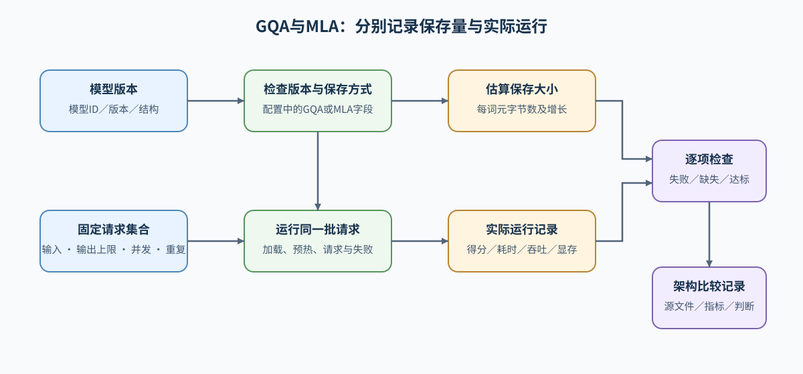
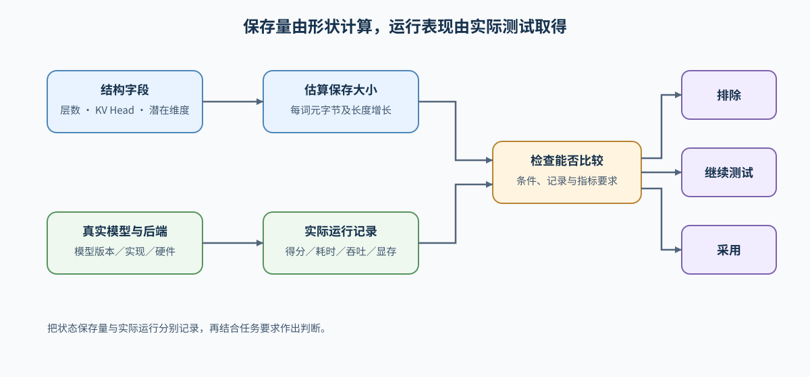

# 71. MLA KV Cache Architecture Benchmark | MLA 与 KV Cache 结构基准

**难度：** Hard | **环境：** [CPU 主线，GPU 可选](#runtime-environment) | **标签：** `推理优化`、`MLA`、`KV Cache` | **目标人群：** 理解KV缓存、希望比较不同保存方式的读者

> 🚀 **云端运行环境**
>
> 本章节的实战代码可以点击以下链接在免费 GPU 算力平台上直接运行：
>
> [](https://colab.research.google.com/github/datawhalechina/llm-algo-leetcode/blob/main/02_PyTorch_Algorithms/71_MLA_KV_Cache_Architecture_Benchmark.ipynb)
> [](https://modelscope.cn/my/mynotebook) *(国内推荐：魔搭社区免费实例)*


## 本节导读

输入变长后，KV缓存会持续增长。GQA通过共享KV头减少保存量，MLA则把内容写进较低维的状态，再单独保存位置分量。每个词元保存的数据更少后，模型能否在现有显存中运行，请求又能快多少？

本项目先根据状态形状估算大小，再检查本地模型与显存条件，分别运行相同请求并读取耗时和显存。两组模型还可能在权重、训练和实现上不同，因此要列出这些差异，分别报告表现，而不是把全部变化都解释为MLA的作用。

<a id="runtime-environment"></a>
## 运行环境

CPU部分使用Python标准库，检查比较条件、状态大小与筛选规则。真实服务实验使用本地模型文件和vLLM环境，入口见[模型架构专题项目环境](../topic_discussion/llm_architecture_evolution/quickstart.md#项目与推理服务环境)。模型文件包括权重、配置和分词器；具体版本由commit标识记录。

## 前置阅读

先理解KV缓存的形状和增长，再看MLA怎样改变保存对象。

- [04. Attention / MHA / GQA](04_Attention_MHA_GQA.md)：核对查询头和KV头的对应关系。
- [ARCH-MLA. MLA与紧凑KV表示](ARCH-MLA_Multihead_Latent_Attention.md)：区分低维内容状态、位置分量与读取计算。
- [Part01·11. KV Cache与显存增长](../01_Hardware_Math_and_Systems/11_KV_Cache_and_Memory_Growth.md)：按层数、长度和数据类型估算缓存占用。

## Step 1：固定两个模型和同一批请求

分别记录GQA与MLA模型的版本、结构和训练设置，再固定请求、生成上限、并发和重复次数。两组都处理完这些请求后，把答案、耗时、显存和失败原因放在一起比较。系列名称相同或声明“只改表示”，都还需要实际配置支持。

| 比较步骤 | 输入 | 检查或执行什么 | 保存什么 |
| --- | --- | --- | --- |
| 检查模型 | 模型版本、结构配置与训练记录 | 确认历史状态的保存方式，并列出其他差异 | 两组实际条件 |
| 估算状态大小 | 层数、状态维度、长度和数据类型 | 分别计算GQA与MLA保存的字节数 | 按配置算出的大小 |
| 运行相同请求 | 请求集、生成上限、并发和重复次数 | 记录加载、请求执行和回退 | 原始结果与日志 |
| 判断下一步 | 实测指标、任务得分与资源预算 | 区分失败、缺测和已满足的要求 | 继续测试、排除或采用的原因 |



## Step 2：把状态大小估算与实际运行分开

设批大小为 $B$、输入长度为 $L$、层数为 $N$、每个元素的字节数为 $s$。GQA每层有 $H_{kv}$ 个KV头，每头维度为 $D_h$，K和V两份历史共需 $2BLNH_{kv}D_hs$ 字节。简化MLA保存维度为 $D_{latent}$ 的内容状态和维度为 $D_{rope}$ 的位置分量，共需 $BLN(D_{latent}+D_{rope})s$ 字节。

这两个式子计算保存对象的大小。实际运行还会分配中间张量和内核工作区；不同模型也可能使用不同宽度、权重或注意力实现。因此先检查状态是否更小，再读取实际耗时和峰值显存，两类数值分别保留。

| 检查对象 | 使用什么 | 得到什么 |
| --- | --- | --- |
| 模型配置 | 层数、KV头数、潜在状态和位置分量维度 | 确认需要保存的形状 |
| 状态大小估算 | 相同批大小、长度和数据类型 | 每层、每词元与整段历史的字节数 |
| 模型与后端运行 | 同一批请求的输出、日志和指标 | 当前模型的得分、延迟、吞吐与峰值显存 |



## Step 3：检查是否满足当前任务

先检查两组是否成功加载、请求是否完成、运行条件是否一致；再查看任务得分和峰值显存。要进一步解释表示变化的作用，还需匹配训练数据、训练方案和其他架构设置。不同条件同时变化时，保留各模型的结果，继续寻找能比较的模型或任务。


本项目在满足要求的方案中先比较峰值显存，再比较首词元之后的平均每词元耗时，最后用模型ID处理并列结果。

| 判断 | 什么情况触发 | 下一步 |
| --- | --- | --- |
| 尚未测量（`pending`） | 尚无两组运行结果 | 执行并保存原始记录 |
| 排除（`reject`） | 模型或请求记录不匹配、运行失败，或已有质量与显存检查未通过 | 修复问题或取消当前方案 |
| 继续测试（`tune`） | 缺少指标或匹配条件，只能分别报告模型表现 | 补对应任务与运行记录 |
| 采用（`accept`） | 条件匹配，任务得分与显存满足要求 | 保存当前任务下的判断，交给架构比较项目汇总 |


```python
from typing import Dict

```

## Step 4：核对两组条件并筛选方案

题目提供模型配置、请求设置和简化结果。字段读取与输出结构已给出，补全条件比较、状态大小计算、指标检查和排序规则。

| 任务与目的 | 已知条件 | 完成标准 | 测试验证 |
| --- | --- | --- | --- |
| TODO 1：比较实际条件 | 两个模型的训练、结构与请求设置 | 识别其他条件变化与请求不一致，不能只相信变化声明 | 缺训练记录、训练设置变化、批大小或长度变化 |
| TODO 2：计算保存字节数 | 状态形状、元素字节数、层数和长度 | 分别计算GQA与简化MLA的状态大小 | 非法维度、具体字节数与长度翻倍 |
| TODO 3：检查结果是否齐全且达标 | 运行失败、任务得分、显存及后端记录 | 保留失败与缺失，按质量下限和显存上限判断 | 请求失败、缺测与阈值检查 |
| TODO 4：按本项目目标排序 | 已满足要求的方案 | 先比较显存，再比较首词元之后的平均每词元耗时 | 空集合、未合格方案和排序方向 |


```python
def validate_comparison_contract(baseline, candidate, baseline_workload, candidate_workload):
    """核对模型身份、表示类型和配对工作负载。"""
    issues = []
    required_identity = ('model_id', 'revision', 'representation')
    for role, model in (('baseline', baseline), ('candidate', candidate)):
        issues.extend(f'{role}.{key}' for key in required_identity if not model.get(key))
    comparable_fields = ('prompt_set_id', 'batch_size', 'sequence_length', 'max_tokens', 'concurrency', 'warmup', 'repeats')
    mismatches = [key for key in comparable_fields
                  if key not in baseline_workload or key not in candidate_workload
                  or baseline_workload[key] != candidate_workload[key]]
    issues.extend(f'workload.{key}' for key in mismatches)
    training_fields = ('data_revision', 'recipe_revision', 'train_tokens', 'seed')
    structural_fields = ('hidden_size', 'num_heads', 'num_layers')
    base_training, candidate_training = baseline.get('training_conditions', {}), candidate.get('training_conditions', {})
    base_structure, candidate_structure = baseline.get('architecture_config', {}), candidate.get('architecture_config', {})
    complete = all(base_training.get(field) is not None and base_training.get(field) != ''
                   and candidate_training.get(field) is not None and candidate_training.get(field) != ''
                   for field in training_fields)
    complete = complete and all(type(base_structure.get(field)) is int and base_structure[field] > 0
                                and type(candidate_structure.get(field)) is int and candidate_structure[field] > 0
                                for field in structural_fields)
    same_training = complete and base_training == candidate_training
    same_structure = complete and base_structure == candidate_structure
    same_storage_type = baseline.get('dtype_bytes') == candidate.get('dtype_bytes')
    representation_changed = baseline.get('representation') != candidate.get('representation')
    # TODO 1：根据实际训练、结构与请求条件判断本次比较。
    # conditions_match：训练记录与其他结构匹配、存储数据类型相同，且表示实际改变。
    conditions_match = ...
    raise NotImplementedError('请完成 TODO 1：实际比较条件')
    comparison_mode = 'controlled' if not issues and conditions_match else 'observational'
    return {'valid': not issues, 'issues': issues, 'comparison_mode': comparison_mode}


def build_state_ledger(model, workload):
    """根据已归一化的结构字段计算每个候选的理论状态字节数。"""
    dimensions = [workload['batch_size'], workload['sequence_length'], model['num_layers'], model['dtype_bytes']]
    if any(not isinstance(value, int) or value <= 0 for value in dimensions):
        raise ValueError('工作负载和公共结构维度必须是正整数')
    representation = model['representation']
    # TODO 2：GQA 保存 K/V 两份状态；MLA 保存潜在状态与位置分量。
    # bytes_per_token_layer = ???
    raise NotImplementedError('请先完成 TODO 2')


def qualify_architecture_evidence(record, limits):
    """检查请求是否成功、条件是否匹配、得分和显存是否满足要求。"""
    failures = list(record.get('failures', []))
    missing = []
    if not record.get('workload_comparable', False):
        failures.append('workload_mismatch')
    if not record.get('backend_capability_observed', False):
        failures.append('backend_capability')
    for field in ('quality_score', 'peak_memory_mb'):
        if record.get(field) is None:
            missing.append(field)
    # TODO 3：请求或能力检查失败时排除；缺少指标或匹配条件时继续测试；记录齐全再检查阈值。
    # status = ???
    raise NotImplementedError('请先完成 TODO 3')


def select_architecture_candidate(candidates):
    """从已满足要求的方案中先比较显存，再比较首词元之后的平均每词元耗时。"""
    accepted = [item for item in candidates if item['status'] == 'accept']
    if not accepted:
        return {'decision': 'tune' if candidates else 'reject', 'candidate': None}
    # TODO 4：按峰值显存、TPOT、模型 ID 依次排序，保证结果稳定。
    # selected = ???
    raise NotImplementedError('请先完成 TODO 4')

```

## 测试


```python
BASELINE_MODEL = {
    'model_id': 'toy-gqa', 'revision': 'gqa-commit', 'representation': 'gqa',
    'family_id': 'toy-family', 'training_recipe_id': 'recipe-v1',
    'num_layers': 2, 'num_kv_heads': 8, 'head_dim': 128, 'dtype_bytes': 2,
}
CANDIDATE_MODEL = {
    'model_id': 'toy-mla', 'revision': 'mla-commit', 'representation': 'mla',
    'family_id': 'toy-family', 'training_recipe_id': 'recipe-v1', 'changed_fields': ['representation'],
    'num_layers': 2, 'latent_dim': 512, 'rope_dim': 64, 'dtype_bytes': 2,
}
TRAINING = {'data_revision': 'data-a', 'recipe_revision': 'recipe-commit-a', 'train_tokens': 10000, 'seed': 0}
STRUCTURE = {'hidden_size': 1024, 'num_heads': 8, 'num_layers': 2}
BASELINE_MODEL.update(training_conditions=TRAINING, architecture_config=STRUCTURE)
CANDIDATE_MODEL.update(training_conditions=dict(TRAINING), architecture_config=dict(STRUCTURE))
WORKLOAD = {
    'prompt_set_id': 'fixed-prompts-v1', 'batch_size': 1, 'sequence_length': 1024,
    'max_tokens': 64, 'concurrency': 1, 'warmup': 2, 'repeats': 5,
}
LIMITS = {'quality_min': 0.80, 'peak_memory_mb_max': 12000}

def test_comparison_contract():
    """核对实际训练、结构和所有请求设置。"""
    result = validate_comparison_contract(BASELINE_MODEL, CANDIDATE_MODEL, WORKLOAD, WORKLOAD)
    assert result == {'valid': True, 'issues': [], 'comparison_mode': 'controlled'}
    observational = validate_comparison_contract(BASELINE_MODEL, {**CANDIDATE_MODEL, 'training_conditions': {**TRAINING, 'recipe_revision': 'other'}}, WORKLOAD, WORKLOAD)
    assert observational['comparison_mode'] == 'observational'
    for changes in ({'training_conditions': {}},
                    {'training_conditions': {**TRAINING, 'data_revision': None}},
                    {'architecture_config': {**STRUCTURE, 'hidden_size': 2048}},
                    {'dtype_bytes': 4}, {'representation': 'gqa'}):
        assert validate_comparison_contract(BASELINE_MODEL, {**CANDIDATE_MODEL, **changes}, WORKLOAD, WORKLOAD)['comparison_mode'] == 'observational'
    for field, value in (('batch_size', 2), ('sequence_length', 2048)):
        assert not validate_comparison_contract(BASELINE_MODEL, CANDIDATE_MODEL, WORKLOAD, {**WORKLOAD, field: value})['valid']
    changed = {**WORKLOAD, 'max_tokens': 32}
    assert 'workload.max_tokens' in validate_comparison_contract(BASELINE_MODEL, CANDIDATE_MODEL, WORKLOAD, changed)['issues']

def test_state_ledger():
    """检查GQA与MLA字节数及长度增长。"""
    gqa = build_state_ledger(BASELINE_MODEL, WORKLOAD)
    mla = build_state_ledger(CANDIDATE_MODEL, WORKLOAD)
    assert gqa['state_bytes'] == 8388608
    assert mla['state_bytes'] == 2359296
    assert build_state_ledger(CANDIDATE_MODEL, {**WORKLOAD, 'sequence_length': 2048})['state_bytes'] == 2 * mla['state_bytes']

def test_evidence_gate():
    """区分失败、缺失和指标未达标。"""
    complete = {
        'model_id': 'toy-mla', 'comparison_mode': 'controlled', 'workload_comparable': True,
        'backend_capability_observed': True, 'quality_score': 0.84,
        'peak_memory_mb': 6200, 'tpot_ms': 8.0, 'failures': [],
    }
    assert qualify_architecture_evidence(complete, LIMITS)['status'] == 'accept'
    assert qualify_architecture_evidence({**complete, 'quality_score': None}, LIMITS)['status'] == 'tune'
    assert qualify_architecture_evidence({**complete, 'failures': ['request_failed']}, LIMITS)['status'] == 'reject'
    assert qualify_architecture_evidence({**complete, 'quality_score': 0.79}, LIMITS)['status'] == 'reject'
    assert qualify_architecture_evidence({**complete, 'peak_memory_mb': 12001}, LIMITS)['status'] == 'reject'

def test_candidate_selection():
    """检查显存优先的排序和空集合。"""
    candidates = [
        {'model_id': 'a', 'status': 'accept', 'peak_memory_mb': 7000, 'tpot_ms': 7.0},
        {'model_id': 'b', 'status': 'accept', 'peak_memory_mb': 6000, 'tpot_ms': 8.0},
    ]
    assert select_architecture_candidate(candidates) == {'decision': 'accept', 'candidate': 'b'}
    assert select_architecture_candidate([]) == {'decision': 'reject', 'candidate': None}

test_comparison_contract()
test_state_ledger()
test_evidence_gate()
test_candidate_selection()
print('测试通过：比较条件、保存量与方案选择规则通过测试。')

```

---
🛑 **STOP HERE** 🛑
请先完成CPU练习并运行测试，再查看参考答案。
---

## 参考代码与解析

### 代码

```python
def validate_comparison_contract(baseline, candidate, baseline_workload, candidate_workload):
    """核对模型身份、表示类型和配对工作负载。"""
    issues = []
    required_identity = ('model_id', 'revision', 'representation')
    for role, model in (('baseline', baseline), ('candidate', candidate)):
        issues.extend(f'{role}.{key}' for key in required_identity if not model.get(key))
    comparable_fields = ('prompt_set_id', 'batch_size', 'sequence_length', 'max_tokens', 'concurrency', 'warmup', 'repeats')
    mismatches = [key for key in comparable_fields
                  if key not in baseline_workload or key not in candidate_workload
                  or baseline_workload[key] != candidate_workload[key]]
    issues.extend(f'workload.{key}' for key in mismatches)
    training_fields = ('data_revision', 'recipe_revision', 'train_tokens', 'seed')
    structural_fields = ('hidden_size', 'num_heads', 'num_layers')
    base_training, candidate_training = baseline.get('training_conditions', {}), candidate.get('training_conditions', {})
    base_structure, candidate_structure = baseline.get('architecture_config', {}), candidate.get('architecture_config', {})
    complete = all(base_training.get(field) is not None and base_training.get(field) != ''
                   and candidate_training.get(field) is not None and candidate_training.get(field) != ''
                   for field in training_fields)
    complete = complete and all(type(base_structure.get(field)) is int and base_structure[field] > 0
                                and type(candidate_structure.get(field)) is int and candidate_structure[field] > 0
                                for field in structural_fields)
    same_training = complete and base_training == candidate_training
    same_structure = complete and base_structure == candidate_structure
    same_storage_type = baseline.get('dtype_bytes') == candidate.get('dtype_bytes')
    representation_changed = baseline.get('representation') != candidate.get('representation')
    # TODO 1：根据实际训练、结构与请求条件判断本次比较。
    conditions_match = same_training and same_structure and same_storage_type and representation_changed
    comparison_mode = 'controlled' if not issues and conditions_match else 'observational'
    return {'valid': not issues, 'issues': issues, 'comparison_mode': comparison_mode}


def build_state_ledger(model, workload):
    """根据已归一化的结构字段计算每个候选的理论状态字节数。"""
    dimensions = [workload['batch_size'], workload['sequence_length'], model['num_layers'], model['dtype_bytes']]
    if any(not isinstance(value, int) or value <= 0 for value in dimensions):
        raise ValueError('工作负载和公共结构维度必须是正整数')
    representation = model['representation']
    if representation == 'gqa':
        specific = (model['num_kv_heads'], model['head_dim'])
        if any(not isinstance(value, int) or value <= 0 for value in specific):
            raise ValueError('GQA 结构维度必须是正整数')
        bytes_per_token_layer = 2 * model['num_kv_heads'] * model['head_dim'] * model['dtype_bytes']
    elif representation == 'mla':
        specific = (model['latent_dim'], model['rope_dim'])
        if any(not isinstance(value, int) or value <= 0 for value in specific):
            raise ValueError('MLA 结构维度必须是正整数')
        bytes_per_token_layer = (model['latent_dim'] + model['rope_dim']) * model['dtype_bytes']
    else:
        raise ValueError(f'不支持的状态表示：{representation}')
    state_bytes = workload['batch_size'] * workload['sequence_length'] * model['num_layers'] * bytes_per_token_layer
    return {'model_id': model['model_id'], 'representation': representation, 'state_bytes': state_bytes, 'evidence_level': 'cpu_theoretical_ledger'}


def qualify_architecture_evidence(record, limits):
    """检查请求是否成功、条件是否匹配、得分和显存是否满足要求。"""
    failures = list(record.get('failures', []))
    missing = []
    if not record.get('workload_comparable', False):
        failures.append('workload_mismatch')
    if not record.get('backend_capability_observed', False):
        failures.append('backend_capability')
    for field in ('quality_score', 'peak_memory_mb'):
        if record.get(field) is None:
            missing.append(field)
    if failures:
        status = 'reject'
    elif missing or record.get('comparison_mode') != 'controlled':
        status = 'tune'
    elif record['quality_score'] < limits['quality_min'] or record['peak_memory_mb'] > limits['peak_memory_mb_max']:
        status = 'reject'
    else:
        status = 'accept'
    return {**record, 'status': status, 'gate_failures': failures, 'missing_evidence': missing}


def select_architecture_candidate(candidates):
    """从已满足要求的方案中先比较显存，再比较首词元之后的平均每词元耗时。"""
    accepted = [item for item in candidates if item['status'] == 'accept']
    if not accepted:
        return {'decision': 'tune' if candidates else 'reject', 'candidate': None}
    selected = min(accepted, key=lambda item: (item['peak_memory_mb'], item['tpot_ms'], item['model_id']))
    return {'decision': 'accept', 'candidate': selected['model_id']}

```


```python
test_comparison_contract()
test_state_ledger()
test_evidence_gate()
test_candidate_selection()

```

### 解析

#### TODO 1：比较实际条件

- 逐项比较请求设置，并核对训练记录和其他架构配置。模型名称、系列标签与变化声明只能帮助识别方案，不能代替实际取值。
- `test_comparison_contract` 保留原标签，分别改变训练记录、隐藏宽度、批大小或长度；缺少匹配记录时分别报告模型表现，请求条件不同则标为不可配对。

#### TODO 2：计算保存字节数

- GQA保存K、V两份状态；本题的简化MLA保存内容状态与位置分量。每词元每层的字节数乘以批大小、长度和层数，得到整段保存量。
- `test_state_ledger` 检查两种表示的具体字节数，再将输入长度翻倍，确认估算量也翻倍。

#### TODO 3：区分失败、缺测和未达标

- 请求失败或后端能力检查失败时排除方案；缺少得分、显存或匹配条件时继续测试。记录齐全后，分别检查质量下限和显存上限。
- `test_evidence_gate` 分别移除得分、注入请求失败，再让得分低于下限或显存超过上限，检查返回状态。

#### TODO 4：选择满足要求的方案

- 只让已通过检查的方案参与排序。这个项目优先节省显存，再比较首词元之后的平均每词元耗时；相同数值用模型ID保持顺序稳定。
- `test_candidate_selection` 使用显存与耗时优劣相反的两个方案检查排序方向，并检查空集合。

## Step 5（项目实验）：检查本地模型并运行相同请求

先读取状态表示实验的结果，再检查GQA与MLA模型文件和显存估算。条件满足后依次启动两个服务，分别报告各模型表现。

#### 5.1 本次运行配置

填写唯一标签和阶段，按 `prepare → measure → close` 顺序运行。模型、工作负载和显存预算在 5.2 固定。


```python
RUN_LABEL = 'replace_with_unique_label'
RUN_STAGE = 'prepare'  # prepare / measure / close

```

#### 5.2 检查模型文件与显存估算

读取状态表示结果和本地模型版本，检查保存方式，并根据权重文件大小估算运行所需显存。文件缺失或估算超过预算时列出原因。


```python
from pathlib import Path
import json
import sys

SEMANTIC_ID = 'ARCH-MLA-KV'
RESULT_SCHEMA = 'architecture-evaluation/v1'
MLA_BASELINE_MODEL = 'Qwen/Qwen2.5-0.5B-Instruct'
MLA_CANDIDATE_MODEL = 'deepseek-ai/DeepSeek-V2-Lite'
MODEL_CACHE_RELATIVE = 'model_cache'
MECHANISM_RESULT_RELATIVE = 'benchmarks/results/arch_mla_representation_rtx5070ti_mla_v3.json'
GPU_MEMORY_LIMIT_GB = 10.5
MLA_DTYPE = 'bfloat16'
MLA_WORKLOAD = 'benchmarks/workloads/mla_architecture.jsonl'
MLA_BACKEND_WORKLOAD = {'num_prompts': 4, 'max_tokens': 64, 'temperature': 0.0, 'concurrency': 1, 'warmup': 2, 'repeats': 3}
MLA_RESULT_DIR_RELATIVE = 'benchmarks/results/71_mla_kv_architecture'
if RUN_STAGE not in {'prepare', 'measure', 'close'}:
    raise ValueError(f'未知 RUN_STAGE: {RUN_STAGE}')
if RUN_STAGE != 'prepare' and RUN_LABEL == 'replace_with_unique_label':
    raise ValueError('measure / close 需要唯一 RUN_LABEL。')

MLA_REPOSITORY_ROOT = next(
    (path for path in (Path.cwd(), *Path.cwd().parents) if (path / 'tools' / 'benchmark_inference_backend.py').is_file()),
    None,
)
if MLA_REPOSITORY_ROOT is None:
    raise RuntimeError('未找到 tools/benchmark_inference_backend.py，请从教程仓库中运行本节。')
if str(MLA_REPOSITORY_ROOT) not in sys.path:
    sys.path.insert(0, str(MLA_REPOSITORY_ROOT))

from tools.model_runtime import find_cached_snapshot

MLA_MODEL_CACHE = MLA_REPOSITORY_ROOT / MODEL_CACHE_RELATIVE
MLA_MECHANISM_PATH = MLA_REPOSITORY_ROOT / MECHANISM_RESULT_RELATIVE
MLA_RESULT_DIR = MLA_REPOSITORY_ROOT / MLA_RESULT_DIR_RELATIVE
MLA_EVIDENCE_PATH = MLA_RESULT_DIR / f'71_mla_kv_{RUN_LABEL}.json'
if not MLA_MECHANISM_PATH.is_file():
    raise FileNotFoundError(f'缺少 MLA 机制证据：{MLA_MECHANISM_PATH}')
mechanism_record = json.loads(MLA_MECHANISM_PATH.read_text(encoding='utf-8'))
mechanism_identity = mechanism_record.get('identity', {})
mechanism_ok = (
    mechanism_identity.get('semantic_id') == 'ARCH-MLA-REPRESENTATION-MECHANISM'
    and str(mechanism_record.get('decision', '')).startswith('accept_')
)

def inspect_local_model(model_id, expected_representation):
    snapshot = find_cached_snapshot(model_id, MLA_MODEL_CACHE)
    if snapshot is None:
        return {'model_id': model_id, 'asset_ready': False, 'representation': None,
                'expected_representation': expected_representation, 'reason': 'asset_missing'}
    config = json.loads((snapshot / 'config.json').read_text(encoding='utf-8'))
    if config.get('kv_lora_rank') and config.get('qk_rope_head_dim'):
        representation = 'mla'
    elif config.get('num_key_value_heads'):
        representation = 'gqa' if config.get('num_key_value_heads') < config.get('num_attention_heads', 0) else 'mha'
    else:
        representation = 'unknown'
    weight_bytes = sum(
        path.stat().st_size for path in snapshot.rglob('*')
        if path.is_file() and path.suffix in {'.safetensors', '.bin'}
    )
    weight_gb = weight_bytes / 1024**3
    estimated_runtime_gb = weight_gb * 1.2 + 1.0
    return {
        'model_id': model_id, 'revision': snapshot.name, 'snapshot': str(snapshot),
        'asset_ready': True, 'representation': representation,
        'expected_representation': expected_representation,
        'representation_ok': representation == expected_representation,
        'weight_files_gb': round(weight_gb, 3),
        'estimated_runtime_gb': round(estimated_runtime_gb, 3),
        'capacity_ok': estimated_runtime_gb <= GPU_MEMORY_LIMIT_GB,
    }

MLA_MODEL_ADMISSION = {
    'baseline': inspect_local_model(MLA_BASELINE_MODEL, 'gqa'),
    'candidate': inspect_local_model(MLA_CANDIDATE_MODEL, 'mla'),
}
admission_failures = []
if not mechanism_ok:
    admission_failures.append('mechanism_evidence_not_accepted')
for role, record in MLA_MODEL_ADMISSION.items():
    if not record.get('asset_ready'):
        admission_failures.append(f'{role}.asset_missing')
    elif not record.get('representation_ok'):
        admission_failures.append(f'{role}.representation_mismatch')
    elif not record.get('capacity_ok'):
        admission_failures.append(f'{role}.capacity_exceeded')
MLA_ADMISSION = {
    'status': 'runnable' if not admission_failures else 'blocked',
    'failures': admission_failures,
    'mechanism_ok': mechanism_ok,
    'models': MLA_MODEL_ADMISSION,
}
print(json.dumps(MLA_ADMISSION, ensure_ascii=False, indent=2))

```

#### 5.3 核对请求设置与启动条件

两组使用相同请求文件、生成长度、并发、预热和重复次数。两组还在权重和结构上不同，因此分别报告表现，并列出差异。


```python
# 只读展示；需要修改请求条件时回到 5.1。
workload_path = MLA_REPOSITORY_ROOT / MLA_WORKLOAD
if not workload_path.is_file():
    raise FileNotFoundError(f'冻结 workload 不存在：{workload_path}')
workload_rows = [json.loads(line) for line in workload_path.read_text(encoding='utf-8').splitlines() if line.strip()]
if len(workload_rows) != MLA_BACKEND_WORKLOAD['num_prompts']:
    raise ValueError('MLA_BACKEND_WORKLOAD.num_prompts 与 JSONL 请求数不一致')
print({'workload': MLA_WORKLOAD, **MLA_BACKEND_WORKLOAD, 'admission_status': MLA_ADMISSION['status']})

```

#### 5.4 执行后端对照

`measure` 在模型与显存检查通过后顺序启动 GQA 与 MLA 服务；其他阶段不启动后端。


```python
if RUN_STAGE == 'measure':
    MLA_RESULT_DIR.mkdir(parents=True, exist_ok=True)
MLA_RESULT_PATHS = {
    role: MLA_RESULT_DIR / f'71_{role}_{RUN_LABEL}.json'
    for role in ('baseline', 'candidate')
}
MLA_BACKEND_REPORTS = None
MLA_BACKEND_FAILURES = {}
if RUN_STAGE == 'measure' and MLA_ADMISSION['status'] == 'runnable':
    import importlib
    from tools import backend_runtime
    from tools import inference_project_runtime as inference_runtime
    backend_runtime = importlib.reload(backend_runtime)
    inference_runtime = importlib.reload(inference_runtime)
    MLA_BACKEND_REPORTS = {}
    for role in ('baseline', 'candidate'):
        model_record = MLA_MODEL_ADMISSION[role]
        server = log_handle = None
        try:
            server, log_handle, port, selected_dtype, _ = inference_runtime.start_optional_vllm(
                model_id=model_record['snapshot'], model_source='local', cache_dir=MLA_MODEL_CACHE,
                dtype=MLA_DTYPE, max_model_len=2048, gpu_memory_utilization=0.8,
                enforce_eager=True, served_model_name=model_record['model_id'],
                log_path=MLA_RESULT_DIR / f'71_{role}_{RUN_LABEL}.log',
            )
            MLA_BACKEND_REPORTS[role] = inference_runtime.run_backend_benchmark(
                project='71', base_url=f'http://127.0.0.1:{port}', model=model_record['model_id'],
                label=f'mla_{role}', output=MLA_RESULT_PATHS[role], workload=MLA_WORKLOAD,
                num_prompts=MLA_BACKEND_WORKLOAD['num_prompts'],
                max_tokens=MLA_BACKEND_WORKLOAD['max_tokens'],
                concurrency=MLA_BACKEND_WORKLOAD['concurrency'], warmup=MLA_BACKEND_WORKLOAD['warmup'],
                repeats=MLA_BACKEND_WORKLOAD['repeats'], temperature=MLA_BACKEND_WORKLOAD['temperature'],
                backend='vllm', dtype=selected_dtype, role=role, include_requests=True,
                measure_device_peak_memory=True, quiet=True,
            )
        except Exception as exc:
            MLA_BACKEND_FAILURES[role] = {'type': type(exc).__name__, 'message': str(exc)}
            break
        finally:
            inference_runtime.stop_optional_vllm(server, log_handle)
    if MLA_BACKEND_FAILURES:
        print(json.dumps({'backend_failures': MLA_BACKEND_FAILURES}, ensure_ascii=False, indent=2))
        MLA_BACKEND_REPORTS = None
else:
    reason = MLA_ADMISSION['failures'] if MLA_ADMISSION['status'] != 'runnable' else ['execution_disabled']
    print({'backend_run': 'skipped', 'reason': reason})

```

#### 5.5 读取模型检查与运行结果

核对两组请求设置、模型检查结果与后端指标。未测得的值保留为空，避免把缺测误读成零开销。


```python
if MLA_BACKEND_REPORTS is None and all(path.is_file() for path in MLA_RESULT_PATHS.values()):
    MLA_BACKEND_REPORTS = {role: json.loads(path.read_text(encoding='utf-8'))
                           for role, path in MLA_RESULT_PATHS.items()}
if MLA_BACKEND_REPORTS is not None:
    comparable_keys = ('requests', 'max_tokens', 'concurrency', 'warmup', 'repeats')
    baseline_workload = MLA_BACKEND_REPORTS['baseline']['workload']
    candidate_workload = MLA_BACKEND_REPORTS['candidate']['workload']
    mismatches = [key for key in comparable_keys if baseline_workload.get(key) != candidate_workload.get(key)]
    if mismatches:
        raise ValueError(f'backend workload 不一致：{mismatches}')
    for role, report in MLA_BACKEND_REPORTS.items():
        metrics = report['metrics']
        normalized = report.get('normalized_result', {})
        print(role, {
            'model': report['model'],
            'ttft_ms': metrics['ttft_ms'],
            'tpot_ms': metrics['tpot_ms'],
            'throughput_tokens_per_s': metrics['output_token_throughput_per_s'],
            'peak_memory_mb': normalized.get('metrics', {}).get('peak_memory_mb'),
        })
else:
    mechanism_rows = mechanism_record.get('metrics', {}).get('rows', [])
    longest = max((row.get('sequence_length', 0) for row in mechanism_rows), default=0)
    mechanism_view = [
        {key: row.get(key) for key in ('sequence_length', 'representation', 'cache_bytes',
                                        'materialized_kv_bytes', 'mean_step_ms', 'peak_memory_mb')}
        for row in mechanism_rows if row.get('sequence_length') == longest
    ]
    print(json.dumps({'backend_pair': 'not_recorded', 'mechanism_longest_sequence': mechanism_view},
                     ensure_ascii=False, indent=2))

```

#### 5.6 保存比较结果

`close` 保存状态实验的来源、模型检查结果和已有运行指标；`prepare`、`measure` 不生成最终比较记录。

**当前登记结果**

| 字段 | 登记内容 |
| --- | --- |
| 项目与标签 | 71 节 MLA / KV Cache 架构比较；`rtx5070ti_mla_architecture_v1` |
| 运行条件 | RTX 5070 Ti Laptop GPU；单卡12 GB，检查模型是否能在预算内运行 |
| 原始证据 | 无真实 MLA backend 测量；模型检查阶段记录了文件不足 |
| 正式证据 | [架构判断](../../benchmarks/results/71_mla_kv_architecture/71_mla_kv_rtx5070ti_mla_architecture_v1.json) |
| 清单与交接 | 无；缺少能在当前显存预算下运行的本地MLA模型 |
| 结论 | `tune`（运行状态 `blocked`）：已有记录可解释状态保存量；两组服务尚未实际运行 |

```python
if RUN_STAGE == 'close':
    from tools.architecture_result_schema import make_producer_record, save_record

    reports_ok = (
        MLA_BACKEND_REPORTS is not None
        and set(MLA_BACKEND_REPORTS) == {'baseline', 'candidate'}
        and all(report.get('metrics', {}).get('successful_requests') == MLA_BACKEND_WORKLOAD['num_prompts']
                and report.get('metrics', {}).get('failed_requests') == 0
                for report in MLA_BACKEND_REPORTS.values())
    )

    def backend_cost(report):
        metrics = report.get('metrics', {})
        normalized_metrics = report.get('normalized_result', {}).get('metrics', {})
        return {
            'ttft_ms': metrics.get('ttft_ms'), 'tpot_ms': metrics.get('tpot_ms'),
            'throughput_tokens_per_s': metrics.get('output_token_throughput_per_s'),
            'peak_memory_mb': normalized_metrics.get('peak_memory_mb'),
        }

    mechanism_rows = mechanism_record.get('metrics', {}).get('rows', [])
    longest = max((row.get('sequence_length', 0) for row in mechanism_rows), default=0)
    theoretical_cost = {
        row['representation']: {
            'sequence_length': row.get('sequence_length'), 'cache_bytes': row.get('cache_bytes'),
            'materialized_kv_bytes': row.get('materialized_kv_bytes'),
        }
        for row in mechanism_rows
        if row.get('sequence_length') == longest and row.get('representation') in {'gqa_shared_kv', 'latent_kv_absorbed_proxy'}
    }
    if reports_ok:
        record_status, evidence_level = 'ok', 'observational_gpu_benchmark'
        failure = {}
        decision_reason = '真实配对完成；仍需匹配质量集与 MLA kernel 证据'
        cost = {role: backend_cost(report) for role, report in MLA_BACKEND_REPORTS.items()}
    elif MLA_BACKEND_FAILURES:
        record_status, evidence_level = 'failed', 'theoretical'
        failure = {'reason': 'backend_execution_failed', 'details': MLA_BACKEND_FAILURES}
        decision_reason = '后端执行失败，保留机制证据并修复后复测'
        cost = {'theoretical_mechanism': theoretical_cost}
    else:
        record_status, evidence_level = 'blocked', 'theoretical'
        failure = {'reason': 'backend_admission_blocked', 'details': MLA_ADMISSION['failures']}
        decision_reason = '机制证据有效，但真实 MLA 候选尚未通过资产与容量准入'
        cost = {'theoretical_mechanism': theoretical_cost}

    architecture_record = make_producer_record(
        semantic_id=SEMANTIC_ID, comparison_mode='observational',
        source={
            'notebook': '02_PyTorch_Algorithms/71_MLA_KV_Cache_Architecture_Benchmark.ipynb',
            'mechanism_result': str(MLA_MECHANISM_PATH.relative_to(MLA_REPOSITORY_ROOT)),
            'raw_result_paths': {role: str(path.relative_to(MLA_REPOSITORY_ROOT))
                                 for role, path in MLA_RESULT_PATHS.items() if path.is_file()},
        },
        runtime={'backend': 'vllm', 'dtype': MLA_DTYPE, 'device': 'cuda',
                 'gpu_memory_limit_gb': GPU_MEMORY_LIMIT_GB, 'run_label': RUN_LABEL},
        workload={'source': MLA_WORKLOAD, **MLA_BACKEND_WORKLOAD},
        baseline={'name': 'gqa_reference', **MLA_MODEL_ADMISSION['baseline']},
        candidates=[{'name': 'mla_candidate', **MLA_MODEL_ADMISSION['candidate']}],
        quality={'status': 'not_recorded', 'reason': 'independent matched quality set is required'},
        cost=cost,
        mechanism={
            'source_identity': mechanism_identity, 'mechanism_accepted': mechanism_ok,
            'baseline_representation': 'gqa', 'candidate_representation': 'mla',
            'backend_capability_observed': reports_ok,
            'theoretical_ledger_is_measured_memory': False,
        },
        evidence_level=evidence_level, status=record_status, failure=failure,
        decision={'status': 'tune', 'reason': decision_reason,
                  'next_action': ('add matched quality and kernel evidence' if reports_ok
                                  else 'provide a local MLA artifact that fits the memory budget')},
    )
    if MLA_EVIDENCE_PATH.exists():
        print(f'Evidence already exists and was not overwritten: {MLA_EVIDENCE_PATH.relative_to(MLA_REPOSITORY_ROOT)}')
    else:
        save_record(MLA_EVIDENCE_PATH, architecture_record)
        print(f'Saved evidence: {MLA_EVIDENCE_PATH.relative_to(MLA_REPOSITORY_ROOT)}')
    print(json.dumps({'status': record_status, 'decision': architecture_record['decision'],
                      'admission': MLA_ADMISSION['status']}, ensure_ascii=False, indent=2))
else:
    print(f'跳过收口：RUN_STAGE={RUN_STAGE}')

```

## 相关阅读

- [61. 模型架构审计](./61_Model_Architecture_Exploration.md)
- [74. 性能分析驱动的端到端优化](./74_Profiling_Driven_End_to_End_Optimization.md)
- [81. 分布式推理项目](./81_Distributed_Inference_Project.md)
