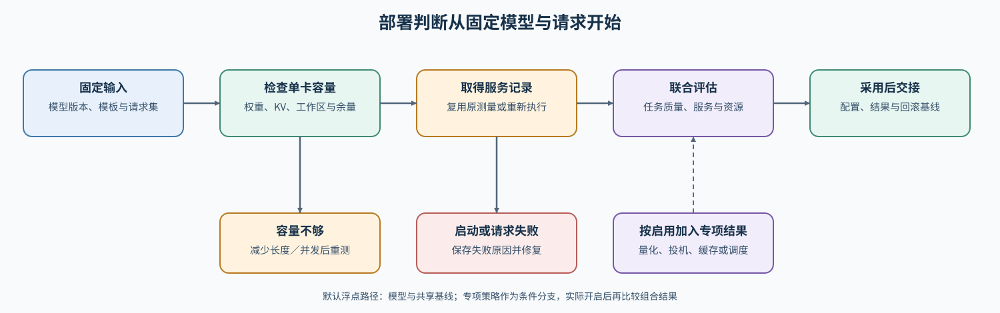
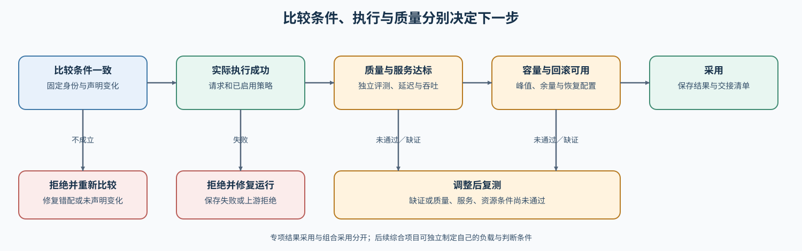

# 72. Multi Model Deployment Comparison | Single-GPU Deployment and Backend Comparison

**难度：** Hard | **环境：** [CPU 主线，GPU 可选](#runtime-environment) | **标签：** `推理优化`、`单卡部署`、`vLLM`、`SGLang`、`部署交接` | **目标人群：** 理解服务指标、需要判断部署候选的读者

> 🚀 **云端运行环境**
>
> 本章节的实战代码可以点击以下链接在免费 GPU 算力平台上直接运行：
>
> [](https://colab.research.google.com/github/datawhalechina/llm-algo-leetcode/blob/main/02_PyTorch_Algorithms/72_Multi_Model_Deployment_Comparison.ipynb)
> [](https://modelscope.cn/my/mynotebook) *(国内推荐：魔搭社区免费实例)*


## 本节导读

模型已经能回答请求，为什么还不能决定部署？同一组请求可能全部返回，却回答错误；显存也可能只在短输入下够用。采用一个服务配置，需要把请求完成、任务质量、延迟、吞吐与资源占用分别核对。

从固定模型和请求集出发，先比较候选的实际变化，再判断已有结果是否足以支持采用。默认浮点服务可以独立评估；量化、投机解码、前缀缓存和调度策略在启用时各自补充证据，最后保留可恢复的基线配置。

**关键词：** 模型版本、请求负载、服务目标、显存余量、回滚配置

<a id="runtime-environment"></a>

## 运行环境

- **基础练习：** 使用 [BASE-CPU](../guide.md#base-cpu)，检查候选配对、指标门槛与决策。
- **服务记录与可选复测：** 使用 [INF-VLLM-011-CU128](../topic_discussion/inference_optimization/quickstart.md#inf-vllm-quickstart)。现有执行入口为 vLLM；默认读取已保存结果，重新测量时需要单卡 GPU 和本地模型。

## 前置阅读

先明确请求计时与统计口径，再判断候选能否满足同一负载的要求。

- [共享推理基线](./66_Inference_Performance_Comparison.md)：固定模型、请求清单与服务指标。
- [服务迭代成本与批次容量上界](./INF-ITERATION-BUDGET_Serving_Iteration_Cost_and_Batch_Bounds.md)：区分活跃请求数量、KV 容量与延迟限制。

## Step 1：从固定模型到单卡部署判断

部署候选是一组可以实际启动的模型、加载方式、后端配置和请求处理规则。共享基线记录参照配置的运行结果，候选则说明改了哪些条件。权重或后端变化会影响数值与性能，比较前先固定模型版本、分词器、聊天模板、请求集和生成规则，再逐项声明允许变化的部分。

最终交接要让另一人能找到同一模型、恢复服务配置、复查结果，并在候选失败时回到基线。默认浮点路径使用模型与基线记录；启用专项策略时，再加入相应策略在当前负载中的结果。

| 项目阶段 | 检查对象 | 主要动作 | 留下的结果 |
| --- | --- | --- | --- |
| 固定比较条件 | 模型、分词器、模板与请求集 | 保存版本与内容摘要，声明候选变化 | 基线与候选的身份记录 |
| 检查容量 | 常驻权重、KV、工作区与余量 | 估算后再测目标长度和并发 | 可加载配置与实际峰值 |
| 执行服务 | 后端配置与同一请求清单 | 记录返回内容、时间与失败 | 原始请求和运行记录 |
| 联合判断 | 任务质量、服务指标与资源 | 与各自门槛比较 | 采用、调整或拒绝 |
| 准备交接 | 采用配置与回滚基线 | 保存结果引用和恢复方法 | 部署交接清单 |



## Step 2：模型身份与显存占用怎样限制候选

模型名称指向一类模型，版本和权重摘要才确定本次加载的文件。分词器与聊天模板决定实际输入词元；数据类型、上下文上限和并发数影响 KV 与工作区。先把显存拆成常驻权重、历史状态、临时工作区及预留余量，再用实际峰值核对估算。

启动参数说明希望使用的路径，加载日志和运行观测说明实际走了哪条路径。量化加载器、缓存开关或调度策略发生回退时，应先记录回退原因，再将实际路径纳入比较。服务等级目标（SLO）是给当前请求负载约定的延迟、成功率或吞吐要求，各指标的比较方向需要分别声明。

| 检查对象 | 读取什么 | 如何比较 | 不满足时怎样处理 |
| --- | --- | --- | --- |
| 模型与输入 | 权重版本、分词器、聊天模板 | 固定身份一致，候选变化已声明 | 修正来源后重新加载 |
| 加载路径 | 文件格式、摘要、加载器和日志 | 实际文件与候选声明相符 | 更换文件或兼容后端 |
| 显存 | 权重、KV、工作区、峰值和余量 | 峰值在预算内且留有余量 | 减少长度或并发，再测峰值 |
| 执行策略 | 配置、日志和策略统计 | 缓存、投机或调度实际生效 | 排查回退并重新采集 |
| 请求负载 | 内容、输出上限、采样与并发 | 两组采用同一请求和测量规则 | 重新构造可比的运行 |

## Step 3：哪些结果支持采用，哪些需要调整

先核对候选是否可比、服务是否运行成功，再检查实际启用策略的证据。未启用的量化或缓存策略可以保留为其他负载的参考，不进入当前候选的采用条件。某项策略在自己的请求集上通过后，还要回到当前模型、请求分布和组合配置重新测量。

本项目把无法比较、后端失败或已启用策略被拒绝的候选记为拒绝（`reject`），修复原因后重试；缺少证据或服务门槛未达标记为调整（`tune`），保留评估并补测；各项通过后记为采用（`accept`），生成供后续评估使用的配置与结果引用。请求成功返回与回答正确分开检查，回滚则要求基线模型和配置能够恢复。

| 检查顺序 | 比较什么 | 调整或补测 | 拒绝并修复 |
| --- | --- | --- | --- |
| 比较条件 | 固定身份与声明变化 | 补全来源后重新比较 | 已确认身份错配或实际变化未声明 |
| 已启用策略 | 当前模型和负载中的策略结果 | 缺记录或上游仍为调整状态 | 上游已拒绝该候选 |
| 任务质量 | 独立评测及其门槛 | 补评测或调整候选后重测 | 已确认执行错误时修复 |
| 服务目标 | 成功率、TTFT、TPOT 与吞吐 | 调整配置并重新测量 | 服务启动或请求执行失败 |
| 容量与恢复 | 峰值、预算余量和回滚配置 | 降低工作量或补恢复验证 | 候选已无法执行 |



## Step 4：实现部署配对、证据汇总与采用判断

题目提供简化的基线、候选和专项结果，以及字段读取、问题列表与报告骨架。请补全固定身份与声明变化的比较、已启用策略的状态分类、指标门槛和最终决策。测试分别构造可采用候选、未声明变化、缺失结果、上游拒绝、服务目标未达标与后端失败。

| 任务与目的 | 已知条件 | 完成标准 | 测试验证 |
| --- | --- | --- | --- |
| TODO 1：核对部署配对 | 固定身份、实际变化和声明集合 | 固定字段一致，变化与声明相符，容量状态可用 | 合法候选、产物错配与未声明并发变化 |
| TODO 2：汇总专项证据 | 已启用策略及各自结果 | 分开记录缺失、待补与拒绝 | 完整、缺失和混合状态 |
| TODO 3：检查部署门槛 | 质量、成功率、延迟、吞吐、显存和回滚 | 延迟与峰值不超过上限，下限指标达标 | 延迟超限、吞吐不足与容量边界 |
| TODO 4：形成部署状态 | 比较结果、失败、缺口和门槛 | 失败拒绝，缺证或未达标则调整，全部通过才采用 | 三类状态及其优先级 |


```python
from typing import Any, Dict, List

```


```python
# 题目区只挖空会改变部署结论的配对、证据、门槛与状态判断。

def compare_deployment_pair(baseline, candidate):
    """检查固定资产、workload、声明变化和候选容量。"""
    fixed_fields = ('model_id', 'revision', 'tokenizer_revision', 'artifact_digest', 'dtype', 'workload_key')
    controlled_fields = ('backend', 'enabled_strategies', 'max_model_len', 'concurrency')
    mismatches = [field for field in fixed_fields if baseline.get(field) != candidate.get(field)]
    changed_fields = [field for field in controlled_fields if baseline.get(field) != candidate.get(field)]
    declared_changes = sorted(candidate.get('declared_changes', []))
    # ==========================================
    # TODO 1：核对部署配对
    # ==========================================
    # identity_ok = ???  # 所有固定身份字段必须一致
    # changes_ok = ???  # 实际变化集合必须与声明变化集合完全一致且非空
    # capacity_ok = ???  # 候选容量状态必须为 ready
    raise NotImplementedError('TODO 1：请核对部署配对')
    issues = [f'fixed.{field}' for field in mismatches]
    if not changes_ok:
        issues.append('undeclared_or_empty_change')
    if not capacity_ok:
        issues.append('capacity')
    return {'comparable': identity_ok and changes_ok and capacity_ok,
            'issues': issues, 'changed_fields': changed_fields}


def summarize_strategy_evidence(enabled_strategies, evidence_by_strategy):
    """区分缺失、待补和已拒绝的上游证据。"""
    supported = {'quantized_profile', 'speculative', 'prefix_cache', 'scheduler'}
    unknown = sorted(set(enabled_strategies) - supported)
    records = {name: evidence_by_strategy.get(name) for name in enabled_strategies if name in supported}
    missing = sorted(name for name, record in records.items() if record is None)
    statuses = {name: (record or {}).get('decision') for name, record in records.items() if record is not None}
    # ==========================================
    # TODO 2：汇总专项证据
    # ==========================================
    # rejected = ???  # decision 为 reject 的已启用策略
    # incomplete = ???  # decision 不是 accept/reject 或仍待补的已启用策略
    raise NotImplementedError('TODO 2：请汇总专项证据')
    return {'unknown_strategies': unknown, 'missing_evidence': missing,
            'incomplete_evidence': incomplete, 'hard_failures': rejected,
            'records': records}


def evaluate_deployment_gates(candidate, limits):
    """检查质量、服务指标、容量和回滚门槛。"""
    # ==========================================
    # TODO 3：检查部署门槛
    # ==========================================
    # quality_ok = ???  # 质量状态通过且成功率不低于下限
    # service_ok = ???  # TTFT/TPOT 不越界且吞吐不低于下限
    # capacity_ok = ???  # 峰值显存不越界并保留正余量
    # rollback_ok = ???  # 已登记可恢复的参考基线
    raise NotImplementedError('TODO 3：请检查部署门槛')
    return {'quality_ok': quality_ok, 'service_ok': service_ok,
            'capacity_ok': capacity_ok, 'rollback_ok': rollback_ok}


def decide_single_gpu_deployment(comparison, strategy_summary, gates, candidate):
    """按硬失败、缺证和部署门槛顺序形成状态。"""
    hard_failures = list(strategy_summary['hard_failures'])
    if candidate.get('failure'):
        hard_failures.append('backend')
    if not comparison.get('comparable'):
        hard_failures.append('deployment_pair')
    evidence_gaps = (list(strategy_summary['unknown_strategies'])
                     + list(strategy_summary['missing_evidence'])
                     + list(strategy_summary['incomplete_evidence']))
    all_gates_passed = all(gates.values())
    # ==========================================
    # TODO 4：形成部署状态
    # ==========================================
    # decision = ???  # hard failure→reject；缺证或门槛未过→tune；否则 accept
    # next_action = ???  # 与 decision 对应的修复、补测或交接动作
    raise NotImplementedError('TODO 4：请形成部署状态')
    return {'decision': decision, 'next_action': next_action,
            'hard_failures': hard_failures, 'evidence_gaps': evidence_gaps,
            'gates': gates}

```

## 测试

测试核对比较条件、专项状态、指标方向和决策优先级；真实测量与任务质量评估由保存的服务及评测记录提供。


```python
def _deployment_pair():
    """构造固定资产一致、只改变后端的合法部署配对。"""
    baseline = {
        'model_id': 'model', 'revision': 'commit', 'tokenizer_revision': 'tokenizer-commit',
        'artifact_digest': 'sha256:a', 'dtype': 'bf16', 'workload_key': 'fixed-v1',
        'backend': 'vllm', 'enabled_strategies': (), 'max_model_len': 2048,
        'concurrency': 1, 'capacity_status': 'ready',
    }
    candidate = {**baseline, 'backend': 'sglang', 'declared_changes': ['backend']}
    return baseline, candidate


def _ready_candidate(**updates):
    """构造满足质量、服务、容量与回滚门槛的候选记录。"""
    record = {
        'quality_status': 'passed', 'success_rate': 1.0,
        'ttft_p95_ms': 90.0, 'tpot_p95_ms': 12.0,
        'throughput_tokens_per_s': 120.0, 'peak_memory_gb': 9.5,
        'memory_headroom_gb': 1.5, 'rollback_ready': True, 'failure': None,
    }
    record.update(updates)
    return record


def _limits():
    """返回测试使用的部署服务目标。"""
    return {'min_success_rate': 0.99, 'max_ttft_p95_ms': 120.0,
            'max_tpot_p95_ms': 15.0, 'min_throughput_tokens_per_s': 100.0,
            'max_peak_memory_gb': 11.0}


def test_deployment_pair_contract():
    """验证合法后端变化以及产物错配和未声明变化。"""
    baseline, candidate = _deployment_pair()
    assert compare_deployment_pair(baseline, candidate)['comparable']
    assert not compare_deployment_pair(baseline, {**candidate, 'artifact_digest': 'sha256:b'})['comparable']
    assert not compare_deployment_pair(baseline, {**candidate, 'concurrency': 4})['comparable']


def test_strategy_evidence_states():
    """验证缺失、待补和上游拒绝不会被当作完整证据。"""
    complete = summarize_strategy_evidence(
        ['quantized_profile', 'prefix_cache'],
        {'quantized_profile': {'decision': 'accept'}, 'prefix_cache': {'decision': 'accept'}},
    )
    assert not complete['missing_evidence'] and not complete['incomplete_evidence'] and not complete['hard_failures']
    missing = summarize_strategy_evidence(['scheduler'], {})
    assert missing['missing_evidence'] == ['scheduler']
    mixed = summarize_strategy_evidence(
        ['speculative', 'prefix_cache'],
        {'speculative': {'decision': 'tune'}, 'prefix_cache': {'decision': 'reject'}},
    )
    assert mixed['incomplete_evidence'] == ['speculative']
    assert mixed['hard_failures'] == ['prefix_cache']


def test_deployment_gate_directions():
    """验证延迟与显存使用上限、吞吐与成功率使用下限。"""
    assert all(evaluate_deployment_gates(_ready_candidate(), _limits()).values())
    assert not evaluate_deployment_gates(_ready_candidate(ttft_p95_ms=130.0), _limits())['service_ok']
    assert not evaluate_deployment_gates(_ready_candidate(throughput_tokens_per_s=90.0), _limits())['service_ok']
    assert not evaluate_deployment_gates(_ready_candidate(peak_memory_gb=11.5), _limits())['capacity_ok']


def test_deployment_decision_priority():
    """验证硬失败先于缺证，完整证据和门槛全部通过才采用。"""
    baseline, candidate_config = _deployment_pair()
    comparison = compare_deployment_pair(baseline, candidate_config)
    summary = summarize_strategy_evidence(['prefix_cache'], {'prefix_cache': {'decision': 'accept'}})
    candidate = _ready_candidate()
    gates = evaluate_deployment_gates(candidate, _limits())
    assert decide_single_gpu_deployment(comparison, summary, gates, candidate)['decision'] == 'accept'
    incomplete = summarize_strategy_evidence(['prefix_cache'], {'prefix_cache': {'decision': 'tune'}})
    assert decide_single_gpu_deployment(comparison, incomplete, gates, candidate)['decision'] == 'tune'
    failed = {**candidate, 'failure': 'backend_start_failed'}
    assert decide_single_gpu_deployment(comparison, summary, gates, failed)['decision'] == 'reject'


def run_deployment_project_tests():
    """按固定顺序执行单卡部署项目测试。"""
    for test in (test_deployment_pair_contract, test_strategy_evidence_states,
                 test_deployment_gate_directions, test_deployment_decision_priority):
        test()
    print('✅ 72：部署配对、专项证据、服务门槛与采用状态均已验证。')


run_deployment_project_tests()

```

---

## 参考代码与解析

### 代码

```python
# 题目区只挖空会改变部署结论的配对、证据、门槛与状态判断。

def compare_deployment_pair(baseline, candidate):
    """检查固定资产、workload、声明变化和候选容量。"""
    fixed_fields = ('model_id', 'revision', 'tokenizer_revision', 'artifact_digest', 'dtype', 'workload_key')
    controlled_fields = ('backend', 'enabled_strategies', 'max_model_len', 'concurrency')
    mismatches = [field for field in fixed_fields if baseline.get(field) != candidate.get(field)]
    changed_fields = [field for field in controlled_fields if baseline.get(field) != candidate.get(field)]
    declared_changes = sorted(candidate.get('declared_changes', []))
    # ==========================================
    # TODO 1：核对部署配对
    # ==========================================
    identity_ok = not mismatches
    changes_ok = bool(changed_fields) and sorted(changed_fields) == declared_changes
    capacity_ok = candidate.get('capacity_status') == 'ready'
    issues = [f'fixed.{field}' for field in mismatches]
    if not changes_ok:
        issues.append('undeclared_or_empty_change')
    if not capacity_ok:
        issues.append('capacity')
    return {'comparable': identity_ok and changes_ok and capacity_ok,
            'issues': issues, 'changed_fields': changed_fields}


def summarize_strategy_evidence(enabled_strategies, evidence_by_strategy):
    """区分缺失、待补和已拒绝的上游证据。"""
    supported = {'quantized_profile', 'speculative', 'prefix_cache', 'scheduler'}
    unknown = sorted(set(enabled_strategies) - supported)
    records = {name: evidence_by_strategy.get(name) for name in enabled_strategies if name in supported}
    missing = sorted(name for name, record in records.items() if record is None)
    statuses = {name: (record or {}).get('decision') for name, record in records.items() if record is not None}
    # ==========================================
    # TODO 2：汇总专项证据
    # ==========================================
    rejected = sorted(name for name, status in statuses.items() if status == 'reject')
    incomplete = sorted(name for name, status in statuses.items() if status not in {'accept', 'reject'})
    return {'unknown_strategies': unknown, 'missing_evidence': missing,
            'incomplete_evidence': incomplete, 'hard_failures': rejected,
            'records': records}


def evaluate_deployment_gates(candidate, limits):
    """检查质量、服务指标、容量和回滚门槛。"""
    # ==========================================
    # TODO 3：检查部署门槛
    # ==========================================
    quality_ok = (candidate.get('quality_status') == 'passed'
                  and candidate.get('success_rate', 0.0) >= limits['min_success_rate'])
    service_ok = (candidate.get('ttft_p95_ms', float('inf')) <= limits['max_ttft_p95_ms']
                  and candidate.get('tpot_p95_ms', float('inf')) <= limits['max_tpot_p95_ms']
                  and candidate.get('throughput_tokens_per_s', 0.0) >= limits['min_throughput_tokens_per_s'])
    capacity_ok = (candidate.get('peak_memory_gb', float('inf')) <= limits['max_peak_memory_gb']
                   and candidate.get('memory_headroom_gb', 0.0) > 0.0)
    rollback_ok = candidate.get('rollback_ready') is True
    return {'quality_ok': quality_ok, 'service_ok': service_ok,
            'capacity_ok': capacity_ok, 'rollback_ok': rollback_ok}


def decide_single_gpu_deployment(comparison, strategy_summary, gates, candidate):
    """按硬失败、缺证和部署门槛顺序形成状态。"""
    hard_failures = list(strategy_summary['hard_failures'])
    if candidate.get('failure'):
        hard_failures.append('backend')
    if not comparison.get('comparable'):
        hard_failures.append('deployment_pair')
    evidence_gaps = (list(strategy_summary['unknown_strategies'])
                     + list(strategy_summary['missing_evidence'])
                     + list(strategy_summary['incomplete_evidence']))
    all_gates_passed = all(gates.values())
    # ==========================================
    # TODO 4：形成部署状态
    # ==========================================
    if hard_failures:
        decision, next_action = 'reject', 'repair_failed_candidate'
    elif evidence_gaps or not all_gates_passed:
        decision, next_action = 'tune', 'collect_evidence_or_adjust_candidate'
    else:
        decision, next_action = 'accept', 'write_deployment_handoff'
    return {'decision': decision, 'next_action': next_action,
            'hard_failures': hard_failures, 'evidence_gaps': evidence_gaps,
            'gates': gates}

```

### 解析

#### TODO 1：核对部署配对

- 固定字段确定两次运行是否针对同一部署对象，实际变化集合需与声明完全一致；容量状态还须可用。
- 答案合并身份、变化与容量三个判断。产物摘要变化和未声明并发变化的测试分别核对这两类不匹配。

#### TODO 2：汇总专项证据

- 只处理候选启用的策略：缺记录单列，`reject` 进入失败列表，其他尚未采用的状态进入待补列表。
- 答案按状态分类；完整、缺失和混合样例核对各列表，保留后续动作所需的原因。

#### TODO 3：检查部署门槛

- 延迟和峰值显存按上限判断，吞吐与成功率按下限判断；显存余量需大于零，质量和回滚需显式通过。
- 答案分别计算质量、服务、容量和回滚四项布尔结果。TTFT、吞吐和峰值越界样例核对方向及最终合取判断。

#### TODO 4：形成部署状态

- 不可比、后端失败或已启用策略被拒绝时，先拒绝当前候选；缺证和门槛未达标时调整，全部通过才采用。
- 答案按上述优先级分支。测试让失败、缺口和性能变化分别出现，检查好看的性能数值不会覆盖先出现的失败。

## Step 5：读取部署证据与可选重新测量

默认读取已保存的 vLLM 基线，整理专项结果，并保存本次部署评估；需要重新测量时，再启动同一模型与请求集。当前入口执行普通浮点服务，专项结果用来判断后续候选是否值得接入，启用策略的组合运行还需要相应启动配置与实际路径记录。

| CPU 练习核对 | 真实记录补充 | 本页输出 |
| --- | --- | --- |
| 候选配对、专项状态、指标方向与采用顺序 | 模型版本、请求结果、时间、峰值及独立任务质量 | 部署评估；满足全部条件后保存交接清单 |

### 5.1 环境与运行配置

使用 [INF-VLLM-011-CU128](../topic_discussion/inference_optimization/quickstart.md#inf-vllm-quickstart)，本页读取已登记的共享基线；重新测量还需要单卡 GPU 与本地模型。配置中的标签用于命名评估和交接文件，新一次评估应使用新标签；独立质量记录需针对相同模型和评测任务准备。模型和请求参数从共享基线读取。


```python
# 5.1：唯一可编辑配置。默认只做只读汇总，不重复启动模型。
RUN_FRESH_BENCHMARK = False  # 环境或软件栈变化后才改为 True。
RUN_LABEL = 'rtx5070ti_single_gpu_delivery_v1'  # 正式复测使用新标签，保留历史结果。
SEMANTIC_ID = 'INF-SINGLE-GPU-DEPLOY'
SCHEMA_VERSION = 'inference-deployment-evaluation/v1'
QUALITY_EVIDENCE_PATH = None  # 独立任务质量 JSON；缺失时可以评估，但不能形成 accept 交接。

PROFILE_ID = 'INF-VLLM-011-CU128'
BASELINE_RESULT_PATH = 'benchmarks/results/66_g0_vllm_baseline.json'
RESULT_DIR = 'benchmarks/results/72_single_gpu_deployment'
EVALUATION_PATH = f'{RESULT_DIR}/72_evaluation_{RUN_LABEL}.json'
HANDOFF_PATH = f'{RESULT_DIR}/inference_deployment_handoff_{RUN_LABEL}.json'
UPSTREAM_EVIDENCE_PATHS = {
    'speculative': 'benchmarks/results/68_evidence_record_rtx5070ti_speculative_ngram_smoke_v3.json',
    'prefix_cache': 'benchmarks/results/69_evidence_record_rtx5070ti_prefix_cache_v4.json',
    'scheduler': 'benchmarks/results/70_serving_scheduler/70_evidence_record_rtx5070ti_scheduler_priority_v4.json',
}
LIMITS = {
    'min_success_rate': 1.0,
    'max_ttft_p95_ms': 300.0,
    'max_tpot_p95_ms': 40.0,
    'min_throughput_tokens_per_s': 1.0,
    'max_peak_memory_gib': 11.0,
}

```

### 5.2 读取共享基线与模型版本

读取配置指向的 JSON、本地模型缓存和请求文件，检查所需指标与基线合同版本。显存总量和预算使用 GiB（每 GiB 为 2³⁰ 字节），容量比较时统一单位。这里也读取可选专项记录和独立质量记录，缺少文件时保留未取得的状态。


```python
# 5.2：自动解析，不填写 revision、摘要、显存余量或服务地址。
from pathlib import Path
import json
import torch

from tools.inference_project_runtime import locate_repo_root
from tools.model_runtime import find_cached_snapshot

REPO_ROOT = locate_repo_root()


def read_json(path_value, *, required=False):
    """读取仓库相对 JSON；可选证据不存在时返回 None。"""
    if not path_value:
        return None
    path = Path(path_value)
    if not path.is_absolute():
        path = REPO_ROOT / path
    if not path.is_file():
        if required:
            raise FileNotFoundError(f'缺少必需记录：{path}')
        return None
    payload = json.loads(path.read_text(encoding='utf-8'))
    if not isinstance(payload, dict):
        raise ValueError(f'记录必须是 JSON object：{path}')
    return payload


baseline_record = read_json(BASELINE_RESULT_PATH, required=True)
baseline_contract = baseline_record.get('baseline_contract') or {}
model_identity = baseline_record.get('model_identity') or {}
model_id = baseline_contract.get('model_id') or baseline_record.get('model')
resolved_revision = model_identity.get('resolved_snapshot')
local_snapshot = find_cached_snapshot(model_id, 'auto') if model_id else None
quality_record = read_json(QUALITY_EVIDENCE_PATH)
upstream_records = {
    name: read_json(path) for name, path in UPSTREAM_EVIDENCE_PATHS.items()
}

workload_path = baseline_contract.get('workload_path')
workload_file = REPO_ROOT / workload_path if workload_path else None
visible_gpu_count = torch.cuda.device_count() if torch.cuda.is_available() else 0
gpu_total_gib = (
    torch.cuda.get_device_properties(0).total_memory / 1024**3
    if visible_gpu_count == 1 else None
)

baseline_metrics = baseline_record.get('metrics') or {}
required_metric_paths = {
    'successful_requests': baseline_metrics.get('successful_requests'),
    'failed_requests': baseline_metrics.get('failed_requests'),
    'ttft_p95_ms': (baseline_metrics.get('ttft_ms') or {}).get('p95'),
    'tpot_p95_ms': (baseline_metrics.get('tpot_ms') or {}).get('p95'),
    'throughput_tokens_per_s': baseline_metrics.get('output_token_throughput_per_s'),
    'peak_memory_mb': baseline_metrics.get('peak_memory_mb'),
}
preflight_issues = []
if baseline_contract.get('schema_version') != 'inference-baseline/v2':
    preflight_issues.append('baseline_contract_invalid')
if not workload_file or not workload_file.is_file():
    preflight_issues.append('workload_missing')
if local_snapshot is None:
    preflight_issues.append('model_snapshot_missing')
elif resolved_revision and local_snapshot.name != resolved_revision:
    preflight_issues.append('model_revision_mismatch')
if any(value is None for value in required_metric_paths.values()):
    preflight_issues.append('baseline_metrics_incomplete')
if baseline_record.get('quality', {}).get('status') != 'passed':
    preflight_issues.append('baseline_operational_quality_failed')

preflight = {
    'status': 'ready' if not preflight_issues else 'blocked',
    'issues': preflight_issues,
    'profile_id': PROFILE_ID,
    'model_id': model_id,
    'resolved_revision': resolved_revision,
    'local_snapshot': str(local_snapshot) if local_snapshot else None,
    'workload_path': workload_path,
    'gpu': {
        'cuda_available': torch.cuda.is_available(),
        'visible_count': visible_gpu_count,
        'total_gib': round(gpu_total_gib, 3) if gpu_total_gib is not None else None,
    },
    'baseline_metrics': required_metric_paths,
}
print(json.dumps(preflight, ensure_ascii=False, indent=2))
if RUN_FRESH_BENCHMARK and preflight_issues:
    raise RuntimeError(f'新鲜复测未通过预检：{preflight_issues}')
if RUN_FRESH_BENCHMARK and visible_gpu_count != 1:
    raise RuntimeError('新鲜复测要求恰好一张可见 NVIDIA GPU')

```

### 5.3 整理专项结果的适用负载

当前代码根据模型名和请求文件名筛选专项记录，将同模型、同负载且已采用的记录列为潜在候选，将其他负载的采用结果保留为专项参考。正式复用前还需核对权重版本、请求内容摘要、生成规则与采样方法；文件名相同只能提供查找线索。这个筛选过程整理已有证据，实际开启策略还需后端启动配置。


```python
# 5.3：提取上游决策并区分“可采用”“专项 Profile”和“暂不采用”。
def decision_value(record):
    if not isinstance(record, dict):
        return 'missing'
    decision = record.get('decision')
    if isinstance(decision, dict):
        return decision.get('decision') or decision.get('status') or 'not_evaluated'
    return decision or record.get('status') or 'not_evaluated'


def record_model(record):
    config = (record or {}).get('config') or {}
    return config.get('model') or config.get('target_model')


def record_workload(record):
    workload = (record or {}).get('workload') or {}
    return workload.get('source') or workload.get('path')


strategy_portfolio = {}
for name, record in upstream_records.items():
    decision = decision_value(record)
    same_model = record_model(record) == model_id
    source_workload = record_workload(record)
    same_workload = bool(source_workload and Path(source_workload).name == Path(workload_path).name)
    if decision == 'accept' and same_model and same_workload:
        disposition = 'eligible_for_primary_candidate'
    elif decision == 'accept' and same_model:
        disposition = 'retain_as_specialized_profile'
    elif decision == 'reject':
        disposition = 'exclude_rejected'
    else:
        disposition = 'hold_for_more_evidence'
    strategy_portfolio[name] = {
        'decision': decision,
        'same_model': same_model,
        'same_workload': same_workload,
        'source_workload': source_workload,
        'disposition': disposition,
        'source': UPSTREAM_EVIDENCE_PATHS[name],
    }

primary_strategies = sorted(
    name for name, item in strategy_portfolio.items()
    if item['disposition'] == 'eligible_for_primary_candidate'
)
candidate_identity = {
    'group': 'G0_vllm_default',
    'role': 'single_gpu_reference',
    'backend': baseline_contract.get('backend'),
    'model_id': model_id,
    'revision': resolved_revision,
    'dtype': baseline_contract.get('dtype'),
    'workload_path': workload_path,
    'enabled_strategies': primary_strategies,
}
print(json.dumps({
    'candidate': candidate_identity,
    'strategy_portfolio': strategy_portfolio,
}, ensure_ascii=False, indent=2))

```

### 5.4 复用基线或重新测量服务

默认引用共享基线的真实结果；开启重新测量后，代码从本地模型启动 vLLM，发送相同请求清单，并在结束或异常时清理服务。当前启动路径明确关闭前缀缓存并采用先到先服务，专项策略的组合性能需要另行执行对应配置。


```python
# 5.4：默认零 GPU 重复成本；显式开启后自动启动、测量和清理服务。
from tools.inference_project_runtime import (
    run_backend_benchmark,
    start_optional_vllm,
    stop_optional_vllm,
)
from tools.project_runtime import save_json_record_once

RESULT_ROOT = REPO_ROOT / RESULT_DIR
RESULT_ROOT.mkdir(parents=True, exist_ok=True)
fresh_raw_result_path = RESULT_ROOT / f'g0_vllm_default_raw_{RUN_LABEL}.json'
fresh_result_path = RESULT_ROOT / f'g0_vllm_default_{RUN_LABEL}.json'

if RUN_FRESH_BENCHMARK:
    collisions = [path for path in (fresh_raw_result_path, fresh_result_path) if path.exists()]
    if collisions:
        raise FileExistsError(f'当前 RUN_LABEL 已有结果，请更换标签：{collisions}')
    server = log_handle = None
    try:
        server, log_handle, port, selected_dtype, model_path = start_optional_vllm(
            model_id=model_id,
            model_source='local',
            cache_dir='auto',
            dtype=baseline_contract['dtype'],
            max_model_len=2048,
            gpu_memory_utilization=0.80,
            enforce_eager=True,
            served_model_name=model_id,
            enable_prefix_caching=False,
            scheduling_policy='fcfs',
            log_path=RESULT_ROOT / f'g0_vllm_default_{RUN_LABEL}.log',
        )
        candidate_result = run_backend_benchmark(
            project='72',
            base_url=f'http://127.0.0.1:{port}',
            model=model_id,
            label='G0_vllm_default',
            output=fresh_raw_result_path,
            workload=workload_path,
            num_prompts=baseline_contract['num_prompts'],
            max_tokens=baseline_contract['max_tokens'],
            concurrency=baseline_contract['concurrency'],
            warmup=baseline_contract['warmup'],
            repeats=baseline_contract['repeats'],
            backend='vllm',
            dtype=selected_dtype,
            batch=baseline_contract['batch'],
            role='single_gpu_reference',
            measure_device_peak_memory=True,
            include_requests=True,
        )
        candidate_result.update({'semantic_id': SEMANTIC_ID, 'run_label': RUN_LABEL, 'run_mode': 'fresh_backend', 'raw_result_path': str(fresh_raw_result_path)})
        candidate_result['deployment_identity'] = candidate_identity
        save_json_record_once(fresh_result_path, candidate_result)
        result_source = str(fresh_result_path.relative_to(REPO_ROOT))
    finally:
        if server is not None:
            stop_optional_vllm(server, log_handle)
else:
    candidate_result = baseline_record
    result_source = BASELINE_RESULT_PATH
    print('复用 66 真实基线；未重复启动 GPU 服务。')

```

### 5.5 核对请求、服务指标与任务质量

读取当前结果中的成功率、客户端首次内容延迟（历史 TTFT）、后续内容至结束的平均间隔（历史 TPOT）、输出吞吐和峰值。记录沿用原采集协议；后续复测按共享基线保存时间戳，再区分内容到达与流结束。这里把请求完成与独立任务质量分别列为条件。

当前质量读取函数检查报告中的状态标记。用于正式采用前，还要核对质量报告与模型版本、样本和评测门槛的对应关系；保存路径可供查找，身份核对需要报告本身提供。


```python
# 5.5：缺失值保持 None；不把“有输出”补成任务质量通过。
def p95(metrics, key):
    value = (metrics or {}).get(key)
    return value.get('p95') if isinstance(value, dict) else value


def independent_quality_passed(record):
    if not isinstance(record, dict):
        return False
    decision = record.get('decision')
    if isinstance(decision, dict):
        decision = decision.get('decision') or decision.get('status')
    status = record.get('status') or (record.get('quality') or {}).get('status')
    return decision == 'accept' or status in {'passed', 'accept'}


metrics = candidate_result.get('metrics') or {}
successful = metrics.get('successful_requests')
failed = metrics.get('failed_requests')
total = successful + failed if isinstance(successful, int) and isinstance(failed, int) else None
success_rate = successful / total if total else None
peak_memory_mb = metrics.get('peak_memory_mb')
peak_memory_gib = peak_memory_mb / 1024 if isinstance(peak_memory_mb, (int, float)) else None
observed = {
    'success_rate': success_rate,
    'ttft_p95_ms': p95(metrics, 'ttft_ms'),
    'tpot_p95_ms': p95(metrics, 'tpot_ms'),
    'throughput_tokens_per_s': metrics.get('output_token_throughput_per_s'),
    'peak_memory_gib': peak_memory_gib,
    'headroom_to_limit_gib': (
        LIMITS['max_peak_memory_gib'] - peak_memory_gib
        if peak_memory_gib is not None else None
    ),
}
operational_quality_ok = (
    success_rate == 1.0
    and baseline_record.get('quality', {}).get('status') == 'passed'
)
service_gates = {
    'success_rate': success_rate is not None and success_rate >= LIMITS['min_success_rate'],
    'ttft_p95': observed['ttft_p95_ms'] is not None
    and observed['ttft_p95_ms'] <= LIMITS['max_ttft_p95_ms'],
    'tpot_p95': observed['tpot_p95_ms'] is not None
    and observed['tpot_p95_ms'] <= LIMITS['max_tpot_p95_ms'],
    'throughput': observed['throughput_tokens_per_s'] is not None
    and observed['throughput_tokens_per_s'] >= LIMITS['min_throughput_tokens_per_s'],
    'peak_memory': peak_memory_gib is not None
    and peak_memory_gib <= LIMITS['max_peak_memory_gib'],
    'operational_quality': operational_quality_ok,
    'independent_task_quality': independent_quality_passed(quality_record),
}
print(json.dumps({'observed': observed, 'gates': service_gates}, ensure_ascii=False, indent=2))

```

### 5.6 保存评估与符合条件的交接清单

本单元始终尝试保存评估，因此“复用已有测量”仍会产生本次评估文件。模型与输入检查失败时拒绝；服务、资源或质量条件未通过时保留调整状态；全部条件通过后保存交接清单。下游可读取该清单作为参考，综合项目也可以从自己的模型与请求集独立开始。

| 当前检查结果 | 决策与保存内容 | 下一动作 |
| --- | --- | --- |
| 输入检查或后端执行失败 | `reject`；保存失败评估 | 修复来源或运行问题 |
| 缺独立质量或任一服务门槛未通过 | `tune`；保存评估 | 补质量或调整配置后复测 |
| 服务、容量与质量条件均通过 | `accept`；保存评估和交接 | 核对版本、负载及恢复配置后用于后续评估 |

**当前登记结果**

| 字段 | 登记内容 |
| --- | --- |
| 项目与标签 | 72 节单卡部署；`rtx5070ti_single_gpu_delivery_v1` |
| 模型与负载 | Qwen2.5-0.5B-Instruct；版本 `7ae5576`；固定请求清单、并发 1；复用原 vLLM 结果 |
| 原始证据 | [共享基线](../../benchmarks/results/66_g0_vllm_baseline.json)；专项记录见评估中的来源引用 |
| 正式证据 | [部署评估](../../benchmarks/results/72_single_gpu_deployment/72_evaluation_rtx5070ti_single_gpu_delivery_v1.json) |
| 服务与资源 | 成功率 1.0；TTFT P95 46.1171 ms；TPOT P95 5.4064 ms；吞吐 175.2218 token/s；峰值约 10.206 GiB |
| 专项结果 | 主候选未启用专项策略；投机记录被拒绝，前缀缓存待调整，调度保留为不同负载的参考 |
| 结论与交接 | `tune`；缺独立任务质量记录，未生成交接；按相同模型与独立评测任务补齐质量证据 |


```python
# 5.6：保存阶段性评估；accept 才产生供 Part 05 消费的稳定交接。
from tools.project_runtime import save_json_record_once
hard_failures = list(preflight_issues)
if candidate_result.get('status') == 'failed' or candidate_result.get('failure'):
    hard_failures.append('backend_failure')
failed_gates = [name for name, passed in service_gates.items() if not passed]

if hard_failures:
    project_decision = 'reject'
    next_action = 'repair_baseline_or_backend_failure'
elif failed_gates:
    project_decision = 'tune'
    next_action = (
        'provide_independent_task_quality_evidence'
        if failed_gates == ['independent_task_quality']
        else 'repair_failed_service_or_quality_gates'
    )
else:
    project_decision = 'accept'
    next_action = 'handoff_to_integrated_delivery'

candidate_record = {
    **candidate_identity,
    'result_source': result_source,
    'observed': observed,
    'gates': service_gates,
    'decision': project_decision,
    'handoff_status': (
        'ready_for_integrated_evaluation'
        if project_decision == 'accept' else 'not_ready'
    ),
}
evaluation = {
    'schema_version': SCHEMA_VERSION,
    'semantic_id': SEMANTIC_ID,
    'run_label': RUN_LABEL,
    'run_mode': 'fresh_backend' if RUN_FRESH_BENCHMARK else 'read_only',
    'profile_id': PROFILE_ID,
    'workload': {
        'path': workload_path,
        'num_prompts': baseline_contract.get('num_prompts'),
        'max_tokens': baseline_contract.get('max_tokens'),
        'batch': baseline_contract.get('batch'),
        'concurrency': baseline_contract.get('concurrency'),
        'warmup': baseline_contract.get('warmup'),
        'repeats': baseline_contract.get('repeats'),
    },
    'candidate_records': [candidate_record],
    'strategy_portfolio': strategy_portfolio,
    'quality_evidence': QUALITY_EVIDENCE_PATH,
    'decision': {
        'decision': project_decision,
        'reason': next_action,
        'hard_failures': hard_failures,
        'failed_gates': failed_gates,
    },
    'rollback': {
        'ready': preflight['status'] == 'ready',
        'baseline_result': BASELINE_RESULT_PATH,
        'model_revision': resolved_revision,
    },
    'evidence_level': (
        'reused_real_backend_with_deployment_audit'
        if not RUN_FRESH_BENCHMARK else 'fresh_real_backend_deployment_audit'
    ),
}
evaluation_path = REPO_ROOT / EVALUATION_PATH
save_json_record_once(evaluation_path, evaluation)

saved = {'evaluation': str(evaluation_path), 'handoff': None}
if project_decision == 'accept':
    handoff = {
        'schema_version': 'inference-deployment-handoff/v1',
        'semantic_id': SEMANTIC_ID,
        'run_label': RUN_LABEL,
        'run_mode': evaluation['run_mode'],
        'workload': evaluation['workload'],
        'candidate_records': [candidate_record],
        'decision': 'accept',
        'rollback': evaluation['rollback'],
        'strategy_portfolio': strategy_portfolio,
        'quality_evidence': QUALITY_EVIDENCE_PATH,
    }
    handoff_path = REPO_ROOT / HANDOFF_PATH
    save_json_record_once(handoff_path, handoff)
    saved['handoff'] = str(handoff_path)

print(json.dumps({
    'decision': evaluation['decision'],
    'saved': saved,
}, ensure_ascii=False, indent=2))

```

## 相关阅读

需要增加策略或扩大部署范围时，再读取对应实验；综合项目可以独立制定请求集和采用条件。

- [前缀缓存基准](./69_Prefix_Caching_Benchmark.md)：缓存关闭与开启的命中、输出和性能比较。
- [量化服务配置基准](./83_Quantized_Serving_Profile_Benchmark.md)：选择量化分支后核对加载与服务参数。
- [推理服务综合项目](../05_Integrated_Projects_and_Decisions/01_Inference_Service_Integrated_Project.md)：端到端负载、服务目标与交付。
