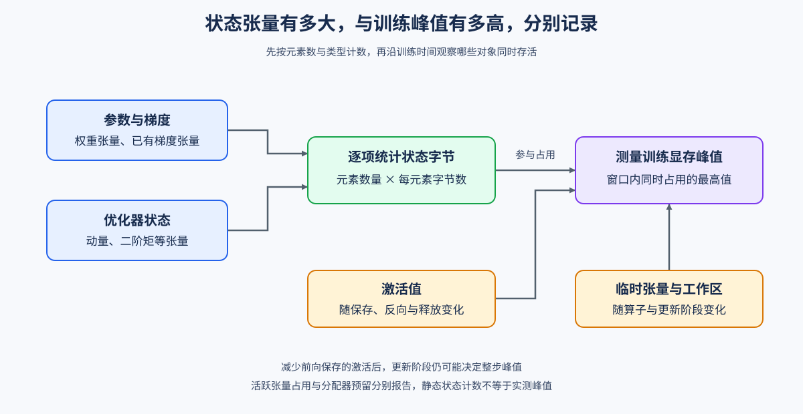
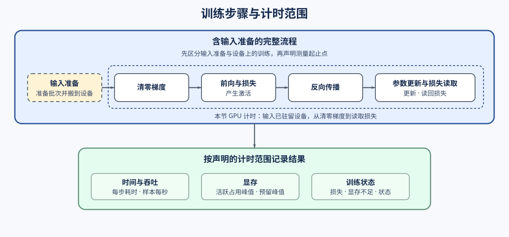

# 73. Training Performance Analysis | 训练性能分析

**难度：** Hard | **环境：** CPU基础练习，GPU训练测量 | **标签：** `显存优化`、`训练剖析`、`性能分析` | **目标人群：** 具备训练基础的读者

> 🚀 **云端运行环境**
>
> 本章节的实战代码可以点击以下链接在免费 GPU 算力平台上直接运行：
>
> [](https://colab.research.google.com/github/datawhalechina/llm-algo-leetcode/blob/main/02_PyTorch_Algorithms/73_Training_Performance_Analysis.ipynb)
> [](https://modelscope.cn/my/mynotebook) *(国内推荐：魔搭社区免费实例)*


---

## 本节导读

训练变慢或显存快用满时，应该先改批量、精度，还是优化器？只看一个总耗时或显存峰值，很难决定。需要先固定模型、输入和更新方式，分别弄清训练中保存了什么、一次更新花了多久，以及较多时间或容量出现在哪个阶段。

本节从一次参数更新开始，整理状态大小、重复计时与显存测量，再提出下一项对照实验。目标不是从热点表直接选优化方案，而是把“可能慢在哪里”变成能用同一训练任务检验的问题。

**关键词：** `training`、`profiling`、`memory`、`step time`

---

## 前置阅读

先回顾一次参数更新包含哪些操作，再理解计时与显存统计各自回答什么问题。

- [13. SFT训练循环](./13_SFT_Training_Loop.md)：追踪前向、反向与参数更新。
- [Part00·11 优化器与损失](../00_Prerequisites/11_PyTorch_Optimizers_and_Loss.md)：理解梯度与优化器状态何时产生。
- [Part01·13 性能分析与瓶颈定位](../01_Hardware_Math_and_Systems/13_Profiling_and_Bottleneck_Analysis.md)：区分高耗时操作与限制总时间的瓶颈。

---

## Step 1：固定训练任务，分别记录状态与运行情况

基线是后续改动的比较起点：模型、输入、精度、批量、序列长度与更新方式先保持一致。训练中常驻的参数、梯度和优化器状态可以逐张量统计字节；激活值是前向传播保存、供反向使用的中间结果，临时工作区则随算子执行分配和释放。因此，各对象大小相加不一定等于某一时刻的显存峰值。活跃占用是当前张量使用的内存，分配器预留则还包括暂未使用、留待复用的内存，两者分别报告。

训练步（step）在这里指完成一次参数更新的流程。耗时与吞吐说明它完成得多快，显存峰值说明同一窗口内最多用了多少内存；执行轨迹（trace）进一步展示线程、搬运和算子何时活动。先把这几类记录对应起来，再选择要验证的改动。

| 记录对象 | 怎样取得 | 回答什么问题 |
|:---|:---|:---|
| 固定训练条件 | 保存模型、输入和更新配置 | 基线与候选是否在做同一件事 |
| 状态张量 | 按元素数与类型统计字节 | 参数、梯度和优化器状态分别多大 |
| 完整更新 | 同步计时并记录吞吐、损失与峰值 | 训练速度和容量是否满足目标 |
| 执行轨迹 | 记录事件起止与通道 | 哪些操作或等待需要进一步检查 |



## Step 2：说明一次更新从哪里计时到哪里

需要解释数据供给时，把批次准备与搬运一起计入；需要比较设备内训练时，可以先把输入放到GPU，再计梯度清理、前向、反向、参数更新和损失读取。损失读回主机会等待相关GPU工作完成，是否包含这段等待会改变数字。基线与候选必须使用相同起止点。

吞吐按窗口内实际处理的样本数除以时间计算；词元吞吐还要明确是否排除填充位置。下面的GPU实验采用输入已就绪的窗口，计时前后同步设备，并将损失读取计入更新流程。

| 阶段 | 包含输入准备的整步 | 输入已驻留设备的测量 |
|:---|:---|:---|
| 批次准备与搬到设备 | 计入 | 在计时前完成 |
| 梯度清理 | 计入 | 计入 |
| 前向与损失计算 | 计入 | 计入 |
| 反向计算梯度 | 计入 | 计入 |
| 参数更新与损失读取 | 计入 | 计入，包含读取等待 |



## Step 3：从观察结果选择下一项对照

先检查重复运行是否稳定，再看耗时与容量。某阶段耗时最高，说明它值得进一步检查；它是否限制整步速度，还要结合事件依赖与计算重叠判断。例如反向传播变快了，但同时发生的另一条长任务没有结束，整步时间就可能不变。

容量也要结合时刻解释：前向激活减少后，峰值仍可能出现在优化器更新。下一项实验应围绕一个具体问题改变条件，比较完整更新是否变快、最大占用是否下降，而不是把一处局部变化直接当作整体收益。

| 观察结果 | 继续查看什么 | 要检验的问题 | 下一项对照 |
|:---|:---|:---|:---|
| 反向耗时较高 | 算子、保存张量与事件依赖 | 减少反向工作是否缩短整步 | 同任务下比较计算或保存策略 |
| 峰值接近容量上限 | 峰值时刻与存活对象 | 哪类对象占据峰值 | 比较重算、卸载或状态分片 |
| 设备空闲、输入较晚就绪 | 批次准备与搬运时间线 | 输入供给是否拖延更新开始 | 固定模型比较输入流水线 |
| 重复运行差异大 | 样本顺序、后台活动与预热 | 测量条件是否足够稳定 | 先固定条件并补测 |

## Step 4：检查基线记录并提出待验证假设

题目提供CPU计时、状态张量计数和示例阶段记录，补全样本可用性、阶段汇总与容量判断。阶段占比按“该阶段中位耗时／所有阶段中位耗时之和”计算；稳定性用耗时标准差除以均值，当前以不超过10%作为示例条件。`capacity_ratio`使用各次峰值的中位数除以容量，描述典型占用；判断能否安全运行时，还要另外查看最大峰值。这里的阶段判断是待验证假设，不是自动识别的真实关键路径。

| 任务与目的 | 已知条件 | 完成标准 | 测试验证 |
|:---|:---|:---|:---|
| TODO 1：检查记录能否统计 | 任务标识、状态、重复样本和阶段名称 | 必需字段与数值合法，各轮阶段名称一致 | 缺失、非有限值与阶段名称不同 |
| TODO 2：汇总耗时与容量 | 重复样本、状态字节与设备容量 | 计算波动、阶段中位数、最高耗时阶段和典型容量占比 | 已知阶段耗时与非法输入 |
| TODO 3：选择下一项实验 | 汇总结果与阈值 | 波动大时先补测，容量高时检查状态，其余检查耗时阶段 | 改变稳定性、容量与阶段占比 |


```python
import math
import statistics
import time
import torch

```


```python
def measure_train_step(train_step_fn, warmup=2, iters=8, batch_size=1):
    """测量 CPU training step；不读取或模拟 GPU 峰值显存。

    输入是训练函数和测量配置，返回 step_time_ms、samples_per_s 和 peak_mem_mb。
    peak_mem_mb 固定为 0.0；真实 GPU 峰值由 Step 5 单独测量。
    """
    if warmup < 0 or iters <= 0 or batch_size <= 0:
        raise ValueError('warmup / iters / batch_size 配置不合法')
    for _ in range(warmup):
        train_step_fn()

    start = time.perf_counter()
    for _ in range(iters):
        train_step_fn()
    end = time.perf_counter()
    elapsed = (end - start) / iters

    peak_mem_mb = 0.0

    return {
        'step_time_ms': round(elapsed * 1000, 2),
        'samples_per_s': round(batch_size * iters / (end - start), 3),
        'peak_mem_mb': round(peak_mem_mb, 2),
    }

def summarize_training_result(base_metrics, tuned_metrics):
    """按统一方向计算 baseline / tuned 的时间、显存和吞吐差值。"""
    time_delta = base_metrics['step_time_ms'] - tuned_metrics['step_time_ms']
    mem_delta = base_metrics['peak_mem_mb'] - tuned_metrics['peak_mem_mb']
    throughput_delta = tuned_metrics['samples_per_s'] - base_metrics['samples_per_s']
    return {
        'step_time_delta_ms': round(time_delta, 2),
        'peak_mem_delta_mb': round(mem_delta, 2),
        'time_improved': time_delta > 0,
        'memory_improved': mem_delta > 0,
        'throughput_delta': round(throughput_delta, 2),
        'throughput_improved': throughput_delta > 0,
    }

def recommend_training_decision(summary, min_time_delta_ms=10.0, min_memory_delta_mb=512.0):
    """给定实现：根据速度和显存收益输出训练项目结论。"""
    strong_time_gain = summary['step_time_delta_ms'] >= min_time_delta_ms
    strong_memory_gain = summary['peak_mem_delta_mb'] >= min_memory_delta_mb
    if strong_time_gain and strong_memory_gain:
        return {'decision': 'accept', 'reason': '训练速度和显存收益都达标。'}
    if summary['time_improved'] or summary['memory_improved']:
        return {'decision': 'tune', 'reason': '至少有一项收益，但仍需继续验证。'}
    return {'decision': 'reject', 'reason': '速度和显存都没有形成有效收益。'}

def summarize_training_memory_ledger(model, optimizer):
    """统计参数、梯度和 optimizer state 的实际 tensor 字节数。

    activation、临时 workspace 和 CUDA allocator reserved 不在本函数内计算。
    """
    # 给定实现：统计参数、梯度和 optimizer state 的实际字节数。
    def tensor_bytes(tensor):
        return tensor.numel() * tensor.element_size()

    parameter_bytes = sum(tensor_bytes(parameter) for parameter in model.parameters())
    gradient_bytes = sum(tensor_bytes(parameter.grad) for parameter in model.parameters() if parameter.grad is not None)
    optimizer_state_bytes = sum(tensor_bytes(value) for state in optimizer.state.values() for value in state.values() if torch.is_tensor(value))
    first_parameter = next(model.parameters(), None)
    return {
        'parameter_bytes': parameter_bytes,
        'gradient_bytes': gradient_bytes,
        'optimizer_state_bytes': optimizer_state_bytes,
        'parameter_dtype': str(first_parameter.dtype) if first_parameter is not None else None,
    }

def _valid_baseline_number(value, *, positive=False):
    """检查JSON指标的类型、有限性与方向，布尔值不是测量。"""
    if isinstance(value, bool) or not isinstance(value, (int, float)):
        return False
    try:
        finite = math.isfinite(value)
    except OverflowError:
        return False
    return finite and (value > 0 if positive else value >= 0)


def validate_training_baseline(report, minimum_samples=3):
    """核验身份、重复数与可统计的样本，保留失败原因。"""
    if type(minimum_samples) is not int or minimum_samples < 1:
        raise ValueError('minimum_samples必须为正整数')
    if not isinstance(report, dict):
        return {'is_valid': False, 'issues': ['report_not_mapping'], 'sample_count': 0}
    issues = []
    if not isinstance(report.get('workload_id'), str) or not report['workload_id'].strip():
        issues.append('workload_id_missing')
    if report.get('status') != 'ok':
        issues.append('baseline_failed')
    samples = report.get('samples')
    if not isinstance(samples, list) or len(samples) < minimum_samples:
        issues.append('insufficient_samples')
        samples = samples if isinstance(samples, list) else []
    required = ('step_time_ms', 'samples_per_s', 'peak_memory_mb', 'stages_ms')
    expected_stages = None
    for index, sample in enumerate(samples):
        if not isinstance(sample, dict) or not all(key in sample for key in required):
            issues.append(f'sample_{index}:incomplete')
            continue
        scalar_values_valid = (
            _valid_baseline_number(sample['step_time_ms'], positive=True)
            and _valid_baseline_number(sample['samples_per_s'], positive=True)
            and _valid_baseline_number(sample['peak_memory_mb'])
        )
        stages = sample['stages_ms']
        stages_valid = (
            isinstance(stages, dict) and bool(stages)
            and all(isinstance(name, str) and name.strip() for name in stages)
            and all(_valid_baseline_number(value) for value in stages.values())
        )
        if stages_valid:
            stages_valid = _valid_baseline_number(sum(stages.values()), positive=True)
        stage_names = set(stages) if stages_valid else set()
        if stages_valid and expected_stages is None:
            expected_stages = stage_names
        stage_names_match = stages_valid and stage_names == expected_stages
        # TODO 1：判断样本能否进入统计
        # sample_is_usable = ???  # bool；标量合法、阶段合法且各轮阶段名称一致
        raise NotImplementedError('TODO 1：请判断样本是否可用')
        if not sample_is_usable:
            issues.append(f'sample_{index}:invalid_metrics')
    return {'is_valid': not issues, 'issues': issues, 'sample_count': len(samples)}


def build_training_baseline_evidence(report, memory_ledger, capacity_mb):
    """检查样本后汇总耗时；容量为正数，状态大小用非负整数字节。"""
    review = validate_training_baseline(report)
    if not review['is_valid']:
        raise ValueError(f"基线不能用于归因：{review['issues']}")
    if not _valid_baseline_number(capacity_mb, positive=True):
        raise ValueError('capacity_mb必须为有限正数')
    ledger_keys = ('parameter_bytes', 'gradient_bytes', 'optimizer_state_bytes')
    if (not isinstance(memory_ledger, dict)
            or any(type(memory_ledger.get(key)) is not int or memory_ledger[key] < 0
                   for key in ledger_keys)):
        raise ValueError('各类状态必须提供非负整数字节数')
    samples = report['samples']
    step_times = [sample['step_time_ms'] for sample in samples]
    step_median = statistics.median(step_times)
    step_cv = statistics.pstdev(step_times) / statistics.fmean(step_times)
    stage_names = samples[0]['stages_ms'].keys()
    # ==========================================
    # TODO 2：汇总阶段耗时并识别主导阶段
    # stage_medians = ???  # dict[str, float]；每个阶段在重复样本上的中位数
    # dominant_stage = ???  # str；阶段中位数最高的阶段名
    # ==========================================
    raise NotImplementedError('TODO 2：请汇总阶段证据')
    peak_memory_mb = statistics.median(sample['peak_memory_mb'] for sample in samples)
    return {
        'workload_id': report['workload_id'], 'step_time_median_ms': step_median,
        'step_time_cv': step_cv, 'stable': step_cv <= 0.10,
        'stage_medians_ms': stage_medians, 'dominant_stage': dominant_stage,
        'dominant_stage_share': stage_medians[dominant_stage] / sum(stage_medians.values()),
        'peak_memory_mb': peak_memory_mb, 'capacity_ratio': peak_memory_mb / capacity_mb,
        'memory_ledger': memory_ledger,
    }

def classify_training_bottleneck(evidence, capacity_alert_ratio=0.90, hotspot_share=0.40):
    """依据基线证据提出下一项可验证实验。"""
    if not evidence.get('stable', False):
        return {'status': 'rerun_required', 'hypothesis': 'measurement_unstable', 'evidence': ['step_time_cv'], 'next_experiment': 'repeat_training_baseline'}
    # ==========================================
    # TODO 3：判断典型占用是否达到容量提醒阈值
    # capacity_is_high = ???  # bool；容量占用率达到 capacity_alert_ratio 时为 True
    # ==========================================
    raise NotImplementedError('TODO 3：请判断容量压力')
    if capacity_is_high:
        return {'status': 'ready', 'hypothesis': 'training_capacity_pressure', 'evidence': ['peak_memory_mb', 'capacity_ratio', 'memory_ledger'], 'next_experiment': '76_activation_checkpoint_offload'}
    if evidence['dominant_stage_share'] >= hotspot_share:
        stage = evidence['dominant_stage']
        return {'status': 'ready', 'hypothesis': f'{stage}_critical_path', 'evidence': ['stage_medians_ms', 'dominant_stage_share'], 'next_experiment': f'test_{stage}_candidate'}
    return {'status': 'needs_more_evidence', 'hypothesis': 'no_dominant_bottleneck', 'evidence': ['stage_medians_ms'], 'next_experiment': 'collect_trace'}

```

## 测试


```python
# 测试你的实现
def test_training_project_template():
    """验证训练计时、状态大小和基线归因的核心边界。"""
    torch.manual_seed(42)
    counter = {'n': 0}
    model = torch.nn.Sequential(torch.nn.Linear(8, 16), torch.nn.Tanh(), torch.nn.Linear(16, 4))
    # AdamW 在第一次 optimizer.step() 后创建状态，便于检查 优化器状态大小。
    optimizer = torch.optim.AdamW(model.parameters(), lr=0.01)
    inputs = torch.randn(2, 8)
    targets = torch.randn(2, 4)

    def train_step():
        counter['n'] += 1
        optimizer.zero_grad(set_to_none=True)
        loss = torch.nn.functional.mse_loss(model(inputs), targets)
        loss.backward()
        optimizer.step()
        return loss.detach()

    timing_calls = {'n': 0}
    def count_step():
        timing_calls['n'] += 1
    warmup_result = measure_train_step(count_step, warmup=2, iters=3)
    assert timing_calls['n'] == 5, 'warmup 应执行但不能混入正式迭代次数'
    assert warmup_result['samples_per_s'] > 0.0

    before = [parameter.detach().clone() for parameter in model.parameters()]
    result = measure_train_step(train_step, warmup=0, iters=2)
    assert counter['n'] == 2, "measure_train_step 没有正确执行训练迭代次数！"
    assert {'step_time_ms', 'samples_per_s', 'peak_mem_mb'} <= result.keys(), "训练统计字段不完整！"
    assert result['samples_per_s'] > 0.0, "samples_per_s 应为正数！"
    assert result['step_time_ms'] >= 0.0, "step_time_ms 应为非负数！"
    assert result['peak_mem_mb'] == 0.0, "CPU 测量不能虚构 GPU 峰值显存！"
    assert all(parameter.grad is not None for parameter in model.parameters()), "训练 step 必须完成 backward 并产生梯度！"
    assert all(torch.isfinite(parameter).all() for parameter in model.parameters()), "参数出现 NaN 或 Inf！"
    assert any(not torch.equal(previous, parameter) for previous, parameter in zip(before, model.parameters())), "optimizer.step 必须更新至少一个参数！"
    ledger = summarize_training_memory_ledger(model, optimizer)
    expected_parameter_bytes = sum(parameter.numel() * parameter.element_size() for parameter in model.parameters())
    assert ledger['parameter_bytes'] == expected_parameter_bytes, "参数字节数不正确！"
    assert ledger['gradient_bytes'] > 0, "完成 backward 后应能统计梯度字节数！"
    assert ledger['optimizer_state_bytes'] > 0, "完成 AdamW step 后应能统计 optimizer state 字节数！"
    assert ledger['parameter_dtype'] == 'torch.float32', "参数 dtype 记录不正确！"
    for invalid in ({'warmup': -1, 'iters': 2}, {'warmup': 0, 'iters': 0}):
        try:
            measure_train_step(train_step, **invalid)
        except ValueError:
            pass
        else:
            raise AssertionError('非法 warmup / iters 应明确拒绝！')

    baseline = {'step_time_ms': 120.0, 'peak_mem_mb': 8192.0, 'samples_per_s': 8.0}
    tuned = {'step_time_ms': 98.0, 'peak_mem_mb': 6144.0, 'samples_per_s': 10.0}
    summary = summarize_training_result(baseline, tuned)
    assert summary['step_time_delta_ms'] == 22.0, "step_time_delta_ms 计算不正确！"
    assert summary['peak_mem_delta_mb'] == 2048.0, "peak_mem_delta_mb 计算不正确！"
    assert summary['time_improved'] is True, "time_improved 判断不正确！"
    assert summary['memory_improved'] is True, "memory_improved 判断不正确！"
    assert summary['throughput_delta'] == 2.0, "throughput_delta 计算不正确！"
    assert summary['throughput_improved'] is True, "throughput_improved 判断不正确！"
    decision = recommend_training_decision(summary, min_time_delta_ms=10.0, min_memory_delta_mb=512.0)
    assert decision['decision'] == 'accept', "速度和显存收益都达标时应建议 accept！"

    weak_summary = {'step_time_delta_ms': 6.0, 'peak_mem_delta_mb': 256.0, 'time_improved': True, 'memory_improved': True}
    assert recommend_training_decision(weak_summary, min_time_delta_ms=10.0, min_memory_delta_mb=512.0)['decision'] == 'tune', "收益不够稳时应建议 tune！"

    bad_summary = {'step_time_delta_ms': -4.0, 'peak_mem_delta_mb': 0.0, 'time_improved': False, 'memory_improved': False}
    assert recommend_training_decision(bad_summary, min_time_delta_ms=10.0, min_memory_delta_mb=512.0)['decision'] == 'reject', "没有形成有效收益时应建议 reject！"

    baseline_report = {
        'workload_id': 'train-b2-s1024', 'status': 'ok',
        'samples': [
            {'step_time_ms': 100.0, 'samples_per_s': 20.0, 'peak_memory_mb': 9200.0, 'stages_ms': {'input': 10.0, 'forward': 25.0, 'backward': 50.0, 'update': 15.0}},
            {'step_time_ms': 102.0, 'samples_per_s': 19.6, 'peak_memory_mb': 9250.0, 'stages_ms': {'input': 11.0, 'forward': 25.0, 'backward': 51.0, 'update': 15.0}},
            {'step_time_ms': 98.0, 'samples_per_s': 20.4, 'peak_memory_mb': 9180.0, 'stages_ms': {'input': 9.0, 'forward': 24.0, 'backward': 50.0, 'update': 15.0}},
        ],
    }
    contract = validate_training_baseline(baseline_report)
    assert contract['is_valid'] is True
    assert validate_training_baseline({**baseline_report, 'workload_id': ''})['is_valid'] is False
    evidence = build_training_baseline_evidence(baseline_report, ledger, capacity_mb=10000.0)
    assert evidence['stable'] is True and evidence['dominant_stage'] == 'backward'
    assert evidence['capacity_ratio'] > 0.90
    hypothesis = classify_training_bottleneck(evidence)
    assert hypothesis['hypothesis'] == 'training_capacity_pressure'
    assert hypothesis['next_experiment'] == '76_activation_checkpoint_offload'
    noisy = {**evidence, 'stable': False}
    assert classify_training_bottleneck(noisy)['status'] == 'rerun_required'
    print("✅ 训练计时、状态计数与基线分析测试通过。")


def _baseline_report_fixture():
    """构造三次完整且稳定的训练基线样本。"""
    return {
        'workload_id': 'train-b2-s1024', 'status': 'ok',
        'samples': [
            {'step_time_ms': 100.0, 'samples_per_s': 20.0, 'peak_memory_mb': 9200.0, 'stages_ms': {'input': 10.0, 'forward': 25.0, 'backward': 50.0, 'update': 15.0}},
            {'step_time_ms': 102.0, 'samples_per_s': 19.6, 'peak_memory_mb': 9250.0, 'stages_ms': {'input': 11.0, 'forward': 25.0, 'backward': 51.0, 'update': 15.0}},
            {'step_time_ms': 98.0, 'samples_per_s': 20.4, 'peak_memory_mb': 9180.0, 'stages_ms': {'input': 9.0, 'forward': 24.0, 'backward': 50.0, 'update': 15.0}},
        ],
    }

def test_baseline_contract_rejects_incomplete_reports():
    """完整报告通过，身份、状态、重复数或样本字段缺失时拒绝归因。"""
    report = _baseline_report_fixture()
    assert validate_training_baseline(report)['is_valid'] is True
    assert not validate_training_baseline({**report, 'workload_id': ''})['is_valid']
    assert not validate_training_baseline({**report, 'status': 'failed'})['is_valid']
    assert not validate_training_baseline({**report, 'samples': report['samples'][:2]})['is_valid']
    incomplete = _baseline_report_fixture()
    incomplete['samples'][0].pop('stages_ms')
    assert 'sample_0:incomplete' in validate_training_baseline(incomplete)['issues']

def _expect_baseline_value_error(function, *args):
    """非法样本或预算必须在统计前停止。"""
    try:
        function(*args)
    except ValueError:
        return
    raise AssertionError('非法基线未被拒绝')


def test_baseline_contract_rejects_invalid_metrics():
    """拒绝非有限值、布尔值、错误方向与不可比较的阶段。"""
    for field in ('step_time_ms', 'samples_per_s', 'peak_memory_mb'):
        values = [None, True, '1', -1, float('nan'), float('inf')]
        if field != 'peak_memory_mb':
            values.append(0)
        for invalid in values:
            report = _baseline_report_fixture()
            report['samples'][0][field] = invalid
            assert not validate_training_baseline(report)['is_valid'], (field, invalid)
    for stages in ({}, None, {'forward': 0}, {'': 10}, {'forward': True},
                   {'forward': -1}, {'forward': float('nan')},
                   {'forward': 1e308, 'backward': 1e308}, {'other': 100}):
        report = _baseline_report_fixture()
        report['samples'][0]['stages_ms'] = stages
        assert not validate_training_baseline(report)['is_valid'], stages
    report = _baseline_report_fixture()
    report['samples'][0]['peak_memory_mb'] = 0.0
    assert validate_training_baseline(report)['is_valid']
    for sample in report['samples']:
        sample['stages_ms']['input'] = 0.0
    assert validate_training_baseline(report)['is_valid']
    for invalid in (None, [], {'status': 'ok'}, {'workload_id': '   ', 'samples': []}):
        assert not validate_training_baseline(invalid)['is_valid']
    for invalid in (0, -1, True, 1.5):
        _expect_baseline_value_error(validate_training_baseline, report, invalid)


def test_baseline_evidence_rejects_invalid_inputs():
    """汇总入口自行执行门禁，容量和状态字节也必须合法。"""
    ledger = {'parameter_bytes': 100, 'gradient_bytes': 100, 'optimizer_state_bytes': 200}
    report = _baseline_report_fixture()
    for invalid in (0, -1, True, float('nan'), float('inf')):
        _expect_baseline_value_error(build_training_baseline_evidence, report, ledger, invalid)
    for invalid in (None, {}, {**ledger, 'gradient_bytes': -1},
                    {**ledger, 'parameter_bytes': True}):
        _expect_baseline_value_error(build_training_baseline_evidence, report, invalid, 10000)
    report['samples'][0]['step_time_ms'] = float('nan')
    _expect_baseline_value_error(build_training_baseline_evidence, report, ledger, 10000)


def test_baseline_evidence_summarizes_stability_and_hotspot():
    """重复测量给出稳定性、阶段中位数、主导阶段和容量占用。"""
    evidence = build_training_baseline_evidence(
        _baseline_report_fixture(),
        {'parameter_bytes': 100, 'gradient_bytes': 100, 'optimizer_state_bytes': 200},
        capacity_mb=10000.0,
    )
    assert evidence['stable'] is True
    assert evidence['stage_medians_ms']['backward'] == 50.0
    assert evidence['dominant_stage'] == 'backward'
    assert evidence['capacity_ratio'] > 0.90

def test_bottleneck_hypothesis_prioritizes_remeasurement_and_capacity():
    """不稳定先复测，稳定但显存接近上限时转入容量实验。"""
    evidence = build_training_baseline_evidence(
        _baseline_report_fixture(),
        {'parameter_bytes': 100, 'gradient_bytes': 100, 'optimizer_state_bytes': 200},
        capacity_mb=10000.0,
    )
    assert classify_training_bottleneck({**evidence, 'stable': False})['next_experiment'] == 'repeat_training_baseline'
    capacity = classify_training_bottleneck(evidence)
    assert capacity['hypothesis'] == 'training_capacity_pressure'
    assert capacity['next_experiment'] == '76_activation_checkpoint_offload'
    time_bound = classify_training_bottleneck({**evidence, 'capacity_ratio': 0.5, 'dominant_stage_share': 0.6})
    assert time_bound['next_experiment'] == 'test_backward_candidate'

test_training_project_template()
test_baseline_contract_rejects_incomplete_reports()
test_baseline_contract_rejects_invalid_metrics()
test_baseline_evidence_rejects_invalid_inputs()
test_baseline_evidence_summarizes_stability_and_hotspot()
test_bottleneck_hypothesis_prioritizes_remeasurement_and_capacity()

```

---

🛑 **STOP HERE** 🛑
<br><br><br><br><br><br><br><br><br><br>
> 请先尝试自己完成代码并跑通测试。<br>
> 如果你正在 Colab 中运行，并且遇到困难没有思路，可以向下滚动查看参考答案。
<br><br><br><br><br><br><br><br><br><br>

---


## 参考代码与解析

### 代码


```python
def measure_train_step(train_step_fn, warmup=2, iters=8, batch_size=1):
    """测量 CPU training step 的平均耗时；不采集或模拟 GPU 显存。

    先执行 warmup，再用正式迭代计算平均 step time 和 samples/s；peak_mem_mb
    固定为 0.0，真实 GPU 显存由后续 GPU 实验单独测量。
    """
    if warmup < 0 or iters <= 0 or batch_size <= 0:
        raise ValueError('warmup / iters / batch_size 配置不合法')
    for _ in range(warmup):
        train_step_fn()

    start = time.perf_counter()
    for _ in range(iters):
        train_step_fn()
    end = time.perf_counter()
    elapsed = (end - start) / iters

    peak_mem_mb = 0.0

    return {
        'step_time_ms': round(elapsed * 1000, 2),
        'samples_per_s': round(batch_size * iters / (end - start), 3),
        'peak_mem_mb': round(peak_mem_mb, 2),
    }

def summarize_training_result(base_metrics, tuned_metrics):
    """按统一方向计算 baseline / tuned 的时间、显存和吞吐差值。

    正值表示 tuned 相对 baseline 有改善：耗时和显存取 baseline - tuned，
    吞吐取 tuned - baseline。
    """
    time_delta = base_metrics['step_time_ms'] - tuned_metrics['step_time_ms']
    mem_delta = base_metrics['peak_mem_mb'] - tuned_metrics['peak_mem_mb']
    throughput_delta = tuned_metrics['samples_per_s'] - base_metrics['samples_per_s']
    return {
        'step_time_delta_ms': round(time_delta, 2),
        'peak_mem_delta_mb': round(mem_delta, 2),
        'time_improved': time_delta > 0,
        'memory_improved': mem_delta > 0,
        'throughput_delta': round(throughput_delta, 2),
        'throughput_improved': throughput_delta > 0,
    }

# 给定实现：输出训练项目结论
def recommend_training_decision(summary, min_time_delta_ms=10.0, min_memory_delta_mb=512.0):
    """根据配置阈值输出轻量的 accept / tune / reject 建议。"""
    strong_time_gain = summary['step_time_delta_ms'] >= min_time_delta_ms
    strong_memory_gain = summary['peak_mem_delta_mb'] >= min_memory_delta_mb
    if strong_time_gain and strong_memory_gain:
        decision = 'accept'
        reason = '训练速度和显存收益都达标，值得继续保留当前优化。'
    elif summary['time_improved'] or summary['memory_improved']:
        decision = 'tune'
        reason = '至少有一项收益成立，但尚未同时达到时间与显存门槛，需继续比较。'
    else:
        decision = 'reject'
        reason = '速度和显存都没有形成有效收益，当前改动不值得保留。'
    return {'decision': decision, 'reason': reason}

# 给定实现：统计训练状态字节；optimizer.step() 后 optimizer state 才会出现
def summarize_training_memory_ledger(model, optimizer):
    """返回参数、梯度和 optimizer state 的实际字节数。

    activation、临时 workspace 和 CUDA allocator reserved 不在本函数内计算。
    """
    def tensor_bytes(tensor):
        return tensor.numel() * tensor.element_size()

    parameter_bytes = sum(tensor_bytes(parameter) for parameter in model.parameters())
    gradient_bytes = sum(
        tensor_bytes(parameter.grad)
        for parameter in model.parameters()
        if parameter.grad is not None
    )
    optimizer_state_bytes = sum(
        tensor_bytes(value)
        for state in optimizer.state.values()
        for value in state.values()
        if torch.is_tensor(value)
    )
    first_parameter = next(model.parameters(), None)
    return {
        'parameter_bytes': parameter_bytes,
        'gradient_bytes': gradient_bytes,
        'optimizer_state_bytes': optimizer_state_bytes,
        'parameter_dtype': str(first_parameter.dtype) if first_parameter is not None else None,
    }

def _valid_baseline_number(value, *, positive=False):
    """检查JSON指标的类型、有限性与方向，布尔值不是测量。"""
    if isinstance(value, bool) or not isinstance(value, (int, float)):
        return False
    try:
        finite = math.isfinite(value)
    except OverflowError:
        return False
    return finite and (value > 0 if positive else value >= 0)


def validate_training_baseline(report, minimum_samples=3):
    """核验身份、重复数与可统计的样本，保留失败原因。"""
    if type(minimum_samples) is not int or minimum_samples < 1:
        raise ValueError('minimum_samples必须为正整数')
    if not isinstance(report, dict):
        return {'is_valid': False, 'issues': ['report_not_mapping'], 'sample_count': 0}
    issues = []
    if not isinstance(report.get('workload_id'), str) or not report['workload_id'].strip():
        issues.append('workload_id_missing')
    if report.get('status') != 'ok':
        issues.append('baseline_failed')
    samples = report.get('samples')
    if not isinstance(samples, list) or len(samples) < minimum_samples:
        issues.append('insufficient_samples')
        samples = samples if isinstance(samples, list) else []
    required = ('step_time_ms', 'samples_per_s', 'peak_memory_mb', 'stages_ms')
    expected_stages = None
    for index, sample in enumerate(samples):
        if not isinstance(sample, dict) or not all(key in sample for key in required):
            issues.append(f'sample_{index}:incomplete')
            continue
        scalar_values_valid = (
            _valid_baseline_number(sample['step_time_ms'], positive=True)
            and _valid_baseline_number(sample['samples_per_s'], positive=True)
            and _valid_baseline_number(sample['peak_memory_mb'])
        )
        stages = sample['stages_ms']
        stages_valid = (
            isinstance(stages, dict) and bool(stages)
            and all(isinstance(name, str) and name.strip() for name in stages)
            and all(_valid_baseline_number(value) for value in stages.values())
        )
        if stages_valid:
            stages_valid = _valid_baseline_number(sum(stages.values()), positive=True)
        stage_names = set(stages) if stages_valid else set()
        if stages_valid and expected_stages is None:
            expected_stages = stage_names
        stage_names_match = stages_valid and stage_names == expected_stages
        # TODO 1：判断样本能否进入统计
        sample_is_usable = scalar_values_valid and stages_valid and stage_names_match
        if not sample_is_usable:
            issues.append(f'sample_{index}:invalid_metrics')
    return {'is_valid': not issues, 'issues': issues, 'sample_count': len(samples)}


def build_training_baseline_evidence(report, memory_ledger, capacity_mb):
    """检查样本后汇总耗时；容量为正数，状态大小用非负整数字节。"""
    review = validate_training_baseline(report)
    if not review['is_valid']:
        raise ValueError(f"基线不能用于归因：{review['issues']}")
    if not _valid_baseline_number(capacity_mb, positive=True):
        raise ValueError('capacity_mb必须为有限正数')
    ledger_keys = ('parameter_bytes', 'gradient_bytes', 'optimizer_state_bytes')
    if (not isinstance(memory_ledger, dict)
            or any(type(memory_ledger.get(key)) is not int or memory_ledger[key] < 0
                   for key in ledger_keys)):
        raise ValueError('各类状态必须提供非负整数字节数')
    samples = report['samples']
    step_times = [sample['step_time_ms'] for sample in samples]
    step_median = statistics.median(step_times)
    step_cv = statistics.pstdev(step_times) / statistics.fmean(step_times)
    stage_names = samples[0]['stages_ms'].keys()
    # TODO 2：汇总阶段耗时并识别主导阶段
    stage_medians = {name: statistics.median(sample['stages_ms'][name] for sample in samples) for name in stage_names}
    dominant_stage = max(stage_medians, key=stage_medians.get)
    peak_memory_mb = statistics.median(sample['peak_memory_mb'] for sample in samples)
    return {
        'workload_id': report['workload_id'], 'step_time_median_ms': step_median,
        'step_time_cv': step_cv, 'stable': step_cv <= 0.10,
        'stage_medians_ms': stage_medians, 'dominant_stage': dominant_stage,
        'dominant_stage_share': stage_medians[dominant_stage] / sum(stage_medians.values()),
        'peak_memory_mb': peak_memory_mb, 'capacity_ratio': peak_memory_mb / capacity_mb,
        'memory_ledger': memory_ledger,
    }

def classify_training_bottleneck(evidence, capacity_alert_ratio=0.90, hotspot_share=0.40):
    """依据稳定性、容量压力与阶段占比提出待验证假设。"""
    if not evidence.get('stable', False):
        return {'status': 'rerun_required', 'hypothesis': 'measurement_unstable', 'evidence': ['step_time_cv'], 'next_experiment': 'repeat_training_baseline'}
    # TODO 3：判断典型占用是否达到容量提醒阈值
    capacity_is_high = evidence['capacity_ratio'] >= capacity_alert_ratio
    if capacity_is_high:
        return {'status': 'ready', 'hypothesis': 'training_capacity_pressure', 'evidence': ['peak_memory_mb', 'capacity_ratio', 'memory_ledger'], 'next_experiment': '76_activation_checkpoint_offload'}
    if evidence['dominant_stage_share'] >= hotspot_share:
        stage = evidence['dominant_stage']
        return {'status': 'ready', 'hypothesis': f'{stage}_critical_path', 'evidence': ['stage_medians_ms', 'dominant_stage_share'], 'next_experiment': f'test_{stage}_candidate'}
    return {'status': 'needs_more_evidence', 'hypothesis': 'no_dominant_bottleneck', 'evidence': ['stage_medians_ms'], 'next_experiment': 'collect_trace'}


```

### 解析

#### TODO 1：判断样本是否满足统计条件

- 标量合法、阶段耗时合法且各轮阶段名称一致，三项同时满足才使用该样本。任务标识只检查存在与非空，真实模型和配置还要在项目测量中核对。
- 缺失、NaN、负值、全零阶段与名称改变的测试，分别检查这些条件是否被遗漏。

#### TODO 2：汇总各阶段的重复测量

- 每个阶段取中位数，再选中位耗时最高者；占比的分母是各阶段中位数之和。例如50ms占10＋25＋50＋15ms的50%。
- 该比例适合题目的阶段记录，不能把有重叠的GPU活动直接相加后当作墙钟时间。测试核对阶段汇总，并检查容量和状态字节是否合法。

#### TODO 3：按稳定性与容量选择下一步

- 耗时波动超过示例阈值时先重复测量；典型峰值接近容量时，检查各阶段存活对象并比较显存策略。
- 容量压力不高时再围绕最高耗时阶段提出对照。返回的关键路径名称仍是假设，需通过实际依赖与完整更新计时检验。

## Step 5：测量训练基线

在相同模型、输入和训练步骤下，各重复三次 FP32 与 BF16，输入在计时前驻留GPU，比较梯度清理、前向、反向、更新及损失读取的耗时、吞吐和峰值显存。运行顺序是 `prepare → measure → close`。

| 核对内容 | CPU 练习 | GPU 测量与结果 |
|:---|:---|:---|
| 报告可用性 | 检查任务身份、重复样本和失败输入 | 5.5 检查模型与工作负载、重复次数和有限数值 |
| 训练与资源 | 小网络完成反向传播和参数更新，统计训练状态字节 | 固定模型与设备输入，测量FP32与混合精度的训练步耗时、吞吐和峰值显存 |
| 后续实验 | 用给定阶段耗时提出可验证假设 | 为76提供同范围训练对照；阶段归因需另有剖析记录，74核对这些记录与候选证据 |

### 5.1 本次运行配置

运行环境：`PERF-CUDA-MECHANISM`，单卡显存至少 8 GiB；环境创建与验证见[性能机制GPU环境](../topic_discussion/performance_optimization/gpu_quickstart.md#perf-cuda-mechanism-quickstart)。

只需填写本次标签和运行阶段。首次打开保持 `prepare`；新测量使用同一唯一标签依次运行 `measure`、`close`。


```python
# 修改这两个值后，按 5.1 到 5.6 顺序运行。
RUN_LABEL = 'replace_with_unique_label'  # 正式测量时改为唯一标签，measure 和 close 使用同一值。
RUN_STAGE = 'prepare'  # 可选 prepare / measure / close；prepare 只读取和检查。

```

### 5.2 固定实验配置与环境预检

检查项目路径、PyTorch、CUDA 和模型文件，并加载固定训练配置。`prepare` 不加载模型。


```python
"""检查运行环境并加载固定实验配置。"""
from pathlib import Path
import os
import sys

PROJECT_ID = '73'
SEMANTIC_ID = 'PERF-TRAINING-BASELINE'
SCHEMA_VERSION = 'training-performance-project/v1'
MODEL_ID = 'Qwen/Qwen2.5-0.5B-Instruct'
MODEL_SOURCE = 'local'
MODEL_CACHE_DIR = 'model_cache'
WORKLOAD = 'pressure'
WORKLOADS = {'pressure': {'batch_size': 1, 'seq_len': 768, 'warmup': 2, 'iters': 5}}
REPEATS = 3
LEARNING_RATE = 1e-5
SEED = 42
REAL_RUN_MODE = 'paired'
APPROVED_RESULT_RELATIVE_PATH = Path('benchmarks/results/73_real_gpu_training_rtx5070ti_training_baseline_v1.json')
APPROVED_DECISION_RELATIVE_PATH = Path('benchmarks/results/73_training_baseline_decision_rtx5070ti_training_baseline_v1.json')

if RUN_STAGE not in {'prepare', 'measure', 'close'}:
    raise ValueError("RUN_STAGE 只能是 'prepare'、'measure' 或 'close'。")
if RUN_STAGE != 'prepare' and RUN_LABEL == 'replace_with_unique_label':
    raise ValueError('执行测量或生成决策前，请设置唯一 RUN_LABEL。')

start_dir = Path(os.environ.get('LLM_ALGO_PROJECT_ROOT', Path.cwd())).expanduser().resolve()
PROJECT_ROOT = next(
    (candidate for candidate in (start_dir, *start_dir.parents)
     if (candidate / 'tools/project_runtime.py').is_file()),
    None,
)
if PROJECT_ROOT is None and (Path('/content/llm-algo-leetcode') / 'tools/project_runtime.py').is_file():
    PROJECT_ROOT = Path('/content/llm-algo-leetcode')
if PROJECT_ROOT is None:
    raise RuntimeError('找不到项目根目录，请设置 LLM_ALGO_PROJECT_ROOT。')
os.chdir(PROJECT_ROOT)
if str(PROJECT_ROOT) not in sys.path:
    sys.path.insert(0, str(PROJECT_ROOT))

try:
    import torch
except ImportError as exc:
    raise RuntimeError('当前环境缺少 PyTorch，请先按性能实验 Quickstart 准备环境。') from exc

print({'project_root': str(PROJECT_ROOT), 'torch': torch.__version__,
       'cuda_build': torch.version.cuda, 'cuda_available': torch.cuda.is_available()})
if torch.cuda.is_available():
    props = torch.cuda.get_device_properties(0)
    print({'gpu': props.name, 'memory_gib': round(props.total_memory / 2**30, 2)})

```

### 5.3 核对比较条件与结果路径

确认FP32与BF16使用相同模型、输入、更新步骤和重复次数，只改变计算精度。


```python
"""派生本次运行的工作负载和结果路径。"""
workload_config = dict(WORKLOADS[WORKLOAD])
BATCH_SIZE = workload_config['batch_size']
SEQ_LEN = workload_config['seq_len']
WARMUP = workload_config['warmup']
ITERS = workload_config['iters']
OUTPUT_RELATIVE_PATH = Path(f'benchmarks/results/{PROJECT_ID}_real_gpu_training_{RUN_LABEL}.json')
DECISION_OUTPUT_RELATIVE_PATH = Path(f'benchmarks/results/{PROJECT_ID}_training_baseline_decision_{RUN_LABEL}.json')
READ_RESULT_RELATIVE_PATH = APPROVED_RESULT_RELATIVE_PATH if RUN_STAGE == 'prepare' else OUTPUT_RELATIVE_PATH
EXPERIMENT_IDENTITY = {
    'model_id': MODEL_ID, 'workload': WORKLOAD, 'batch_size': BATCH_SIZE,
    'seq_len': SEQ_LEN, 'repeats': REPEATS, 'seed': SEED,
    'run_label': RUN_LABEL, 'run_stage': RUN_STAGE,
    'read_result': str(READ_RESULT_RELATIVE_PATH),
}
print(EXPERIMENT_IDENTITY)

```

### 5.4 采集训练测量

`measure` 各运行三次 FP32 与 BF16 并保存原始结果；其他阶段跳过 GPU。


```python
"""按固定 workload 运行 FP32 / AMP 对照，汇总指标并保存 JSON 报告。"""
import json
import os
import sys
import time
from pathlib import Path

# 先把 Notebook 所在仓库加入 sys.path，再导入项目工具；适配本地、Colab 和 ModelScope。
PROJECT_ROOT = Path(os.environ.get('LLM_ALGO_PROJECT_ROOT', Path.cwd())).expanduser().resolve()
if not (PROJECT_ROOT / 'tools/project_runtime.py').is_file():
    colab_root = Path('/content/llm-algo-leetcode')
    if (colab_root / 'tools/project_runtime.py').is_file():
        PROJECT_ROOT = colab_root
    else:
        for candidate in (PROJECT_ROOT, *PROJECT_ROOT.parents):
            if (candidate / 'tools/project_runtime.py').is_file():
                PROJECT_ROOT = candidate
                break
        else:
            raise RuntimeError('找不到项目根目录；请设置 LLM_ALGO_PROJECT_ROOT。')
if str(PROJECT_ROOT) not in sys.path:
    sys.path.insert(0, str(PROJECT_ROOT))
from tools.project_runtime import ensure_output_path, resolve_project_root, environment_preflight, runtime_snapshot, save_json_record_once, standard_experiment_config, standard_training_metrics, validate_training_config
from tools.training_memory_runtime import measure_training_run

PROJECT_ROOT = resolve_project_root(PROJECT_ROOT)
if str(PROJECT_ROOT) not in sys.path:
    sys.path.insert(0, str(PROJECT_ROOT))
OUTPUT_PATH = PROJECT_ROOT / OUTPUT_RELATIVE_PATH
print(f'项目根目录: {PROJECT_ROOT}')
print(f'结果保存路径: {OUTPUT_PATH}')

def summarize_training_result(base_metrics, tuned_metrics):
    time_delta = base_metrics['step_time_ms'] - tuned_metrics['step_time_ms']
    mem_delta = base_metrics['peak_mem_mb'] - tuned_metrics['peak_mem_mb']
    throughput_delta = tuned_metrics['samples_per_s'] - base_metrics['samples_per_s']
    return {
        'step_time_delta_ms': round(time_delta, 2),
        'peak_mem_delta_mb': round(mem_delta, 2),
        'time_improved': time_delta > 0,
        'memory_improved': mem_delta > 0,
        'throughput_delta': round(throughput_delta, 2),
        'throughput_improved': throughput_delta > 0,
    }


if 'recommend_training_decision' not in globals():
    def recommend_training_decision(summary, min_time_delta_ms=10.0, min_memory_delta_mb=512.0):
        time_gain = summary['step_time_delta_ms'] >= min_time_delta_ms
        memory_gain = summary['peak_mem_delta_mb'] >= min_memory_delta_mb
        if time_gain and memory_gain:
            return {'decision': 'accept', 'reason': '训练速度和显存收益都达到门槛。'}
        if summary['time_improved'] or summary['memory_improved']:
            return {'decision': 'tune', 'reason': '至少有一项收益，但仍需继续验证。'}
        return {'decision': 'reject', 'reason': '速度和显存都没有形成有效收益。'}

if RUN_STAGE == 'measure':
    OUTPUT_PATH = ensure_output_path(PROJECT_ROOT, OUTPUT_RELATIVE_PATH)
    if OUTPUT_PATH.exists():
        raise FileExistsError(f'结果已存在，请更换 RUN_LABEL：{OUTPUT_PATH}')
    # 阶段 1：检查 workload、依赖和 CUDA；检查失败时不加载模型。
    import torch
    from tools.model_runtime import resolve_model
    from transformers import AutoConfig, AutoModelForCausalLM

    if WORKLOAD not in WORKLOADS:
        raise ValueError(f'未知 workload: {WORKLOAD}，可选值：{sorted(WORKLOADS)}')
    workload_config = WORKLOADS[WORKLOAD]
    BATCH_SIZE = workload_config['batch_size']
    SEQ_LEN = workload_config['seq_len']
    WARMUP = workload_config['warmup']
    ITERS = workload_config['iters']
    if REPEATS < 1:
        raise ValueError('REPEATS 必须至少为 1。')
    validate_training_config({'batch_size': BATCH_SIZE, 'seq_len': SEQ_LEN, 'warmup': WARMUP, 'iters': ITERS, 'seed': SEED, 'learning_rate': LEARNING_RATE})
    preflight = environment_preflight(torch, required_packages=('transformers',), require_gpu=True, output_path=OUTPUT_PATH)
    print({'environment_preflight': preflight})
    if not preflight['ready']:
        raise RuntimeError('环境预检未通过，请先按 next_actions 修复；没有加载模型。')
    print({'runtime': runtime_snapshot(torch)})
    if not torch.cuda.is_available():
        raise RuntimeError('measure 阶段需要 CUDA，请先完成 GPU 环境预检。')

    # 阶段 2：准备固定输入、选择可验证的 AMP dtype，并记录运行环境。
    device = torch.device('cuda')
    torch.manual_seed(SEED)
    torch.cuda.manual_seed_all(SEED)
    model_path = resolve_model(MODEL_ID, source=MODEL_SOURCE, cache_dir=MODEL_CACHE_DIR)
    print(f'模型路径: {model_path}')
    model_config = AutoConfig.from_pretrained(model_path)
    input_generator = torch.Generator(device='cpu').manual_seed(SEED)
    shared_input_ids_cpu = torch.randint(
        0, model_config.vocab_size, (BATCH_SIZE, SEQ_LEN),
        generator=input_generator,
    )
    capability = torch.cuda.get_device_capability()
    native_bf16 = capability[0] >= 8 and torch.cuda.is_bf16_supported(including_emulation=False)
    amp_dtype = torch.bfloat16 if native_bf16 else torch.float16
    common = {
        'model_id': MODEL_ID, 'batch_size': BATCH_SIZE, 'seq_len': SEQ_LEN,
        'dtype': 'float32', 'optimizer': 'AdamW', 'workload': WORKLOAD,
        'warmup': WARMUP, 'iters': ITERS, 'amp_dtype': str(amp_dtype),
        'torch': torch.__version__, 'torch_cuda': torch.version.cuda,
        'device': torch.cuda.get_device_name(0),
        'compute_capability': list(capability), 'native_bf16': native_bf16,
    }

    def run_train_mode(use_amp, repeat_index=0):
        """在一次独立模型实例上执行 warmup 和正式训练 step 测量。"""
        torch.manual_seed(SEED + repeat_index)
        model = AutoModelForCausalLM.from_pretrained(model_path, dtype=torch.float32)
        model.config.use_cache = False
        model.to(device).train()
        optimizer = torch.optim.AdamW(model.parameters(), lr=LEARNING_RATE)
        input_ids = shared_input_ids_cpu.to(device)
        labels = input_ids.clone()

        def train_step():
            optimizer.zero_grad(set_to_none=True)
            with torch.autocast(device_type='cuda', dtype=amp_dtype, enabled=use_amp):
                loss = model(input_ids=input_ids, labels=labels).loss
            loss.backward()
            optimizer.step()
            return float(loss.detach().item())

        result = measure_training_run(
            train_step, torch_module=torch, batch_size=BATCH_SIZE,
            warmup=WARMUP, iters=ITERS,
        )
        del optimizer, model, input_ids, labels
        torch.cuda.empty_cache()
        return result

    def aggregate_runs(runs):
        """计算多次 GPU 运行的均值，并保留单次结果供复核。"""
        return {
            key: round(sum(item[key] for item in runs) / len(runs), 3)
            for key in ('step_time_ms', 'samples_per_s', 'loss', 'peak_mem_mb', 'peak_reserved_mb')
        }

    # 阶段 3：分别运行 baseline 和 AMP candidate，每次都重新初始化模型。
    if REAL_RUN_MODE == 'bf16_probe':
        tuned_runs = [run_train_mode(use_amp=True, repeat_index=i) for i in range(REPEATS)]
        tuned = aggregate_runs(tuned_runs)
        result = {
            'task': 'task3_training_memory_optimization',
            'environment_preflight': preflight,
            'stage': 'bf16_capacity_probe',
            'config': {**common, 'mode': REAL_RUN_MODE, 'seed': SEED, 'repeats': REPEATS},
            'candidate': {**tuned, 'runs': tuned_runs},
            'measurement_status': 'capacity_probe_only',
            'evidence_level': 'fixed_workload_capacity_probe',
        }
    else:
        baseline_runs = [run_train_mode(use_amp=False, repeat_index=i) for i in range(REPEATS)]
        tuned_runs = [run_train_mode(use_amp=True, repeat_index=i) for i in range(REPEATS)]
        baseline = aggregate_runs(baseline_runs)
        tuned = aggregate_runs(tuned_runs)
        summary = summarize_training_result(baseline, tuned)
        time_delta = baseline['step_time_ms'] - tuned['step_time_ms']
        memory_delta = baseline['peak_mem_mb'] - tuned['peak_mem_mb']
        summary.update({
            'time_improvement_pct': round(time_delta / baseline['step_time_ms'] * 100, 2),
            'memory_improvement_pct': round(memory_delta / baseline['peak_mem_mb'] * 100, 2),
            'meaningful_memory_improved': memory_delta >= 512.0,
        })
        result = {
            'task': 'task3_training_memory_optimization',
            'environment_preflight': preflight,
            'stage': 'measurement_baseline',
            'next_stage': '76_activation_checkpoint_offload_benchmark',
            'config': {**common, 'mode': REAL_RUN_MODE, 'seed': SEED, 'repeats': REPEATS},
            'baseline': {**baseline, 'runs': baseline_runs},
            'tuned': {**tuned, 'runs': tuned_runs},
            'summary': summary,
            'loss_delta_tuned_minus_baseline': round(tuned['loss'] - baseline['loss'], 6),
            'evidence_level': 'fixed_workload_performance_smoke',
        }
    # 阶段 4：补充统一报告字段，并将单次结果和均值写入 JSON。
    result.update({'schema_version': SCHEMA_VERSION, 'semantic_id': SEMANTIC_ID, 'run_mode': 'real_gpu', 'run_label': RUN_LABEL})
    result['experiment'] = standard_experiment_config(result['config'])
    if 'baseline' in result:
        result['standard_metrics'] = {name: standard_training_metrics(result[name]) for name in ('baseline', 'tuned')}
    elif 'candidate' in result:
        result['standard_metrics'] = {'candidate': standard_training_metrics(result['candidate'])}
    output_path = Path(OUTPUT_PATH)
    save_json_record_once(output_path, result)
    print(json.dumps(result, ensure_ascii=False, indent=2))
else:
    print(f'跳过训练测量：当前 RUN_STAGE={RUN_STAGE!r}。')

```

### 5.5 核对测量结果

读取原始报告，检查模型、输入配置、重复次数和数值，再从样本重算组均值与差异。下方只读保存结果，汇总不一致时停止登记。


```python
import hashlib
import math

result_path = PROJECT_ROOT / READ_RESULT_RELATIVE_PATH
if not result_path.is_file():
    raise FileNotFoundError(f'找不到训练基线：{result_path}')
source_bytes = result_path.read_bytes()
report = json.loads(source_bytes)
if not isinstance(report, dict):
    raise ValueError('训练报告必须为JSON对象')


def _valid_training_measurement(value, *, positive=False):
    """只接受有限的JSON数值，排除布尔值与非法方向。"""
    if type(value) not in (int, float):
        return False
    try:
        return math.isfinite(value) and (value > 0 if positive else value >= 0)
    except OverflowError:
        return False


def recompute_measured_training_summary(baseline, tuned):
    """按原v1舍入规则从两组已核验均值重算差异。"""
    time_delta = baseline['step_time_ms'] - tuned['step_time_ms']
    memory_delta = baseline['peak_mem_mb'] - tuned['peak_mem_mb']
    throughput_delta = tuned['samples_per_s'] - baseline['samples_per_s']
    return {
        'step_time_delta_ms': round(time_delta, 2),
        'peak_mem_delta_mb': round(memory_delta, 2),
        'time_improved': time_delta > 0,
        'memory_improved': memory_delta > 0,
        'throughput_delta': round(throughput_delta, 2),
        'throughput_improved': throughput_delta > 0,
        'time_improvement_pct': round(time_delta / baseline['step_time_ms'] * 100, 2),
        'memory_improvement_pct': round(memory_delta / baseline['peak_mem_mb'] * 100, 2),
        'meaningful_memory_improved': memory_delta >= 512.0,
    }


def review_measured_training_report(report):
    """从原始重复样本重算组均值和summary，不推断任务质量或阶段热点。"""
    issues = []
    review = {'issues': issues, 'recomputed_groups': {}, 'recomputed_summary': None}
    if not isinstance(report, dict) or not isinstance(report.get('config'), dict):
        issues.append('invalid_report_or_config')
        return review
    if report.get('schema_version') != SCHEMA_VERSION:
        issues.append('schema_mismatch')
    if report.get('semantic_id') != SEMANTIC_ID:
        issues.append('semantic_id_mismatch')
    if report.get('failure') is not None:
        issues.append('measurement_failed')
    config = report['config']
    repeats = config.get('repeats')
    valid_repeats = type(repeats) is int and repeats >= 3
    if not valid_repeats:
        issues.append('repeats_must_be_at_least_three')
    expected = {
        'model_id': MODEL_ID, 'workload': WORKLOAD,
        'batch_size': BATCH_SIZE, 'seq_len': SEQ_LEN,
        'warmup': WARMUP, 'iters': ITERS, 'seed': SEED,
        'optimizer': 'AdamW', 'dtype': 'float32',
    }
    for key, value in expected.items():
        if type(config.get(key)) is not type(value) or config.get(key) != value:
            issues.append(f'config_mismatch:{key}')
    mode = config.get('mode')
    if mode not in {'paired', 'bf16_probe'}:
        issues.append('unknown_measurement_mode')
        return review
    metrics = ('step_time_ms', 'samples_per_s', 'loss', 'peak_mem_mb', 'peak_reserved_mb')
    names = ('baseline', 'tuned') if mode == 'paired' else ('candidate',)
    for name in names:
        group = report.get(name)
        if not isinstance(group, dict):
            issues.append(f'{name}:missing')
            continue
        runs = group.get('runs')
        rows_valid = valid_repeats and isinstance(runs, list) and len(runs) == repeats
        if not rows_valid:
            issues.append(f'{name}:repeat_count_mismatch')
        for index, row in enumerate([group] + (runs if isinstance(runs, list) else [])):
            if not isinstance(row, dict):
                issues.append(f'{name}:{index}:invalid_row')
                rows_valid = False
                continue
            if row.get('status', 'ok') != 'ok':
                issues.append(f'{name}:{index}:failed')
                rows_valid = False
            for key in metrics:
                if not _valid_training_measurement(row.get(key), positive=key != 'loss'):
                    issues.append(f'{name}:{index}:invalid_{key}')
                    rows_valid = False
        if not rows_valid:
            continue
        try:
            derived = {key: round(math.fsum(row[key] for row in runs) / repeats, 3)
                       for key in metrics}
        except OverflowError:
            issues.append(f'{name}:aggregate_overflow')
            continue
        if not all(_valid_training_measurement(value, positive=key != 'loss')
                   for key, value in derived.items()):
            issues.append(f'{name}:invalid_aggregate')
            continue
        review['recomputed_groups'][name] = derived
        # v1组均值保存三位小数，仅允许末位舍入差。
        for key, value in derived.items():
            if not math.isclose(group[key], value, rel_tol=0, abs_tol=0.0005 + 1e-10):
                issues.append(f'{name}:aggregate_mismatch:{key}')
    if mode == 'paired' and set(review['recomputed_groups']) == {'baseline', 'tuned'}:
        summary = recompute_measured_training_summary(
            review['recomputed_groups']['baseline'], review['recomputed_groups']['tuned'])
        review['recomputed_summary'] = summary
        saved = report.get('summary')
        if not isinstance(saved, dict):
            issues.append('summary_missing')
        else:
            # v1差异保存两位小数；方向标记必须是实际布尔值。
            for key, value in summary.items():
                stored = saved.get(key)
                if isinstance(value, bool):
                    matches = type(stored) is bool and stored == value
                else:
                    matches = (_valid_training_measurement(abs(stored)) if type(stored) in (int, float) else False)
                    matches = (matches
                               and math.isclose(stored, value, rel_tol=0,
                                                abs_tol=0.005 + 1e-10))
                if not matches:
                    issues.append(f'summary_mismatch:{key}')
    return review


measurement_review = review_measured_training_report(report)
evidence_review = {
    'path': str(result_path.relative_to(PROJECT_ROOT)),
    'sha256': hashlib.sha256(source_bytes).hexdigest(),
    'schema_version': report.get('schema_version'), 'semantic_id': report.get('semantic_id'),
    'run_label': report.get('run_label'), 'config': report.get('config'),
    'baseline': report.get('baseline'), 'candidate': report.get('tuned', report.get('candidate')),
    'summary': report.get('summary'), 'evidence_level': report.get('evidence_level'),
    **measurement_review,
}
evidence_review['ready_for_decision'] = (
    not evidence_review['issues']
    and report.get('run_label') == ('rtx5070ti_training_baseline_v1' if RUN_STAGE == 'prepare' else RUN_LABEL)
)
print(evidence_review)

```

### 5.6 形成训练基线结论

`close`再次核对原始文件哈希，使用独立重算的差异形成决策，再保存登记。来源在读取后改变、汇总不一致或标签不符时停止，保留原文件。

| 结果 | 条件 | 下一步 |
| --- | --- | --- |
| `accept` | 单步耗时和显存收益均达到门槛 | 继续比较76的显存策略 |
| `tune` | 存在正向改善，但未同时达到两项收益门槛 | 保留测量并继续比较显存策略 |
| `reject` | 两项均未改善 | 保留 FP32 基线 |
| `measure` | 缺少完整 FP32/BF16 对照 | 补齐测量 |

**当前登记结果**

| 字段 | 登记内容 |
| --- | --- |
| 项目与标签 | 73 节训练性能基线；`rtx5070ti_training_baseline_v1` |
| 运行条件 | RTX 5070 Ti Laptop GPU；固定模型与训练输入；输入在计时前驻留设备 |
| 原始证据 | 结果文件内保存重复计时、运行条件和显存记录 |
| 正式证据 | [训练基线](../../benchmarks/results/73_real_gpu_training_rtx5070ti_training_baseline_v1.json) |
| 清单与交接 | `close`可生成来源可核对的基线决策；74／76引用时匹配模型与计时范围，75使用独立合成MLP负载 |
| 结论 | `tune`：真实单卡基线已形成，可继续比较显存策略并用剖析记录解释耗时 |

```python
if RUN_STAGE == 'close':
    if not evidence_review['ready_for_decision']:
        raise RuntimeError(f'训练结果核对未通过：{evidence_review}')
    current_bytes = (PROJECT_ROOT / evidence_review['path']).read_bytes()
    if hashlib.sha256(current_bytes).hexdigest() != evidence_review['sha256']:
        raise RuntimeError('原始报告在读取后发生变化，请重新执行5.5。')
    close_report = json.loads(current_bytes)
    close_review = review_measured_training_report(close_report)
    if close_review['issues'] or close_report.get('run_label') != RUN_LABEL:
        raise RuntimeError(f"关闭登记前核对失败：{close_review['issues']}")
    training_decision = (
        recommend_training_decision(close_review['recomputed_summary'])
        if close_report.get('config', {}).get('mode') == 'paired'
        else {'decision': 'measure', 'reason': 'bf16_probe_without_fp32_control'}
    )
    decision_asset = {
        'schema_version': 'training-baseline-decision/v1', 'semantic_id': SEMANTIC_ID,
        'run_label': RUN_LABEL,
        'source_evidence': {'path': evidence_review['path'], 'sha256': evidence_review['sha256']},
        'decision': training_decision,
        'handoff': {'consumer': '76_activation_checkpoint_offload',
                    'workload': close_report.get('config', {}).get('workload')},
    }
    decision_output_path = PROJECT_ROOT / DECISION_OUTPUT_RELATIVE_PATH
    if decision_output_path.exists():
        existing = json.loads(decision_output_path.read_text(encoding='utf-8'))
        if existing != decision_asset:
            raise RuntimeError('同名决策与当前结果不一致，请更换 RUN_LABEL。')
        print({'status': 'already_complete', 'path': str(decision_output_path)})
    else:
        save_json_record_once(decision_output_path, decision_asset)
        print({'status': 'completed', 'path': str(decision_output_path), 'decision': training_decision})
    registered_decision = json.loads(decision_output_path.read_text(encoding='utf-8'))
    registered_evidence_path = PROJECT_ROOT / registered_decision['source_evidence']['path']
    registration_receipt = {
        'run_label_matches': registered_decision.get('run_label') == RUN_LABEL,
        'schema_matches': registered_decision.get('schema_version') == 'training-baseline-decision/v1',
        'decision_recorded': isinstance(registered_decision.get('decision', {}).get('decision'), str),
        'registered_files_exist': decision_output_path.is_file() and registered_evidence_path.is_file(),
        'source_hash_matches': hashlib.sha256(registered_evidence_path.read_bytes()).hexdigest() == registered_decision['source_evidence']['sha256'],
    }
    if not all(registration_receipt.values()):
        raise RuntimeError(f'训练基线登记核对失败：{registration_receipt}')
    print({'registration_receipt': registration_receipt, 'decision_path': str(decision_output_path.relative_to(PROJECT_ROOT))})

else:
    print(f'跳过决策写入：当前 RUN_STAGE={RUN_STAGE!r}。')

```

## 相关阅读

根据本次观察选择下一步：显存压力看策略比较，等待问题看事件依赖，需要汇总不同条件下的结果时再做候选复核。

- [76. 激活重算、卸载与预算比较](./76_Activation_Checkpoint_Offload_Benchmark.md)：比较容量变化与额外计算、搬运代价。
- [PERF-TRACE. 执行轨迹依赖与关键路径](./PERF-TRACE_Trace_Dependencies_and_Critical_Path.md)：检查事件依赖与尚未解释的间隔。
- [74. 性能剖析与训练策略复核](./74_Profiling_Driven_End_to_End_Optimization.md)：分开使用训练对照、阶段显存和剖析结果。
