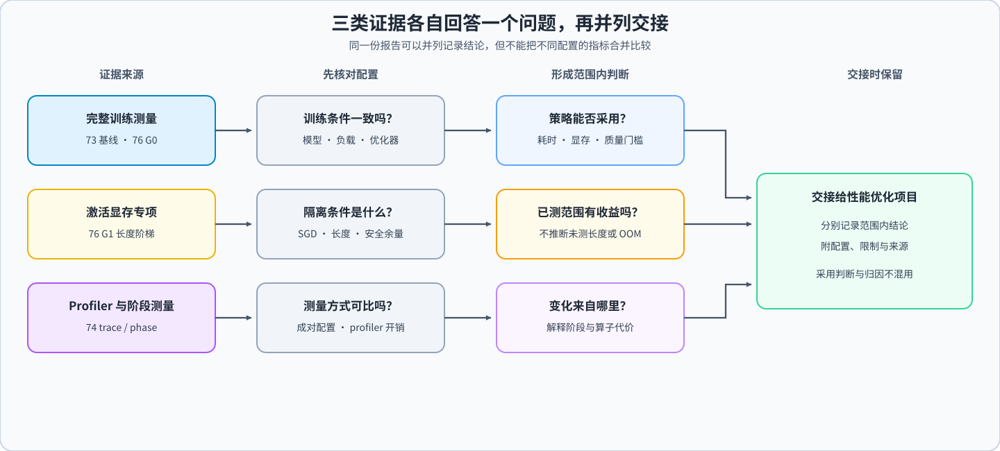
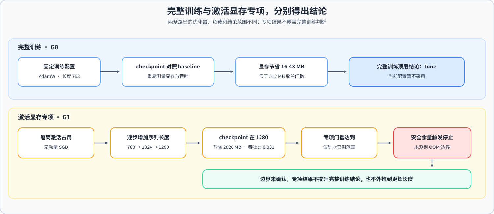

# 74. Profiling Driven End to End Optimization | profiling 驱动的候选准入与交接

**难度：** Hard | **环境：** CPU 可完成报告收口；GPU 用于真实 trace 与候选复测 | **标签：** `性能优化`, `性能剖析`, `候选准入` | **目标人群：** 项目决策练习者

> 🚀 **云端运行环境**
>
> 本章节的实战代码可以点击以下链接在免费 GPU 算力平台上直接运行：
>
> [](https://colab.research.google.com/github/datawhalechina/llm-algo-leetcode/blob/main/02_PyTorch_Algorithms/74_Profiling_Driven_End_to_End_Optimization.ipynb)
> [](https://modelscope.cn/my/mynotebook) *(国内推荐：魔搭社区免费实例)*


---

## 本节导读

当一次优化改变了训练时间或资源占用时，本节带你判断变化来自哪里，并用证据和复测决定候选能否进入综合项目。你将从已有结果提出瓶颈假设，再用针对性的证据和复测检查这个假设，最后生成供 Part 05 使用的性能优化交接包。

**关键词：** `profiling`, `optimization`, `end-to-end`

---

## 前置阅读

**导语：** 先了解 profiling 的基本观察方法，再结合训练测量、显存预算和策略比较结果，进入本节的端到端证据分析。
- [P1: 13. Profiling and Bottleneck Analysis | 性能分析与瓶颈定位](../01_Hardware_Math_and_Systems/13_Profiling_and_Bottleneck_Analysis.md)
- [73. Training Performance Analysis | 训练性能分析](./73_Training_Performance_Analysis.md)
- [76. Activation Checkpoint Offload Benchmark | 显存策略与预算敏感性](./76_Activation_Checkpoint_Offload_Benchmark.md)
- [76. Activation Checkpoint Offload Benchmark | Activation / Checkpoint / Offload 对比项目](./76_Activation_Checkpoint_Offload_Benchmark.md)

---
### Step 1：按实验范围整理已有证据
本项目把完整训练比较、激活显存隔离和 profiler 归因分开处理。先核对每份证据对应的模型、负载、优化器和运行条件，再判断它能支持哪一类结论：完整训练结果用于策略采用判断，激活显存结果只说明已测长度范围内的容量与吞吐变化，trace 用于解释阶段和算子代价。

| 证据范围 | 核对内容 | 可支持的结论 |
|:---|:---|:---|
| 完整训练 | 固定 AdamW、`seq_len=768` 的 G0 配对测量 | 当前完整训练配置的策略门槛与采用结论 |
| 激活显存隔离 | 无动量 SGD 长度阶梯及显存安全准入 | 已测长度范围内的激活容量与吞吐变化；不代表完整训练收益或 OOM 边界 |
| Profiler 归因 | baseline/checkpoint 配对 trace 与阶段数据 | 解释热点、重算及阶段代价；不单独决定候选采用 |



### Step 2：区分采用证据与归因证据

完整训练的重复测量用于判断 checkpoint、offload 等策略是否达到显存、吞吐和质量门槛；配对 trace 与阶段测量用于解释时间或显存变化来自哪里。两类数据配置并不完全相同，不能拼成同一组候选的端到端收益，也不能把 trace 归因当成独立的采用证据。

| 证据类型 | 观察内容 | 使用边界 |
|:---|:---|:---|
| 完整训练重复测量 | 单步耗时、吞吐、峰值显存、验证损失与失败状态 | 用于 G0 的策略比较；仅对固定训练配置成立 |
| 配对 trace | 阶段耗时、调用活动与重算路径 | 用于解释时间变化；不能替代无 profiler 的性能测量 |
| 阶段显存与长度阶梯 | 不同训练阶段峰值和已运行长度 | 用于激活显存范围分析；优化器状态与完整训练结论需分开 |
| 安全准入记录 | 更长序列运行前的可用显存余量 | 安全停止不等于 OOM，未测长度不作外推 |


### Step 3：按证据范围形成结论

先按各自固定条件判断完整训练和激活显存专项，再用 trace 解释结果。完整训练的结论不能由隔离专项提升得到；激活显存专项即使在已测长度内通过，也不能说明更长序列可运行或已经找到 OOM 边界。

| 状态 | 触发条件 | 后续动作 |
|:---|:---|:---|
| 完整训练 | G0 的 AdamW 固定配置；checkpoint 显存节省低于最低收益门槛 | 顶层结论为 `tune`，继续测试压力负载或卸载范围 |
| 激活显存专项 | G1 在 `seq_len=1280` 时 checkpoint 满足容量收益和吞吐门槛 | 仅在已测专项范围内记为通过；更长长度未运行，未得到 OOM 边界 |
| Profiler 归因 | trace 与阶段测量解释变化来源 | 作为解释证据，不独立产生 `accept` |



### Step 4：隔离证据范围并生成项目结论

下面给出一份精简的收口报告。请核对证据范围与配置是否匹配，分别保留各范围的结论，再根据完整训练范围形成项目总决策。

| 任务与目的 | 已知条件 | 完成标准 | 测试验证 |
|:---|:---|:---|:---|
| TODO 1：检查范围配置 | 必需范围及其优化器、长度等配置 | 报告缺范围或字段不匹配时返回具体问题 | 覆盖正确配置、错配配置和缺失范围 |
| TODO 2：汇总范围结论 | 各范围的 decision、evidence status 与 limitations | 三类字段均保留，且不改写专项状态 | 验证 `blocked`、专项结论和限制均未丢失 |
| TODO 3：生成项目总决策 | 完整训练范围结论与各范围摘要 | 从完整训练结论取总决策；缺少该范围时拒绝生成 | 顶层字段与完整训练结论冲突时仍以范围结论为准 |


```python
from copy import deepcopy

```


```python
REPORT = {
    'decision': 'tune',
    'decision_scopes': {
        'full_training_adoption': {'decision': 'tune', 'evidence_status': 'measured', 'optimizer': 'AdamW', 'seq_len': 768},
        'activation_memory_mechanism': {'decision': 'accept_for_activation_memory_scope', 'evidence_status': 'blocked', 'optimizer': 'SGD', 'momentum': 0, 'seq_len': 1280, 'limitations': ['不含优化器状态', '安全停止；未测得 OOM 边界']},
        'profiler_attribution': {'decision': 'explain_only', 'evidence_status': 'measured', 'limitations': ['不单独决定候选采用']},
    },
}
EXPECTED_SCOPE_CONFIG = {
    'full_training_adoption': {'optimizer': 'AdamW', 'seq_len': 768},
    'activation_memory_mechanism': {'optimizer': 'SGD', 'momentum': 0, 'seq_len': 1280},
}

def validate_evidence_scopes(report, expected_config):
    """核对范围配置，防止把不同实验条件的结果拼在一起。"""
    # TODO 1：逐个检查 expected_config 中的范围及字段；
    # 缺少范围或值不一致时，将“范围名:字段名”加入 issues。
    # 返回 {'valid': bool, 'issues': list}。
    raise NotImplementedError('请先完成 TODO 代码！')

def summarize_scope_decisions(report):
    """提取各范围结论、证据状态与限制，不提升专项结论。"""
    # TODO 2：为每个范围建立摘要，只保留 decision、evidence_status、limitations；
    # limitations 必须复制为新列表，避免改摘要时修改输入报告。
    raise NotImplementedError('请先完成 TODO 代码！')

def build_project_decision(report, scope_summary):
    """以完整训练结论为项目总决策，并附带其他范围摘要。"""
    # TODO 3：从 scope_summary['full_training_adoption']['decision'] 读取总决策；
    # 缺少完整训练范围时抛出 ValueError，并在结果中附上全部范围摘要。
    raise NotImplementedError('请先完成 TODO 代码！')

```

### 测试


```python
def test_evidence_scope_exercise():
    try:
        valid = validate_evidence_scopes(REPORT, EXPECTED_SCOPE_CONFIG)
        assert valid['valid'] is True and valid['issues'] == []
        mixed = deepcopy(REPORT)
        mixed['decision_scopes']['activation_memory_mechanism']['optimizer'] = 'AdamW'
        assert validate_evidence_scopes(mixed, EXPECTED_SCOPE_CONFIG)['valid'] is False
        missing = deepcopy(REPORT)
        del missing['decision_scopes']['activation_memory_mechanism']
        missing_check = validate_evidence_scopes(missing, EXPECTED_SCOPE_CONFIG)
        assert missing_check['valid'] is False and 'activation_memory_mechanism:missing' in missing_check['issues']
        wrong_length = deepcopy(REPORT)
        wrong_length['decision_scopes']['activation_memory_mechanism']['seq_len'] = 1536
        assert validate_evidence_scopes(wrong_length, EXPECTED_SCOPE_CONFIG)['valid'] is False
        scopes = summarize_scope_decisions(REPORT)
        assert scopes['activation_memory_mechanism']['decision'] == 'accept_for_activation_memory_scope'
        assert scopes['activation_memory_mechanism']['evidence_status'] == 'blocked'
        assert '未测得 OOM 边界' in scopes['activation_memory_mechanism']['limitations'][1]
        scopes['activation_memory_mechanism']['limitations'].append('测试用本地修改')
        assert '测试用本地修改' not in REPORT['decision_scopes']['activation_memory_mechanism']['limitations']
        scopes = summarize_scope_decisions(REPORT)
        result = build_project_decision(REPORT, scopes)
        assert result['decision'] == 'tune'
        assert result['scopes'] == scopes
        contradictory = deepcopy(REPORT)
        contradictory['decision'] = 'accept'
        assert build_project_decision(contradictory, scopes)['decision'] == 'tune'
        missing_full_training = {key: value for key, value in scopes.items() if key != 'full_training_adoption'}
        try:
            build_project_decision(REPORT, missing_full_training)
        except ValueError:
            pass
        else:
            raise AssertionError('缺少完整训练范围时必须拒绝生成总决策')
        print('✅ 证据范围隔离与总决策测试通过。')
    except NotImplementedError:
        print('请先完成 TODO 代码！')
        raise
    except AssertionError as exc:
        raise NotImplementedError('请先完成 TODO 代码！') from exc

test_evidence_scope_exercise()

```

---

🛑 **STOP HERE** 🛑
<br><br><br><br><br><br><br><br><br><br>
> 请先尝试自己完成代码并跑通测试。<br>
> 如果你正在 Colab 中运行，并且遇到困难没有思路，可以向下滚动查看参考答案。
<br><br><br><br><br><br><br><br><br><br>

---
## 参考代码与解析

### 代码


```python
REPORT = {
    'decision': 'tune',
    'decision_scopes': {
        'full_training_adoption': {'decision': 'tune', 'evidence_status': 'measured', 'optimizer': 'AdamW', 'seq_len': 768},
        'activation_memory_mechanism': {'decision': 'accept_for_activation_memory_scope', 'evidence_status': 'blocked', 'optimizer': 'SGD', 'momentum': 0, 'seq_len': 1280, 'limitations': ['不含优化器状态', '安全停止；未测得 OOM 边界']},
        'profiler_attribution': {'decision': 'explain_only', 'evidence_status': 'measured', 'limitations': ['不单独决定候选采用']},
    },
}
EXPECTED_SCOPE_CONFIG = {
    'full_training_adoption': {'optimizer': 'AdamW', 'seq_len': 768},
    'activation_memory_mechanism': {'optimizer': 'SGD', 'momentum': 0, 'seq_len': 1280},
}

def validate_evidence_scopes(report, expected_config):
    issues = []
    scopes = report.get('decision_scopes', {})
    for scope_name, expected in expected_config.items():
        actual = scopes.get(scope_name)
        if not isinstance(actual, dict):
            issues.append(f'{scope_name}:missing')
            continue
        for key, expected_value in expected.items():
            if actual.get(key) != expected_value:
                issues.append(f'{scope_name}:{key}_mismatch')
    return {'valid': not issues, 'issues': issues}

def summarize_scope_decisions(report):
    summary = {}
    for scope_name, scope in report.get('decision_scopes', {}).items():
        summary[scope_name] = {
            'decision': scope.get('decision'),
            'evidence_status': scope.get('evidence_status'),
            'limitations': list(scope.get('limitations', [])),
        }
    return summary

def build_project_decision(report, scope_summary):
    full_training = scope_summary.get('full_training_adoption')
    if not isinstance(full_training, dict) or not full_training.get('decision'):
        raise ValueError('完整训练范围缺失，不能生成项目总决策')
    return {'decision': full_training['decision'], 'scopes': scope_summary}

```

### 解析

题目用缩小后的报告字段练习三项判断：配置是否仍属于声明的证据范围、专项结论是否保留原有状态和限制、项目总决策是否仍由完整训练范围控制。示例数据仅用于 CPU 逻辑测试，不是新增测量结果。

**1. 核对证据范围**

- 完整训练与激活显存专项采用不同优化器和序列长度，配置不匹配时不能沿用该范围的结论。
- 测试覆盖合法报告和跨范围配置错配。

**2. 分别保留范围结论**

- 激活显存专项通过只说明已测范围内的结果；`blocked` 状态和未测 OOM 边界仍需保留。Profiler 归因只解释变化来源。
- 测试确认专项结论不会覆盖完整训练结论，限制字段也不会丢失。

**3. 形成项目总决策**

- 本项目的总决策依据完整训练范围；专项结果作为范围内结论附带，不把 `accept_for_activation_memory_scope` 改写成全局 `accept`。
- 测试确认示例总决策仍为 `tune`，且各证据状态原样输出。

Profiler 的热点信息用于解释，完整训练数据用于采用判断，两类证据不可互换。

### Step 5（项目实验）：核对性能证据并生成交接结果

本实验核对两组结论：完整训练配置能否采用 checkpoint，以及 checkpoint 在激活显存占主导时是否有效。两组实验的优化器和序列长度不同，因此分别判断。

| 实验范围 | 固定配置 | 可输出的结论 |
| --- | --- | --- |
| 完整训练 | 0.5B、FP32、AdamW、`seq_len=768` | `accept / tune / reject` |
| 激活显存 | 0.5B、FP32、无动量 SGD、长度阶梯 | `accept_for_activation_memory_scope / tune` |

#### 5.1 本次运行配置

运行环境：`PERF-CUDA-MECHANISM`，单卡显存至少 8 GiB；环境创建与验证见[性能分析 Quickstart](../topic_discussion/performance_analysis/quickstart.md#perf-cuda-mechanism-quickstart)。

只需填写 `RUN_LABEL` 和 `RUN_STAGE`。模型、工作负载、门槛、上游路径及证据哈希从 5.2 的固定清单读取。

| `RUN_STAGE` | 操作 | 是否使用 GPU |
| --- | --- | --- |
| `prepare` | 核对输入和输出计划 | 否 |
| `profile` | 采集 baseline/checkpoint 配对跟踪 | 是 |
| `phase` | 各重复三次阶段显存测量 | 是 |
| `close` | 复用清单中的证据并生成结论 | 否 |


```python
# ===== 学习者配置：本单元只声明本次运行意图 =====
RUN_LABEL = 'replace_with_unique_label'  # 默认占位符；写入正式结果前改为本次唯一标签。
RUN_STAGE = 'prepare'  # 默认 prepare 只读检查；profile=重采 trace；phase=重新测量；close=只读收口。

```

#### 5.2 固定实验配置与输入预检

本单元核对项目路径、固定证据清单、上游文件哈希和结果目录。`profile`、`phase` 还会检查训练依赖；`prepare`、`close` 不要求加载模型。


```python
"""加载固定证据清单并检查运行环境；不安装依赖、不加载模型、不创建输出目录。"""
from pathlib import Path
import hashlib
import importlib.util
import json
import os
import sys

PROJECT_ID = '74'
SEMANTIC_ID = 'PERF-PROFILING-CLOSURE'
SCHEMA_VERSION = 'profiling-optimization-benchmark/v1'
EVIDENCE_MANIFEST_SCHEMA_VERSION = 'performance-evidence-manifest/v1'
RAW_PROFILE_SCHEMA_VERSION = 'profiling-trace-evidence/v1'
PHASE_MEMORY_SCHEMA_VERSION = 'training-phase-memory/v1'
EVIDENCE_MANIFEST_RELATIVE_PATH = Path(
    'benchmarks/results/74_evidence_manifest_rtx5070ti_profiling_closure_v5.json'
)
PRESSURE_VALIDATION_RELATIVE_PATH = None
PROFILE_STRATEGIES = ['baseline', 'checkpoint']
PHASE_REPEATS = 3
PHASE_PROCESS_MEMORY_FRACTION = 0.92
PHASE_MIN_FREE_MARGIN_MB = 512.0
REQUIRE_PHASE_MEMORY = True
ROOFLINE_COUNTER_SOURCE = 'not_collected'
QUALIFICATION_GATES = {
    'minimum_memory_saving_mb': 512.0,
    'minimum_throughput_ratio': 0.70,
    'maximum_loss_delta': 0.01,
}

if RUN_STAGE not in {'prepare', 'profile', 'phase', 'close'}:
    raise ValueError("RUN_STAGE 只能是 'prepare'、'profile'、'phase' 或 'close'。")
RUN_REAL_PROFILE = RUN_STAGE == 'profile'
RUN_PHASE_MEMORY = RUN_STAGE == 'phase'
RUN_REAL_PROJECT = RUN_STAGE == 'close'

GPU_PROJECT_ROOT = Path(os.environ.get('LLM_ALGO_PROJECT_ROOT', Path.cwd())).expanduser().resolve()
GPU_PROJECT_ROOT = next(
    (candidate for candidate in (GPU_PROJECT_ROOT, *GPU_PROJECT_ROOT.parents)
     if (candidate / 'tools/project_runtime.py').is_file()),
    GPU_PROJECT_ROOT,
)
if not (GPU_PROJECT_ROOT / 'tools/project_runtime.py').is_file():
    colab_root = Path('/content/llm-algo-leetcode')
    if (colab_root / 'tools/project_runtime.py').is_file():
        GPU_PROJECT_ROOT = colab_root
if not (GPU_PROJECT_ROOT / 'tools/project_runtime.py').is_file():
    raise RuntimeError('找不到项目根目录：请设置 LLM_ALGO_PROJECT_ROOT，或先把仓库放到 /content/llm-algo-leetcode。')
os.chdir(GPU_PROJECT_ROOT)
if str(GPU_PROJECT_ROOT) not in sys.path:
    sys.path.insert(0, str(GPU_PROJECT_ROOT))

manifest_path = GPU_PROJECT_ROOT / EVIDENCE_MANIFEST_RELATIVE_PATH
if not manifest_path.is_file():
    raise FileNotFoundError(f'缺少固定证据清单：{manifest_path}')
evidence_manifest = json.loads(manifest_path.read_text(encoding='utf-8'))
if (
    evidence_manifest.get('schema_version') != EVIDENCE_MANIFEST_SCHEMA_VERSION
    or evidence_manifest.get('semantic_id') != SEMANTIC_ID
):
    raise ValueError('固定证据清单的 schema 或 semantic_id 不匹配')

def check_manifest_entry(entry, name):
    if not isinstance(entry, dict) or not entry.get('path') or not entry.get('sha256'):
        raise ValueError(f'证据清单缺少 {name} 的 path/sha256')
    relative_path = Path(entry['path'])
    artifact_path = GPU_PROJECT_ROOT / relative_path
    if not artifact_path.is_file():
        raise FileNotFoundError(f'{name} 不存在：{artifact_path}')
    actual_sha256 = hashlib.sha256(artifact_path.read_bytes()).hexdigest()
    if actual_sha256 != entry['sha256']:
        raise ValueError(f'{name} SHA256 不匹配：{relative_path}')
    return relative_path

manifest_sources = evidence_manifest.get('source_artifacts', {})
SOURCE_RESULTS = {
    name: check_manifest_entry(manifest_sources.get(name), f'{name} 上游结果')
    for name in ('baseline', 'strategy', 'budget')
}
ACTIVATION_SCOPE_RESULT_RELATIVE_PATH = check_manifest_entry(
    manifest_sources.get('activation_memory_scope'), 'activation_memory_scope 上游结果'
)
manifest_profile = evidence_manifest.get('profile', {})
check_manifest_entry(manifest_profile.get('report'), 'profiler 报告')
check_manifest_entry(manifest_profile.get('phase_memory', {}).get('report'), '阶段显存报告')

BASELINE_RESULT_RELATIVE_PATH = SOURCE_RESULTS['baseline']
STRATEGY_RESULT_RELATIVE_PATH = SOURCE_RESULTS['strategy']
BUDGET_RESULT_RELATIVE_PATH = SOURCE_RESULTS['budget']
PHASE_MEMORY_OUTPUT_RELATIVE_PATH = Path(f'benchmarks/results/{PROJECT_ID}_phase_memory_{RUN_LABEL}.json')
QUALIFICATION_OUTPUT_RELATIVE_PATH = Path(f'benchmarks/results/{PROJECT_ID}_profiling_optimization_{RUN_LABEL}.json')
output_parent = GPU_PROJECT_ROOT / QUALIFICATION_OUTPUT_RELATIVE_PATH.parent
output_parent_writable = output_parent.is_dir() and os.access(output_parent, os.W_OK)
requires_training_runtime = RUN_STAGE in {'profile', 'phase'}
transformers_available = importlib.util.find_spec('transformers') is not None
preflight_report = {
    'project_root': str(GPU_PROJECT_ROOT),
    'evidence_manifest': str(EVIDENCE_MANIFEST_RELATIVE_PATH),
    'manifest_sha256': hashlib.sha256(manifest_path.read_bytes()).hexdigest(),
    'sources': {name: str(path) for name, path in SOURCE_RESULTS.items()},
    'activation_scope': str(ACTIVATION_SCOPE_RESULT_RELATIVE_PATH),
    'output_parent': str(output_parent.relative_to(GPU_PROJECT_ROOT)),
    'output_parent_writable': output_parent_writable,
    'training_runtime_required': requires_training_runtime,
    'transformers_available': transformers_available,
    'ready': output_parent_writable and (transformers_available or not requires_training_runtime),
}
print(preflight_report)
if not preflight_report['ready']:
    raise RuntimeError('环境或输入资产预检未通过；没有执行实验。')

try:
    import torch
except ImportError:
    if requires_training_runtime:
        raise RuntimeError('当前阶段需要 PyTorch；请先安装与 CUDA 匹配的版本。')
    print('当前阶段不需要 PyTorch。')
else:
    print(f'torch: {torch.__version__}')
    print(f'cuda_build: {torch.version.cuda}; cuda_available: {torch.cuda.is_available()}')
    if torch.cuda.is_available():
        props = torch.cuda.get_device_properties(0)
        print(f'gpu: {props.name}; memory_gib: {props.total_memory / 2**30:.1f}')

```

#### 5.3 输入合同与证据路径

从固定清单读取 73、76 的训练结果、预算摘要以及跟踪和阶段显存文件，核对模型、精度、批大小、随机种子和硬件。优化器与序列长度的差异作为两组实验的身份信息保留。

| 证据 | 用途 |
| --- | --- |
| 73/76 | 完整训练基线、策略候选与预算筛选；固定历史清单中的旧预算结果继续用于复现 |
| 配对跟踪 | 定位算子耗时与重算开销 |
| 阶段显存 | 比较前向、反向和优化器阶段峰值 |
| 76 长度阶梯 | 判断激活显存范围内的收益 |


```python
# 只读检查：自动继承固定 workload，并从已审核证据清单推导 trace/phase。
import hashlib
import json

if RUN_STAGE not in {'prepare', 'profile', 'phase', 'close'}:
    raise ValueError("RUN_STAGE 只能是 'prepare'、'profile'、'phase' 或 'close'。")
project_root = globals().get('GPU_PROJECT_ROOT', Path.cwd().resolve())
project_root = next(
    (candidate for candidate in (project_root, *project_root.parents) if (candidate / 'tools/project_runtime.py').is_file()),
    project_root,
)
if not (project_root / 'tools/project_runtime.py').is_file():
    raise RuntimeError(f'找不到项目根目录：{project_root}')
source_paths = {name: project_root / path for name, path in SOURCE_RESULTS.items()}
missing_sources = [str(path) for path in source_paths.values() if not path.is_file()]
activation_scope_path = project_root / ACTIVATION_SCOPE_RESULT_RELATIVE_PATH
evidence_manifest_path = project_root / EVIDENCE_MANIFEST_RELATIVE_PATH
for required_path in (activation_scope_path, evidence_manifest_path):
    if not required_path.is_file():
        missing_sources.append(str(required_path))
if missing_sources:
    raise FileNotFoundError('缺少上游结果：' + ', '.join(missing_sources))
baseline_source = json.loads(source_paths['baseline'].read_text(encoding='utf-8'))
strategy_source = json.loads(source_paths['strategy'].read_text(encoding='utf-8'))
budget_source = json.loads(source_paths['budget'].read_text(encoding='utf-8'))
activation_scope_source = json.loads(activation_scope_path.read_text(encoding='utf-8'))
evidence_manifest = json.loads(evidence_manifest_path.read_text(encoding='utf-8'))
expected_semantic_ids = {
    'baseline': 'PERF-TRAINING-BASELINE',
    'strategy': 'PERF-MEMORY-STRATEGY',
}
actual_semantic_ids = {name: report.get('semantic_id') for name, report in {
    'baseline': baseline_source, 'strategy': strategy_source,
}.items()}
if actual_semantic_ids != expected_semantic_ids or budget_source.get('semantic_id') not in {'PERF-MEMORY-BUDGET', 'PERF-MEMORY-STRATEGY'}:
    raise ValueError(f'上游语义身份不匹配：{actual_semantic_ids}')
if evidence_manifest.get('schema_version') != EVIDENCE_MANIFEST_SCHEMA_VERSION or evidence_manifest.get('semantic_id') != SEMANTIC_ID:
    raise ValueError('证据清单的 schema 或 semantic_id 不匹配')
if activation_scope_source.get('schema_version') != 'training-performance-project/v1':
    raise ValueError('激活机制结果 schema 必须是 training-performance-project/v1')
if activation_scope_source.get('semantic_id') != 'PERF-MEMORY-STRATEGY':
    raise ValueError('激活机制结果 semantic_id 必须是 PERF-MEMORY-STRATEGY')
baseline_config = baseline_source.get('config', {})
strategy_config = strategy_source.get('config', {})
identity_fields = ('model_id', 'batch_size', 'seq_len', 'dtype', 'optimizer', 'workload', 'seed')
identity_mismatches = [key for key in identity_fields if baseline_config.get(key) != strategy_config.get(key)]
if identity_mismatches:
    raise ValueError(f'73/76 工作负载身份不一致：{identity_mismatches}')
activation_config = activation_scope_source.get('config', {})
activation_shared_fields = ('model_id', 'batch_size', 'dtype', 'seed', 'device')
activation_identity_mismatches = [
    key for key in activation_shared_fields
    if activation_config.get(key) != strategy_config.get(key)
]
if activation_identity_mismatches:
    raise ValueError(f'激活机制通道与完整训练通道身份不一致：{activation_identity_mismatches}')
if activation_config.get('optimizer') != 'SGD' or activation_config.get('optimizer_momentum') != 0.0:
    raise ValueError('激活机制通道必须使用无动量 SGD 隔离优化器状态')
if activation_config.get('comparison_scope') != 'activation_memory_isolation':
    raise ValueError('激活机制通道必须声明 comparison_scope=activation_memory_isolation')

def resolve_manifest_artifact(entry, name):
    if not isinstance(entry, dict) or not entry.get('path') or not entry.get('sha256'):
        raise ValueError(f'证据清单缺少 {name} 的 path/sha256')
    relative_path = Path(entry['path'])
    artifact_path = project_root / relative_path
    if not artifact_path.is_file():
        raise FileNotFoundError(f'{name} 不存在：{artifact_path}')
    actual_sha256 = hashlib.sha256(artifact_path.read_bytes()).hexdigest()
    if actual_sha256 != entry['sha256']:
        raise ValueError(f'{name} SHA256 不匹配：{relative_path}')
    return relative_path


# 证据清单是唯一来源：路径与哈希一起推导，避免 TRACE/PHASE 标签漂移。
manifest_profile = evidence_manifest.get('profile', {})
manifest_profile_report = resolve_manifest_artifact(manifest_profile.get('report'), 'profiler 报告')
manifest_phase_report = resolve_manifest_artifact(
    manifest_profile.get('phase_memory', {}).get('report'), '阶段显存报告'
)
manifest_trace_dir = Path(manifest_profile.get('trace_dir', ''))
if not manifest_trace_dir or not (project_root / manifest_trace_dir).is_dir():
    raise FileNotFoundError(f'trace 目录不存在：{project_root / manifest_trace_dir}')

manifest_upstream = evidence_manifest.get('source_artifacts', {})
for name, local_path in source_paths.items():
    manifest_entry = manifest_upstream.get(name)
    resolved_path = resolve_manifest_artifact(manifest_entry, f'{name} 上游结果')
    if resolved_path != local_path.relative_to(project_root):
        raise ValueError(f'{name} 路径与证据清单不一致：{resolved_path}')

if RUN_STAGE == 'profile':
    PROFILE_TRACE_RELATIVE_DIR = Path(f'benchmarks/results/{PROJECT_ID}_profile/trace_{RUN_LABEL}')
    PROFILE_OUTPUT_RELATIVE_PATH = Path(f'benchmarks/results/{PROJECT_ID}_real_gpu_profile_{RUN_LABEL}.json')
else:
    PROFILE_TRACE_RELATIVE_DIR = manifest_trace_dir
    PROFILE_OUTPUT_RELATIVE_PATH = manifest_profile_report
PHASE_MEMORY_SOURCE_RELATIVE_PATH = (
    PHASE_MEMORY_OUTPUT_RELATIVE_PATH if RUN_STAGE == 'phase' else manifest_phase_report
)

PROFILE_MODEL_ID = strategy_config['model_id']
PROFILE_BATCH_SIZE = int(strategy_config['batch_size'])
PROFILE_SEQ_LEN = int(strategy_config['seq_len'])
PROFILE_WARMUP = int(strategy_config.get('warmup', 2))
PROFILE_ITERS = int(strategy_config.get('iters', 5))
if PROFILE_BATCH_SIZE <= 0 or PROFILE_SEQ_LEN <= 0 or PROFILE_WARMUP < 0 or PROFILE_ITERS <= 0:
    raise ValueError('上游 batch_size/seq_len/iters 必须 > 0，warmup 不能为负数。')
if not PROFILE_STRATEGIES or len(PROFILE_STRATEGIES) != len(set(PROFILE_STRATEGIES)):
    raise ValueError('PROFILE_STRATEGIES 不能为空且不能包含重复策略。')
if any(strategy not in {'baseline', 'checkpoint'} for strategy in PROFILE_STRATEGIES):
    raise ValueError('本节只采集 baseline/checkpoint；offload/hybrid 由上游预算门控处理。')
strategy_names = {item.get('name') for item in strategy_source.get('candidates', [])}
missing_candidates = [name for name in PROFILE_STRATEGIES if name not in strategy_names]
if missing_candidates:
    raise ValueError(f'76 节缺少配对候选：{missing_candidates}')
if SCHEMA_VERSION != 'profiling-optimization-benchmark/v1':
    raise ValueError('收口结果必须使用 profiling-optimization-benchmark/v1。')
PROFILE_IDENTITY = {
    'model_id': PROFILE_MODEL_ID, 'batch_size': PROFILE_BATCH_SIZE,
    'seq_len': PROFILE_SEQ_LEN, 'strategies': list(PROFILE_STRATEGIES),
    'warmup': PROFILE_WARMUP, 'iters': PROFILE_ITERS, 'phase_repeats': PHASE_REPEATS,
    'run_label': RUN_LABEL, 'run_stage': RUN_STAGE,
    'evidence_manifest': str(EVIDENCE_MANIFEST_RELATIVE_PATH),
    'adoption_metrics': 'unprofiled_repeated_measurements',
    'profiler_metrics': 'bottleneck_attribution_only',
    'pressure_validation': str(PRESSURE_VALIDATION_RELATIVE_PATH) if PRESSURE_VALIDATION_RELATIVE_PATH else None,
    'decision_scopes': {
        'full_training_adoption': {'optimizer': strategy_config.get('optimizer'), 'seq_len': strategy_config.get('seq_len')},
        'activation_memory_isolation': {
            'optimizer': activation_config.get('optimizer'),
            'tested_seq_lens': activation_scope_source.get('summary', {}).get('tested_seq_lens'),
        },
    },
    'resolved_profile_report': str(PROFILE_OUTPUT_RELATIVE_PATH),
    'resolved_trace_dir': str(PROFILE_TRACE_RELATIVE_DIR),
    'resolved_phase_report': str(PHASE_MEMORY_SOURCE_RELATIVE_PATH),
    'activation_scope_source': str(ACTIVATION_SCOPE_RESULT_RELATIVE_PATH),
    'output_exists': {
        'profile': (project_root / PROFILE_OUTPUT_RELATIVE_PATH).is_file(),
        'phase': (project_root / PHASE_MEMORY_SOURCE_RELATIVE_PATH).is_file(),
        'closure': (project_root / QUALIFICATION_OUTPUT_RELATIVE_PATH).is_file(),
    },
}
print(PROFILE_IDENTITY)

```

#### 5.4 采集专项证据

`profile` 采集配对跟踪，`phase` 采集阶段显存；`prepare` 和 `close` 跳过 GPU。完整训练的采用门槛仍使用无分析器的重复测量，跟踪和阶段数据只用于解释瓶颈。


```python
# 按配置采集原始 trace 和 JSON；本 cell 不修改判定规则。
import gc
import json
import time
from contextlib import nullcontext
from pathlib import Path

if RUN_REAL_PROFILE:
    import torch
    from transformers import AutoConfig, AutoModelForCausalLM

    from tools.model_runtime import resolve_model
    # Jupyter 可能缓存旧版 helper；显式 reload，避免修改工具文件后必须重启内核。
    import importlib
    import tools.profiling_runtime as profiling_runtime
    profiling_runtime = importlib.reload(profiling_runtime)
    collect_training_trace = profiling_runtime.collect_training_trace
    from tools.project_runtime import environment_preflight, save_json_record_once, standard_experiment_config, standard_training_metrics
    preflight = environment_preflight(torch, required_packages=('transformers',), require_gpu=True)
    print({'environment_preflight': preflight})
    if not preflight['ready']:
        raise RuntimeError('环境预检未通过，请先按 next_actions 修复；没有开始 profiling。')

    profile_output_path = project_root / PROFILE_OUTPUT_RELATIVE_PATH
    trace_root = project_root / PROFILE_TRACE_RELATIVE_DIR
    if profile_output_path.exists() or trace_root.exists():
        raise FileExistsError(f'profiler 结果已存在，请更换 RUN_LABEL：{RUN_LABEL}')

    baseline_result_path = project_root / BASELINE_RESULT_RELATIVE_PATH
    if not baseline_result_path.exists():
        raise FileNotFoundError(f'找不到上游训练基线：{baseline_result_path}')
    baseline_result = json.loads(baseline_result_path.read_text(encoding='utf-8'))
    baseline_result_config = baseline_result.get('config', {})
    strategy_result_path = project_root / STRATEGY_RESULT_RELATIVE_PATH
    if not strategy_result_path.exists():
        raise FileNotFoundError(f'找不到上游策略结果：{strategy_result_path}')
    strategy_result = json.loads(strategy_result_path.read_text(encoding='utf-8'))
    strategy_result_config = strategy_result.get('config', {})
    missing_repeats = [item.get('name', '<unknown>') for item in strategy_result.get('candidates', []) if len(item.get('runs', [])) < 3]
    if missing_repeats:
        raise ValueError(f'策略结果必须先完成每个候选的 3 次重复运行：{missing_repeats}')
    for key, value in {'model_id': PROFILE_MODEL_ID, 'batch_size': PROFILE_BATCH_SIZE, 'seq_len': PROFILE_SEQ_LEN}.items():
        if baseline_result_config.get(key) != value:
            raise ValueError(f'当前 workload 与上游训练基线不一致：{key}={baseline_result_config.get(key)} != {value}')
        if strategy_result_config.get(key) != value:
            raise ValueError(f'当前 workload 与上游策略结果不一致：{key}={strategy_result_config.get(key)} != {value}')

    model_path = resolve_model(PROFILE_MODEL_ID, source='auto', cache_dir='model_cache')
    model_config = AutoConfig.from_pretrained(model_path)
    generator = torch.Generator(device='cpu').manual_seed(42)
    input_ids_cpu = torch.randint(0, model_config.vocab_size, (PROFILE_BATCH_SIZE, PROFILE_SEQ_LEN), generator=generator)
    trace_root.mkdir(parents=True, exist_ok=False)
    candidates = []

    for strategy in PROFILE_STRATEGIES:
        trace_dir = trace_root / strategy
        trace_dir.mkdir(parents=True, exist_ok=True)
        model = AutoModelForCausalLM.from_pretrained(model_path, dtype=torch.float32)
        model.config.use_cache = False
        if strategy == 'checkpoint':
            model.gradient_checkpointing_enable()
        model.to('cuda').train()
        optimizer = torch.optim.AdamW(model.parameters(), lr=1e-5)
        input_ids = input_ids_cpu.to('cuda')
        labels = input_ids.clone()

        def train_step():
            optimizer.zero_grad(set_to_none=True)
            with torch.profiler.record_function('phase.forward'):
                loss = model(input_ids=input_ids, labels=labels).loss
            with torch.profiler.record_function('phase.backward'):
                loss.backward()
            with torch.profiler.record_function('phase.optimizer'):
                optimizer.step()
            return loss

        measured = collect_training_trace(
            train_step, torch_module=torch, output_dir=trace_dir,
            warmup=PROFILE_WARMUP, iters=PROFILE_ITERS,
            batch_size=PROFILE_BATCH_SIZE,
        )
        trace_files = sorted(trace_dir.glob('*.pt.trace.json'))
        if not trace_files:
            raise RuntimeError(f'{strategy} 未生成 .pt.trace.json；请检查 profiler schedule 和输出目录：{trace_dir}')
        peak_allocated_mb = measured['peak_memory_mb']
        peak_reserved_mb = measured['peak_reserved_mb']
        # 向后兼容旧 helper 返回值；新 helper 会直接提供 allocator_slack_mb。
        allocator_slack_mb = measured.get(
            'allocator_slack_mb', round(peak_reserved_mb - peak_allocated_mb, 2)
        )
        candidates.append({
            'name': strategy, 'status': 'ok', 'step_time_ms': measured['step_time_ms'],
            'samples_per_s': measured['samples_per_s'], 'loss': measured['loss'],
            'peak_memory_mb': peak_allocated_mb, 'peak_reserved_mb': peak_reserved_mb,
            'allocator_slack_mb': allocator_slack_mb,
            'trace_dir': str(trace_dir.relative_to(project_root)), 'top_operators': measured['top_operators'],
        })
        del optimizer, model, input_ids, labels
        gc.collect()
        torch.cuda.empty_cache()

    report = {
        'schema_version': RAW_PROFILE_SCHEMA_VERSION, 'semantic_id': SEMANTIC_ID, 'run_mode': 'real_gpu', 'run_label': RUN_LABEL,
        'task': 'profiling_driven_optimization', 'stage': 'real_profiler_trace',
        'config': {'model_id': PROFILE_MODEL_ID, 'batch_size': PROFILE_BATCH_SIZE, 'seq_len': PROFILE_SEQ_LEN, 'dtype': 'float32', 'strategies': PROFILE_STRATEGIES, 'warmup': PROFILE_WARMUP, 'iters': PROFILE_ITERS},
        'sources': {'baseline': str(baseline_result_path.relative_to(project_root)), 'strategy': str(strategy_result_path.relative_to(project_root))}, 'trace_root': str(trace_root.relative_to(project_root)),
        'candidates': candidates, 'profile': {'tool': 'torch.profiler', 'activities': ['CPU', 'CUDA'], 'status': 'collected', 'measurement_role': 'bottleneck_attribution_only', 'timing_for_adoption': False, 'active_steps': max(1, PROFILE_ITERS - 1), 'repeat': 1, 'trace_files_by_strategy': {item['name']: [str(path.relative_to(project_root)) for path in sorted((trace_root / item['name']).glob('*.pt.trace.json'))] for item in candidates}},
    }
    report['experiment'] = standard_experiment_config({
        'model_id': PROFILE_MODEL_ID, 'backend': 'torch.profiler',
        'dtype': 'float32', 'optimizer': 'AdamW',
        'batch_size': PROFILE_BATCH_SIZE, 'seq_len': PROFILE_SEQ_LEN,
        'warmup': PROFILE_WARMUP, 'iters': PROFILE_ITERS, 'seed': 42,
        'device': torch.cuda.get_device_name(0),
        'torch': torch.__version__, 'cuda': torch.version.cuda,
    })
    report['standard_metrics'] = {item['name']: standard_training_metrics(item) for item in candidates}
    output_path = project_root / PROFILE_OUTPUT_RELATIVE_PATH
    save_json_record_once(output_path, report)
    print(json.dumps(report, ensure_ascii=False, indent=2))
elif not RUN_PHASE_MEMORY:
    print(f'跳过 GPU 归因实验：当前 RUN_STAGE={RUN_STAGE!r}。')

if RUN_PHASE_MEMORY:
    import torch
    from transformers import AutoConfig, AutoModelForCausalLM
    from tools.model_runtime import resolve_model
    from tools.project_runtime import environment_preflight, save_json_record_once, standard_experiment_config, standard_training_metrics

    import importlib
    import tools.training_memory_runtime as training_memory_runtime
    import tools.profiling_runtime as profiling_runtime
    import tools.profiling_result_schema as profiling_result_schema
    training_memory_runtime = importlib.reload(training_memory_runtime)
    profiling_runtime = importlib.reload(profiling_runtime)
    profiling_result_schema = importlib.reload(profiling_result_schema)
    measure_phased_training_run = training_memory_runtime.measure_phased_training_run
    summarize_phase_memory_runs = profiling_runtime.summarize_phase_memory_runs
    validate_phase_memory_result = profiling_result_schema.validate_phase_memory_result

    preflight = environment_preflight(torch, required_packages=('transformers',), require_gpu=True)
    print({'environment_preflight': preflight})
    if not preflight['ready']:
        raise RuntimeError('环境预检未通过；没有开始阶段显存实验。')
    if not 0 < PHASE_PROCESS_MEMORY_FRACTION <= 1:
        raise ValueError('PHASE_PROCESS_MEMORY_FRACTION 必须位于 (0, 1]。')
    torch.cuda.set_per_process_memory_fraction(PHASE_PROCESS_MEMORY_FRACTION, 0)

    phase_output_path = project_root / PHASE_MEMORY_OUTPUT_RELATIVE_PATH
    if phase_output_path.exists():
        raise FileExistsError(f'阶段显存结果已存在，请更换 RUN_LABEL：{RUN_LABEL}')

    baseline_result_path = project_root / BASELINE_RESULT_RELATIVE_PATH
    strategy_result_path = project_root / STRATEGY_RESULT_RELATIVE_PATH
    baseline_result = json.loads(baseline_result_path.read_text(encoding='utf-8'))
    strategy_result = json.loads(strategy_result_path.read_text(encoding='utf-8'))
    for key, value in {'model_id': PROFILE_MODEL_ID, 'batch_size': PROFILE_BATCH_SIZE, 'seq_len': PROFILE_SEQ_LEN}.items():
        if baseline_result.get('config', {}).get(key) != value or strategy_result.get('config', {}).get(key) != value:
            raise ValueError(f'阶段显存 workload 与 73/76 不一致：{key}')

    source_candidates = {item.get('name'): item for item in strategy_result.get('candidates', [])}
    projected_peak_reserved_mb = source_candidates.get('baseline', {}).get('peak_reserved_mb')
    if not isinstance(projected_peak_reserved_mb, (int, float)) or projected_peak_reserved_mb <= 0:
        raise ValueError('76 节缺少 baseline.peak_reserved_mb，无法执行显存安全准入。')
    free_bytes, total_bytes = torch.cuda.mem_get_info(0)
    free_memory_mb = free_bytes / 1024**2
    total_memory_mb = total_bytes / 1024**2
    required_free_memory_mb = projected_peak_reserved_mb + PHASE_MIN_FREE_MARGIN_MB
    phase_safety = {
        'free_memory_mb_before_load': round(free_memory_mb, 2),
        'total_memory_mb': round(total_memory_mb, 2),
        'projected_peak_reserved_mb': round(projected_peak_reserved_mb, 2),
        'minimum_free_margin_mb': PHASE_MIN_FREE_MARGIN_MB,
        'required_free_memory_mb': round(required_free_memory_mb, 2),
        'admitted': free_memory_mb >= required_free_memory_mb,
    }
    print({'phase_memory_safety': phase_safety})
    if not phase_safety['admitted']:
        raise RuntimeError('GPU 空闲显存不足；关闭其他 GPU 进程后重试，阶段实验尚未开始。')

    model_path = resolve_model(PROFILE_MODEL_ID, source='auto', cache_dir='model_cache')
    model_config = AutoConfig.from_pretrained(model_path)
    generator = torch.Generator(device='cpu').manual_seed(42)
    input_ids_cpu = torch.randint(0, model_config.vocab_size, (PROFILE_BATCH_SIZE, PROFILE_SEQ_LEN), generator=generator)
    phase_candidates = []

    for strategy in PROFILE_STRATEGIES:
        runs = []
        for repeat_index in range(PHASE_REPEATS):
            model = optimizer = input_ids = labels = None
            try:
                model = AutoModelForCausalLM.from_pretrained(model_path, dtype=torch.float32)
                model.config.use_cache = False
                if strategy == 'checkpoint':
                    model.gradient_checkpointing_enable()
                model.to('cuda').train()
                optimizer = torch.optim.AdamW(model.parameters(), lr=1e-5)
                input_ids = input_ids_cpu.to('cuda')
                labels = input_ids.clone()

                def phase_train_step(record_phase):
                    optimizer.zero_grad(set_to_none=True)
                    loss = record_phase(
                        'forward', lambda: model(input_ids=input_ids, labels=labels).loss,
                    )
                    record_phase('backward', loss.backward)
                    record_phase('optimizer', optimizer.step)
                    return loss

                measured = measure_phased_training_run(
                    phase_train_step, torch_module=torch,
                    batch_size=PROFILE_BATCH_SIZE, warmup=PROFILE_WARMUP, iters=PROFILE_ITERS,
                )
                runs.append({'repeat': repeat_index + 1, 'status': 'ok', **measured})
            except torch.OutOfMemoryError as exc:
                runs.append({'repeat': repeat_index + 1, 'status': 'oom', 'error': str(exc)})
            finally:
                del optimizer, model, input_ids, labels
                gc.collect()
                torch.cuda.empty_cache()
        phase_candidates.append(summarize_phase_memory_runs(strategy, runs))

    phase_by_name = {item['name']: item for item in phase_candidates}
    phase_summary = {'candidate_count': len(phase_candidates), 'successful_candidates': [item['name'] for item in phase_candidates if item['status'] == 'ok']}
    if all(phase_by_name.get(name, {}).get('status') == 'ok' for name in PROFILE_STRATEGIES):
        phase_summary['allocated_memory_saving_mb'] = {
            phase: round(phase_by_name['baseline']['phase_metrics'][phase]['peak_allocated_mb'] - phase_by_name['checkpoint']['phase_metrics'][phase]['peak_allocated_mb'], 3)
            for phase in ('forward', 'backward', 'optimizer')
        }
        phase_summary['global_peak_phase'] = {name: phase_by_name[name]['global_peak_phase'] for name in PROFILE_STRATEGIES}

    phase_report = {
        'schema_version': PHASE_MEMORY_SCHEMA_VERSION, 'semantic_id': SEMANTIC_ID,
        'run_mode': 'real_gpu', 'run_label': RUN_LABEL, 'task': 'profiling_driven_optimization',
        'stage': 'phase_memory_attribution', 'evidence_level': 'repeated_phase_memory_measurement',
        'config': {
            'model_id': PROFILE_MODEL_ID, 'batch_size': PROFILE_BATCH_SIZE, 'seq_len': PROFILE_SEQ_LEN,
            'dtype': 'float32', 'optimizer': 'AdamW', 'strategies': PROFILE_STRATEGIES,
            'warmup': PROFILE_WARMUP, 'iters': PROFILE_ITERS, 'repeats': PHASE_REPEATS,
            'seed': 42, 'process_memory_fraction': PHASE_PROCESS_MEMORY_FRACTION,
            'minimum_free_margin_mb': PHASE_MIN_FREE_MARGIN_MB,
            'torch': torch.__version__, 'torch_cuda': torch.version.cuda, 'device': torch.cuda.get_device_name(0),
        },
        'sources': {
            'baseline': str(baseline_result_path.relative_to(project_root)),
            'strategy': str(strategy_result_path.relative_to(project_root)),
            'profile_trace': str(PROFILE_OUTPUT_RELATIVE_PATH),
        },
        'measurement': {'role': 'phase_memory_attribution_only', 'timing_for_adoption': False, 'synchronize_at_phase_boundaries': True},
        'safety': phase_safety,
        'candidates': phase_candidates, 'summary': phase_summary,
    }
    phase_report['experiment'] = standard_experiment_config({
        **phase_report['config'], 'backend': 'torch', 'workload': strategy_result.get('config', {}).get('workload'),
        'cuda': torch.version.cuda,
    })
    phase_report['standard_metrics'] = {item['name']: standard_training_metrics(item) for item in phase_candidates}
    phase_errors = validate_phase_memory_result(phase_report)
    if phase_errors:
        raise ValueError('阶段显存结果契约校验失败：' + '; '.join(phase_errors))
    save_json_record_once(phase_output_path, phase_report)
    print(json.dumps(phase_report, ensure_ascii=False, indent=2))

```

#### 5.5 核对证据

本单元读取并核对两组实验。`prepare` 展示证据计划；`profile`、`phase` 检查本次新增文件；`close` 使用固定清单中的完整证据。完整训练和激活显存分别计算，不互相替代。


```python
import hashlib
import importlib
import json
from pathlib import Path
import sys

project_root = Path.cwd().resolve()
for candidate_root in (project_root, *project_root.parents):
    if (candidate_root / 'tools/project_runtime.py').is_file():
        if str(candidate_root) not in sys.path:
            sys.path.insert(0, str(candidate_root))
        break
from tools.project_runtime import resolve_project_root, save_json_record_once, standard_experiment_config, standard_training_metrics
from tools.profiling_result_schema import validate_phase_memory_result, validate_result as validate_profiling_result
import tools.profiling_runtime as profiling_runtime_module
profiling_runtime_module = importlib.reload(profiling_runtime_module)
infer_bottleneck_assessments = profiling_runtime_module.infer_bottleneck_assessments
import tools.performance_handoff_runtime as performance_handoff_runtime_module
performance_handoff_runtime_module = importlib.reload(performance_handoff_runtime_module)
make_performance_handoff = performance_handoff_runtime_module.build_performance_handoff
build_workload_identity = performance_handoff_runtime_module.build_workload_identity
qualify_memory_candidates = performance_handoff_runtime_module.qualify_memory_candidates

PROJECT_ROOT = resolve_project_root()
UPSTREAM_PATHS = {
    'baseline': PROJECT_ROOT / BASELINE_RESULT_RELATIVE_PATH,
    'strategy': PROJECT_ROOT / STRATEGY_RESULT_RELATIVE_PATH,
    'budget': PROJECT_ROOT / BUDGET_RESULT_RELATIVE_PATH,
}
OUTPUT_PATH = PROJECT_ROOT / QUALIFICATION_OUTPUT_RELATIVE_PATH
HANDOFF_PATH = PROJECT_ROOT / f'benchmarks/results/{PROJECT_ID}_profile/performance_handoff_{RUN_LABEL}.json'
PROFILE_TRACE_DIR = PROJECT_ROOT / PROFILE_TRACE_RELATIVE_DIR
PROFILE_REPORT_PATH = PROJECT_ROOT / PROFILE_OUTPUT_RELATIVE_PATH
PHASE_MEMORY_REPORT_PATH = PROJECT_ROOT / PHASE_MEMORY_SOURCE_RELATIVE_PATH
ACTIVATION_SCOPE_REPORT_PATH = PROJECT_ROOT / ACTIVATION_SCOPE_RESULT_RELATIVE_PATH
PRESSURE_VALIDATION_PATH = (
    PROJECT_ROOT / PRESSURE_VALIDATION_RELATIVE_PATH
    if PRESSURE_VALIDATION_RELATIVE_PATH is not None else None
)

def load_json_object(path):
    payload = json.loads(Path(path).read_text(encoding='utf-8'))
    if not isinstance(payload, dict):
        raise ValueError(f'结果必须是 JSON object：{path}')
    return payload

def load_required_reports(paths):
    missing = [str(path) for path in paths.values() if not path.is_file()]
    if missing:
        raise FileNotFoundError('缺少上游报告：' + ', '.join(missing))
    return {name: load_json_object(path) for name, path in paths.items()}

def sha256_file(path):
    digest = hashlib.sha256()
    with Path(path).open('rb') as stream:
        for chunk in iter(lambda: stream.read(1024 * 1024), b''):
            digest.update(chunk)
    return digest.hexdigest()

def relative_artifact(path):
    path = Path(path).resolve()
    return {'path': str(path.relative_to(PROJECT_ROOT)), 'sha256': sha256_file(path)}

def inspect_profile_trace(trace_dir, expected_strategies=None):
    """只确认 trace 是否存在，不把文件存在误写成瓶颈结论。"""
    trace_dir = Path(trace_dir)
    expected_strategies = list(expected_strategies or [])
    trace_files = sorted(path for path in trace_dir.rglob('*.pt.trace.json')) if trace_dir.is_dir() else []
    strategy_dirs = {name: sorted((trace_dir / name).glob('*.pt.trace.json')) for name in expected_strategies}
    missing_strategies = [name for name, files in strategy_dirs.items() if not files]
    return {
        'status': 'collected' if trace_files else 'not_collected',
        'tool': 'torch.profiler' if trace_files else None,
        'trace_dir': str(trace_dir.relative_to(PROJECT_ROOT)) if trace_dir.is_relative_to(PROJECT_ROOT) else str(trace_dir),
        'trace_files': [str(path.relative_to(PROJECT_ROOT)) for path in trace_files],
        'expected_strategies': expected_strategies,
        'missing_strategies': missing_strategies,
        'trace_files_by_strategy': {
            name: [str(path.relative_to(PROJECT_ROOT)) for path in files]
            for name, files in strategy_dirs.items()
        },
        'measurement_role': 'bottleneck_attribution_only',
        'timing_for_adoption': False,
    }

def load_pressure_validation(base_config):
    if PRESSURE_VALIDATION_PATH is None:
        return {'status': 'not_collected', 'reason': 'optional_pressure_validation_path_not_set'}
    if not PRESSURE_VALIDATION_PATH.is_file():
        raise FileNotFoundError(f'压力验证结果不存在：{PRESSURE_VALIDATION_PATH}')
    report = load_json_object(PRESSURE_VALIDATION_PATH)
    config = report.get('config', {})
    fixed = ('model_id', 'batch_size', 'dtype', 'optimizer')
    mismatches = [key for key in fixed if config.get(key) != base_config.get(key)]
    if mismatches:
        raise ValueError(f'压力验证与 G0 身份不一致：{mismatches}')
    if not isinstance(config.get('seq_len'), int) or config['seq_len'] <= base_config.get('seq_len', 0):
        raise ValueError('压力验证 seq_len 必须大于 G0 seq_len')
    return {'status': 'collected', 'artifact': relative_artifact(PRESSURE_VALIDATION_PATH), 'config': config}

def assess_activation_memory_scope(report, full_training_config):
    """独立重算激活隔离通道，绝不把 SGD 结论提升为 AdamW 采用结论。"""
    config = report.get('config', {})
    if report.get('schema_version') != 'training-performance-project/v1':
        raise ValueError('激活机制结果 schema 不匹配')
    if report.get('semantic_id') != 'PERF-MEMORY-STRATEGY':
        raise ValueError('激活机制结果 semantic_id 不匹配')
    if config.get('comparison_scope') != 'activation_memory_isolation':
        raise ValueError('激活机制结果缺少 activation_memory_isolation 范围声明')
    shared_fields = ('model_id', 'batch_size', 'dtype', 'seed', 'device')
    mismatches = [key for key in shared_fields if config.get(key) != full_training_config.get(key)]
    if mismatches:
        raise ValueError(f'激活机制通道共享身份不匹配：{mismatches}')
    if config.get('optimizer') != 'SGD' or config.get('optimizer_momentum') != 0.0:
        raise ValueError('激活机制通道必须使用无动量 SGD')

    comparisons = {item.get('name'): item for item in report.get('summary', {}).get('comparisons', [])}
    comparison = comparisons.get('checkpoint')
    if not comparison:
        raise ValueError('激活机制结果缺少 checkpoint comparison')
    comparison_seq_len = comparison.get('comparison_seq_len')
    length_record = next(
        (item for item in report.get('length_records', []) if item.get('seq_len') == comparison_seq_len),
        None,
    )
    if not length_record:
        raise ValueError(f'激活机制结果缺少 seq_len={comparison_seq_len} 的原始记录')
    candidates = {item.get('name'): item for item in length_record.get('candidates', [])}
    baseline = candidates.get('baseline')
    checkpoint = candidates.get('checkpoint')
    if not baseline or not checkpoint:
        raise ValueError('激活机制原始记录必须包含 baseline/checkpoint')
    if any(item.get('status') != 'ok' or item.get('successful_runs', 0) < 3 for item in (baseline, checkpoint)):
        raise ValueError('激活机制 baseline/checkpoint 必须各有至少 3 次成功重复')

    memory_saving_mb = baseline['peak_memory_mb'] - checkpoint['peak_memory_mb']
    throughput_ratio = checkpoint['samples_per_s'] / baseline['samples_per_s']
    loss_delta = abs(
        checkpoint.get('eval_loss', checkpoint.get('loss'))
        - baseline.get('eval_loss', baseline.get('loss'))
    )
    passed = (
        memory_saving_mb >= QUALIFICATION_GATES['minimum_memory_saving_mb']
        and throughput_ratio >= QUALIFICATION_GATES['minimum_throughput_ratio']
        and loss_delta <= QUALIFICATION_GATES['maximum_loss_delta']
        and comparison.get('accepted') is True
    )
    return {
        'scope': 'activation_memory_isolation',
        'decision': 'accept_for_activation_memory_scope' if passed else 'tune',
        'reason': (
            'checkpoint_passed_activation_memory_and_throughput_gates'
            if passed else 'checkpoint_failed_activation_scope_gates'
        ),
        'model_id': config.get('model_id'),
        'optimizer': 'SGD',
        'optimizer_momentum': 0.0,
        'comparison_seq_len': comparison_seq_len,
        'metrics': {
            'memory_saving_mb': round(memory_saving_mb, 3),
            'throughput_ratio': round(throughput_ratio, 6),
            'loss_delta': round(loss_delta, 8),
            'baseline_peak_memory_mb': baseline['peak_memory_mb'],
            'checkpoint_peak_memory_mb': checkpoint['peak_memory_mb'],
        },
        'gates': dict(QUALIFICATION_GATES),
        'evidence': relative_artifact(ACTIVATION_SCOPE_REPORT_PATH),
        'evidence_status': report.get('status'),
        'tested_seq_lens': report.get('summary', {}).get('tested_seq_lens', []),
        'promotable_to_full_training': False,
        'limitations': [
            'optimizer_state_is_intentionally_removed_with_zero_momentum_sgd',
            'result_does_not_establish_adamw_full_training_adoption',
            'length_ladder_stopped_at_the_safety_boundary',
        ],
    }


def build_upstream_report(reports):
    if not PROFILE_REPORT_PATH.is_file():
        raise FileNotFoundError(f'缺少 profiler 配对报告：{PROFILE_REPORT_PATH}')
    profile_report = load_json_object(PROFILE_REPORT_PATH)
    if profile_report.get('schema_version') != RAW_PROFILE_SCHEMA_VERSION:
        raise ValueError(f'trace 报告 schema 不匹配：{profile_report.get("schema_version")}')
    phase_report = None
    if PHASE_MEMORY_REPORT_PATH.is_file():
        phase_report = load_json_object(PHASE_MEMORY_REPORT_PATH)
        if phase_report.get('schema_version') != PHASE_MEMORY_SCHEMA_VERSION:
            raise ValueError(f'阶段显存报告 schema 不匹配：{phase_report.get("schema_version")}')
        phase_errors = validate_phase_memory_result(phase_report)
        if phase_errors:
            raise ValueError('阶段显存结果契约校验失败：' + '; '.join(phase_errors))
        phase_status = {item.get('name'): item.get('status') for item in phase_report.get('candidates', [])}
        if REQUIRE_PHASE_MEMORY and any(phase_status.get(name) != 'ok' for name in PROFILE_STRATEGIES):
            raise ValueError(f'阶段显存报告未完成全部配对策略：{phase_status}')
    elif REQUIRE_PHASE_MEMORY:
        raise FileNotFoundError(f'缺少阶段显存报告：{PHASE_MEMORY_REPORT_PATH}')
    expected_strategies = [item.get('name') for item in profile_report.get('candidates', []) if item.get('name')]
    profile = inspect_profile_trace(PROFILE_TRACE_DIR, expected_strategies=expected_strategies)
    profile['report'] = relative_artifact(PROFILE_REPORT_PATH)
    profile['top_operators'] = {item['name']: item.get('top_operators', '') for item in profile_report.get('candidates', [])}
    profile['phase_memory'] = (
        {'status': 'collected', 'report': relative_artifact(PHASE_MEMORY_REPORT_PATH), 'timing_for_adoption': False}
        if phase_report is not None else {'status': 'not_collected'}
    )
    workload_identity = build_workload_identity(reports['baseline'], reports['strategy'])
    bottleneck_assessments = infer_bottleneck_assessments(
        profile_report, evidence_path=str(PROFILE_OUTPUT_RELATIVE_PATH),
        phase_report=phase_report,
        phase_evidence_path=str(PHASE_MEMORY_SOURCE_RELATIVE_PATH) if phase_report else None,
    )
    qualification = qualify_memory_candidates(
        reports['strategy'], reports['budget'], profile_report,
        bottleneck_assessments, QUALIFICATION_GATES,
    )
    if qualification['qualified_candidates']:
        decision = {'decision': 'accept', 'reason': 'at_least_one_candidate_passed_profiling_qualification', 'next_action': 'write_part05_handoff'}
    elif any(item['decision'] == 'tune' for item in qualification['candidate_records']):
        tune_records = [item for item in qualification['candidate_records'] if item['decision'] == 'tune']
        only_memory_gate = all(item.get('failed_gates') == ['memory_saving'] and not item.get('missing_evidence') for item in tune_records)
        decision = {
            'decision': 'tune',
            'reason': 'global_peak_memory_saving_below_threshold' if only_memory_gate else 'candidate_requires_more_evidence_or_threshold_tuning',
            'next_action': 'retain_phase_evidence_and_do_not_adopt_at_fixed_workload' if phase_report else 'collect_phase_memory_evidence',
        }
    else:
        decision = {'decision': 'reject', 'reason': 'all_candidates_failed_hard_gates', 'next_action': 'restore_baseline'}
    activation_scope_report = load_json_object(ACTIVATION_SCOPE_REPORT_PATH)
    activation_scope_decision = assess_activation_memory_scope(
        activation_scope_report, reports['strategy'].get('config', {})
    )
    full_training_scope_decision = {
        'scope': 'full_training_adoption',
        **decision,
        'optimizer': reports['strategy'].get('config', {}).get('optimizer'),
        'seq_len': reports['strategy'].get('config', {}).get('seq_len'),
    }
    decision_scopes = {
        'full_training_adoption': full_training_scope_decision,
        'activation_memory_mechanism': activation_scope_decision,
    }
    source_artifacts = {name: relative_artifact(path) for name, path in UPSTREAM_PATHS.items()}
    source_artifacts['activation_memory_scope'] = relative_artifact(ACTIVATION_SCOPE_REPORT_PATH)
    if phase_report is not None:
        source_artifacts['phase_memory'] = relative_artifact(PHASE_MEMORY_REPORT_PATH)
    report = {
        'schema_version': SCHEMA_VERSION,
        'semantic_id': SEMANTIC_ID,
        'run_label': RUN_LABEL,
        'project': PROJECT_ID,
        'stage': 'profiling_driven_optimization',
        'config': standard_experiment_config(reports['strategy'].get('config', {})),
        'candidates': qualification['candidate_records'],
        'profile': profile,
        'bottleneck': bottleneck_assessments,
        'validation': {
            'workload_identity': workload_identity,
            'pressure_validation': load_pressure_validation(reports['strategy'].get('config', {})),
            'source_artifacts': source_artifacts,
            'evidence_roles': {
                'adoption_metrics': 'unprofiled_repeated_measurements',
                'profiler_metrics': 'bottleneck_attribution_only',
                'activation_scope_metrics': 'scope_limited_unprofiled_repeated_measurements',
            },
            'scope_boundary': {
                'top_level_decision_scope': 'full_training_adoption',
                'activation_scope_promotable_to_full_training': False,
            },
        },
        'decision': decision,
        'decision_scopes': decision_scopes,
        'standard_metrics': {
            item.get('name', f'candidate_{index}'): standard_training_metrics(item)
            for index, item in enumerate(reports['strategy'].get('candidates', []))
            if isinstance(item, dict)
        },
    }
    errors = validate_profiling_result(report)
    if errors:
        raise ValueError('专项结果契约校验失败：' + '; '.join(errors))
    return report, qualification, source_artifacts, workload_identity, decision_scopes

upstream_reports = load_required_reports(UPSTREAM_PATHS)
profile_report_read = load_json_object(PROFILE_REPORT_PATH) if PROFILE_REPORT_PATH.is_file() else None
phase_report_read = load_json_object(PHASE_MEMORY_REPORT_PATH) if PHASE_MEMORY_REPORT_PATH.is_file() else None
activation_scope_report_read = load_json_object(ACTIVATION_SCOPE_REPORT_PATH) if ACTIVATION_SCOPE_REPORT_PATH.is_file() else None
activation_scope_review = (
    assess_activation_memory_scope(activation_scope_report_read, upstream_reports['strategy'].get('config', {}))
    if activation_scope_report_read else None
)
profile_schema_ok = bool(profile_report_read and profile_report_read.get('schema_version') == RAW_PROFILE_SCHEMA_VERSION)
phase_errors = validate_phase_memory_result(phase_report_read) if phase_report_read else ['phase report missing']
evidence_review = {
    'workload_identity': build_workload_identity(upstream_reports['baseline'], upstream_reports['strategy']),
    'profile': {
        'path': str(PROFILE_OUTPUT_RELATIVE_PATH),
        'schema_ok': profile_schema_ok,
        'evidence_level': profile_report_read.get('profile', {}).get('measurement_role') if profile_report_read else None,
    },
    'phase_memory': {
        'path': str(PHASE_MEMORY_SOURCE_RELATIVE_PATH),
        'schema_ok': not phase_errors,
        'errors': phase_errors,
        'evidence_level': phase_report_read.get('evidence_level') if phase_report_read else None,
    },
    'activation_memory_scope': {
        'path': str(ACTIVATION_SCOPE_RESULT_RELATIVE_PATH),
        'decision': activation_scope_review.get('decision') if activation_scope_review else None,
        'promotable_to_full_training': False,
    },
    'ready_for_decision': (
        profile_schema_ok
        and (not REQUIRE_PHASE_MEMORY or not phase_errors)
        and activation_scope_review is not None
    ),
}
print(json.dumps(evidence_review, ensure_ascii=False, indent=2))

# 运行本单元，自动整理真实 profiler 数据和结论；不把 profiler 时间用于采用门控。
import json
from pathlib import Path

project_root = Path.cwd().resolve()
for candidate_root in (project_root, *project_root.parents):
    if (candidate_root / 'benchmarks').is_dir() and (candidate_root / '02_PyTorch_Algorithms').is_dir():
        project_root = candidate_root
        break
PROJECT_ROOT = project_root
profile_report_path = PROJECT_ROOT / PROFILE_OUTPUT_RELATIVE_PATH
phase_report_path = PROJECT_ROOT / PHASE_MEMORY_SOURCE_RELATIVE_PATH
close_report_path = PROJECT_ROOT / QUALIFICATION_OUTPUT_RELATIVE_PATH
if not profile_report_path.is_file():
    print(f'尚未生成 profiler 报告：{profile_report_path}')
    print(f'当前 profiler 来源由证据清单推导：{EVIDENCE_MANIFEST_RELATIVE_PATH}')
    profile_report = {}
else:
    profile_report = json.loads(profile_report_path.read_text(encoding='utf-8'))
rows = [{
    'strategy': item.get('name'),
    'profile_step_time_ms': item.get('step_time_ms'),
    'profile_samples_per_s': item.get('samples_per_s'),
    'peak_allocated_mb': item.get('peak_memory_mb'),
    'peak_reserved_mb': item.get('peak_reserved_mb'),
    'allocator_slack_mb': item.get('allocator_slack_mb'),
    'status': item.get('status'),
    'trace_dir': item.get('trace_dir'),
} for item in profile_report.get('candidates', [])]

if profile_report:
    print('Profiler 归因数据（不用于采用门控）')
    print(json.dumps({'config': profile_report.get('config'), 'candidates': rows, 'trace': profile_report.get('profile')}, ensure_ascii=False, indent=2))
if len(rows) == 2 and all(row['status'] == 'ok' for row in rows):
    base = next(row for row in rows if row['strategy'] == 'baseline')
    tuned = next(row for row in rows if row['strategy'] == 'checkpoint')
    print(f"allocated 变化：{base['peak_allocated_mb']:.2f} → {tuned['peak_allocated_mb']:.2f} MiB")
    print(f"reserved 变化：{base['peak_reserved_mb']:.2f} → {tuned['peak_reserved_mb']:.2f} MiB")
    print(f"profiler 内 step time：{base['profile_step_time_ms']:.2f} → {tuned['profile_step_time_ms']:.2f} ms（仅归因）")
    print('请在 trace 中检查 phase.forward / phase.backward / phase.optimizer 和 checkpoint 重算事件。')

if phase_report_path.is_file():
    phase_report = json.loads(phase_report_path.read_text(encoding='utf-8'))
    print('\n阶段显存归因（不用于采用门控）')
    print(json.dumps({
        'config': phase_report.get('config'),
        'summary': phase_report.get('summary'),
        'candidates': [
            {'name': item.get('name'), 'status': item.get('status'), 'global_peak_phase': item.get('global_peak_phase'), 'phase_metrics': item.get('phase_metrics')}
            for item in phase_report.get('candidates', [])
        ],
    }, ensure_ascii=False, indent=2))
elif RUN_STAGE in {'phase', 'close'}:
    print(f'尚未生成阶段显存报告：{phase_report_path}')

if close_report_path.is_file():
    close_report = json.loads(close_report_path.read_text(encoding='utf-8'))
    print('\n项目收口（采用门控来自上游无 profiler 重复测量）')
    print(json.dumps({
        'top_level_decision': close_report.get('decision', {}),
        'decision_scopes': close_report.get('decision_scopes', {}),
    }, ensure_ascii=False, indent=2))

```

#### 5.6 形成决策与交接结果

`close` 在 5.5 核对通过后生成专项报告和交接文件。相同标签和相同证据可重复运行；同一路径已有不同内容时停止。
登记回执核对标签、决策、报告与交接文件，并逐项检查来源文件存在且 SHA256 匹配。

| 输出字段 | 适用范围 |
| --- | --- |
| `decision`、`full_training_adoption` | AdamW、`seq_len=768` 的完整训练配置 |
| `activation_memory_mechanism` | 无动量 SGD 的长度阶梯 |

**当前登记结果**

| 字段 | 登记内容 |
| --- | --- |
| 项目与标签 | 74 节 profiling 收口；`rtx5070ti_profiling_dual_scope_v7` |
| 运行条件 | RTX 5070 Ti Laptop GPU；完整训练范围与 Activation 专项范围分开判断 |
| 原始证据 | [Profiler 摘要](../../benchmarks/results/74_real_gpu_profile_rtx5070ti_profiling_closure_v4.json)、[Activation 专项](../../benchmarks/results/74_phase_memory_rtx5070ti_profiling_closure_v5.json) |
| 正式证据 | [收口报告](../../benchmarks/results/74_profiling_optimization_rtx5070ti_profiling_dual_scope_v7.json) |
| 清单与交接 | [性能交接](../../benchmarks/results/74_profile/performance_handoff_rtx5070ti_profiling_dual_scope_v7.json) |
| 结论 | 顶层 `tune`；`seq_len=1280` 的 activation 对照通过，但更长长度因安全准入未执行、未测出 OOM 边界；不可提升为完整训练采用结论 |

```python
# 只根据 5.5 已读取并校验的证据形成决策；本单元不加载模型。
if RUN_STAGE == 'close':
    if not evidence_review['ready_for_decision']:
        raise RuntimeError('证据尚未通过 5.5 核对，不能生成决策与交接资产。')
    if RUN_LABEL == 'replace_with_unique_label':
        raise ValueError('请先把 RUN_LABEL 替换为本次运行的唯一标签。')

    project_report, qualification, source_artifacts, workload_identity, decision_scopes = build_upstream_report(upstream_reports)
    if OUTPUT_PATH.exists():
        existing_report = load_json_object(OUTPUT_PATH)
        if existing_report != project_report:
            raise RuntimeError('检测到同名但内容不一致的专项报告；请审核后更换 RUN_LABEL，禁止覆盖。')
        report_status = 'already_complete'
    else:
        if HANDOFF_PATH.exists():
            raise RuntimeError('检测到 handoff 存在但专项报告缺失，资产链不完整；请先审核现有文件。')
        save_json_record_once(OUTPUT_PATH, project_report)
        report_status = 'written'

    # 热重载避免 Notebook 内核继续持有升级前、不支持 decision_scopes 的旧函数。
    performance_handoff_runtime_module = importlib.reload(performance_handoff_runtime_module)
    make_performance_handoff = performance_handoff_runtime_module.build_performance_handoff
    performance_handoff = make_performance_handoff(
        run_label=RUN_LABEL,
        workload=workload_identity,
        baseline_path=source_artifacts['baseline']['path'],
        profiling_report_path=str(OUTPUT_PATH.relative_to(PROJECT_ROOT)),
        qualification=qualification,
        source_artifacts={
            **source_artifacts,
            'profile_trace': relative_artifact(PROFILE_REPORT_PATH),
            'closure': relative_artifact(OUTPUT_PATH),
        },
        decision_scopes=decision_scopes,
    )
    if HANDOFF_PATH.exists():
        existing_handoff = load_json_object(HANDOFF_PATH)
        if existing_handoff != performance_handoff:
            raise RuntimeError('检测到同名但内容不一致的 handoff；请审核后更换 RUN_LABEL，禁止覆盖。')
        handoff_status = 'already_complete'
    else:
        save_json_record_once(HANDOFF_PATH, performance_handoff)
        handoff_status = 'written'

    artifact_checks = {}
    for name, artifact in performance_handoff.get('source_artifacts', {}).items():
        artifact_path = PROJECT_ROOT / artifact['path']
        artifact_checks[name] = (
            artifact_path.is_file()
            and hashlib.sha256(artifact_path.read_bytes()).hexdigest() == artifact['sha256']
        )
    registration_receipt = {
        'run_label_matches': project_report.get('run_label') == RUN_LABEL and performance_handoff.get('run_label') == RUN_LABEL,
        'report_schema_matches': project_report.get('schema_version') == 'profiling-optimization-benchmark/v1',
        'handoff_schema_matches': performance_handoff.get('schema_version') == 'performance-optimization-handoff/v1',
        'decision_recorded': isinstance(project_report.get('decision', {}).get('decision'), str),
        'report_and_handoff_exist': OUTPUT_PATH.is_file() and HANDOFF_PATH.is_file(),
        'source_artifacts_match': bool(artifact_checks) and all(artifact_checks.values()),
        'source_artifact_checks': artifact_checks,
    }
    if not (registration_receipt['run_label_matches'] and registration_receipt['report_schema_matches']
            and registration_receipt['handoff_schema_matches'] and registration_receipt['decision_recorded']
            and registration_receipt['report_and_handoff_exist'] and registration_receipt['source_artifacts_match']):
        raise RuntimeError(f'性能交接登记核对失败：{registration_receipt}')
    print(json.dumps({
        'status': 'already_complete' if report_status == handoff_status == 'already_complete' else 'completed',
        'report_status': report_status,
        'handoff_status': handoff_status,
        'decision': project_report['decision'],
        'decision_scopes': project_report['decision_scopes'],
        'result_path': str(OUTPUT_PATH.relative_to(PROJECT_ROOT)),
        'handoff_path': str(HANDOFF_PATH.relative_to(PROJECT_ROOT)),
        'registration_receipt': registration_receipt,
    }, ensure_ascii=False, indent=2))
else:
    print(f'跳过决策与交接：当前 RUN_STAGE={RUN_STAGE!r}；只有 close 会写入最终资产。')

```

---
## 相关阅读

- [PyTorch Profiler 官方文档](https://pytorch.org/docs/stable/profiler.html)
- [Perfetto 官方文档](https://perfetto.dev/docs/)
- [Nsight Systems 官方文档](https://docs.nvidia.com/nsight-systems/)
- [13. Profiling and Bottleneck Analysis | 性能分析与瓶颈定位](../01_Hardware_Math_and_Systems/13_Profiling_and_Bottleneck_Analysis.md)
