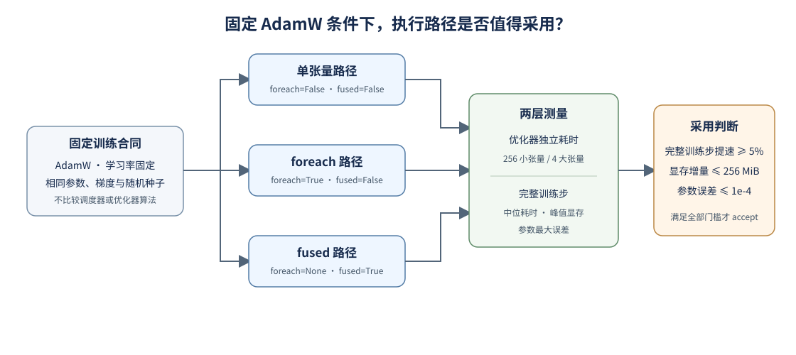

# 75. Optimizer Execution Path Benchmark | Optimizer Execution Path Benchmark

**难度：** Hard | **环境：** CPU 验证比较规则；单 GPU 测量执行路径 | **标签：** `AdamW`、`foreach`、`fused`、`基准对比` | **目标人群：** 需要理解训练步耗时构成者

> 🚀 **云端运行环境**
>
> 本章节的实战代码可以点击以下链接在免费 GPU 算力平台上直接运行：
>
> [](https://colab.research.google.com/github/datawhalechina/llm-algo-leetcode/blob/main/02_PyTorch_Algorithms/75_Optimizer_Execution_Path_Benchmark.ipynb)
> [](https://modelscope.cn/my/mynotebook) *(国内推荐：魔搭社区免费实例)*


## 本节导读

同一个 AdamW 更新可以逐张量执行，也可以使用 foreach 或 fused 路径。独立测量优化器调用能显示路径本身的差别，但训练步还包含前向和反向；本节用固定的小型训练任务检查局部提速是否能传递到整体，并同时核对显存与参数结果。学习率保持不变，不扫描调度策略。

**关键词：** `AdamW`、`optimizer execution path`、`training step`、`CUDA events`

## 前置阅读

**导语：** 先看优化器如何更新参数，再用训练基线的测量口径解释完整训练步的时间与显存。
- [12. 优化器更新与学习率调度](./12_Optimizer_Updates_and_Learning_Rate_Scheduling.md)
- [73. 训练性能分析](./73_Training_Performance_Analysis.md)

### Step 1：固定训练条件，对比 AdamW 的执行路径

比较对象只改变参数更新的执行方式；优化器算法、学习率、权重衰减、张量数值和随机种子保持一致。两种张量布局用于观察调用粒度的影响，完整训练步用于判断局部提速是否值得采用。

| 比较环节 | 固定条件 | 记录证据 |
|:---|:---|:---|
| 优化器调用 | 相同总元素数；分别使用多小张量和少大张量 | AdamW 单步耗时、峰值分配显存 |
| 完整训练步 | 相同 MLP、输入、目标、批量与更新次数 | 训练步中位耗时、峰值显存、最终损失 |
| 数值核对 | 相同初始参数、梯度、学习率与权重衰减 | 相对单张量路径的最大参数误差 |
| 采用门槛 | 完整训练步至少快 5%，显存增量不超过 256 MiB，最大参数误差不超过 1e-4 | `accept` 或 `tune` 及各项门槛结果 |



### Step 2：张量布局如何改变更新成本

多小张量会增加逐个调度更新的次数；少大张量则减少张量数量，但单次更新处理的数据更大。总元素数相同，能把“参数规模”与“张量组织方式”分开观察。这个微基准用于解释优化器路径的成本，不单独作为采用依据。

| 布局 | 张量数量 | 每个张量元素数 | 总元素数 |
|:---|---:|---:|---:|
| 多小张量 | 256 | 65,536 | 16,777,216 |
| 少大张量 | 4 | 4,194,304 | 16,777,216 |

### Step 3：用完整训练步和数值误差决定是否采用

优化器单步计时不含前向与反向，不能直接代表训练吞吐。候选路径只有在完整训练步达到速度门槛、额外显存受控且参数更新足够接近时才进入 `accept`；否则保留为 `tune`，并查看耗时、显存和误差中未通过的项。

| 证据 | 比较方式 | 用途 |
|:---|:---|:---|
| 优化器单步中位数 | 两种张量布局分别与单张量路径比较 | 解释局部更新开销，不作为采用门槛 |
| 完整训练步中位数 | 固定 MLP、输入和测量轮数，候选与基线配对 | 主要速度门槛 |
| 峰值分配显存 | 完整训练步测量峰值 | 限制额外资源代价 |
| 参数最大绝对误差 | 更新后的参数逐项对比 | 检查数值路径差异 |

### Step 4：核对候选契约并筛选执行路径

给定同一 AdamW 任务的候选配置与测量记录，补全两个判断：拒绝改变学习率、权重衰减或调度器的对照；再根据完整训练步速度、显存增量和参数误差筛选路径。测试覆盖候选不完整、配置漂移、局部微基准更快但完整训练步未达标等情况。

| 任务与目的 | 已知条件 | 完成标准 | 测试验证 |
|:---|:---|:---|:---|
| TODO 1：核对比较契约 | 三种 AdamW 执行路径及共同超参数 | 只接受指定路径差异，固定学习率、权重衰减和调度器 | 缺候选、学习率漂移和调度器变更均被拒绝 |
| TODO 2：筛选可采用路径 | 基线与候选的完整训练步、显存和参数误差 | 三项门槛全部通过才接受；优化器单步快不能替代完整步收益 | 覆盖通过、显存超限、误差超限和完整步无收益 |


```python
from typing import Dict, List

```


```python
OPTIMIZER_PATHS = {
    'single_tensor': {'foreach': False, 'fused': False},
    'foreach': {'foreach': True, 'fused': False},
    'fused': {'foreach': None, 'fused': True},
}

def validate_comparison_contract(candidates: List[Dict[str, object]], learning_rate: float, weight_decay: float) -> Dict[str, object]:
    """确认候选只改变 AdamW 的执行路径。"""
    # TODO 1：核对候选集合完整且无重复，并逐项检查共同条件和唯一执行路径。
    # 返回 {'valid': bool, 'errors': list[str]}。
    raise NotImplementedError

def select_optimizer_path(records: List[Dict[str, object]], minimum_speedup: float = 1.05, max_memory_increase_mb: float = 256.0, max_parameter_error: float = 1e-4) -> Dict[str, object]:
    """只按完整训练步收益与显存、数值门槛筛选路径。"""
    # TODO 2：候选集合不完整或 workload_id、seed 不一致时返回 pending。
    # 其余候选须同时通过完整训练步提速、显存增量和参数误差门槛。
    # optimizer_step_ms 仅用于诊断，不决定 accept。
    raise NotImplementedError

```


```python
def test_execution_path_project():
    candidates = [
        {'name': name, 'optimizer': 'AdamW', 'learning_rate': 1e-4, 'weight_decay': 0.01, 'scheduler': None, **path}
        for name, path in OPTIMIZER_PATHS.items()
    ]
    assert validate_comparison_contract(candidates, 1e-4, 0.01)['valid']
    drifted = [dict(row) for row in candidates]
    drifted[1]['learning_rate'] = 2e-4
    assert not validate_comparison_contract(candidates[:-1], 1e-4, 0.01)['valid']
    duplicated = candidates + [dict(candidates[0])]
    assert not validate_comparison_contract(duplicated, 1e-4, 0.01)['valid']
    assert not validate_comparison_contract(drifted, 1e-4, 0.01)['valid']
    wrong_path = [dict(row) for row in candidates]
    wrong_path[1]['fused'] = True
    assert not validate_comparison_contract(wrong_path, 1e-4, 0.01)['valid']

    baseline = {'name': 'single_tensor', 'status': 'ok', 'workload_id': 'mlp-v1', 'seed': 42, 'training_step_ms': 10.0, 'optimizer_step_ms': 2.0, 'peak_allocated_mb': 900.0, 'max_parameter_error': 0.0}
    fast_local_only = {'name': 'fused', 'status': 'ok', 'workload_id': 'mlp-v1', 'seed': 42, 'training_step_ms': 9.8, 'optimizer_step_ms': 0.5, 'peak_allocated_mb': 910.0, 'max_parameter_error': 1e-6}
    missing = select_optimizer_path([baseline, fast_local_only])
    assert missing['decision'] == 'pending'
    no_gain = {**fast_local_only, 'name': 'foreach', 'training_step_ms': 10.0}
    local_only = {**fast_local_only, 'training_step_ms': 9.8}
    assert select_optimizer_path([baseline, no_gain, local_only])['decision'] == 'tune'
    good = {**fast_local_only, 'name': 'foreach', 'training_step_ms': 9.0}
    fused = {**fast_local_only, 'training_step_ms': 9.8}
    result = select_optimizer_path([baseline, good, fused])
    assert result['decision'] == 'accept' and result['selected'] == 'foreach'
    blocked_fused = {**fused, 'training_step_ms': 9.0, 'peak_allocated_mb': 1200.0}
    assert select_optimizer_path([baseline, no_gain, blocked_fused])['decision'] == 'tune'
    blocked_error = {**fused, 'training_step_ms': 9.0, 'max_parameter_error': 1e-2}
    assert select_optimizer_path([baseline, no_gain, blocked_error])['decision'] == 'tune'
    mismatched = {**good, 'seed': 7}
    assert select_optimizer_path([baseline, mismatched, fused])['decision'] == 'pending'
    print('AdamW 执行路径契约与采用门槛测试通过。')

test_execution_path_project()

```

🛑 **STOP HERE** 🛑

## 参考代码与解析

### 代码


```python
OPTIMIZER_PATHS = {'single_tensor': {'foreach': False, 'fused': False}, 'foreach': {'foreach': True, 'fused': False}, 'fused': {'foreach': None, 'fused': True}}

def validate_comparison_contract(candidates: List[Dict[str, object]], learning_rate: float, weight_decay: float) -> Dict[str, object]:
    expected = set(OPTIMIZER_PATHS)
    names = [row.get('name') for row in candidates]
    errors = []
    if len(names) != len(set(names)):
        errors.append('duplicate_candidate')
    if set(names) != expected:
        errors.append('candidate_set_mismatch')
    if set(names) != expected:
        errors.append('candidate_set_mismatch')
    for row in candidates:
        name = row.get('name')
        if name not in OPTIMIZER_PATHS:
            continue
        if row.get('optimizer') != 'AdamW':
            errors.append(f'{name}:optimizer_mismatch')
        if row.get('learning_rate') != learning_rate:
            errors.append(f'{name}:learning_rate_mismatch')
        if row.get('weight_decay') != weight_decay:
            errors.append(f'{name}:weight_decay_mismatch')
        if row.get('scheduler') is not None:
            errors.append(f'{name}:scheduler_must_be_fixed')
        if {'foreach': row.get('foreach'), 'fused': row.get('fused')} != OPTIMIZER_PATHS[name]:
            errors.append(f'{name}:execution_path_mismatch')
    return {'valid': not errors, 'errors': errors}

def select_optimizer_path(records: List[Dict[str, object]], minimum_speedup: float = 1.05, max_memory_increase_mb: float = 256.0, max_parameter_error: float = 1e-4) -> Dict[str, object]:
    names = [row.get('name') for row in records]
    if len(names) != len(set(names)):
        return {'decision': 'pending', 'reason': 'duplicate_candidate', 'selected': None}
    if set(names) != set(OPTIMIZER_PATHS):
        return {'decision': 'pending', 'reason': 'incomplete_candidate_set', 'selected': None}
    baseline = next((row for row in records if row.get('name') == 'single_tensor'), None)
    if baseline is None or baseline.get('status') != 'ok':
        return {'decision': 'pending', 'reason': 'usable_baseline_missing', 'selected': None}
    evaluated = []
    for row in records:
        if row is baseline:
            continue
        if row.get('workload_id') != baseline.get('workload_id') or row.get('seed') != baseline.get('seed'):
            return {'decision': 'pending', 'reason': 'incomparable_workload', 'selected': None}
        if row.get('status') != 'ok' or row.get('training_step_ms', 0) <= 0:
            evaluated.append({'name': row.get('name'), 'eligible': False, 'reason': 'run_failed'})
            continue
        speedup = baseline['training_step_ms'] / row['training_step_ms']
        memory_increase = row['peak_allocated_mb'] - baseline['peak_allocated_mb']
        error = row['max_parameter_error']
        eligible = speedup >= minimum_speedup and memory_increase <= max_memory_increase_mb and error <= max_parameter_error
        evaluated.append({'name': row['name'], 'eligible': eligible, 'training_speedup': round(speedup, 4), 'optimizer_step_ms': row['optimizer_step_ms'], 'peak_memory_increase_mb': round(memory_increase, 3), 'max_parameter_error': error})
    selected = [row for row in evaluated if row['eligible']]
    selected.sort(key=lambda row: (-row['training_speedup'], row['peak_memory_increase_mb']))
    return {'decision': 'accept' if selected else 'tune', 'selected': selected[0]['name'] if selected else None, 'candidates': evaluated}

```

### 解析

TODO 1 把候选集合和 AdamW 超参数锁定，只允许 `foreach` 与 `fused` 的执行方式不同。这样比较结果不会混入学习率或调度器变化。

TODO 2 以完整训练步中位耗时作为速度门槛，并同时检查显存增量和参数误差。优化器独立计时保留为解释数据；即使该项更快，完整训练步不足 5% 的改善仍返回 `tune`。测试用“局部明显更快、完整训练步未达标”的样例区分两种口径。

### Step 5（项目实验）：测量 AdamW 执行路径

CPU 部分验证候选契约与采用规则；单 GPU 部分测量 PyTorch 的三种 AdamW 执行路径。实验使用仓库内固定张量和小型 MLP，不下载模型或数据集，输出原始测量 JSON 和采用决策 JSON。

| 核对内容 | CPU 练习与测试 | 单 GPU 实验与结果 |
|:---|:---|:---|
| 比较契约 | 检查候选、学习率、权重衰减与调度器是否一致 | 固定 AdamW 配置和同一组初始权重，只切换执行路径 |
| 性能证据 | 用样例记录测试决策逻辑 | CUDA event 测优化器调用和完整训练步，并记录峰值显存 |
| 采用判断 | 复核完整训练步、显存与参数误差三项门槛 | 保存全部重复样本、汇总统计和 `accept / tune` |

#### 5.1 本次运行配置

运行环境：`PERF-CUDA-MECHANISM`，单卡显存至少 8 GiB；环境创建与验证见[性能分析 Quickstart](../topic_discussion/performance_analysis/quickstart.md#perf-cuda-mechanism-quickstart)。

只在配置单元修改唯一标签和阶段。先用 `prepare` 顺序核对 5.1–5.6；确认无误后改为 `measure` 再运行，最后改为 `close` 顺序运行以读取证据并登记决策。

| 阶段 | GPU 行为 | 写入 |
|:---|:---|:---|
| `prepare` | 只检查环境和比较合同 | 无 |
| `measure` | 执行固定重复测量 | 原始测量 JSON |
| `close` | 复用已保存测量，不重新跑 GPU | 决策登记 JSON |


```python
RUN_LABEL = 'replace_with_unique_label'  # 本次实验的唯一标签。
RUN_STAGE = 'prepare'  # 可选 prepare / measure / close；measure 使用 GPU，close 只读结果。


```

#### 5.2 环境与结果路径预检

核对 CUDA、可用显存、结果目录写权限和本次标签对应的输出路径；此处不执行基准。

```python
import importlib
import json
import os
from pathlib import Path
import torch

from tools.project_runtime import bootstrap_project_root, save_json_record_once
PROJECT_ROOT = bootstrap_project_root()
benchmark = importlib.import_module('tools.optimizer_path_benchmark')
benchmark = importlib.reload(benchmark)
if RUN_STAGE not in {'prepare', 'measure', 'close'}:
    raise ValueError('RUN_STAGE 只能是 prepare、measure 或 close。')
if RUN_STAGE in {'measure', 'close'} and RUN_LABEL == 'replace_with_unique_label':
    raise ValueError('真实运行前请在 5.1 设置唯一 RUN_LABEL。')
RESULTS_DIR = PROJECT_ROOT / 'benchmarks/results/75_optimizer_path'
RAW_PATH = RESULTS_DIR / f'optimizer_path_{RUN_LABEL}.json'
DECISION_PATH = RESULTS_DIR / f'optimizer_path_decision_{RUN_LABEL}.json'
free_bytes, total_bytes = torch.cuda.mem_get_info() if torch.cuda.is_available() else (0, 0)
PREFLIGHT = {'stage': RUN_STAGE, 'torch': torch.__version__, 'torch_cuda': torch.version.cuda, 'cuda_available': torch.cuda.is_available(), 'device': torch.cuda.get_device_name(0) if torch.cuda.is_available() else None, 'free_memory_mb': round(free_bytes / 1024**2, 1), 'result_directory_writable': os.access(PROJECT_ROOT / 'benchmarks/results', os.W_OK), 'raw_path': str(RAW_PATH), 'decision_path': str(DECISION_PATH)}
if RUN_STAGE == 'measure' and (not torch.cuda.is_available() or free_bytes < 2 * 1024**3):
    raise RuntimeError('测量要求 CUDA 可用且当前空闲显存至少 2 GiB。')
if RUN_STAGE == 'measure' and RAW_PATH.exists():
    raise FileExistsError(f'原始证据已存在，不覆盖：{RAW_PATH}；请使用新 RUN_LABEL。')
if RUN_STAGE == 'measure' and not PREFLIGHT['result_directory_writable']:
    raise PermissionError(f'结果目录不可写：{PROJECT_ROOT / "benchmarks/results"}')
print(json.dumps(PREFLIGHT, ensure_ascii=False, indent=2))

```

#### 5.3 固定候选与比较条件

从公共基准定义加载 AdamW 路径、张量布局和固定训练条件，确认候选只改变执行路径。

```python
LEARNING_RATE = 1e-4
WEIGHT_DECAY = 0.01
SEED = 42
WARMUP = 5
ITERATIONS = 30
REPEATS = 3
MINIMUM_TRAINING_SPEEDUP = 1.05
MAXIMUM_PEAK_MEMORY_INCREASE_MB = 256.0
MAXIMUM_PARAMETER_ERROR = 1e-4
CANDIDATES = [{'name': name, 'optimizer': 'AdamW', 'learning_rate': LEARNING_RATE, 'weight_decay': WEIGHT_DECAY, 'scheduler': None, 'path': path} for name, path in benchmark.OPTIMIZER_PATHS.items()]
CONTRACT = benchmark.validate_optimizer_candidates(CANDIDATES, learning_rate=LEARNING_RATE, weight_decay=WEIGHT_DECAY)
if not CONTRACT['valid']:
    raise RuntimeError(f'比较合同无效：{CONTRACT["errors"]}')
print({'candidate_names': [row['name'] for row in CANDIDATES], 'workloads': benchmark.WORKLOADS, 'learning_rate': LEARNING_RATE, 'scheduler': None, 'warmup': WARMUP, 'iterations': ITERATIONS, 'repeats': REPEATS})

```

#### 5.4 测量并保存原始证据

`measure` 执行预热与重复测量，将逐次样本和汇总值写入原始 JSON；其他阶段跳过 GPU 测量。

```python
if RUN_STAGE == 'measure':
    raw_result = benchmark.run_optimizer_path_benchmark(learning_rate=LEARNING_RATE, weight_decay=WEIGHT_DECAY, seed=SEED, warmup=WARMUP, iterations=ITERATIONS, repeats=REPEATS)
    raw_result.update({'run_label': RUN_LABEL, 'project': '75', 'semantic_id': 'PERF-OPTIMIZER-PATH', 'thresholds': {'minimum_training_speedup': MINIMUM_TRAINING_SPEEDUP, 'maximum_peak_memory_increase_mb': MAXIMUM_PEAK_MEMORY_INCREASE_MB, 'maximum_parameter_error': MAXIMUM_PARAMETER_ERROR}})
    save_json_record_once(RAW_PATH, raw_result)
    print(f'原始测量已保存：{RAW_PATH}')
else:
    print(f'跳过 GPU 测量：RUN_STAGE={RUN_STAGE}')

```

#### 5.5 读取测量并核对证据

读取同标签原始记录，检查设备、运行时、重复样本、训练步耗时、显存和参数误差；不重新测量或改写结果。

```python
EVIDENCE = None
DECISION_INPUTS = None
if RUN_STAGE in {'measure', 'close'}:
    if not RAW_PATH.is_file():
        raise FileNotFoundError(f'找不到本标签原始测量：{RAW_PATH}；先运行 RUN_STAGE=measure。')
    EVIDENCE = json.loads(RAW_PATH.read_text(encoding='utf-8'))
    if EVIDENCE.get('schema_version') != 'optimizer-path-benchmark/v1' or EVIDENCE.get('run_label') != RUN_LABEL:
        raise RuntimeError('原始测量 schema 或 RUN_LABEL 不匹配。')
    optimizer_ms = {name: sum(EVIDENCE['paths'][layout][name]['optimizer_step_ms_median'] for layout in EVIDENCE['paths']) / len(EVIDENCE['paths']) for name in benchmark.OPTIMIZER_PATHS}
    DECISION_INPUTS = [{'name': name, 'status': row['status'], 'workload_id': 'fixed_mlp_training_step_v1', 'seed': EVIDENCE['seed'], 'training_step_ms': row['training_step_ms_median'], 'optimizer_step_ms': optimizer_ms[name], 'peak_allocated_mb': row['peak_allocated_mb_median'], 'max_parameter_error': row['max_parameter_error_vs_single_tensor']} for name, row in EVIDENCE['training_step'].items()]
    print(json.dumps({'device': EVIDENCE['device'], 'torch': EVIDENCE['torch'], 'optimizer_only_ms': EVIDENCE['paths'], 'training_step': EVIDENCE['training_step']}, ensure_ascii=False, indent=2))
else:
    print('尚无当前标签实测结果；prepare 阶段不生成测量数据。')

```

#### 5.6 形成决策并登记结果

采用判断要求完整训练步至少提速 5%，且显存增量与参数误差均在门槛内；`close` 复用 5.4 的证据保存决策 JSON，不重复运行 GPU。

```python
if RUN_STAGE == 'close':
    decision = benchmark.decide_optimizer_path(DECISION_INPUTS, minimum_training_speedup=MINIMUM_TRAINING_SPEEDUP, maximum_peak_memory_increase_mb=MAXIMUM_PEAK_MEMORY_INCREASE_MB, maximum_parameter_error=MAXIMUM_PARAMETER_ERROR)
    registration = {'schema_version': 'optimizer-path-decision/v1', 'project': '75', 'semantic_id': 'PERF-OPTIMIZER-PATH', 'run_label': RUN_LABEL, 'raw_evidence_path': str(RAW_PATH.relative_to(PROJECT_ROOT)), 'raw_schema': EVIDENCE['schema_version'], 'device': EVIDENCE['device'], 'torch': EVIDENCE['torch'], 'torch_cuda': EVIDENCE['torch_cuda'], 'decision': decision, 'evidence_scope': 'single_gpu_synthetic_mlp_adamw_path_benchmark', 'next_action': '只将结论用于本次 PyTorch、GPU 与 workload；若需迁移到完整模型，另做目标训练验证。'}
    if DECISION_PATH.exists():
        existing = json.loads(DECISION_PATH.read_text(encoding='utf-8'))
        if existing != registration:
            raise FileExistsError(f'同名决策登记内容冲突，不覆盖：{DECISION_PATH}')
        registration_receipt = {'status': 'already_complete', 'path': str(DECISION_PATH), 'run_label': RUN_LABEL, 'decision': decision['decision']}
    else:
        save_json_record_once(DECISION_PATH, registration)
        registration_receipt = {'status': 'saved', 'path': str(DECISION_PATH), 'run_label': RUN_LABEL, 'decision': decision['decision']}
    print(json.dumps(registration_receipt, ensure_ascii=False, indent=2))
    print(json.dumps(decision, ensure_ascii=False, indent=2))
else:
    print(f'跳过决策登记：RUN_STAGE={RUN_STAGE}；只有 close 写入决策 JSON。')

```

**当前登记结果**

| 项目身份 | 运行条件 | 原始证据 | 正式证据 | 结论 |
|:---|:---|:---|:---|:---|
| 75 · `PERF-OPTIMIZER-PATH` · `rtx5070ti_adamw_path_v1` | RTX 5070 Ti Laptop GPU；PyTorch 2.11.0+cu128；固定 MLP；3 次重复 | [原始测量 JSON](../../benchmarks/results/75_optimizer_path/optimizer_path_rtx5070ti_adamw_path_v1.json) | [决策 JSON](../../benchmarks/results/75_optimizer_path/optimizer_path_decision_rtx5070ti_adamw_path_v1.json) | `accept`：本 workload 下选 `fused`；完整训练步加速 1.691×，峰值分配显存减少 7.938 MiB，最大参数误差 1.79e-7；不外推到其他模型 |

## 相关阅读

若要比较优化器执行路径与激活重算、卸载等训练内存策略，可继续看 [76. 激活检查点与卸载基准](./76_Activation_Checkpoint_Offload_Benchmark.md)。
