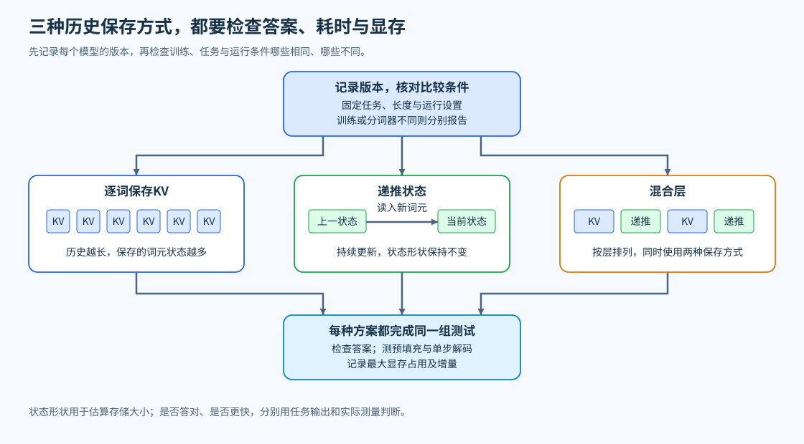
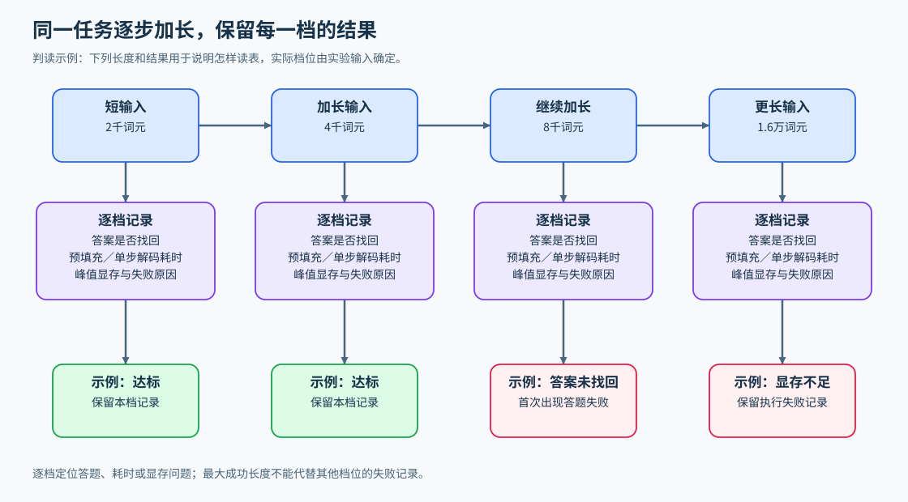

# 77. Long Sequence Memory Architecture Benchmark | 长序列记忆架构基准

**难度：** Hard | **环境：** [CPU 主线，GPU 可选](#runtime-environment) | **标签：** `长上下文`、`Attention`、`SSM`、`架构基准` | **目标人群：** 理解注意力与递推状态、希望比较长序列架构的读者

> 🚀 **云端运行环境**
>
> 本章节的实战代码可以点击以下链接在免费 GPU 算力平台上直接运行：
>
> [](https://colab.research.google.com/github/datawhalechina/llm-algo-leetcode/blob/main/02_PyTorch_Algorithms/77_Long_Sequence_Memory_Architecture_Benchmark.ipynb)
> [](https://modelscope.cn/my/mynotebook) *(国内推荐：魔搭社区免费实例)*


## 本节导读

同一段长材料，从两千词元延长到四千词元后，模型还能找回开头的信息吗？Attention 保存逐词的键和值，递推模型把读过的内容写入固定形状状态，混合架构同时使用两种方式。它们需要保存的状态不同，回答、耗时和显存随长度的变化也可能不同。

本项目让各方案处理逐渐变长的输入，检查输出是否包含预设答案，并测量预填充耗时、固定缓存长度下的一次解码耗时和峰值显存。公开模型往往还在权重、训练数据或实现上有所不同：这些结果能帮助比较各模型的表现；要解释记忆架构本身的作用，还需核对训练与运行条件。

<a id="runtime-environment"></a>
## 运行环境

CPU 部分使用 Python 标准库，估算状态占用，并核对两组模型的长度记录和筛选规则。真实实验使用固定版本的本地模型文件，包括权重、配置和分词器文件；具体版本通过 commit 标识记录。环境准备见[模型架构专题 Quickstart](../topic_discussion/llm_architecture_evolution/quickstart.md)。Step 5 默认只读取配置、检查文件，不下载或加载模型。

## 前置阅读

先区分逐词保存的 KV 与递推状态，再理解混合模型如何安排两类层。

- [45. Linear Attention and Recurrent State | 线性 Attention 与递推状态](45_Linear_Attention_and_Recurrent_State.md)：核对递推状态的形状及其更新方式。
- [ARCH-HYBRID-MEMORY. Attention / SSM Hybrid | Attention 与 SSM 混合记忆](ARCH-HYBRID-MEMORY_Attention_SSM_Hybrid.md)：理解 Attention 层与递推层如何分工。

## Step 1：固定模型版本与测试条件

先记录每个模型的版本、分词器和运行设置，再确定长度档位，例如两千、四千、八千词元。逐步加长同一类输入，观察模型在哪一档开始答错、变慢或超出显存，这就是长度阶梯。混合模型还需列出每一层采用 Attention 还是递推状态，保留具体的层排列。

比较记忆方式的作用时，要核对两组的训练数据、训练方案、训练词元数和随机种子，以及运行设置和其他架构配置。它们保持一致、只改变记忆层安排时，才便于解释架构变化的作用。公开模型缺少这些记录，或同时改变了训练和实现时，分别报告各自结果。两种情况都要检查答案、耗时和显存，但能解释的差异原因不同。

| 比较步骤 | 使用什么 | 检查什么 | 得到什么 |
| --- | --- | --- | --- |
| 记录模型与配置 | 模型和分词器版本、记忆类型、层排列 | 文件版本明确，层类型与配置一致 | 能重新加载的模型及配置 |
| 逐步增加输入长度 | 固定任务、长度、批大小、数据类型、执行实现和硬件 | 两组都完成每个长度，记录实际输入词元数 | 每档的答案、耗时、显存和失败原因 |
| 判断结果 | 状态大小估算、实际测量和训练记录 | 哪些条件相同，哪些发生变化；各项指标是否达标 | 采用、继续测试或排除方案 |



## Step 2：保存多少状态，是否还能找回答案

状态占用可以先按形状估算。设批大小为 `B`、输入长度为 `L`、注意力层数为 `N_a`、KV头数为 `H_kv`、每个头的维度为 `D_h`，显式 KV 约有 `2 × B × L × N_a × H_kv × D_h` 个元素。对于每层保存一块 `state_dim × value_dim` 状态的简化递推模型，`N_r` 层约有 `B × N_r × state_dim × value_dim` 个元素；后两个参数是状态的两个轴长。乘以每个元素的字节数，就得到相应的存储大小。实际模型的状态形状从配置和缓存接口读取。

保存的状态更小，是否仍能找回答案，需要另做任务检查。例如把答案放在材料开头，再逐渐增加它与末尾问题的距离，比较输出是否仍包含该答案。混合架构则分别记录注意力层与递推层保存的对象，同时保留层排列，才能解释状态增长和答题结果。

| 记忆方式 | 保存什么 | 怎样使用历史 | 状态随长度变化 |
| --- | --- | --- | --- |
| 显式 KV | 每个历史词元的键和值 | 当前查询可以读取已保存的历史位置 | 线性增长 |
| 递推状态 | 随词元更新的固定形状状态 | 根据当前状态生成输出 | 状态形状固定时近似不变 |
| 混合记忆 | 部分层的KV与部分层的递推状态 | 两类层按模型中的顺序处理输入 | 增长部分来自保存KV的层 |

## Step 3：分别检查答案、耗时和显存

状态大小估算说明需要保存多少数据；实际测量还包括模型计算、中间张量等开销。显式 KV 允许读取已保存的历史位置，也需要随输入增长保存更多数据；递推状态占用较稳定，但能否找回远处的信息要看任务结果。两组的每个长度都要保留：基线缺少长档，就无法完成该档对照；候选缺少长档，就无法判断目标长度是否可用。

模型版本不明、运行失败，或答案得分低于下限、显存超过上限时，排除该方案（`reject`）。缺少长度、指标或匹配的训练记录时，继续测试（`tune`）。条件已匹配且全部长度都满足要求时，才在当前任务下采用（`accept`）。

| 检查项 | 记录什么 | 怎样判断 |
| --- | --- | --- |
| 答案 | 任务、输入长度、输出是否包含预设答案、错误输出 | 加长输入后是否仍能找回答案 |
| 耗时与显存 | 预填充耗时、固定缓存上的单步解码耗时、模型常驻显存、各窗口峰值与增量 | 哪一项随长度增加，是否超过预算 |
| 比较条件 | 模型与分词器版本、数据类型、执行实现、硬件和训练记录 | 区分架构变化与其他条件变化 |
| 方案选择 | 每个长度的结果、未完成项、质量下限与资源上限 | 明确采用、继续测试或排除的原因 |




```python
import math
from typing import Dict, List

```

## Step 4：核对比较条件、长度记录与采用标准

题目提供三类架构的状态大小估算函数、两组模型配置和简化的逐长度结果。补全三项项目判断：比较条件是否匹配、每档记录是否齐全、所有长度是否同时达标。骨架负责字段收集、重复档位识别和状态分支。

| 任务与目的 | 已知条件 | 完成标准 | 测试验证 |
| --- | --- | --- | --- |
| TODO 1：判断架构比较条件 | 两组的训练数据版本、完整训练方案版本、训练词元数、随机种子、运行条件和层配置 | 训练与运行条件匹配，其他架构配置相同，记忆层安排实际改变 | 匹配配置、缺训练记录、换数据或方案、改变运行条件和隐藏宽度 |
| TODO 2：核对每档结果 | 基线与候选的预期长度、质量、三项成本和失败状态 | 两组每档均有指标；成功可记为 failure=None，缺字段仍需补齐 | 两侧缺档、逐字段缺失、空指标、重复长度和执行失败 |
| TODO 3：检查全部长度的阈值 | 逐档质量下限与预填充耗时、固定缓存单步解码耗时、显存上限 | 每个长度的四项条件同时满足 | 阈值等号、长档单项越界、其他条件变化和基线缺档 |


```python
def validate_memory_architecture(spec: Dict[str, object]) -> Dict[str, object]:
    """检查 explicit_kv、recurrent_state 或 hybrid 的层数与状态维度。"""
    architecture_type = str(spec.get('architecture_type', ''))
    issues = []
    if architecture_type not in {'explicit_kv', 'recurrent_state', 'hybrid'}:
        issues.append('unsupported architecture_type')
    required = ('num_layers', 'attention_layers', 'recurrent_layers', 'dtype_bytes')
    issues.extend(f'missing: {key}' for key in required if key not in spec)
    if not issues:
        if any(int(spec[key]) < 0 for key in ('attention_layers', 'recurrent_layers')) or int(spec['num_layers']) <= 0:
            issues.append('layer counts must be non-negative and num_layers positive')
        if int(spec['attention_layers']) + int(spec['recurrent_layers']) != int(spec['num_layers']):
            issues.append('attention_layers + recurrent_layers must equal num_layers')
        if int(spec['dtype_bytes']) <= 0:
            issues.append('dtype_bytes must be positive')
        if architecture_type == 'explicit_kv' and int(spec['recurrent_layers']) != 0:
            issues.append('explicit_kv cannot contain recurrent layers')
        if architecture_type == 'recurrent_state' and int(spec['attention_layers']) != 0:
            issues.append('recurrent_state cannot contain attention layers')
        if architecture_type == 'hybrid' and (int(spec['attention_layers']) == 0 or int(spec['recurrent_layers']) == 0):
            issues.append('hybrid needs both attention and recurrent layers')
        if int(spec['attention_layers']) and (int(spec.get('kv_heads', 0)) <= 0 or int(spec.get('head_dim', 0)) <= 0):
            issues.append('attention layers need positive kv_heads and head_dim')
        if int(spec['recurrent_layers']) and (int(spec.get('state_dim', 0)) <= 0 or int(spec.get('value_dim', 0)) <= 0):
            issues.append('recurrent layers need positive state_dim and value_dim')
    return {'ready': not issues, 'issues': issues}


def estimate_memory_state(spec: Dict[str, object], seq_len: int, batch_size: int = 1) -> Dict[str, object]:
    """根据层数与状态形状估算 KV 和递推状态的存储大小，单位为字节。"""
    validation = validate_memory_architecture(spec)
    if not validation['ready']:
        raise ValueError(f"非法候选：{validation['issues']}")
    if seq_len <= 0 or batch_size <= 0:
        raise ValueError('seq_len 和 batch_size 必须为正整数')
    dtype_bytes = int(spec['dtype_bytes'])
    kv_bytes = (2 * batch_size * seq_len * int(spec['attention_layers']) * int(spec.get('kv_heads', 0)) * int(spec.get('head_dim', 0)) * dtype_bytes)
    recurrent_state_bytes = (batch_size * int(spec['recurrent_layers']) * int(spec.get('state_dim', 0)) * int(spec.get('value_dim', 0)) * dtype_bytes)
    return {
        'kv_bytes': float(kv_bytes),
        'recurrent_state_bytes': float(recurrent_state_bytes),
        'total_state_bytes': float(kv_bytes + recurrent_state_bytes),
        'evidence_level': 'cpu_state_ledger',
    }


def validate_length_ladder_pair(baseline: Dict[str, object], candidate: Dict[str, object], expected_lengths: List[int]) -> Dict[str, object]:
    """核对两组的训练与运行条件，以及每个长度档位的结果。"""
    if not expected_lengths or any(type(length) is not int or length <= 0 for length in expected_lengths):
        raise ValueError('预期长度须为非空的正整数列表')
    if len(set(expected_lengths)) != len(expected_lengths):
        raise ValueError('预期长度不能重复')
    failures, missing = [], []
    for role, record in (('baseline', baseline), ('candidate', candidate)):
        for field in ('candidate_id', 'model_id', 'revision', 'workload_id', 'tokenizer_revision'):
            if not record.get(field):
                failures.append(f'{role}.{field}')
    for field in ('workload_id', 'tokenizer_revision'):
        if baseline.get(field) != candidate.get(field):
            failures.append(f'workload.{field}')

    required_conditions = {
        'training_conditions': ('data_revision', 'recipe_revision', 'train_tokens', 'seed'),
        'execution_conditions': ('dtype', 'batch_size', 'backend', 'hardware', 'max_new_tokens', 'repeats'),
        'architecture_config': ('num_layers', 'hidden_size', 'memory_layers'),
    }
    condition_pairs = [
        (baseline.get(group, {}).get(field), candidate.get(group, {}).get(field))
        for group, fields in required_conditions.items() for field in fields
    ]
    conditions_complete = all(left is not None and left != '' and right is not None and right != ''
                              for left, right in condition_pairs)
    training_matches = baseline.get('training_conditions') == candidate.get('training_conditions')
    execution_matches = baseline.get('execution_conditions') == candidate.get('execution_conditions')
    base_arch = baseline.get('architecture_config', {})
    candidate_arch = candidate.get('architecture_config', {})
    fixed_arch_fields = (set(base_arch) | set(candidate_arch)) - {'memory_layers'}
    other_arch_matches = all(base_arch.get(field) == candidate_arch.get(field) for field in fixed_arch_fields)
    memory_changed = base_arch.get('memory_layers') != candidate_arch.get('memory_layers')
    # TODO 1：controlled 表示训练、运行和其他架构条件已匹配，且记忆层安排发生变化。
    # conditions_complete：所需比较条件是否齐全。
    # training_matches / execution_matches：两组训练与执行条件是否分别相同。
    # other_arch_matches：除记忆层安排外的架构配置是否相同。
    # memory_changed：记忆层安排是否实际改变。
    controlled = ...
    raise NotImplementedError('请完成 TODO 1：架构比较条件')
    mode = 'invalid' if failures else 'controlled' if controlled else 'observational'

    all_runs = {}
    required_metrics = ('quality_score', 'prefill_ms', 'decode_step_ms', 'peak_memory_mb')
    for role, record in (('baseline', baseline), ('candidate', candidate)):
        rows = {}
        for run in record.get('runs', []):
            length = run.get('length')
            if type(length) is not int or length not in expected_lengths:
                failures.append(f'{role}.unexpected_length')
                continue
            if length in rows:
                failures.append(f'{role}.length.{length}.duplicate')
            rows[length] = run
        for length in expected_lengths:
            prefix = f'{role}.length.{length}'
            if length not in rows:
                missing.append(prefix)
                continue
            run = rows[length]
            missing_fields = [f'{prefix}.{field}' for field in (*required_metrics, 'failure')
                              if field not in run or (field != 'failure' and run[field] is None)]
            # TODO 2：row_complete 表示该组该长度的指标与失败状态均已记录。
            # missing_fields：骨架已收集的缺失或未测指标，以及缺少的失败状态。
            # failure：值可以为 None，表示执行成功；字段本身必须存在。
            row_complete = ...
            raise NotImplementedError('请完成 TODO 2：逐档记录完整性')
            if not row_complete:
                missing.extend(missing_fields or [f'{prefix}.incomplete'])
            if run.get('failure'):
                failures.append(f'{prefix}.failure')
            for field in required_metrics:
                value = run.get(field)
                if value is not None and (type(value) not in (int, float) or not math.isfinite(value) or value < 0):
                    failures.append(f'{prefix}.{field}.invalid')
        all_runs[role] = rows
    return {'comparison_mode': mode, 'candidate_runs': all_runs['candidate'],
            'baseline_runs': all_runs['baseline'], 'expected_lengths': expected_lengths,
            'gate_failures': failures, 'missing_evidence': missing}


def decide_memory_candidate(pair: Dict[str, object], limits: Dict[str, float]) -> Dict[str, object]:
    """先处理失败和缺档，再检查逐档门槛与比较条件。"""
    if pair['gate_failures'] or pair['comparison_mode'] == 'invalid':
        return {'decision': 'reject', 'reason': '模型身份、工作负载或长度档位执行失败'}
    if pair['missing_evidence']:
        return {'decision': 'tune', 'reason': '基线或候选的长度档位、指标不完整'}
    checks = []
    for length in pair['expected_lengths']:
        run = pair['candidate_runs'][length]
        checks.extend((run['quality_score'] >= limits['min_quality'],
                       run['prefill_ms'] <= limits['max_prefill_ms'],
                       run['decode_step_ms'] <= limits['max_decode_step_ms'],
                       run['peak_memory_mb'] <= limits['max_peak_memory_mb']))
    # TODO 3：all_lengths_pass 表示所有长度的质量下限与资源上限均满足。
    # checks：按长度收集的逐项阈值比较结果。
    all_lengths_pass = ...
    raise NotImplementedError('请完成 TODO 3：全部长度的联合判断')
    if not all_lengths_pass:
        return {'decision': 'reject', 'reason': '至少一个长度档位未通过质量或资源门槛'}
    if pair['comparison_mode'] != 'controlled':
        return {'decision': 'tune', 'reason': '候选指标达标；仍需匹配训练与运行条件才能归因于记忆架构'}
    return {'decision': 'accept', 'reason': '匹配条件的候选通过全部长度档位的质量与资源门槛'}

```

## 测试


```python
# CPU 样例用于测试比较与决策规则，数值不是模型实测结果。
def test_architecture_contract():
    """核对三类状态表示的层数与维度约束。"""
    explicit = {
        'name': 'kv', 'architecture_type': 'explicit_kv', 'num_layers': 4,
        'attention_layers': 4, 'recurrent_layers': 0, 'kv_heads': 2,
        'head_dim': 8, 'state_dim': 0, 'value_dim': 0, 'dtype_bytes': 2,
    }
    recurrent = {
        'name': 'ssm', 'architecture_type': 'recurrent_state', 'num_layers': 4,
        'attention_layers': 0, 'recurrent_layers': 4, 'kv_heads': 0,
        'head_dim': 0, 'state_dim': 8, 'value_dim': 8, 'dtype_bytes': 2,
    }
    hybrid = {
        'name': 'hybrid', 'architecture_type': 'hybrid', 'num_layers': 4,
        'attention_layers': 2, 'recurrent_layers': 2, 'kv_heads': 2,
        'head_dim': 8, 'state_dim': 8, 'value_dim': 8, 'dtype_bytes': 2,
    }
    assert validate_memory_architecture(explicit)['ready']
    assert validate_memory_architecture(recurrent)['ready']
    assert validate_memory_architecture(hybrid)['ready']
    assert not validate_memory_architecture({**hybrid, 'attention_layers': 3})['ready']
    assert not validate_memory_architecture({**hybrid, 'attention_layers': 4, 'recurrent_layers': 0})['ready']
    assert not validate_memory_architecture({**hybrid, 'attention_layers': 0, 'recurrent_layers': 4})['ready']
    return explicit, recurrent, hybrid


def test_state_growth(explicit, recurrent, hybrid):
    """用已提供的估算函数检查状态大小随长度的变化。"""
    kv_short, kv_long = estimate_memory_state(explicit, 16), estimate_memory_state(explicit, 32)
    state_short, state_long = estimate_memory_state(recurrent, 16), estimate_memory_state(recurrent, 32)
    hybrid_state = estimate_memory_state(hybrid, 32)
    assert kv_long['total_state_bytes'] == 2 * kv_short['total_state_bytes']
    assert state_long['total_state_bytes'] == state_short['total_state_bytes']
    assert state_long['total_state_bytes'] < hybrid_state['total_state_bytes'] < kv_long['total_state_bytes']


def memory_pair_fixture():
    """构造训练条件匹配的 CPU 对照样例，不表示已有真实模型对。"""
    runs = [
        {'length': 2048, 'quality_score': 0.91, 'prefill_ms': 8.0, 'decode_step_ms': 1.8, 'peak_memory_mb': 1200, 'failure': None},
        {'length': 4096, 'quality_score': 0.88, 'prefill_ms': 14.0, 'decode_step_ms': 2.2, 'peak_memory_mb': 1500, 'failure': None},
    ]
    baseline = {
        'candidate_id': 'kv', 'model_id': 'cpu-kv', 'revision': 'snapshot-a',
        'family_id': 'family-a', 'training_recipe_id': 'recipe-a',
        'workload_id': 'long-v1', 'tokenizer_revision': 'tok-a', 'runs': runs,
        'training_conditions': {'data_revision': 'data-a', 'recipe_revision': 'recipe-hash-a', 'train_tokens': 10000, 'seed': 0},
        'execution_conditions': {'dtype': 'float16', 'batch_size': 1, 'backend': 'same-runtime', 'hardware': 'same-device', 'max_new_tokens': 16, 'repeats': 3},
        'architecture_config': {'num_layers': 4, 'hidden_size': 16, 'memory_layers': ['attention'] * 4},
    }
    candidate = {**baseline, 'candidate_id': 'hybrid', 'model_id': 'cpu-hybrid',
                 'revision': 'snapshot-b', 'changed_fields': ['architecture_type'],
                 'architecture_config': {**baseline['architecture_config'], 'memory_layers': ['attention', 'recurrent'] * 2}}
    return baseline, candidate


def test_comparison_conditions():
    """TODO 1：同系列标签与变化声明不能代替具体配置比较。"""
    baseline, candidate = memory_pair_fixture()
    assert validate_length_ladder_pair(baseline, candidate, [2048, 4096])['comparison_mode'] == 'controlled'
    for field in ('data_revision', 'recipe_revision', 'train_tokens', 'seed'):
        changed = {**candidate, 'training_conditions': {**candidate['training_conditions'], field: 'other'}}
        assert validate_length_ladder_pair(baseline, changed, [2048, 4096])['comparison_mode'] == 'observational'
    for field in candidate['execution_conditions']:
        changed = {**candidate, 'execution_conditions': {**candidate['execution_conditions'], field: 'other'}}
        assert validate_length_ladder_pair(baseline, changed, [2048, 4096])['comparison_mode'] == 'observational'
    for changes in (
        {'training_conditions': {}},
        {'architecture_config': {**candidate['architecture_config'], 'hidden_size': 32}},
        {'architecture_config': baseline['architecture_config']},
    ):
        assert validate_length_ladder_pair(baseline, {**candidate, **changes}, [2048, 4096])['comparison_mode'] == 'observational'
    assert validate_length_ladder_pair(baseline, {**candidate, 'workload_id': 'other'}, [2048, 4096])['comparison_mode'] == 'invalid'


def test_length_coverage():
    """TODO 2：两组均需覆盖全部档位，且保留缺字段、重复和执行失败。"""
    baseline, candidate = memory_pair_fixture()
    for role in ('baseline', 'candidate'):
        records = {'baseline': baseline, 'candidate': candidate}
        records[role] = {**records[role], 'runs': records[role]['runs'][:1]}
        pair = validate_length_ladder_pair(records['baseline'], records['candidate'], [2048, 4096])
        assert f'{role}.length.4096' in pair['missing_evidence']
        for field in ('quality_score', 'prefill_ms', 'decode_step_ms', 'peak_memory_mb', 'failure'):
            rows = [dict(row) for row in candidate['runs']]
            rows[0].pop(field)
            records = {'baseline': baseline, 'candidate': candidate}
            records[role] = {**records[role], 'runs': rows}
            pair = validate_length_ladder_pair(records['baseline'], records['candidate'], [2048, 4096])
            assert f'{role}.length.2048.{field}' in pair['missing_evidence']
        rows = [dict(row) for row in candidate['runs']]
        rows[0]['failure'] = 'oom'
        records = {'baseline': baseline, 'candidate': candidate}
        records[role] = {**records[role], 'runs': rows}
        assert validate_length_ladder_pair(records['baseline'], records['candidate'], [2048, 4096])['gate_failures']
    duplicate = {**candidate, 'runs': candidate['runs'] + candidate['runs'][:1]}
    assert 'candidate.length.2048.duplicate' in validate_length_ladder_pair(baseline, duplicate, [2048, 4096])['gate_failures']
    none_metric = {**candidate, 'runs': [{**row, 'decode_step_ms': None} for row in candidate['runs']]}
    assert validate_length_ladder_pair(baseline, none_metric, [2048, 4096])['missing_evidence']


def test_all_length_limits():
    """TODO 3：每个长度均须达标，单档成功不能掩盖长档失败。"""
    baseline, candidate = memory_pair_fixture()
    limits = {'min_quality': 0.88, 'max_prefill_ms': 14.0, 'max_decode_step_ms': 2.2, 'max_peak_memory_mb': 1500}
    pair = validate_length_ladder_pair(baseline, candidate, [2048, 4096])
    assert decide_memory_candidate(pair, limits)['decision'] == 'accept'
    for field, value in (('quality_score', 0.87), ('prefill_ms', 14.01), ('decode_step_ms', 2.21), ('peak_memory_mb', 1501)):
        rows = [dict(row) for row in candidate['runs']]
        rows[-1][field] = value
        pair = validate_length_ladder_pair(baseline, {**candidate, 'runs': rows}, [2048, 4096])
        assert decide_memory_candidate(pair, limits)['decision'] == 'reject'
    observed = validate_length_ladder_pair(baseline, {**candidate, 'training_conditions': {}}, [2048, 4096])
    assert decide_memory_candidate(observed, limits)['decision'] == 'tune'
    incomplete = validate_length_ladder_pair({**baseline, 'runs': []}, candidate, [2048, 4096])
    assert decide_memory_candidate(incomplete, limits)['decision'] == 'tune'
    for lengths in ([], [2048, 2048], [0]):
        try:
            validate_length_ladder_pair(baseline, candidate, lengths)
        except ValueError:
            pass
        else:
            raise AssertionError('应拒绝无效的预期长度')


explicit_spec, recurrent_spec, hybrid_spec = test_architecture_contract()
test_state_growth(explicit_spec, recurrent_spec, hybrid_spec)
test_comparison_conditions()
test_length_coverage()
test_all_length_limits()
print('通过：架构比较条件、双侧长度完整性与逐档阈值判断。')

```

## 参考代码与解析

### 代码


```python
def validate_memory_architecture(spec: Dict[str, object]) -> Dict[str, object]:
    """检查 explicit_kv、recurrent_state 或 hybrid 的层数与状态维度。"""
    architecture_type = str(spec.get('architecture_type', ''))
    issues = []
    if architecture_type not in {'explicit_kv', 'recurrent_state', 'hybrid'}:
        issues.append('unsupported architecture_type')
    required = ('num_layers', 'attention_layers', 'recurrent_layers', 'dtype_bytes')
    issues.extend(f'missing: {key}' for key in required if key not in spec)
    if not issues:
        if any(int(spec[key]) < 0 for key in ('attention_layers', 'recurrent_layers')) or int(spec['num_layers']) <= 0:
            issues.append('layer counts must be non-negative and num_layers positive')
        if int(spec['attention_layers']) + int(spec['recurrent_layers']) != int(spec['num_layers']):
            issues.append('attention_layers + recurrent_layers must equal num_layers')
        if int(spec['dtype_bytes']) <= 0:
            issues.append('dtype_bytes must be positive')
        if architecture_type == 'explicit_kv' and int(spec['recurrent_layers']) != 0:
            issues.append('explicit_kv cannot contain recurrent layers')
        if architecture_type == 'recurrent_state' and int(spec['attention_layers']) != 0:
            issues.append('recurrent_state cannot contain attention layers')
        if architecture_type == 'hybrid' and (int(spec['attention_layers']) == 0 or int(spec['recurrent_layers']) == 0):
            issues.append('hybrid needs both attention and recurrent layers')
        if int(spec['attention_layers']) and (int(spec.get('kv_heads', 0)) <= 0 or int(spec.get('head_dim', 0)) <= 0):
            issues.append('attention layers need positive kv_heads and head_dim')
        if int(spec['recurrent_layers']) and (int(spec.get('state_dim', 0)) <= 0 or int(spec.get('value_dim', 0)) <= 0):
            issues.append('recurrent layers need positive state_dim and value_dim')
    return {'ready': not issues, 'issues': issues}


def estimate_memory_state(spec: Dict[str, object], seq_len: int, batch_size: int = 1) -> Dict[str, object]:
    """根据层数与状态形状估算 KV 和递推状态的存储大小，单位为字节。"""
    validation = validate_memory_architecture(spec)
    if not validation['ready']:
        raise ValueError(f"非法候选：{validation['issues']}")
    if seq_len <= 0 or batch_size <= 0:
        raise ValueError('seq_len 和 batch_size 必须为正整数')
    dtype_bytes = int(spec['dtype_bytes'])
    kv_bytes = (2 * batch_size * seq_len * int(spec['attention_layers']) * int(spec.get('kv_heads', 0)) * int(spec.get('head_dim', 0)) * dtype_bytes)
    recurrent_state_bytes = (batch_size * int(spec['recurrent_layers']) * int(spec.get('state_dim', 0)) * int(spec.get('value_dim', 0)) * dtype_bytes)
    return {
        'kv_bytes': float(kv_bytes),
        'recurrent_state_bytes': float(recurrent_state_bytes),
        'total_state_bytes': float(kv_bytes + recurrent_state_bytes),
        'evidence_level': 'cpu_state_ledger',
    }


def validate_length_ladder_pair(baseline: Dict[str, object], candidate: Dict[str, object], expected_lengths: List[int]) -> Dict[str, object]:
    """核对两组的训练与运行条件，以及每个长度档位的结果。"""
    if not expected_lengths or any(type(length) is not int or length <= 0 for length in expected_lengths):
        raise ValueError('预期长度须为非空的正整数列表')
    if len(set(expected_lengths)) != len(expected_lengths):
        raise ValueError('预期长度不能重复')
    failures, missing = [], []
    for role, record in (('baseline', baseline), ('candidate', candidate)):
        for field in ('candidate_id', 'model_id', 'revision', 'workload_id', 'tokenizer_revision'):
            if not record.get(field):
                failures.append(f'{role}.{field}')
    for field in ('workload_id', 'tokenizer_revision'):
        if baseline.get(field) != candidate.get(field):
            failures.append(f'workload.{field}')

    required_conditions = {
        'training_conditions': ('data_revision', 'recipe_revision', 'train_tokens', 'seed'),
        'execution_conditions': ('dtype', 'batch_size', 'backend', 'hardware', 'max_new_tokens', 'repeats'),
        'architecture_config': ('num_layers', 'hidden_size', 'memory_layers'),
    }
    condition_pairs = [
        (baseline.get(group, {}).get(field), candidate.get(group, {}).get(field))
        for group, fields in required_conditions.items() for field in fields
    ]
    conditions_complete = all(left is not None and left != '' and right is not None and right != ''
                              for left, right in condition_pairs)
    training_matches = baseline.get('training_conditions') == candidate.get('training_conditions')
    execution_matches = baseline.get('execution_conditions') == candidate.get('execution_conditions')
    base_arch = baseline.get('architecture_config', {})
    candidate_arch = candidate.get('architecture_config', {})
    fixed_arch_fields = (set(base_arch) | set(candidate_arch)) - {'memory_layers'}
    other_arch_matches = all(base_arch.get(field) == candidate_arch.get(field) for field in fixed_arch_fields)
    memory_changed = base_arch.get('memory_layers') != candidate_arch.get('memory_layers')
    # TODO 1：核对架构比较条件。
    controlled = conditions_complete and training_matches and execution_matches and other_arch_matches and memory_changed
    mode = 'invalid' if failures else 'controlled' if controlled else 'observational'

    all_runs = {}
    required_metrics = ('quality_score', 'prefill_ms', 'decode_step_ms', 'peak_memory_mb')
    for role, record in (('baseline', baseline), ('candidate', candidate)):
        rows = {}
        for run in record.get('runs', []):
            length = run.get('length')
            if type(length) is not int or length not in expected_lengths:
                failures.append(f'{role}.unexpected_length')
                continue
            if length in rows:
                failures.append(f'{role}.length.{length}.duplicate')
            rows[length] = run
        for length in expected_lengths:
            prefix = f'{role}.length.{length}'
            if length not in rows:
                missing.append(prefix)
                continue
            run = rows[length]
            missing_fields = [f'{prefix}.{field}' for field in (*required_metrics, 'failure')
                              if field not in run or (field != 'failure' and run[field] is None)]
            # TODO 2：核对两组的逐档记录。
            row_complete = not missing_fields
            if not row_complete:
                missing.extend(missing_fields or [f'{prefix}.incomplete'])
            if run.get('failure'):
                failures.append(f'{prefix}.failure')
            for field in required_metrics:
                value = run.get(field)
                if value is not None and (type(value) not in (int, float) or not math.isfinite(value) or value < 0):
                    failures.append(f'{prefix}.{field}.invalid')
        all_runs[role] = rows
    return {'comparison_mode': mode, 'candidate_runs': all_runs['candidate'],
            'baseline_runs': all_runs['baseline'], 'expected_lengths': expected_lengths,
            'gate_failures': failures, 'missing_evidence': missing}


def decide_memory_candidate(pair: Dict[str, object], limits: Dict[str, float]) -> Dict[str, object]:
    """先处理失败和缺档，再检查逐档门槛与比较条件。"""
    if pair['gate_failures'] or pair['comparison_mode'] == 'invalid':
        return {'decision': 'reject', 'reason': '模型身份、工作负载或长度档位执行失败'}
    if pair['missing_evidence']:
        return {'decision': 'tune', 'reason': '基线或候选的长度档位、指标不完整'}
    checks = []
    for length in pair['expected_lengths']:
        run = pair['candidate_runs'][length]
        checks.extend((run['quality_score'] >= limits['min_quality'],
                       run['prefill_ms'] <= limits['max_prefill_ms'],
                       run['decode_step_ms'] <= limits['max_decode_step_ms'],
                       run['peak_memory_mb'] <= limits['max_peak_memory_mb']))
    # TODO 3：联合检查全部长度。
    all_lengths_pass = all(checks)
    if not all_lengths_pass:
        return {'decision': 'reject', 'reason': '至少一个长度档位未通过质量或资源门槛'}
    if pair['comparison_mode'] != 'controlled':
        return {'decision': 'tune', 'reason': '候选指标达标；仍需匹配训练与运行条件才能归因于记忆架构'}
    return {'decision': 'accept', 'reason': '匹配条件的候选通过全部长度档位的质量与资源门槛'}

```

### 解析

#### TODO 1：核对架构比较条件

- 比较两组实际使用的训练记录、运行设置和架构配置。它们齐全且匹配，只有记忆层排列发生变化，才将结果作为架构对照；系列名称相同，仍需逐项检查这些条件。
- `test_comparison_conditions` 保留系列名称，分别更换数据版本、训练方案、运行设置和隐藏宽度，结果都改为分别报告各模型表现；请求集不同时则无法配对。

#### TODO 2：核对两组的逐档记录

- 每个长度都要有四项指标和失败状态。骨架已收集缺失项，据此判断记录是否完整；`failure=None` 表示执行成功，而耗时为 `None` 表示该项没有测得。
- `test_length_coverage` 分别删除两组的长档及各项指标，检查是否列出缺失内容；重复长度和执行失败也要报告，不能只留下短档的成功记录。

#### TODO 3：检查所有长度是否达标

- 每档答案得分都要达到下限，三项耗时与显存指标都要在上限内。对全部比较结果取合取，任意一档有一项不满足，就排除该方案。
- `test_all_length_limits` 检查阈值等号及长档的逐项越界。缺档要继续测试；指标达标但条件未匹配时，仍分别报告各模型表现。

## Step 5（项目实验）：比较长序列记忆架构

加载已固定版本的模型，让它们分别处理相同的长度档位。先检查每档能否找回答案，再读取耗时和显存，解释不同保存方式在长输入下的表现。

| CPU 中检查的规则 | 真实实验补充什么 | 用来判断什么 |
| --- | --- | --- |
| 比较条件与状态大小估算 | 模型版本、层配置、缓存接口返回的状态 | 保存了哪些历史，状态如何随长度变化 |
| 两组每档结果与阈值 | 各模型的答案、预填充与单步解码耗时、显存 | 从哪个长度开始答错、变慢或超出预算 |
| 失败与缺失的处理 | 原始结果、架构报告和登记回执 | 哪些项目已测，哪些还需继续测试 |

#### 5.1 本次运行配置

使用[模型架构专题 Quickstart](../topic_discussion/llm_architecture_evolution/quickstart.md)准备本地 CUDA／Transformers 环境。`prepare` 检查配置和文件；`measure` 采集并保存结果；`close` 读取校验后登记，不重复测量。


```python
RUN_LABEL = 'replace_with_unique_label'  # 每次新实验使用唯一标签。
RUN_STAGE = 'prepare'  # prepare / measure / close；默认只读预检。

```

#### 5.2 检查环境与模型文件

核对 CUDA、Transformers、本地模型版本、架构类型和结果路径。模型文件从已有缓存读取，不自动下载。


```python
if RUN_STAGE not in {'prepare', 'measure', 'close'}:
    raise ValueError(f'未知 RUN_STAGE: {RUN_STAGE}')
if RUN_STAGE != 'prepare' and RUN_LABEL == 'replace_with_unique_label':
    raise ValueError('measure / close 需要唯一 RUN_LABEL。')

import hashlib
import math
import json
import re
import sys
from datetime import datetime, timezone
from pathlib import Path
from typing import Dict, List

from tools.model_runtime import resolve_model_snapshot
from tools.project_runtime import resolve_project_root

SEMANTIC_ID = 'ARCH-LONG-SEQUENCE-MEMORY'
RESULT_SCHEMA = 'architecture-evaluation/v1'
INPUT_MANIFEST_RELATIVE = 'benchmarks/project_inputs/77_long_sequence_memory.json'
MODEL_CACHE_RELATIVE = 'model_cache'

MEMORY_ARCH_REPOSITORY_ROOT = resolve_project_root()
manifest_path = MEMORY_ARCH_REPOSITORY_ROOT / INPUT_MANIFEST_RELATIVE
manifest_bytes = manifest_path.read_bytes()
manifest = json.loads(manifest_bytes)
MEMORY_ARCH_MANIFEST_SHA256 = hashlib.sha256(manifest_bytes).hexdigest()
if manifest.get('semantic_id') != SEMANTIC_ID:
    raise ValueError(f'输入清单语义不匹配：{manifest_path}')

MEMORY_ARCH_GPU_CONFIG = {
    'models': [dict(item) for item in manifest.get('models', [])],
    'comparison_design': manifest.get('comparison_design', 'cross_model_observational'),
    'comparison_notes': manifest.get('comparison_notes', ''),
    'revision': manifest.get('revision', 'main'),
    'seq_lens': [256, 512, 1024],
    'batch_size': 1,
    'dtype': 'float16',
    'max_new_tokens': 16,
    'warmup': 2,
    'repeats': 3,
    'needle_phrase': 'MEMORY_ARCH_NEEDLE_77',
    'measurement_protocol': 'prefill-single-decode/v2',
}
MEMORY_ARCH_RESULTS_DIR = MEMORY_ARCH_REPOSITORY_ROOT / 'benchmarks/results/77_memory_architecture'
MEMORY_ARCH_RESULT_PATH = MEMORY_ARCH_RESULTS_DIR / f'gpu_memory_arch_{RUN_LABEL}.json'

asset_issues = []
models = MEMORY_ARCH_GPU_CONFIG['models']
if len(models) < 2:
    asset_issues.append('输入清单至少需要基线和候选两个模型')
valid_types = {'explicit_kv', 'recurrent_state', 'hybrid'}
cache_root = MEMORY_ARCH_REPOSITORY_ROOT / MODEL_CACHE_RELATIVE
for model in models:
    if not model.get('model_id'):
        asset_issues.append(f"{model.get('name', 'unnamed')} 未填写 model_id")
        continue
    if model.get('architecture_type') not in valid_types:
        asset_issues.append(f"{model.get('name', 'unnamed')} 的 architecture_type 不受支持")
        continue
    revision = model.get('revision', '')
    try:
        model_path, _ = resolve_model_snapshot(model['model_id'], revision, cache_dir=cache_root, allow_download=False)
        model['resolved_model_path'] = model_path
        model['resolved_revision'] = revision
    except (ValueError, FileNotFoundError) as exc:
        asset_issues.append(f"{model.get('name', 'unnamed')}: {exc}")
if MEMORY_ARCH_GPU_CONFIG['comparison_design'] not in {'same_family_variant', 'cross_model_observational'}:
    asset_issues.append('comparison_design 取值无效')
if MEMORY_ARCH_GPU_CONFIG['comparison_design'] == 'same_family_variant' and not MEMORY_ARCH_GPU_CONFIG['comparison_notes']:
    asset_issues.append('同系列变体需要说明训练、分词器和版本匹配依据')

if not re.fullmatch(r'[A-Za-z0-9._-]+', RUN_LABEL):
    raise ValueError('RUN_LABEL 只能包含字母、数字、点、下划线和连字符')

if RUN_STAGE == 'measure':
    if asset_issues:
        raise RuntimeError('输入预检未通过：' + '; '.join(asset_issues))
    import torch
    import transformers
    if not torch.cuda.is_available():
        raise RuntimeError('measure 阶段需要 CUDA。')
    if not re.fullmatch(r'[A-Za-z0-9._-]+', RUN_LABEL):
        raise ValueError('RUN_LABEL 只能包含字母、数字、点、下划线和连字符')
    expected = [
        MEMORY_ARCH_RESULT_PATH,
        MEMORY_ARCH_RESULT_PATH.with_name(MEMORY_ARCH_RESULT_PATH.stem + '_architecture.json'),
    ]
    collisions = [str(item) for item in expected if item.exists()]
    if collisions:
        raise FileExistsError(f'RUN_LABEL 已存在结果，请更换标签：{collisions}')
    print({'gpu': torch.cuda.get_device_name(0), 'transformers': transformers.__version__, 'ready': True})
else:
    print({
        'stage': RUN_STAGE,
        'manifest': INPUT_MANIFEST_RELATIVE,
        'models': [{key: item.get(key) for key in ('name', 'model_id', 'architecture_type')} for item in models],
        'issues': asset_issues,
        'ready_for_measurement': not asset_issues,
    })

```

#### 5.3 构造各长度的远距离读取输入

答案放在材料开头，问题放在末尾，中间填入无关记录。直接组装词元序列，使问题保留在末尾、输入达到指定长度。各模型分别记录分词器与实际词元数，便于检查输入差异。


```python
def build_memory_arch_prompt(tokenizer, target_tokens: int, needle_phrase: str) -> List[int]:
    """把答案置于开头、问题置于末尾，返回恰好指定长度的词元序列。"""
    prefix = tokenizer(f'Hidden memory token: {needle_phrase}.\n', add_special_tokens=False).input_ids
    question = tokenizer('\nQuestion: What is the hidden memory token?\nAnswer:', add_special_tokens=False).input_ids
    filler = tokenizer('The archive contains routine records. ', add_special_tokens=False).input_ids
    gap = target_tokens - len(prefix) - len(question)
    if gap <= 0 or not filler:
        raise ValueError('目标长度须能容纳答案、间隔和末尾问题')
    middle = (filler * ((gap + len(filler) - 1) // len(filler)))[:gap]
    return prefix + middle + question


def summarize_memory_trials(trials):
    """按重复窗口汇总中位耗时、最大驻留峰值与同窗口增量峰值。"""
    from statistics import median
    if not trials:
        raise ValueError('至少需要一个重复窗口')
    prefill = [trial['prefill_ms'] for trial in trials if trial['prefill_ms'] is not None]
    decode = [trial['decode_step_ms'] for trial in trials if trial['decode_step_ms'] is not None]
    return {
        'prefill_ms': float(median(prefill)) if prefill else None,
        'decode_step_ms': float(median(decode)) if decode else None,
        'peak_memory_mb': max(trial['peak_memory_mb'] for trial in trials),
        'incremental_peak_memory_mb': max(max(0.0, trial['peak_memory_mb'] - trial['before_memory_mb']) for trial in trials),
        'completed_decode_trials': len(decode),
    }


memory_expected_models = [
    {key: model.get(key) for key in ('name', 'model_id', 'architecture_type', 'revision')}
    for model in MEMORY_ARCH_GPU_CONFIG['models']
]
memory_fixed_workload = {
    key: MEMORY_ARCH_GPU_CONFIG[key]
    for key in ('seq_lens', 'batch_size', 'dtype', 'max_new_tokens', 'warmup', 'repeats', 'needle_phrase', 'measurement_protocol')
}
print({'lengths': memory_fixed_workload['seq_lens'], 'models': memory_expected_models})

```

#### 5.4 采集各长度的答案、耗时和显存

一次测量从预填充开始，到固定缓存上的一次解码结束，分别记录两段GPU事件耗时和本次峰值；这段范围称为测量窗口。耗时取多次测量的中位数，显存峰值取所有窗口的最大值；增量显存先分别减去各窗口开始时的占用，再取最大值。完整生成另用于检查答案，其耗时与显存不计入这些窗口。

单步解码耗时是在一个固定缓存长度上测得的；整段生成会不断增长缓存，因此这里不将它记为平均每词耗时。每次测量前释放上次输出，`measure` 保存各窗口的原始记录。


```python
if RUN_STAGE == 'measure':
    from statistics import median
    from transformers import AutoConfig, AutoModelForCausalLM, AutoTokenizer

    device = torch.device('cuda')
    dtype = getattr(torch, MEMORY_ARCH_GPU_CONFIG['dtype'])

    def infer_architecture_type(config) -> str:
        """从已知 config 名称识别递推或混合模型；其余默认为显式 KV Decoder。"""
        model_type = str(getattr(config, 'model_type', '')).lower()
        if any(name in model_type for name in ('zamba', 'jamba')):
            return 'hybrid'
        if 'mamba' in model_type or 'ssm' in model_type:
            return 'recurrent_state'
        return 'explicit_kv'

    def tensor_bytes(value, seen=None) -> int | None:
        """递归汇总 cache/state 对象中的 tensor；未知对象返回 None。"""
        seen = set() if seen is None else seen
        if id(value) in seen:
            return 0
        seen.add(id(value))
        if isinstance(value, torch.Tensor):
            return value.numel() * value.element_size()
        if hasattr(value, 'to_legacy_cache'):
            return tensor_bytes(value.to_legacy_cache(), seen)
        if isinstance(value, (tuple, list)):
            parts = [tensor_bytes(item, seen) for item in value]
            return None if any(part is None for part in parts) else sum(parts)
        if isinstance(value, dict):
            parts = [tensor_bytes(item, seen) for item in value.values()]
            return None if any(part is None for part in parts) else sum(parts)
        if hasattr(value, '__dict__'):
            fields = [item for key, item in vars(value).items() if not key.startswith('_')]
            parts = [tensor_bytes(item, seen) for item in fields]
            return None if not parts or any(part is None for part in parts) else sum(parts)
        return None

    def extract_runtime_state(outputs):
        """返回模型公开的 cache/state 字段名与字节数；没有公开接口时显式标记缺失。"""
        for field in ('past_key_values', 'cache_params', 'cache', 'state'):
            value = getattr(outputs, field, None)
            if value is not None:
                return field, tensor_bytes(value)
        return None, None

    def run_decode_step(model, next_token, state_field, state_value):
        """按公开 cache/state 参数做单步 decode；接口不支持时抛出可记录的错误。"""
        kwargs = {'use_cache': True}
        if state_field is not None:
            kwargs[state_field] = state_value
        return model(next_token, **kwargs)

    def measure_memory_model(model_spec: Dict[str, str]) -> Dict[str, object]:
        """运行一个模型快照的长度阶梯，返回结构、长距离读取、成本与失败记录。"""
        model_id = model_spec['model_id']
        model_path = model_spec['resolved_model_path']
        tokenizer = AutoTokenizer.from_pretrained(model_path, local_files_only=True)
        if tokenizer.pad_token_id is None:
            tokenizer.pad_token = tokenizer.eos_token
        config = AutoConfig.from_pretrained(model_path, local_files_only=True)
        inferred_type = infer_architecture_type(config)
        if inferred_type != model_spec['architecture_type']:
            raise ValueError(f"{model_spec['name']} 的声明类型 {model_spec['architecture_type']} 与 config 推断 {inferred_type} 不一致。")
        model = AutoModelForCausalLM.from_pretrained(model_path, torch_dtype=dtype, local_files_only=True).to(device).eval()
        torch.cuda.synchronize(device)
        resident_mb = torch.cuda.memory_allocated(device) / 2**20
        rows = []
        for seq_len in MEMORY_ARCH_GPU_CONFIG['seq_lens']:
            prompt_ids = build_memory_arch_prompt(tokenizer, seq_len, MEMORY_ARCH_GPU_CONFIG['needle_phrase'])
            input_ids = torch.tensor([prompt_ids], dtype=torch.long, device=device)
            needle_ids = tokenizer(MEMORY_ARCH_GPU_CONFIG['needle_phrase'], add_special_tokens=False).input_ids
            input_list = input_ids[0].tolist()
            needle_present = any(input_list[idx:idx + len(needle_ids)] == needle_ids for idx in range(len(input_list) - len(needle_ids) + 1))
            if not needle_present:
                raise RuntimeError('needle 在截断后不在输入中；请检查 prompt 构造与 seq_len。')
            trials = []
            outputs = None
            state_field, state_size = None, None
            failure = None
            with torch.inference_mode():
                for _ in range(MEMORY_ARCH_GPU_CONFIG['warmup']):
                    model(input_ids, use_cache=True)
                for _ in range(MEMORY_ARCH_GPU_CONFIG['repeats']):
                    outputs = None
                    next_token = None
                    decoded = None
                    torch.cuda.synchronize(device)
                    before_mb = torch.cuda.memory_allocated(device) / 2**20
                    torch.cuda.reset_peak_memory_stats(device)
                    start, end = torch.cuda.Event(enable_timing=True), torch.cuda.Event(enable_timing=True)
                    start.record()
                    outputs = model(input_ids, use_cache=True)
                    end.record()
                    torch.cuda.synchronize(device)
                    prefill_ms = start.elapsed_time(end)
                    decode_ms = None
                    state_field, state_size = extract_runtime_state(outputs)
                    next_token = outputs.logits[:, -1:].argmax(dim=-1)
                    try:
                        decode_start, decode_end = torch.cuda.Event(enable_timing=True), torch.cuda.Event(enable_timing=True)
                        if state_field is None:
                            raise RuntimeError('模型未暴露可用于单步解码的缓存接口')
                        decode_start.record()
                        decoded = run_decode_step(model, next_token, state_field, getattr(outputs, state_field))
                        decode_end.record()
                        torch.cuda.synchronize(device)
                        decode_ms = decode_start.elapsed_time(decode_end)
                    except Exception as exc:
                        failure = f'decode_interface_error: {type(exc).__name__}: {exc}'
                    finally:
                        torch.cuda.synchronize(device)
                        trials.append({
                            'prefill_ms': prefill_ms, 'decode_step_ms': decode_ms,
                            'before_memory_mb': before_mb,
                            'peak_memory_mb': torch.cuda.max_memory_allocated(device) / 2**20,
                        })
                        outputs = None
                        next_token = None
                        decoded = None
                    if failure:
                        break
                cost_summary = summarize_memory_trials(trials)
                generated = model.generate(input_ids, max_new_tokens=MEMORY_ARCH_GPU_CONFIG['max_new_tokens'], do_sample=False, use_cache=True)
            completion = tokenizer.decode(generated[0, input_ids.shape[1]:], skip_special_tokens=True)
            if failure is None and state_field is None:
                failure = 'state_interface_not_exposed'
            if failure is None and MEMORY_ARCH_GPU_CONFIG['needle_phrase'] not in completion:
                failure = 'needle_not_recalled'
            rows.append({
                'seq_len': int(input_ids.shape[1]),
                'quality': {'task': 'single_prompt_long_range_retrieval', 'eval_length': int(input_ids.shape[1]), 'metric': float(MEMORY_ARCH_GPU_CONFIG['needle_phrase'] in completion), 'failure': failure},
                'cost': {
                    **cost_summary,
                    'model_resident_memory_mb': resident_mb,
                    'runtime_peak_memory_mb': cost_summary['peak_memory_mb'],
                    'measurement_boundary': 'prefill_and_one_cached_decode_excludes_quality_generation',
                    'trials': trials,
                    'kv_or_state_memory_mb': None if state_size is None else state_size / 2**20,
                },
                'state_interface': state_field,
            })
            del generated, input_ids
        del model
        torch.cuda.empty_cache()
        return {
            'name': model_spec['name'], 'model': model_id, 'architecture_type': inferred_type,
            'resolved_revision': model_spec['resolved_revision'],
            'architecture': {'model_type': getattr(config, 'model_type', None), 'kv_heads': getattr(config, 'num_key_value_heads', None), 'rope_scaling': getattr(config, 'rope_scaling', None), 'max_position_embeddings': getattr(config, 'max_position_embeddings', None)},
            'rows': rows,
        }

    model_records = [measure_memory_model(model_spec) for model_spec in MEMORY_ARCH_GPU_CONFIG['models']]
    all_rows = [row for model in model_records for row in model['rows']]
    has_failure = any(row['quality']['failure'] for row in all_rows)
    decision = 'tune'
    reason = ('存在 quality 或接口 failure，需要先修复候选并扩大评测' if has_failure else '当前只有长度阶梯与单个长距离读取用例，仍需独立长上下文质量集')
    MEMORY_ARCH_RESULT_PATH = MEMORY_ARCH_RESULTS_DIR / f'gpu_memory_arch_{RUN_LABEL}.json'
    MEMORY_ARCH_RECORD = {
        'schema_version': RESULT_SCHEMA, 'semantic_id': SEMANTIC_ID, 'run_label': RUN_LABEL,
        'input_manifest_sha256': MEMORY_ARCH_MANIFEST_SHA256,
        'workload': MEMORY_ARCH_GPU_CONFIG,
        'hardware': {'gpu': torch.cuda.get_device_name(device), 'torch': torch.__version__, 'cuda': torch.version.cuda},
        'models': model_records,
        'failure': None,
        'evidence_level': 'single_gpu_length_ladder_observational',
        'decision': decision, 'decision_reason': reason,
        'note': 'A single long-range retrieval case is not an independent long-context benchmark; cross-model results are observational.',
    }
    import sys
    if str(MEMORY_ARCH_REPOSITORY_ROOT) not in sys.path:
        sys.path.insert(0, str(MEMORY_ARCH_REPOSITORY_ROOT))
    from tools.project_runtime import save_json_record_once
    save_json_record_once(MEMORY_ARCH_RESULT_PATH, MEMORY_ARCH_RECORD)
    print(f'Saved memory architecture benchmark: {MEMORY_ARCH_RESULT_PATH}')
else:
    print(f'跳过 GPU 测量：RUN_STAGE={RUN_STAGE}')

```

#### 5.5 读取并核对模型、输入与测量记录

读取原始文件，核对运行标签、输入清单哈希、模型版本、请求设置与两组的长度记录，并列出执行或答题失败。旧文件缺少必要信息时只展示缺失项，保留原文件；按当前输入重新测量后再登记。


```python
def review_memory_arch_record(record, expected_models, expected_workload, run_label, manifest_sha256):
    """只检查原始记录，返回结构问题与逐档失败；不填补或改写字段。"""
    issues, failures = [], []
    expected_identity = {
        'schema_version': RESULT_SCHEMA, 'semantic_id': SEMANTIC_ID,
        'run_label': run_label, 'input_manifest_sha256': manifest_sha256,
    }
    for field, expected in expected_identity.items():
        if record.get(field) != expected:
            issues.append(field)
    workload = record.get('workload', {})
    for field, expected in expected_workload.items():
        if workload.get(field) != expected:
            issues.append(f'workload.{field}')
    expected_lengths = expected_workload['seq_lens']
    models = record.get('models', [])
    if len(models) != len(expected_models) or len(models) < 2:
        issues.append('models.count')
    for index, (model, expected) in enumerate(zip(models, expected_models)):
        prefix = f'models.{index}'
        for field, raw_field in (('name', 'name'), ('model_id', 'model'), ('architecture_type', 'architecture_type')):
            if model.get(raw_field) != expected[field]:
                issues.append(f'{prefix}.{raw_field}')
        if (not re.fullmatch(r'[0-9a-f]{40}', str(model.get('resolved_revision', '')))
                or model.get('resolved_revision') != expected.get('revision')):
            issues.append(f'{prefix}.resolved_revision')
        if not isinstance(model.get('architecture'), dict):
            issues.append(f'{prefix}.architecture')
        rows = model.get('rows', [])
        if sorted(row.get('seq_len', -1) for row in rows) != sorted(expected_lengths):
            issues.append(f'{prefix}.length_coverage')
        for row in rows:
            key = f"{prefix}.length.{row.get('seq_len')}"
            quality, cost = row.get('quality', {}), row.get('cost', {})
            if 'failure' not in quality or 'state_interface' not in row:
                issues.append(f'{key}.failure_or_interface')
            if quality.get('eval_length') != row.get('seq_len'):
                issues.append(f'{key}.eval_length')
            value = quality.get('metric')
            if type(value) not in (int, float) or not math.isfinite(value) or not 0 <= value <= 1:
                issues.append(f'{key}.quality.metric')
            if quality.get('failure'):
                failures.append({'model': model.get('name'), 'length': row.get('seq_len'), 'reason': quality['failure']})
            for field in ('prefill_ms', 'decode_step_ms', 'peak_memory_mb'):
                value = cost.get(field)
                if value is None and quality.get('failure') and field == 'decode_step_ms':
                    continue
                if type(value) not in (int, float) or not math.isfinite(value) or value < 0:
                    issues.append(f'{key}.cost.{field}')
            trials = cost.get('trials', [])
            if (not trials or (not quality.get('failure') and len(trials) != expected_workload['repeats'])
                    or len(trials) > expected_workload['repeats']):
                issues.append(f'{key}.cost.trials')
            else:
                trial_fields = ('prefill_ms', 'before_memory_mb', 'peak_memory_mb')
                valid_trials = all(
                    isinstance(trial, dict) and all(
                        type(trial.get(field)) in (int, float) and math.isfinite(trial[field]) and trial[field] >= 0
                        for field in trial_fields)
                    and trial['peak_memory_mb'] >= trial['before_memory_mb']
                    and ((trial.get('decode_step_ms') is None and bool(quality.get('failure')))
                         or type(trial.get('decode_step_ms')) in (int, float)
                         and math.isfinite(trial['decode_step_ms']) and trial['decode_step_ms'] >= 0)
                    for trial in trials
                )
                if not valid_trials:
                    issues.append(f'{key}.cost.trial_values')
                else:
                    summary = summarize_memory_trials(trials)
                    for field in ('prefill_ms', 'decode_step_ms', 'peak_memory_mb', 'incremental_peak_memory_mb', 'completed_decode_trials'):
                        actual, expected = cost.get(field), summary[field]
                        if expected is None:
                            matches = actual is None
                        else:
                            matches = type(actual) in (int, float) and math.isclose(actual, expected, rel_tol=1e-9, abs_tol=1e-9)
                        if not matches:
                            issues.append(f'{key}.cost.summary.{field}')
            if cost.get('measurement_boundary') != 'prefill_and_one_cached_decode_excludes_quality_generation':
                issues.append(f'{key}.cost.measurement_boundary')
    if not record.get('hardware'):
        issues.append('hardware')
    return {'issues': issues, 'failures': failures, 'ready_for_registration': not issues}


expected_result_path = MEMORY_ARCH_RESULT_PATH
MEMORY_ARCH_RECORD = None
memory_review = {'issues': ['result_missing'], 'failures': [], 'ready_for_registration': False}
memory_raw_sha256 = None
if expected_result_path.is_file():
    raw_bytes = expected_result_path.read_bytes()
    memory_raw_sha256 = hashlib.sha256(raw_bytes).hexdigest()
    MEMORY_ARCH_RECORD = json.loads(raw_bytes)
    memory_review = review_memory_arch_record(
        MEMORY_ARCH_RECORD, memory_expected_models, memory_fixed_workload,
        RUN_LABEL, MEMORY_ARCH_MANIFEST_SHA256,
    )
print({'result': str(expected_result_path), 'raw_sha256': memory_raw_sha256, **memory_review})

```

#### 5.6 判断结果并保存报告

根据5.5读到的结果生成架构报告和登记回执。回执记录原始文件、报告的路径及哈希，用来检查文件是否发生变化。

**当前登记结果**

模型清单尚未填写，未采集本版GPU结果。当前实验只设计了一个远距离读取问题；完成后还需用未参与方案选择的长上下文任务集评估质量，再结合训练条件判断是否采用。

| 测试情况 | 判断 | 下一步 |
| --- | --- | --- |
| 模型版本、输入文件或长度记录不匹配 | 停止登记 | 查看具体问题；需要重测时保留旧文件、使用新标签 |
| 记录齐全，但接口出错或答案未找回 | `reject` | 保存失败报告与回执，修复接口或检查答题结果 |
| 记录齐全，当前读取问题成功 | `tune` | 保存各模型结果，再测试更多任务并核对训练条件 |
| 同标签报告及回执与本次记录相同 | 沿用原判断 | 返回 `already_complete`；只缺回执时补写 |


```python
if RUN_STAGE == 'close' and MEMORY_ARCH_RECORD is not None:
    if not memory_review['ready_for_registration']:
        raise ValueError(f"结果校验未通过：{memory_review['issues']}")
    if hashlib.sha256(MEMORY_ARCH_RESULT_PATH.read_bytes()).hexdigest() != memory_raw_sha256:
        raise ValueError('5.5 后原始文件发生变化，请重新读取校验')
    if hashlib.sha256(manifest_path.read_bytes()).hexdigest() != MEMORY_ARCH_MANIFEST_SHA256:
        raise ValueError('输入清单发生变化，请重新从5.2开始核对')
    decision = 'reject' if memory_review['failures'] else 'tune'
    reason = '存在接口或读取失败' if memory_review['failures'] else '单个读取用例完成，需补独立质量集与匹配训练条件'

    repository_root = MEMORY_ARCH_REPOSITORY_ROOT
    if str(repository_root) not in sys.path:
        sys.path.insert(0, str(repository_root))
    from tools.architecture_result_schema import make_producer_record, save_record

    baseline_model = MEMORY_ARCH_RECORD['models'][0]
    candidate_models = MEMORY_ARCH_RECORD['models'][1:]
    # 当前原始报告仅记录跨模型长度测量，尚无匹配训练记录。
    comparison_mode = 'observational'
    failure_rows = {
        model['name']: [
            {'seq_len': row['seq_len'], 'failure': row['quality']['failure']}
            for row in model['rows']
            if row['quality']['failure']
        ]
        for model in MEMORY_ARCH_RECORD['models']
    }
    failure_rows = {name: rows for name, rows in failure_rows.items() if rows}

    companion = make_producer_record(
        semantic_id=SEMANTIC_ID,
        comparison_mode=comparison_mode,
        source={
            'notebook': '02_PyTorch_Algorithms/77_Long_Sequence_Memory_Architecture_Benchmark.ipynb',
            'raw_result_path': str(MEMORY_ARCH_RESULT_PATH.relative_to(repository_root)),
            'raw_result_sha256': memory_raw_sha256,
            'input_manifest_sha256': MEMORY_ARCH_MANIFEST_SHA256,
        },
        runtime={
            'framework': 'transformers',
            'hardware': MEMORY_ARCH_RECORD['hardware'],
            'dtype': MEMORY_ARCH_GPU_CONFIG['dtype'],
            'model_revisions': {model['name']: model['resolved_revision'] for model in MEMORY_ARCH_RECORD['models']},
        },
        workload={
            key: MEMORY_ARCH_GPU_CONFIG[key]
            for key in ('seq_lens', 'batch_size', 'max_new_tokens', 'warmup', 'repeats', 'needle_phrase')
        },
        baseline={
            'name': baseline_model['name'],
            'model': baseline_model['model'],
            'state_representation': baseline_model['architecture_type'],
        },
        candidates=[
            {
                'name': model['name'],
                'model': model['model'],
                'state_representation': model['architecture_type'],
            }
            for model in candidate_models
        ],
        quality={
            model['name']: [row['quality'] for row in model['rows']]
            for model in MEMORY_ARCH_RECORD['models']
        },
        cost={
            model['name']: [dict(seq_len=row['seq_len'], **row['cost']) for row in model['rows']]
            for model in MEMORY_ARCH_RECORD['models']
        },
        mechanism={
            'length_ladder': MEMORY_ARCH_GPU_CONFIG['seq_lens'],
            'comparison_design': MEMORY_ARCH_GPU_CONFIG['comparison_design'],
            'comparison_notes': MEMORY_ARCH_GPU_CONFIG['comparison_notes'],
            'models': {
                model['name']: {
                    'state_representation': model['architecture_type'],
                    'architecture': model['architecture'],
                    'state_interfaces': [row['state_interface'] for row in model['rows']],
                }
                for model in MEMORY_ARCH_RECORD['models']
            },
        },
        evidence_level='observational_gpu_benchmark',
        status='failed' if failure_rows else 'ok',
        failure=failure_rows,
        decision={
            'status': decision,
            'reason': reason,
            'next_action': 'add an independent long-context quality set and matched architecture variants',
        },
    )
    companion_path = MEMORY_ARCH_RESULT_PATH.with_name(
        MEMORY_ARCH_RESULT_PATH.stem + '_architecture.json'
    )
    companion['run_label'] = RUN_LABEL
    from tools import architecture_result_schema as architecture_schema
    from tools.project_runtime import save_json_record_once
    schema_errors = architecture_schema.validate_record(companion)
    if schema_errors:
        raise ValueError(f'架构报告格式不符：{schema_errors}')
    receipt_path = companion_path.with_name(companion_path.stem + '_registration.json')
    report_bytes = (json.dumps(companion, ensure_ascii=False, indent=2) + '\n').encode('utf-8')
    if companion_path.exists():
        existing = companion_path.read_bytes()
        if json.loads(existing) != companion:
            raise FileExistsError(f'同标签报告内容冲突，请更换 RUN_LABEL：{companion_path}')
        report_bytes = existing
    sources = [
        {'path': str(MEMORY_ARCH_RESULT_PATH.relative_to(repository_root)), 'sha256': memory_raw_sha256},
        {'path': str(manifest_path.relative_to(repository_root)), 'sha256': MEMORY_ARCH_MANIFEST_SHA256},
        {'path': str(companion_path.relative_to(repository_root)), 'sha256': hashlib.sha256(report_bytes).hexdigest()},
    ]
    registration_receipt = {
        'schema_version': 'architecture-registration/v1', 'semantic_id': SEMANTIC_ID,
        'run_label': RUN_LABEL, 'decision': decision, 'result_schema': RESULT_SCHEMA,
        'report_path': str(companion_path.relative_to(repository_root)),
        'sources': sources, 'handoff': None, 'handoff_reason': '仍需更多长上下文任务和匹配的训练记录，才能判断是否采用',
    }
    outputs = [(companion_path, companion), (receipt_path, registration_receipt)]
    for path, payload in outputs:
        if path.exists() and json.loads(path.read_text(encoding='utf-8')) != payload:
            raise FileExistsError(f'同标签文件内容冲突，请更换 RUN_LABEL：{path}')
    already_complete = all(path.exists() for path, _ in outputs)
    for path, payload in outputs:
        if not path.exists():
            save_json_record_once(path, payload)
    for source in registration_receipt['sources']:
        path = repository_root / source['path']
        if not path.is_file() or hashlib.sha256(path.read_bytes()).hexdigest() != source['sha256']:
            raise ValueError(f'登记来源校验失败：{path}')
    print({'status': 'already_complete' if already_complete else 'registered',
           'receipt_path': str(receipt_path), 'registration_receipt': registration_receipt})
elif RUN_STAGE == 'close':
    raise FileNotFoundError(f'找不到当前标签结果：{expected_result_path}')
else:
    print(f'跳过登记：RUN_STAGE={RUN_STAGE}')

```

## 相关阅读

- [Mamba: Linear-Time Sequence Modeling with Selective State Spaces](https://arxiv.org/abs/2312.00752)
- [Transformers are SSMs](https://arxiv.org/abs/2405.21060)
- [45. Linear Attention and Recurrent State](./45_Linear_Attention_and_Recurrent_State.md)
- [61. Model Architecture Exploration](./61_Model_Architecture_Exploration.md)
- [大模型架构 · 线性 Attention、SSM 与混合记忆](../topic_discussion/llm_architecture_evolution/10_linear_attention_ssm_and_hybrid.md)
