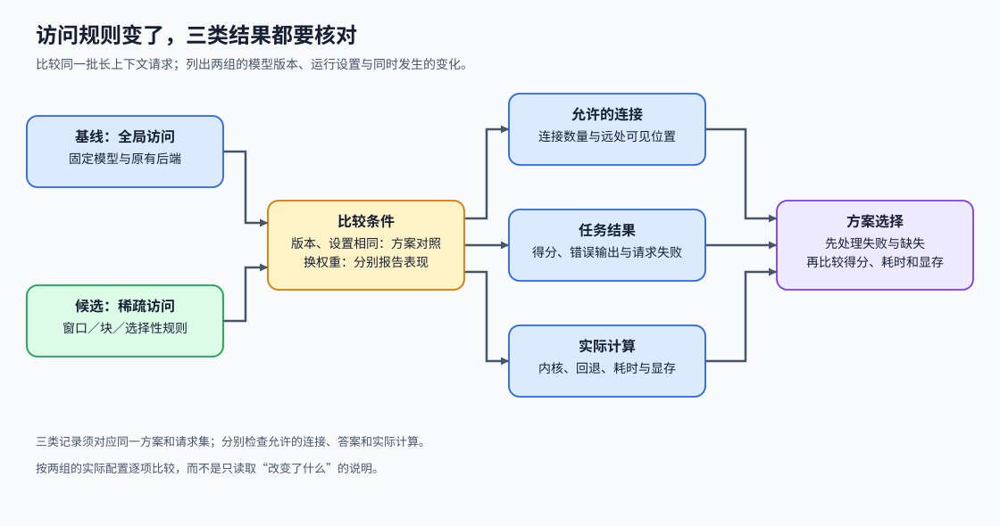
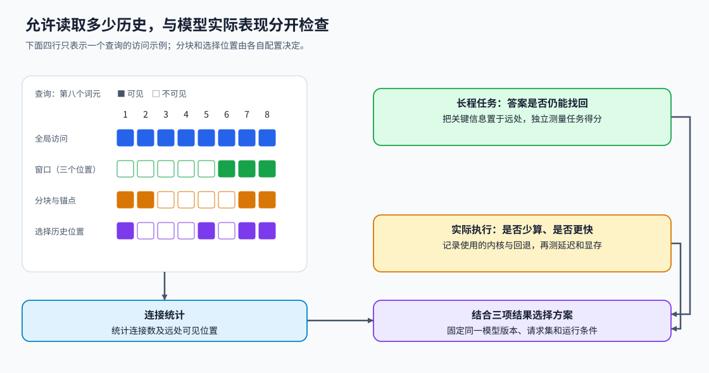

# 78. Attention Access Pattern Benchmark | Attention 访问模式基准

**难度：** Hard | **环境：** [CPU 主线，GPU 可选](#runtime-environment) | **标签：** `Attention`、`稀疏访问`、`性能基准` | **目标人群：** 理解注意力访问范围、希望比较长上下文方案的读者

> 🚀 **云端运行环境**
>
> 本章节的实战代码可以点击以下链接在免费 GPU 算力平台上直接运行：
>
> [](https://colab.research.google.com/github/datawhalechina/llm-algo-leetcode/blob/main/02_PyTorch_Algorithms/78_Attention_Access_Pattern_Benchmark.ipynb)
> [](https://modelscope.cn/my/mynotebook) *(国内推荐：魔搭社区免费实例)*


## 本节导读

一段长材料中，答案可能在开头，也可能需要结合多处信息。把注意力限制在局部窗口后，连接数减少了，回答还能正确吗？如果实现能够跳过未选部分的计算，相同请求又能快多少、节省多少显存？

本项目把模型版本、访问规则和实际执行实现放在一起比较：先核对两组条件，再分别查看任务得分、请求耗时和峰值显存。44 节中的连接统计说明允许读取哪些历史；本项目继续检查模型是否答对，以及这些连接在GPU上怎样计算。

<a id="runtime-environment"></a>
## 运行环境

CPU 部分使用 Python 标准库，检查两组条件、各份记录所属的方案和筛选规则。真实实验需要固定版本的模型文件，包括权重、配置与分词器文件，以及支持稀疏访问的执行实现。环境准备见[推理优化 Quickstart](../topic_discussion/inference_optimization/quickstart.md)，具体文件检查见 Step 5。

## 前置阅读

先理解查询、键和值以及因果约束，再比较不同规则允许读取的历史范围。

- [04 Attention Core: MHA / GQA / KV Cache](04_Attention_MHA_GQA.md)：理解 Q、K、V、因果约束与KV状态。
- [44 Local, Sliding-Window and Sparse Attention](44_Local_Sliding_and_Sparse_Attention.md)：认识窗口、分块和选择性访问怎样改变连接。
- [77 Long-Sequence Memory Architecture Benchmark](77_Long_Sequence_Memory_Architecture_Benchmark.md)：比较逐词保存历史与递推状态的不同代价。

## Step 1：固定模型版本，比较两套访问方案

一次比较要同时记录模型版本、访问规则与执行后端；后端就是实际完成注意力计算的软件实现。模型版本通过具体 commit 标识固定，请求集、分词器、长度、生成上限、并发和重复次数也保持一致，再替换访问规则及执行它的后端。它比较的是两套方案的整体效果，分别解释规则与内核的作用还需要额外对照。

如果换了权重、训练方案或其他运行条件，则分别报告各模型的表现，并列出同时改变的条件。例如换模型后显存下降，可能与参数量有关，也可能与访问规则有关；需要先列出这些变化，才能解释结果。

| 比较对象 | 记录什么 | 怎样使用 |
| --- | --- | --- |
| 模型 | 模型 ID、固定版本、架构和训练方案 | 区分权重变化与访问规则变化 |
| 访问规则 | 全局、窗口、分块或选择性访问及其参数 | 重建允许读取的历史位置 |
| 执行实现 | 框架、后端、内核、是否回退到稠密计算 | 检查稀疏连接是否确实减少了计算 |
| 请求与运行设置 | 请求集、分词器、长度、生成上限、并发和重复次数 | 让两组耗时、显存和答题结果可以比较 |



## Step 2：分开检查连接、答案与实际计算

访问规则决定允许读取哪些位置；模型能否利用这些位置答对问题，要通过任务测试检查。“长程覆盖”指规则保留了哪些远处连接，不等于模型已经找回了远处答案。两者分开记录，才能看出问题出在访问限制，还是模型的答题能力。

原生稀疏实现按选中的窗口或块执行，跳过部分未选连接的计算；如果先算完整的注意力矩阵再加掩码，连接统计虽已变少，计算量仍可能接近稠密路径。因此还要检查实际使用的内核、是否回退，并测量耗时与显存。

| 检查什么 | 记录什么 | 回答的问题 |
| --- | --- | --- |
| 允许的连接 | 连接密度、远处位置的可见范围、因果约束 | 模型被允许读取哪些历史位置 |
| 答题结果 | 固定任务集、得分、错误输出 | 限制访问范围后是否仍能答对 |
| 实际计算 | 稀疏内核、稠密回退、延迟和峰值显存 | 连接减少后是否更快、是否省显存 |
| 记录属于哪个方案 | 模型版本、方案 ID、请求集和运行设置 | 三类结果是否来自本次比较的同一方案 |



## Step 3：根据答案与运行结果筛选方案

先检查模型版本和请求集是否匹配、请求是否成功，再检查答案得分、连接密度、延迟和显存。多个方案都满足要求时，按当前目标比较延迟或显存；连接较少只说明保留的位置不同，不能代替这两项实测。

| 判断 | 什么情况触发 | 下一步 |
| --- | --- | --- |
| 排除（`reject`） | 模型或请求记录不匹配，加载／请求失败，或条件匹配后方案未通过质量、资源检查 | 修复问题，或取消采用 |
| 继续测试（`tune`） | 同时改变了其他条件、缺少指标、稀疏路径未确认或回退到稠密计算 | 补齐同一方案的记录，重新比较 |
| 采用（`accept`） | 模型与运行条件已匹配，方案满足质量、连接、延迟和显存要求，实际稀疏执行已确认 | 保存该任务与运行条件下的采用结果 |


```python
from typing import Any, Dict

```

## Step 4：核对方案、汇总结果并筛选候选

题目给出模型、访问配置和三类测试记录；骨架提供字段校验、缺失项收集和状态分支。补全两组实际条件比较、记录所属方案匹配，以及四项指标是否同时达标的判断。

| 任务与目的 | 已知条件 | 完成标准 | 测试验证 |
| --- | --- | --- | --- |
| TODO 1：判断比较类型 | 模型版本、实际配置、请求设置和变化声明 | 确认模型与固定条件相同、访问模式实际改变；其他条件变化时分别报告 | 同模型、换权重、声明与配置不符、长度变化、请求集不一致 |
| TODO 2：匹配记录所属方案 | 目标方案 ID 和三类结果记录 | 各份记录均属于同一方案，保留缺失指标与执行失败 | 完整记录、混入其他方案、缺少运行指标 |
| TODO 3：筛选合格候选 | 质量下限、连接密度、延迟和显存上限 | 四项同时满足，缺失或回退按骨架进入待测试状态 | 阈值等号、逐项越界、缺失、回退和执行失败 |


```python
def validate_access_candidate(candidate: Dict[str, Any]) -> Dict[str, Any]:
    """核对项目候选的身份、访问配置、后端和工作负载。"""
    required = ('candidate_id', 'model_id', 'revision', 'family_id', 'training_recipe_id', 'pattern', 'backend', 'workload_id', 'tokenizer_revision')
    issues = [field for field in required if not candidate.get(field)]
    if candidate.get('pattern') not in {'global', 'sliding_window', 'block_sparse', 'selective_sparse'}:
        if 'pattern' not in issues:
            issues.append('pattern')
    return {'ready': not issues, 'issues': issues}


def classify_access_comparison(baseline: Dict[str, Any], candidate: Dict[str, Any]) -> Dict[str, Any]:
    """核对工作负载、不可变模型版本和实际变化，区分比较类型。"""
    issues = []
    for role, record in (('baseline', baseline), ('candidate', candidate)):
        issues.extend(f'{role}.{field}' for field in validate_access_candidate(record)['issues'])
    for field in ('workload_id', 'tokenizer_revision'):
        if baseline.get(field) != candidate.get(field):
            issues.append(f'workload.{field}')
    model_fields = ('model_id', 'revision', 'family_id', 'training_recipe_id')
    # TODO 1：same_model 表示两组使用同一不可变模型与训练方案。
    # same_conditions 表示除访问模式及其后端外，已记录的条件均保持一致。
    # controlled 表示此次可将结果归于访问模式与执行后端这一组改变。
    same_model = ...  # 比较 model_fields 中的实际字段值。
    allowed_changes = {'candidate_id', 'pattern', 'backend', 'changed_fields'}
    fixed_fields = (set(baseline) | set(candidate)) - allowed_changes
    same_conditions = ...  # 检查 fixed_fields；以实际配置为依据。
    pattern_changed = baseline.get('pattern') != candidate.get('pattern')
    controlled = ...  # 组合模型、固定条件和访问模式变化。
    raise NotImplementedError('请完成 TODO 1：比较类型判断')
    mode = 'invalid' if issues else 'controlled' if controlled else 'observational'
    return {'comparison_mode': mode, 'issues': issues}


def merge_access_evidence(candidate_id: str, mechanism: Dict[str, Any], quality: Dict[str, Any], runtime: Dict[str, Any]) -> Dict[str, Any]:
    """合并三层证据，同时保留串线、缺失、失败和回退。"""
    records = {'mechanism': mechanism, 'quality': quality, 'runtime': runtime}
    failures = list(runtime.get('failures', []))
    for role, record in records.items():
        # TODO 2：record_matches_candidate 表示当前证据确实属于待评候选。
        record_matches_candidate = ...
        raise NotImplementedError('请完成 TODO 2：证据身份匹配')
        if not record_matches_candidate:
            failures.append(f'{role}.candidate_id')
    required = {
        'mechanism': ('density', 'long_range_coverage'),
        'quality': ('quality_score',),
        'runtime': ('latency_ms', 'peak_memory_mb', 'native_sparse_executed', 'fallback'),
    }
    missing = [f'{role}.{field}' for role, fields in required.items() for field in fields if records[role].get(field) is None]
    return {
        'candidate_id': candidate_id, 'density': mechanism.get('density'),
        'long_range_coverage': mechanism.get('long_range_coverage'),
        'quality_score': quality.get('quality_score'), 'latency_ms': runtime.get('latency_ms'),
        'peak_memory_mb': runtime.get('peak_memory_mb'),
        'native_sparse_executed': runtime.get('native_sparse_executed'), 'fallback': runtime.get('fallback'),
        'gate_failures': failures, 'missing_evidence': missing,
    }


def decide_access_candidate(comparison: Dict[str, Any], evidence: Dict[str, Any], limits: Dict[str, float]) -> Dict[str, Any]:
    """按可比性、证据层级与指标门槛形成采用状态。"""
    if comparison.get('comparison_mode') == 'invalid' or evidence.get('gate_failures'):
        return {'decision': 'reject', 'reason': '候选身份、工作负载或执行失败'}
    if comparison.get('comparison_mode') != 'controlled':
        return {'decision': 'tune', 'reason': '跨模型观察不能证明访问模式的因果收益'}
    if evidence.get('missing_evidence'):
        return {'decision': 'tune', 'reason': '机制、质量或运行证据不完整'}
    if not evidence.get('native_sparse_executed') or evidence.get('fallback'):
        return {'decision': 'tune', 'reason': '尚未确认原生稀疏路径，或执行发生回退'}
    checks = (
        evidence['quality_score'] >= limits['min_quality'],
        evidence['density'] <= limits['max_density'],
        evidence['latency_ms'] <= limits['max_latency_ms'],
        evidence['peak_memory_mb'] <= limits['max_peak_memory_mb'],
    )
    # TODO 3：meets_limits 表示质量下限与三项成本上限同时满足。
    meets_limits = ...
    raise NotImplementedError('请完成 TODO 3：指标联合判断')
    if not meets_limits:
        return {'decision': 'reject', 'reason': '质量、连接、延迟或显存门槛失守'}
    return {'decision': 'accept', 'reason': '模型与运行条件已匹配，当前方案满足质量、耗时和显存要求'}
```

## 测试


```python
# 以下数值为 CPU 规则测试样例，不是后端实测结果。
BASELINE = {'candidate_id': 'global', 'model_id': 'model-a', 'revision': 'commit-a', 'family_id': 'family-a', 'training_recipe_id': 'recipe-a', 'pattern': 'global', 'backend': 'dense-sdpa', 'workload_id': 'long-context-v1', 'tokenizer_revision': 'tok-a', 'changed_fields': []}
CANDIDATE = {**BASELINE, 'candidate_id': 'window', 'pattern': 'sliding_window', 'backend': 'native-window', 'changed_fields': ['pattern']}

def test_candidate_contract():
    """检查身份完整性与非法访问模式。"""
    assert validate_access_candidate(CANDIDATE)['ready']
    broken = validate_access_candidate({**CANDIDATE, 'revision': '', 'pattern': 'unknown'})
    assert not broken['ready'] and {'revision', 'pattern'} <= set(broken['issues'])

def test_comparison_contract():
    """TODO 1：比较实际模型和配置，不以声明代替逐项核对。"""
    controlled = classify_access_comparison(BASELINE, CANDIDATE)
    assert controlled['comparison_mode'] == 'controlled'
    observational = classify_access_comparison(BASELINE, {**CANDIDATE, 'training_recipe_id': 'other'})
    assert observational['comparison_mode'] == 'observational'
    for changes in (
        {'model_id': 'model-b'}, {'revision': 'commit-b'},
        {'family_id': 'family-b'}, {'changed_fields': ['pattern'], 'max_tokens': 128},
        {'pattern': 'global', 'backend': 'other-dense'},
    ):
        assert classify_access_comparison(BASELINE, {**CANDIDATE, **changes})['comparison_mode'] == 'observational'
    assert classify_access_comparison(
        BASELINE, {**CANDIDATE, 'changed_fields': ['arbitrary_claim']}
    )['comparison_mode'] == 'controlled'
    invalid = classify_access_comparison(BASELINE, {**CANDIDATE, 'workload_id': 'other'})
    assert invalid['comparison_mode'] == 'invalid'
    assert classify_access_comparison(
        BASELINE, {**CANDIDATE, 'tokenizer_revision': 'tok-b'}
    )['comparison_mode'] == 'invalid'
    return controlled

def test_evidence_merge():
    """TODO 2：保留身份串线、缺失字段及后端失败。"""
    evidence = merge_access_evidence(
        'window',
        {'candidate_id': 'window', 'density': 0.45, 'long_range_coverage': 0.80},
        {'candidate_id': 'window', 'quality_score': 0.91},
        {'candidate_id': 'window', 'latency_ms': 8.0, 'peak_memory_mb': 4200, 'native_sparse_executed': True, 'fallback': False, 'failures': []},
    )
    assert evidence['missing_evidence'] == [] and evidence['gate_failures'] == []
    crossed = merge_access_evidence('window', {'candidate_id': 'other'}, {}, {})
    assert 'mechanism.candidate_id' in crossed['gate_failures']
    missing = merge_access_evidence('window',
        {'candidate_id': 'window'}, {'candidate_id': 'window'}, {'candidate_id': 'window'})
    assert 'runtime.latency_ms' in missing['missing_evidence']
    return evidence

def test_decision(comparison, evidence):
    """TODO 3：联合检查各指标，测试等号、越界与不完整证据。"""
    limits = {'min_quality': 0.88, 'max_density': 0.70, 'max_latency_ms': 10.0, 'max_peak_memory_mb': 5000}
    assert decide_access_candidate(comparison, evidence, limits)['decision'] == 'accept'
    boundary = {**evidence, 'quality_score': 0.88, 'density': 0.70,
                'latency_ms': 10.0, 'peak_memory_mb': 5000}
    assert decide_access_candidate(comparison, boundary, limits)['decision'] == 'accept'
    for field, value in (('quality_score', 0.87), ('density', 0.71),
                         ('latency_ms', 10.01), ('peak_memory_mb', 5001)):
        assert decide_access_candidate(comparison, {**boundary, field: value}, limits)['decision'] == 'reject'
    assert decide_access_candidate({'comparison_mode': 'observational'}, evidence, limits)['decision'] == 'tune'
    assert decide_access_candidate(comparison, {**evidence, 'missing_evidence': ['quality_score']}, limits)['decision'] == 'tune'
    assert decide_access_candidate(comparison, {**evidence, 'fallback': True}, limits)['decision'] == 'tune'
    assert decide_access_candidate(comparison, {**evidence, 'gate_failures': ['request_failed']}, limits)['decision'] == 'reject'

test_candidate_contract()
_comparison = test_comparison_contract()
_evidence = test_evidence_merge()
test_decision(_comparison, _evidence)
print('测试通过：两组条件、记录所属方案和指标筛选规则一致。')
```

## 参考代码与解析

### 代码


```python
def validate_access_candidate(candidate: Dict[str, Any]) -> Dict[str, Any]:
    """核对项目候选的身份、访问配置、后端和工作负载。"""
    required = ('candidate_id', 'model_id', 'revision', 'family_id', 'training_recipe_id', 'pattern', 'backend', 'workload_id', 'tokenizer_revision')
    issues = [field for field in required if not candidate.get(field)]
    if candidate.get('pattern') not in {'global', 'sliding_window', 'block_sparse', 'selective_sparse'}:
        if 'pattern' not in issues:
            issues.append('pattern')
    return {'ready': not issues, 'issues': issues}


def classify_access_comparison(baseline: Dict[str, Any], candidate: Dict[str, Any]) -> Dict[str, Any]:
    """核对工作负载、不可变模型版本和实际变化，区分比较类型。"""
    issues = []
    for role, record in (('baseline', baseline), ('candidate', candidate)):
        issues.extend(f'{role}.{field}' for field in validate_access_candidate(record)['issues'])
    for field in ('workload_id', 'tokenizer_revision'):
        if baseline.get(field) != candidate.get(field):
            issues.append(f'workload.{field}')
    model_fields = ('model_id', 'revision', 'family_id', 'training_recipe_id')
    # TODO 1：比较实际模型与配置。
    same_model = all(baseline.get(field) == candidate.get(field) for field in model_fields)
    allowed_changes = {'candidate_id', 'pattern', 'backend', 'changed_fields'}
    fixed_fields = (set(baseline) | set(candidate)) - allowed_changes
    same_conditions = all(baseline.get(field) == candidate.get(field) for field in fixed_fields)
    pattern_changed = baseline.get('pattern') != candidate.get('pattern')
    controlled = same_model and same_conditions and pattern_changed
    mode = 'invalid' if issues else 'controlled' if controlled else 'observational'
    return {'comparison_mode': mode, 'issues': issues}


def merge_access_evidence(candidate_id: str, mechanism: Dict[str, Any], quality: Dict[str, Any], runtime: Dict[str, Any]) -> Dict[str, Any]:
    """合并三层证据，同时保留串线、缺失、失败和回退。"""
    records = {'mechanism': mechanism, 'quality': quality, 'runtime': runtime}
    failures = list(runtime.get('failures', []))
    for role, record in records.items():
        # TODO 2：匹配证据所属候选。
        record_matches_candidate = record.get('candidate_id') == candidate_id
        if not record_matches_candidate:
            failures.append(f'{role}.candidate_id')
    required = {
        'mechanism': ('density', 'long_range_coverage'),
        'quality': ('quality_score',),
        'runtime': ('latency_ms', 'peak_memory_mb', 'native_sparse_executed', 'fallback'),
    }
    missing = [f'{role}.{field}' for role, fields in required.items() for field in fields if records[role].get(field) is None]
    return {
        'candidate_id': candidate_id, 'density': mechanism.get('density'),
        'long_range_coverage': mechanism.get('long_range_coverage'),
        'quality_score': quality.get('quality_score'), 'latency_ms': runtime.get('latency_ms'),
        'peak_memory_mb': runtime.get('peak_memory_mb'),
        'native_sparse_executed': runtime.get('native_sparse_executed'), 'fallback': runtime.get('fallback'),
        'gate_failures': failures, 'missing_evidence': missing,
    }


def decide_access_candidate(comparison: Dict[str, Any], evidence: Dict[str, Any], limits: Dict[str, float]) -> Dict[str, Any]:
    """按可比性、证据层级与指标门槛形成采用状态。"""
    if comparison.get('comparison_mode') == 'invalid' or evidence.get('gate_failures'):
        return {'decision': 'reject', 'reason': '候选身份、工作负载或执行失败'}
    if comparison.get('comparison_mode') != 'controlled':
        return {'decision': 'tune', 'reason': '跨模型观察不能证明访问模式的因果收益'}
    if evidence.get('missing_evidence'):
        return {'decision': 'tune', 'reason': '机制、质量或运行证据不完整'}
    if not evidence.get('native_sparse_executed') or evidence.get('fallback'):
        return {'decision': 'tune', 'reason': '尚未确认原生稀疏路径，或执行发生回退'}
    checks = (
        evidence['quality_score'] >= limits['min_quality'],
        evidence['density'] <= limits['max_density'],
        evidence['latency_ms'] <= limits['max_latency_ms'],
        evidence['peak_memory_mb'] <= limits['max_peak_memory_mb'],
    )
    # TODO 3：同时满足质量与成本门槛。
    meets_limits = all(checks)
    if not meets_limits:
        return {'decision': 'reject', 'reason': '质量、连接、延迟或显存门槛失守'}
    return {'decision': 'accept', 'reason': '模型与运行条件已匹配，当前方案满足质量、耗时和显存要求'}
```

### 解析

#### TODO 1：比较实际模型与配置

- 逐项比较模型的固定版本与运行设置，变化声明仅作说明。模型和固定条件相同、访问模式实际改变时，比较的是访问规则与对应后端这一组方案的效果。
- `test_comparison_contract` 分别更换模型、版本和生成上限，即使仍声明“只改访问模式”，也要分别报告变化后的结果；请求集或分词器不同时则无法配对。

#### TODO 2：匹配各份记录所属的方案

- 将连接统计、答题和运行记录中的方案 ID 与目标 ID 比较。混入其他方案的记录要列为失败项；属于当前方案但缺少指标时，要列为缺失项。
- `test_evidence_merge` 分别混入其他方案记录和删除运行指标，检查汇总后是否仍保留这两类问题。

#### TODO 3：同时满足质量与成本要求

- 质量达到下限，连接密度、延迟和显存同时不超过上限，才通过指标检查。四项条件取合取，而非任选一项达标。
- `test_decision` 检查阈值等号和逐项越界，并检查失败、缺失、其他条件变化及回退的处理顺序，防止低成本掩盖答题错误。

## Step 5（项目实验）：运行并检查稀疏访问方案

固定模型版本、请求集和调用脚本后，分别保存基线与候选的执行结果。调用脚本按约定的参数启动后端、写出结果，下面称为适配器。

| CPU 中检查的规则 | 真实实验补充什么 | 用来判断什么 |
| --- | --- | --- |
| 两组模型与运行设置是否一致 | 模型版本、请求集与适配器文件哈希 | 比较的是哪两个方案，输入是否变化 |
| 每份记录是否属于当前方案 | 各方案的得分、耗时、显存、实际输入长度和失败原因 | 哪项未测、哪项失败，是否回退 |
| 四项指标是否同时满足要求 | 实际运行记录与独立任务集 | 在目标请求下是否值得采用 |

#### 5.1 本次运行配置

环境选择见[模型架构专题项目环境入口](../topic_discussion/llm_architecture_evolution/quickstart.md#项目与推理服务环境)。`prepare` 检查配置和文件；`probe` 保存检查结果；`measure` 调用适配器；`close` 读取校验后登记。


```python
RUN_LABEL = 'replace_with_unique_label'  # 新实验使用唯一标签。
RUN_STAGE = 'prepare'  # prepare / probe / measure / close；默认只读。

```

#### 5.2 检查环境与输入文件

读取模型版本、调用脚本和请求集，检查它们是否存在、是否与固定配置一致。这一步只读文件，不启动后端。


```python
import hashlib
import json
import math
import re
import sys
from pathlib import Path

from tools.model_runtime import resolve_model_snapshot
from tools.project_runtime import resolve_project_root

REPO_ROOT = resolve_project_root()
SEMANTIC_ID = 'ARCH-ATTENTION-ACCESS'
RESULT_SCHEMA = 'architecture-evaluation/v1'
NATIVE_RUN_SCHEMA = 'attention-access-native-run/v1'
INPUT_MANIFEST_RELATIVE_PATH = Path('benchmarks/project_inputs/78_attention_access.json')
input_manifest_path = REPO_ROOT / INPUT_MANIFEST_RELATIVE_PATH
manifest_sha256 = hashlib.sha256(input_manifest_path.read_bytes()).hexdigest()
input_manifest = json.loads(input_manifest_path.read_bytes())
if input_manifest.get('schema_version') != 'architecture-project-input/v1' or input_manifest.get('semantic_id') != SEMANTIC_ID:
    raise ValueError('输入清单身份不匹配')
MODEL_ID = input_manifest.get('model_id', '')
MODEL_REVISION = input_manifest.get('model_revision', '')
NATIVE_SPARSE_ADAPTER = input_manifest.get('native_sparse_adapter', '')
WORKLOAD_PATH = input_manifest.get('workload_path', '')
RESULT_DIR = Path('benchmarks/results/78_attention_access')
capability_path = REPO_ROOT / RESULT_DIR / f'78_capability_{RUN_LABEL}.json'
raw_result_path = REPO_ROOT / RESULT_DIR / f'78_attention_access_{RUN_LABEL}_raw.json'
companion_path = REPO_ROOT / RESULT_DIR / f'78_attention_access_{RUN_LABEL}.json'
contract_path = REPO_ROOT / RESULT_DIR / f'78_contract_{RUN_LABEL}.json'
receipt_path = REPO_ROOT / RESULT_DIR / f'78_registration_{RUN_LABEL}.json'

if RUN_STAGE not in {'prepare', 'probe', 'measure', 'close'}:
    raise ValueError(f'未知 RUN_STAGE: {RUN_STAGE}')
if not re.fullmatch(r'[A-Za-z0-9._-]+', RUN_LABEL) or RUN_LABEL in {'.', '..'}:
    raise ValueError('RUN_LABEL 只能使用字母、数字、点、下划线和连字符')
if RUN_STAGE != 'prepare' and RUN_LABEL == 'replace_with_unique_label':
    raise ValueError('probe / measure / close 需要唯一 RUN_LABEL')


def local_input_path(relative):
    """只接受仓库内的相对输入路径，不创建目录。"""
    if not relative:
        return None
    path = Path(relative)
    resolved = (REPO_ROOT / path).resolve()
    if path.is_absolute() or not resolved.is_relative_to(REPO_ROOT.resolve()):
        raise ValueError(f'输入路径须位于仓库内：{relative}')
    return resolved


adapter_path = local_input_path(NATIVE_SPARSE_ADAPTER)
workload_path = local_input_path(WORKLOAD_PATH)
adapter_sha256 = hashlib.sha256(adapter_path.read_bytes()).hexdigest() if adapter_path and adapter_path.is_file() else None
workload_sha256 = hashlib.sha256(workload_path.read_bytes()).hexdigest() if workload_path and workload_path.is_file() else None
issues, workload_records = [], []
if not workload_sha256:
    issues.append('缺少固定请求集')
else:
    workload_records = [json.loads(line) for line in workload_path.read_text(encoding='utf-8').splitlines() if line.strip()]
    request_ids = [row.get('request_id') for row in workload_records]
    if not request_ids or any(not isinstance(value, str) or not value for value in request_ids) or len(set(request_ids)) != len(request_ids):
        issues.append('请求 ID 须非空且唯一')
    if any(not row.get('prompt') or not row.get('expected_answer') for row in workload_records):
        issues.append('每个请求须提供提示和预期答案')
if not re.fullmatch(r'[0-9a-f]{40}', MODEL_REVISION):
    issues.append('模型须登记不可变的40位 commit')
if not MODEL_ID:
    issues.append('尚未登记模型')
if not adapter_sha256:
    issues.append('缺少原生稀疏适配器')
try:
    local_model_path, _ = resolve_model_snapshot(MODEL_ID, MODEL_REVISION, cache_dir=REPO_ROOT / 'model_cache', allow_download=False)
except (ValueError, FileNotFoundError) as exc:
    issues.append(str(exc))
preflight = {'stage': RUN_STAGE, 'issues': issues, 'ready_to_start': not issues}
print(preflight)
if RUN_STAGE == 'measure' and issues:
    raise RuntimeError('；'.join(issues))

```

#### 5.3 固定比较输入与适配器接口

适配器接收 `--contract` 和 `--output`，读取固定版本的模型与同一请求集，并保存基线、候选和执行路径记录。协议版本为 `attention-access-native/v1`。

请求集中的长度分档只是目标值，实际词元数由分词器和输入构造决定，需要另行记录。例如标为512词元的请求，必须检查分词后有多少词元，再判断是否测到了目标长度。

| 适配器结果 | 必须保存的内容 |
| --- | --- |
| 结果属于哪次运行 | `attention-access-native-run/v1`、项目 ID、运行标签和完整固定输入 `contract` |
| 基线与候选 | 各自的候选 ID、模型 ID、固定版本；候选 ID 不重复 |
| 工作负载 | 请求 ID 列表、请求集 SHA256、各请求实际输入词元数 |
| 执行情况 | 后端与内核、是否原生稀疏执行、是否回退、失败原因 |
| 质量与成本 | 按候选 ID 保存 `quality_score`（0–1）、`latency_ms`、`peak_memory_mb`；单位和候选集合一致 |


```python
candidate_contract = {
    'protocol': 'attention-access-native/v1',
    'semantic_id': SEMANTIC_ID, 'run_label': RUN_LABEL,
    'model_id': MODEL_ID, 'model_revision': MODEL_REVISION,
    'manifest_sha256': manifest_sha256,
    'adapter_path': NATIVE_SPARSE_ADAPTER, 'adapter_sha256': adapter_sha256,
    'workload_path': WORKLOAD_PATH, 'workload_sha256': workload_sha256,
    'request_ids': [row.get('request_id') for row in workload_records],
    'raw_result_schema': NATIVE_RUN_SCHEMA,
}
print(candidate_contract)

```

#### 5.4 保存检查结果或执行后端

`probe` 保存文件与配置检查结果；`measure` 先保存固定输入，再调用适配器。已有同标签原始结果时停止测量，保留原文件。适配器按5.3中的格式写出结果，随后读取核对。


```python
import subprocess
from tools.project_runtime import save_json_record_once

if RUN_STAGE in {'probe', 'measure'}:
    if contract_path.exists():
        if json.loads(contract_path.read_bytes()) != candidate_contract:
            raise FileExistsError('同标签固定输入已变化，请更换 RUN_LABEL')
    else:
        save_json_record_once(contract_path, candidate_contract)
    if RUN_STAGE == 'probe':
        capability_record = {
            'schema_version': 'architecture-capability-probe/v1',
            'semantic_id': SEMANTIC_ID, 'run_label': RUN_LABEL,
            'contract': candidate_contract, 'issues': preflight['issues'],
            'status': 'ready_to_start' if preflight['ready_to_start'] else 'input_not_ready',
            'native_sparse_executed': False,
        }
        save_json_record_once(capability_path, capability_record)
        print({'saved': str(capability_path), 'status': capability_record['status']})
    else:
        if raw_result_path.exists():
            raise FileExistsError('原始结果已存在，请更换 RUN_LABEL 或改为 close')
        command = [sys.executable, str(adapter_path), '--contract', str(contract_path), '--output', str(raw_result_path)]
        completed = subprocess.run(command, cwd=REPO_ROOT, check=False)
        if completed.returncode != 0 or not raw_result_path.is_file():
            raise RuntimeError(f'原生适配器执行失败：returncode={completed.returncode}')
        print({'saved': str(raw_result_path)})
else:
    print(f'跳过采集：RUN_STAGE={RUN_STAGE}')

```

#### 5.5 读取并核对方案与结果

先比较已保存的输入和本次清单，再读取原始结果；尚无原始结果时，展示启动前的文件检查结果。核对模型版本、文件哈希、请求是否齐全，以及实际输入长度、得分、耗时和显存，并单列失败与回退。


```python
def review_access_run(record, contract):
    """检查原生适配器结果的身份、请求覆盖和数值，不修补原始字段。"""
    errors = []
    if not isinstance(record, dict):
        return ['result.not_mapping']
    for field, expected in (
        ('schema_version', NATIVE_RUN_SCHEMA), ('semantic_id', SEMANTIC_ID),
        ('run_label', RUN_LABEL), ('contract', contract),
    ):
        if record.get(field) != expected:
            errors.append(field)
    for field in ('native_sparse_executed', 'fallback'):
        if type(record.get(field)) is not bool:
            errors.append(field)
    if 'failure' not in record:
        errors.append('failure')
    if not record.get('backend') or not record.get('kernel'):
        errors.append('backend_or_kernel')
    baseline, candidates = record.get('baseline', {}), record.get('candidates', [])
    if not isinstance(baseline, dict) or not isinstance(candidates, list) or not candidates:
        return [*errors, 'baseline_or_candidates']
    records = [baseline, *candidates]
    ids = [item.get('candidate_id') for item in records if isinstance(item, dict)]
    if len(ids) != len(records) or any(not isinstance(value, str) or not value for value in ids) or len(set(ids)) != len(ids):
        return [*errors, 'candidate_ids']
    for item in records:
        if item.get('model_id') != contract['model_id'] or item.get('model_revision') != contract['model_revision']:
            errors.append(f"{item['candidate_id']}.model_identity")
    workload = record.get('workload', {})
    if workload.get('request_ids') != contract['request_ids'] or workload.get('sha256') != contract['workload_sha256']:
        errors.append('workload')
    lengths = workload.get('actual_input_tokens', {})
    if set(lengths) != set(contract['request_ids']) or any(type(value) is not int or value <= 0 for value in lengths.values()):
        errors.append('workload.actual_input_tokens')
    for group, fields in (('quality', ('quality_score',)), ('metrics', ('latency_ms', 'peak_memory_mb'))):
        table = record.get(group, {})
        if not isinstance(table, dict) or set(table) != set(ids):
            errors.append(group)
            continue
        for candidate_id, values in table.items():
            if not isinstance(values, dict):
                errors.append(f'{group}.{candidate_id}')
                continue
            for field in fields:
                value = values.get(field)
                if type(value) not in (int, float) or not math.isfinite(value) or value < 0 or (field == 'quality_score' and value > 1):
                    errors.append(f'{group}.{candidate_id}.{field}')
    return errors


evidence = None
evidence_path = raw_result_path if raw_result_path.is_file() else capability_path
evidence_sha256, access_errors = None, []
contract_sha256 = hashlib.sha256(contract_path.read_bytes()).hexdigest() if contract_path.is_file() else None
if not contract_path.is_file() or json.loads(contract_path.read_bytes()) != candidate_contract:
    access_errors.append('saved_contract')
if evidence_path.is_file():
    evidence_bytes = evidence_path.read_bytes()
    evidence_sha256 = hashlib.sha256(evidence_bytes).hexdigest()
    evidence = json.loads(evidence_bytes)
    if evidence_path == raw_result_path:
        access_errors.extend(review_access_run(evidence, candidate_contract))
    elif (evidence.get('schema_version') != 'architecture-capability-probe/v1'
          or evidence.get('semantic_id') != SEMANTIC_ID or evidence.get('run_label') != RUN_LABEL
          or evidence.get('contract') != candidate_contract):
        access_errors.append('capability_identity')
else:
    access_errors.append('evidence_missing')
ready_for_decision = not access_errors
print({'source': str(evidence_path), 'issues': access_errors,
       'ready_for_registration': ready_for_decision,
       'native_sparse_executed': evidence.get('native_sparse_executed') if evidence else None,
       'fallback': evidence.get('fallback') if evidence else None,
       'failure': evidence.get('failure') if evidence else None})

```

#### 5.6 保存报告并确定下一步

根据5.5读到的结果保存架构报告与登记回执。回执记录运行标签、结果格式、判断和来源文件哈希，供再次检查同一批文件。

**当前登记结果**

模型与适配器尚未填写，未采集本版GPU结果。当前只准备了少量读取任务；后续需另选一组未参与访问参数选择的任务评测，并明确质量、耗时和显存要求，再判断是否采用。

| 测试情况 | 判断 | 下一步 |
| --- | --- | --- |
| 模型版本、输入哈希或结果字段不符 | 停止登记 | 保留原始文件，修复输入或用新标签测量 |
| 只有启动前的文件检查结果 | `pending` | 保存回执；补齐输入后以新标签运行 |
| 实验中有请求执行失败 | `reject` | 保存失败报告，修复调用脚本或请求执行 |
| 回退到稠密计算，或尚未执行稀疏计算 | `tune` | 保留实际路径，再检查实现选择 |
| 稀疏计算已执行，记录齐全 | `tune` | 保存本次结果，补评测任务与采用要求 |
| 同标签已有相同报告及回执 | 沿用原判断 | 返回 `already_complete`；只缺回执时补写 |


```python
if RUN_STAGE == 'close':
    if not ready_for_decision:
        raise ValueError(f'结果校验未通过：{access_errors}')
    if hashlib.sha256(evidence_path.read_bytes()).hexdigest() != evidence_sha256:
        raise ValueError('5.5 后来源结果已变化，请重新读取')
    current_inputs = [(input_manifest_path, manifest_sha256), (contract_path, contract_sha256)]
    for path, expected in ((workload_path, workload_sha256), (adapter_path, adapter_sha256)):
        if expected is not None:
            current_inputs.append((path, expected))
    for path, expected in current_inputs:
        if not path.is_file() or hashlib.sha256(path.read_bytes()).hexdigest() != expected:
            raise ValueError(f'来源文件变化：{path}')
    if json.loads(contract_path.read_bytes()) != candidate_contract:
        raise ValueError('固定输入文件已变化，请重新核对')
    outputs = []
    companion = None
    if evidence_path == capability_path:
        decision = {'status': 'pending', 'reason': '当前只有启动条件，尚无原生执行结果'}
    else:
        from tools.architecture_result_schema import make_producer_record, validate_record
        decision = {
            'status': 'reject' if evidence['failure'] else 'tune',
            'reason': '原生实验执行失败' if evidence['failure'] else
                      '需要核对原生路径及独立质量集' if evidence['fallback'] or not evidence['native_sparse_executed'] else
                      '原生执行记录完成，仍需独立质量集与采用门槛',
        }
        companion = make_producer_record(
            semantic_id=SEMANTIC_ID, comparison_mode='observational',
            source={'notebook': '02_PyTorch_Algorithms/78_Attention_Access_Pattern_Benchmark.ipynb',
                    'raw_result_path': str(raw_result_path.relative_to(REPO_ROOT)), 'raw_result_sha256': evidence_sha256},
            runtime={'backend': evidence['backend'], 'kernel': evidence['kernel'], 'fallback': evidence['fallback']},
            workload=evidence['workload'], baseline=evidence['baseline'], candidates=evidence['candidates'],
            quality=evidence['quality'], cost=evidence['metrics'],
            mechanism={'native_sparse_executed': evidence['native_sparse_executed'], 'fallback': evidence['fallback']},
            status='failed' if evidence['failure'] else 'ok', failure=evidence['failure'],
            evidence_level='observational_gpu_benchmark', decision=decision,
        )
        companion['run_label'] = RUN_LABEL
        if validate_record(companion):
            raise ValueError(f'架构报告不符合schema：{validate_record(companion)}')
        outputs.append((companion_path, companion))
    sources = [
        {'path': str(path.relative_to(REPO_ROOT)), 'sha256': digest}
        for path, digest in [*current_inputs, (evidence_path, evidence_sha256)]
    ]
    if companion is not None:
        report_bytes = (json.dumps(companion, ensure_ascii=False, indent=2) + '\n').encode('utf-8')
        if companion_path.exists():
            if json.loads(companion_path.read_bytes()) != companion:
                raise FileExistsError('同标签报告内容不同，请更换 RUN_LABEL')
            report_bytes = companion_path.read_bytes()
        sources.append({'path': str(companion_path.relative_to(REPO_ROOT)), 'sha256': hashlib.sha256(report_bytes).hexdigest()})
    registration_receipt = {
        'schema_version': 'architecture-registration/v1', 'semantic_id': SEMANTIC_ID,
        'run_label': RUN_LABEL, 'decision': decision['status'], 'result_schema': RESULT_SCHEMA if companion else None,
        'report_path': str(companion_path.relative_to(REPO_ROOT)) if companion else None,
        'sources': sources, 'handoff': None, 'handoff_reason': '当前记录尚未达到采用条件',
    }
    outputs.append((receipt_path, registration_receipt))
    if companion is None and companion_path.exists():
        raise FileExistsError('当前仅有启动条件，但同标签已有架构报告，请核对来源')
    for path, payload in outputs:
        if path.exists() and json.loads(path.read_bytes()) != payload:
            raise FileExistsError(f'同标签文件内容冲突：{path}')
    already_complete = all(path.exists() for path, _ in outputs)
    from tools.project_runtime import save_json_record_once
    for path, payload in outputs:
        if not path.exists():
            save_json_record_once(path, payload)
    for source in registration_receipt['sources']:
        path = REPO_ROOT / source['path']
        if not path.is_file() or hashlib.sha256(path.read_bytes()).hexdigest() != source['sha256']:
            raise ValueError(f'登记来源校验失败：{path}')
    print({'status': 'already_complete' if already_complete else 'registered', 'registration_receipt': registration_receipt})
else:
    print(f'跳过登记：RUN_STAGE={RUN_STAGE}')

```

## 相关阅读

- [Longformer: The Long-Document Transformer](https://arxiv.org/abs/2004.05150)：滑动窗口与全局 token 的经典设计。
- [Big Bird: Transformers for Longer Sequences](https://arxiv.org/abs/2007.14062)：随机、窗口和全局连接的块稀疏组合。
- [PyTorch scaled_dot_product_attention](https://pytorch.org/docs/stable/generated/torch.nn.functional.scaled_dot_product_attention.html)：对照接口允许的掩码语义，区分接口输入与实际后端选择。
- [FlashAttention](https://arxiv.org/abs/2205.14135)：与“改变访问集合”不同，FlashAttention 主要改变密集 attention 的计算与存储路径。
