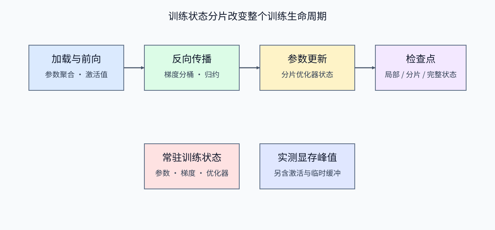
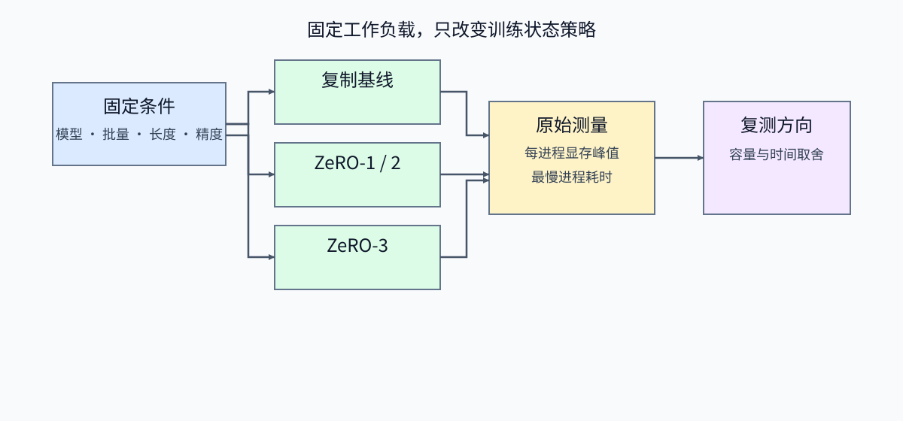

# 79. Distributed Parallel Benchmark | 训练状态并行基准

**难度：** Hard | **环境：** CPU-first | **标签：** `并行通信`、`分布式`、`基准对比` | **目标人群：** 具备训练与并行基础的读者

> 🚀 **云端运行环境**
>
> 本章节的实战代码可以点击以下链接在免费 GPU 算力平台上直接运行：
>
> [](https://colab.research.google.com/github/datawhalechina/llm-algo-leetcode/blob/main/02_PyTorch_Algorithms/79_Distributed_Parallel_Benchmark.ipynb)
> [](https://modelscope.cn/my/mynotebook) *(国内推荐：魔搭社区免费实例)*


---

## 本节导读

同一个模型在单卡上放不下，增加GPU后为什么仍可能显存不足？数据并行通常在每个训练进程中保存完整的参数、梯度和优化器状态。把这些状态分给不同进程，可以降低各进程的常驻量，却也会增加参数收集、梯度归约和同步等待。

本节比较复制状态与不同深度的状态分片：先算清每个进程保存什么，再沿前向、反向和更新过程寻找临时峰值，最后结合显存与训练耗时判断该选哪种策略。分布式进程的编号称为rank；CPU部分把rank当作计算份额的编号，多GPU实验才让多个进程实际通信。

**关键词：** `distributed training`、`state sharding`、`benchmark`

---

## 前置阅读

先弄清三类训练状态怎样分片，以及归约和收集分别移动什么，再比较分片前后的容量与时间。

- [27. ZeRO 优化器模拟](./27_ZeRO_Optimizer_Sim.md)：区分优化器、梯度和参数分片。
- [47. NCCL 通信分析](./47_Communication_Profiling_with_NCCL.md)：理解通信计时与训练时间线的关系。
- [Part01·05 通信拓扑与分布式基石](../01_Hardware_Math_and_Systems/05_Communication_Topologies.md)：解释相同字节量为何可能有不同传输耗时。

---

## Step 1：比较每个进程保存的训练状态

普通数据并行在每个进程中复制参数、梯度和优化器状态；ZeRO按阶段逐步分片这三类状态，FSDP的全分片模式也拆分它们。例如三类状态合计1600MB，分给4个进程后，全部分片的理想常驻量为每进程400MB。激活值、临时收集的参数和通信缓冲区要另外计入运行时峰值。

All-Reduce把各进程的贡献归约后交给所有进程；Reduce-Scatter把归约结果再分给各进程；All-Gather把各自持有的分片收集起来。它们分别决定梯度如何汇总、参数何时可用于计算。

| 策略 | 参数 | 梯度 | 优化器状态 | 主要通信 |
| --- | --- | --- | --- | --- |
| DDP | 复制 | 复制 | 复制 | 梯度All-Reduce |
| ZeRO-1 | 复制 | 复制 | 分片 | 梯度归约与更新后参数同步 |
| ZeRO-2 | 复制 | 分片 | 分片 | 梯度Reduce-Scatter与参数同步 |
| ZeRO-3／FSDP全分片 | 分片 | 分片 | 分片 | 按需All-Gather参数、归约梯度并重新分片 |



## Step 2：沿训练过程寻找临时峰值与等待

常驻状态减少后，运行峰值可能仍然很高。参数全分片的策略要在相关层计算前收集参数，反向传播还会产生梯度与通信缓冲；缓冲区释放的时间和通信是否重叠，会改变实际峰值与单步耗时。检查点保存则可能额外收集完整状态，需要单独观察。

| 训练位置 | 当时需要的状态 | 需要观察什么 |
| --- | --- | --- |
| 加载与初始化 | 参数、主机缓冲区 | 启动峰值，是否集中到编号0的进程 |
| 前向与反向传播 | 激活值、临时聚合参数、梯度桶 | 峰值显存，参数收集与梯度归约的时机 |
| 优化器更新 | 参数、梯度、优化器状态 | 完整更新耗时，各进程是否互相等待 |
| 检查点保存 | 完整或分片状态 | 保存峰值、文件大小与恢复方式 |

## Step 3：先满足容量，再比较训练速度

选择策略时，先确认训练能够完成且数值检查通过，再排除显存超限或吞吐不足的方案。多个候选都满足要求时，优先比较相同完整训练更新所需的时间，再结合显存余量选择。更深的分片适合解决容量压力，频繁收集参数却可能使训练变慢。

通信活动占训练时间的比例，与未被计算隐藏的通信等待是两回事：通信可能与反向计算重叠，通信占比很高也未必同样拖长训练。使用占比筛选候选前，应确认计时窗口和重叠活动的统计方法；判断最后还等了多久，则需要时间线或明确的同步区间。



## Step 4：计算状态份额并筛选候选

题目使用给定的状态大小与示例测量记录：分别计算每个进程保存的三类状态，收集显存、吞吐、通信占比和运行失败的全部不合格原因，再对满足条件的候选排序。通信占比是输入记录，不由状态大小推算；本练习也未提供训练输出的数值对照。

| 任务与目的 | 已知条件 | 完成标准 | 测试验证 |
|:---|:---|:---|:---|
| TODO 1：计算各进程状态大小 | 三类状态总量、进程数与分片策略 | 分别计算参数、梯度和优化器状态的常驻量 | DDP、ZeRO-2、ZeRO-3与非法策略 |
| TODO 2：保留所有不合格原因 | 峰值显存、吞吐、通信占比与运行状态 | 独立检查各项条件，保留同时失败的项目 | 容量、吞吐、通信与运行失败 |
| TODO 3：对合格候选排序 | 候选记录与筛选阈值 | 按吞吐、通信占比和峰值显存依次比较 | 无合格候选与多候选排序 |


```python
from copy import deepcopy

```


```python
def training_state_ledger(parameter_mb, gradient_mb, optimizer_mb, world_size, strategy):
    """计算指定训练状态策略下的各进程的常驻状态大小。"""
    if world_size < 1:
        raise ValueError('world_size 必须至少为 1')

    shard_factors = {
        'ddp': (1, 1, 1),
        'zero1': (1, 1, world_size),
        'zero2': (1, world_size, world_size),
        'zero3': (world_size, world_size, world_size),
        'fsdp_full_shard': (world_size, world_size, world_size),
    }
    if strategy not in shard_factors:
        raise ValueError(f'未知训练状态策略：{strategy}')

    raise NotImplementedError("请完成TODO 1：计算各进程的三类状态大小。")
    # TODO 1：训练状态分片机制——分别计算参数、梯度和优化器状态的每 rank 驻留量。
    # parameter_factor, gradient_factor, optimizer_factor = ???
    # parameter_per_rank_mb = ???
    # gradient_per_rank_mb = ???
    # optimizer_per_rank_mb = ???
    resident_state_mb = parameter_per_rank_mb + gradient_per_rank_mb + optimizer_per_rank_mb
    return {
        'strategy': strategy,
        'parameter_per_rank_mb': parameter_per_rank_mb,
        'gradient_per_rank_mb': gradient_per_rank_mb,
        'optimizer_per_rank_mb': optimizer_per_rank_mb,
        'resident_state_mb': resident_state_mb,
    }


def evaluate_candidate(metrics, memory_limit_mb, min_throughput, max_communication_ratio):
    """按容量、吞吐、通信和运行状态判断候选是否可以进入决策。"""
    result = deepcopy(metrics)
    # TODO 2：候选筛选规则——逐项检查 failure、显存、吞吐与通信占比。
    # failures = ???
    result['eligible'] = not failures
    result['gate_failures'] = failures
    return result


def select_training_state_strategy(candidates):
    """在满足筛选条件的候选中选择训练状态策略。"""
    eligible = [item for item in candidates if item['eligible']]
    if not eligible:
        return {'decision': 'reject', 'strategy': None, 'reason': '没有候选通过容量、吞吐与通信门槛'}

    # TODO 3：策略选择机制——优先吞吐，其次通信占比，再比较峰值显存。
    # selected = ???
    return {
        'decision': 'ready_for_gpu',
        'strategy': selected['strategy'],
        'reason': '候选通过 CPU示例中的筛选条件，可以进入真实多卡复测',
    }

```

## 测试


```python
def test_training_state_ledger():
    """检查各策略的常驻量和非法配置。"""
    ddp = training_state_ledger(400, 400, 800, world_size=4, strategy='ddp')
    zero2 = training_state_ledger(400, 400, 800, world_size=4, strategy='zero2')
    zero3 = training_state_ledger(400, 400, 800, world_size=4, strategy='zero3')
    assert ddp['resident_state_mb'] == 1600
    assert zero2['resident_state_mb'] == 700
    assert zero3['resident_state_mb'] == 400
    assert ddp['resident_state_mb'] > zero2['resident_state_mb'] > zero3['resident_state_mb']
    for kwargs in (
        {'world_size': 0, 'strategy': 'ddp'},
        {'world_size': 4, 'strategy': 'pipeline'},
    ):
        try:
            training_state_ledger(400, 400, 800, **kwargs)
            raise AssertionError('非法 world size 或未知策略必须被拒绝')
        except ValueError:
            pass


def test_candidate_gate():
    """检查各项阈值，并保留同时失败的原因。"""
    metrics = {'strategy': 'zero2', 'peak_memory_mb': 9000, 'throughput': 110, 'communication_ratio': 0.22, 'failure': None}
    accepted = evaluate_candidate(metrics, memory_limit_mb=10000, min_throughput=100, max_communication_ratio=0.25)
    rejected = evaluate_candidate(metrics, memory_limit_mb=8000, min_throughput=120, max_communication_ratio=0.20)
    assert accepted['eligible'] is True
    assert rejected['eligible'] is False
    assert set(rejected['gate_failures']) == {'memory', 'throughput', 'communication'}
    runtime_failed = evaluate_candidate({**metrics, 'failure': 'oom'}, 10000, 100, 0.25)
    assert runtime_failed['eligible'] is False
    assert runtime_failed['gate_failures'] == ['runtime']


def test_strategy_selection():
    """检查合格候选排序和没有可用候选的情况。"""
    candidates = [
        {'strategy': 'ddp', 'eligible': False, 'throughput': 130, 'communication_ratio': 0.12, 'peak_memory_mb': 15000},
        {'strategy': 'zero2', 'eligible': True, 'throughput': 112, 'communication_ratio': 0.20, 'peak_memory_mb': 9000},
        {'strategy': 'zero3', 'eligible': True, 'throughput': 105, 'communication_ratio': 0.31, 'peak_memory_mb': 7000},
    ]
    decision = select_training_state_strategy(candidates)
    assert decision['strategy'] == 'zero2'
    assert decision['decision'] == 'ready_for_gpu'
    assert select_training_state_strategy([])['decision'] == 'reject'


def run_training_state_tests():
    """依次运行测试，保留断言失败与未完成题目的真实异常。"""
    test_training_state_ledger()
    test_candidate_gate()
    test_strategy_selection()
    print("✅ 状态大小、候选条件与策略选择测试通过。")


run_training_state_tests()

```

---

🛑 **STOP HERE** 🛑
<br><br><br><br><br><br><br><br><br><br>
> 请先尝试自己完成代码并跑通测试。<br>
> 如果你正在 Colab 中运行，并且遇到困难没有思路，可以向下滚动查看参考答案。
<br><br><br><br><br><br><br><br><br><br>

---
## 参考代码与解析

### 代码


```python
def training_state_ledger(parameter_mb, gradient_mb, optimizer_mb, world_size, strategy):
    """计算指定训练状态策略下的各进程的常驻状态大小。"""
    if world_size < 1:
        raise ValueError('world_size 必须至少为 1')
    shard_factors = {
        'ddp': (1, 1, 1),
        'zero1': (1, 1, world_size),
        'zero2': (1, world_size, world_size),
        'zero3': (world_size, world_size, world_size),
        'fsdp_full_shard': (world_size, world_size, world_size),
    }
    if strategy not in shard_factors:
        raise ValueError(f'未知训练状态策略：{strategy}')
    # TODO 1：训练状态分片机制。
    parameter_factor, gradient_factor, optimizer_factor = shard_factors[strategy]
    parameter_per_rank_mb = parameter_mb / parameter_factor
    gradient_per_rank_mb = gradient_mb / gradient_factor
    optimizer_per_rank_mb = optimizer_mb / optimizer_factor
    resident_state_mb = parameter_per_rank_mb + gradient_per_rank_mb + optimizer_per_rank_mb
    return {
        'strategy': strategy,
        'parameter_per_rank_mb': parameter_per_rank_mb,
        'gradient_per_rank_mb': gradient_per_rank_mb,
        'optimizer_per_rank_mb': optimizer_per_rank_mb,
        'resident_state_mb': resident_state_mb,
    }


def evaluate_candidate(metrics, memory_limit_mb, min_throughput, max_communication_ratio):
    """按容量、吞吐、通信和运行状态判断候选是否可以进入决策。"""
    result = deepcopy(metrics)
    # TODO 2：候选筛选规则。
    failures = []
    if metrics.get('failure'):
        failures.append('runtime')
    if metrics['peak_memory_mb'] > memory_limit_mb:
        failures.append('memory')
    if metrics['throughput'] < min_throughput:
        failures.append('throughput')
    if metrics['communication_ratio'] > max_communication_ratio:
        failures.append('communication')
    result['eligible'] = not failures
    result['gate_failures'] = failures
    return result


def select_training_state_strategy(candidates):
    """在满足筛选条件的候选中选择训练状态策略。"""
    eligible = [item for item in candidates if item['eligible']]
    if not eligible:
        return {'decision': 'reject', 'strategy': None, 'reason': '没有候选通过容量、吞吐与通信门槛'}
    # TODO 3：策略选择机制。
    selected = sorted(
        eligible,
        key=lambda item: (-item['throughput'], item['communication_ratio'], item['peak_memory_mb']),
    )[0]
    return {
        'decision': 'ready_for_gpu',
        'strategy': selected['strategy'],
        'reason': '候选通过 CPU示例中的筛选条件，可以进入真实多卡复测',
    }

```

### 解析

#### TODO 1：按分片对象计算常驻量

- DDP的三类状态均完整保留；ZeRO-2只分片梯度和优化器状态，ZeRO-3再分片参数。测试中的1600MB总量分别对应复制1600MB、ZeRO-2每进程700MB和ZeRO-3每进程400MB。
- 返回值表示常驻训练状态；激活值和临时收集缓冲区另由运行测量确认。

#### TODO 2：逐项检查候选条件

- 运行失败、显存超限、吞吐不足和通信占比超限分别加入原因列表；同时失败的用例能区分“收集全部原因”与“遇到一项就返回”。
- 通信占比沿用输入记录的统计方法，不能直接换算成训练关键路径上的等待时间。

#### TODO 3：在合格候选中排序

- 先筛选，再按吞吐降序、通信占比和峰值显存升序排序；空集合应返回无可用候选，而不是从失败项中勉强选一个。
- `ready_for_gpu`表示示例条件下值得进入真实复测。测试检查多候选排序和无合格候选两条路径。

## Step 5：多GPU比较复制状态与ZeRO分片

### 5.1 环境与固定工作负载

使用[通信与并行实验Quickstart](../topic_discussion/communication_parallelism/quickstart.md)中的多卡环境，并额外确认DeepSpeed可导入。实验固定残差MLP的宽度、层数、批量、长度和精度，由DeepSpeed执行不启用ZeRO的复制基线与ZeRO-1／2／3；FSDP属于前面的机制对照，没有接入这里的运行命令。

当前脚本保存各进程耗时和显存峰值。`tokens_per_s_proxy`是按配置换算的速率：脚本按微步计时，而分子包含梯度累积次数，计时窗口统一到完整更新前应以原始耗时为准。通信时间与检查点开销需要另外采集。

| 对象 | 固定并记录什么 | 用途 |
| --- | --- | --- |
| 运行环境 | GPU数、PyTorch／CUDA、DeepSpeed、互联拓扑 | 解释进程间容量与时间差异 |
| 工作负载 | 模型宽度／层数、微批量、累积次数、长度、精度、预热与重复次数 | 比较相同计算任务 |
| 对照策略 | 复制基线、ZeRO-1／2／3 | 观察状态分片的影响 |
| 输出 | 各策略原始JSON与汇总JSON | 复核时间、显存和运行失败 |


```python
# 5.1：默认关闭；只比较 DDP、FSDP/ZeRO 训练状态策略。
RUN_GPU_EXPERIMENT = False
WORLD_SIZE = 2
MODEL_WIDTH = 1024
MODEL_LAYERS = 8
MICRO_BATCH = 1
GRADIENT_ACCUMULATION = 2
SEQ_LEN = 256
DTYPE = 'bf16'
WARMUP = 2
REPEATS = 5
from tools.project_runtime import resolve_project_root
RESULT_DIR = resolve_project_root() / 'benchmarks/results/79_distributed_parallel'
ZERO_STRATEGIES = ['ddp', 'zero1', 'zero2', 'zero3']
SUMMARY_PATH = f'{RESULT_DIR}/summary.json'
print({'run': RUN_GPU_EXPERIMENT, 'world_size': WORLD_SIZE, 'strategies': ZERO_STRATEGIES, 'summary': SUMMARY_PATH})
REFERENCE_PATH = f'{RESULT_DIR}/summary_reference.json'  # 供 81 消费的稳定资产引用。

```

### 5.2 多卡环境预检

开启实验前检查 CUDA、可见 GPU 数、NCCL 与 `torchrun`。预检结果帮助你确认后续记录来自可启动的多卡环境。

```python
# 5.2：默认关闭；开启时检查运行多卡实验所需条件。
GPU_READY = False
if RUN_GPU_EXPERIMENT:
    import shutil
    import torch
    GPU_READY = torch.cuda.is_available() and torch.cuda.device_count() >= WORLD_SIZE and shutil.which('torchrun') is not None
    print({'cuda': torch.cuda.is_available(), 'visible_gpus': torch.cuda.device_count(), 'world_size': WORLD_SIZE, 'torchrun': bool(shutil.which('torchrun')), 'ready': GPU_READY})
else:
    print({'run': False, 'required_gpus': WORLD_SIZE, 'ready': GPU_READY})

```

### 5.3 核对实验组与输出路径

G0为DeepSpeed复制状态的基线，G1为ZeRO-1／2，G2为ZeRO-3。每种策略保存独立结果，再汇总成`summary.json`；运行名称中的`ddp`指这里的复制基线。


```python
# 5.3：实验组与预期 source；实际执行在 5.4。
EXPERIMENT_GROUPS = {
    'G0': {'purpose': 'ddp_baseline', 'sources': ['zero_ddp.json']},
    'G1': {'purpose': 'optimizer_and_gradient_sharding', 'sources': ['zero_zero1.json', 'zero_zero2.json']},
    'G2': {'purpose': 'full_state_sharding', 'sources': ['zero_zero3.json']},
}
print({'groups': EXPERIMENT_GROUPS, 'result_dir': RESULT_DIR})

```

### 5.4 执行并保存原始测量

按相同模型与批量配置运行各策略，保存每个进程的耗时、显存峰值和失败信息，再汇总原始结果。


```python
# 5.4：运行机制实验并汇总证据；默认关闭。
import subprocess
from pathlib import Path

if RUN_GPU_EXPERIMENT and GPU_READY:
    Path(RESULT_DIR).mkdir(parents=True, exist_ok=True)
    result_paths = []
    for strategy in ZERO_STRATEGIES:
        output = Path(RESULT_DIR) / f'zero_{strategy}.json'
        command = ['torchrun', '--standalone', f'--nproc_per_node={WORLD_SIZE}', 'tools/run_zero_stage_benchmark.py', '--strategy', strategy, '--output', str(output), '--width', str(MODEL_WIDTH), '--layers', str(MODEL_LAYERS), '--micro-batch', str(MICRO_BATCH), '--gradient-accumulation', str(GRADIENT_ACCUMULATION), '--seq-len', str(SEQ_LEN), '--warmup', str(WARMUP), '--repeats', str(REPEATS), '--dtype', DTYPE]
        print(' '.join(command))
        subprocess.run(command, check=False)
        result_paths.append(str(output))
    summary_command = ['python', 'tools/aggregate_distributed_evidence.py', '--project', '79', '--output', SUMMARY_PATH] + sum((['--input', path] for path in result_paths), [])
    subprocess.run(summary_command, check=True)
elif RUN_GPU_EXPERIMENT:
    print('多卡预检未通过；请先检查 5.2 的 CUDA、GPU 数和 torchrun 输出。')
else:
    print('GPU benchmark 默认关闭。')

```

### 5.5 读取结果与生成来源引用

读取汇总后检查各策略的运行状态、模型与批量配置。下方单元还会写出供下游读取的来源引用文件；重新运行时应确认结果目录对应同一次比较。


```python
# 5.5：读取项目 companion，并生成供 81 使用的稳定资产引用。
import json
from pathlib import Path

from tools.distributed_result_schema import validate_record
from tools.project_asset_relations import make_asset_reference

if Path(SUMMARY_PATH).exists():
    result = json.loads(Path(SUMMARY_PATH).read_text(encoding="utf-8"))
    errors = validate_record(result)
    if errors:
        raise ValueError("79 companion 不符合 distributed-benchmark/v1：" + "; ".join(errors))
    reference = make_asset_reference("distributed.training_state", SUMMARY_PATH)
    Path(REFERENCE_PATH).write_text(json.dumps(reference, ensure_ascii=False, indent=2), encoding="utf-8")
    print({"decision": result["decision"], "sources": len(result.get("sources", [])), "reference": REFERENCE_PATH})
else:
    print(f"尚无项目 companion：{SUMMARY_PATH}")

```

### 5.6 解释结果与决定复测方向

当前记录可用于比较容量与耗时。完整训练的数值一致性、统一计时后的吞吐和通信等待，是采用策略前还需要补齐的检查。

| 读取项 | 判断与下一步 |
| --- | --- |
| 运行状态 | 出现失败时，先区分启动、显存不足与通信错误 |
| 比较条件 | 核对模型、批量、精度、硬件与分片策略 |
| 时间与容量 | 比较最慢进程耗时和最大显存峰值；吞吐代理值按5.1的计时范围解释 |
| 采用条件 | 完整更新的数值、吞吐与容量均满足目标后再判断采用；当前缺少的项目安排复测 |

## 相关阅读

按本次问题选择下一步：需要解释显存与通信的取舍时看分片论文，需要转向另一类并行对象时看对应项目。

- [ZeRO论文](https://arxiv.org/abs/1910.02054)：阅读三个阶段分别分片什么，以及它们如何改变通信。
- [80. MoE专家并行基准](./80_MoE_Expert_Parallel_Benchmark.md)：把状态分片的比较转向专家路由、热点与容量溢出。
