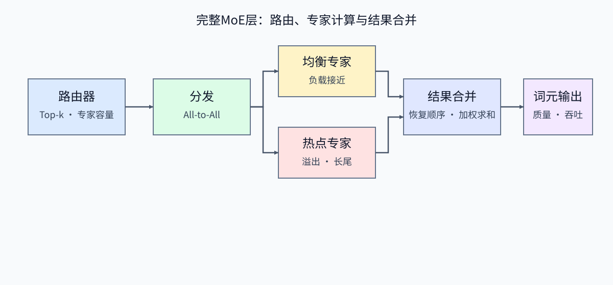
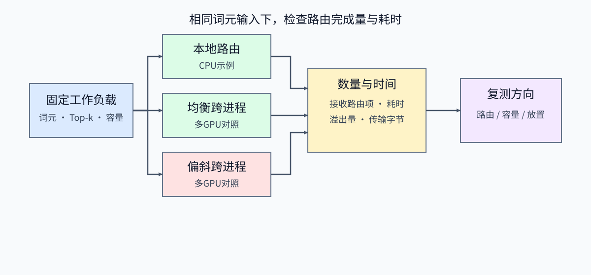

# 80. MoE Expert Parallel Benchmark | MoE 专家并行基准

**难度：** Hard | **环境：** CPU-first | **标签：** `并行通信`、`MoE`、`基准对比` | **目标人群：** 具备MoE与并行基础的读者

> 🚀 **云端运行环境**
>
> 本章节的实战代码可以点击以下链接在免费 GPU 算力平台上直接运行：
>
> [](https://colab.research.google.com/github/datawhalechina/llm-algo-leetcode/blob/main/02_PyTorch_Algorithms/80_MoE_Expert_Parallel_Benchmark.ipynb)
> [](https://modelscope.cn/my/mynotebook) *(国内推荐：魔搭社区免费实例)*


---

## 本节导读

把专家分到多张卡上后，同样数量的输入词元可能产生很不一样的耗时：均衡路由让各卡分担计算，热点路由却会使少数专家拥挤，其他设备等待。专家接收数量达到上限时，还要决定超出的分配如何处理，较短的运行时间可能只是少做了工作。

本节从词元选择专家开始，追踪跨进程分发、专家计算和结果返回，比较路由分布怎样改变通信、负载与容量溢出。先用示例记录练习筛选规则，再在多GPU实验中观察均衡与偏斜路由的真实时间和数量变化。

**关键词：** `MoE`、`expert parallel`、`routing`、`capacity`

---

## 前置阅读

先理解词元如何选择专家，以及多个进程如何接收和返回数据，再比较路由形态带来的代价。

- [06. MoE路由](./06_MoE_Router.md)：理解Top-k选择和专家权重。
- [46. MoE专家并行](./46_MoE_Expert_Parallel.md)：追踪分发、计算与结果合并。
- [47. NCCL通信分析](./47_Communication_Profiling_with_NCCL.md)：理解集合通信的计时与进程等待。

---

## Step 1：追踪词元到专家再返回的过程

MoE（混合专家）用路由器为每个输入词元选择Top-k个专家，即得分最高的k个计算分支。专家并行把专家分布到不同进程；rank是进程编号，目标专家在远端时就要传输词元状态。All-to-All（全互换）让各进程按目标分组发送数据，专家计算完成后再把结果返回来源进程。

完整MoE层还要恢复词元顺序，并按路由权重合并多个专家的结果。路由较均衡时，各进程有机会同时结束；流量集中到少数专家时，最忙的进程会拖长本轮计算。

| 路由形态 | 主要去向 | 可能增加的代价 | 观察对象 |
|---|---|---|---|
| 本地路由 | 本进程的专家 | 本地热点与容量不足 | 各专家分配量 |
| 均衡跨卡路由 | 多个进程均匀接收 | 跨卡分发与返回 | 传输字节、各进程耗时 |
| 偏斜跨卡路由 | 少数热点专家 | 容量溢出与等待 | 超额分配、最慢进程耗时 |



## Step 2：区分输入词元与专家接收的路由项

一个词元选中两个专家，会产生两个“词元—专家”路由项。例如100个词元、每个选择2个专家，总共要处理200项分配；若其中20项超过容量，接收的路由项为180，但完成的原始词元数还取决于每个词元是否保留了所需专家结果。专家容量表示单个专家本轮最多接收多少路由项，溢出表示超过这个上限的部分。

不同系统可以丢弃、重路由或延迟处理溢出项，因此比较吞吐时要先确定所计数的工作量。路由项每秒适合分析分发与专家执行，原始词元吞吐与模型质量则要在结果合并后检查。

| 数量 | 计算方式 | 解释什么 |
|---|---|---|
| 原始词元数 | 输入词元数量 | 模型收到多少输入 |
| 分配路由项数 | 词元数×每个词元选择的专家数 | 各专家合计收到多少分配 |
| 专家容量 | 单个专家允许接收的路由项上限 | 本轮可接收多少工作 |
| 溢出路由项数 | 超出各专家容量的分配之和 | 哪些分配未按原计划执行 |
| 已接收路由项数 | 总分配减去被丢弃的溢出项 | 当前丢弃策略下进入专家计算的数量 |

## Step 3：把完成数量与耗时一起比较

只有计数与计时范围相同，速率才有比较意义。偏斜路由若丢弃更多分配，运行更快未必更有效：应同时列出已接收路由项、溢出数量、分发与返回字节以及最慢进程耗时，再判断热点是否真正缓解。负载偏斜还要区分专家之间与进程之间；同一进程上的两个专家一忙一闲，进程总负载可能仍然接近其他进程。

进入完整模型后，再用恢复顺序并合并后的输出检查质量，并记录成功完成的迭代数占全部尝试的比例。分发返回实验中的形状正确、数值有限，只能检查这段计算是否正常完成；质量与原始词元吞吐需要完整模型结果。



## Step 4：比较路由记录并筛选候选

题目提供本地、均衡与偏斜三组示例记录。`effective_tokens`沿用原字段名，在本练习中表示已接收并完成专家计算的路由项数；由它除以秒数得到路由项每秒。`imbalance`为输入记录中给定的负载偏斜指标，`successful_step_ratio`为成功迭代数占尝试次数的比例；它们不是下面简化GPU实验直接生成的完整模型指标。先计算速率与基线差值，再结合容量、通信和成功比例筛选候选。

| 任务与目的 | 已知条件 | 完成标准 | 测试验证 |
|:---|:---|:---|:---|
| TODO 1：汇总完成数量与速率 | 各路由记录中的已接收路由项和耗时 | 用实际接收量计算速率，并保留通信与溢出 | 溢出后完成量与输入分配量不同 |
| TODO 2：比较候选与基线 | 本地基线与一个跨进程候选 | 计算速率、通信、偏斜、溢出和成功比例的差值 | 各项差值的单位与方向 |
| TODO 3：决定复测或调整 | 速率收益与各项阈值 | 全部满足时进入GPU复测，有收益但部分超限时调整，否则退回基线 | `ready_for_gpu / tune / reject`三条路径 |


```python
from typing import Dict, List

```


```python
def summarize_moe_parallel_runs(runs: list[dict[str, float]]) -> dict[str, object]:
    """TODO 1：汇总多种路由形态的有效工作量与系统代价。"""
    # total_effective_tokens = ???
    # mean_comm_ms = ???
    # max_overflow = ???
    # best_effective_throughput_run = ???  # effective_tokens / duration_ms * 1000
    raise NotImplementedError("请先完成 TODO 代码！")

def compare_moe_parallel_to_baseline(baseline: dict[str, float], candidate: dict[str, float]) -> dict[str, float]:
    """TODO 2：计算 candidate 相对 baseline 的收益和代价。"""
    # effective_throughput_gain = ???
    # comm_delta_ms = ???
    # overflow_delta = ???
    # imbalance_delta = ???
    raise NotImplementedError("请先完成 TODO 代码！")

def recommend_moe_parallel_run(
    baseline: dict[str, float],
    candidate: dict[str, float],
    max_imbalance: float,
    min_successful_step_ratio: float,
    max_overflow: float = 0.0,
    max_comm_increase_ms: float = 12.0,
) -> dict[str, object]:
    """TODO 3：按路由项速率、容量、通信和成功迭代比例筛选候选。"""
    # capacity_ok = ???
    # communication_ok = ???
    # decision = ???
    raise NotImplementedError("请先完成 TODO 代码！")

```


```python
# 测试你的实现
def test_moe_parallel_decision():
    """检查路由项速率、基线差值与三类候选决策。"""
    baseline = {'name': 'local', 'comm_ms': 40, 'imbalance': 0.25, 'duration_ms': 10000, 'successful_step_ratio': 0.82, 'overflow': 0, 'effective_tokens': 1000}
    candidate = {'name': 'cross_rank_balanced', 'comm_ms': 48, 'imbalance': 0.12, 'duration_ms': 8000, 'successful_step_ratio': 0.80, 'overflow': 0, 'effective_tokens': 1000}
    skewed = {'name': 'cross_rank_skewed', 'comm_ms': 47, 'imbalance': 0.72, 'duration_ms': 6000, 'successful_step_ratio': 0.80, 'overflow': 280, 'effective_tokens': 720}
    summary = summarize_moe_parallel_runs([baseline, candidate, skewed])
    assert summary['run_count'] == 3
    assert summary['best_effective_throughput_run'] == 'cross_rank_balanced'
    assert summary['total_effective_tokens'] == 2720
    assert summary['max_overflow'] == 280
    comparison = compare_moe_parallel_to_baseline(baseline, candidate)
    assert comparison['comm_delta_ms'] == 8
    assert comparison['imbalance_delta'] == -0.13
    assert comparison['effective_throughput_gain'] == 25
    assert comparison['overflow_delta'] == 0
    assert comparison['successful_step_ratio_delta'] == -0.02
    decision = recommend_moe_parallel_run(baseline, candidate, max_imbalance=0.15, min_successful_step_ratio=0.78)
    assert decision['decision'] == 'ready_for_gpu'
    assert decision['next_action'] == 'run_cluster_evaluation'
    skewed_decision = recommend_moe_parallel_run(baseline, skewed, max_imbalance=0.15, min_successful_step_ratio=0.78)
    assert skewed_decision['decision'] == 'tune'
    unstable = {**candidate, 'successful_step_ratio': 0.60}
    assert recommend_moe_parallel_run(baseline, unstable, 0.15, 0.78)['decision'] == 'reject'


test_moe_parallel_decision()
print('✅ 路由项速率、容量溢出与候选决策通过基础校验。')

```

---

🛑 **STOP HERE** 🛑
<br><br><br><br><br><br><br><br><br><br>
> 请先尝试自己完成代码并跑通测试。<br>
> 如果你正在 Colab 中运行，并且遇到困难没有思路，可以向下滚动查看参考答案。
<br><br><br><br><br><br><br><br><br><br>

---

## 参考代码与解析

### 代码


```python
def summarize_moe_parallel_runs(runs: list[dict[str, float]]) -> dict[str, object]:
    """TODO 1：汇总多种路由形态的有效工作量与系统代价。"""
    if not runs:
        return {'run_count': 0, 'total_effective_tokens': 0, 'mean_comm_ms': 0.0, 'max_overflow': 0.0, 'best_effective_throughput_run': None}
    for item in runs:
        if item.get('duration_ms', 0.0) <= 0:
            raise ValueError('duration_ms 必须大于 0')
    best = max(runs, key=lambda item: item['effective_tokens'] / item['duration_ms'])
    return {
        'run_count': len(runs),
        'total_effective_tokens': sum(item.get('effective_tokens', item.get('tokens', 0.0)) for item in runs),
        'mean_comm_ms': sum(item.get('comm_ms', 0.0) for item in runs) / len(runs),
        'max_overflow': max(item.get('overflow', 0.0) for item in runs),
        'best_effective_throughput_run': best.get('name', 'run'),
    }


def compare_moe_parallel_to_baseline(baseline: dict[str, float], candidate: dict[str, float]) -> dict[str, float]:
    """比较候选与基线，速率差单位为路由项每秒。"""
    baseline_throughput = baseline['effective_tokens'] / baseline['duration_ms'] * 1000
    candidate_throughput = candidate['effective_tokens'] / candidate['duration_ms'] * 1000
    return {
        'comm_delta_ms': candidate.get('comm_ms', 0.0) - baseline.get('comm_ms', 0.0),
        'imbalance_delta': round(candidate.get('imbalance', 0.0) - baseline.get('imbalance', 0.0), 4),
        'effective_throughput_gain': candidate_throughput - baseline_throughput,
        'overflow_delta': candidate.get('overflow', 0.0) - baseline.get('overflow', 0.0),
        'successful_step_ratio_delta': round(candidate.get('successful_step_ratio', 0.0) - baseline.get('successful_step_ratio', 0.0), 4),
    }


def recommend_moe_parallel_run(
    baseline: dict[str, float],
    candidate: dict[str, float],
    max_imbalance: float,
    min_successful_step_ratio: float,
    max_overflow: float = 0.0,
    max_comm_increase_ms: float = 12.0,
) -> dict[str, object]:
    """按速率收益及容量、通信和稳定性约束筛选候选。"""
    comparison = compare_moe_parallel_to_baseline(baseline, candidate)
    if (
        comparison['effective_throughput_gain'] > 0
        and candidate.get('imbalance', 10**9) <= max_imbalance
        and candidate.get('successful_step_ratio', -10**9) >= min_successful_step_ratio
        and candidate.get('overflow', 10**9) <= max_overflow
        and comparison['comm_delta_ms'] <= max_comm_increase_ms
    ):
        return {'decision': 'ready_for_gpu', 'reason': '示例中的路由项速率、负载、容量、通信和成功比例均达标', 'next_action': 'run_cluster_evaluation'}
    if comparison['effective_throughput_gain'] > 0 and candidate.get('successful_step_ratio', -10**9) >= min_successful_step_ratio:
        return {'decision': 'tune', 'reason': '路由项速率增加，但容量、负载或通信仍需调整', 'next_action': 'refine_router_capacity_or_placement'}
    return {'decision': 'reject', 'reason': '收益不足或成功迭代比例不达标', 'next_action': 'fallback_to_parallel_baseline'}

```

### 解析

#### TODO 1：按已完成数量计算速率

- 用`effective_tokens / duration_ms`比较各组速率，计算每秒速率时再乘1000。示例中偏斜路由只完成720个路由项，应使用720而不是原计划的1000。
- 汇总返回总完成量、平均通信时间和最大溢出量；这些值分别说明做了多少工作和付出什么代价。

#### TODO 2：保持基线差值的单位与方向

- 各项差值均为“候选减基线”：速率差为正表示增加，通信时间、偏斜和溢出差为正则表示代价增加。
- `effective_throughput_gain`是路由项每秒的绝对差。例如100增至125返回25，而不是25%的比例值。

#### TODO 3：同时满足收益与约束

- 速率增加且负载、成功比例、溢出与通信增量全部达标时返回`ready_for_gpu`；仍有收益但容量或通信需调整时返回`tune`。
- 收益不足或成功比例不足时返回`reject`。三类测试分别检查进入真实复测、调整配置和退回基线，CPU示例不产生多卡采用结论。

## Step 5：多GPU比较均衡与偏斜路由

### 5.1 环境、输入与固定条件

使用[通信与并行实验Quickstart](../topic_discussion/communication_parallelism/quickstart.md)中的`PAR-CUDA-MECHANISM`环境，至少需要两张可见CUDA GPU。实验执行All-to-All分发、每个进程的一套本地矩阵计算和All-to-All返回，比较均衡与偏斜路由。当前简化路径没有为每个专家配置独立权重，也没有恢复原词元顺序和完成Top-k加权合并；返回形状和有限值检查对应这段往返计算。

脚本已经记录各专家分配量、容量和溢出路由项。`received_tokens_per_rank`沿用原字段名，计数的是每进程接收的路由项。配置中的`EXPERTS_PER_RANK`尚未接入命令；专家总数、Top-k和容量系数采用脚本默认值，运行前应核对输出工作负载中的实际值。

| 固定对象 | 记录内容 | 作用 |
| --- | --- | --- |
| 输入 | 每进程词元数、隐藏维、精度 | 保持输入数量与张量大小一致 |
| 路由与容量 | 实际专家总数、Top-k、容量系数 | 解释接收量与溢出量 |
| 分布式执行 | 进程数、GPU、NCCL、预热与重复次数 | 比较相同硬件上的均衡与偏斜路由 |
| 输出 | 各组原始JSON与汇总JSON | 复核时间、负载、通信字节、峰值显存和失败 |


```python
# 5.1：默认关闭；真实 EP 机制基准至少需要两张 CUDA GPU。
RUN_GPU_EXPERIMENT = False
WORLD_SIZE = 2
EXPERTS_PER_RANK = 1  # 每个 rank 持有一个本地 expert；项目 backend 可扩展多个 expert。
TOKENS_PER_RANK = 256
HIDDEN_SIZE = 1024
DTYPE = 'bf16'
WARMUP = 2
REPEATS = 5
from tools.project_runtime import resolve_project_root
RESULT_DIR = resolve_project_root() / 'benchmarks/results/80_moe_dispatch'
ROUTE_MODES = ['balanced', 'skewed']  # 只改变路由负载分布。
SUMMARY_PATH = f'{RESULT_DIR}/summary.json'
print({'run': RUN_GPU_EXPERIMENT, 'world_size': WORLD_SIZE, 'experts_per_rank': EXPERTS_PER_RANK, 'route_modes': ROUTE_MODES, 'summary': SUMMARY_PATH})
REFERENCE_PATH = f'{RESULT_DIR}/summary_reference.json'  # 供 81 消费的稳定资产引用。

```

### 5.2 多卡环境预检

检查 CUDA、可见 GPU 数与 `torchrun`，再开始 all-to-all 路由实验。

```python
# 5.2：默认关闭；开启时检查多卡条件。
GPU_READY = False
if RUN_GPU_EXPERIMENT:
    import shutil, torch
    GPU_READY = torch.cuda.is_available() and torch.cuda.device_count() >= WORLD_SIZE and shutil.which('torchrun') is not None
    print({'visible_gpus': torch.cuda.device_count(), 'world_size': WORLD_SIZE, 'ready': GPU_READY})
else:
    print({'run': False, 'required_gpus': WORLD_SIZE})

```

### 5.3 核对实验组与输出路径

G0和G1运行相同分发与返回路径，只改变路由分布；本地路由是CPU示例中的对照，没有在当前GPU命令中执行。`G2`为可选完整MoE后端结果，需要提供原词元输出、质量和端到端时间。


```python
# 5.3：每组的 JSON 由 5.4 写入 RESULT_DIR；G2 留给真实 MoE backend。
EXPERIMENT_GROUPS = {'G0': 'balanced', 'G1': 'skewed', 'G2': 'real_moe_backend'}
print(EXPERIMENT_GROUPS)

```

### 5.4 执行并保存原始测量

按均衡与偏斜两组路由运行分发、计算和返回，分别保存原始JSON，再汇总结果。


```python
# 5.4：运行均匀与偏斜 EP 对照并汇总结果；默认关闭。
import subprocess
from pathlib import Path

if RUN_GPU_EXPERIMENT and GPU_READY:
    Path(RESULT_DIR).mkdir(parents=True, exist_ok=True)
    result_paths = []
    for route_mode in ROUTE_MODES:
        output = Path(RESULT_DIR) / f'{route_mode}.json'
        command = ['torchrun', '--standalone', f'--nproc_per_node={WORLD_SIZE}', 'tools/run_parallel_mechanism_benchmark.py', '--mode', 'ep_dispatch', '--routing', route_mode, '--output', str(output), '--tokens-per-rank', str(TOKENS_PER_RANK), '--hidden-dim', str(HIDDEN_SIZE), '--warmup', str(WARMUP), '--repeats', str(REPEATS), '--dtype', 'bfloat16' if DTYPE == 'bf16' else 'float32']
        print(' '.join(command))
        subprocess.run(command, check=False)
        result_paths.append(str(output))
    summary_command = ['python', 'tools/aggregate_distributed_evidence.py', '--project', '80', '--output', SUMMARY_PATH] + sum((['--input', path] for path in result_paths), [])
    subprocess.run(summary_command, check=True)
elif RUN_GPU_EXPERIMENT:
    print('多卡预检未通过；请先检查 5.2 输出。')
else:
    print('GPU benchmark 默认关闭。')

```

### 5.5 读取结果与生成来源引用

先核对两组实际输入和路由配置，再比较接收路由项、容量溢出、最慢进程耗时与跨卡字节。下方单元同时写出供下游读取的来源引用文件。


```python
# 5.5：读取项目 companion，并生成供 81 使用的稳定资产引用。
import json
from pathlib import Path

from tools.distributed_result_schema import validate_record
from tools.project_asset_relations import make_asset_reference

if Path(SUMMARY_PATH).exists():
    result = json.loads(Path(SUMMARY_PATH).read_text(encoding="utf-8"))
    errors = validate_record(result)
    if errors:
        raise ValueError("80 companion 不符合 distributed-benchmark/v1：" + "; ".join(errors))
    reference = make_asset_reference("distributed.moe_dispatch", SUMMARY_PATH)
    Path(REFERENCE_PATH).write_text(json.dumps(reference, ensure_ascii=False, indent=2), encoding="utf-8")
    print({"decision": result["decision"], "sources": len(result.get("sources", [])), "reference": REFERENCE_PATH})
else:
    print(f"尚无 dispatch companion：{SUMMARY_PATH}")

```

### 5.6 解释结果与决定复测方向

先解释更短的时间是否伴随更多溢出，再决定调整容量、路由或专家放置。当前实验的数值检查是返回形状与有限值，完整模型的输出质量需要另行对照。

| 读取项 | 判断与下一步 |
| --- | --- |
| 运行状态 | 先区分启动、显存不足与All-to-All错误 |
| 比较条件 | 核对输入数量、进程数、专家数、Top-k、容量系数和精度 |
| 负载与容量 | 同时查看各专家容量前分配量、接收路由项和溢出比例 |
| 时间与传输 | 比较最慢进程耗时、跨卡分发与往返字节、峰值显存 |
| 完整模型复测 | 恢复词元顺序并加权合并后，检查质量、成功迭代比例与原始词元吞吐，再决定是否采用 |

## 相关阅读

需要改变路由目标时回到负载均衡机制；需要比较训练状态分片时进入另一类并行基准。

- [07. MoE负载均衡损失](./07_MoE_Load_Balancing_Loss.md)：区分训练中的均衡目标与运行时专家容量。
- [79. 训练状态并行基准](./79_Distributed_Parallel_Benchmark.md)：比较参数、梯度和优化器状态的分片代价。
