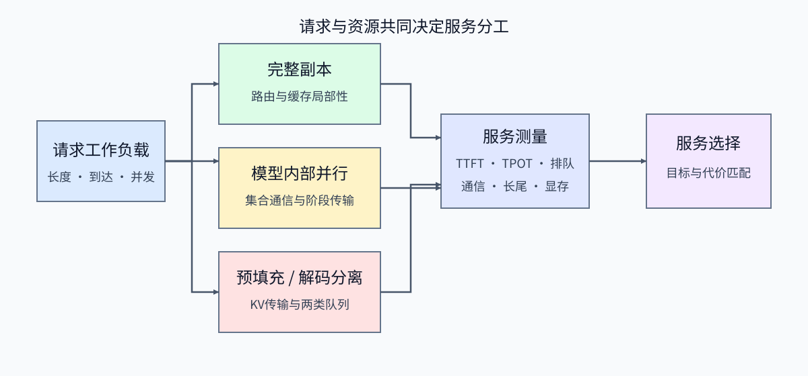
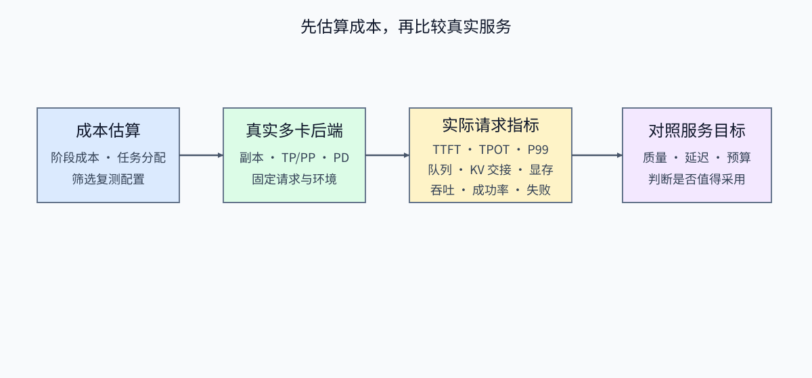

# 81. Distributed Inference Project | 分布式推理逻辑验证

**难度：** Hard | **环境：** CPU-first | **标签：** `并行通信`、`分布式推理`、`推理服务` | **目标人群：** 具备推理与并行基础的读者

> 🚀 **云端运行环境**
>
> 本章节的实战代码可以点击以下链接在免费 GPU 算力平台上直接运行：
>
> [](https://colab.research.google.com/github/datawhalechina/llm-algo-leetcode/blob/main/02_PyTorch_Algorithms/81_Distributed_Inference_Project.ipynb)
> [](https://modelscope.cn/my/mynotebook) *(国内推荐：魔搭社区免费实例)*


---

## 本节导读

请求越来越多时，增加模型副本可以分担请求，但每个副本要保存完整模型；单个模型放不下时，则需要把一次执行拆到多张卡上。长输入与持续生成争用设备时，还可以把预填充和解码分开执行，同时付出转移KV状态的成本。它们改变的是不同对象，不能仅凭GPU数更多就判断哪种更快。

本节用相同请求比较这些选择：先拆开输入处理、生成和传输时间，再观察请求如何分配以及最后一个请求何时结束。CPU估算帮助选择值得实测的配置；真正的服务比较还要测量排队、首词元、逐词元与端到端延迟。

**关键词：** `distributed inference`、`replica routing`、`model parallelism`、`KV transfer`

---

## 前置阅读

先确定单实例测什么，再区分“给请求选副本”与“把模型切到多卡”两种操作。

- [66. 推理性能对比实验](./66_Inference_Performance_Comparison.md)：确定固定请求与延迟统计范围。
- [PAR-REPLICA. 服务副本与请求路由](./PAR-REPLICA_Serving_Replica_Routing.md)：理解排队、缓存复用与副本选择。
- [87. 模型内部并行基准](./87_Model_Internal_Parallel_Benchmark.md)：核对流水、张量与上下文切分的条件。

---

## Step 1：按分工对象选择服务形态

预填充一次处理输入词元并建立KV状态，解码再逐词元生成。服务副本是可独立处理请求的一套模型实例，一个副本自身也可以跨多卡运行。增加副本主要分担请求；张量并行与流水线并行则把模型的层内计算或不同层分给多个进程，共同完成一次模型执行。

预填充—解码分离让两类工作进程分别处理输入和生成，简称PD分离。解码进程需要接收预填充产生的KV状态，即每层Key和Value缓存。分离是否合适，要比较减少的阶段争用与增加的状态传输和排队，而不是把阶段分开本身当作加速。

| 服务形态 | 分工对象 | 可能带来的收益 | 新增代价 |
|:---|:---|:---|:---|
| 完整副本路由 | 不同请求 | 分担并发请求、减少排队 | 每个副本保存模型，可能负载不均 |
| 模型内部并行实例 | 一次模型执行 | 分摊权重与计算，让大模型跨卡运行 | 进程间通信与流水等待 |
| 预填充—解码分离 | 输入与生成两个阶段 | 分别调配资源、减少阶段争用 | KV传输、两类队列与状态匹配 |



## Step 2：固定请求与资源预算再比较

比较时先使用相同的请求内容、输入长度、生成设置和到达过程。增加副本通常也增加设备投入：应同时记录总GPU数和每个实例的并行布局，区分“同设备预算下换分工”与“增加设备后扩容”。副本数相同但每个副本使用更多GPU，也不是同资源比较。

PD分离还要记录KV格式、需要传输的位置数、链路与两类工作进程的数量。相同词元数下，模型的KV头数、精度和层数会改变传输量；缓存复用、生成提前结束也会改变实际完成的计算量。

| 固定或记录的条件 | 影响什么 | 比较时怎样使用 |
|:---|:---|:---|
| 模型、分词器与精度 | 参数、输入编码与KV格式 | 固定版本与编码输入 |
| 输入、生成与停止条件 | 预填充和解码工作量 | 记录实际输入与输出长度 |
| 到达过程与并发限制 | 排队与设备竞争 | 全组使用同一请求流 |
| 总GPU数、实例数与模型切分 | 容量、通信与资源投入 | 区分等预算比较与扩容比较 |
| KV大小与交接链路 | PD状态传输 | 同时记录字节和传输耗时 |

## Step 3：区分阶段耗时与请求体验

首词元延迟TTFT从请求发出计到首个输出到达，包含网络、排队和输入处理；服务器预填充耗时只覆盖其中一部分。逐词元时间TPOT通常按首个到最后一个输出之间的时间除以输出间隔数计算，反映生成推进速度；完整解码耗时还随输出长度变化。单词元输出没有输出间隔，应按评测协议单独处理。

整批完成时间（makespan）是从本批开始到最后一个请求结束的时间；P95／P99是某个延迟分布的95%／99%分位值。比较前先说明分位数统计排队、首词元还是端到端延迟，再把吞吐与服务目标一起判断。通信活动总量和拖长请求的等待也要分别观察。

| 观察量 | 回答的问题 | 配合检查 |
|:---|:---|:---|
| TTFT与预填充耗时 | 首个输出慢在哪里 | 排队与网络时间 |
| TPOT与完整解码耗时 | 生成推进是否变慢 | 实际输出长度 |
| 排队与整批完成时间 | 副本是否有效分担请求 | 各实例忙碌时间 |
| KV交接字节与耗时 | 状态转移付出多少代价 | 对请求关键路径的影响 |
| 请求／词元吞吐与延迟分位数 | 完成更多工作是否牺牲响应速度 | 成功率、质量与设备预算 |



## Step 4：估算阶段成本并筛选复测候选

题目给出请求长度和各阶段成本系数，假设请求在起点同时可分配，按累计工作量最小的副本依次安排。生成成本按词元数线性计算；PD仅增加KV交接成本，没有模拟两个工作池的流水收益。`comm_ms_per_token`保留原参数名，实际用于输入每128词元、生成每64词元的归一化成本项，不是实测的单词元通信时间。使用这些示例假设比较整批完成时间，再检查负载与通信比例。

| 任务与目的 | 已知条件 | 完成标准 | 测试验证 |
|:---|:---|:---|:---|
| TODO 1：分开计算请求成本 | 输入／输出长度、成本系数、并行度与交接假设 | 分别计算输入处理、生成、通信、流水附加和KV交接 | 普通副本与PD附加成本 |
| TODO 2：按累计负载安排请求 | 同时到达的请求与副本数 | 选择累计负载最小副本，汇总等待和最后完成时间 | 两请求分配与交接数量 |
| TODO 3：判断是否值得实测 | 单副本总时间、候选完成时间与风险上限 | 有时间收益且条件满足时复测，部分超限时调整，无收益时退回基线 | `ready_for_gpu / tune / reject`三条路径 |


```python
from typing import Dict, List

```


```python
# 3 个核心 TODO：阶段成本估算、分布式路由模拟、迁移决策
# 目标：用同一 workload 比较副本路由与通信成本；PD handoff 的真实时间在 GPU backend 结果中验证。

def estimate_request_cost(request: Dict[str, int], config: Dict[str, float]) -> Dict[str, float]:
    """估算单请求的 Prefill、Decode 与通信代理成本。"""
    # TODO 1：分开计算预填充、逐 Token 生成、模型内部通信与可选 KV 交接代价。
    raise NotImplementedError("请先完成 TODO 代码！")

def simulate_distributed_inference(
    requests: List[Dict[str, int]], num_replicas: int, config: Dict[str, float]
) -> Dict[str, object]:
    """在 least-loaded 路由下汇总 worker 负载、队列与通信成本。"""
    # TODO 2：按最低当前负载分配请求，并保留分配、队列、通信、交接和完成时间证据。
    raise NotImplementedError("请先完成 TODO 代码！")

def recommend_distributed_inference_run(
    baseline: Dict[str, float], candidate: Dict[str, float], max_imbalance_ratio: float, max_comm_ratio: float
) -> Dict[str, object]:
    """根据时延、负载与通信代价形成下一步实验决策。"""
    # TODO 3：候选只有在完成时间改善且负载、通信风险可控时，才能进入真实多卡复测。
    raise NotImplementedError("请先完成 TODO 代码！")

```

## 测试


```python
# 测试你的实现
def test_distributed_inference_project():
    """检查阶段估算、两副本分配和三类候选判断。"""
    requests = [
        {'prompt_tokens': 128, 'generate_tokens': 64},
        {'prompt_tokens': 64, 'generate_tokens': 32},
    ]
    config = {
        'prefill_ms_per_token': 0.01,
        'decode_ms_per_token': 0.02,
        'comm_ms_per_token': 0.03,
        'pipeline_penalty_ms': 0.25,
        'tp_degree': 2,
        'pp_stages': 1,
    }

    cost = estimate_request_cost(requests[0], config)
    assert round(cost['prefill_ms'], 2) == 1.28
    assert round(cost['decode_ms'], 2) == 1.28
    assert round(cost['comm_ms'], 2) == 0.06
    assert round(cost['total_ms'], 2) == 2.62

    pd_config = {**config, 'serving_mode': 'pd_disaggregated', 'kv_bytes_per_token': 16, 'handoff_base_ms': 0.2, 'handoff_bytes_per_ms': 1024}
    pd_cost = estimate_request_cost(requests[0], pd_config)
    assert pd_cost['handoff_bytes'] == 2048
    assert round(pd_cost['handoff_ms'], 2) == 2.2
    assert round(pd_cost['total_ms'], 2) == 4.82

    summary = simulate_distributed_inference(requests, num_replicas=2, config=config)
    assert summary['routing_strategy'] == 'least_loaded'
    assert summary['assignments'] == [0, 1]
    assert round(summary['single_replica_time_ms'], 2) == 3.93
    assert round(summary['makespan_ms'], 2) == 2.62
    assert round(summary['throughput_req_per_ms'], 4) == 0.7634
    assert round(summary['imbalance_ratio'], 4) == 0.6667
    assert round(summary['comm_cost_ms'], 2) == 0.09

    pd_summary = simulate_distributed_inference(requests, num_replicas=2, config=pd_config)
    assert pd_summary['serving_mode'] == 'pd_disaggregated'
    assert pd_summary['handoff_total_bytes'] == 3072
    assert pd_summary['handoff_total_ms'] > 0

    decision = recommend_distributed_inference_run(
        {'single_replica_time_ms': 3.93},
        summary,
        max_imbalance_ratio=0.8,
        max_comm_ratio=0.05,
    )
    assert decision['decision'] == 'ready_for_gpu'
    assert decision['next_action'] == 'promote_to_real_cluster_check'

    weak_candidate = {
        'single_replica_time_ms': 3.93,
        'makespan_ms': 3.10,
        'imbalance_ratio': 0.9,
        'comm_cost_ms': 0.09,
    }
    weak_decision = recommend_distributed_inference_run(
        {'single_replica_time_ms': 3.93},
        weak_candidate,
        max_imbalance_ratio=0.8,
        max_comm_ratio=0.05,
    )
    assert weak_decision['decision'] == 'tune'

    bad_candidate = {
        'single_replica_time_ms': 3.93,
        'makespan_ms': 4.30,
        'imbalance_ratio': 1.2,
        'comm_cost_ms': 0.40,
    }
    bad_decision = recommend_distributed_inference_run(
        {'single_replica_time_ms': 3.93},
        bad_candidate,
        max_imbalance_ratio=0.8,
        max_comm_ratio=0.05,
    )
    assert bad_decision['decision'] == 'reject'


test_distributed_inference_project()
print('✅ 请求阶段成本、路由模拟与候选筛选通过基础校验。')
```

🛑 **STOP HERE** 🛑

请先尝试自己完成代码并跑通测试。如果你在 Colab 中运行，并且暂时没有思路，再继续看下面的参考答案。
## 参考代码与解析

### 代码


```python
def estimate_request_cost(request: Dict[str, int], config: Dict[str, float]) -> Dict[str, float]:
    """按给定系数估算单请求成本，PD路径额外计入KV传输。"""
    prompt_tokens = request['prompt_tokens']
    generate_tokens = request['generate_tokens']
    prefill_ms = prompt_tokens * config['prefill_ms_per_token']
    decode_ms = generate_tokens * config['decode_ms_per_token']
    comm_ms = max(config['tp_degree'] - 1, 0) * config['comm_ms_per_token'] * (
        prompt_tokens / 128.0 + generate_tokens / 64.0
    )
    pipeline_ms = max(config['pp_stages'] - 1, 0) * config['pipeline_penalty_ms']
    handoff_bytes = prompt_tokens * config.get('kv_bytes_per_token', 0.0)
    handoff_ms = 0.0
    if config.get('serving_mode', 'replica') == 'pd_disaggregated':
        handoff_ms = config.get('handoff_base_ms', 0.0) + handoff_bytes / config.get('handoff_bytes_per_ms', 1.0)
    total_ms = prefill_ms + decode_ms + comm_ms + pipeline_ms + handoff_ms
    return {
        'prefill_ms': round(prefill_ms, 4),
        'decode_ms': round(decode_ms, 4),
        'comm_ms': round(comm_ms, 4),
        'handoff_bytes': round(handoff_bytes, 4),
        'handoff_ms': round(handoff_ms, 4),
        'total_ms': round(total_ms, 4),
    }


def simulate_distributed_inference(
    requests: List[Dict[str, int]], num_replicas: int, config: Dict[str, float]
) -> Dict[str, object]:
    """假设请求同时到达，按最小累计负载分配并汇总成本。"""
    replica_loads = [0.0 for _ in range(num_replicas)]
    assignments = []
    single_replica_time_ms = 0.0
    comm_cost_ms = 0.0
    handoff_total_ms = 0.0
    handoff_total_bytes = 0.0
    queue_wait_total_ms = 0.0

    for request in requests:
        cost = estimate_request_cost(request, config)
        single_replica_time_ms += cost['total_ms']
        comm_cost_ms += cost['comm_ms']
        handoff_total_ms += cost['handoff_ms']
        handoff_total_bytes += cost['handoff_bytes']
        chosen_replica = min(range(num_replicas), key=lambda idx: replica_loads[idx])
        assignments.append(chosen_replica)
        queue_wait_total_ms += replica_loads[chosen_replica]
        replica_loads[chosen_replica] += cost['total_ms']

    makespan_ms = max(replica_loads) if replica_loads else 0.0
    throughput_req_per_ms = len(requests) / makespan_ms if makespan_ms else 0.0
    min_load = min(replica_loads) if replica_loads else 0.0
    avg_load = sum(replica_loads) / len(replica_loads) if replica_loads else 0.0
    imbalance_ratio = (makespan_ms - min_load) / avg_load if avg_load else 0.0

    return {
        'routing_strategy': 'least_loaded',
        'serving_mode': config.get('serving_mode', 'replica'),
        'assignments': assignments,
        'single_replica_time_ms': round(single_replica_time_ms, 4),
        'makespan_ms': round(makespan_ms, 4),
        'throughput_req_per_ms': round(throughput_req_per_ms, 4),
        'imbalance_ratio': round(imbalance_ratio, 4),
        'comm_cost_ms': round(comm_cost_ms, 4),
        'handoff_total_ms': round(handoff_total_ms, 4),
        'handoff_total_bytes': round(handoff_total_bytes, 4),
        'queue_wait_total_ms': round(queue_wait_total_ms, 4),
    }


def recommend_distributed_inference_run(
    baseline: Dict[str, float], candidate: Dict[str, float], max_imbalance_ratio: float, max_comm_ratio: float
) -> Dict[str, object]:
    """比较估算完成时间，返回复测、调整或退回基线的建议。"""
    baseline_time = baseline.get('single_replica_time_ms', 0.0)
    candidate_makespan = candidate.get('makespan_ms', 0.0)
    comm_ratio = candidate.get('comm_cost_ms', 0.0) / baseline_time if baseline_time else 0.0

    if (
        candidate_makespan < baseline_time
        and candidate.get('imbalance_ratio', 1.0) <= max_imbalance_ratio
        and comm_ratio <= max_comm_ratio
    ):
        return {
            'decision': 'ready_for_gpu',
            'reason': '估算完成时间下降，负载偏斜与通信比例均满足阈值',
            'next_action': 'promote_to_real_cluster_check',
        }
    if candidate_makespan < baseline_time:
        return {
            'decision': 'tune',
            'reason': '估算完成时间下降，但负载偏斜或通信比例超限',
            'next_action': 'refine_routing_or_parallel_degree',
        }
    return {
        'decision': 'reject',
        'reason': '候选的估算完成时间没有缩短',
        'next_action': 'fallback_to_single_replica_audit',
    }
```

### 解析

#### TODO 1：分别保留计算与传输成本

- 预填充和生成各按长度乘给定系数；通信项按题目约定的归一化长度与TP度数计算，流水附加项按阶段数计算。这里没有假设计算耗时随TP度数线性下降。
- PD例子用128个输入词元×16字节得到2048字节，再加固定传输开销。只增加交接费用的模型，用来检查这项代价怎样进入总时间。

#### TODO 2：累加副本工作量

- 每次选择当前累计时间最小的副本；该副本已有工作量就是本请求的预计等待。两条请求被分到不同副本时，整批完成时间取两者最大值。
- `throughput_req_per_ms`以请求／毫秒为单位；负载偏斜为“最大负载减最小负载，再除以平均负载”。到达过程变化时，需要另用在线队列模拟。

#### TODO 3：按示例阈值选择下一步

- 候选完成时间低于单副本总时间，且负载偏斜、通信比例都达标时返回`ready_for_gpu`；有时间收益但部分超限时返回`tune`，否则返回`reject`。
- 通信比例用累计通信成本除以单副本总时间，表示题目约定的筛选量。真实采用需要服务测量，不能用这个比例代替通信等待。

## Step 5：准备多副本与PD服务对照

### 5.1 环境、输入与固定条件

真实服务比较使用[通信与并行实验Quickstart](../topic_discussion/communication_parallelism/quickstart.md)中的多卡准备说明，并按所选vLLM或SGLang后端配置服务。当前各组命令为空，需先接入能够启动、压测并保存结果的命令，才能得到本节的服务测量。

G0为单副本基线，G1增加副本，G2采用PD分离。模型内部并行通过每组TP／PP布局配置，没有独立的模型并行实验组。来自其他小节的结果引用是可选对照；每组模型、请求和测量仍从本项目配置开始准备。

| 对象 | 固定或记录什么 | 用途 |
| --- | --- | --- |
| 模型与输入 | 模型／分词器版本、编码输入、精度 | 固定实际计算对象 |
| 请求流 | 输入与输出长度、到达过程、并发、预热与重复次数 | 比较同一负载 |
| 资源布局 | 实例数、TP／PP、总GPU数、PD工作池与后端 | 区分新增资源和分工变化 |
| 输出 | 每组JSON、失败信息与测量范围 | 回查原始测量 |


```python
# 5.1：默认关闭。每个服务形态各自保存 JSON，避免把副本与 PD 结果混在一起。
RUN_GPU_EXPERIMENT = False
WORLD_SIZE = 2
REPLICAS = 2
TP_DEGREE = 1
PP_STAGES = 1
# 5.3：选择已安装的服务 backend，并为每个实验组提供启动命令。
BACKEND_ADAPTER = 'vllm'  # 可改为 'sglang'；命令语法随 adapter 调整。
MODEL_ID = 'Qwen/Qwen2.5-0.5B-Instruct'
CONCURRENCY = 1
PROMPT_TOKENS = 512
MAX_TOKENS = 64
KV_BYTES_PER_TOKEN = 16384
from tools.project_runtime import resolve_project_root
RESULT_DIR = resolve_project_root() / 'benchmarks/results/81_distributed_inference'
# 为 G0/G1/G2 填入当前 backend 的启动与压测命令；每组必须写入同名 JSON。
EXPERIMENTS = [
    {'name': 'g0_single_replica', 'mode': 'replica', 'replicas': 1, 'tp': 1, 'pp': 1, 'command': []},
    {'name': 'g1_multi_replica', 'mode': 'replica', 'replicas': REPLICAS, 'tp': TP_DEGREE, 'pp': PP_STAGES, 'command': []},
    {'name': 'g2_pd_disaggregated', 'mode': 'pd_disaggregated', 'replicas': REPLICAS, 'tp': TP_DEGREE, 'pp': PP_STAGES, 'command': []},
]
print({'run': RUN_GPU_EXPERIMENT, 'world_size': WORLD_SIZE, 'backend_adapter': BACKEND_ADAPTER, 'experiments': [item['name'] for item in EXPERIMENTS]})
# 三类上游证据均为可选；本节可以独立运行，但缺失时不能形成跨策略综合结论。
TRAINING_STATE_REFERENCE = ''  # 79 生成的 project-asset-reference/v1 JSON。
MODEL_INTERNAL_REFERENCE = ''  # 87 生成的 project-asset-reference/v1 JSON。
MOE_DISPATCH_REFERENCE = ''  # 80 生成的 project-asset-reference/v1 JSON。
SCHEDULER_REFERENCE = ''  # 可选：70 生成的调度结果稳定引用。
SUMMARY_PATH = f'{RESULT_DIR}/summary.json'  # 本节 distributed-benchmark/v1 companion。

```

### 5.2 检查环境与可选来源

下方检查可见GPU与`torchrun`，并读取已填写的可选结果引用。服务启动命令、模型路径、端口和PD两端的连通性还要按后端逐项确认。


```python
# 5.2：检查多卡环境，并按配置读取稳定上游引用；不依赖其他 Notebook 内存状态。
import json
from pathlib import Path

from tools.project_asset_relations import load_asset_reference

GPU_READY = False
if RUN_GPU_EXPERIMENT:
    import shutil
    import torch
    GPU_READY = torch.cuda.is_available() and torch.cuda.device_count() >= WORLD_SIZE and shutil.which("torchrun") is not None

reference_specs = [
    ("training_state", TRAINING_STATE_REFERENCE, "PAR-DISTRIBUTED-INFERENCE"),
    ("model_internal", MODEL_INTERNAL_REFERENCE, "PAR-DISTRIBUTED-INFERENCE"),
    ("moe_dispatch", MOE_DISPATCH_REFERENCE, "PAR-DISTRIBUTED-INFERENCE"),
    ("scheduler", SCHEDULER_REFERENCE, "PAR-DISTRIBUTED-INFERENCE"),
]
UPSTREAM_EVIDENCE = {}
for name, reference_path, consumer in reference_specs:
    if not reference_path:
        continue
    reference = json.loads(Path(reference_path).read_text(encoding="utf-8"))
    UPSTREAM_EVIDENCE[name] = load_asset_reference(reference, consumer=consumer)
print({"gpu_ready": GPU_READY, "adapter": BACKEND_ADAPTER, "upstream": sorted(UPSTREAM_EVIDENCE)})

```

### 5.3 配置 G0 / G1 / G2

在每组的 `command` 中填入当前 adapter 的启动与压测命令；命令必须在对应 JSON 路径写入结果。

```python
# 5.3：命令为空时保持默认关闭；填入命令后再开启 RUN_GPU_EXPERIMENT。
for experiment in EXPERIMENTS:
    result_path = f"{RESULT_DIR}/{experiment['name']}.json"
    print({'group': experiment['name'], 'mode': experiment['mode'], 'result_path': result_path, 'command_configured': bool(experiment['command'])})

```

### 5.4 执行并保存各组结果

按G0、G1、G2执行已配置的服务命令，由命令保存对应JSON。通信与KV交接字段需要后端实际采集；不适用的字段应按结果协议表示，不用估算值填成测量值。


```python
# 5.4：按服务形态运行已配置的 backend 命令；默认关闭。
import subprocess
from pathlib import Path

if RUN_GPU_EXPERIMENT:
    Path(RESULT_DIR).mkdir(parents=True, exist_ok=True)
    for experiment in EXPERIMENTS:
        if not experiment['command']:
            raise ValueError(f"请为 {experiment['name']} 填写 backend benchmark command，并写入 {RESULT_DIR}/{experiment['name']}.json")
        subprocess.run(experiment['command'], check=True)
        result_path = Path(RESULT_DIR) / f"{experiment['name']}.json"
        if not result_path.exists():
            raise FileNotFoundError(f'真实 benchmark 未写入结果文件：{result_path}')
if not RUN_GPU_EXPERIMENT:
    print('GPU 实验默认关闭；先完成后端启动与通信预检，再采集端到端结果。')

```

### 5.5 读取各组结果并保存汇总

下方检查必需字段并写出汇总文件。当前汇总表示结果等待复核：还需要逐组核对模型版本、输入、硬件布局、指标单位和完整性，才能据此比较性能。


```python
# 5.5：校验真实服务结果，并保存统一 distributed companion。
import json
from pathlib import Path

from tools.distributed_result_schema import make_record, save_record

required_metric_fields = {
    "ttft_ms", "tpot_ms", "e2e_ms", "throughput_tokens_per_s", "p95_ms", "p99_ms",
    "queue_wait_ms", "kv_handoff_bytes", "kv_handoff_ms", "peak_memory_mb", "success_rate",
}
serving_results = []
for experiment in EXPERIMENTS:
    result_path = Path(RESULT_DIR) / f"{experiment['name']}.json"
    if not result_path.exists():
        print(f"尚无真实 backend 结果：{result_path}")
        continue
    result = json.loads(result_path.read_text(encoding="utf-8"))
    required = {"backend", "workload", "hardware", "metrics", "evidence_level", "failure", "decision"}
    missing = required - set(result)
    metric_missing = required_metric_fields - set(result.get("metrics", {}))
    if missing or metric_missing:
        raise ValueError(f"{result_path} 缺少字段：outer={sorted(missing)}, metrics={sorted(metric_missing)}")
    serving_results.append({"path": str(result_path), **result})

if serving_results:
    failures = [result for result in serving_results if result.get("failure")]
    companion = make_record(
        project="81",
        role="distributed_serving",
        workload={"model": MODEL_ID, "concurrency": CONCURRENCY, "prompt_tokens": PROMPT_TOKENS, "max_tokens": MAX_TOKENS},
        hardware={"world_size": WORLD_SIZE, "replicas": REPLICAS, "tp": TP_DEGREE, "pp": PP_STAGES},
        metrics={"result_count": len(serving_results), "upstream_reference_count": len(UPSTREAM_EVIDENCE)},
        evidence_level="real_multi_gpu_benchmark",
        failure={"failed_results": len(failures)} if failures else None,
        decision={"decision": "tune" if failures else "ready_for_review"},
        artifacts={"backend": BACKEND_ADAPTER},
        sources=serving_results,
    )
    save_record(SUMMARY_PATH, companion)
    print({"summary": SUMMARY_PATH, "decision": companion["decision"], "upstream": sorted(UPSTREAM_EVIDENCE)})
else:
    print({"summary": "pending", "upstream": sorted(UPSTREAM_EVIDENCE)})

```

### 5.6 对照服务目标决定复测方向

先确认所有计划组的结果齐全，再按相同请求与资源口径比较。下方汇总中的`ready_for_review`表示等待复核，不表示已经满足采用条件。

| 读取项 | 判断与下一步 |
| --- | --- |
| 运行状态 | 区分模型加载、端口、多卡启动和请求失败 |
| 比较条件 | 核对模型／分词器版本、编码输入、生成设置、并发与GPU布局 |
| 请求体验 | 同时比较TTFT、TPOT与明确统计对象的P95／P99 |
| 成本与工作量 | 查看实际输出、吞吐、显存、排队与KV传输 |
| 采用判断 | 质量、成功率与延迟目标满足后，再比较吞吐和资源成本；否则调整布局或保留原服务 |

## 相关阅读

需要拆解某一项代价时，回到直接测量该对象的小节。

- [70. 推理服务调度基准](./70_Serving_Scheduler_Benchmark.md)：比较请求到达、排队与调度。
- [PAR-REPLICA. 服务副本与请求路由](./PAR-REPLICA_Serving_Replica_Routing.md)：解释缓存复用与额外等待的取舍。
- [87. 模型内部并行基准](./87_Model_Internal_Parallel_Benchmark.md)：核对模型切分布局和候选条件。
