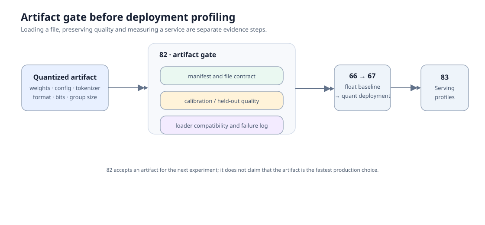
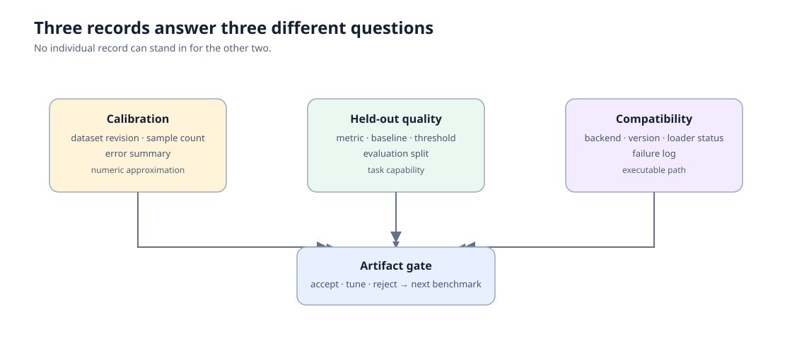

# 82. Quantization Artifact Evaluation Project | 量化产物评估项目

**难度：** Hard | **环境：** CPU 可完成门禁逻辑；单张 NVIDIA GPU 完成真实 vLLM 加载 | **标签：** `量化产物`, `加载门禁`, `部署准入` | **目标人群：** 项目决策练习者

> 🚀 **云端运行环境**
>
> 本章节的实战代码可以点击以下链接在免费 GPU 算力平台上直接运行：
>
> [](https://colab.research.google.com/github/datawhalechina/llm-algo-leetcode/blob/main/02_PyTorch_Algorithms/82_Quantization_Artifact_Evaluation_Project.ipynb)
> [](https://modelscope.cn/my/mynotebook) *(国内推荐：魔搭社区免费实例)*


---

## 本节导读

量化权重、配置和分词器文件能够保存下来，并不表示它们已经成为可部署产物。文件可能不完整，校准与评测数据可能重叠，质量记录可能方向错误，目标执行后端也可能无法加载该格式。

本项目把这些风险整理成一条产物准入链：先核对候选包的身份、文件和独立评测证据，再用真实加载结果补齐执行证据。通过的候选交给 67 做浮点—量化配对部署；本节不比较服务压力，也不作跨策略采用判断。

**关键词：** `候选包`、`产物清单`、`独立评测`、`加载门禁`、`证据等级`

---

## 前置阅读

- [40 GPTQ / AWQ 权重量化](40_GPTQ_and_AWQ_Weight_Quantization.md)：生成本项目读取的标准量化候选包，并记录模型、数据、质量和文件身份。

### Step 1：量化候选包如何描述一个可审计产物

量化候选包把基座模型、量化方式、数据来源、独立质量结果和实际文件绑定到同一个稳定身份。审计从这份候选包开始，而不是从目录名或某个权重文件推断产物内容。

| 候选包区域 | 必须保留的信息 | 门禁要排除的问题 |
| --- | --- | --- |
| 产物身份 | 唯一产物身份、基座模型及不可变版本 | 产物与基座来源无法追溯 |
| 量化配置 | 方法、格式、位宽、分组大小、工具版本 | loader 无法判断格式或配置不完整 |
| 数据证据 | 校准集与评测集的版本、划分、样本哈希 | 数据泄漏或质量口径漂移 |
| 文件清单 | 权重、配置、分词器、文件大小与哈希 | 文件缺失、被替换或内容损坏 |
| 质量结果 | 指标、方向、基线、候选值与阈值 | 把低值更优的指标按相反方向判断 |



### Step 2：静态契约、独立质量与真实加载分别证明什么

产物准入需要三类相互独立的证据。静态契约确认候选包与文件可追溯；独立质量确认量化后的能力仍在阈值内；真实加载确认目标执行后端能够读取同一份产物并完成最小往返生成。任一证据缺失，都不能由另外两类代替。

| 证据层 | 输入 | 通过条件 | 失败含义 |
| --- | --- | --- | --- |
| 静态契约 | 身份、量化配置、文件清单与哈希 | 必填身份完整，文件存在且哈希一致 | 产物不可复核或已经损坏 |
| 数据与质量 | 校准/评测身份、指标方向、基线与候选值 | 两组数据隔离，质量门槛通过 | 质量结论存在泄漏或退化超限 |
| 真实加载 | 执行后端版本、加载状态、往返生成与显存 | 加载成功、生成非空、无运行失败 | 格式或运行环境与目标执行后端不兼容 |



### Step 3：门禁状态如何决定候选的下一步

门禁按顺序消费三层证据。静态契约或独立质量失败时直接拒绝候选；尚未执行真实加载时保持待验证；加载成功但超过可选显存预算时继续调整；三层证据全部通过后，候选只获得进入部署基准实验的资格。

| 当前状态 | 项目判断 | 下一步动作 |
| --- | --- | --- |
| 契约、哈希或质量证据失败 | `reject` | 修复产物或重新量化、评测 |
| CPU 门禁通过，尚无真实加载记录 | `pending` | 在登记环境中执行 loader adapter |
| 加载成功，但超过项目显存预算 | `tune` | 调整产物、加载参数或预算后复测 |
| 契约、质量、加载与预算全部通过 | `accept` | 进入同工作负载的浮点—量化部署对照 |

### Step 4：实现候选契约、证据隔离与准入决策

本题使用一份简化候选包和一份 loader 结果复现项目门禁。骨架负责字段读取、原子检查和问题列表；你需要组合候选契约、独立证据、真实加载与显存预算，形成阶段化准入状态。

| 任务与目的 | 已知条件 | 完成标准 | 测试验证 |
| --- | --- | --- | --- |
| TODO 1：组合候选契约门禁 | 已计算的身份、量化配置和文件完整性 | 三项条件使用合取关系形成总状态 | 缺少分词器或文件哈希均失败 |
| TODO 2：组合独立证据门禁 | 已计算的数据划分、样本身份和质量状态 | 三项条件使用合取关系形成总状态 | 重叠数据和质量失败分别被识别 |
| TODO 3：真实加载与预算决策。把 CPU 门禁状态升级为项目采用建议 | 两项 CPU 检查、loader 结果和可选显存上限 | 输出 `pending / reject / tune / accept` 及原因 | 未执行、加载失败、超预算和通过四条路径 |


```python
from typing import Any, Dict

```


```python
def _positive_int(value: Any) -> bool:
    """给定实现：判断配置值能否解释为正整数。"""
    try:
        return int(value) > 0
    except (TypeError, ValueError):
        return False


# TODO 1：判断候选包是否具备稳定身份、量化配置和完整文件角色。
def validate_candidate_contract(candidate: Dict[str, Any]) -> Dict[str, Any]:
    """检查候选包静态契约，不访问文件系统或启动 backend。"""
    model = candidate.get("model", {})
    quantization = candidate.get("quantization", {})
    files = candidate.get("files", {})

    identity_ready = all((
        candidate.get("schema_version") == "quantization-artifact-candidate/v1",
        candidate.get("artifact_id"), model.get("id"), model.get("revision"),
    ))
    quantization_ready = all((
        quantization.get("method"), quantization.get("format"),
        _positive_int(quantization.get("bits")), _positive_int(quantization.get("group_size")),
    ))
    inventory = files.get("inventory", [])
    files_ready = bool(
        files.get("weights") and files.get("config") and files.get("tokenizer")
        and inventory and all(item.get("path") and item.get("sha256") for item in inventory)
    )
    # contract_ready = ???  # 身份、量化配置和文件清单必须全部通过，不能互相替代。
    if "contract_ready" not in locals():
        raise NotImplementedError("TODO 1：请完成候选契约的合取规则")
    issues = []
    if not identity_ready:
        issues.append("identity")
    if not quantization_ready:
        issues.append("quantization")
    if not files_ready:
        issues.append("files")
    return {
        "ready": contract_ready,
        "identity_ready": identity_ready,
        "quantization_ready": quantization_ready,
        "files_ready": files_ready,
        "issues": issues,
    }


# TODO 2：判断校准与评测是否隔离，并核对带方向的质量证据。
def evaluate_candidate_evidence(candidate: Dict[str, Any]) -> Dict[str, Any]:
    """检查数据隔离与质量结论，不重新计算量化指标。"""
    calibration = candidate.get("calibration", {})
    evaluation = candidate.get("evaluation", {})

    split_isolated = bool(
        calibration.get("split") and evaluation.get("split")
        and calibration["split"] != evaluation["split"]
    )
    sample_ids_isolated = bool(
        calibration.get("sample_ids_hash") and evaluation.get("sample_ids_hash")
        and calibration["sample_ids_hash"] != evaluation["sample_ids_hash"]
    )
    direction = evaluation.get("direction")
    baseline_value = evaluation.get("baseline_value")
    candidate_value = evaluation.get("candidate_value")
    values_ready = all(
        isinstance(value, (int, float)) and value > 0
        for value in (baseline_value, candidate_value)
    )
    observed_ratio = candidate_value / baseline_value if values_ready else None
    quality_limit = (
        evaluation.get("max_degradation_ratio")
        if direction == "lower_is_better"
        else evaluation.get("min_retention_ratio")
    )
    # TODO 2：按指标方向复核质量门槛，再组合独立证据门禁。
    # quality_ready = ???  # lower 指标不超过上限；higher 指标不低于下限；声明状态也必须通过。
    # evidence_ready = ???  # 数据划分、样本身份和质量门槛必须全部通过。
    if not all(name in locals() for name in ("quality_ready", "evidence_ready")):
        raise NotImplementedError("TODO 2：请完成方向化质量检查与独立证据门禁")
    issues = []
    if not split_isolated:
        issues.append("split_overlap")
    if not sample_ids_isolated:
        issues.append("sample_overlap")
    if not quality_ready:
        issues.append("quality")
    return {
        "ready": evidence_ready,
        "split_isolated": split_isolated,
        "sample_ids_isolated": sample_ids_isolated,
        "quality_ready": quality_ready,
        "issues": issues,
    }


# TODO 3：根据 CPU 门禁、真实加载和显存预算形成项目判断。
def decide_artifact_adoption(
    contract_check: Dict[str, Any],
    evidence_check: Dict[str, Any],
    loader_result: Dict[str, Any] | None,
    *,
    max_memory_mb: float = 0.0,
) -> Dict[str, str]:
    """决定候选应拒绝、待验证、继续调整，还是进入部署基准实验。"""
    if not contract_check.get("ready") or not evidence_check.get("ready"):
        issues = [*contract_check.get("issues", []), *evidence_check.get("issues", [])]
        return {"decision": "reject", "reason": "; ".join(issues)}
    if loader_result is None:
        return {"decision": "pending", "reason": "CPU 门禁已通过，尚未执行真实 loader"}

    roundtrip = loader_result.get("roundtrip_quality", {})
    peak_memory_mb = loader_result.get("peak_memory_mb")
    # loader_ready = ???  # backend 已加载、没有失败，且所有固定提示都生成非空结果。
    # memory_ready = ???  # 预算为 0 时只记录；否则峰值显存必须存在且不超过预算。
    if not all(name in locals() for name in ("loader_ready", "memory_ready")):
        raise NotImplementedError("TODO 3：请完成加载与显存预算判断")
    if not loader_ready:
        return {"decision": "reject", "reason": "真实 loader 未完成加载与往返生成"}
    if not memory_ready:
        return {"decision": "tune", "reason": "加载成功，但峰值显存超过项目预算"}
    return {"decision": "accept", "reason": "候选可进入浮点—量化部署基准实验"}

```


```python
def _candidate_fixture() -> Dict[str, Any]:
    """构造三个测试共同使用的完整候选包。"""
    return {
        "schema_version": "quantization-artifact-candidate/v1",
        "artifact_id": "toy-gptq-v1",
        "model": {"id": "toy/base", "revision": "abc123"},
        "quantization": {"method": "gptq", "format": "pack-quantized", "bits": 4, "group_size": 128},
        "calibration": {"split": "train", "sample_ids_hash": "cal-hash"},
        "evaluation": {
            "split": "validation",
            "sample_ids_hash": "eval-hash",
            "direction": "lower_is_better",
            "baseline_value": 10.0,
            "candidate_value": 10.5,
            "max_degradation_ratio": 1.10,
            "passed": True,
        },
        "files": {"weights": ["model.safetensors"], "config": "config.json", "tokenizer": ["tokenizer.json"], "inventory": [{"path": "model.safetensors", "sha256": "hash"}]},
    }


def test_candidate_contract() -> None:
    """验证 TODO 1：完整身份与文件角色通过，缺少分词器时失败。"""
    candidate = _candidate_fixture()
    assert validate_candidate_contract(candidate)["ready"]
    incomplete = {**candidate, "files": {**candidate["files"], "tokenizer": []}}
    result = validate_candidate_contract(incomplete)
    assert not result["ready"] and "files" in result["issues"]
    bad_inventory = {**candidate, "files": {**candidate["files"], "inventory": [{"path": "model.safetensors"}]}}
    assert not validate_candidate_contract(bad_inventory)["ready"]


def test_candidate_evidence() -> None:
    """验证 TODO 2：数据隔离和带方向质量证据必须同时成立。"""
    candidate = _candidate_fixture()
    assert evaluate_candidate_evidence(candidate)["ready"]
    overlapping = {**candidate, "evaluation": {**candidate["evaluation"], "split": "train", "sample_ids_hash": "cal-hash"}}
    assert not evaluate_candidate_evidence(overlapping)["ready"]
    failed_quality = {
        **candidate,
        "evaluation": {**candidate["evaluation"], "candidate_value": 12.0},
    }
    assert not evaluate_candidate_evidence(failed_quality)["ready"]
    higher_is_better = {
        **candidate,
        "evaluation": {
            **candidate["evaluation"],
            "direction": "higher_is_better",
            "candidate_value": 9.6,
            "min_retention_ratio": 0.95,
        },
    }
    assert evaluate_candidate_evidence(higher_is_better)["ready"]


def test_adoption_decision() -> None:
    """验证 TODO 3：未执行、加载失败、超预算和通过形成不同状态。"""
    ready = {"ready": True, "issues": []}
    loader = {
        "load_status": "loaded",
        "roundtrip_quality": {"non_empty_generations": 2, "prompt_count": 2},
        "peak_memory_mb": 1200.0,
        "failure": None,
    }
    assert decide_artifact_adoption(ready, ready, None)["decision"] == "pending"
    assert decide_artifact_adoption(ready, ready, {**loader, "load_status": "failed"})["decision"] == "reject"
    assert decide_artifact_adoption(ready, ready, loader, max_memory_mb=1000)["decision"] == "tune"
    assert decide_artifact_adoption(ready, ready, loader, max_memory_mb=1500)["decision"] == "accept"
    assert decide_artifact_adoption(ready, ready, loader, max_memory_mb=0)["decision"] == "accept"


test_candidate_contract()
test_candidate_evidence()
test_adoption_decision()
print("测试通过：候选契约、数据与质量证据、真实加载决策相互一致。")

```

---

🛑 **STOP HERE** 🛑
<br><br><br><br><br><br><br><br><br><br>
> 请先尝试自己完成代码并跑通测试。<br>
> 如果遇到困难，可以继续向下查看参考代码与解析。
<br><br><br><br><br><br><br><br><br><br>

---

## 参考代码与解析

### 参考代码


```python
from typing import Any, Dict


def _positive_int(value: Any) -> bool:
    """给定实现：判断配置值能否解释为正整数。"""
    try:
        return int(value) > 0
    except (TypeError, ValueError):
        return False


def validate_candidate_contract(candidate: Dict[str, Any]) -> Dict[str, Any]:
    """TODO 1：检查候选包的稳定身份、量化配置和文件角色。"""
    model = candidate.get("model", {})
    quantization = candidate.get("quantization", {})
    files = candidate.get("files", {})

    identity_ready = all((
        candidate.get("schema_version") == "quantization-artifact-candidate/v1",
        candidate.get("artifact_id"),
        model.get("id"),
        model.get("revision"),
    ))
    quantization_ready = all((
        quantization.get("method"),
        quantization.get("format"),
        _positive_int(quantization.get("bits")),
        _positive_int(quantization.get("group_size")),
    ))
    inventory = files.get("inventory", [])
    files_ready = all((
        files.get("weights"),
        files.get("config"),
        files.get("tokenizer"),
        inventory,
        all(item.get("path") and item.get("sha256") for item in inventory),
    ))
    contract_ready = identity_ready and quantization_ready and files_ready
    issues = []
    if not identity_ready:
        issues.append("identity")
    if not quantization_ready:
        issues.append("quantization")
    if not files_ready:
        issues.append("files")
    return {
        "ready": contract_ready,
        "identity_ready": identity_ready,
        "quantization_ready": quantization_ready,
        "files_ready": files_ready,
        "issues": issues,
    }


def evaluate_candidate_evidence(candidate: Dict[str, Any]) -> Dict[str, Any]:
    """TODO 2：检查校准/评测隔离和带方向的质量结论。"""
    calibration = candidate.get("calibration", {})
    evaluation = candidate.get("evaluation", {})

    split_isolated = bool(
        calibration.get("split")
        and evaluation.get("split")
        and calibration["split"] != evaluation["split"]
    )
    sample_ids_isolated = bool(
        calibration.get("sample_ids_hash")
        and evaluation.get("sample_ids_hash")
        and calibration["sample_ids_hash"] != evaluation["sample_ids_hash"]
    )
    direction = evaluation.get("direction")
    baseline_value = evaluation.get("baseline_value")
    candidate_value = evaluation.get("candidate_value")
    values_ready = all(
        isinstance(value, (int, float)) and value > 0
        for value in (baseline_value, candidate_value)
    )
    observed_ratio = candidate_value / baseline_value if values_ready else None
    quality_limit = (
        evaluation.get("max_degradation_ratio")
        if direction == "lower_is_better"
        else evaluation.get("min_retention_ratio")
    )
    # TODO 2：按指标方向复核质量门槛，再组合独立证据门禁。
    quality_ready = bool(
        evaluation.get("passed") is True
        and isinstance(quality_limit, (int, float))
        and observed_ratio is not None
        and (
            (direction == "lower_is_better" and observed_ratio <= quality_limit)
            or (direction == "higher_is_better" and observed_ratio >= quality_limit)
        )
    )
    evidence_ready = split_isolated and sample_ids_isolated and quality_ready
    issues = []
    if not split_isolated:
        issues.append("split_overlap")
    if not sample_ids_isolated:
        issues.append("sample_overlap")
    if not quality_ready:
        issues.append("quality")
    return {
        "ready": evidence_ready,
        "split_isolated": split_isolated,
        "sample_ids_isolated": sample_ids_isolated,
        "quality_ready": quality_ready,
        "issues": issues,
    }


def decide_artifact_adoption(
    contract_check: Dict[str, Any],
    evidence_check: Dict[str, Any],
    loader_result: Dict[str, Any] | None,
    *,
    max_memory_mb: float = 0.0,
) -> Dict[str, str]:
    """TODO 3：把 CPU 门禁与真实加载证据组合成项目判断。"""
    if not contract_check.get("ready") or not evidence_check.get("ready"):
        issues = [*contract_check.get("issues", []), *evidence_check.get("issues", [])]
        return {"decision": "reject", "reason": "; ".join(issues)}
    if loader_result is None:
        return {"decision": "pending", "reason": "CPU 门禁已通过，尚未执行真实 loader"}

    roundtrip = loader_result.get("roundtrip_quality", {})
    loader_ready = all((
        loader_result.get("load_status") == "loaded",
        not loader_result.get("failure"),
        roundtrip.get("prompt_count", 0) > 0,
        roundtrip.get("non_empty_generations") == roundtrip.get("prompt_count"),
    ))
    peak_memory_mb = loader_result.get("peak_memory_mb")
    memory_ready = max_memory_mb <= 0 or (
        peak_memory_mb is not None and float(peak_memory_mb) <= max_memory_mb
    )
    if not loader_ready:
        return {"decision": "reject", "reason": "真实 loader 未完成加载与往返生成"}
    if not memory_ready:
        return {"decision": "tune", "reason": "加载成功，但峰值显存超过项目预算"}
    return {"decision": "accept", "reason": "候选可进入浮点—量化部署基准实验"}

```

### 解析

本题依次完成候选契约准入、数据与质量证据隔离，以及真实加载后的项目决策。答案保留题目区的接口和控制流，只补全对应门禁判断。

**TODO 1：判断候选契约是否完整**

- 骨架已给出身份、量化配置和文件完整性三个原子状态；实现只需使用合取关系形成候选总门禁。
- `test_candidate_contract` 分别破坏分词器角色和文件哈希，验证任一静态证据缺失都会阻止准入。

**TODO 2：隔离校准数据与独立评测证据**

- 数据划分隔离、样本身份隔离和质量通过缺一不可；TODO 只组合门禁，不要求重新拼装问题列表。
- `test_candidate_evidence` 用数据重叠与质量失败验证两类问题不会被总状态掩盖。

**TODO 3：用真实加载结果升级 CPU 门禁**

- CPU 检查通过但没有 loader 记录时只能得到 `pending`；加载失败应拒绝，加载成功但超预算应继续调整。
- 答案同时检查加载状态、非空往返生成、失败记录和可选显存预算；`test_adoption_decision` 覆盖四条项目状态路径。

### Step 5（项目实验）：验证量化产物

读取 40 生成的 GPTQ 候选包，依次核对文件、离线质量和 vLLM 加载结果。通过后生成供 67 使用的稳定引用。

#### 5.1 本次运行配置

填写本次检查标签、阶段和 40 节运行标签，按 `prepare → measure → close` 运行。本节从 40 的结果记录自动定位获选候选包，无需复制路径。


```python
RUN_LABEL = 'replace_with_unique_label'
RUN_STAGE = 'prepare'  # prepare / measure / close
UPSTREAM_RUN_LABEL = 'default11'  # 40 节已完成 real_gpu 的 RUN_LABEL；复测时填写对应标签。

```

#### 5.2 固定候选包与环境预检

检查环境配置、候选包、文件哈希和目标路径。`prepare` 不启动 vLLM、不写结果。


```python
if RUN_STAGE not in {'prepare', 'measure', 'close'}:
    raise ValueError(f'未知 RUN_STAGE: {RUN_STAGE}')
if RUN_STAGE != 'prepare' and RUN_LABEL == 'replace_with_unique_label':
    raise ValueError('measure / close 需要唯一 RUN_LABEL。')

SEMANTIC_ID = "QUANT-ARTIFACT-GATE"
RESULT_SCHEMA = "quantization-evidence/v1"
ENVIRONMENT_PROFILE = "INF-VLLM-011-CU128"  # 固定 Profile；必须先通过同名环境预检。
LOADER_MAX_MODEL_LEN = 512  # vLLM 最大上下文长度；单位为 Token。
LOADER_MAX_TOKENS = 16  # 每条固定提示的最大生成长度；单位为 Token。
GPU_MEMORY_UTILIZATION = 0.75  # vLLM 可用显存比例；12 GiB GPU 默认保留 25% 余量。
MAX_MEMORY_MB = 0.0  # 默认值 0：只记录峰值显存；大于 0 时启用预算门禁。

import json
import subprocess
import sys
from pathlib import Path

from tools.project_runtime import resolve_project_root
from tools.quantization_runtime import validate_candidate_bundle
from tools.quantization_project_runtime import (
    decide_artifact_adoption, evaluate_candidate_evidence, validate_candidate_contract,
)

REPO_ROOT = resolve_project_root()
SOURCE_RESULT_PATH = REPO_ROOT / f"benchmarks/results/40_llmcompressor_gptq_awq_{UPSTREAM_RUN_LABEL}.json"
RESULT_DIR = REPO_ROOT / "benchmarks/results/82_quantization_artifact_evaluation"
LOADER_RESULT_PATH = RESULT_DIR / f"loader_{RUN_LABEL}.json"
source_result = None
source_result_issue = None
candidate_bundle_path = None
if not SOURCE_RESULT_PATH.is_file():
    source_result_issue = f"找不到 40 节结果：{SOURCE_RESULT_PATH}；请先完成 40 节 real_gpu。"
else:
    try:
        source_result = json.loads(SOURCE_RESULT_PATH.read_text(encoding="utf-8"))
    except (OSError, json.JSONDecodeError) as exc:
        source_result_issue = f"无法读取 40 节结果：{exc}"
if source_result is not None:
    if source_result.get("run_label") != UPSTREAM_RUN_LABEL:
        source_result_issue = "40 节结果中的 RUN_LABEL 与 UPSTREAM_RUN_LABEL 不一致。"
    elif source_result.get("decision") != "accept_weight_ptq_candidate":
        source_result_issue = "40 节尚未选出可交付候选；先处理该节的决策结果。"
    else:
        selected_name = source_result.get("mechanism_metrics", {}).get("selected_candidate")
        if selected_name not in source_result.get("candidates", {}):
            source_result_issue = "40 节结果没有有效的获选候选名称。"
        else:
            candidate_bundle_path = (
                REPO_ROOT / "benchmarks/artifacts/40_gptq_awq" / UPSTREAM_RUN_LABEL
                / selected_name / "candidate_bundle.json"
            )

profile_process = subprocess.run(
    [sys.executable, str(REPO_ROOT / "tools/environment_preflight.py"), "--profile", ENVIRONMENT_PROFILE],
    cwd=REPO_ROOT,
    capture_output=True,
    text=True,
)
try:
    profile_report = json.loads(profile_process.stdout)
except json.JSONDecodeError:
    profile_report = {"ready": False, "reasons": [profile_process.stderr.strip() or "环境预检没有返回 JSON"]}

candidate_bundle = (
    json.loads(candidate_bundle_path.read_text(encoding="utf-8"))
    if candidate_bundle_path is not None and candidate_bundle_path.is_file()
    else None
)
bundle_validation = (
    validate_candidate_bundle(candidate_bundle, project_root=REPO_ROOT)
    if candidate_bundle is not None
    else {"ready": False, "issues": [source_result_issue or "找不到 candidate_bundle.json；检查 40 节产物目录。"], "artifact_path": None}
)

preflight_issues = []
if RUN_STAGE not in {'prepare', 'measure', 'close'}:
    preflight_issues.append("RUN_STAGE 必须是 prepare、measure 或 close")
if not profile_report.get("ready"):
    preflight_issues.extend(profile_report.get("reasons", ["环境 Profile 未通过"]))
if source_result_issue:
    preflight_issues.append(source_result_issue)
if not bundle_validation.get("ready"):
    preflight_issues.extend(bundle_validation.get("issues", []))

expected_outputs = [
    LOADER_RESULT_PATH,
    RESULT_DIR / f"82_artifact_gate_{RUN_LABEL}.json",
    RESULT_DIR / f"82_artifact_gate_{RUN_LABEL}_companion.json",
    RESULT_DIR / f"82_artifact_gate_{RUN_LABEL}_reference.json",
]
if RUN_STAGE == 'measure':
    collisions = [str(path) for path in expected_outputs if path.exists()]
    if collisions:
        preflight_issues.append(f"RUN_LABEL 已存在结果: {collisions}")

preflight = {
    "ready": not preflight_issues,
    "issues": preflight_issues,
    "profile": ENVIRONMENT_PROFILE,
    "artifact_id": (candidate_bundle or {}).get("artifact_id"),
    "artifact_path": bundle_validation.get("artifact_path"),
}
print(json.dumps(preflight, ensure_ascii=False, indent=2))

```

#### 5.3 候选合同与离线质量门禁

将候选包映射为产物身份、校准/评测隔离和质量方向；真实加载前保持 `pending`。


```python
if candidate_bundle is None:
    candidate_contract = {"ready": False, "issues": ["candidate_bundle_not_configured"]}
    candidate_evidence = {"ready": False, "issues": ["candidate_bundle_not_configured"]}
    cpu_decision = {
        "decision": "pending",
        "reason": "先完成 40 节 real_gpu，并在 5.1 填写对应的 UPSTREAM_RUN_LABEL。",
    }
else:
    candidate_contract = validate_candidate_contract(candidate_bundle)
    candidate_evidence = evaluate_candidate_evidence(candidate_bundle)
    cpu_decision = decide_artifact_adoption(
        candidate_contract,
        candidate_evidence,
        None,
        max_memory_mb=MAX_MEMORY_MB,
    )

print({
    "contract": candidate_contract,
    "evidence": candidate_evidence,
    "cpu_decision": cpu_decision,
})

```

#### 5.4 执行真实加载

`measure` 启动 vLLM，验证非空往返生成并保存加载记录、证据记录和稳定引用；其他阶段跳过后端。


```python
from tools.project_adapters import CommandExecutionAdapter
from tools.project_asset_relations import make_asset_reference
from tools.quantization_result_schema import artifact_gate_record, save_record
from tools.project_runtime import save_json_record_once

loader_result = None
raw_path = RESULT_DIR / f"82_artifact_gate_{RUN_LABEL}.json"
artifact_gate_path = RESULT_DIR / f"82_artifact_gate_{RUN_LABEL}_companion.json"
asset_reference_path = RESULT_DIR / f"82_artifact_gate_{RUN_LABEL}_reference.json"

if RUN_STAGE == 'measure':
    if preflight_issues:
        raise RuntimeError("预检未通过：" + "; ".join(preflight_issues))
    adapter = CommandExecutionAdapter(
        name="vllm-artifact-loader",
        command=(
            sys.executable,
            str(REPO_ROOT / "tools/validate_quantized_artifact.py"),
            "--artifact", str(bundle_validation["artifact_path"]),
            "--output", str(LOADER_RESULT_PATH),
            "--max-model-len", str(LOADER_MAX_MODEL_LEN),
            "--max-tokens", str(LOADER_MAX_TOKENS),
            "--gpu-memory-utilization", str(GPU_MEMORY_UTILIZATION),
        ),
        output_path=LOADER_RESULT_PATH,
    )
    adapter_check = adapter.preflight({})
    if not adapter_check.get("ready"):
        raise RuntimeError(adapter_check.get("reason", "loader adapter 不可用"))
    loader_result = dict(adapter.run({}))

    project_decision = decide_artifact_adoption(
        candidate_contract,
        candidate_evidence,
        loader_result,
        max_memory_mb=MAX_MEMORY_MB,
    )
    quality_record = {
        **candidate_bundle["evaluation"],
        "eval_split": candidate_bundle["evaluation"]["split"],
        "peak_memory_mb": loader_result.get("peak_memory_mb"),
        "roundtrip_quality": loader_result.get("roundtrip_quality"),
    }
    compatibility = {
        "backend": "vllm",
        "version": loader_result.get("backend_version"),
        "loader_status": loader_result.get("load_status"),
        "kernel": loader_result.get("kernel"),
        "fallback": loader_result.get("fallback"),
        "failure": loader_result.get("failure"),
    }
    gate = {
        "ready": project_decision["decision"] == "accept",
        "issues": [] if project_decision["decision"] == "accept" else [project_decision["reason"]],
        "evidence_level": "real_project_benchmark",
    }
    raw_payload = {
        "schema_version": RESULT_SCHEMA, "semantic_id": SEMANTIC_ID, "run_label": RUN_LABEL,
        "config": {"run_label": RUN_LABEL, "environment_profile": ENVIRONMENT_PROFILE, "backend": "vllm"},
        "manifest": candidate_bundle,
        "quality": quality_record,
        "compatibility": compatibility,
        "hardware": loader_result.get("hardware", {}),
        "gate": gate,
    }
    RESULT_DIR.mkdir(parents=True, exist_ok=True)
    save_json_record_once(raw_path, raw_payload)
    save_record(artifact_gate_path, artifact_gate_record(raw_payload))
    asset_reference = make_asset_reference("quantization.artifact_gate", artifact_gate_path)
    save_json_record_once(asset_reference_path, asset_reference)

print({
    "loader_result": str(LOADER_RESULT_PATH) if loader_result else None,
    "companion": str(artifact_gate_path) if artifact_gate_path.is_file() else None,
    "reference": str(asset_reference_path) if asset_reference_path.is_file() else None,
})


```

#### 5.5 核对加载证据

读取当前标签的证据记录，核对产物身份、质量方向、后端、峰值显存和失败状态。


```python
from tools.project_contracts import load_record

gate_record = load_record(artifact_gate_path) if artifact_gate_path and artifact_gate_path.is_file() else None
evidence_summary = None
if gate_record is not None:
    evidence_summary = {
        "artifact_id": gate_record["artifact"]["artifact_id"],
        "model_revision": gate_record["artifact"]["model_revision"],
        "quality_metric": gate_record["quality"]["metric_name"],
        "quality_direction": gate_record["quality"]["direction"],
        "quality_passed": gate_record["quality"]["passed"],
        "backend": gate_record["backend"],
        "peak_memory_mb": gate_record["metrics"]["peak_memory_mb"],
        "failure": gate_record["failure"],
        "evidence_level": gate_record["evidence_level"],
    }
print(evidence_summary or {"status": "pending", "next_action": "set RUN_STAGE='measure' and run Step 5"})

```

#### 5.6 形成产物准入结论

`close` 读取已保存的证据记录；只有契约、质量和真实加载都通过时才允许交给 67。


```python
if RUN_STAGE == 'close':
    if gate_record is None:
        adoption = {
            "decision": "pending",
            "reason": "尚无真实 loader companion",
            "next_action": "run_real_backend",
        }
    else:
        decision = gate_record.get("decision", {}).get("decision", "reject")
        adoption = {
            "decision": decision,
            "reason": gate_record.get("decision", {}).get("reason"),
            "next_action": "consume_reference_in_deployment_benchmark" if decision == "accept" else "repair_and_rerun",
        }
    print(adoption)
else:
    print(f'跳过收口：RUN_STAGE={RUN_STAGE}')

```

## 相关阅读

- [vLLM Quantization](https://docs.vllm.ai/en/latest/features/quantization/)：核对目标版本支持的量化格式与限制。
- [Compressed Tensors](https://github.com/vllm-project/compressed-tensors)：理解候选产物中的压缩配置与序列化格式。
- [Safetensors](https://huggingface.co/docs/safetensors/index)：了解权重文件及其元数据格式。
