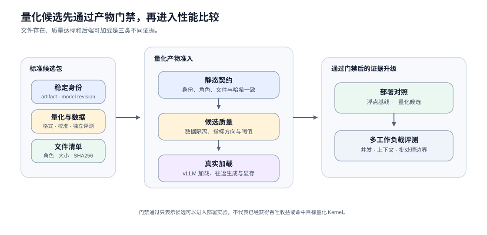
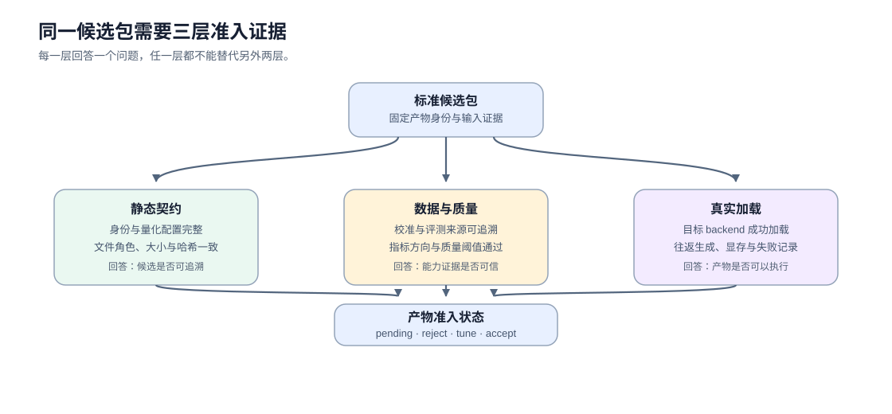

# 82. Quantization Artifact Evaluation Project | 量化产物评估项目

**难度：** Hard | **环境：** [CPU 练习，NVIDIA GPU 实验](#runtime-environment) | **标签：** `量化产物`、`加载门禁`、`部署准入` | **目标人群：** 理解量化产物与质量指标的读者

> 🚀 **云端运行环境**
>
> 本章节的实战代码可以点击以下链接在免费 GPU 算力平台上直接运行：
>
> [](https://colab.research.google.com/github/datawhalechina/llm-algo-leetcode/blob/main/02_PyTorch_Algorithms/82_Quantization_Artifact_Evaluation_Project.ipynb)
> [](https://modelscope.cn/my/mynotebook) *(国内推荐：魔搭社区免费实例)*


---

## 本节导读

量化权重、配置和分词器文件能够保存下来，并不表示它们已经成为可部署产物。文件可能不完整，校准与评测数据可能重叠，质量记录可能方向错误，目标执行后端也可能无法加载该格式。

本项目把这些风险整理成一条产物准入链：先核对候选包的身份、文件和独立评测证据，再用真实加载结果补齐执行证据。通过的候选交给 67 做浮点—量化配对部署；真实加载通过后，再比较部署代价和服务负载收益。

**关键词：** `候选包`、`产物清单`、`独立评测`、`加载门禁`、`证据等级`

---

<a id="runtime-environment"></a>

## 运行环境

- **CPU 练习：** 使用 [`BASE-CPU`](../guide.md#base-cpu)，核对候选声明、质量方向与准入状态。
- **真实加载：** 使用 [`INF-VLLM-011-CU128`](../topic_discussion/quantization_compression/quickstart.md#q-vllm-quickstart)，需要单张兼容的 NVIDIA GPU；输入来自40节生成的本地候选包。
- **结果与交接：** [Step 5](#gpu-experiment)按 prepare、measure、close 执行；默认 prepare 不启动模型或后端。

## 前置阅读

先了解量化候选怎样生成，再检查它是否具备进入部署对照的证据。

- [40 GPTQ / AWQ 权重量化](40_GPTQ_and_AWQ_Weight_Quantization.md)：生成本项目读取的标准量化候选包，并记录模型、数据、质量和文件身份。

## Step 1：量化候选包如何描述一个可审计产物

量化候选包把基座模型、量化方式、数据来源、候选评测结果和实际文件绑定到同一个稳定身份。审计从这份候选包开始，而不是从目录名或某个权重文件推断产物内容。

| 候选包区域 | 必须保留的信息 | 门禁要排除的问题 |
| --- | --- | --- |
| 产物身份 | 唯一产物身份、基座模型及不可变版本 | 产物与基座来源无法追溯 |
| 量化配置 | 方法、格式、位宽、分组大小、工具版本 | loader 无法判断格式或配置不完整 |
| 数据证据 | 校准集与评测集的版本、划分、样本哈希 | 数据泄漏或质量口径漂移 |
| 文件清单 | 权重、配置、分词器、文件大小与哈希 | 文件缺失、被替换或内容损坏 |
| 质量结果 | 指标、方向、基线、候选值与阈值 | 把低值更优的指标按相反方向判断 |



## Step 2：静态契约、候选质量与真实加载分别证明什么

产物准入需要三类证据。静态契约确认候选包与文件可追溯；质量记录确认候选在所声明评测和门槛下的表现；真实加载确认目标后端能够读取同一份产物并完成最小往返生成。数据划分名称与样本摘要用于追溯抽样：摘要不同仅说明记录不同，不能证明集合无交集；这里复核登记的同一数据快照和不同划分，跨划分重复内容还需另查。

上游40节的验证集已用于选择候选，因此本项目复核的是候选选择证据，不是新的独立测试集质量。质量值必须有限，并按指标方向重算比率；非空生成只说明往返调用成功，不能替代任务质量或量化内核取证。

| 证据层 | 输入 | 通过条件 | 失败含义 |
| --- | --- | --- | --- |
| 静态契约 | 身份、量化配置、文件清单与哈希 | 必填身份完整，文件存在且哈希一致 | 产物不可复核或已经损坏 |
| 数据与质量 | 校准/评测身份、指标方向、基线与候选值 | 登记快照与划分可追溯，数值有限且重算门槛通过 | 质量结论存在泄漏或退化超限 |
| 真实加载 | 执行后端版本、加载状态、往返生成与显存 | 加载成功、生成非空、无运行失败 | 格式或运行环境与目标执行后端不兼容 |



## Step 3：门禁状态如何决定候选的下一步

门禁按顺序消费三层证据。静态契约或候选质量失败时直接拒绝候选；尚未执行真实加载时保持待验证；已启用预算却缺少有效测量时继续等待证据，记录超出预算时再调整；三层证据全部通过后，候选只获得进入部署基准实验的资格。

| 当前状态 | 项目判断 | 下一步动作 |
| --- | --- | --- |
| 契约、哈希或质量证据失败 | `reject` | 修复产物或重新量化、评测 |
| CPU 门禁通过，尚无真实加载记录 | `pending` | 在登记环境中执行 loader adapter |
| 已启用预算但缺少有效显存记录 | `pending` | 补充符合预算计量范围的记录 |
| 加载成功，但有效记录超过预算 | `tune` | 调整产物、加载参数或预算后复测 |
| 契约、质量、加载与预算全部通过 | `accept` | 进入同工作负载的浮点—量化部署对照 |

## Step 4：实现候选契约、证据隔离与准入决策

本题使用一份简化候选包和一份 loader 结果复现项目门禁。骨架负责字段读取、原子检查和问题列表；你需要组合候选契约、独立证据、真实加载与显存预算，形成阶段化准入状态。

| 任务与目的 | 已知条件 | 完成标准 | 测试验证 |
| --- | --- | --- | --- |
| TODO 1：组合候选契约门禁 | 已计算的身份、量化配置和文件完整性 | 三项条件使用合取关系形成总状态 | 缺少分词器或文件哈希均失败 |
| TODO 2：组合独立证据门禁 | 已计算的数据划分、样本身份和质量状态 | 三项条件使用合取关系形成总状态 | 重叠数据和质量失败分别被识别 |
| TODO 3：真实加载与预算决策。把 CPU 门禁状态升级为项目采用建议 | 两项 CPU 检查、loader 结果和可选显存上限 | 输出 `pending / reject / tune / accept` 及原因 | 未执行、加载失败、超预算和通过四条路径 |


```python
from typing import Any, Dict
from tools.quantization_project_runtime import (
    candidate_contract_facts, candidate_evidence_facts, artifact_loader_facts,
)

```


```python
def validate_candidate_contract(candidate: Dict[str, Any]) -> Dict[str, Any]:
    """TODO 1：组合身份、量化配置和文件角色门槛；不访问真实文件。"""
    facts = candidate_contract_facts(candidate)
    identity_ready, quantization_ready, files_ready = (facts[key] for key in ('identity_ready', 'quantization_ready', 'files_ready'))
    # TODO 1：组合静态门槛。
    # contract_ready = ???  # 三类声明都满足，不能互相替代。
    raise NotImplementedError('请完成 TODO 1：contract_ready')
    return {'ready': contract_ready, **facts}


def evaluate_candidate_evidence(candidate: Dict[str, Any]) -> Dict[str, Any]:
    """TODO 2：按指标方向重算质量，并核对登记的数据划分。"""
    facts = candidate_evidence_facts(candidate)
    split_isolated = facts['split_isolated']
    sample_hashes_distinct = facts['sample_hashes_distinct']
    direction, ratio, limit = facts['direction'], facts['observed_ratio'], facts['quality_limit']
    # TODO 2：质量数值先通过有限性和一致性检查，再按指标方向比较。
    # quality_ready = ???   # 声明通过、数值有效，且比率满足所声明方向的门槛。
    # evidence_ready = ???  # 登记划分、样本摘要与质量判断同时成立。
    raise NotImplementedError('请完成 TODO 2：quality_ready、evidence_ready')
    issues = [name for name, ready in (('split_overlap', split_isolated), ('sample_identity_missing_or_equal', sample_hashes_distinct), ('quality', quality_ready)) if not ready]
    return {'ready': evidence_ready, **facts, 'quality_ready': quality_ready, 'issues': issues}


def decide_artifact_adoption(contract_check: Dict[str, Any], evidence_check: Dict[str, Any], loader_result: Dict[str, Any] | None, *, max_memory_mb: float = 0.0) -> Dict[str, str]:
    """TODO 3：组合真实加载和预算，缺测与超预算形成不同状态。"""
    if contract_check.get('ready') is not True or evidence_check.get('ready') is not True:
        issues = [*contract_check.get('issues', []), *evidence_check.get('issues', [])]
        return {'decision': 'reject', 'reason': '; '.join(issues) or '静态或质量门禁未通过'}
    if loader_result is None:
        return {'decision': 'pending', 'reason': 'CPU 门禁已通过，尚未执行真实加载'}
    facts = artifact_loader_facts(loader_result, max_memory_mb)
    # TODO 3：组合加载与资源判断，缺测分支由骨架保留为 pending。
    # loader_ready = ???  # 加载完成，且全部固定提示都返回非空生成。
    # memory_ready = ???  # 预算合法，且未启用上限或有效记录没有超预算。
    raise NotImplementedError('请完成 TODO 3：loader_ready、memory_ready')
    if not loader_ready:
        return {'decision': 'reject', 'reason': '真实加载与往返生成未完成'}
    if not facts['budget_valid'] or (not facts['memory_missing'] and not facts['memory_valid']):
        return {'decision': 'reject', 'reason': '显存预算或测量数值无效'}
    if max_memory_mb > 0 and facts['memory_missing']:
        return {'decision': 'pending', 'reason': '已启用预算但尚无有效显存证据'}
    if not memory_ready:
        return {'decision': 'tune', 'reason': '加载成功，但显存记录超过预算'}
    return {'decision': 'accept', 'reason': '候选可进入浮点—量化部署基准实验'}

```


```python
def _candidate_fixture() -> Dict[str, Any]:
    """构造三个测试共同使用的完整候选包。"""
    return {
        "schema_version": "quantization-artifact-candidate/v1",
        "artifact_id": "toy-gptq-v1",
        "model": {"id": "toy/base", "revision": "abc123"},
        "quantization": {"method": "gptq", "format": "pack-quantized", "bits": 4, "group_size": 128},
        "calibration": {"dataset": "toy/data", "revision": "data-v1", "split": "train", "sample_ids_hash": "cal-hash"},
        "evaluation": {
            "dataset": "toy/data", "revision": "data-v1",
            "split": "validation",
            "sample_ids_hash": "eval-hash",
            "direction": "lower_is_better",
            "baseline_value": 10.0,
            "candidate_value": 10.5,
            "max_degradation_ratio": 1.10,
            "passed": True,
        },
        "files": {"weights": ["model.safetensors"], "config": "config.json", "tokenizer": ["tokenizer.json"], "inventory": [{"path": name, "sha256": "a" * 64} for name in ("model.safetensors", "config.json", "tokenizer.json")]},
    }


def test_candidate_contract() -> None:
    """验证 TODO 1：完整身份与文件角色通过，缺少分词器时失败。"""
    candidate = _candidate_fixture()
    assert validate_candidate_contract(candidate)["ready"]
    incomplete = {**candidate, "files": {**candidate["files"], "tokenizer": []}}
    result = validate_candidate_contract(incomplete)
    assert not result["ready"] and "files" in result["issues"]
    bad_inventory = {**candidate, "files": {**candidate["files"], "inventory": [{"path": "model.safetensors"}]}}
    assert not validate_candidate_contract(bad_inventory)["ready"]


def test_candidate_evidence() -> None:
    """验证 TODO 2：数据隔离和带方向质量证据必须同时成立。"""
    candidate = _candidate_fixture()
    assert evaluate_candidate_evidence(candidate)["ready"]
    overlapping = {**candidate, "evaluation": {**candidate["evaluation"], "split": "train", "sample_ids_hash": "cal-hash"}}
    assert not evaluate_candidate_evidence(overlapping)["ready"]
    failed_quality = {
        **candidate,
        "evaluation": {**candidate["evaluation"], "candidate_value": 12.0},
    }
    assert not evaluate_candidate_evidence(failed_quality)["ready"]
    higher_is_better = {
        **candidate,
        "evaluation": {
            **candidate["evaluation"],
            "direction": "higher_is_better",
            "candidate_value": 9.6,
            "min_retention_ratio": 0.95,
        },
    }
    assert evaluate_candidate_evidence(higher_is_better)["ready"]


def test_adoption_decision() -> None:
    """验证 TODO 3：未执行、加载失败、超预算和通过形成不同状态。"""
    ready = {"ready": True, "issues": []}
    loader = {
        "load_status": "loaded",
        "roundtrip_quality": {"non_empty_generations": 2, "prompt_count": 2},
        "peak_memory_mb": 1200.0,
        "failure": None,
    }
    assert decide_artifact_adoption(ready, ready, None)["decision"] == "pending"
    assert decide_artifact_adoption(ready, ready, {**loader, "load_status": "failed"})["decision"] == "reject"
    assert decide_artifact_adoption(ready, ready, loader, max_memory_mb=1000)["decision"] == "tune"
    assert decide_artifact_adoption(ready, ready, loader, max_memory_mb=1500)["decision"] == "accept"
    assert decide_artifact_adoption(ready, ready, loader, max_memory_mb=0)["decision"] == "accept"


def test_invalid_numbers_roles_and_evidence_scope() -> None:
    """缺少角色清单、非整数配置与非有限质量不能进入真实加载。"""
    candidate = _candidate_fixture()
    for bad_bits in (True, 4.5, '4'):
        assert not validate_candidate_contract({**candidate, 'quantization': {**candidate['quantization'], 'bits': bad_bits}})['ready']
    missing = {**candidate, 'files': {**candidate['files'], 'inventory': candidate['files']['inventory'][:1]}}
    assert not validate_candidate_contract(missing)['ready']
    for value in (float('nan'), float('inf'), True):
        evidence = {**candidate, 'evaluation': {**candidate['evaluation'], 'direction': 'higher_is_better', 'candidate_value': value, 'min_retention_ratio': .95}}
        assert not evaluate_candidate_evidence(evidence)['ready']
    zero = {**candidate, 'evaluation': {**candidate['evaluation'], 'candidate_value': 0.0}}
    assert evaluate_candidate_evidence(zero)['ready']
    stale_ratio = {**candidate, 'evaluation': {**candidate['evaluation'], 'ratio_vs_baseline': .5}}
    assert not evaluate_candidate_evidence(stale_ratio)['ready']
    checked = evaluate_candidate_evidence(candidate)
    assert checked['sample_hashes_distinct'] and checked['sample_disjointness_proven'] is False
    foreign = {**candidate, 'evaluation': {**candidate['evaluation'], 'revision': 'other'}}
    assert not evaluate_candidate_evidence(foreign)['ready']


def test_missing_memory_and_invalid_roundtrip() -> None:
    """缺测不伪装超预算，布尔计数和非有限预算不能通过。"""
    ready = {'ready': True, 'issues': []}
    loader = {'load_status': 'loaded', 'roundtrip_quality': {'prompt_count': 2, 'non_empty_generations': 2}, 'peak_memory_mb': None, 'failure': None}
    assert decide_artifact_adoption(ready, ready, loader, max_memory_mb=1000)['decision'] == 'pending'
    assert decide_artifact_adoption(ready, ready, loader, max_memory_mb=float('nan'))['decision'] == 'reject'
    invalid = {**loader, 'roundtrip_quality': {'prompt_count': True, 'non_empty_generations': True}}
    assert decide_artifact_adoption(ready, ready, invalid)['decision'] == 'reject'


test_candidate_contract()
test_candidate_evidence()
test_adoption_decision()
test_invalid_numbers_roles_and_evidence_scope()
test_missing_memory_and_invalid_roundtrip()
print("测试通过：候选契约、数据与质量证据、真实加载决策相互一致。")

```

---

🛑 **STOP HERE** 🛑
<br><br><br><br><br><br><br><br><br><br>
> 请先尝试自己完成代码并跑通测试。<br>
> 如果遇到困难，可以继续向下查看参考代码与解析。
<br><br><br><br><br><br><br><br><br><br>

---

## 参考代码与解析

### 参考代码


```python
def validate_candidate_contract(candidate: Dict[str, Any]) -> Dict[str, Any]:
    """TODO 1：组合身份、量化配置和文件角色门槛；不访问真实文件。"""
    facts = candidate_contract_facts(candidate)
    identity_ready, quantization_ready, files_ready = (facts[key] for key in ('identity_ready', 'quantization_ready', 'files_ready'))
    contract_ready = identity_ready and quantization_ready and files_ready
    return {'ready': contract_ready, **facts}


def evaluate_candidate_evidence(candidate: Dict[str, Any]) -> Dict[str, Any]:
    """TODO 2：按指标方向重算质量，并核对登记的数据划分。"""
    facts = candidate_evidence_facts(candidate)
    split_isolated = facts['split_isolated']
    sample_hashes_distinct = facts['sample_hashes_distinct']
    direction, ratio, limit = facts['direction'], facts['observed_ratio'], facts['quality_limit']
    quality_ready = bool(facts['quality_inputs_ready'] and (
        (direction == 'lower_is_better' and ratio <= limit)
        or (direction == 'higher_is_better' and ratio >= limit)
    ))
    evidence_ready = split_isolated and sample_hashes_distinct and quality_ready
    issues = [name for name, ready in (('split_overlap', split_isolated), ('sample_identity_missing_or_equal', sample_hashes_distinct), ('quality', quality_ready)) if not ready]
    return {'ready': evidence_ready, **facts, 'quality_ready': quality_ready, 'issues': issues}


def decide_artifact_adoption(contract_check: Dict[str, Any], evidence_check: Dict[str, Any], loader_result: Dict[str, Any] | None, *, max_memory_mb: float = 0.0) -> Dict[str, str]:
    """TODO 3：组合真实加载和预算，缺测与超预算形成不同状态。"""
    if contract_check.get('ready') is not True or evidence_check.get('ready') is not True:
        issues = [*contract_check.get('issues', []), *evidence_check.get('issues', [])]
        return {'decision': 'reject', 'reason': '; '.join(issues) or '静态或质量门禁未通过'}
    if loader_result is None:
        return {'decision': 'pending', 'reason': 'CPU 门禁已通过，尚未执行真实加载'}
    facts = artifact_loader_facts(loader_result, max_memory_mb)
    loader_ready = facts['load_complete'] and facts['roundtrip_complete']
    memory_ready = facts['budget_valid'] and (max_memory_mb == 0 or facts['memory_within_budget'])
    if not loader_ready:
        return {'decision': 'reject', 'reason': '真实加载与往返生成未完成'}
    if not facts['budget_valid'] or (not facts['memory_missing'] and not facts['memory_valid']):
        return {'decision': 'reject', 'reason': '显存预算或测量数值无效'}
    if max_memory_mb > 0 and facts['memory_missing']:
        return {'decision': 'pending', 'reason': '已启用预算但尚无有效显存证据'}
    if not memory_ready:
        return {'decision': 'tune', 'reason': '加载成功，但显存记录超过预算'}
    return {'decision': 'accept', 'reason': '候选可进入浮点—量化部署基准实验'}

```

### 解析

本题依次完成候选契约准入、数据与质量证据隔离，以及真实加载后的项目决策。声明检查与磁盘文件校验分别执行，不能把清单存在当成内容哈希已经核对。

#### TODO 1：判断候选契约是否完整

- 骨架已给出身份、量化配置和文件完整性三个原子状态；实现只需使用合取关系形成候选总门禁。
- `test_candidate_contract` 分别破坏分词器角色和文件哈希，验证任一静态证据缺失都会阻止准入。

#### TODO 2：隔离校准数据与独立评测证据

- 登记快照、不同划分与样本摘要可追溯，质量值有限且按方向通过；TODO 只组合门禁，不要求重新拼装问题列表。
- `test_candidate_evidence` 用数据重叠与质量失败验证两类问题不会被总状态掩盖。

#### TODO 3：用真实加载结果升级 CPU 门禁

- CPU 检查通过但没有 loader 记录时只能得到 `pending`；加载失败应拒绝，已启用预算却缺测应保持 pending，有效记录超预算才是 tune。
- 答案同时检查加载状态、非空往返生成、失败记录和可选显存预算；`test_adoption_decision` 覆盖四条项目状态路径。

<a id="gpu-experiment"></a>

## Step 5：验证量化产物并生成部署准入记录

使用40节获选候选的同一份文件和质量记录，先检查内容身份，再执行vLLM最小往返生成。`prepare`只读预检，`measure`保存加载与原始准入证据，`close`重读证据并生成报告、登记回执；只有接受的报告才交给部署对照。

| CPU 练习 | 真实环境补充 | 项目输出 |
|---|---|---|
| 组合候选声明、质量方向与准入状态 | 磁盘内容哈希、固定vLLM调用与非空生成 | 原始加载记录、准入报告、登记回执；接受时生成稳定引用 |

### 5.1 本次运行配置

真实加载使用 [`INF-VLLM-011-CU128`](../topic_discussion/quantization_compression/quickstart.md#q-vllm-quickstart)。准备40节的获选候选及对应结果，再填写唯一上游标签，按 `prepare → measure → close` 分阶段顺序运行本节；`close`无需重新启动GPU或后端。


```python
RUN_LABEL = 'replace_with_unique_label'  # 本次82节标签；measure/close前填写，已有不同内容时不得覆盖。
RUN_STAGE = 'prepare'  # prepare只读；measure执行或恢复采集；close校验并补齐报告与交接。
UPSTREAM_RUN_LABEL = 'replace_with_upstream_label'  # 40节已完成real_gpu并接受候选的RUN_LABEL；只配置这一份直接来源。

```

### 5.2 固定合同、来源与环境预检

从公共运行合同解析路径和固定加载参数，检查40节的获选身份、数据与质量声明、候选包和实际文件哈希。来源缺失或JSON损坏时输出具体原因。只有新`measure`才执行环境GPU预检；`prepare`和`close`不初始化设备。


```python
import importlib
import json
import subprocess
import sys

from tools.project_runtime import resolve_project_root
import tools.quantization_project_runtime as quantization_project

# 集中刷新公共模块；后续从模块对象取函数，避免热Kernel继续使用旧绑定。
quantization_project = importlib.reload(quantization_project)
plan = quantization_project.artifact_gate_plan(
    resolve_project_root(), RUN_LABEL, UPSTREAM_RUN_LABEL, RUN_STAGE,
)
prepared = quantization_project.prepare_artifact_gate(plan)
profile_report = {'status': 'not_requested', 'ready': None}
gpu_preflight_executed = False
preflight_issues = list(prepared['issues'])
if RUN_STAGE == 'measure' and prepared['ready'] and not plan['loader_path'].exists():
    gpu_preflight_executed = True
    try:
        process = subprocess.run(
            [sys.executable, str(plan['root'] / 'tools/environment_preflight.py'),
             '--profile', plan['contract']['environment_profile']],
            cwd=plan['root'], capture_output=True, text=True, timeout=60,
        )
        profile_report = json.loads(process.stdout)
        if not isinstance(profile_report, dict):
            raise ValueError('环境预检输出必须是JSON对象')
        if process.returncode != 0 or profile_report.get('ready') is not True:
            preflight_issues.extend(profile_report.get('reasons') or ['环境Profile未通过'])
    except (OSError, ValueError, subprocess.TimeoutExpired) as error:
        preflight_issues.append(f'环境预检失败：{error}')
preflight = {'ready': not preflight_issues, 'issues': preflight_issues,
             'profile': plan['contract']['environment_profile'],
             'gpu_preflight_executed': gpu_preflight_executed,
             'inputs': prepared['snapshot']}
print(json.dumps(preflight, ensure_ascii=False, indent=2))

```

### 5.3 候选与质量门槛

复核登记的数据快照、不同划分与样本摘要，再按指标方向重算质量。40节验证集已参与候选选择，这里不把它当作新的独立任务测试；真实加载前的判断保持`pending`。


```python
if prepared['ready']:
    candidate_contract = quantization_project.validate_candidate_contract(prepared['bundle'])
    candidate_evidence = quantization_project.evaluate_candidate_evidence(prepared['bundle'])
    cpu_decision = quantization_project.decide_artifact_adoption(candidate_contract, candidate_evidence, None)
else:
    candidate_contract = {'ready': False, 'issues': prepared['issues']}
    candidate_evidence = {'ready': False, 'issues': prepared['issues']}
    cpu_decision = {'decision': 'pending', 'reason': '先按5.2的问题修复来源'}
print({'contract': candidate_contract, 'evidence': candidate_evidence, 'decision': cpu_decision})

```

### 5.4 执行或恢复加载采集

`measure`执行固定vLLM调用，只保存加载记录和原始准入证据。已有同身份加载记录时复用，不再次启动后端；若在生成原始准入记录前中断，可用相同配置继续。兼容字段`peak_memory_mb`是设备空闲显存差，不是过程峰值，当前合同不启用峰值预算。


```python
if RUN_STAGE == 'measure':
    if not preflight['ready']:
        raise RuntimeError('预检未通过：' + '; '.join(preflight['issues']))
    if plan['loader_path'].exists():
        loader_result = json.loads(plan['loader_path'].read_text(encoding='utf-8'))
    else:
        invocation = quantization_project.artifact_loader_invocation(plan, prepared)
        command = [
            sys.executable, str(plan['root'] / 'tools/validate_quantized_artifact.py'),
            '--artifact', prepared['snapshot']['artifact_path'], '--output', str(plan['loader_path']),
            '--invocation-json', json.dumps(invocation, ensure_ascii=False),
            '--max-model-len', str(plan['contract']['max_model_len']),
            '--max-tokens', str(plan['contract']['max_tokens']),
            '--gpu-memory-utilization', str(plan['contract']['gpu_memory_utilization']),
        ]
        completed = subprocess.run(command, cwd=plan['root'], capture_output=True, text=True)
        if plan['loader_path'].is_file():
            loader_result = json.loads(plan['loader_path'].read_text(encoding='utf-8'))
        else:
            loader_result = {
                'schema_version': 'quantization-artifact-loader/v2', 'backend': 'vllm',
                'invocation': invocation, 'status': 'failed', 'load_status': 'failed',
                'failure': {'stage': 'loader_process', 'returncode': completed.returncode,
                            'reason': completed.stderr[-2000:] or '后端未生成完整加载记录'},
            }
    measurement = quantization_project.save_artifact_gate_measurement(plan, prepared, loader_result)
    print(measurement)
else:
    print({'status': 'skipped', 'stage': RUN_STAGE, 'reason': '本阶段不执行真实加载'})

```

### 5.5 只读核对已保存证据

按当前标签重新定位记录，核对上游与候选包SHA256、实际文件、固定调用、加载记录、质量判断和准入结论；已有报告、交接与回执也须一致。读取不重建候选、不改写文件；缺少测量时显示待采集，身份冲突则停止。


```python
if prepared['ready']:
    checked = quantization_project.read_artifact_gate(plan)
else:
    checked = {'status': 'blocked', 'decision': {'decision': 'pending'}, 'issues': prepared['issues']}
print({'status': checked['status'], 'decision': checked['decision'],
       'evidence': checked.get('summary'), 'issues': checked.get('issues', []),
       'next_action': checked.get('next_action')})

```

### 5.6 形成结论、登记与交接

`close`重新校验磁盘证据，再生成准入报告和登记回执；`accept`才生成供67消费的稳定引用。同标签内容一致时只读复用，中断后补齐缺失资产；已有内容不一致时停止，不覆盖历史记录。

| 已核对的证据 | 决策 | 下一动作 |
|---|---|---|
| 尚无完整测量 | pending | 执行measure；若已有加载记录则复用恢复 |
| 契约、质量或真实加载未通过 | reject | 保留失败报告与回执，修复后使用新标签 |
| 加载完成但有效资源记录超过门槛 | tune | 检查资源条件；当前合同未启用峰值预算 |
| 契约、质量与真实加载全部通过 | accept | 生成稳定引用，进入浮点／量化部署对照 |

**当前登记结果**：尚无本项目真实加载结果；本轮仅完成文档、CPU与临时目录中的运行流程测试，不登记GPU标签或采用结论。正式状态见[实验资产表](../topic_discussion/quantization_compression/experiment_assets.md#项目验证顺序)。


```python
if RUN_STAGE == 'close':
    registration = quantization_project.close_artifact_gate(plan)
    print(registration)
else:
    print({'status': 'skipped', 'stage': RUN_STAGE, 'reason': '只有close生成最终报告、交接和登记回执'})

```

## 相关阅读

- [vLLM Quantization](https://docs.vllm.ai/en/latest/features/quantization/)：核对目标版本支持的量化格式与限制。
- [Compressed Tensors](https://github.com/vllm-project/compressed-tensors)：理解候选产物中的压缩配置与序列化格式。
- [Safetensors](https://huggingface.co/docs/safetensors/index)：了解权重文件及其元数据格式。
