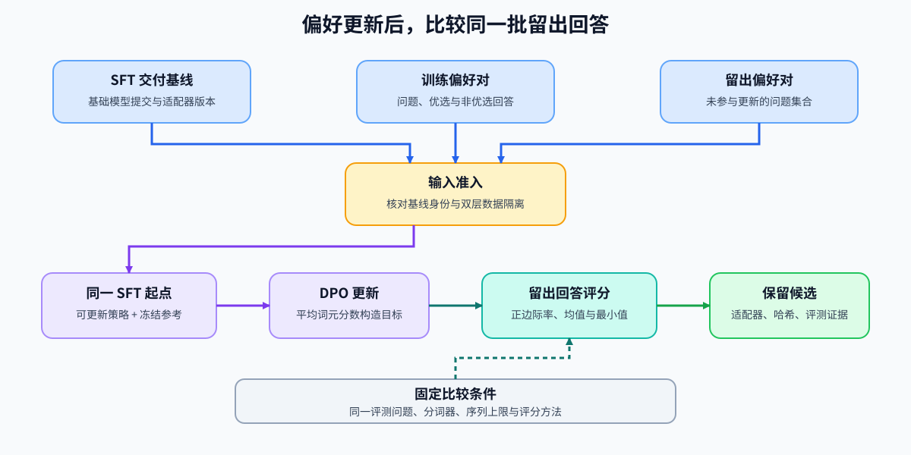
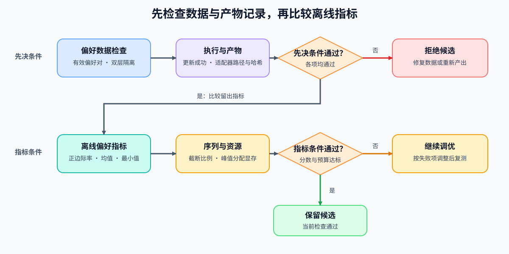

# 84. DPO Preference Project | DPO 偏好优化项目

**难度：** Hard | **环境：** [CPU 主线，GPU 可选](#runtime-environment) | **标签：** `离线偏好`, `DPO`, `留出评测` | **目标人群：** 理解 SFT 与偏好损失、需要比较更新结果的读者

> 🚀 **云端运行环境**
>
> 本章节的实战代码可以点击以下链接在免费 GPU 算力平台上直接运行：
>
> [](https://colab.research.google.com/github/datawhalechina/llm-algo-leetcode/blob/main/02_PyTorch_Algorithms/84_DPO_Preference_Project.ipynb)
> [](https://modelscope.cn/my/mynotebook) *(国内推荐：魔搭社区免费实例)*


---

## 本节导读

模型完成 SFT 后，如果同一问题有两条回答，而且知道哪条更符合要求，就可以用偏好对继续更新。训练损失下降后，还要问：模型对未参与训练的偏好对是否更倾向优选回答，序列截断和显存代价是否可接受？

本节从固定 SFT 基线出发，训练一条离线偏好候选，并用同一组留出偏好对比较更新前后的分数。通过当前指标门槛后保存候选适配器与记录；实际生成回答的质量、安全性与任务成本，再用相应评测检查。

**关键词：** `DPO`, `偏好对`, `冻结参考模型`, `回答分数`, `适配器`

---

<a id="runtime-environment"></a>

## 运行环境

- **CPU 练习：** 使用 [BASE-CPU](../guide.md#base-cpu)，运行摘要检查与测试。
- **GPU 实验：** 使用[后训练 Quickstart](../topic_discussion/post_training_optimization/quickstart.md#pt-rl-cuda-quickstart)中的 `PT-RL-CUDA`，执行 Step 5 的真实候选更新。

## 前置阅读

先理解偏好对怎样形成损失，再确认反馈来源与 SFT 起点。

- [17 DPO 损失与固定参考模型](./17_DPO_Loss_Tutorial.md)：区分策略与参考策略的回答对数概率。
- [50 偏好数据与评测](./50_Preference_Data_and_Evaluation.md)：检查优选标签、共享问题和训练／评测切分。
- [62 SFT 训练交付项目](./62_Instruction_Fine_Tuning_Project.md)：核对基础模型、分词器及适配器来源。

## Step 1：从同一 SFT 起点比较偏好更新

偏好对包含一个共享问题和两条有顺序的回答：优选回答与非优选回答。DPO（直接偏好优化）从同一 SFT 起点建立可更新策略与冻结参考模型，用两条回答的相对分数变化形成损失，更新策略适配器；训练数据已带偏好标签，训练时沿用这些回答。

训练与留出评测使用不同问题。更新前后对相同留出回答打分，检查排序和边际，再保存适配器与资源记录。当前项目在训练及评测中都采用回答词元平均对数概率，是长度归一化的比较方式；与按回答序列求和的标准 DPO 目标不同，解释结果时需保留这一约定。

| 阶段 | 输入 | 检查或动作 | 输出 |
|:---|:---|:---|:---|
| 固定起点 | SFT 清单、基础模型与适配器 | 对应同一模型和训练起点 | 策略与冻结参考模型 |
| 准备偏好数据 | 共享问题、优选／非优选回答 | 检查内容有效性及两侧任务重合 | 训练对与留出对 |
| 偏好更新 | 训练对与固定步数 | 依据相对参考的分数差更新策略 | 候选适配器与更新记录 |
| 更新前后比较 | 固定留出对 | 比较离线排序、边际、截断与显存 | 候选检查结果 |



## Step 2：用同一批留出回答计算分数变化

本项目把保留的回答词元（含未截去的结束标记）对数概率取平均，得到回答分数。设回答保留 $N$ 个目标词元，则 $s_\theta(x,y)=N^{-1}\sum_t\log\pi_\theta(y_t\mid x,y_{<t})$；每个偏好对的边际是优选分数减非优选分数。相同问题、回答、分词器、保留区间及长度上限，使更新前后分数可以逐项对应。

边际大于零的偏好对占比称为本页的偏好准确率：它统计给定回答的离线排序，而非重新生成回答后的裁判胜率。平均边际描述整体分数差；最小边际变化是“更新后最小值减更新前最小值”，两次最小值可能来自不同样本，因此逐条退化还应查看每对记录。缩放系数 $\beta$、步数与种子随实验保存。

| 比较项 | 实际计算或记录 | 作用 |
|:---|:---|:---|
| 偏好准确率变化 | 正边际比例的更新后值减更新前值 | 观察有多少给定回答对排序正确 |
| 平均边际变化 | 两次边际均值之差 | 检查整体分数差是否增加 |
| 最小边际变化 | 两次边际最小值之差 | 检查最小值变化；逐样本下降需另看配对值 |
| 问题与回答截断 | 对训练及留出集合分别计数，另汇总比例 | 说明实际参与比较的内容覆盖 |
| 资源 | 更新步时及峰值分配／保留显存 | 显存参与当前门槛，步时作为观察量保存 |

## Step 3：区分拒绝、继续调整与保留候选

数据有任务重合、训练执行失败，或缺少适配器路径及哈希时，候选进入 `reject`，先修复相应问题。执行和记录齐全，但离线排序、截断或显存未达门槛时进入 `tune`，保留记录用于分析。各项通过后进入 `accept`，表示当前候选检查通过。

候选清单可供生命周期项目核对版本、恢复与回退信息。要决定某个应用是否采用，还应在其实际生成、质量和成本评测中比较；独立综合项目可以自行准备起点与负载，并不以读取本清单为前提。

| 检查项 | 当前要求 | 未通过时 |
|:---|:---|:---|
| 数据 | 共享问题有效，偏好对与任务输入无跨集合重合 | `reject` |
| 执行与产物记录 | 更新成功，适配器路径与哈希已记录 | `reject` |
| 离线偏好指标 | 准确率、平均边际与最小边际变化达标 | `tune` |
| 序列与显存 | 截断比例及峰值分配显存达标 | `tune` |
| 全部检查 | 上述条件同时通过 | `accept`，保存候选记录 |



## Step 4：实现数据隔离、指标门槛与候选决定

骨架提供偏好对重合、任务重合、指标汇总与结果装配。你将补全三个合取／状态判断：数据是否可比、候选是否满足给定门槛，以及应拒绝、调整还是保留候选。CPU 输入是摘要及按同一顺序排列的边际列表；文件核对和真实训练在 Step 5 执行。

| 任务与目的 | 已知条件 | 完成标准 | 测试验证 |
|:---|:---|:---|:---|
| TODO 1：检查样本和任务隔离 | 两侧偏好对／任务标识及有效性记录 | 重合、有效率和回答差异四项检查同时通过 | 同偏好对重合、同问题换回答及无效偏好对 |
| TODO 2：合并候选门槛 | 基线／候选边际、截断和显存摘要 | 执行、排序变化、截断和显存各项均通过 | 最小边际下降、截断超限、显存越界及列表长度不一致 |
| TODO 3：选择候选状态 | 数据、候选与产物记录检查 | 数据／执行／产物失败拒绝，其余门槛失败调整 | 缺产物、执行失败与候选需调整 |


```python
from typing import Any, Dict, List
```


```python
# TODO 1：检查训练—评测隔离与偏好数据准入
def check_preference_partition(train_pair_ids: List[str], evaluation_pair_ids: List[str], train_prompt_ids: List[str], evaluation_prompt_ids: List[str], audit: Dict[str, Any], minimum_valid_ratio: float) -> Dict[str, Any]:
    """检查偏好对、任务输入和样本内容能否支持独立评测。"""
    pair_overlap = sorted(set(train_pair_ids) & set(evaluation_pair_ids))
    prompt_overlap = sorted(set(train_prompt_ids) & set(evaluation_prompt_ids))
    checks = {
        "pair_isolation": not pair_overlap,
        "prompt_isolation": not prompt_overlap,
        "valid_ratio": audit["valid_ratio"] >= minimum_valid_ratio,
        "distinct_responses": audit["identical_response_count"] == 0,
    }
    # admitted = ???  # 偏好对隔离、任务隔离、有效率与回答差异必须同时通过
    raise NotImplementedError("TODO 1：请完成当前机制判据或公式")
    return {"admitted": admitted, "pair_overlap": pair_overlap, "prompt_overlap": prompt_overlap, "failed_checks": [name for name, passed in checks.items() if not passed]}


# TODO 2：检查 DPO 候选的离线评分与资源门槛
def evaluate_dpo_candidate(evidence: Dict[str, Any], gates: Dict[str, float]) -> Dict[str, Any]:
    """检查留出回答分数、截断和显存记录。"""
    baseline_margins = evidence["baseline_margins"]
    candidate_margins = evidence["candidate_margins"]
    if not baseline_margins or len(baseline_margins) != len(candidate_margins):
        raise ValueError("更新前后必须使用同一组非空偏好对")
    def summarize(margins: List[float]) -> Dict[str, float]:
        return {
            "preference_accuracy": sum(margin > 0 for margin in margins) / len(margins),
            "margin_mean": sum(margins) / len(margins),
            "margin_min": min(margins),
        }
    baseline = summarize(baseline_margins)
    candidate = summarize(candidate_margins)
    comparison = {
        "preference_accuracy_gain": candidate["preference_accuracy"] - baseline["preference_accuracy"],
        "margin_mean_gain": candidate["margin_mean"] - baseline["margin_mean"],
        "margin_floor_gain": candidate["margin_min"] - baseline["margin_min"],
    }
    checks = {
        "execution": evidence["status"] == "ok",
        "accuracy_gain": comparison["preference_accuracy_gain"] >= gates["minimum_accuracy_gain"],
        "margin_gain": comparison["margin_mean_gain"] >= gates["minimum_margin_gain"],
        "margin_floor": comparison["margin_floor_gain"] >= gates["minimum_margin_floor_gain"],
        "truncation": evidence["evaluation"]["truncation_ratio"] <= gates["maximum_truncation_ratio"],
        "memory": evidence["resources"]["peak_allocated_bytes"] <= gates["maximum_peak_allocated_bytes"],
    }
    # eligible = ???  # 执行、留出评分、截断与显存门槛必须同时通过
    raise NotImplementedError("TODO 2：请完成当前机制判据或公式")
    return {"eligible": eligible, "execution_ok": checks["execution"], "comparison": comparison, "failed_checks": [name for name, passed in checks.items() if not passed]}


# TODO 3：确定 DPO 候选状态
def decide_dpo_delivery(partition: Dict[str, Any], candidate: Dict[str, Any], artifact: Dict[str, Any]) -> Dict[str, Any]:
    """区分拒绝候选、继续调整和保留候选三种状态。"""
    checks = {
        "partition": partition["admitted"],
        "candidate": candidate["eligible"],
        "artifact": bool(artifact.get("path")) and bool(artifact.get("sha256")),
    }
    # decision = ???  # 数据、执行或产物记录失败时拒绝；其余门槛失败调整，全部通过保留候选
    raise NotImplementedError("TODO 3：请完成当前机制判据或公式")
    return {"decision": decision, "failed_checks": [name for name, passed in checks.items() if not passed]}
```

## 测试

逐项改变数据重合、离线分数、截断、显存和产物记录，核对门槛与三种决定。


```python
def test_preference_partition_contract():
    """验证偏好对和任务输入两个层次的训练—评测隔离。"""
    audit = {"valid_ratio": 1.0, "identical_response_count": 0}
    partition = check_preference_partition(["a", "b"], ["c"], ["p1", "p2"], ["p3"], audit, 0.95)
    assert partition["admitted"]
    assert not check_preference_partition(["a"], ["a"], ["p1"], ["p2"], audit, 0.95)["admitted"]
    assert not check_preference_partition(["a"], ["b"], ["p1"], ["p1"], audit, 0.95)["admitted"]
    assert not check_preference_partition(["a"], ["b"], ["p1"], ["p2"], {**audit, "identical_response_count": 1}, 0.95)["admitted"]


def _dpo_candidate_fixture():
    """构造满足离线评分、截断和显存门槛的候选记录。"""
    gates = {
        "minimum_accuracy_gain": 0.05,
        "minimum_margin_gain": 0.02,
        "minimum_margin_floor_gain": 0.0,
        "maximum_peak_allocated_bytes": 10_000,
        "maximum_truncation_ratio": 0.05,
    }
    evidence = {
        "status": "ok",
        "baseline_margins": [-0.20, 0.00, 0.20, 0.40],
        "candidate_margins": [-0.19, 0.05, 0.25, 0.45],
        "evaluation": {"truncation_ratio": 0.01},
        "resources": {"peak_allocated_bytes": 8_000},
    }
    return evidence, gates


def test_dpo_candidate_gates():
    """验证最小边际下降时，即使平均边际增加也需调整。"""
    evidence, gates = _dpo_candidate_fixture()
    candidate = evaluate_dpo_candidate(evidence, gates)
    assert candidate["eligible"]
    assert not evaluate_dpo_candidate({**evidence, "resources": {"peak_allocated_bytes": 10_001}}, gates)["eligible"]
    assert evaluate_dpo_candidate({**evidence, "resources": {"peak_allocated_bytes": 10_000}}, gates)["eligible"]
    tail_regression = {**evidence, "candidate_margins": [-0.21, 0.05, 0.25, 0.47]}
    assert not evaluate_dpo_candidate(tail_regression, gates)["eligible"]
    assert not evaluate_dpo_candidate({**evidence, "evaluation": {"truncation_ratio": 0.20}}, gates)["eligible"]
    try:
        evaluate_dpo_candidate({**evidence, "candidate_margins": [0.10]}, gates)
    except ValueError:
        pass
    else:
        raise AssertionError("未拒绝无法配对的评测边际")


def test_dpo_delivery_decision():
    """验证数据、候选指标和产物记录对三种状态的影响。"""
    audit = {"valid_ratio": 1.0, "identical_response_count": 0}
    partition = check_preference_partition(["a"], ["b"], ["p1"], ["p2"], audit, 0.95)
    evidence, gates = _dpo_candidate_fixture()
    candidate = evaluate_dpo_candidate(evidence, gates)
    assert decide_dpo_delivery(partition, candidate, {"path": "adapter", "sha256": "abc"})["decision"] == "accept"
    assert decide_dpo_delivery(partition, candidate, {})["decision"] == "reject"
    assert decide_dpo_delivery(partition, {"eligible": False}, {"path": "adapter", "sha256": "abc"})["decision"] == "tune"


def test_dpo_execution_failure_rejected():
    """执行失败不能被归为只需调参的候选。"""
    evidence, gates = _dpo_candidate_fixture()
    candidate = evaluate_dpo_candidate({**evidence, "status": "failed"}, gates)
    assert decide_dpo_delivery({"admitted": True}, candidate, {"path": "adapter", "sha256": "abc"})["decision"] == "reject"


test_preference_partition_contract()
test_dpo_candidate_gates()
test_dpo_delivery_decision()
print("所有测试通过！")
test_dpo_execution_failure_rejected()

```

🛑 **STOP HERE** 🛑
## 参考代码与解析

### 代码

```python
# TODO 1：检查训练—评测隔离与偏好数据准入
def check_preference_partition(train_pair_ids: List[str], evaluation_pair_ids: List[str], train_prompt_ids: List[str], evaluation_prompt_ids: List[str], audit: Dict[str, Any], minimum_valid_ratio: float) -> Dict[str, Any]:
    """检查偏好对、任务输入和样本内容能否支持独立评测。"""
    pair_overlap = sorted(set(train_pair_ids) & set(evaluation_pair_ids))
    prompt_overlap = sorted(set(train_prompt_ids) & set(evaluation_prompt_ids))
    checks = {
        "pair_isolation": not pair_overlap,
        "prompt_isolation": not prompt_overlap,
        "valid_ratio": audit["valid_ratio"] >= minimum_valid_ratio,
        "distinct_responses": audit["identical_response_count"] == 0,
    }
    admitted = all(checks.values())
    return {"admitted": admitted, "pair_overlap": pair_overlap, "prompt_overlap": prompt_overlap, "failed_checks": [name for name, passed in checks.items() if not passed]}


# TODO 2：检查 DPO 候选的离线评分与资源门槛
def evaluate_dpo_candidate(evidence: Dict[str, Any], gates: Dict[str, float]) -> Dict[str, Any]:
    """检查留出回答分数、截断和显存记录。"""
    baseline_margins = evidence["baseline_margins"]
    candidate_margins = evidence["candidate_margins"]
    if not baseline_margins or len(baseline_margins) != len(candidate_margins):
        raise ValueError("更新前后必须使用同一组非空偏好对")
    def summarize(margins: List[float]) -> Dict[str, float]:
        return {
            "preference_accuracy": sum(margin > 0 for margin in margins) / len(margins),
            "margin_mean": sum(margins) / len(margins),
            "margin_min": min(margins),
        }
    baseline = summarize(baseline_margins)
    candidate = summarize(candidate_margins)
    comparison = {
        "preference_accuracy_gain": candidate["preference_accuracy"] - baseline["preference_accuracy"],
        "margin_mean_gain": candidate["margin_mean"] - baseline["margin_mean"],
        "margin_floor_gain": candidate["margin_min"] - baseline["margin_min"],
    }
    checks = {
        "execution": evidence["status"] == "ok",
        "accuracy_gain": comparison["preference_accuracy_gain"] >= gates["minimum_accuracy_gain"],
        "margin_gain": comparison["margin_mean_gain"] >= gates["minimum_margin_gain"],
        "margin_floor": comparison["margin_floor_gain"] >= gates["minimum_margin_floor_gain"],
        "truncation": evidence["evaluation"]["truncation_ratio"] <= gates["maximum_truncation_ratio"],
        "memory": evidence["resources"]["peak_allocated_bytes"] <= gates["maximum_peak_allocated_bytes"],
    }
    eligible = all(checks.values())
    return {"eligible": eligible, "execution_ok": checks["execution"], "comparison": comparison, "failed_checks": [name for name, passed in checks.items() if not passed]}


# TODO 3：确定 DPO 候选状态
def decide_dpo_delivery(partition: Dict[str, Any], candidate: Dict[str, Any], artifact: Dict[str, Any]) -> Dict[str, Any]:
    """区分拒绝候选、继续调整和保留候选三种状态。"""
    checks = {
        "partition": partition["admitted"],
        "candidate": candidate["eligible"],
        "artifact": bool(artifact.get("path")) and bool(artifact.get("sha256")),
    }
    if not checks["partition"] or not checks["artifact"] or not candidate.get("execution_ok", True):
        decision = "reject"
    elif not checks["candidate"]:
        decision = "tune"
    else:
        decision = "accept"
    return {"decision": decision, "failed_checks": [name for name, passed in checks.items() if not passed]}
```

### 解析

#### TODO 1：检查数据隔离

- 完整偏好对相同和问题相同是两种重合；换一条回答后，仍可能把同一问题放到训练和评测两侧。
- 合并骨架的四项检查。测试分别设置偏好对重合、问题重合及两条回答相同，确认都会阻止进入训练。

#### TODO 2：合并候选指标

- 各项门槛分别约束执行、离线分数变化、截断与显存，某项收益不抵消其他项失败。
- 对已有检查取合取。测试包含两次最小边际之差不达标、显存上限等号、截断超限及边际列表长度不一致；列表顺序对应由输入方保证。

#### TODO 3：形成候选状态

- 数据不可比、执行失败或产物记录缺失时先拒绝；其余指标未达标时进入调整，全部通过才保留候选。
- 按上述顺序选择状态。测试分别删除产物信息、标记执行失败或降低候选指标，核对拒绝与调整的区别。

## Step 5：真实 DPO 候选训练与交付

本实验读取62节历史 SFT 基线，固定偏好对与更新预算，保存离线分数、截断、资源与适配器记录。当前入口使用 dry_run／real_gpu；读取已有结果与重新训练分开操作。

| 对照层 | 输入 | 主要证据 | 输出与证据边界 |
|:---|:---|:---|:---|
| CPU 摘要检查 | 人工构造的偏好对和指标 | 偏好对与任务输入隔离、截断、三级决策 | 核对给定摘要下的判断 |
| 真实 DPO 候选 | 固定 SFT 适配器、固定偏好数据和训练预算 | 留出回答分数差、序列覆盖、资源与适配器 | 输出候选清单，实际生成质量由后续评测检查 |

### 5.1 环境、输入资产与固定条件

按[后训练优化 Quickstart](../topic_discussion/post_training_optimization/quickstart.md#pt-rl-cuda-quickstart)准备 `PT-RL-CUDA` 环境。固定实验使用 Qwen2.5-0.5B 的 SFT 适配器、策略模型与参考模型；v5 将统一序列上限设为 1024，训练对、评测对、更新步数与门槛保持不变。模型和数据变化后使用新标签，历史1024长度结果在5.6单独登记。

```python
from pathlib import Path
import json

from tools.project_runtime import resolve_project_root

RUN_MODE = "dry_run"  # 默认只检查配置；改为 real_gpu 执行新的真实 DPO 更新。
RUN_LABEL = "replace_with_unique_label"  # 新运行使用唯一标签；历史 v5 结果在 5.6 登记。
if RUN_MODE not in {"dry_run", "real_gpu"}:
    raise ValueError("运行模式必须为dry_run或real_gpu")
if RUN_MODE == "real_gpu" and RUN_LABEL == "replace_with_unique_label":
    raise ValueError("真实运行前请设置唯一RUN_LABEL")
PROFILE_ID = "PT-RL-CUDA"
SEMANTIC_ID = "PT-DPO-OFFLINE"
SCHEMA_VERSION = "model-evaluation/v1"

PROJECT_ROOT = resolve_project_root()
SFT_MANIFEST = PROJECT_ROOT / "benchmarks/results/62_sft_delivery/sft_delivery_manifest_sft_delivery_v2_1.json"
PREFERENCE_DATASET_ID = "trl-lib/ultrafeedback_binarized"
PREFERENCE_DATASET_REVISION = "main"
TRAIN_PAIRS = 24
EVALUATION_PAIRS = 16
TRAIN_POOL_SIZE = 256  # 从固定训练池按 seed 选择，不依赖数据集当前顺序的前 N 条。
EVALUATION_POOL_SIZE = 128  # 评测池来自独立 split。
MAX_LENGTH = 1024  # v4 在 768 Token 下输入截断率为 27.5%；本轮只扩大序列覆盖。
UPDATE_STEPS = 12
BETA = 0.1
LEARNING_RATE = 1e-5
DTYPE = "bfloat16"
SEED = 42
EVIDENCE_WINDOW_INDEX = 0  # 当前偏好数据窗口编号；窗口推进时递增。
GATES = {
    "minimum_valid_ratio": 0.95,
    "minimum_accuracy_gain": 0.0,
    "minimum_margin_gain": 0.0,
    "minimum_margin_floor_gain": -0.05,
    "maximum_prompt_truncation_ratio": 0.25,
    "maximum_response_truncation_ratio": 0.10,
    "maximum_peak_allocated_bytes": 10 * 1024**3,
}

RESULTS_DIR = PROJECT_ROOT / "benchmarks/results/84_dpo_preference"
EVIDENCE_PATH = RESULTS_DIR / f"dpo_evidence_{RUN_LABEL}.json"
MANIFEST_PATH = RESULTS_DIR / f"dpo_manifest_{RUN_LABEL}.json"
ARTIFACT_DIR = RESULTS_DIR / f"adapter_{RUN_LABEL}"
print({"run_mode": RUN_MODE, "evidence_path": str(EVIDENCE_PATH), "beta": BETA})
```

### 5.2 预检基线、环境与输出路径

当前配置读取62节历史 `sft_delivery_v2_1` 清单。预检确认依赖与输入清单状态，真实运行再检查输出路径是否已经存在。此处尚未重新计算基线适配器哈希；训练前还应核对本地文件与清单对应。


```python
import torch
from tools.project_runtime import environment_preflight, require_input_file
from tools.post_training_project_runtime import audit_preference_records, preference_record_to_text, run_dpo_delivery, save_json_record, stable_text_hash

preflight = environment_preflight(
    torch, required_packages=("transformers", "peft", "datasets", "huggingface_hub"),
    require_gpu=RUN_MODE == "real_gpu", output_path=EVIDENCE_PATH,
    environment_profile=PROFILE_ID,
)
if not preflight["ready"]:
    raise RuntimeError(preflight["reasons"])
sft_path = require_input_file(SFT_MANIFEST, "62 节 SFT manifest")
sft_manifest = json.loads(sft_path.read_text(encoding="utf-8"))
if sft_manifest["decision"] != "accept":
    raise RuntimeError("SFT baseline 未通过交付")
for path in (EVIDENCE_PATH, MANIFEST_PATH, ARTIFACT_DIR):
    if RUN_MODE == "real_gpu" and path.exists():
        raise FileExistsError(f"输出已存在，请修改 RUN_LABEL：{path}")
print({"preflight": preflight["status"], "sft_artifact": sft_manifest["artifacts"]["adapter"]["path"]})
```

### 5.3 固定偏好数据与留出集合

从数据集 `train` 和 `test` 的固定规模池中，按种子各抽取24组和16组偏好对；数据提交、池大小和抽样索引随结果保存。检查共享问题、偏好对内容及两侧任务重合后再训练；当前文本提取使用首条问题和末条回答，适用于本实验的数据形式。


```python
def check_preference_partition_for_run(train_pair_ids, evaluation_pair_ids, train_prompt_ids, evaluation_prompt_ids, audit, minimum_valid_ratio):
    """同时检查完整偏好对与共享 prompt 的跨切分隔离。"""
    pair_overlap = sorted(set(train_pair_ids) & set(evaluation_pair_ids))
    prompt_overlap = sorted(set(train_prompt_ids) & set(evaluation_prompt_ids))
    checks = {"no_pair_overlap": not pair_overlap, "no_prompt_overlap": not prompt_overlap, "valid_ratio": audit["valid_ratio"] >= minimum_valid_ratio, "distinct_responses": audit["identical_response_count"] == 0}
    return {"admitted": all(checks.values()), "pair_overlap": pair_overlap, "prompt_overlap": prompt_overlap, "train_pair_ids": train_pair_ids, "evaluation_pair_ids": evaluation_pair_ids, "train_prompt_ids": train_prompt_ids, "evaluation_prompt_ids": evaluation_prompt_ids, "failed_checks": [name for name, passed in checks.items() if not passed]}

if RUN_MODE == "real_gpu":
    from datasets import load_dataset
    from huggingface_hub import HfApi

    import random

    dataset_commit = HfApi().dataset_info(PREFERENCE_DATASET_ID, revision=PREFERENCE_DATASET_REVISION).sha
    train_pool = load_dataset(PREFERENCE_DATASET_ID, split=f"train[:{TRAIN_POOL_SIZE}]", revision=dataset_commit)
    evaluation_pool = load_dataset(PREFERENCE_DATASET_ID, split=f"test[:{EVALUATION_POOL_SIZE}]", revision=dataset_commit)
    selector = random.Random(SEED)
    train_indices = sorted(selector.sample(range(len(train_pool)), TRAIN_PAIRS))
    evaluation_indices = sorted(selector.sample(range(len(evaluation_pool)), EVALUATION_PAIRS))
    train_records = [dict(train_pool[index]) for index in train_indices]
    evaluation_records = [dict(evaluation_pool[index]) for index in evaluation_indices]
    all_audit = audit_preference_records(train_records + evaluation_records)
    train_pair_ids = [stable_text_hash(preference_record_to_text(row)) for row in train_records]
    evaluation_pair_ids = [stable_text_hash(preference_record_to_text(row)) for row in evaluation_records]
    train_prompt_ids = [stable_text_hash((preference_record_to_text(row)[0],)) for row in train_records]
    evaluation_prompt_ids = [stable_text_hash((preference_record_to_text(row)[0],)) for row in evaluation_records]
    partition = check_preference_partition_for_run(train_pair_ids, evaluation_pair_ids, train_prompt_ids, evaluation_prompt_ids, all_audit, GATES["minimum_valid_ratio"])
    if not partition["admitted"]:
        raise RuntimeError(f"偏好数据未通过准入：{partition['failed_checks']}")
    print({"dataset_commit": dataset_commit, "audit": all_audit, "partition": partition})
```

### 5.4 执行更新并保存记录

策略与冻结参考从同一 SFT 适配器初始化，按回答词元平均对数概率构造相对参考的偏好目标。每步读取一组训练对，完成12次更新后评测并保存适配器。步时包含策略与参考的回答打分、反向及更新；峰值记录覆盖更新与后续评测。


```python
if RUN_MODE == "real_gpu":
    from transformers import AutoTokenizer

    model_id = sft_manifest["model"]["id"]
    model_commit = sft_manifest["model"]["resolved_commit"]
    sft_adapter = sft_manifest["artifacts"]["adapter"]["path"]
    tokenizer = AutoTokenizer.from_pretrained(model_id, revision=model_commit)
    run_evidence = run_dpo_delivery(
        model_id=model_id, revision=model_commit, sft_adapter_path=sft_adapter,
        tokenizer=tokenizer, train_records=train_records, evaluation_records=evaluation_records,
        max_length=MAX_LENGTH, update_steps=UPDATE_STEPS, beta=BETA,
        learning_rate=LEARNING_RATE, seed=SEED, dtype_name=DTYPE,
        artifact_directory=ARTIFACT_DIR,
    )
    record = {
        "schema_version": SCHEMA_VERSION, "semantic_id": SEMANTIC_ID,
        "environment_profile": PROFILE_ID, "run_mode": RUN_MODE, "run_label": RUN_LABEL,
        "sft_manifest": str(SFT_MANIFEST),
        "dataset": {"id": PREFERENCE_DATASET_ID, "requested_revision": PREFERENCE_DATASET_REVISION, "resolved_commit": dataset_commit},
        "partition": partition, "audit": all_audit,
        "workload": {"train_pairs": TRAIN_PAIRS, "evaluation_pairs": EVALUATION_PAIRS, "train_pool_size": TRAIN_POOL_SIZE, "evaluation_pool_size": EVALUATION_POOL_SIZE, "train_indices": train_indices, "evaluation_indices": evaluation_indices, "max_length": MAX_LENGTH, "update_steps": UPDATE_STEPS, "beta": BETA, "seed": SEED},
        "gates": GATES, "evidence": run_evidence,
    }
    save_json_record(EVIDENCE_PATH, record)
    print({"evidence_path": str(EVIDENCE_PATH), "comparison": run_evidence["comparison"]})
else:
    print({"run_mode": RUN_MODE, "next_action": "确认数据和门槛后改为 real_gpu"})
```

### 5.5 读取记录并重算决定

该单元读取当前路径的已有 JSON，使用记录中的门槛重新计算决定，不重新训练。现有读取逻辑没有逐项核对当前标签、模型配置或磁盘适配器哈希，使用历史记录时应对应其保存的配置。


```python
def decide_dpo_candidate_for_run(evidence, gates, partition):
    comparison = evidence["comparison"]
    sequence_contract = evidence["sequence_contract"]
    checks = {
        "partition": partition["admitted"],
        "execution": evidence["status"] == "ok",
        "accuracy_gain": comparison["preference_accuracy_gain"] >= gates["minimum_accuracy_gain"],
        "margin_gain": comparison["margin_mean_gain"] >= gates["minimum_margin_gain"],
        "margin_floor": comparison["margin_floor_gain"] >= gates["minimum_margin_floor_gain"],
        "prompt_coverage": sequence_contract["prompt_truncation_ratio"] <= gates["maximum_prompt_truncation_ratio"],
        "response_coverage": sequence_contract["response_truncation_ratio"] <= gates["maximum_response_truncation_ratio"],
        "memory": evidence["resources"]["peak_allocated_bytes"] <= gates["maximum_peak_allocated_bytes"],
        "artifact": bool(evidence.get("artifact", {}).get("path")) and bool(evidence.get("artifact", {}).get("sha256")),
    }
    if not checks["partition"] or not checks["execution"] or not checks["artifact"]:
        decision = "reject"
    elif not all(checks.values()):
        decision = "tune"
    else:
        decision = "accept"
    return {"decision": decision, "failed_checks": [name for name, passed in checks.items() if not passed]}

if EVIDENCE_PATH.exists():
    record = json.loads(EVIDENCE_PATH.read_text(encoding="utf-8"))
    decision = decide_dpo_candidate_for_run(record["evidence"], record["gates"], record["partition"])
    print({"decision": decision, "baseline": record["evidence"]["baseline"], "candidate": record["evidence"]["candidate"], "resources": record["evidence"]["resources"]})
```

### 5.6 形成离线 DPO 候选清单

84 与 85 是并列候选分支。该候选清单交给 86 核对生命周期、恢复与交接状态，不作为 85 的前置输入；完整应用采用由其自身的质量、安全与成本评测决定；Part05项目独立设计输入与负载。

`dpo_offline_len1024_v5` 完成 12 次更新。偏好准确率保持 0.5625，平均偏好边际提高 0.0022，最差边际下降 0.0036；峰值分配显存约 6.49 GiB、峰值保留显存约 10.13 GiB。训练与评测隔离保持通过，任务输入截断率从 v4 的 27.5% 降至 5%，回答截断率为 0，因此全部候选门槛通过，结论为 `accept`。该结论只适用于当前 SFT 基线、固定偏好数据、12 次更新和 1024 序列上限。


| 决策项 | 实测证据 | 结果 | 后续动作 |
|:---|:---|:---|:---|
| 数据与隔离 | 40 组偏好对全部有效；训练与评测任务输入无重合 | 通过 | 保留当前数据成员 |
| 偏好质量 | 偏好准确率保持 0.5625；平均边际 +0.0022，最差边际 -0.0036 | 通过质量下限 | 不据此自动采用 |
| 序列覆盖 | 1024 上限下任务输入截断率 5%，回答截断率 0 | 通过 | 固定当前长度与数据成员 |
| 项目决策 | 适配器、资源与离线偏好记录完整 | `accept` | 交给 86 进行生命周期交接 |

**当前登记结果**

| 字段 | 登记内容 |
| --- | --- |
| 项目与标签 | 84 节离线 DPO；`dpo_offline_len1024_v5` |
| 运行条件 | 当前 SFT 基线；40 组偏好对；12 次更新；序列上限 1024 |
| 原始证据 | [DPO 证据](../../benchmarks/results/84_dpo_preference/dpo_evidence_dpo_offline_len1024_v5.json) |
| 正式证据 | DPO 证据内保存偏好质量、资源、隔离和截断指标 |
| 清单与交接 | [候选清单](../../benchmarks/results/84_dpo_preference/dpo_manifest_dpo_offline_len1024_v5.json)；本地 adapter 由清单记录 |
| 结论 | `accept`：候选交给 86 节核对生命周期，不表示已完成最终算法采用 |

```python
if RUN_MODE == "real_gpu":
    record = json.loads(EVIDENCE_PATH.read_text(encoding="utf-8"))
    decision = decide_dpo_candidate_for_run(record["evidence"], record["gates"], record["partition"])
    manifest = {
        "schema_version": SCHEMA_VERSION, "semantic_id": SEMANTIC_ID,
        "run_label": RUN_LABEL, "decision": decision["decision"],
        "decision_details": decision,
        "source_evidence": str(EVIDENCE_PATH), "sft_manifest": str(SFT_MANIFEST),
        "evidence_window_index": EVIDENCE_WINDOW_INDEX,
        "source_policy_version": sft_manifest["artifacts"]["adapter"]["sha256"],
        "evaluation_version": record["dataset"]["resolved_commit"],
        "policy_version": record["evidence"]["artifact"]["sha256"],
        "quality": {"baseline": record["evidence"]["baseline"], "candidate": record["evidence"]["candidate"], "comparison": record["evidence"]["comparison"]},
        "resources": record["evidence"]["resources"],
        "artifacts": {"adapter": record["evidence"]["artifact"]},
        "next_consumer": "PT-POST-TRAINING-LIFECYCLE",
    }
    save_json_record(MANIFEST_PATH, manifest)
    print({"manifest_path": str(MANIFEST_PATH), "decision": decision["decision"]})
```

## 相关阅读

继续核对序列级 DPO 与本项目长度归一化目标的差异，再查看候选如何用于生命周期检查。

- [DPO 原论文](https://arxiv.org/abs/2305.18290)：对照策略／参考的序列对数概率比与偏好目标。
- [TRL DPO Trainer 文档](https://huggingface.co/docs/trl/dpo_trainer)：核对实际 Trainer 的损失与序列处理选项。
- [86 在线后训练生命周期与恢复](./86_DPO_Online_Benchmark.md)：检查候选版本、回退基线和恢复记录。
