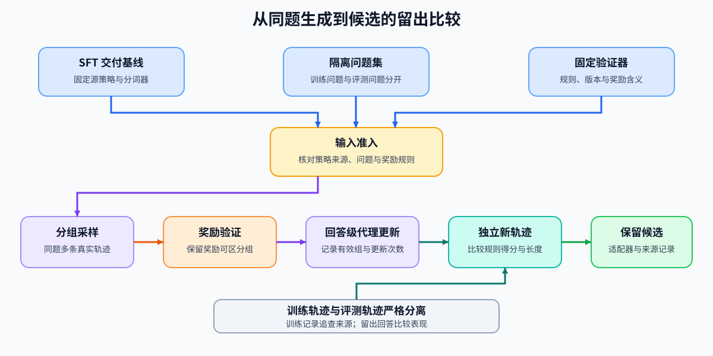
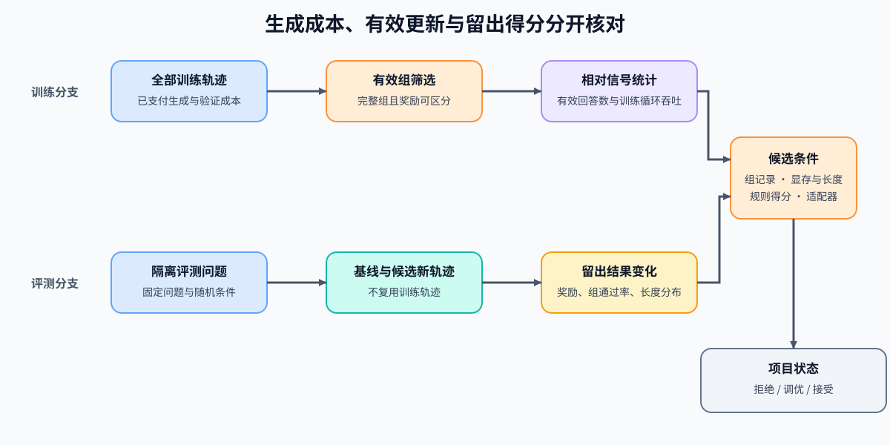

# 85. GRPO Groupwise Alignment Project | GRPO 组内奖励优化项目

**难度：** Hard | **环境：** [CPU 练习，单卡 GPU 实验](#runtime-environment) | **标签：** `RLVR`, `GRPO`, `组内优势` | **目标人群：** 理解策略损失、需要比较奖励更新结果的读者

> 🚀 **云端运行环境**
>
> 可用以下链接在云端Notebook平台打开；设备和依赖要求以本节运行环境说明为准：
>
> [](https://colab.research.google.com/github/datawhalechina/llm-algo-leetcode/blob/main/02_PyTorch_Algorithms/85_GRPO_Groupwise_Alignment_Project.ipynb)
> [](https://modelscope.cn/my/mynotebook) *(国内推荐：魔搭社区免费实例)*


---

## 本节导读

同一道数学题，模型可能生成有对有错的多条回答。用规则核对最终数值后，可以比较同组回答的奖励，让策略增加较好回答的概率。若一组全对或全错，组内比较就缺少差异；生成成本已经发生，却未必得到可用的奖励信号。

本节从固定 SFT 起点生成回答、计算组内优势并更新候选，再在留出问题上重新生成，比较更新前后的规则得分、至少一次答对的题目比例及显存。这样可以分开判断采样产生了多少相对信号，以及更新后的候选表现如何。

**关键词：** `RLVR`、`GRPO`、`组内优势`、`留出评测`、`有效轨迹吞吐`

---

<a id="runtime-environment"></a>

## 运行环境

- **CPU 练习：** 使用 [BASE-CPU](../guide.md#base-cpu)，核对生成组、指标与候选决定。
- **单卡实验：** 使用[后训练 Quickstart](../topic_discussion/post_training_optimization/quickstart.md#pt-rl-cuda-quickstart)的 `PT-RL-CUDA`，读取 SFT 适配器并执行 Step 5。

## 前置阅读

先理解组内奖励如何形成优势，再核对策略起点与已生成回答的版本记录。

- [18 GRPO、RLVR 与组内优势](./18_GRPO_Loss_Tutorial.md)：理解同题多回答、零方差组和裁剪目标。
- [62 SFT 训练交付项目](./62_Instruction_Fine_Tuning_Project.md)：确认基础模型、分词器及适配器来源。
- [轨迹生命周期与策略版本](./PT-ROLLOUT-LIFECYCLE_Rollout_and_Policy_Freshness.md)：区分初始适配器与采样当时的策略状态。

## Step 1：从分组生成到留出问题复测

可验证奖励强化学习（RLVR）用规则判断回答是否完成任务；组相对策略优化（GRPO）用同一问题下多条回答的相对奖励形成更新信号。这里从一个 SFT 策略出发，对训练问题逐组生成回答，再提取最终数值与标准答案比较，奖励为 0 或 1。固定验证器使奖励含义可比较，同时也决定了本项目评价的是最终数值匹配，而非整段推理质量。

奖励有差异的组提供回答级优势，候选完成更新后，在未参与训练的问题上重新生成回答。每个生成组记录问题、初始适配器、采样状态和验证器版本；这些记录帮助追查来源，参数是否改变还要检查实际更新，候选是否更好则由留出评测判断。

| 阶段 | 固定对象 | 观察或动作 | 输出 |
|:---|:---|:---|:---|
| 准备起点 | SFT 策略、训练／评测问题、验证器 | 确认问题不重合，保存版本 | 固定输入 |
| 分组生成 | 采样当时的策略、每题回答数 | 生成回答并计算规则奖励 | 回答组与奖励 |
| 组内更新 | 同题完整组 | 有奖励差异时计算优势并更新 | 候选适配器、更新次数 |
| 留出比较 | 同一题集、组规模及随机种子 | 更新前后分别生成新回答 | 奖励、长度和资源记录 |



## Step 2：把生成成本与可用奖励信号联系起来

设生成了 N 个问题组，每组保留预定的 K 条回答，评分缺失或异常时先补齐，再计算组内优势。评分完成且有限后，其中 M 个完整组的奖励并非全部相同，本项目把这 M 组称为有效组，有效组比例为 M/N，有效轨迹数为 M×K。例如四组、每组四条回答，若只有两组同时含 0 分和 1 分回答，则有效轨迹数为 8；其余八条回答也花费了生成和评分时间。

有效轨迹吞吐用有效轨迹数除以完整训练循环耗时，包含生成、验证、旧策略及参考策略评分、反向传播和参数更新，评测与产物保存另记。当前更新以回答平均词元对数概率构造新旧分数比，并加入与参考分数差的平方惩罚；这是回答级代理目标，与标准逐词元 GRPO 的概率比及 KL 估计有区别。

| 观察量 | 计算或比较 | 用途 |
|:---|:---|:---|
| 有效组比例 | 完整且奖励有差异的组数 / 全部组数 | 观察已生成回答中有多少组提供相对信号 |
| 有效轨迹数 | 有效组数 × 固定组规模 | 统计进入组内优势计算的回答数 |
| 有效轨迹吞吐 | 有效轨迹数 / 完整训练循环秒数 | 把奖励信号数量与训练成本对应起来 |
| 长度上限命中率 | 达到生成上限的回答数 / 全部回答数 | 检查最终答案是否可能因长度预算而缺失 |
| 更新记录 | 代理目标、步长、更新次数和参数变化 | 区分存在奖励差异、执行更新与实际策略变化 |

## Step 3：按留出得分、生成预算和产物记录判断候选

更新前策略与候选在相同留出题集、每题回答数及随机种子下分别生成。平均奖励是全部回答的 0/1 奖励均值；组内至少一次通过率是“至少一条回答匹配答案的题目数 / 评测题目数”。例如每题八条回答时，后者描述八次尝试的结果，需要和单回答得分、长度及生成成本一起看。相同种子便于复测，小题集、单次采样的增益还需更多问题与种子确认。

数据或产物记录不完整、执行失败时拒绝候选；执行完成而得分、有效组、吞吐、长度或显存未过门槛时继续调整；全部检查通过则保留候选及来源记录。保留候选后，可进一步核对恢复和回退，也可在具体应用中补充推理过程质量与任务成本比较。

| 检查对象 | 当前依据 | 对候选的处理 |
|:---|:---|:---|
| 生成组记录 | 问题标识非空、版本相符、组大小正确、轨迹标识不重复 | 不符时 `reject`，修复输入或记录 |
| 执行与产物 | 更新执行状态、适配器路径及哈希记录 | 失败时 `reject`，保留失败原因 |
| 训练信号与成本 | 有效组比例、更新次数、有效轨迹吞吐 | 未达门槛时 `tune`，调整采样或更新条件 |
| 留出结果与预算 | 平均奖励、至少一次通过率、长度上限命中率及峰值显存 | 未达门槛时 `tune`，检查具体失败项 |
| 全部检查 | 上述条件同时通过 | `accept`，保留当前负载下的候选 |



## Step 4：实现生成组检查、信号统计与候选决定

题目使用生成组标识、奖励列表和候选摘要。骨架已给出版本、组大小、标识重复和评分有限性检查；你将组合这些条件，统计奖励有差异的完整组，并选择拒绝、调整或保留候选。CPU 吞吐按输入中的采样与更新耗时相加计算，测试核对统计和门槛，真实测量的计时范围在 Step 5 中核对。

| 任务与目的 | 已知条件 | 完成标准 | 测试验证 |
|:---|:---|:---|:---|
| TODO 1：检查生成组记录 | 问题、轨迹、策略和验证器标识 | 非空组通过全部记录检查 | 空组、空问题标识、版本不符、重复标识和不完整组 |
| TODO 2：统计相对信号与候选门槛 | 奖励列表、组规模、给定耗时及指标 | 仅计完整且奖励有差异的组，再检查得分、长度与显存 | 评分缺失／非有限、全同奖励、不完整组、长度超限和显存越界 |
| TODO 3：选择候选状态 | 生成组、候选指标和适配器记录 | 数据／执行／产物失败拒绝，其他门槛失败调整 | 缺产物、执行失败和候选需调整 |


```python
import math
from typing import Any, Dict, List
```


```python
def check_rollout_contract(groups: List[Dict[str, Any]], expected_policy_version: str, expected_verifier_version: str, expected_group_size: int) -> Dict[str, Any]:
    """检查实际轨迹的任务身份、版本、组大小和唯一性。"""
    trace_ids = [trace_id for group in groups for trace_id in group["trace_ids"]]
    checks = {
        "prompt_identity": all(bool(group.get("prompt_id")) for group in groups),
        "policy_version": all(group["source_policy_version"] == expected_policy_version for group in groups),
        "verifier_version": all(group["verifier_version"] == expected_verifier_version for group in groups),
        "group_size": all(len(group["trace_ids"]) == expected_group_size for group in groups),
        "unique_traces": len(trace_ids) == len(set(trace_ids)),
    }
    # ==========================================
    # TODO 1：检查生成组记录
    # ==========================================
    # admitted = ???  # 非空轨迹组必须同时满足身份、版本、完整性与唯一性检查
    raise NotImplementedError("TODO 1：检查生成组记录")
    return {"admitted": admitted, "failed_checks": [name for name, passed in checks.items() if not passed]}


def evaluate_grpo_candidate(evidence: Dict[str, Any], gates: Dict[str, float]) -> Dict[str, Any]:
    """检查有效更新、新轨迹质量、截断和资源证据。"""
    rollout = evidence["rollout"]
    update = evidence["update"]
    elapsed_seconds = rollout["rollout_seconds"] + update["update_seconds"]
    reward_groups = rollout["reward_groups"]
    group_size = rollout["group_size"]
    if type(group_size) is not int or group_size < 2:
        raise ValueError("组规模必须是至少为2的整数")
    if any(value is None or type(value) not in (int, float) or not math.isfinite(value)
           for rewards in reward_groups for value in rewards):
        raise ValueError("候选统计需要完整且有限的评分；补齐评分后再重算整组")
    complete_groups = [rewards for rewards in reward_groups if len(rewards) == group_size]
    valid_groups = [rewards for rewards in complete_groups if max(rewards) > min(rewards)]
    # ==========================================
    # TODO 2：统计有效组与候选指标
    # ==========================================
    # valid_group_ratio = ???  # 有效完整组占所有组的比例；空输入记为零
    # effective_trajectory_count = ???  # 只有有效完整组中的轨迹计入更新量
    # effective_trajectories_per_second = ???  # 有效更新量除以给定计时；非正耗时记为零
    raise NotImplementedError("TODO 2：统计有效组与候选指标")
    checks = {
        "execution": evidence["status"] == "ok",
        "effective_groups": valid_group_ratio >= gates["minimum_valid_group_ratio"],
        "effective_throughput": effective_trajectories_per_second >= gates["minimum_effective_trajectories_per_second"],
        "updates": update["update_count"] >= gates["minimum_update_count"],
        "reward": evidence["comparison"]["reward_mean_gain"] >= gates["minimum_reward_gain"],
        "pass_at_group": evidence["comparison"]["pass_at_group_gain"] >= gates["minimum_pass_at_group_gain"],
        "truncation": rollout["max_length_hit_ratio"] <= gates["maximum_max_length_hit_ratio"],
        "memory": evidence["resources"]["peak_allocated_bytes"] <= gates["maximum_peak_allocated_bytes"],
    }
    eligible = all(checks.values())
    return {"eligible": eligible, "execution_ok": checks["execution"], "valid_group_ratio": valid_group_ratio, "effective_trajectory_count": effective_trajectory_count, "effective_trajectories_per_second": effective_trajectories_per_second, "failed_checks": [name for name, passed in checks.items() if not passed]}


def decide_grpo_delivery(rollout: Dict[str, Any], candidate: Dict[str, Any], artifact: Dict[str, Any]) -> Dict[str, Any]:
    """区分拒绝候选、继续调整与保留候选。"""
    checks = {
        "rollout": rollout["admitted"],
        "candidate": candidate["eligible"],
        "artifact": bool(artifact.get("path")) and bool(artifact.get("sha256")),
    }
    # ==========================================
    # TODO 3：选择候选状态
    # ==========================================
    # decision = ???  # 生成组、执行或产物记录失败时拒绝；其余门槛失败调整，全部通过保留
    raise NotImplementedError("TODO 3：选择候选状态")
    return {"decision": decision, "failed_checks": [name for name, passed in checks.items() if not passed]}
```

## 测试

逐项改变组标识、奖励差异、长度、显存与产物记录，检查统计和三种候选状态。


```python
def _grpo_candidate_fixture():
    """构造候选检查共用的证据与门槛。"""
    gates = {
        "minimum_valid_group_ratio": 0.25,
        "minimum_update_count": 1,
        "minimum_effective_trajectories_per_second": 1.0,
        "minimum_reward_gain": 0.0,
        "minimum_pass_at_group_gain": 0.0,
        "maximum_peak_allocated_bytes": 10_000,
        "maximum_max_length_hit_ratio": 0.10,
    }
    evidence = {
        "status": "ok",
        "rollout": {"group_size": 4, "reward_groups": [[0.0, 1.0, 0.0, 1.0], [1.0, 1.0, 1.0, 1.0], [0.0, 0.0, 0.0, 0.0], [0.0, 0.0, 1.0, 1.0]], "rollout_seconds": 4.0, "max_length_hit_ratio": 0.05},
        "update": {"update_count": 2, "update_seconds": 2.0},
        "comparison": {"reward_mean_gain": 0.1, "pass_at_group_gain": 0.1},
        "resources": {"peak_allocated_bytes": 8_000},
    }
    return evidence, gates


def test_rollout_contract():
    """TODO 1：验证轨迹身份、来源版本、组大小和唯一性。"""
    groups = [
        {"prompt_id": "math-1", "source_policy_version": "p1", "verifier_version": "v1", "trace_ids": ["a1", "a2", "a3", "a4"]},
        {"prompt_id": "math-2", "source_policy_version": "p1", "verifier_version": "v1", "trace_ids": ["b1", "b2", "b3", "b4"]},
    ]
    rollout = check_rollout_contract(groups, "p1", "v1", 4)
    assert rollout["admitted"]
    assert not check_rollout_contract([], "p1", "v1", 4)["admitted"]
    assert not check_rollout_contract([{**groups[0], "prompt_id": ""}], "p1", "v1", 4)["admitted"]
    assert not check_rollout_contract([{**groups[0], "trace_ids": ["a1"]}], "p1", "v1", 4)["admitted"]
    assert not check_rollout_contract([{**groups[0], "source_policy_version": "p0"}], "p1", "v1", 4)["admitted"]
    assert not check_rollout_contract([{**groups[0], "verifier_version": "v0"}], "p1", "v1", 4)["admitted"]
    duplicate = [groups[0], {**groups[1], "trace_ids": ["a1", "b2", "b3", "b4"]}]
    assert check_rollout_contract(duplicate, "p1", "v1", 4)["failed_checks"] == ["unique_traces"]


def test_grpo_candidate_gates():
    """TODO 2：验证有效更新、截断与资源门槛。"""
    evidence, gates = _grpo_candidate_fixture()
    candidate = evaluate_grpo_candidate(evidence, gates)
    assert candidate["eligible"]
    no_effective_update = {**evidence, "status": "no_effective_update", "rollout": {**evidence["rollout"], "reward_groups": [[0.0] * 4 for _ in range(4)]}, "update": {**evidence["update"], "update_count": 0}}
    assert not evaluate_grpo_candidate(no_effective_update, gates)["eligible"]
    incomplete_groups = {**evidence, "rollout": {**evidence["rollout"], "reward_groups": [[0.0, 1.0], [1.0, 1.0]]}}
    assert evaluate_grpo_candidate(incomplete_groups, gates)["valid_group_ratio"] == 0.0
    assert not evaluate_grpo_candidate({**evidence, "rollout": {**evidence["rollout"], "max_length_hit_ratio": 0.50}}, gates)["eligible"]
    assert not evaluate_grpo_candidate({**evidence, "resources": {"peak_allocated_bytes": 20_000}}, gates)["eligible"]


def test_grpo_delivery_decision():
    """TODO 3：验证拒绝、调优和交付三种结果。"""
    evidence, gates = _grpo_candidate_fixture()
    rollout = {"admitted": True}
    candidate = evaluate_grpo_candidate(evidence, gates)
    assert decide_grpo_delivery(rollout, candidate, {"path": "adapter", "sha256": "abc"})["decision"] == "accept"
    assert decide_grpo_delivery(rollout, candidate, {})["decision"] == "reject"
    assert decide_grpo_delivery(rollout, {"eligible": False}, {"path": "adapter", "sha256": "abc"})["decision"] == "tune"


def test_grpo_execution_failure_rejected():
    """执行失败不能被归为只需调参的候选。"""
    evidence, gates = _grpo_candidate_fixture()
    candidate = evaluate_grpo_candidate({**evidence, "status": "failed"}, gates)
    assert decide_grpo_delivery({"admitted": True}, candidate, {"path": "adapter", "sha256": "abc"})["decision"] == "reject"


def test_unfinished_scores_block_candidate_statistics():
    """固定组先补齐评分，避免 NaN 进入有效组和吞吐统计。"""
    for bad_score in (None, float("nan"), float("inf"), -float("inf")):
        evidence, gates = _grpo_candidate_fixture()
        evidence["rollout"]["reward_groups"] = [[0.0, bad_score, 1.0, 1.0]] * 4
        try:
            evaluate_grpo_candidate(evidence, gates)
        except ValueError:
            pass
        else:
            raise AssertionError("评分未完成或非有限时应停止候选计算")
    evidence, gates = _grpo_candidate_fixture()
    evidence["rollout"]["reward_groups"] = [[0.0, 0.0, 1.0, 1.0]] * 4
    complete = evaluate_grpo_candidate(evidence, gates)
    assert complete["eligible"] and complete["effective_trajectory_count"] == 16

test_unfinished_scores_block_candidate_statistics()
test_rollout_contract()
test_grpo_candidate_gates()
test_grpo_delivery_decision()
print("所有测试通过！")
test_grpo_execution_failure_rejected()

```

🛑 **STOP HERE** 🛑
## 参考代码与解析

### 代码

```python
def check_rollout_contract(groups: List[Dict[str, Any]], expected_policy_version: str, expected_verifier_version: str, expected_group_size: int) -> Dict[str, Any]:
    """检查实际轨迹的任务身份、版本、组大小和唯一性。"""
    trace_ids = [trace_id for group in groups for trace_id in group["trace_ids"]]
    checks = {
        "prompt_identity": all(bool(group.get("prompt_id")) for group in groups),
        "policy_version": all(group["source_policy_version"] == expected_policy_version for group in groups),
        "verifier_version": all(group["verifier_version"] == expected_verifier_version for group in groups),
        "group_size": all(len(group["trace_ids"]) == expected_group_size for group in groups),
        "unique_traces": len(trace_ids) == len(set(trace_ids)),
    }
    # TODO 1：检查生成组记录
    admitted = bool(groups) and all(checks.values())
    return {"admitted": admitted, "failed_checks": [name for name, passed in checks.items() if not passed]}


def evaluate_grpo_candidate(evidence: Dict[str, Any], gates: Dict[str, float]) -> Dict[str, Any]:
    """检查有效更新、新轨迹质量、截断和资源证据。"""
    rollout = evidence["rollout"]
    update = evidence["update"]
    elapsed_seconds = rollout["rollout_seconds"] + update["update_seconds"]
    reward_groups = rollout["reward_groups"]
    group_size = rollout["group_size"]
    if type(group_size) is not int or group_size < 2:
        raise ValueError("组规模必须是至少为2的整数")
    if any(value is None or type(value) not in (int, float) or not math.isfinite(value)
           for rewards in reward_groups for value in rewards):
        raise ValueError("候选统计需要完整且有限的评分；补齐评分后再重算整组")
    complete_groups = [rewards for rewards in reward_groups if len(rewards) == group_size]
    valid_groups = [rewards for rewards in complete_groups if max(rewards) > min(rewards)]
    # TODO 2：统计有效组与候选指标
    valid_group_ratio = len(valid_groups) / len(reward_groups) if reward_groups else 0.0
    effective_trajectory_count = len(valid_groups) * group_size
    effective_trajectories_per_second = effective_trajectory_count / elapsed_seconds if elapsed_seconds > 0 else 0.0
    checks = {
        "execution": evidence["status"] == "ok",
        "effective_groups": valid_group_ratio >= gates["minimum_valid_group_ratio"],
        "effective_throughput": effective_trajectories_per_second >= gates["minimum_effective_trajectories_per_second"],
        "updates": update["update_count"] >= gates["minimum_update_count"],
        "reward": evidence["comparison"]["reward_mean_gain"] >= gates["minimum_reward_gain"],
        "pass_at_group": evidence["comparison"]["pass_at_group_gain"] >= gates["minimum_pass_at_group_gain"],
        "truncation": rollout["max_length_hit_ratio"] <= gates["maximum_max_length_hit_ratio"],
        "memory": evidence["resources"]["peak_allocated_bytes"] <= gates["maximum_peak_allocated_bytes"],
    }
    eligible = all(checks.values())
    return {"eligible": eligible, "execution_ok": checks["execution"], "valid_group_ratio": valid_group_ratio, "effective_trajectory_count": effective_trajectory_count, "effective_trajectories_per_second": effective_trajectories_per_second, "failed_checks": [name for name, passed in checks.items() if not passed]}


def decide_grpo_delivery(rollout: Dict[str, Any], candidate: Dict[str, Any], artifact: Dict[str, Any]) -> Dict[str, Any]:
    """区分拒绝候选、继续调整与保留候选。"""
    checks = {
        "rollout": rollout["admitted"],
        "candidate": candidate["eligible"],
        "artifact": bool(artifact.get("path")) and bool(artifact.get("sha256")),
    }
    # TODO 3：选择候选状态
    if not checks["rollout"] or not checks["artifact"] or not candidate.get("execution_ok", True):
        decision = "reject"
    elif not checks["candidate"]:
        decision = "tune"
    else:
        decision = "accept"
    return {"decision": decision, "failed_checks": [name for name, passed in checks.items() if not passed]}
```

### 解析

#### TODO 1：检查生成组记录

- 问题标识、策略和验证器版本、组大小及轨迹唯一性分别决定记录能否对应本次生成。空组还需单独拒绝，因为空集合的全称判断会返回真。
- 将具名检查合取并要求组非空；测试逐项改变版本、标识和组大小，重复标识用例还核对具体失败项。

#### TODO 2：统计有效组与候选指标

- 先确认评分已完成且有限；缺失、NaN和无穷值停止候选统计，补齐后重算。固定组规模下，完整且奖励有差异的组才贡献相对信号。用有效组数计算比例和回答数，再除以给定的采样与更新秒数；全部生成回答数会高估这项吞吐。
- 测试中的四组只有两组有奖励差异；全零奖励和不完整组均不计入，长度及显存超限各自使候选需要调整。新增用例核对缺失与非有限评分会停止计算，已确认的0分正常参与；实测另核对计时范围。

#### TODO 3：选择候选状态

- 生成组记录或产物缺失、执行失败时，先修复这些问题；执行完成而指标未达标时，可保留结果继续调整。
- 先判断拒绝条件，再判断候选指标，最后返回保留候选；测试区分缺产物、执行失败与指标不足，避免把失败运行归为普通调参。


## Step 5：真实生成、代理更新与留出复测

CPU 练习核对生成组记录、奖励差异统计和状态判断；单卡实验提供实际回答、规则奖励、代理目标更新和留出新回答。本页使用回答级代理更新，记录目标形式后再解释得分变化。

| 比较层 | 输入 | 可观察结果 |
|:---|:---|:---|
| CPU 练习 | 人工组标识、奖励与指标摘要 | 字段匹配、统计及候选状态 |
| 单卡实验 | 固定 SFT 起点、题集、验证器和生成预算 | 实际奖励、更新次数、长度、显存及候选适配器 |

### 5.1 环境、输入资产与固定条件

使用[后训练 Quickstart](../topic_discussion/post_training_optimization/quickstart.md#pt-rl-cuda-quickstart)的 `PT-RL-CUDA`，参考容量为 12 GB 级单卡。配置声明 24 道训练题、12 道留出题、每题 8 条回答及 384 词元生成上限；当前来源与已完成结果见[实验资产表](../topic_discussion/post_training_optimization/experiment_assets.md)。正式测量设置新标签并保留原文件。


```python
from pathlib import Path
import json

from tools.project_runtime import resolve_project_root

RUN_MODE = "dry_run"  # 默认只检查配置；改为 real_gpu 执行新的真实轨迹与更新。
RUN_LABEL = "replace_with_unique_label"  # 新运行使用唯一标签；历史 v7 结果在 5.6 登记。
if RUN_MODE not in {"dry_run", "real_gpu"}:
    raise ValueError("运行模式必须为dry_run或real_gpu")
if RUN_MODE == "real_gpu" and RUN_LABEL == "replace_with_unique_label":
    raise ValueError("真实运行前请设置唯一RUN_LABEL")
PROFILE_ID = "PT-RL-CUDA"
SEMANTIC_ID = "PT-GRPO-GROUPWISE"
SCHEMA_VERSION = "model-evaluation/v1"

PROJECT_ROOT = resolve_project_root()
SFT_MANIFEST = PROJECT_ROOT / "benchmarks/results/62_sft_delivery/sft_delivery_manifest_sft_delivery_v2_1.json"
DATASET_ID = "openai/gsm8k"
DATASET_CONFIG = "main"
DATASET_REVISION = "main"
TRAIN_PROMPTS = 24  # 扩大更新窗口，避免单个有效组支配结论。
EVALUATION_PROMPTS = 12  # 降低小评测集造成的 pass@group 跳变。
GROUP_SIZE = 8  # v1 的 group=4 仅产生 1/6 个有效更新组。
MAX_PROMPT_LENGTH = 192
MAX_NEW_TOKENS = 384  # v6 的基线触顶率为 51.04%；本轮只扩大生成预算。
CLIP_EPSILON = 0.2
KL_COEFFICIENT = 0.02
LEARNING_RATE = 1e-5
DTYPE = "bfloat16"
SEED = 42
EVIDENCE_WINDOW_INDEX = 1  # 新生成的轨迹窗口；不复用 v6 的在线采样证据。
GATES = {
    "minimum_valid_group_ratio": 0.20,
    "minimum_update_count": 1,
    "minimum_effective_trajectories_per_second": 1.0,
    "minimum_reward_gain": 0.0,
    "minimum_pass_at_group_gain": 0.0,
    "maximum_max_length_hit_ratio": 0.50,
    "maximum_peak_allocated_bytes": 10 * 1024**3,
}

RESULTS_DIR = PROJECT_ROOT / "benchmarks/results/85_grpo_alignment"
EVIDENCE_PATH = RESULTS_DIR / f"grpo_evidence_{RUN_LABEL}.json"
MANIFEST_PATH = RESULTS_DIR / f"grpo_manifest_{RUN_LABEL}.json"
ARTIFACT_DIR = RESULTS_DIR / f"adapter_{RUN_LABEL}"
print({"run_mode": RUN_MODE, "group_size": GROUP_SIZE, "evidence_path": str(EVIDENCE_PATH)})
```

### 5.2 预检 SFT 基线、环境与输出路径

```python
import torch
from tools.project_runtime import environment_preflight, require_input_file
from tools.post_training_project_runtime import run_grpo_delivery, save_json_record, stable_text_hash

preflight = environment_preflight(
    torch, required_packages=("transformers", "peft", "datasets", "huggingface_hub"),
    require_gpu=RUN_MODE == "real_gpu", output_path=EVIDENCE_PATH,
    environment_profile=PROFILE_ID,
)
if not preflight["ready"]:
    raise RuntimeError(preflight["reasons"])
sft_path = require_input_file(SFT_MANIFEST, "62 节 SFT manifest")
sft_manifest = json.loads(sft_path.read_text(encoding="utf-8"))
if sft_manifest["decision"] != "accept":
    raise RuntimeError("SFT baseline 未通过交付")
for path in (EVIDENCE_PATH, MANIFEST_PATH, ARTIFACT_DIR):
    if RUN_MODE == "real_gpu" and path.exists():
        raise FileExistsError(f"输出已存在，请修改 RUN_LABEL：{path}")
print({"preflight": preflight["status"], "sft_policy_version": sft_manifest["artifacts"]["adapter"]["sha256"]})
```

### 5.3 固定问题集、策略版本与验证器

训练和评测来自 GSM8K 的不同数据划分；规则验证器提取回答中的最后一个数值，与标准答案 `####` 后的数值比较。

```python
def check_rollout_contract_for_run(groups, expected_policy_version, expected_verifier_version, expected_group_size):
    """核对实际生成轨迹的身份、版本和组大小。"""
    trace_ids = [trace_id for group in groups for trace_id in group["trace_ids"]]
    checks = {
        "policy_version": all(group["source_policy_version"] == expected_policy_version for group in groups),
        "verifier_version": all(group["verifier_version"] == expected_verifier_version for group in groups),
        "group_size": all(len(group["trace_ids"]) == expected_group_size for group in groups),
        "prompt_identity": all(bool(group.get("prompt_id")) for group in groups),
        "unique_traces": len(trace_ids) == len(set(trace_ids)),
    }
    return {"admitted": bool(groups) and all(checks.values()), "failed_checks": [name for name, passed in checks.items() if not passed]}

if RUN_MODE == "real_gpu":
    from datasets import load_dataset
    from huggingface_hub import HfApi

    dataset_commit = HfApi().dataset_info(DATASET_ID, revision=DATASET_REVISION).sha
    train_tasks = [dict(row) for row in load_dataset(DATASET_ID, DATASET_CONFIG, split=f"train[:{TRAIN_PROMPTS}]", revision=dataset_commit)]
    evaluation_tasks = [dict(row) for row in load_dataset(DATASET_ID, DATASET_CONFIG, split=f"test[:{EVALUATION_PROMPTS}]", revision=dataset_commit)]
    policy_version = sft_manifest["artifacts"]["adapter"]["sha256"]
    verifier_version = "gsm8k-final-number-v1"
    train_prompt_ids = [stable_text_hash((row["question"],)) for row in train_tasks]
    evaluation_prompt_ids = [stable_text_hash((row["question"],)) for row in evaluation_tasks]
    if set(train_prompt_ids) & set(evaluation_prompt_ids):
        raise RuntimeError("训练题与独立评测题发生 prompt 身份重合")
    print({"dataset_commit": dataset_commit, "train_prompts": len(train_prompt_ids), "evaluation_prompts": len(evaluation_prompt_ids), "prompt_overlap": 0})
```

### 5.4 执行分组生成、奖励与代理更新

当前 helper 在结果中写入 `measurement_version`、`objective_kind` 和 `timing_scope`。新测量 v2 对完整训练循环计时，包含生成、验证、旧／参考策略评分及更新，评测和保存产物在窗口外；历史 v7 的吞吐分母仅为生成与更新的局部耗时，读取时保留原口径。

每组记录初始适配器、采样时已完成的更新步数和运行内行为版本。运行内行为版本由初始版本与更新步派生，用于区分状态；精确重放还需保存生成词元、采样概率及相应检查点。历史 v7 逐组记录仅含初始版本，相关文件继续作为当时的结果保存。


```python
if RUN_MODE == "real_gpu":
    from transformers import AutoTokenizer

    model_id = sft_manifest["model"]["id"]
    model_commit = sft_manifest["model"]["resolved_commit"]
    sft_adapter = sft_manifest["artifacts"]["adapter"]["path"]
    tokenizer = AutoTokenizer.from_pretrained(model_id, revision=model_commit)
    run_evidence = run_grpo_delivery(
        model_id=model_id, revision=model_commit, sft_adapter_path=sft_adapter,
        tokenizer=tokenizer, train_tasks=train_tasks, evaluation_tasks=evaluation_tasks,
        group_size=GROUP_SIZE, max_prompt_length=MAX_PROMPT_LENGTH,
        max_new_tokens=MAX_NEW_TOKENS, clip_epsilon=CLIP_EPSILON,
        kl_coefficient=KL_COEFFICIENT, learning_rate=LEARNING_RATE,
        seed=SEED, dtype_name=DTYPE, artifact_directory=ARTIFACT_DIR,
        source_policy_version=policy_version, verifier_version=verifier_version,
    )
    rollout_contract = check_rollout_contract_for_run(
        run_evidence["rollout"]["trajectory_records"], policy_version, verifier_version, GROUP_SIZE
    )
    if not rollout_contract["admitted"]:
        raise RuntimeError(f"实际轨迹契约失败：{rollout_contract['failed_checks']}")
    record = {
        "schema_version": SCHEMA_VERSION, "semantic_id": SEMANTIC_ID,
        "environment_profile": PROFILE_ID, "run_mode": RUN_MODE, "run_label": RUN_LABEL,
        "sft_manifest": str(SFT_MANIFEST), "policy_version": policy_version,
        "dataset": {"id": DATASET_ID, "config": DATASET_CONFIG, "resolved_commit": dataset_commit},
        "verifier_version": verifier_version, "rollout_contract": rollout_contract,
        "workload": {"train_prompts": TRAIN_PROMPTS, "evaluation_prompts": EVALUATION_PROMPTS, "group_size": GROUP_SIZE, "max_new_tokens": MAX_NEW_TOKENS, "seed": SEED},
        "gates": GATES, "evidence": run_evidence,
    }
    save_json_record(EVIDENCE_PATH, record)
    print({"evidence_path": str(EVIDENCE_PATH), "status": run_evidence["status"], "comparison": run_evidence["comparison"]})
else:
    print({"run_mode": RUN_MODE, "next_action": "确认问题集和门槛后改为 real_gpu"})
```

### 5.5 读取结果并核对比较条件

读取已有文件时，先核对标签、题集、组规模、长度预算、目标形式和计时范围，再解释候选决定。当前读取代码使用记录中保存的门槛；历史记录缺少新测量字段时，对照其原始配置解释，补采需要另设标签。


```python
def decide_grpo_candidate_for_run(evidence, gates, rollout_contract):
    """以轨迹硬契约和候选质量、截断、资源门槛形成三级决策。"""
    checks = {
        "rollout": rollout_contract["admitted"],
        "execution": evidence["status"] == "ok",
        "effective_groups": evidence["rollout"]["valid_group_ratio"] >= gates["minimum_valid_group_ratio"],
        "updates": evidence["update"]["update_count"] >= gates["minimum_update_count"],
        "effective_throughput": evidence["update"]["effective_trajectories_per_second"] >= gates["minimum_effective_trajectories_per_second"],
        "reward": evidence["comparison"]["reward_mean_gain"] >= gates["minimum_reward_gain"],
        "pass_at_group": evidence["comparison"]["pass_at_group_gain"] >= gates["minimum_pass_at_group_gain"],
        "length_budget": max(evidence["baseline"]["max_length_hit_ratio"], evidence["candidate"]["max_length_hit_ratio"]) <= gates["maximum_max_length_hit_ratio"],
        "memory": evidence["resources"]["peak_allocated_bytes"] <= gates["maximum_peak_allocated_bytes"],
        "artifact": bool(evidence.get("artifact", {}).get("path")) and bool(evidence.get("artifact", {}).get("sha256")),
    }
    if not checks["rollout"] or not checks["execution"] or not checks["artifact"]:
        decision = "reject"
    elif not all(checks.values()):
        decision = "tune"
    else:
        decision = "accept"
    return {"decision": decision, "failed_checks": [name for name, passed in checks.items() if not passed]}

if EVIDENCE_PATH.exists():
    record = json.loads(EVIDENCE_PATH.read_text(encoding="utf-8"))
    decision = decide_grpo_candidate_for_run(record["evidence"], record["gates"], record["rollout_contract"])
    print({"decision": decision, "baseline": record["evidence"]["baseline"], "candidate": record["evidence"]["candidate"], "rollout": {key: value for key, value in record["evidence"]["rollout"].items() if key != "trajectory_records"}, "update": record["evidence"]["update"]})
```

### 5.6 保存候选决定与来源

历史 `grpo_rlvr_len384_v7` 在 12 道留出题、每题 8 次尝试下，平均奖励增加约 0.0521，至少一次通过率增加约 0.0833。该记录按当时门槛返回 `accept`；当前完整计时和逐次行为版本需要新标签复测，应用采用还应扩大题集并补充过程质量检查。

| 决策项 | 历史记录 | 解释与下一动作 |
|:---|:---|:---|
| 训练信号 | 24 组中 18 组奖励有差异，记录 18 次更新 | 有效组比例 0.75；参数变化另查实际更新 |
| 留出规则得分 | 平均奖励 0.2708 → 0.3229；`pass@group` 0.5833 → 0.6667 | 保留此小题集的观察，再用更多问题和种子复测 |
| 长度与显存 | 触顶率 11.46% / 18.75%；分配峰值约 7.00 GiB，保留峰值约 9.50 GiB | 与 384 词元预算一起读取 |
| 计时与来源 | 历史吞吐使用生成＋更新局部耗时；组记录保存初始策略版本 | 完整流程吞吐与逐组行为记录使用新协议补采 |
| 候选决定 | 历史 `accept`，适配器路径与哈希已记录 | 可进一步核对生命周期及恢复；具体应用单独评测 |

**当前登记结果**

| 字段 | 登记内容 |
| --- | --- |
| 项目与标签 | GRPO / RLVR；`grpo_rlvr_len384_v7` |
| 运行条件 | 历史 SFT 适配器；GSM8K 训练 24 题、留出 12 题，每题 8 条，生成上限 384 |
| 原始与正式记录 | [历史结果 JSON](../../benchmarks/results/85_grpo_alignment/grpo_evidence_grpo_rlvr_len384_v7.json)，含生成组摘要、奖励、更新、资源和留出指标 |
| 清单与来源 | [候选清单](../../benchmarks/results/85_grpo_alignment/grpo_manifest_grpo_rlvr_len384_v7.json)，记录适配器及 SFT 来源 |
| 结论 | 按历史门槛 `accept`；完整计时与逐组行为版本待新协议复测 |


```python
if RUN_MODE == "real_gpu":
    record = json.loads(EVIDENCE_PATH.read_text(encoding="utf-8"))
    decision = decide_grpo_candidate_for_run(record["evidence"], record["gates"], record["rollout_contract"])
    trajectory_records = record["evidence"]["rollout"]["trajectory_records"]
    trace_ids = [trace_id for group in trajectory_records for trace_id in group["trace_ids"]]
    manifest = {
        "schema_version": SCHEMA_VERSION, "semantic_id": SEMANTIC_ID,
        "run_label": RUN_LABEL, "decision": decision["decision"],
        "decision_details": decision,
        "source_evidence": str(EVIDENCE_PATH), "sft_manifest": str(SFT_MANIFEST),
        "evidence_window_index": EVIDENCE_WINDOW_INDEX,
        "source_policy_version": sft_manifest["artifacts"]["adapter"]["sha256"],
        "evaluation_version": record["dataset"]["resolved_commit"],
        "policy_version": record["evidence"]["artifact"]["sha256"],
        "quality": {"baseline": record["evidence"]["baseline"], "candidate": record["evidence"]["candidate"], "comparison": record["evidence"]["comparison"]},
        "rollout": {key: value for key, value in record["evidence"]["rollout"].items() if key != "trajectory_records"},
        "rollout_contract": record["rollout_contract"],
        "trajectory_identity": {"group_count": len(trajectory_records), "trace_count": len(trace_ids), "trace_ids_hash": stable_text_hash(trace_ids), "verifier_version": record["verifier_version"]},
        "resources": record["evidence"]["resources"],
        "artifacts": {"adapter": record["evidence"]["artifact"]},
        "next_consumer": "PT-POST-TRAINING-LIFECYCLE",
    }
    save_json_record(MANIFEST_PATH, manifest)
    print({"manifest_path": str(MANIFEST_PATH), "decision": decision["decision"]})
```

## 相关阅读

可对照标准目标、生成数据和候选恢复，判断当前代理实验还需补哪些比较。

- [DeepSeekMath](https://arxiv.org/abs/2402.03300)：阅读 GRPO 的组内归一化与逐词元目标，对照本页回答平均分数代理。
- [TRL GRPO Trainer](https://huggingface.co/docs/trl/grpo_trainer)：查看采样组、奖励缩放和不同损失归约的配置。
- [86 后训练生命周期与恢复](./86_DPO_Online_Benchmark.md)：核对候选来源、适配器和回退信息。
