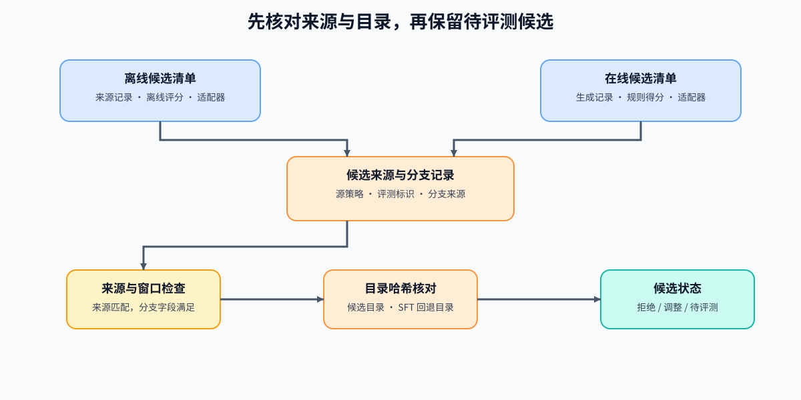
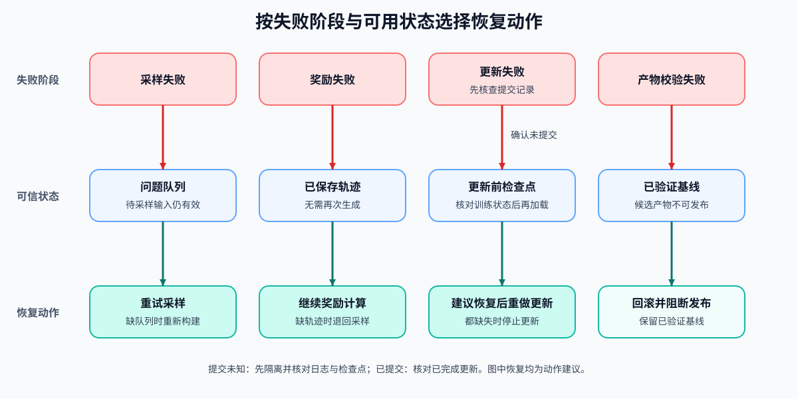

# 86. DPO Online Benchmark | 在线后训练生命周期与恢复

**难度：** Hard | **环境：** [CPU 与本地训练产物](#runtime-environment) | **标签：** `策略版本`, `恢复`, `回退基线` | **目标人群：** 理解偏好更新、需要核对候选来源与恢复条件的读者

> 🚀 **云端运行环境**
>
> 可用以下链接在云端Notebook平台打开；设备和依赖要求以本节运行环境说明为准：
>
> [](https://colab.research.google.com/github/datawhalechina/llm-algo-leetcode/blob/main/02_PyTorch_Algorithms/86_DPO_Online_Benchmark.ipynb)
> [](https://modelscope.cn/my/mynotebook) *(国内推荐：魔搭社区免费实例)*


---

## 本节导读

候选适配器已经训练完成，准备评测时却发现基线换了、目录内容变了，或更新失败后找不到可恢复状态。怎样判断手里的文件仍对应那次训练？失败后哪些步骤可以复用，哪些需要重做？

本节把候选清单、源基线和本地适配器放在一起核对，分别检查版本记录、文件哈希及回退来源，再按失败阶段选择恢复动作。结果说明哪些候选可以继续评测；不同算法的质量与成本仍需在共同任务上比较。

**关键词：** `候选来源`、`版本记录`、`产物哈希`、`恢复动作`

---

<a id="runtime-environment"></a>

## 运行环境

使用 [BASE-CPU](../guide.md#base-cpu) 运行题目和本地文件核对。Step 5 读取已保存的候选清单与适配器目录，不加载模型、不执行新的训练。

## 前置阅读

按已有候选选择离线或在线分支，再了解生成记录怎样随策略变化。

- [84 离线偏好项目](./84_DPO_Preference_Project.md)：查看偏好候选、适配器与离线评分记录。
- [85 组内奖励项目](./85_GRPO_Groupwise_Alignment_Project.md)：查看分组生成、规则得分与候选清单。
- [轨迹生命周期与策略版本](./PT-ROLLOUT-LIFECYCLE_Rollout_and_Policy_Freshness.md)：区分初始来源、生成时策略与实际行为偏离。

## Step 1：核对候选来源、适配器与回退基线

离线偏好与组内奖励可以从同一 SFT 起点分别训练出候选。保留各分支的清单和结果，才能知道当前目录对应哪个模型、训练起点及评测记录。这里同时处理一个或多个已有分支；缺少某一分支时，先核对已有候选。

核对分为两类：记录检查确认源策略相符、候选及评测标识存在，并检查分支特有字段；文件检查重新计算候选和回退适配器的哈希，与记录值比较。恢复动作则根据失败阶段和给定可用状态单独选择。三项都应留下具体结果，避免把“记录齐全”“文件相符”和“恢复已经执行”混成一个判断。

| 核对对象 | 当前使用的信息 | 输出 |
|:---|:---|:---|
| 来源与分支记录 | 源策略、候选及评测标识，偏好来源或在线窗口 | 通过项与缺失项 |
| 本地适配器 | 候选及回退目录、预期哈希 | 重新计算的哈希与相等结果 |
| 上游决定 | 接受、调整或拒绝 | 与本页条件共同形成候选状态 |
| 恢复场景 | 失败阶段、声明可用的状态 | 建议复用的状态和下一动作 |



## Step 2：区分来源匹配、窗口年龄与行为偏离

源策略标识必须与所选 SFT 基线相同；候选标识与评测标识则要求非空。离线分支另保留偏好结果的版本或路径，在线分支另保留验证器标识，并检查“当前窗口序号减生成窗口序号”是否处于允许范围。例如当前窗口为 5、生成窗口为 3，窗口年龄是 2，它不是经过了两小时，也不是策略更新了两次。

这些条件检查记录对应关系。要判断评测协议是否相同，还需比较题集、评分规则与解码配置；要判断旧轨迹是否适合当前策略，还需比较同一动作的新旧概率。评测标识存在、验证器标识存在或窗口年龄合格，分别保留为本页实际检查的结果。

| 条件 | 本页如何检查 | 进一步比较什么 |
|:---|:---|:---|
| 源策略 | 等于所选 SFT 适配器标识 | 模型与分词器等来源是否配套 |
| 候选与评测记录 | 对应标识非空 | 评测协议与当前任务是否一致 |
| 离线偏好来源 | 偏好记录版本或路径非空 | 数据切分、评分目标与参数 |
| 在线生成窗口 | 验证器标识非空，窗口年龄在区间内 | 验证器内容、逐次行为版本与动作概率 |
| 磁盘目录 | 实际哈希等于保存值 | 后续加载、恢复和任务评测 |

## Step 3：选择恢复动作并决定哪些候选继续评测

失败发生在哪个阶段，决定优先查找哪些保存状态。奖励计算失败时，先找已保存回答，仍可用就重新评分；回答也丢失时，再从问题队列生成。更新失败时先核对提交状态：确认未提交，再优先使用更新前检查点，其次回退已验证基线；提交未知时先隔离本批次并查提交日志与检查点，已提交则核对已完成记录。这里选择动作，实际恢复还要加载状态并核对优化器、随机状态和消费记录。

候选的上游状态与本页条件共同决定后续操作：来源、产物或回退检查失败则拒绝；检查通过但上游仍在调整则保留调整状态；上游接受且本页条件通过则进入后续评测。多个候选同时通过时，各自保留，不把偏好边际与数学题得分直接排序。

| 情况 | 可复用状态或触发条件 | 动作 |
|:---|:---|:---|
| 提交状态未知／已提交 | 提交日志、检查点与消费记录 | 暂停重试并核查／核对已完成更新 |
| 采样失败 | 问题队列仍可用 | 从队列重试；队列缺失则重建 |
| 奖励失败 | 回答或问题队列仍可用 | 重算奖励，或重新生成 |
| 更新失败且确认未提交 | 更新前检查点或已验证基线 | 恢复检查点，或回退基线；都缺失则停止 |
| 产物校验失败 | 已验证基线 | 回退；基线缺失则停止发布 |
| 来源、产物或回退失败，或上游拒绝 | 任一拒绝条件成立 | `reject`，修复失败项 |
| 本页通过，上游需要调整 | 已有候选仍可追查 | `tune`，继续分支实验 |
| 本页通过，上游接受 | 当前记录及目录核对通过 | `ready_for_evaluation`，进入任务评测 |



## Step 4：实现记录检查、恢复选择与候选状态

题目使用候选摘要、失败阶段、提交状态和可用状态标记。更新失败先区分 not_committed（确认未提交）、committed（已提交）、unknown（待核查），省略时按 unknown 处理。骨架提供提交检查与恢复优先表；你将补分支条件，在确认未提交时选择恢复点，再传播候选状态。CPU 测试检查判断逻辑，磁盘目录哈希在 Step 5 核对。

| 任务与目的 | 已知条件 | 完成标准 | 测试验证 |
|:---|:---|:---|:---|
| TODO 1：检查候选来源与分支记录 | 源策略、非空标识、分支版本及窗口年龄 | 共同来源与对应分支条件都满足 | 源基线不符、缺少标识、窗口过期与验证器缺失 |
| TODO 2：按阶段选择恢复点 | 提交状态、优先表与可用状态标记 | 未知先核查，已提交查记录，确认未提交才选择恢复点 | 提交状态缺失／未知／已提交、回答可用、检查点与基线都缺失 |
| TODO 3：形成待评测状态 | 上游决定、记录、文件及回退检查 | 拒绝条件优先，其后保留调整或待评测 | 上游三态、来源失配与回退缺失 |


```python
from typing import Any, Dict
```


```python
# ==========================================
# TODO 1：检查来源与分支记录
# ==========================================
def check_candidate_freshness(candidate: Dict[str, Any], active_policy_version: str, maximum_window_age: int) -> Dict[str, Any]:
    """按离线偏好或在线轨迹分支检查候选证据。"""
    candidate_kind = candidate.get("candidate_kind")
    common_checks = {
        "candidate_kind": candidate.get("candidate_kind") in {"dpo", "grpo", "rlvr"},
        "source_policy": candidate.get("source_policy_version") == active_policy_version,
        "candidate_identity": bool(candidate.get("policy_version")),
        "evaluation_identity": bool(candidate.get("evaluation_version")),
    }
    # branch_evidence_fresh = ???  # DPO 要有偏好证据身份；在线候选还要有验证器身份且窗口未过期。
    # fresh = ???  # 共同来源与分支条件必须同时满足。
    raise NotImplementedError("TODO 1：请检查来源与分支条件")
    checks = {**common_checks, "branch_evidence": branch_evidence_fresh}
    return {"fresh": fresh, "failed_checks": [name for name, passed in checks.items() if not passed]}


# ==========================================
# TODO 2：按阶段选择恢复点
# ==========================================
def choose_recovery_action(failure: Dict[str, Any]) -> Dict[str, str]:
    """依据失败阶段和已保存证据选择恢复动作。"""
    stage = failure["stage"]
    available = failure["available"]
    recovery_candidates_by_stage = {
        "sampling": ["prompt_queue"],
        "reward": ["trajectories", "prompt_queue"],
        "update": ["pre_update_checkpoint", "verified_baseline"],
        "artifact_validation": ["verified_baseline"],
    }
    action_by_stage_and_state = {
        ("sampling", "prompt_queue"): "retry_sampling_from_prompt_queue",
        ("reward", "trajectories"): "resume_reward_from_saved_trajectories",
        ("reward", "prompt_queue"): "restart_sampling_from_prompt_queue",
        ("update", "pre_update_checkpoint"): "restore_pre_update_checkpoint",
        ("update", "verified_baseline"): "rollback_to_verified_baseline",
        ("artifact_validation", "verified_baseline"): "rollback_to_verified_baseline",
    }
    fallback_action_by_stage = {
        "sampling": "rebuild_prompt_queue",
        "reward": "restart_sampling",
        "update": "block_update",
        "artifact_validation": "block_release",
    }
    if stage not in recovery_candidates_by_stage:
        raise ValueError(f"未知失败阶段：{stage}")
    if stage == "update":
        commit_state = failure.get("commit_state", "unknown")
        if commit_state not in {"not_committed", "committed", "unknown"}:
            raise ValueError("更新提交状态须为 not_committed、committed 或 unknown")
        if commit_state != "not_committed":
            action = ("inspect_committed_update" if commit_state == "committed"
                      else "quarantine_and_reconcile_commit")
            return {"stage": stage, "recovery_state": None, "reused_state": False, "action": action}
    # recovery_state = ???  # 按候选顺序选择第一个当前可用的可信状态；都不可用时为 None。
    # action = ???  # 有可信状态时执行对应的最小恢复动作，否则执行阶段回退动作。
    raise NotImplementedError("TODO 2：请搜索最晚可信恢复点并选择对应动作")
    return {"stage": stage, "recovery_state": recovery_state, "reused_state": recovery_state is not None, "action": action}


# ==========================================
# TODO 3：形成待评测状态
# ==========================================
def decide_lifecycle_handoff(upstream_decision: str, freshness: Dict[str, Any], evidence: Dict[str, Any]) -> Dict[str, Any]:
    """传播上游状态，并检查产物与回滚条件。"""
    hard_checks = {
        "freshness": freshness["fresh"],
        "rollback": evidence["rollback_ready"],
        "artifact": evidence["artifact_verified"],
    }

    hard_failures = [name for name, passed in hard_checks.items() if not passed]
    if upstream_decision not in {"accept", "tune", "reject"}:
        hard_failures.append("upstream_state")
    elif upstream_decision == "reject":
        hard_failures.append("upstream_reject")
    # handoff_status = ???  # 硬失败拒绝，否则传播调优或进入独立评测。
    raise NotImplementedError("TODO 3：请形成待评测状态")
    return {
        "handoff_status": handoff_status,
        "upstream_decision": upstream_decision,
        "hard_failures": hard_failures,
    }
```

## 测试

逐项改变来源、分支标识、窗口与可用状态，核对恢复选择和候选状态。


```python
def test_candidate_freshness():
    """TODO 1：验证候选来源和窗口条件。"""
    candidate = {"candidate_kind": "dpo", "decision": "accept", "source_policy_version": "sft-v1", "policy_version": "dpo-v1", "evaluation_version": "pref-eval-v1", "preference_evidence_version": "pref-train-v1", "window_age": 99}
    freshness = check_candidate_freshness(candidate, "sft-v1", 2)
    assert freshness["fresh"]
    assert check_candidate_freshness({**candidate, "decision": "tune"}, "sft-v1", 2)["fresh"]
    assert not check_candidate_freshness({**candidate, "source_policy_version": "sft-v0"}, "sft-v1", 2)["fresh"]
    assert not check_candidate_freshness({**candidate, "preference_evidence_version": ""}, "sft-v1", 2)["fresh"]
    online = {**candidate, "candidate_kind": "grpo", "verifier_version": "math-v1", "window_age": 2}
    assert check_candidate_freshness(online, "sft-v1", 2)["fresh"]
    assert not check_candidate_freshness({**online, "window_age": 3}, "sft-v1", 2)["fresh"]
    assert not check_candidate_freshness({**online, "verifier_version": ""}, "sft-v1", 2)["fresh"]
    assert not check_candidate_freshness({**candidate, "candidate_kind": "unknown"}, "sft-v1", 2)["fresh"]
    assert not check_candidate_freshness({**candidate, "evaluation_version": ""}, "sft-v1", 2)["fresh"]


def test_recovery_actions():
    """TODO 2：验证各失败阶段的恢复与回退动作。"""
    assert choose_recovery_action({"stage": "sampling", "available": {"prompt_queue": True}})["action"] == "retry_sampling_from_prompt_queue"
    reward_recovery = choose_recovery_action({"stage": "reward", "available": {"trajectories": True}})
    assert reward_recovery["action"] == "resume_reward_from_saved_trajectories"
    assert reward_recovery["recovery_state"] == "trajectories" and reward_recovery["reused_state"]
    assert choose_recovery_action({"stage": "update", "commit_state": "not_committed", "available": {"pre_update_checkpoint": True}})["action"] == "restore_pre_update_checkpoint"
    assert choose_recovery_action({"stage": "artifact_validation", "available": {"verified_baseline": True}})["action"] == "rollback_to_verified_baseline"
    reward_fallback = choose_recovery_action({"stage": "reward", "available": {"trajectories": False, "prompt_queue": True}})
    assert reward_fallback["recovery_state"] == "prompt_queue"
    assert reward_fallback["action"] == "restart_sampling_from_prompt_queue"
    assert choose_recovery_action({"stage": "reward", "available": {}})["action"] == "restart_sampling"
    assert choose_recovery_action({"stage": "update", "commit_state": "not_committed", "available": {}})["action"] == "block_update"
    assert choose_recovery_action({"stage": "update", "commit_state": "not_committed", "available": {"verified_baseline": True}})["action"] == "rollback_to_verified_baseline"


def test_lifecycle_handoff():
    """TODO 3：验证拒绝、调优和进入独立评测三种结果。"""
    freshness = {"fresh": True}
    evidence = {"rollback_ready": True, "artifact_verified": True}
    assert decide_lifecycle_handoff("accept", freshness, evidence)["handoff_status"] == "ready_for_evaluation"
    assert decide_lifecycle_handoff("tune", freshness, evidence)["handoff_status"] == "tune"
    rejected = decide_lifecycle_handoff("reject", freshness, evidence)
    assert rejected["handoff_status"] == "reject" and "upstream_reject" in rejected["hard_failures"]
    assert decide_lifecycle_handoff("accept", {"fresh": False}, evidence)["handoff_status"] == "reject"
    assert decide_lifecycle_handoff("accept", freshness, {**evidence, "rollback_ready": False})["handoff_status"] == "reject"


def test_uncertain_or_completed_update_is_not_replayed():
    """提交未知先核查，已提交查记录，只有确认未提交才选择恢复点。"""
    available = {"pre_update_checkpoint": True, "verified_baseline": True}
    before = dict(available)
    for state in (None, "unknown", "committed"):
        failure = {"stage": "update", "available": available}
        if state is not None:
            failure["commit_state"] = state
        result = choose_recovery_action(failure)
        expected = ("inspect_committed_update" if state == "committed"
                    else "quarantine_and_reconcile_commit")
        assert result["action"] == expected
        assert result["recovery_state"] is None and result["reused_state"] is False
    assert available == before
    try:
        choose_recovery_action({"stage": "update", "commit_state": "maybe", "available": available})
    except ValueError:
        pass
    else:
        raise AssertionError("非法提交状态应明确失败")

test_uncertain_or_completed_update_is_not_replayed()
test_candidate_freshness()
test_recovery_actions()
test_lifecycle_handoff()
print("所有测试通过！")
```

🛑 **STOP HERE** 🛑
## 参考代码与解析

### 代码

```python
# TODO 1：检查来源与分支记录
def check_candidate_freshness(candidate: Dict[str, Any], active_policy_version: str, maximum_window_age: int) -> Dict[str, Any]:
    """按离线偏好或在线轨迹分支检查候选证据。"""
    candidate_kind = candidate.get("candidate_kind")
    common_checks = {
        "candidate_kind": candidate.get("candidate_kind") in {"dpo", "grpo", "rlvr"},
        "source_policy": candidate.get("source_policy_version") == active_policy_version,
        "candidate_identity": bool(candidate.get("policy_version")),
        "evaluation_identity": bool(candidate.get("evaluation_version")),
    }
    if candidate_kind == "dpo":
        branch_evidence_fresh = bool(candidate.get("preference_evidence_version"))
    else:
        branch_evidence_fresh = bool(candidate.get("verifier_version")) and 0 <= candidate.get("window_age", -1) <= maximum_window_age
    checks = {**common_checks, "branch_evidence": branch_evidence_fresh}
    fresh = all(checks.values())
    return {"fresh": fresh, "failed_checks": [name for name, passed in checks.items() if not passed]}


# TODO 2：按阶段选择恢复点
def choose_recovery_action(failure: Dict[str, Any]) -> Dict[str, str]:
    """依据失败阶段和现有可信状态选择最小恢复范围。"""
    stage = failure["stage"]
    available = failure["available"]
    recovery_candidates_by_stage = {
        "sampling": ["prompt_queue"],
        "reward": ["trajectories", "prompt_queue"],
        "update": ["pre_update_checkpoint", "verified_baseline"],
        "artifact_validation": ["verified_baseline"],
    }
    action_by_stage_and_state = {
        ("sampling", "prompt_queue"): "retry_sampling_from_prompt_queue",
        ("reward", "trajectories"): "resume_reward_from_saved_trajectories",
        ("reward", "prompt_queue"): "restart_sampling_from_prompt_queue",
        ("update", "pre_update_checkpoint"): "restore_pre_update_checkpoint",
        ("update", "verified_baseline"): "rollback_to_verified_baseline",
        ("artifact_validation", "verified_baseline"): "rollback_to_verified_baseline",
    }
    fallback_action_by_stage = {
        "sampling": "rebuild_prompt_queue",
        "reward": "restart_sampling",
        "update": "block_update",
        "artifact_validation": "block_release",
    }
    if stage not in recovery_candidates_by_stage:
        raise ValueError(f"未知失败阶段：{stage}")
    if stage == "update":
        commit_state = failure.get("commit_state", "unknown")
        if commit_state not in {"not_committed", "committed", "unknown"}:
            raise ValueError("更新提交状态须为 not_committed、committed 或 unknown")
        if commit_state != "not_committed":
            action = ("inspect_committed_update" if commit_state == "committed"
                      else "quarantine_and_reconcile_commit")
            return {"stage": stage, "recovery_state": None, "reused_state": False, "action": action}
    recovery_state = next((state for state in recovery_candidates_by_stage[stage] if available.get(state)), None)
    action = action_by_stage_and_state[(stage, recovery_state)] if recovery_state is not None else fallback_action_by_stage[stage]
    return {"stage": stage, "recovery_state": recovery_state, "reused_state": recovery_state is not None, "action": action}


# TODO 3：形成待评测状态
def decide_lifecycle_handoff(upstream_decision: str, freshness: Dict[str, Any], evidence: Dict[str, Any]) -> Dict[str, Any]:
    """传播上游状态，并按生命周期硬条件形成三态交接。"""
    hard_checks = {
        "freshness": freshness["fresh"],
        "rollback": evidence["rollback_ready"],
        "artifact": evidence["artifact_verified"],
    }
    hard_failures = [name for name, passed in hard_checks.items() if not passed]
    if upstream_decision not in {"accept", "tune", "reject"}:
        hard_failures.append("upstream_state")
    elif upstream_decision == "reject":
        hard_failures.append("upstream_reject")
    handoff_status = "reject" if hard_failures else "tune" if upstream_decision == "tune" else "ready_for_evaluation"
    return {
        "handoff_status": handoff_status,
        "upstream_decision": upstream_decision,
        "hard_failures": hard_failures,
    }
```

### 解析

#### TODO 1：检查来源与分支记录

- 所有分支共用源策略匹配、候选标识及评测标识检查；离线分支要求偏好记录存在，在线分支再要求验证器标识和窗口年龄合格。
- 测试中的离线候选即使窗口年龄为 99 也可通过，因为它不使用在线窗口条件；在线候选在年龄 2 通过、3 被拒绝，用来验证分支差异和上界。

#### TODO 2：选择恢复动作

- 更新失败先检查提交状态；未知时暂停重试并核查日志与检查点，已提交则查已完成记录，确认未提交才按优先表选择恢复点。其他阶段按已有状态选择动作。
- 测试验证省略提交状态按 unknown 处理，未知与已提交均不直接回退；确认未提交而检查点和基线都缺失时停止更新。奖励失败另比较回答、队列与两者都缺失的情况。

#### TODO 3：形成候选状态

- 本页任一拒绝条件成立时优先拒绝，即使上游已接受；条件通过后才传播上游调整或待评测状态。
- 测试区分上游拒绝、上游调整、来源失配和回退缺失，并确认全部满足时返回 `ready_for_evaluation`。


## Step 5：核对本地产物并记录恢复建议

读取已有候选清单，重新计算候选与 SFT 回退目录哈希，再保存记录检查及恢复动作。四种失败场景使用声明可用的状态进行动作选择，实际训练恢复应在加载检查点后另行验证。

| 比较层 | 输入 | 结果 |
|:---|:---|:---|
| CPU 判断 | 人工候选、失败阶段与可用性标记 | 分支条件、恢复选择与候选状态 |
| 本地文件核对 | 候选清单、SFT 来源与适配器目录 | 目录哈希比较及候选清单 |

### 5.1 环境、输入资产与固定条件

使用能导入仓库运行时的 CPU 环境，读取所选 SFT 基线和至少一个候选清单。修改候选集合或窗口条件时使用新标签；原始训练指标按各分支自己的实验协议解释。


```python
from pathlib import Path
import json

from tools.project_runtime import resolve_project_root

RUN_MODE = "dry_run"  # 默认值 dry_run：只检查配置；改为 real_artifact 审核真实产物。
RUN_LABEL = "replace_with_unique_label"  # 历史v6只在结果登记处引用。
if RUN_MODE not in {"dry_run", "real_artifact"}:
    raise ValueError("运行模式必须为dry_run或real_artifact")
if RUN_MODE == "real_artifact" and RUN_LABEL == "replace_with_unique_label":
    raise ValueError("真实产物审核前请设置唯一RUN_LABEL")
SEMANTIC_ID = "PT-POST-TRAINING-LIFECYCLE"
SCHEMA_VERSION = "post-training-lifecycle/v1"

PROJECT_ROOT = resolve_project_root()
SFT_MANIFEST = PROJECT_ROOT / "benchmarks/results/62_sft_delivery/sft_delivery_manifest_sft_delivery_v2_1.json"
CANDIDATE_MANIFESTS = [
    PROJECT_ROOT / "benchmarks/results/84_dpo_preference/dpo_manifest_dpo_offline_len1024_v5.json",
    PROJECT_ROOT / "benchmarks/results/85_grpo_alignment/grpo_manifest_grpo_rlvr_len384_v7.json",
]
MAXIMUM_WINDOW_AGE = 2
ACTIVE_WINDOW_INDEX = 1  # 当前交接窗口；85 v7 在窗口 1 生成，年龄为当前窗口减证据窗口。
RESULTS_DIR = PROJECT_ROOT / "benchmarks/results/86_post_training_lifecycle"
EVIDENCE_PATH = RESULTS_DIR / f"lifecycle_evidence_{RUN_LABEL}.json"
HANDOFF_PATH = RESULTS_DIR / f"lifecycle_handoff_{RUN_LABEL}.json"
print({"run_mode": RUN_MODE, "candidate_manifests": [str(path) for path in CANDIDATE_MANIFESTS]})
```

### 5.2 预检基线与候选清单

`real_artifact` 模式至少需要一个真实候选清单；尚未生成的并列分支记录为未完成，不参与生命周期交接。

```python
from tools.post_training_project_runtime import hash_directory, save_json_record
from tools.project_runtime import require_input_file

if RUN_MODE == "real_artifact" and (EVIDENCE_PATH.exists() or HANDOFF_PATH.exists()):
    raise FileExistsError("结果已存在，请修改 RUN_LABEL")
if RUN_MODE == "real_artifact":
    sft_path = require_input_file(SFT_MANIFEST, "62 节 SFT manifest")
    sft_manifest = json.loads(sft_path.read_text(encoding="utf-8"))
    available_candidates = [path for path in CANDIDATE_MANIFESTS if path.exists()]
    if not available_candidates:
        raise FileNotFoundError("84/85 尚无候选 manifest")
    print({"baseline": str(sft_path), "available_candidates": [str(path) for path in available_candidates]})
else:
    print({"run_mode": RUN_MODE, "next_action": "完成 84 或 85 后改为 real_artifact"})
```

### 5.3 固定窗口条件与恢复场景

在线窗口年龄为当前窗口减记录窗口。四种恢复场景分别给定问题队列、已保存回答、更新前检查点或基线可用，代码据此输出建议动作。


```python
def check_candidate_freshness_for_run(candidate, active_policy_version, maximum_window_age):
    semantic_id = candidate.get("semantic_id")
    common_checks = {
        "candidate_kind": semantic_id in {"PT-DPO-OFFLINE", "PT-GRPO-GROUPWISE"},
        "source_policy": candidate.get("source_policy_version") == active_policy_version,
        "candidate_identity": bool(candidate.get("policy_version")),
        "evaluation_identity": bool(candidate.get("evaluation_version")),
    }
    if semantic_id == "PT-DPO-OFFLINE":
        branch_evidence_fresh = bool(candidate.get("source_evidence"))
    else:
        verifier_version = candidate.get("trajectory_identity", {}).get("verifier_version")
        branch_evidence_fresh = bool(verifier_version) and 0 <= candidate.get("window_age", -1) <= maximum_window_age
    checks = {**common_checks, "branch_evidence": branch_evidence_fresh}
    return {"fresh": all(checks.values()), "failed_checks": [name for name, passed in checks.items() if not passed]}

def choose_recovery_action_for_run(failure):
    """只从实际可用的可信状态恢复；没有检查点或基线时阻止更新。"""
    stage, available = failure["stage"], failure["available"]
    candidates = {
        "sampling": [("prompt_queue", "retry_sampling_from_prompt_queue")],
        "reward": [("trajectories", "resume_reward_from_saved_trajectories"),
                   ("prompt_queue", "restart_sampling_from_prompt_queue")],
        "update": [("pre_update_checkpoint", "restore_pre_update_checkpoint"),
                   ("verified_baseline", "rollback_to_verified_baseline")],
        "artifact_validation": [("verified_baseline", "rollback_to_verified_baseline")],
    }
    fallback = {"sampling": "rebuild_prompt_queue", "reward": "restart_sampling",
                "update": "block_update", "artifact_validation": "block_release"}
    if stage not in candidates:
        raise ValueError(f"未知失败阶段：{stage}")
    if stage == "update":
        commit_state = failure.get("commit_state", "unknown")
        if commit_state not in {"not_committed", "committed", "unknown"}:
            raise ValueError("更新提交状态须为 not_committed、committed 或 unknown")
        if commit_state != "not_committed":
            action = ("inspect_committed_update" if commit_state == "committed"
                      else "quarantine_and_reconcile_commit")
            return {"stage": stage, "required_state": None, "reused_state": False, "action": action}
    state, action = next(((state, action) for state, action in candidates[stage]
                          if available.get(state) is True), (None, fallback[stage]))
    return {"stage": stage, "required_state": state,
            "reused_state": state is not None, "action": action}

def decide_lifecycle_handoff_for_run(upstream_decision, freshness, evidence):
    hard_checks = {
        "freshness": freshness["fresh"],
        "rollback": evidence["rollback_ready"],
        "artifact": evidence["artifact_verified"],
    }
    hard_failures = [name for name, passed in hard_checks.items() if not passed]
    if upstream_decision not in {"accept", "tune", "reject"}:
        hard_failures.append("upstream_state")
    elif upstream_decision == "reject":
        hard_failures.append("upstream_reject")
    handoff_status = "reject" if hard_failures else "tune" if upstream_decision == "tune" else "ready_for_evaluation"
    return {"handoff_status": handoff_status, "upstream_decision": upstream_decision, "hard_failures": hard_failures}

FAILURE_SCENARIOS = [
    {"stage": "sampling", "available": {"prompt_queue": True}},
    {"stage": "reward", "available": {"trajectories": True}},
    {"stage": "update", "commit_state": "not_committed", "available": {"pre_update_checkpoint": True}},
    {"stage": "update", "commit_state": "unknown", "available": {"pre_update_checkpoint": True}},
    {"stage": "artifact_validation", "available": {"verified_baseline": True}},
]
print([choose_recovery_action_for_run(scenario) for scenario in FAILURE_SCENARIOS])
```

### 5.4 执行候选记录与目录核对

逐候选比较源策略、分支记录与适配器目录哈希，再核对回退基线目录。输出保留各候选状态及恢复建议；不同分支的任务得分继续在其原始报告中读取。


```python
if RUN_MODE == "real_artifact":
    active_policy_version = sft_manifest["artifacts"]["adapter"]["sha256"]
    candidate_records = []
    for path in available_candidates:
        candidate = json.loads(path.read_text(encoding="utf-8"))
        candidate["window_age"] = ACTIVE_WINDOW_INDEX - candidate.get("evidence_window_index", -1)
        freshness = check_candidate_freshness_for_run(candidate, active_policy_version, MAXIMUM_WINDOW_AGE)
        candidate_adapter = candidate.get("artifacts", {}).get("adapter", {})
        candidate_artifact_path = Path(candidate_adapter.get("path", ""))
        expected_candidate_hash = candidate_adapter.get("sha256")
        actual_candidate_hash = hash_directory(candidate_artifact_path) if candidate_artifact_path.is_dir() else None
        baseline_adapter = sft_manifest["artifacts"]["adapter"]
        baseline_artifact_path = Path(baseline_adapter["path"])
        expected_baseline_hash = baseline_adapter.get("sha256")
        actual_baseline_hash = hash_directory(baseline_artifact_path) if baseline_artifact_path.is_dir() else None
        evidence = {
            "rollback_ready": bool(expected_baseline_hash) and actual_baseline_hash == expected_baseline_hash,
            "artifact_verified": bool(expected_candidate_hash) and actual_candidate_hash == expected_candidate_hash,
            "artifact_check": {"expected": expected_candidate_hash, "actual": actual_candidate_hash},
            "rollback_check": {"expected": expected_baseline_hash, "actual": actual_baseline_hash},
        }
        upstream_decision = candidate.get("decision")
        handoff = decide_lifecycle_handoff_for_run(upstream_decision, freshness, evidence)
        candidate_records.append({"path": str(path), "semantic_id": candidate["semantic_id"], "upstream_decision": upstream_decision, "freshness": freshness, "artifact": candidate_adapter, "evidence": evidence, **handoff})
    recovery = [choose_recovery_action_for_run(scenario) for scenario in FAILURE_SCENARIOS]
    record = {
        "schema_version": SCHEMA_VERSION, "semantic_id": SEMANTIC_ID,
        "run_mode": RUN_MODE, "run_label": RUN_LABEL,
        "active_policy_version": active_policy_version,
        "candidate_records": candidate_records, "recovery_scenarios": recovery,
        "missing_candidate_manifests": [str(path) for path in CANDIDATE_MANIFESTS if not path.exists()],
    }
    save_json_record(EVIDENCE_PATH, record)
    print({"evidence_path": str(EVIDENCE_PATH), "candidate_count": len(candidate_records)})
```

### 5.5 读取候选状态与核对结果

读取当前标签文件，查看每个候选通过或失败的具体项、预期与实际目录哈希，再列出待评测候选。当前读取单元只展示紧凑状态，复核详细内容时同时打开原始结果。


```python
if EVIDENCE_PATH.exists():
    record = json.loads(EVIDENCE_PATH.read_text(encoding="utf-8"))
    ready = [item for item in record["candidate_records"] if item["handoff_status"] == "ready_for_evaluation"]
    print({"ready_for_evaluation": [item["semantic_id"] for item in ready], "candidate_status": {item["semantic_id"]: item["handoff_status"] for item in record["candidate_records"]}})
```

### 5.6 保存候选核对清单

历史 `post_training_lifecycle_v6` 中，两条候选的源基线、分支记录、目录哈希与回退目录核对通过，候选状态为 `ready_for_evaluation`，汇总状态为 `ready`。后续任务可用该清单追查来源；Part05 MiniMind 项目独立准备模型、数据与候选，不读取这份历史清单。

| 观察项 | 历史记录 | 解释与下一动作 |
|:---|:---|:---|
| 离线候选 | DPO v5 来源与目录哈希通过 | 保留对应偏好评分记录，另作任务比较 |
| 在线候选 | GRPO / RLVR v7 来源、窗口与目录哈希通过 | 窗口通过按索引解释，行为概率与新协议测量另查 |
| 恢复选择 | 四类场景各给出可复用状态和动作 | 此处记录建议；实际恢复需加载相应状态验证 |
| 汇总状态 | 两条候选待评测，汇总 `ready` | 保留二者，按统一任务和生成预算继续比较 |

**当前登记结果**

| 字段 | 登记内容 |
| --- | --- |
| 项目与标签 | 候选来源与恢复检查；`post_training_lifecycle_v6` |
| 固定输入 | 历史 SFT 基线、DPO v5 与 GRPO / RLVR v7 候选及其目录 |
| 原始与正式记录 | [生命周期结果](../../benchmarks/results/86_post_training_lifecycle/lifecycle_evidence_post_training_lifecycle_v6.json)，含目录哈希与四种恢复动作 |
| 候选清单 | [来源与状态汇总](../../benchmarks/results/86_post_training_lifecycle/lifecycle_handoff_post_training_lifecycle_v6.json) |
| 结论 | 历史 `ready`，表示记录与目录检查通过；任务质量和实际恢复另行验证 |


```python
if RUN_MODE == "real_artifact":
    record = json.loads(EVIDENCE_PATH.read_text(encoding="utf-8"))
    ready = [item for item in record["candidate_records"] if item["handoff_status"] == "ready_for_evaluation"]
    handoff_record = {
        "schema_version": SCHEMA_VERSION, "semantic_id": SEMANTIC_ID,
        "run_label": RUN_LABEL,
        "handoff_status": "ready" if ready else "no_ready_candidate",
        "baseline_manifest": str(SFT_MANIFEST),
        "candidate_records": record["candidate_records"],
        "source_evidence": str(EVIDENCE_PATH),
        "recovery_scenarios": record["recovery_scenarios"],
    }
    save_json_record(HANDOFF_PATH, handoff_record)
    print({"handoff_path": str(HANDOFF_PATH), "handoff_status": handoff_record["handoff_status"], "ready_count": len(ready)})
```

## 相关阅读

进一步核对旧轨迹的使用条件与实际训练资源安排。

- [轨迹生命周期与策略版本](./PT-ROLLOUT-LIFECYCLE_Rollout_and_Policy_Freshness.md)：计算动作概率偏离，区分窗口记录与行为比较。
- [采样、训练与奖励系统](./PT-RL-SYSTEM_Rollout_Training_and_Reward_System.md)：查看生成、更新和同步如何争用资源。
- [51 在线 DPO](./51_Online_DPO.md)：比较反馈窗口与偏好候选更新。
