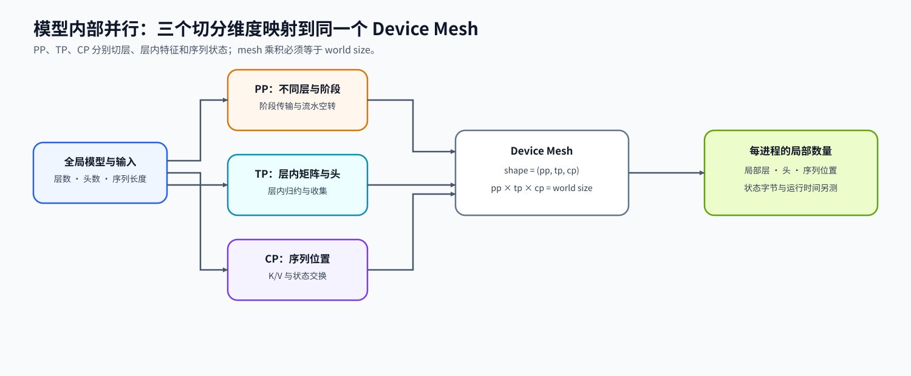
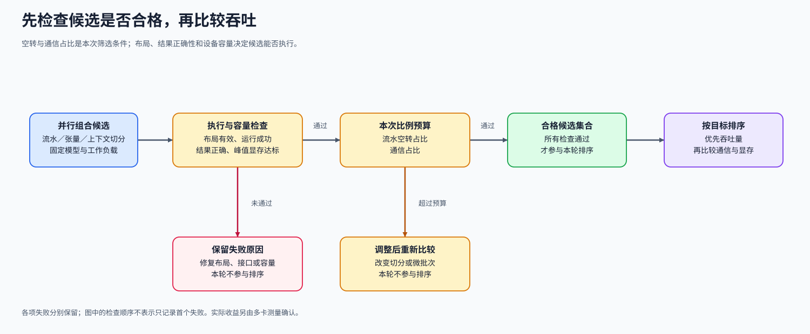

# 87. Model Internal Parallel Benchmark | 模型内部并行基准

**难度：** Hard | **环境：** CPU-first | **标签：** `PP`、`TP`、`CP`、`Device Mesh` | **目标人群：** 具备模型与并行基础的读者

> 🚀 **云端运行环境**
>
> 本章节的实战代码可以点击以下链接在免费 GPU 算力平台上直接运行：
>
> [](https://colab.research.google.com/github/datawhalechina/llm-algo-leetcode/blob/main/02_PyTorch_Algorithms/87_Model_Internal_Parallel_Benchmark.ipynb)
> [](https://modelscope.cn/my/mynotebook) *(国内推荐：魔搭社区免费实例)*


---

## 本节导读

同样是8张GPU，可以按模型层、层内计算或上下文位置分工，也可以组合使用。切分后每个进程负责的工作变少，但跨进程传输、集合通信和等待也会增加。模型能放下只是第一步，还要看这些额外代价是否抵消了分工收益。

本节先画清每个进程在组合中的位置，再检查模型维度能否均匀切分，最后用给定的显存、正确性、流水空转和通信记录筛选候选。局部数量计算帮助理解切分对象，真实容量与速度则需要相同负载下的多卡测量。

## 前置阅读

先理解三种分工怎样传递数据，再组合它们的进程组。

- [28. 流水线并行与微批次](./28_Pipeline_Parallelism_MicroBatch.md)：理解不同层之间的传输与流水空转。
- [29. 张量并行模拟](./29_Tensor_Parallelism_Sim.md)：理解层内矩阵、特征与头的切分。
- [PAR-CONTEXT. 上下文与序列并行](./PAR-CONTEXT_Context_and_Sequence_Parallelism.md)：理解序列切分后的K/V访问。

## Step 1：把三种分工映射到进程组

流水线并行（PP）把不同层分给不同阶段；张量并行（TP）拆分层内矩阵或特征；上下文并行（CP）让不同进程处理不同序列位置。rank是进程编号，Device Mesh（设备网格）则把这些编号排成多维数组：沿某一维变化的进程组成一组，执行该种并行所需的通信。

例如8个进程排成2×2×2网格，每个进程有一个“流水阶段、张量分片、上下文分片”坐标。沿TP维的两个进程共同完成层内计算，沿PP维传递阶段输出，沿CP维交换所需K/V。这个乘积关系针对本节的三轴组合；增加数据并行等维度时，资源分解也要加入对应维度。

| 切分轴 | 分工对象 | 主要新增代价 |
| --- | --- | --- |
| PP | 不同层组成的阶段 | 阶段间激活传输、流水空转、阶段负载不均 |
| TP | 层内矩阵、特征或注意力头 | 多进程参与的归约与收集 |
| CP | 不同序列位置 | 注意力所需的远端K/V交换 |



## Step 2：检查能否均匀切分，再计算局部数量

采用均匀切分时，层数要能分给PP阶段，注意力头要能分给TP进程，序列长度要能分给CP进程。例如24层、16个头、4096个位置，按2×2×2切分后，每个进程对应12层、8个头和2048个位置。运行实际模型时，继续核对矩阵宽度、KV头布局与后端对该切分方式的支持情况。

局部层数、头数和序列位置数说明每个进程负责的计算范围。估算显存时，再按权重与激活的实际维度、元素字节数，以及临时收集缓冲区逐项计算；分别列出每种切分减少和保留的对象。

| 检查对象 | 本节均匀布局的条件 | 得到的局部数量 |
| --- | --- | --- |
| PP阶段 | 层数能被PP度数整除 | 每阶段层数 |
| TP进程 | Query头数能被TP度数整除 | 每进程Query头数 |
| CP进程 | 序列长度能被CP度数整除 | 每进程序列位置数 |
| 资源分解 | 三种度数的乘积等于进程总数 | 每个进程的三维坐标 |

## Step 3：先筛选可用候选，再比较吞吐

流水空转（bubble）是某个阶段等待输入、下游或其他调度条件而没有做有效计算的时间；它的占比需要说明统计区间。通信占比则说明通信活动占多少时间，通信与计算重叠时不等于未被隐藏的等待。比较两类比例前，先核对它们的计时方法。

布局有效、运行成功、数值一致且显存满足要求后，再按本次预算检查空转和通信占比，最后比较相同负载下的吞吐。相同总GPU数下换切分方式是配置比较；比较新增设备是否划算，还要记录设备数并另算扩展效率。

| 检查项 | 不满足时意味着什么 | 下一步 |
| --- | --- | --- |
| 布局与数值 | 切分无法执行，或输出与基线不一致 | 调整布局或实现 |
| 峰值显存 | 运行超过目标设备容量 | 调整切分或批量 |
| 空转与通信预算 | 可运行，但不符合本次时间预算 | 调整微批次、阶段或进程组 |
| 吞吐 | 满足约束的候选完成工作快慢不同 | 在合格集合中排序 |



## Step 4：核对布局、局部数量与候选条件

题目提供正整数模型维度、并行度和示例指标。先检查网格与整除关系，再计算局部层、头和词元数；`state_units` 保存三者的乘积，用于比较局部数量。指标筛选与布局检查分别调用：先确认布局，再检查给定的正确性、显存、空转和通信条件。选择函数返回的 `accept` 表示从这组示例候选中选出该项；真实多卡运行需另行测量并核对输出。

| 任务与目的 | 已知条件 | 完成标准 | 测试验证 |
| --- | --- | --- | --- |
| TODO 1：报告布局不兼容项 | 模型形状与PP／TP／CP配置 | 分别保留资源乘积与整除错误 | 同时出现两个布局错误 |
| TODO 2：计算局部数量 | 可均匀切分的配置 | 分摊层、头和序列位置 | 12层、8头、2048个位置 |
| TODO 3：收集候选失败原因 | 给定指标与预算 | 同时检查运行、数值、显存、空转和通信 | 多项失败并存 |
| TODO 4：对合格候选排序 | 已标记是否合格的候选 | 优先吞吐，再比较通信占比和显存 | 空集合、超限排除与并列排序 |


```python
from copy import deepcopy

```


```python
def validate_mesh_layout(config):
    """返回 Device Mesh 与模型布局的全部不兼容原因。"""
    raise NotImplementedError("请完成TODO 1：核对进程数与模型维度。")
    # TODO 1（布局机制）：检查 mesh 乘积，以及层、Head、序列能否映射到对应维度。
    # errors = ???
    return {'valid': not errors, 'errors': errors}


def build_local_state_ledger(config):
    """计算单个 rank 承担的局部层、Head、token 与数量示意。"""
    # TODO 2（局部状态机制）：将全局模型形状按 PP、TP、CP 三个维度分摊。
    # ledger = ???
    return ledger


def evaluate_internal_parallel_candidate(metrics, limits):
    """汇总候选的运行、正确性、容量与给定时间预算的不合格原因。"""
    result = deepcopy(metrics)
    # TODO 3（候选筛选规则）：保留全部失败原因，不只返回布尔值。
    # failures = ???
    result['eligible'] = not failures
    result['gate_failures'] = failures
    return result


def select_internal_parallel_candidate(candidates):
    """从通过门槛的 PP/TP/CP 组合中选择候选。"""
    eligible = [item for item in candidates if item['eligible']]
    if not eligible:
        return {'decision': 'reject', 'candidate': None}
    # TODO 4（组合决策机制）：优先吞吐，其次通信占比和单 rank 峰值显存。
    # selected = ???
    return {'decision': 'accept', 'candidate': selected['name']}

```

## 测试


```python
BASE_CONFIG = {'world_size': 8, 'pp': 2, 'tp': 2, 'cp': 2, 'num_layers': 24, 'num_heads': 16, 'sequence_length': 4096}
LIMITS = {'memory_mb': 12000, 'bubble_ratio': 0.2, 'communication_ratio': 0.3}


def test_mesh_layout_contract():
    """验证 mesh 乘积与三个模型维度的布局约束。"""
    assert validate_mesh_layout(BASE_CONFIG) == {'valid': True, 'errors': []}
    invalid = {**BASE_CONFIG, 'world_size': 4, 'num_heads': 15}
    assert set(validate_mesh_layout(invalid)['errors']) == {'mesh_product', 'attention_heads'}


def test_local_state_ledger():
    """验证 PP、TP、CP 分别影响局部层、Head 与 token 数。"""
    ledger = build_local_state_ledger(BASE_CONFIG)
    assert ledger['local_layers'] == 12
    assert ledger['local_heads'] == 8
    assert ledger['local_tokens'] == 2048
    assert ledger['state_units'] == 12 * 8 * 2048


def test_candidate_gate_collects_failures():
    """验证候选筛选会保留全部失败原因。"""
    metrics = {'name': 'bad', 'peak_memory_mb': 13000, 'bubble_ratio': 0.25, 'communication_ratio': 0.35, 'throughput': 150, 'failure': None, 'correct': False}
    result = evaluate_internal_parallel_candidate(metrics, LIMITS)
    assert result['eligible'] is False
    assert set(result['gate_failures']) == {'correctness', 'memory', 'bubble', 'communication'}


def test_candidate_selection():
    """验证只有合格候选参与吞吐与 tie-break 排序。"""
    tp = evaluate_internal_parallel_candidate({'name': 'tp2', 'peak_memory_mb': 11000, 'bubble_ratio': 0.0, 'communication_ratio': 0.22, 'throughput': 120, 'failure': None, 'correct': True}, LIMITS)
    hybrid = evaluate_internal_parallel_candidate({'name': 'pp2_tp2', 'peak_memory_mb': 9000, 'bubble_ratio': 0.25, 'communication_ratio': 0.28, 'throughput': 130, 'failure': None, 'correct': True}, LIMITS)
    assert hybrid['gate_failures'] == ['bubble']
    assert select_internal_parallel_candidate([tp, hybrid]) == {'decision': 'accept', 'candidate': 'tp2'}
    assert select_internal_parallel_candidate([])['decision'] == 'reject'
    equal_speed = [
        {'name': 'more_comm', 'eligible': True, 'throughput': 120, 'communication_ratio': 0.25, 'peak_memory_mb': 8000},
        {'name': 'less_comm', 'eligible': True, 'throughput': 120, 'communication_ratio': 0.20, 'peak_memory_mb': 10000},
        {'name': 'less_memory', 'eligible': True, 'throughput': 120, 'communication_ratio': 0.20, 'peak_memory_mb': 9000},
    ]
    assert select_internal_parallel_candidate(equal_speed)['candidate'] == 'less_memory'


for test_fn in (test_mesh_layout_contract, test_local_state_ledger, test_candidate_gate_collects_failures, test_candidate_selection):
    test_fn()
print('✅ Device Mesh、局部数量、候选筛选与组合选择通过基础校验。')

```

---

🛑 **STOP HERE** 🛑

> 请先完成题目区并通过测试，再查看参考代码。

---

## 参考代码与解析

### 代码


```python
def validate_mesh_layout(config):
    """返回 Device Mesh 与模型布局的全部不兼容原因。"""
    errors = []
    if config['pp'] * config['tp'] * config['cp'] != config['world_size']:
        errors.append('mesh_product')
    if config['num_layers'] % config['pp'] != 0:
        errors.append('pipeline_layers')
    if config['num_heads'] % config['tp'] != 0:
        errors.append('attention_heads')
    if config['sequence_length'] % config['cp'] != 0:
        errors.append('context_blocks')
    return {'valid': not errors, 'errors': errors}


def build_local_state_ledger(config):
    """计算单个 rank 的局部层、Head、token 与数量示意。"""
    local_layers = config['num_layers'] // config['pp']
    local_heads = config['num_heads'] // config['tp']
    local_tokens = config['sequence_length'] // config['cp']
    return {
        'local_layers': local_layers,
        'local_heads': local_heads,
        'local_tokens': local_tokens,
        'state_units': local_layers * local_heads * local_tokens,
    }


def evaluate_internal_parallel_candidate(metrics, limits):
    """汇总候选的运行、正确性、容量与给定时间预算的不合格原因。"""
    result = deepcopy(metrics)
    failures = []
    if metrics.get('failure'):
        failures.append('runtime')
    if not metrics.get('correct', True):
        failures.append('correctness')
    if metrics['peak_memory_mb'] > limits['memory_mb']:
        failures.append('memory')
    if metrics['bubble_ratio'] > limits['bubble_ratio']:
        failures.append('bubble')
    if metrics['communication_ratio'] > limits['communication_ratio']:
        failures.append('communication')
    result['eligible'] = not failures
    result['gate_failures'] = failures
    return result


def select_internal_parallel_candidate(candidates):
    """从通过门槛的 PP/TP/CP 组合中选择候选。"""
    eligible = [item for item in candidates if item['eligible']]
    if not eligible:
        return {'decision': 'reject', 'candidate': None}
    selected = sorted(eligible, key=lambda item: (-item['throughput'], item['communication_ratio'], item['peak_memory_mb']))[0]
    return {'decision': 'accept', 'candidate': selected['name']}

```

### 解析

#### TODO 1：分别核对进程数与模型维度

- 三轴度数的乘积检查资源分解；层数、头数和长度的整除检查均匀布局。两类错误分别记录，测试中的进程数与头数错误应同时返回。

#### TODO 2：计算每个进程承担的数量

- PP除层数、TP除头数、CP除序列长度。用三者乘积表示当前示例的局部数量，不能把它当作显存字节数。
- 示例的12×8×2048检查切分是否作用于正确维度；真实权重与激活大小另按具体张量计算。

#### TODO 3：逐项保留不合格原因

- 运行失败、数值错误、显存超限、空转超限和通信超限分别检查；高吞吐不能抵消其中一项失败。
- 多项同时失败的测试能发现只记录首个原因或错误使用“任一满足即通过”的实现。

#### TODO 4：仅在合格集合中排序

- 先按吞吐降序，再按通信占比和峰值显存升序；超出空转预算的候选即使更快，也不参加本轮排序。
- 空集合返回无可用候选；并列测试检查第二、第三排序条件。输出状态沿用题目接口，真实采用还需完整测量与阈值复核。

## Step 5：准备真实多卡组合对照

### 5.1 环境与固定工作负载

多卡环境准备见[通信与并行实验Quickstart](../topic_discussion/communication_parallelism/quickstart.md)。计划固定同一模型版本、输入、批量、精度与4张GPU，比较TP4、PP4与PP2×TP2；当前组别的CP度数均为1，没有执行CP组合。

运行入口`benchmarks/model_internal_parallel.py`尚未接入，因此本节目前可运行的是CPU布局与筛选练习。多卡部分列出待使用的配置和结果要求，开启前需要先提供真实适配器。

| 固定项 | 实验需要记录什么 |
| --- | --- |
| 模型与输入 | 模型／分词器版本、编码输入、序列长度、批量与随机种子 |
| 运行条件 | GPU、互联、PyTorch／CUDA／NCCL、精度与进程数 |
| 比较对象 | 单轴TP、单轴PP、PP×TP组合 |
| 结果 | 各组原始指标、失败信息与汇总文件 |


```python
# 默认关闭，避免打开 Notebook 时自动启动多进程。
RUN_GPU_EXPERIMENT = False
MODEL_ID = 'Qwen/Qwen3-0.6B'  # 功能与通信路径验证模型，不代表生产规模收益。
WORLD_SIZE = 4                 # G2 组合至少需要 4 张可见 GPU。
SEQUENCE_LENGTH = 4096         # 所有候选保持相同输入长度。
MICRO_BATCH_SIZE = 1           # PP bubble 与显存均受 micro-batch 影响。
WARMUP = 3                     # 预热轮次不进入统计。
REPEATS = 10                   # 正式重复次数。
from tools.project_runtime import resolve_project_root
RESULT_DIR = resolve_project_root() / 'benchmarks/results/par_model_internal'
print({'run': RUN_GPU_EXPERIMENT, 'model': MODEL_ID, 'world_size': WORLD_SIZE, 'seq_len': SEQUENCE_LENGTH})
SUMMARY_PATH = f'{RESULT_DIR}/summary.json'  # distributed-benchmark/v1 companion。
REFERENCE_PATH = f'{RESULT_DIR}/summary_reference.json'  # 供 81 消费的稳定资产引用。

```

### 5.2 多卡与通信预检

进入性能比较前，先确认 CUDA、NCCL、torchrun、可见 GPU 数和 Device Mesh API。预检失败应记录环境错误，不应生成性能结论。


```python
import importlib.util
import shutil
import torch

GPU_PREFLIGHT = {
    'cuda_available': torch.cuda.is_available(),
    'visible_gpus': torch.cuda.device_count(),
    'nccl_available': bool(torch.distributed.is_available() and torch.distributed.is_nccl_available()),
    'torchrun': shutil.which('torchrun') is not None,
    'device_mesh_api': importlib.util.find_spec('torch.distributed.device_mesh') is not None,
}
GPU_PREFLIGHT['ready'] = all([
    GPU_PREFLIGHT['cuda_available'],
    GPU_PREFLIGHT['visible_gpus'] >= WORLD_SIZE,
    GPU_PREFLIGHT['nccl_available'],
    GPU_PREFLIGHT['torchrun'],
    GPU_PREFLIGHT['device_mesh_api'],
])
GPU_PREFLIGHT

```

### 5.3 核对三组切分配置

三组都使用4个进程：G0为TP4，G1为PP4，G2为PP2×TP2。保持模型与输入相同；微批量大小之外，流水采用的微批次数与调度方法也要在适配器结果中说明。


```python
ENTRYPOINT = 'benchmarks/model_internal_parallel.py'  # 真实执行适配器接入后再开启 RUN_GPU_EXPERIMENT。
EXPERIMENTS = [
    {'name': 'G0_tp', 'mesh': {'pp': 1, 'tp': 4, 'cp': 1}},
    {'name': 'G1_pp', 'mesh': {'pp': 4, 'tp': 1, 'cp': 1}},
    {'name': 'G2_pp_tp', 'mesh': {'pp': 2, 'tp': 2, 'cp': 1}},
]
for experiment in EXPERIMENTS:
    experiment['result_path'] = f"{RESULT_DIR}/{experiment['name']}.json"
EXPERIMENTS

```

### 5.4 执行并保存原始结果

接入真实适配器后，使用下方配置启动各组并保存原始结果。默认关闭，入口缺失或环境预检失败时停止，不生成性能测量。


```python
from pathlib import Path
import subprocess

if not RUN_GPU_EXPERIMENT:
    print('GPU 实验默认关闭；确认至少 4 张 GPU、适配器和结果目录后再开启。')
elif not GPU_PREFLIGHT['ready']:
    raise RuntimeError(f'多卡预检未通过：{GPU_PREFLIGHT}')
elif not Path(ENTRYPOINT).exists():
    raise FileNotFoundError(f'尚未接入真实执行适配器：{ENTRYPOINT}')
else:
    Path(RESULT_DIR).mkdir(parents=True, exist_ok=True)
    for experiment in EXPERIMENTS:
        mesh = experiment['mesh']
        command = [
            'torchrun', '--standalone', f'--nproc_per_node={WORLD_SIZE}', ENTRYPOINT,
            '--model-id', MODEL_ID, '--name', experiment['name'],
            '--pp', str(mesh['pp']), '--tp', str(mesh['tp']), '--cp', str(mesh['cp']),
            '--sequence-length', str(SEQUENCE_LENGTH), '--micro-batch-size', str(MICRO_BATCH_SIZE),
            '--warmup', str(WARMUP), '--repeats', str(REPEATS), '--output', experiment['result_path'],
        ]
        subprocess.run(command, check=True)

    result_paths = [experiment['result_path'] for experiment in EXPERIMENTS]
    summary_command = [
        'python', 'tools/aggregate_distributed_evidence.py',
        '--project', '87', '--output', SUMMARY_PATH,
    ] + sum((['--input', result_path] for result_path in result_paths), [])
    subprocess.run(summary_command, check=True)

```

### 5.5 读取结果与生成来源引用

下方读取已有结果，校验汇总结构并写出来源引用。逐组原始内容、模型一致性、数值对照及指标计算还需要进一步核对；结构检查本身不能确认测量条件一致。

| 字段组 | 需要核对什么 |
| --- | --- |
| 输入与硬件 | 模型版本、编码输入、批量、精度、GPU与互联 |
| 切分与指标 | PP／TP／CP、峰值显存、空转、通信占比、吞吐与数值误差 |
| 原始记录 | 各组是否齐全，是否有失败、回退或不同计时方法 |


```python
import json
from pathlib import Path

from tools.distributed_result_schema import validate_record
from tools.project_asset_relations import make_asset_reference

GPU_RESULTS = []
for experiment in EXPERIMENTS:
    result_path = Path(experiment["result_path"])
    if result_path.exists():
        GPU_RESULTS.append(json.loads(result_path.read_text(encoding="utf-8")))

if Path(SUMMARY_PATH).exists():
    companion = json.loads(Path(SUMMARY_PATH).read_text(encoding="utf-8"))
    errors = validate_record(companion)
    if errors:
        raise ValueError("87 companion 不符合 distributed-benchmark/v1：" + "; ".join(errors))
    reference = make_asset_reference("distributed.model_internal", SUMMARY_PATH)
    Path(REFERENCE_PATH).write_text(json.dumps(reference, ensure_ascii=False, indent=2), encoding="utf-8")
    print({"loaded": len(GPU_RESULTS), "companion": SUMMARY_PATH, "reference": REFERENCE_PATH})
else:
    print({"loaded": len(GPU_RESULTS), "expected": len(EXPERIMENTS), "companion": "pending"})

```

### 5.6 对照约束决定采用或继续调整

完成真实执行后，先排除布局、数值、运行与容量问题，再比较相同资源预算下的吞吐。若要判断扩展效率，还需增加不同设备数的基线；当前四卡组别只能比较切分方案。

| 结论 | 条件 | 下一步 |
| --- | --- | --- |
| 采用 | 数值、容量与服务／训练目标达标，收益重复稳定 | 固定配置并保留原始记录 |
| 调整 | 可运行，但空转、通信或吞吐不符合目标 | 调整微批次、阶段划分或并行度 |
| 退回基线 | 布局、结果或运行失败，或收益不足 | 保留失败原因，再核对模型与实现 |

## 相关阅读

需要按请求而不是模型内部维度分工时，转向副本路由；需要把单项结果放到真实服务中比较时，再进入服务项目。

- [PAR-REPLICA. 服务副本与请求路由](./PAR-REPLICA_Serving_Replica_Routing.md)：比较请求分配，而不是层、特征或序列切分。
- [81. 分布式推理逻辑验证](./81_Distributed_Inference_Project.md)：区分成本估算与端到端服务测量。
