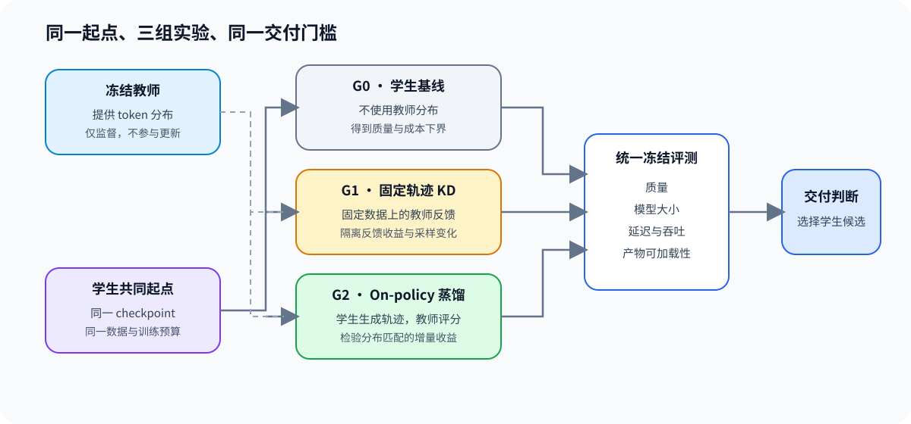
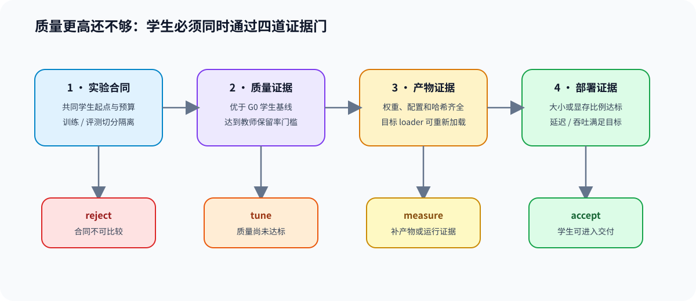

# 88. Distilled Student Delivery Project | 蒸馏学生交付项目

**难度：** Hard | **环境：** CPU 完成合同与决策练习；`PT-DISTILL-CUDA` 执行真实蒸馏实验 | **标签：** `蒸馏`, `学生模型`, `配对实验`, `交付门禁` | **目标人群：** 模型压缩与后训练项目学习者

> 🚀 **云端运行环境**
>
> 本章节的实战代码可以点击以下链接在免费 GPU 算力平台上直接运行：
>
> [](https://colab.research.google.com/github/datawhalechina/llm-algo-leetcode/blob/main/02_PyTorch_Algorithms/88_Distilled_Student_Delivery_Project.ipynb)
> [](https://modelscope.cn/my/mynotebook) *(国内推荐：魔搭社区免费实例)*


---

## 本节导读

蒸馏损失下降只说明学生更接近教师分布，不能证明学生获得了可交付收益。本项目固定教师、学生初始快照、数据切分和推理工作负载，依次比较学生基线、固定轨迹蒸馏和在策略蒸馏，再用独立质量、产物完整性、模型规模与推理性能共同决定候选是否值得交付。

Step 4 用 CPU 记录练习项目合同与决策逻辑；Step 5 在 `PT-DISTILL-CUDA` 环境中先做教师、轨迹、词表和显存准入，再运行通过准入的蒸馏路线。

**关键词：** `student baseline`, `offline trace distillation`, `on-policy distillation`, `quality retention`, `delivery gate`

---

## 前置阅读

**导语：** 先掌握完成区监督、教师轨迹准入、在线轨迹新鲜度和 GKD，再进入本项目比较离线、在线与混合蒸馏路线。

- [13. SFT Supervision and Loss | SFT 监督边界与损失](./13_SFT_Training_Loop.md)
- [PT-SYNTHETIC-DATA. Instruction Generation and Verifier Admission | 合成数据与验证器准入](./PT-SYNTHETIC-DATA_Instruction_Generation_and_Verifier_Admission.md)
- [PT-ROLLOUT-LIFECYCLE. Rollout and Policy Freshness | 轨迹与策略新鲜度](./PT-ROLLOUT-LIFECYCLE_Rollout_and_Policy_Freshness.md)
- [DISTILL-OPD. On-Policy Distillation and GKD | 在策略蒸馏与 GKD](./DISTILL-OPD_On_Policy_Distillation_and_GKD.md)

---

### Step 1：怎样固定共同合同并区分蒸馏路线

项目先冻结教师与学生初始快照，再固定训练提示、独立评测集、解码参数和推理工作负载。G0 测量学生起点；离线路线使用训练前生成并通过验证的教师文本轨迹；在线路线由当前学生生成回答，再让兼容教师提供逐 Token 分布。候选共享学生起点、训练提示集合、验证集和指标口径，并分别记录教师身份、训练 Token 数与运行成本。

| 路线 | 学生起点 | 轨迹来源 | 教师作用 | 额外条件 |
|:---|:---|:---|:---|:---|
| G0 · student baseline | 固定学生初始快照 | 无蒸馏训练 | 提供质量上界 | 固定评测与推理协议 |
| Offline trace | 与在线路线相同 | 教师预先生成并过滤的文本 | 提供答案或推理轨迹 | 轨迹可解析、正确且不过度截断 |
| Online GKD | 与离线路线相同 | 当前学生生成 | 对学生访问的前缀给出分布 | 词表映射一致且联合显存准入 |
| Hybrid | 先离线、后在线 | 两类轨迹依次使用 | 先锚定答案，再纠正学生生成 | 两条路线分别通过准入 |



### Step 2：每条路线需要哪些准入与交付证据

离线路线先检查轨迹是否适合作为训练数据，在线路线先检查教师分布能否与学生逐 Token 对齐。路线准入后，质量比较至少包含教师、G0 和蒸馏候选；资源比较使用同一加载方式、相同输入和解码参数。

设教师质量为 $Q_T$，学生基线为 $Q_0$，候选为 $Q_c$，则候选的学生增益和教师保持率分别为

$$
\Delta Q_c=Q_c-Q_0,
\qquad
R_c=\frac{Q_c}{Q_T}.
$$

设教师、学生基线和候选的产物大小为 $S_T,S_0,S_c$，推理延迟为 $L_T,L_0,L_c$，则教师侧压缩收益和学生侧延迟回归分别由

$$
C_c=\frac{S_c}{S_T},
\qquad
P_c=\frac{L_c}{L_T},
\qquad
B_c=\frac{L_c}{L_0}.
$$

$\Delta Q_c$ 证明候选相对学生起点的能力增益，$R_c$ 约束教师能力损失，$C_c$ 与 $P_c$ 检查相对教师的部署收益，$B_c$ 防止蒸馏学生相对 G0 出现明显延迟回归。各评测类别还要分别与 G0 比较，避免总分掩盖局部退化。

| 检查阶段 | 证据或指标 | 固定比较与通过条件 | 失败动作 |
|:---|:---|:---|:---|
| Offline trace 准入 | 最终答案可解析率、正确率、截断率、长度与来源哈希 | 轨迹质量不低于同题教师基线，并满足解析与截断门槛 | 清洗轨迹、调整生成协议或更换教师 |
| Online GKD 准入 | token→ID 映射、特殊 Token、教师上界与联合显存 | 教师—学生分布可逐 Token 对齐，教师与显存均通过预检 | 改用离线轨迹或兼容教师 |
| Hybrid 准入 | 两条路线的准入结果与学生血缘 | 离线和在线分别通过，阶段间学生产物可追溯 | 保留通过准入的单一路线 |
| 学生能力增益 | $\Delta Q_c$ | 候选相对 G0 达到最低增益 | 调整数据、预算或训练目标 |
| 教师能力保持 | $R_c$ | 候选达到最低教师能力保持率 | 调整蒸馏强度或更换候选 |
| 学生产物 | 候选目录、配置、分词器与哈希 | 文件完整并可独立加载 | 修复并重新生成产物 |
| 部署收益 | $C_c$、$P_c$、$B_c$ 与类别分数 | 同一重复测量协议下，大小、延迟和类别退化同时达到门槛 | 保持 `tune` 并补充针对性复测 |

### Step 3：怎样选择训练路线并形成交付决策

路线选择和交付判断是两层决策。轨迹合格但词表不兼容时选择离线；词表、教师和显存都通过时可以选择在线；两边分别通过时才进入混合路线。完成训练后再检查项目合同、产物、质量和部署收益。

| 路线状态 | 触发条件 | 下一步 |
|:---|:---|:---|
| `offline` | 轨迹通过，在线兼容性或显存未通过 | 使用已验证文本轨迹训练学生 |
| `online` | 在线教师通过，离线轨迹未通过 | 在学生当前轨迹上执行 GKD |
| `hybrid` | 两条路线分别通过 | 先离线锚定，再在线纠偏 |
| `blocked` | 两条路线都未通过 | 修复教师、轨迹或资源条件 |

| 状态 | 触发条件 | 下一步 |
|:---|:---|:---|
| `reject` | 身份不一致、评测污染、教师被更新或产物不可恢复 | 修复实验设计并重新建立三组证据 |
| `tune` | 合同有效，但质量增益或教师保持率不足 | 调整数据、训练预算或蒸馏目标后复测 |
| `measure` | 质量与产物通过，但缺少同协议推理证据 | 执行教师—学生配对部署测量 |
| `accept` | 合同、质量、产物、大小和延迟门槛全部通过 | 输出蒸馏学生交接清单 |



### Step 4：实现蒸馏项目合同与交付判断

题目区使用小型项目记录复现四项工作：核对教师—学生与数据身份、根据轨迹和兼容性选择训练路线、计算候选相对 G0 和教师的指标、组合质量与部署门槛。测试覆盖路线阻塞、学生起点漂移、评测污染、质量不足、缺少部署证据和完整通过。

| TODO / 函数 | 学习者完成的项目逻辑 | 必须满足的约束 | 测试证据 |
|:---|:---|:---|:---|
| TODO 1：核对项目合同<br>`validate_distillation_contract` | 固定教师、学生、数据切分和三组身份 | G1/G2 共享学生起点与训练预算；训练/评测哈希不同；教师保持冻结 | 学生版本漂移、评测污染和教师可训练状态分别被拒绝 |
| TODO 2：选择蒸馏路线<br>`select_distillation_route` | 根据轨迹质量、词表兼容和显存准入选择路线 | 只有分别通过的路线才能组成 hybrid | 覆盖 `offline / online / hybrid / blocked` |
| TODO 3：计算候选证据<br>`summarize_distilled_candidate` | 计算质量增益、教师保持率、教师侧资源比、G0 延迟比和类别退化 | 分母为正；候选必须携带内容哈希、加载状态和重复延迟协议 | 候选指标与手算结果一致，类别退化和无效延迟协议可被识别 |
| TODO 4：形成交付判断<br>`decide_distilled_student` | 按合同、质量、产物和部署顺序组合门槛 | 硬失败优先；缺少推理证据不能接受；原因可追溯 | 分别得到 `reject / tune / measure / accept` |


```python
from copy import deepcopy
from typing import Any, Dict

```


```python
def validate_distillation_contract(spec: Dict[str, Any]) -> Dict[str, Any]:
    """核对教师、学生、数据隔离和三组实验是否可比较。"""
    # ==========================================
    # TODO 1：检查模型身份、教师冻结、数据隔离与 G1/G2 配对条件。
    # issues = ...
    # ==========================================
    raise NotImplementedError("TODO 1：核对蒸馏项目合同")


def select_distillation_route(
    evidence: Dict[str, Any],
    gates: Dict[str, float],
) -> Dict[str, Any]:
    """根据离线轨迹和在线教师证据选择训练路线。"""
    # ==========================================
    # TODO 2：分别判断 offline 与 online 是否准入，再选择路线。
    # ==========================================
    raise NotImplementedError("TODO 2：选择蒸馏路线")


def summarize_distilled_candidate(
    teacher: Dict[str, Any],
    student_baseline: Dict[str, Any],
    candidate: Dict[str, Any],
) -> Dict[str, float | bool | str]:
    """计算候选相对教师和学生基线的质量与部署指标。"""
    # ==========================================
    # TODO 3：计算质量、教师侧资源比、G0 延迟比和类别退化。
    # ==========================================
    raise NotImplementedError("TODO 3：汇总蒸馏候选证据")


def decide_distilled_student(
    contract: Dict[str, Any],
    summary: Dict[str, Any],
    gates: Dict[str, float],
) -> Dict[str, str]:
    """按合同、质量、产物和部署证据形成项目判断。"""
    # ==========================================
    # TODO 4：按 reject > tune > measure > accept 的顺序判断。
    # ==========================================
    raise NotImplementedError("TODO 4：形成蒸馏学生交付判断")

```


```python
def _project_fixture() -> Dict[str, Any]:
    return {
        "schema_version": "distilled-student-project/v2",
        "teacher": {"model_id": "Qwen/Qwen2.5-1.5B-Instruct", "revision": "teacher-rev", "frozen": True},
        "student": {"model_id": "Qwen/Qwen2.5-0.5B-Instruct", "revision": "student-rev"},
        "data": {"train_hash": "train-hash", "evaluation_hash": "eval-hash"},
        "groups": {
            "g0": {"student_revision": "student-rev", "train_steps": 0, "trajectory_mode": "none"},
            "g1": {"student_revision": "student-rev", "train_steps": 20, "trajectory_mode": "fixed"},
            "g2": {"student_revision": "student-rev", "train_steps": 20, "trajectory_mode": "on_policy"},
        },
    }


def _evidence_fixture():
    teacher = {"name": "teacher", "quality_score": 0.80, "artifact_size_mb": 3000.0, "latency_ms": 60.0, "category_scores": {"core": {"quality_score": 0.75}}}
    baseline = {"name": "g0", "quality_score": 0.55, "artifact_size_mb": 1000.0, "latency_ms": 24.0, "category_scores": {"core": {"quality_score": 0.60}}}
    candidate = {
        "name": "g2", "quality_score": 0.72, "artifact_size_mb": 1000.0, "latency_ms": 24.0,
        "artifact_verified": True, "load_status": "loaded",
        "category_scores": {"core": {"quality_score": 0.70}},
        "latency_protocol": {"repeats": 3, "sample_count": 24},
    }
    return teacher, baseline, candidate


def test_distillation_contract():
    spec = _project_fixture()
    assert validate_distillation_contract(spec)["ready"]

    changed_student = deepcopy(spec)
    changed_student["groups"]["g2"]["student_revision"] = "other-rev"
    assert "student_start_mismatch" in validate_distillation_contract(changed_student)["issues"]

    contaminated = deepcopy(spec)
    contaminated["data"]["evaluation_hash"] = contaminated["data"]["train_hash"]
    assert "evaluation_overlap" in validate_distillation_contract(contaminated)["issues"]

    trainable_teacher = deepcopy(spec)
    trainable_teacher["teacher"]["frozen"] = False
    assert "teacher_not_frozen" in validate_distillation_contract(trainable_teacher)["issues"]


def test_candidate_summary():
    teacher, baseline, candidate = _evidence_fixture()
    summary = summarize_distilled_candidate(teacher, baseline, candidate)
    assert abs(summary["quality_gain"] - 0.17) < 1e-9
    assert abs(summary["teacher_retention"] - 0.90) < 1e-9
    assert abs(summary["teacher_size_ratio"] - (1.0 / 3.0)) < 1e-9
    assert abs(summary["teacher_latency_ratio"] - 0.40) < 1e-9
    assert abs(summary["baseline_latency_ratio"] - 1.0) < 1e-9
    assert summary["regressed_category_count"] == 0
    broken_teacher = {**teacher, "latency_ms": 0.0}
    try:
        summarize_distilled_candidate(broken_teacher, baseline, candidate)
    except ValueError:
        pass
    else:
        raise AssertionError("教师延迟为零时应拒绝计算")


def test_distillation_route_selection():
    gates = {"min_trace_parse_ratio": 0.80, "max_trace_saturation_ratio": 0.25}
    offline = {"trace_available": True, "parse_ratio": 0.90, "quality_score": 0.75, "baseline_quality_score": 0.70, "saturation_ratio": 0.10}
    online = {"teacher_ready": True, "full_logit_compatible": True, "memory_admitted": True}
    assert select_distillation_route({"offline": offline, "online": online}, gates)["route"] == "hybrid"
    incompatible = {**online, "full_logit_compatible": False}
    assert select_distillation_route({"offline": offline, "online": incompatible}, gates)["route"] == "offline"
    weak_trace = {**offline, "parse_ratio": 0.50, "quality_score": 0.60}
    assert select_distillation_route({"offline": weak_trace, "online": incompatible}, gates)["route"] == "blocked"


def test_delivery_decision():
    teacher, baseline, candidate = _evidence_fixture()
    summary = summarize_distilled_candidate(teacher, baseline, candidate)
    gates = {"min_quality_gain": 0.10, "min_teacher_retention": 0.85, "max_teacher_size_ratio": 0.50, "max_teacher_latency_ratio": 0.60, "max_baseline_latency_ratio": 1.05, "max_regressed_categories": 0}
    assert decide_distilled_student({"ready": False, "issues": ["evaluation_overlap"]}, summary, gates)["decision"] == "reject"
    assert decide_distilled_student({"ready": True, "issues": []}, {**summary, "quality_gain": 0.02}, gates)["decision"] == "tune"
    assert decide_distilled_student({"ready": True, "issues": []}, {**summary, "latency_measured": False}, gates)["decision"] == "measure"
    assert decide_distilled_student({"ready": True, "issues": []}, summary, gates)["decision"] == "accept"


test_distillation_contract()
test_distillation_route_selection()
test_candidate_summary()
test_delivery_decision()
print("✅ 蒸馏项目合同、候选证据和交付判断测试通过。")

```

---

🛑 **STOP HERE** 🛑
<br><br><br><br><br><br><br><br><br><br>
> 请先完成题目并运行测试，再查看参考代码与解析。
<br><br><br><br><br><br><br><br><br><br>

---

## 参考代码与解析

### 参考代码


```python
def validate_distillation_contract(spec: Dict[str, Any]) -> Dict[str, Any]:
    # TODO 1：逐项记录会破坏三组可比性的合同问题。
    issues = []
    teacher = spec.get("teacher", {})
    student = spec.get("student", {})
    data = spec.get("data", {})
    groups = spec.get("groups", {})
    required_groups = ("g0", "g1", "g2")

    if spec.get("schema_version") not in {"distilled-student-project/v1", "distilled-student-project/v2"}:
        issues.append("schema")
    if not all((teacher.get("model_id"), teacher.get("revision"), student.get("model_id"), student.get("revision"))):
        issues.append("model_identity")
    if teacher.get("frozen") is not True:
        issues.append("teacher_not_frozen")
    if not data.get("train_hash") or not data.get("evaluation_hash") or data.get("train_hash") == data.get("evaluation_hash"):
        issues.append("evaluation_overlap")
    if any(name not in groups for name in required_groups):
        issues.append("missing_group")
    else:
        if any(groups[name].get("student_revision") != student.get("revision") for name in required_groups):
            issues.append("student_start_mismatch")
        if groups["g1"].get("train_steps") != groups["g2"].get("train_steps"):
            issues.append("training_budget_mismatch")
        if groups["g1"].get("trajectory_mode") != "fixed" or groups["g2"].get("trajectory_mode") != "on_policy":
            issues.append("trajectory_mode")
    return {"ready": not issues, "issues": issues}


def select_distillation_route(
    evidence: Dict[str, Any],
    gates: Dict[str, float],
) -> Dict[str, Any]:
    # TODO 2：离线检查轨迹，在线检查教师、词表和联合显存。
    offline = evidence.get("offline", {})
    online = evidence.get("online", {})
    offline_checks = {
        "trace_available": offline.get("trace_available") is True,
        "parse_ratio": offline.get("parse_ratio", 0.0) >= gates["min_trace_parse_ratio"],
        "quality": offline.get("quality_score", 0.0) >= offline.get("baseline_quality_score", 1.0),
        "saturation": offline.get("saturation_ratio", 1.0) <= gates["max_trace_saturation_ratio"],
    }
    online_checks = {
        "teacher_ready": online.get("teacher_ready") is True,
        "full_logit_compatible": online.get("full_logit_compatible") is True,
        "memory_admitted": online.get("memory_admitted") is True,
    }
    offline_ready = all(offline_checks.values())
    online_ready = all(online_checks.values())
    route = "hybrid" if offline_ready and online_ready else "offline" if offline_ready else "online" if online_ready else "blocked"
    return {"route": route, "offline_ready": offline_ready, "online_ready": online_ready, "offline_checks": offline_checks, "online_checks": online_checks}


def summarize_distilled_candidate(
    teacher: Dict[str, Any],
    student_baseline: Dict[str, Any],
    candidate: Dict[str, Any],
) -> Dict[str, float | bool | str]:
    # TODO 3：使用同一质量与推理协议计算四个配对比值。
    numeric_fields = ("quality_score", "artifact_size_mb", "latency_ms")
    if any(not isinstance(record.get(field), (int, float)) for record in (teacher, student_baseline, candidate) for field in numeric_fields):
        raise ValueError("教师、学生基线和候选缺少可比较数值")
    if teacher["quality_score"] <= 0 or any(record[field] <= 0 for record in (teacher, student_baseline, candidate) for field in ("artifact_size_mb", "latency_ms")):
        raise ValueError("教师质量以及三组大小和延迟必须为正")
    teacher_categories = teacher.get("category_scores", {})
    baseline_categories = student_baseline.get("category_scores", {})
    candidate_categories = candidate.get("category_scores", {})
    common_categories = sorted(set(teacher_categories) & set(baseline_categories) & set(candidate_categories))
    regressed_categories = [name for name in common_categories if candidate_categories[name]["quality_score"] < baseline_categories[name]["quality_score"]]
    latency_protocol = candidate.get("latency_protocol", {})
    return {
        "candidate": str(candidate.get("name", "candidate")),
        "quality_gain": candidate["quality_score"] - student_baseline["quality_score"],
        "teacher_retention": candidate["quality_score"] / teacher["quality_score"],
        "teacher_size_ratio": candidate["artifact_size_mb"] / teacher["artifact_size_mb"],
        "teacher_latency_ratio": candidate["latency_ms"] / teacher["latency_ms"],
        "baseline_size_ratio": candidate["artifact_size_mb"] / student_baseline["artifact_size_mb"],
        "baseline_latency_ratio": candidate["latency_ms"] / student_baseline["latency_ms"],
        "regressed_categories": regressed_categories,
        "regressed_category_count": len(regressed_categories),
        "artifact_verified": candidate.get("artifact_verified") is True,
        "load_ready": candidate.get("load_status") == "loaded",
        "latency_measured": latency_protocol.get("repeats", 0) >= 2 and latency_protocol.get("sample_count", 0) >= 2,
    }


def decide_distilled_student(
    contract: Dict[str, Any],
    summary: Dict[str, Any],
    gates: Dict[str, float],
) -> Dict[str, str]:
    # TODO 4：硬合同失败优先，其次检查质量，再检查可测量性与部署门槛。
    if not contract.get("ready"):
        return {"decision": "reject", "reason": "; ".join(contract.get("issues", []))}
    if not summary.get("artifact_verified") or not summary.get("load_ready"):
        return {"decision": "reject", "reason": "学生产物未通过完整性或加载检查"}
    if summary["quality_gain"] < gates["min_quality_gain"] or summary["teacher_retention"] < gates["min_teacher_retention"]:
        return {"decision": "tune", "reason": "学生增益或教师能力保持率未达到门槛"}
    if not summary.get("latency_measured"):
        return {"decision": "measure", "reason": "缺少同协议教师—学生推理测量"}
    if (summary["teacher_size_ratio"] > gates["max_teacher_size_ratio"] or summary["teacher_latency_ratio"] > gates["max_teacher_latency_ratio"] or summary["baseline_latency_ratio"] > gates["max_baseline_latency_ratio"] or summary["regressed_category_count"] > gates["max_regressed_categories"]):
        return {"decision": "tune", "reason": "学生质量通过，但部署收益未达到门槛"}
    return {"decision": "accept", "reason": "质量、产物、大小和延迟门槛全部通过"}

```

### 解析

#### TODO 1：固定三组实验的共同身份

- 机制：教师冻结、学生起点、训练预算和数据隔离共同决定实验是否可比较。
- 测试：分别改变 G2 学生版本、评测哈希和教师冻结状态，确认任一硬问题都会阻止准入。

#### TODO 2：选择离线、在线或混合路线

- 机制：离线准入检查轨迹可解析率、正确率和截断率；在线准入检查教师、词表映射和联合显存。
- 测试：分别构造两条路线都通过、只有离线通过和两条路线都阻塞的输入。

#### TODO 3：计算质量和部署证据

- 机制：候选同时与 G0 和教师比较，训练成本与部署收益分开记录。
- 测试：用可手算数值检查四个指标，并拒绝零分母。

#### TODO 4：形成交付判断

- 机制：合同和产物属于硬门禁；质量不足与部署收益不足进入调优；没有推理证据时保持测量状态。
- 测试：四个输入分别覆盖 `reject / tune / measure / accept`。

## Step 5：真实蒸馏与学生交付实验

实验先用 `teacher_check / trace_check` 判断教师适合在线分布蒸馏还是离线轨迹蒸馏，再按 `prepare → prompt_check → preflight → g0 → g1/g2 → confirm` 执行候选训练；final holdout 在配方冻结前只登记身份与哈希。

| 证据层 | Step 4 CPU 验证 | Step 5 真实环境补充 | 项目输出 |
|:---|:---|:---|:---|
| 路线准入 | 轨迹、词表和显存事实如何组合成路线 | 真实轨迹质量、tokenizer 映射和显存预检 | `offline / online / hybrid / blocked` |
| 候选比较 | 配对指标与类别退化计算 | 教师、G0 和训练后学生的同口径评测 | 候选证据 JSON |
| 交付门禁 | 合同、质量、产物与部署状态机 | 模型产物加载、延迟、显存和质量 | `accept / tune / reject / measure` 与交接资产 |

### 5.1 配置本次运行

按[后训练优化 Quickstart](../topic_discussion/post_training_optimization/quickstart.md#pt-distill-cuda-quickstart)创建并选择 `PT-DISTILL-CUDA` Kernel。学习者只需设置唯一 `RUN_LABEL` 和当前 `RUN_STAGE`；G1、G2 会自动复用已通过的数据、提示词、预检与 G0 基线。


```python
# 核心复现：prepare → prompt_check → preflight → g0 → g1 → g2 → close。
# 教师路线（可选）：完成 g0 后运行 teacher_check → trace_check，判断候选教师与离线轨迹是否可用。
# 扩展诊断（可选）：diagnose 检查 G2，hybrid 组合锚定与在线蒸馏，confirm 对入选配方做多种子复测。
RUN_LABEL = "replace_with_unique_label"  # 整条复现链只设置一次，例如 rtx5070ti_distill_repro_v1。
RUN_STAGE = "prepare"  # 每次只切换阶段；默认先运行核心复现路径。

```

### 5.2 环境与输入预检

本轮继续使用固定 GSM8K 切分。先在 32 条 development 上比较提示词并固定安全选项，再建立新 G0；提示词筛选不读取 64 条 validation 和 final holdout。

| 数据或变量 | 本轮方案 | 作用 |
|:---|:---|:---|
| 训练集 | 512 条 | 四档复杂度均衡抽样；一个 epoch 为 512 步 |
| 开发集 | 32 条 | 四档各 8 条；选择训练剂量 |
| 验证集 | 64 条 | 四档各 16 条；比较训练配方 |
| final holdout | 64 条 | 四档各 16 条；配方冻结后只验收一次 |


```python
import hashlib
import importlib
import json
from pathlib import Path

from tools.project_runtime import resolve_project_root
from tools.post_training_project_runtime import stable_text_hash
import tools.distillation_project_runtime as distillation_runtime
import tools.distillation_matrix_runtime as matrix_runtime

distillation_runtime = importlib.reload(distillation_runtime)
matrix_runtime = importlib.reload(matrix_runtime)
assess_g0_readiness = distillation_runtime.assess_g0_readiness
build_development_partition = distillation_runtime.build_development_partition
build_memory_admission = distillation_runtime.build_memory_admission
build_distillation_diagnostics = distillation_runtime.build_distillation_diagnostics
decide_distilled_student = distillation_runtime.decide_distilled_student
evaluate_offline_trace_candidate = distillation_runtime.evaluate_offline_trace_candidate
evaluate_model = distillation_runtime.evaluate_model
inspect_distillation_api = distillation_runtime.inspect_distillation_api
inspect_tokenizer_compatibility = distillation_runtime.inspect_tokenizer_compatibility
load_distillation_workload = distillation_runtime.load_distillation_workload
resolve_distillation_models = distillation_runtime.resolve_distillation_models
run_fixed_trajectory_kd = distillation_runtime.run_fixed_trajectory_kd
run_g0_baseline = distillation_runtime.run_g0_baseline
evaluate_prompt_candidates = distillation_runtime.evaluate_prompt_candidates
run_on_policy_distillation = distillation_runtime.run_on_policy_distillation
run_profile_preflight = distillation_runtime.run_profile_preflight
save_json_record = distillation_runtime.save_json_record
select_distillation_route = distillation_runtime.select_distillation_route
summarize_offline_trace_admission = distillation_runtime.summarize_offline_trace_admission
summarize_distilled_candidate = distillation_runtime.summarize_distilled_candidate
validate_distillation_contract = distillation_runtime.validate_distillation_contract
build_distillation_matrix_plan = matrix_runtime.build_distillation_matrix_plan
load_final_holdout = matrix_runtime.load_final_holdout
rank_validation_candidates = matrix_runtime.rank_validation_candidates
resolve_prompt_candidate_id = matrix_runtime.resolve_prompt_candidate_id
run_g1_screening_matrix = matrix_runtime.run_g1_screening_matrix
select_prompt_candidate = matrix_runtime.select_prompt_candidate
summarize_confirmation_runs = matrix_runtime.summarize_confirmation_runs

PROJECT_ROOT = resolve_project_root()
PROFILE_ID = "PT-DISTILL-CUDA"
SEMANTIC_ID = "DISTILL-STUDENT-DELIVERY"
BASELINE_RUN_LABEL = RUN_LABEL  # 同一标签串联基线、候选、决策和可选路线检查。
MODEL_SOURCE = "local"
SCHEMA_VERSION = "distilled-student-delivery/v4"
WORKLOAD_PATH = PROJECT_ROOT / "benchmarks/workloads/distillation_delivery_gsm8k_v1.jsonl"
MATRIX_WORKLOAD_PATH = PROJECT_ROOT / "benchmarks/workloads/distillation_delivery_gsm8k_train512_v1.jsonl"
ACTIVE_WORKLOAD_PATH = (
    WORKLOAD_PATH
    if RUN_STAGE in {"prepare", "prompt_check", "preflight", "g0"}
    else MATRIX_WORKLOAD_PATH
)
FINAL_HOLDOUT_PATH = PROJECT_ROOT / "benchmarks/workloads/distillation_delivery_gsm8k_final_v1.jsonl"

DEVELOPMENT_CANARY_SPECS = ()  # workload 已提供独立 development split

PROMPT_CANDIDATES = {
    "concise_control": {
        "candidate_id": "concise_control",
        "role": "control",
        "system_prompt": "Use concise arithmetic with at most six short reasoning lines. End with '#### number' and write nothing after it.",
    },
    "concise_three_lines": {
        "candidate_id": "concise_three_lines",
        "role": "candidate",
        "system_prompt": "Solve the problem concisely using at most three short equations or sentences. Do not use headings, bullet lists, or LaTeX. End with one separate line exactly in the form: #### 42",
    },
    "simple_format_following": {
        "candidate_id": "simple_format_following",
        "role": "candidate",
        "system_prompt": "Solve the math problem accurately. Keep the reasoning concise and follow the answer format requested by the user.",
    },
    "answer_only_diagnostic": {
        "candidate_id": "answer_only_diagnostic",
        "role": "diagnostic",
        "system_prompt": "Return only one line in the form: #### 42, replacing 42 with the numeric answer.",
    },
}
RESULTS_DIR = PROJECT_ROOT / "benchmarks/results/88_distillation_delivery"
PROMPT_CHECK_PATH = RESULTS_DIR / f"prompt_check_{BASELINE_RUN_LABEL}.json"
if RUN_STAGE in {"prepare", "prompt_check"}:
    ACTIVE_PROMPT_ID = "concise_three_lines"  # prompt_check 阶段不用于选择
else:
    if not PROMPT_CHECK_PATH.is_file():
        raise FileNotFoundError("缺少同标签 prompt_check；先运行 RUN_STAGE='prompt_check'")
    _prompt_check = json.loads(PROMPT_CHECK_PATH.read_text(encoding="utf-8"))
    ACTIVE_PROMPT_ID = resolve_prompt_candidate_id(_prompt_check.get("selection", {}))
    if ACTIVE_PROMPT_ID not in PROMPT_CANDIDATES:
        raise RuntimeError("prompt_check 没有选出可用于蒸馏的提示词")
PROMPT_CHECK_GATES = {
    "max_teacher_quality_loss_count": 1,
    "max_teacher_saturation_ratio": 0.15,
    "max_teacher_mean_token_ratio": 1.0,
    "min_teacher_format_compliance": 0.35,
    "max_student_quality_loss_count": 1,
    "max_student_saturation_ratio": 0.15,
    "max_student_mean_token_ratio": 1.0,
}
PROMPT_MATRIX_HASH = stable_text_hash((json.dumps(PROMPT_CANDIDATES, sort_keys=True),))

PROJECT_CONFIG = {
    "experiment_revision": "v8_3_gsm8k_prompt_canary",
    "teacher_model": "Qwen/Qwen2.5-1.5B-Instruct",
    "student_model": "Qwen/Qwen2.5-0.5B-Instruct",
    "dtype": "bfloat16",
    "batch_size": 1,
    "max_prompt_length": 256,
    "max_completion_length": 256,
    "max_steps": 128,
    "dose_steps": [128],
    "learning_rate": 1e-5,
    "temperature": 1.0,
    "beta": 0.0,
    "optimizer": "sgd",
    "g1_max_grad_norm": None,
    "g2_max_grad_norm": 1.0,
    "warmup_ratio": 0.0,
    "weight_decay": 0.0,
    "hard_label_weight": 0.0,
    "gradient_checkpointing": True,
    "use_vllm": False,
    "seed": 42,
    "confirmation_seeds": [42, 43],
    "latency_warmup_prompts": 2,
    "latency_repeats": 2,
    "prompt_candidate_id": ACTIVE_PROMPT_ID,
    "system_prompt": PROMPT_CANDIDATES[ACTIVE_PROMPT_ID]["system_prompt"],
}
TEACHER_CANDIDATE = {
    "candidate_id": "deepseek_r1_distill_qwen_1_5b",
    "model_id": "deepseek-ai/DeepSeek-R1-Distill-Qwen-1.5B",
    "role": "reasoning_teacher_candidate",
    "generation_protocol": "same_deterministic_protocol_as_g0",
}
TEACHER_CHECK_GATES = {
    "min_quality_gain": 0.05,
    "max_regressed_categories": 0,
    "max_saturation_ratio": 0.15,
    "max_mean_output_token_ratio": 1.25,
    "min_format_compliance": 0.35,
}
TRACE_CHECK_CONFIG = {
    "categories": ["reasoning_q1", "reasoning_q2", "reasoning_q3", "reasoning_q4"],
    "samples_per_category": 16,
    "max_completion_length": 1024,
    "temperature": 0.6,
    "top_p": 0.95,
    "seed": 42,
    "assistant_prefix": "<think>\n",
}
ROUTE_GATES = {
    "min_records_per_category": 16,
    "min_trace_parse_ratio": 0.95,
    "min_trace_quality_score": 0.70,
    "min_trace_quality_gain": 0.05,
    "min_trace_category_quality": 0.50,
    "max_trace_regressed_categories": 0,
    "min_trace_training_eligible_ratio": 0.70,
    "max_trace_saturation_ratio": 0.05,
    "max_trace_mean_output_token_ratio": 3.0,
    "max_trace_mean_latency_ratio": 3.0,
}
G0_ADMISSION_GATES = {
    "min_teacher_quality": 0.60,
    "min_teacher_category_quality": 0.1875,
    "max_teacher_saturation_ratio": 0.15,
    "min_teacher_student_gap": 0.05,
}
DELIVERY_GATES = {
    "min_quality_gain": 0.05,
    "min_teacher_retention": 0.85,
    "max_teacher_size_ratio": 0.50,
    "max_teacher_latency_ratio": 0.70,
    "max_baseline_latency_ratio": 1.05,
    "max_regressed_categories": 0,
}
CONFIRMATION_GATES = {
    "min_quality_gain": 0.05,
    "max_regressed_categories": 0,
    "max_saturation_increase": 0.05,
    "min_format_compliance": 0.80,
    "max_baseline_latency_ratio": 1.10,
    "required_qualified_runs": 2,
}
MINIMUM_FREE_MARGIN_BYTES = 768 * 1024**2
HYBRID_RECIPE = {
    "anchor": {"max_steps": 64, "learning_rate": 5e-5, "hard_label_weight": 0.5},
    "online": {"max_steps": 32, "learning_rate": 5e-5, "beta": 0.1},
    "optimizer_name": "adamw",
    "max_grad_norm": 1.0,
    "adapter_config": {
        "rank": 16, "alpha": 32, "dropout": 0.05,
        "target_modules": ["q_proj", "k_proj", "v_proj", "o_proj", "gate_proj", "up_proj", "down_proj"],
    },
}
HYBRID_RECIPE_HASH = stable_text_hash((json.dumps(HYBRID_RECIPE, sort_keys=True),))
TEACHER_CHECK_HASH = stable_text_hash((
    json.dumps(TEACHER_CANDIDATE, sort_keys=True),
    json.dumps(TEACHER_CHECK_GATES, sort_keys=True),
))
TRACE_CHECK_HASH = stable_text_hash((
    json.dumps(TRACE_CHECK_CONFIG, sort_keys=True),
    json.dumps(ROUTE_GATES, sort_keys=True),
))

CONFIG_HASH = hashlib.sha256(json.dumps(
    {"profile": PROFILE_ID, "workload": str(WORKLOAD_PATH), "config": PROJECT_CONFIG, "development_canaries": DEVELOPMENT_CANARY_SPECS, "prompt_matrix_hash": PROMPT_MATRIX_HASH},
    sort_keys=True,
).encode("utf-8")).hexdigest()
PREFLIGHT_PATH = RESULTS_DIR / f"preflight_{BASELINE_RUN_LABEL}.json"
G0_PATH = RESULTS_DIR / f"g0_{BASELINE_RUN_LABEL}.json"
G1_PATH = RESULTS_DIR / f"g1_{RUN_LABEL}.json"
G1_CONFIRM_PATH = RESULTS_DIR / f"g1_confirm_{RUN_LABEL}.json"
G2_PATH = RESULTS_DIR / f"g2_{RUN_LABEL}.json"
G2_DIAGNOSTIC_PATH = RESULTS_DIR / f"g2_diagnostic_{RUN_LABEL}.json"
G1_ARTIFACT_PATH = RESULTS_DIR / f"student_g1_{RUN_LABEL}"
G1_CONFIRM_ARTIFACT_PATH = RESULTS_DIR / f"student_g1_confirm_{RUN_LABEL}"
G2_ARTIFACT_PATH = RESULTS_DIR / f"student_g2_{RUN_LABEL}"
HYBRID_ANCHOR_PATH = RESULTS_DIR / f"hybrid_anchor_{RUN_LABEL}.json"
HYBRID_PATH = RESULTS_DIR / f"hybrid_{RUN_LABEL}.json"
HYBRID_ANCHOR_ARTIFACT_PATH = RESULTS_DIR / f"student_hybrid_anchor_{RUN_LABEL}"
HYBRID_ARTIFACT_PATH = RESULTS_DIR / f"student_hybrid_{RUN_LABEL}"
DECISION_PATH = RESULTS_DIR / f"decision_{RUN_LABEL}.json"
TEACHER_CHECK_PATH = RESULTS_DIR / f"teacher_check_{RUN_LABEL}.json"
TRACE_CHECK_PATH = RESULTS_DIR / f"trace_check_{RUN_LABEL}.json"
TEACHER_CHECK_SOURCE_PATH = TEACHER_CHECK_PATH

```

### 5.3 项目候选与可比性检查

当前先确认教师路线，不启动学生训练。`trace_check` 使用全部 64 条验证样本，按 q1–q4 分层比较 DeepSeek 原生轨迹与当前教师，并记录配对净胜题数、分组最低正确率、95% 区间、可用轨迹比例和生成成本。验证样本只用于判断路线，不能回流训练；路线通过后再从 train split 生成并过滤训练轨迹。

`teacher_check` 不重新训练学生，只在原验证协议上比较 DeepSeek-R1-Distill-Qwen-1.5B 与当前教师，并核对 token→ID 映射。它用于决定后续采用全词表 GKD、离线轨迹蒸馏，还是保留当前教师。


```python
RAW_WORKLOAD_CONTRACT = load_distillation_workload(ACTIVE_WORKLOAD_PATH)
WORKLOAD_CONTRACT = build_development_partition(RAW_WORKLOAD_CONTRACT, DEVELOPMENT_CANARY_SPECS)
expected_categories = {"reasoning_q1", "reasoning_q2", "reasoning_q3", "reasoning_q4"}
actual_categories = set(WORKLOAD_CONTRACT["identity"]["evaluation_category_counts"])
if actual_categories != expected_categories:
    raise RuntimeError(f"GSM8K 评测类别不完整：{sorted(actual_categories)}")
if WORKLOAD_CONTRACT["identity"]["train_reference_count"] != WORKLOAD_CONTRACT["identity"]["train_count"]:
    raise RuntimeError("GSM8K 每条训练记录都必须提供参考答案")
expected_train_count = 128 if ACTIVE_WORKLOAD_PATH == WORKLOAD_PATH else 512
if WORKLOAD_CONTRACT["identity"]["selected_train_count"] != expected_train_count or WORKLOAD_CONTRACT["identity"]["development_count"] != 32:
    raise RuntimeError(f"数据资格检查必须固定为 {expected_train_count} 条训练记录和 32 条开发记录")
FINAL_HOLDOUT = load_final_holdout(
    FINAL_HOLDOUT_PATH,
    forbidden_prompt_hashes=[
        stable_text_hash((str(record["prompt"]),))
        for record in RAW_WORKLOAD_CONTRACT["records"]
    ],
)
VALIDATION_IDENTITY = {
    **WORKLOAD_CONTRACT["identity"],
    "role": "hyperparameter_validation",
    "historical_name": "evaluation",
}
MATRIX_PLAN = build_distillation_matrix_plan(
    run_label=RUN_LABEL,
    validation_identity=VALIDATION_IDENTITY,
    final_holdout_identity=FINAL_HOLDOUT["identity"],
    screening_steps=128,
    screening_dose_steps=(64, 128),
    finalist_steps=128,
    finalists_per_family=1,
    min_screening_quality_gain=0.05,
    require_development_admissible=True,
    max_screening_regressed_categories=0,
    min_screening_format_compliance=CONFIRMATION_GATES["min_format_compliance"],
    max_screening_saturation_increase=CONFIRMATION_GATES["max_saturation_increase"],
    max_screening_baseline_latency_ratio=CONFIRMATION_GATES["max_baseline_latency_ratio"],
)
CONFIG_HASH = hashlib.sha256(
    f"{CONFIG_HASH}:{MATRIX_PLAN['plan_hash']}".encode("utf-8")
).hexdigest()
PROJECT_CONTRACT = {
    "schema_version": SCHEMA_VERSION,
    "run_label": RUN_LABEL,
    "stage": RUN_STAGE,
    "config_hash": CONFIG_HASH,
    "workload": VALIDATION_IDENTITY,
    "final_holdout": FINAL_HOLDOUT["identity"],
    "matrix_plan_hash": MATRIX_PLAN["plan_hash"],
    "groups": {"g0": "baseline", "g1": "fixed_trajectory_matrix"},
    "gates": DELIVERY_GATES,
}
PROJECT_CONTRACT

```

### 5.4 真实执行并保存原始证据

已有合格基线时直接运行 `hybrid`。锚定阶段完成后立即保存中间 JSON 和模型，因此在线阶段异常时可以复用中间产物；最终结果同时登记 G0→锚定、G0→最终和锚定→最终三组变化，以及在线轨迹正确率、格式、截断、KL/熵日志和 LoRA 更新强度。final holdout 仍保持封存。


```python
ALLOWED_STAGES = {"prepare", "prompt_check", "preflight", "g0", "g1", "g2", "close", "diagnose", "hybrid", "teacher_check", "trace_check", "confirm"}
if RUN_STAGE not in ALLOWED_STAGES:
    raise ValueError(f"未知 RUN_STAGE：{RUN_STAGE}")
if RUN_STAGE != "prepare" and RUN_LABEL == "replace_with_unique_label":
    raise ValueError("真实阶段必须先设置唯一 RUN_LABEL")
if RUN_STAGE in {"prompt_check", "preflight", "g0"} and BASELINE_RUN_LABEL != RUN_LABEL:
    raise ValueError("prompt_check/preflight/G0 必须使用本轮 RUN_LABEL 作为基线标签")
if PROJECT_CONFIG["batch_size"] != 1 or PROJECT_CONFIG["use_vllm"] is not False:
    raise ValueError("本轮必须保持 batch_size=1 且 use_vllm=False")
if PROJECT_CONFIG["optimizer"] != "sgd":
    raise ValueError("固定轨迹实验使用 SGD")
if PROJECT_CONFIG["dose_steps"] != [128] or PROJECT_CONFIG["max_steps"] != 128:
    raise ValueError("复用的 GSM8K 基线配置必须保持 128 步不变")
if any(PROJECT_CONFIG[key] != expected for key, expected in {"learning_rate": 1e-5, "temperature": 1.0, "beta": 0.0, "warmup_ratio": 0.0, "weight_decay": 0.0, "hard_label_weight": 0.0}.items()):
    raise ValueError("矩阵公共配置必须保持 SGD + forward-KL 基准配方")

plan = {
    "semantic_id": SEMANTIC_ID,
    "run_label": RUN_LABEL,
    "baseline_run_label": BASELINE_RUN_LABEL,
    "stage": RUN_STAGE,
    "profile": PROFILE_ID,
    "config_hash": CONFIG_HASH,
    "outputs": {
        "prompt_check": str(PROMPT_CHECK_PATH),
        "preflight": str(PREFLIGHT_PATH),
        "g0": str(G0_PATH),
        "g1_matrix": str(G1_PATH),
        "g2_on_policy": str(G2_PATH),
        "g2_diagnostic": str(G2_DIAGNOSTIC_PATH),
        "hybrid_anchor": str(HYBRID_ANCHOR_PATH),
        "hybrid_final": str(HYBRID_PATH),
        "teacher_check": str(TEACHER_CHECK_PATH),
        "trace_check": str(TRACE_CHECK_PATH),
        "confirmation": str(G1_CONFIRM_PATH),
        "confirmation_seeds": [
            str(RESULTS_DIR / f"g1_confirm_{RUN_LABEL}_seed_{seed}.json")
            for seed in PROJECT_CONFIG["confirmation_seeds"]
        ],
    },
}

if RUN_STAGE == "prepare":
    STAGE_RESULT = {"status": "planned", **plan}
else:
    import torch

    workload = build_development_partition(
        load_distillation_workload(ACTIVE_WORKLOAD_PATH), DEVELOPMENT_CANARY_SPECS
    )
    assets = resolve_distillation_models(
        PROJECT_CONFIG["teacher_model"], PROJECT_CONFIG["student_model"],
        source=MODEL_SOURCE, cache_dir=PROJECT_ROOT / "model_cache",
    )
    api = inspect_distillation_api()
    environment = run_profile_preflight(
        torch, project_root=PROJECT_ROOT, profile_id=PROFILE_ID,
        output_path=PREFLIGHT_PATH,
    )
    admissions = {
        stage: build_memory_admission(
            torch,
            teacher_weight_bytes=assets["teacher"]["weight_bytes"],
            student_weight_bytes=assets["student"]["weight_bytes"],
            stage=stage,
            minimum_free_margin_bytes=MINIMUM_FREE_MARGIN_BYTES,
        )
        for stage in ("g0", "g1", "g2")
    }
    preflight_record = {
        "schema_version": SCHEMA_VERSION,
        "semantic_id": SEMANTIC_ID,
        "record_type": "preflight",
        "run_label": RUN_LABEL,
        "config_hash": CONFIG_HASH,
        "config": PROJECT_CONFIG,
        "g0_admission_gates": G0_ADMISSION_GATES,
        "environment": environment,
        "api": api,
        "workload": VALIDATION_IDENTITY,
        "final_holdout_identity": FINAL_HOLDOUT["identity"],
        "matrix_plan": MATRIX_PLAN,
        "assets": assets,
        "memory_admission": admissions,
        "stage_readiness": {
            "g0": environment["ready"] and api["ready"] and admissions["g0"]["admitted"],
            "g1": environment["ready"] and api["ready"] and admissions["g1"]["admitted"],
            "g2": environment["ready"] and api["ready"] and admissions["g2"]["admitted"],
        },
    }

    if RUN_STAGE == "teacher_check":
        if not G0_PATH.is_file():
            raise FileNotFoundError("teacher_check 要求已冻结的 G0 基线")
        if TEACHER_CHECK_PATH.is_file():
            raise FileExistsError(f"教师候选结果已存在，请更换 RUN_LABEL：{RUN_LABEL}")
        g0_record = json.loads(G0_PATH.read_text(encoding="utf-8"))
        if g0_record.get("workload", {}).get("evaluation_prompt_ids_hash") != VALIDATION_IDENTITY.get("evaluation_prompt_ids_hash"):
            raise RuntimeError("teacher_check 与 G0 的验证集身份不一致")
        if g0_record.get("config", {}).get("system_prompt") != PROJECT_CONFIG["system_prompt"]:
            raise RuntimeError("teacher_check 与 G0 的系统提示词不一致")
        candidate_assets = resolve_distillation_models(
            TEACHER_CANDIDATE["model_id"], PROJECT_CONFIG["student_model"],
            source=MODEL_SOURCE, cache_dir=PROJECT_ROOT / "model_cache",
        )
        tokenizer_contract = inspect_tokenizer_compatibility(
            candidate_assets["student"]["path"],
            candidate_assets["teacher"]["path"],
        )
        candidate_evidence = evaluate_model(
            torch, model_path=candidate_assets["teacher"]["path"],
            evaluation_records=workload["evaluation"],
            max_prompt_length=PROJECT_CONFIG["max_prompt_length"],
            max_completion_length=PROJECT_CONFIG["max_completion_length"],
            dtype_name=PROJECT_CONFIG["dtype"],
            latency_warmup_prompts=PROJECT_CONFIG["latency_warmup_prompts"],
            latency_repeats=PROJECT_CONFIG["latency_repeats"],
            system_prompt=PROJECT_CONFIG["system_prompt"],
        )
        baseline_teacher = g0_record["evidence"]["teacher"]
        category_deltas = {
            name: candidate_evidence["category_scores"][name]["quality_score"] - values["quality_score"]
            for name, values in baseline_teacher["category_scores"].items()
        }
        quality_gain = candidate_evidence["quality_score"] - baseline_teacher["quality_score"]
        output_token_ratio = (
            candidate_evidence["generated_tokens"]["mean_per_request"]
            / baseline_teacher["generated_tokens"]["mean_per_request"]
        )
        checks = {
            "quality_gain": quality_gain >= TEACHER_CHECK_GATES["min_quality_gain"],
            "category_stability": sum(value < 0 for value in category_deltas.values()) <= TEACHER_CHECK_GATES["max_regressed_categories"],
            "saturation": candidate_evidence["generated_tokens"]["saturation_ratio"] <= TEACHER_CHECK_GATES["max_saturation_ratio"],
            "output_length": output_token_ratio <= TEACHER_CHECK_GATES["max_mean_output_token_ratio"],
            "format_compliance": candidate_evidence["format_compliance"]["compliance_ratio"] >= TEACHER_CHECK_GATES["min_format_compliance"],
            "full_logit_compatible": tokenizer_contract["full_logit_compatible"],
        }
        stronger_and_safe = all(checks[name] for name in ("quality_gain", "category_stability", "saturation", "output_length", "format_compliance"))
        if stronger_and_safe and checks["full_logit_compatible"]:
            next_route = "full_logit_gkd_trial"
        elif checks["quality_gain"]:
            next_route = "offline_trace_distillation"
        else:
            next_route = "retain_current_teacher"
        teacher_check_record = {
            "schema_version": "distillation-teacher-check/v1",
            "semantic_id": SEMANTIC_ID, "record_type": "teacher_candidate_check",
            "run_label": RUN_LABEL, "baseline_run_label": BASELINE_RUN_LABEL,
            "teacher_check_hash": TEACHER_CHECK_HASH,
            "candidate": TEACHER_CANDIDATE, "gates": TEACHER_CHECK_GATES,
            "source_g0": str(G0_PATH), "workload": VALIDATION_IDENTITY,
            "candidate_asset": candidate_assets["teacher"],
            "tokenizer_contract": tokenizer_contract,
            "baseline_teacher": baseline_teacher, "candidate_evidence": candidate_evidence,
            "comparison": {"quality_gain": quality_gain, "category_deltas": category_deltas, "mean_output_token_ratio": output_token_ratio},
            "checks": checks, "decision": {"next_route": next_route},
        }
        save_json_record(TEACHER_CHECK_PATH, teacher_check_record)
        STAGE_RESULT = teacher_check_record
    elif RUN_STAGE == "trace_check":
        if not G0_PATH.is_file() or not TEACHER_CHECK_SOURCE_PATH.is_file():
            raise FileNotFoundError("trace_check 要求已冻结的 G0 与 teacher_check 结果")
        if TRACE_CHECK_PATH.is_file():
            raise FileExistsError(f"离线轨迹结果已存在，请更换 RUN_LABEL：{RUN_LABEL}")
        g0_record = json.loads(G0_PATH.read_text(encoding="utf-8"))
        teacher_check_source = json.loads(TEACHER_CHECK_SOURCE_PATH.read_text(encoding="utf-8"))
        candidate_assets = resolve_distillation_models(
            TEACHER_CANDIDATE["model_id"], PROJECT_CONFIG["student_model"],
            source=MODEL_SOURCE, cache_dir=PROJECT_ROOT / "model_cache",
        )
        if candidate_assets["teacher"]["snapshot"] != teacher_check_source["candidate_asset"]["snapshot"]:
            raise RuntimeError("trace_check 的 DeepSeek 快照与 teacher_check 不一致")
        trace_evidence = evaluate_offline_trace_candidate(
            torch, model_path=candidate_assets["teacher"]["path"],
            evaluation_records=workload["evaluation"],
            categories=TRACE_CHECK_CONFIG["categories"],
            samples_per_category=TRACE_CHECK_CONFIG["samples_per_category"],
            max_prompt_length=PROJECT_CONFIG["max_prompt_length"],
            max_completion_length=TRACE_CHECK_CONFIG["max_completion_length"],
            dtype_name=PROJECT_CONFIG["dtype"],
            temperature=TRACE_CHECK_CONFIG["temperature"],
            top_p=TRACE_CHECK_CONFIG["top_p"],
            seed=TRACE_CHECK_CONFIG["seed"],
            assistant_prefix=TRACE_CHECK_CONFIG["assistant_prefix"],
        )
        trace_ids = {row["record_id"] for row in trace_evidence["rows"]}
        baseline_rows = [
            row for row in g0_record["evidence"]["teacher"]["rows"]
            if row["record_id"] in trace_ids
        ]
        if len(baseline_rows) != trace_evidence["record_count"]:
            raise RuntimeError("G0 缺少 trace_check 对应的教师基线记录")
        trace_admission = summarize_offline_trace_admission(trace_evidence, baseline_rows)
        current_tokenizer_contract = inspect_tokenizer_compatibility(
            assets["student"]["path"], assets["teacher"]["path"],
        )
        route_evidence = {
            "offline": {
                "trace_available": trace_evidence["status"] == "ok",
                "minimum_category_count": min(
                    row["record_count"] for row in trace_admission["category_scores"].values()
                ),
                "parse_ratio": trace_evidence["parse_ratio"],
                "quality_score": trace_admission["trace_quality_score"],
                "baseline_quality_score": trace_admission["baseline_quality_score"],
                "quality_delta": trace_admission["quality_delta"],
                "minimum_category_quality": trace_admission["minimum_category_quality"],
                "regressed_category_count": len(trace_admission["regressed_categories"]),
                "training_eligible_ratio": trace_admission["training_eligible_ratio"],
                "training_reuse_allowed": trace_admission["training_reuse_allowed"],
                "saturation_ratio": trace_evidence["saturation_ratio"],
                "mean_output_token_ratio": trace_admission["mean_output_token_ratio"],
                "mean_latency_ratio": trace_admission["mean_latency_ratio"],
            },
            "online": {
                "teacher_ready": g0_record.get("g0_readiness", {}).get("ready") is True,
                "full_logit_compatible": current_tokenizer_contract["full_logit_compatible"],
                "memory_admitted": admissions["g2"]["admitted"],
            },
        }
        route_decision = select_distillation_route(route_evidence, ROUTE_GATES)
        trace_record = {
            "schema_version": "distillation-trace-check/v1",
            "semantic_id": SEMANTIC_ID, "record_type": "offline_trace_candidate_check",
            "run_label": RUN_LABEL, "baseline_run_label": BASELINE_RUN_LABEL,
            "trace_check_hash": TRACE_CHECK_HASH, "config": TRACE_CHECK_CONFIG,
            "gates": ROUTE_GATES, "source_g0": str(G0_PATH),
            "source_teacher_check": str(TEACHER_CHECK_SOURCE_PATH),
            "candidate_asset": candidate_assets["teacher"],
            "baseline_subset": {"record_count": len(baseline_rows), "quality_score": trace_admission["baseline_quality_score"], "rows": baseline_rows},
            "trace_evidence": trace_evidence, "trace_admission": trace_admission,
            "route_evidence": route_evidence,
            "current_online_tokenizer_contract": current_tokenizer_contract,
            "route_decision": route_decision,
        }
        save_json_record(TRACE_CHECK_PATH, trace_record)
        STAGE_RESULT = trace_record
    elif RUN_STAGE == "diagnose":
        if not G0_PATH.is_file() or not G2_PATH.is_file():
            raise FileNotFoundError("diagnose 要求基线 G0 与同标签 G2 结果")
        g0_record = json.loads(G0_PATH.read_text(encoding="utf-8"))
        g2_record = json.loads(G2_PATH.read_text(encoding="utf-8"))
        diagnostics = build_distillation_diagnostics(
            g0_record["evidence"]["student"],
            g2_record["evidence"]["evaluation"],
            g2_record["evidence"]["training"],
        )
        diagnostic_record = {
            "schema_version": "distillation-diagnostic-record/v1",
            "semantic_id": SEMANTIC_ID,
            "record_type": "g2_interpretability_diagnostic",
            "run_label": RUN_LABEL,
            "baseline_run_label": BASELINE_RUN_LABEL,
            "source_g0": str(G0_PATH),
            "source_g2": str(G2_PATH),
            "diagnostics": diagnostics,
        }
        save_json_record(G2_DIAGNOSTIC_PATH, diagnostic_record)
        STAGE_RESULT = diagnostic_record
    elif RUN_STAGE == "prompt_check":
        teacher_prompt_evidence = evaluate_prompt_candidates(
            torch,
            model_path=assets["teacher"]["path"],
            evaluation_records=workload["development"],
            prompt_candidates=list(PROMPT_CANDIDATES.values()),
            max_prompt_length=PROJECT_CONFIG["max_prompt_length"],
            max_completion_length=PROJECT_CONFIG["max_completion_length"],
            dtype_name=PROJECT_CONFIG["dtype"],
            latency_warmup_prompts=0,
            latency_repeats=1,
        )
        prompt_results = {
            candidate_id: {
                "candidate": PROMPT_CANDIDATES[candidate_id],
                "teacher": evidence,
            }
            for candidate_id, evidence in teacher_prompt_evidence.items()
        }
        student_candidate_ids = [
            candidate_id
            for candidate_id, candidate in PROMPT_CANDIDATES.items()
            if candidate["role"] in {"control", "candidate"}
        ]
        student_prompt_evidence = evaluate_prompt_candidates(
            torch,
            model_path=assets["student"]["path"],
            evaluation_records=workload["development"],
            prompt_candidates=[PROMPT_CANDIDATES[item] for item in student_candidate_ids],
            max_prompt_length=PROJECT_CONFIG["max_prompt_length"],
            max_completion_length=PROJECT_CONFIG["max_completion_length"],
            dtype_name=PROJECT_CONFIG["dtype"],
            latency_warmup_prompts=0,
            latency_repeats=1,
        )
        for candidate_id, evidence in student_prompt_evidence.items():
            prompt_results[candidate_id]["student"] = evidence
        selection = select_prompt_candidate(
            prompt_results, control_id="concise_control", **PROMPT_CHECK_GATES
        )
        prompt_record = {
            "schema_version": "distillation-prompt-canary/v1",
            "semantic_id": SEMANTIC_ID,
            "record_type": "development_prompt_canary",
            "run_label": RUN_LABEL,
            "prompt_matrix_hash": PROMPT_MATRIX_HASH,
            "workload": {
                "role": "development_only",
                "count": len(workload["development"]),
                "source_ids_hash": workload["identity"]["development_source_ids_hash"],
            },
            "candidates": prompt_results,
            "selection": selection,
        }
        save_json_record(PROMPT_CHECK_PATH, prompt_record)
        STAGE_RESULT = prompt_record
    elif RUN_STAGE == "preflight":
        if not PROMPT_CHECK_PATH.is_file():
            raise FileNotFoundError("缺少 prompt_check；先运行 RUN_STAGE='prompt_check'")
        prompt_record = json.loads(PROMPT_CHECK_PATH.read_text(encoding="utf-8"))
        if prompt_record.get("prompt_matrix_hash") != PROMPT_MATRIX_HASH:
            raise RuntimeError("prompt_check 与当前候选集合不一致，请更换 RUN_LABEL 重跑")
        selected_prompt_id = resolve_prompt_candidate_id(prompt_record.get("selection", {}))
        if selected_prompt_id != ACTIVE_PROMPT_ID:
            raise RuntimeError(f"ACTIVE_PROMPT_ID 应设置为 prompt_check 选中的 {selected_prompt_id!r}")
        preflight_record["source_prompt_check"] = str(PROMPT_CHECK_PATH)
        preflight_record["prompt_selection"] = {
            "source_status": prompt_record.get("selection", {}).get("status"),
            "effective_status": (
                "retain_control"
                if selected_prompt_id == prompt_record.get("selection", {}).get("control_id")
                else "selected"
            ),
            "selected_candidate_id": selected_prompt_id,
        }
        save_json_record(PREFLIGHT_PATH, preflight_record)
        STAGE_RESULT = preflight_record
    elif RUN_STAGE == "g0":
        if not PREFLIGHT_PATH.is_file():
            raise FileNotFoundError("缺少同标签 preflight；先运行 RUN_STAGE='preflight'")
        saved_preflight = json.loads(PREFLIGHT_PATH.read_text(encoding="utf-8"))
        if saved_preflight.get("config_hash") != CONFIG_HASH:
            raise RuntimeError("preflight 与当前配置不一致，请更换 RUN_LABEL 后重新预检")
        if not saved_preflight["stage_readiness"]["g0"]:
            raise RuntimeError("同标签 preflight 未准入 G0")
        evidence = run_g0_baseline(
            torch,
            teacher_path=assets["teacher"]["path"],
            student_path=assets["student"]["path"],
            development_records=workload["development"],
            evaluation_records=workload["evaluation"],
            max_prompt_length=PROJECT_CONFIG["max_prompt_length"],
            max_completion_length=PROJECT_CONFIG["max_completion_length"],
            dtype_name=PROJECT_CONFIG["dtype"],
            latency_warmup_prompts=PROJECT_CONFIG["latency_warmup_prompts"],
            latency_repeats=PROJECT_CONFIG["latency_repeats"],
            system_prompt=PROJECT_CONFIG["system_prompt"],
        )
        evidence["comparison"]["size_ratio"] = (
            assets["student"]["weight_bytes"] / assets["teacher"]["weight_bytes"]
        )
        g0_readiness = assess_g0_readiness(evidence, **G0_ADMISSION_GATES)
        g0_record = {
            "schema_version": SCHEMA_VERSION,
            "semantic_id": SEMANTIC_ID,
            "record_type": "g0_student_baseline",
            "run_label": RUN_LABEL,
            "config_hash": CONFIG_HASH,
            "source_preflight": str(PREFLIGHT_PATH),
            "workload": VALIDATION_IDENTITY,
            "assets": assets,
            "config": PROJECT_CONFIG,
            "evidence": evidence,
            "g0_readiness": g0_readiness,
        }
        save_json_record(G0_PATH, g0_record)
        STAGE_RESULT = g0_record
    elif RUN_STAGE in {"g1", "confirm"}:
        if not PREFLIGHT_PATH.is_file() or not G0_PATH.is_file():
            raise FileNotFoundError("G1/confirm 要求 BASELINE_RUN_LABEL 对应的 preflight 与 G0")
        saved_preflight = json.loads(PREFLIGHT_PATH.read_text(encoding="utf-8"))
        g0_record = json.loads(G0_PATH.read_text(encoding="utf-8"))
        if any(record.get("config") != PROJECT_CONFIG for record in (saved_preflight, g0_record)):
            raise RuntimeError("基线证据的模型、提示词或推理协议与当前矩阵不一致")
        validation_identity_keys = (
            "development_prompt_ids_hash",
            "development_reference_answers_hash",
            "evaluation_prompt_ids_hash",
            "scoring_contract_sha256",
        )
        mismatched_identity_keys = [
            key for key in validation_identity_keys
            if g0_record.get("workload", {}).get(key) != VALIDATION_IDENTITY.get(key)
        ]
        if mismatched_identity_keys:
            raise RuntimeError(f"基线与当前矩阵的开发集或验证集不一致：{mismatched_identity_keys}")
        readiness_stage = "g1" if RUN_STAGE == "confirm" else RUN_STAGE
        if not saved_preflight["stage_readiness"][readiness_stage]:
            raise RuntimeError(f"同标签 preflight 未准入 {RUN_STAGE.upper()}")
        if not admissions[readiness_stage]["admitted"]:
            raise RuntimeError(f"当前空闲显存不足，不能运行 {RUN_STAGE.upper()}：{admissions[readiness_stage]}")
        if not g0_record.get("g0_readiness", {}).get("ready"):
            raise RuntimeError(f"G0 教师上界未通过放行门槛：{g0_record.get('g0_readiness', {}).get('issues', [])}")
        common_training = {
            "teacher_path": assets["teacher"]["path"],
            "student_path": assets["student"]["path"],
            "train_records": workload["train"],
            "development_records": workload["development"],
            "development_baseline": g0_record["evidence"]["development"]["student"],
            "evaluation_records": workload["evaluation"],
            "max_prompt_length": PROJECT_CONFIG["max_prompt_length"],
            "max_completion_length": PROJECT_CONFIG["max_completion_length"],
            "learning_rate": PROJECT_CONFIG["learning_rate"],
            "temperature": PROJECT_CONFIG["temperature"],
            "optimizer_name": PROJECT_CONFIG["optimizer"],
            "warmup_ratio": PROJECT_CONFIG["warmup_ratio"],
            "weight_decay": PROJECT_CONFIG["weight_decay"],
            "dtype_name": PROJECT_CONFIG["dtype"],
            "gradient_checkpointing": PROJECT_CONFIG["gradient_checkpointing"],
            "seed": PROJECT_CONFIG["seed"],
            "latency_warmup_prompts": PROJECT_CONFIG["latency_warmup_prompts"],
            "latency_repeats": PROJECT_CONFIG["latency_repeats"],
            "system_prompt": PROJECT_CONFIG["system_prompt"],
        }
        if RUN_STAGE == "g1":
            evidence = run_g1_screening_matrix(
                torch,
                plan=MATRIX_PLAN,
                baseline_validation=g0_record["evidence"]["student"],
                common_run_kwargs=common_training,
                output_dir=RESULTS_DIR,
            )
            output_path, record_type = G1_PATH, "g1_validation_matrix"
        else:
            if not G1_PATH.is_file():
                raise FileNotFoundError("confirm 要求先完成同 RUN_LABEL 的 G1 权重矩阵")
            g1_record = json.loads(G1_PATH.read_text(encoding="utf-8"))
            if g1_record.get("config_hash") != CONFIG_HASH:
                raise RuntimeError("G1 权重矩阵与当前配置不一致")
            selected_ids = g1_record.get("evidence", {}).get("selected_candidate_ids", [])
            if len(selected_ids) != 1:
                raise RuntimeError(f"G1 必须选出一个确认候选，当前为：{selected_ids}")
            selected_ranking = next(
                item for item in g1_record["evidence"]["ranking"]
                if item["candidate_id"] == selected_ids[0]
            )
            if selected_ranking.get("selected_step") is None:
                raise RuntimeError("G1 候选缺少开发集选出的训练剂量")
            selected_candidate = {
                **next(
                    item for item in MATRIX_PLAN["families"]["g1_fixed_trajectory"]
                    if item["candidate_id"] == selected_ids[0]
                ),
                "selected_step": int(selected_ranking["selected_step"]),
            }
            confirmation_runs = []
            for seed in PROJECT_CONFIG["confirmation_seeds"]:
                seed_result_path = RESULTS_DIR / f"g1_confirm_{RUN_LABEL}_seed_{seed}.json"
                seed_artifact_path = RESULTS_DIR / f"student_g1_confirm_{RUN_LABEL}_seed_{seed}"
                if seed_result_path.is_file():
                    seed_record = json.loads(seed_result_path.read_text(encoding="utf-8"))
                    if (
                        seed_record.get("config_hash") != CONFIG_HASH
                        or seed_record.get("seed") != seed
                        or seed_record.get("candidate") != selected_candidate
                    ):
                        raise RuntimeError(f"种子 {seed} 的已有证据与当前配置不一致")
                else:
                    seed_training = {
                        **common_training,
                        "seed": seed,
                        "learning_rate": selected_candidate["learning_rate"],
                        "optimizer_name": selected_candidate["optimizer_name"],
                    }
                    seed_evidence = run_fixed_trajectory_kd(
                        torch,
                        artifact_path=seed_artifact_path,
                        max_steps=selected_candidate["selected_step"],
                        dose_steps=(selected_candidate["selected_step"],),
                        max_grad_norm=selected_candidate["max_grad_norm"],
                        hard_label_weight=selected_candidate["hard_label_weight"],
                        adapter_config=selected_candidate["adapter_config"],
                        persist_artifact=True,
                        checkpoint_validation_records=workload["evaluation"],
                        checkpoint_validation_baseline=g0_record["evidence"]["student"],
                        **seed_training,
                    )
                    seed_record = {
                        "schema_version": SCHEMA_VERSION,
                        "semantic_id": SEMANTIC_ID,
                        "record_type": "g1_confirmation_seed",
                        "run_label": RUN_LABEL,
                        "config_hash": CONFIG_HASH,
                        "seed": seed,
                        "source_preflight": str(PREFLIGHT_PATH),
                        "source_g0": str(G0_PATH),
                        "candidate": selected_candidate,
                        "evidence": seed_evidence,
                    }
                    save_json_record(seed_result_path, seed_record)
                confirmation_runs.append({
                    "seed": seed,
                    "evaluation": seed_record["evidence"]["evaluation"],
                    "artifact_verified": seed_record["evidence"]["artifact_verified"],
                    "artifact": seed_record["evidence"]["artifact"],
                })
            evidence = summarize_confirmation_runs(
                g0_record["evidence"]["student"],
                confirmation_runs,
                **CONFIRMATION_GATES,
            )
            output_path, record_type = G1_CONFIRM_PATH, "g1_repeated_confirmation"
        stage_record = {
            "schema_version": SCHEMA_VERSION,
            "semantic_id": SEMANTIC_ID,
            "record_type": record_type,
            "run_label": RUN_LABEL,
            "baseline_run_label": BASELINE_RUN_LABEL,
            "config_hash": CONFIG_HASH,
            "source_preflight": str(PREFLIGHT_PATH),
            "source_g0": str(G0_PATH),
            "workload": VALIDATION_IDENTITY,
            "final_holdout_identity": FINAL_HOLDOUT["identity"],
            "matrix_plan_hash": MATRIX_PLAN["plan_hash"],
            "selected_candidate": (selected_candidate if RUN_STAGE == "confirm" else None),
            "student_start_snapshot": assets["student"]["snapshot"],
            "config": PROJECT_CONFIG,
            "evidence": evidence,
        }
        save_json_record(output_path, stage_record)
        STAGE_RESULT = stage_record
    elif RUN_STAGE == "hybrid":
        if not PREFLIGHT_PATH.is_file() or not G0_PATH.is_file():
            raise FileNotFoundError("hybrid 要求 BASELINE_RUN_LABEL 对应的 preflight 与 G0")
        saved_preflight = json.loads(PREFLIGHT_PATH.read_text(encoding="utf-8"))
        g0_record = json.loads(G0_PATH.read_text(encoding="utf-8"))
        if any(record.get("config") != PROJECT_CONFIG for record in (saved_preflight, g0_record)):
            raise RuntimeError("基线证据的模型、提示词或推理协议与 hybrid 不一致")
        if not saved_preflight["stage_readiness"]["g1"] or not saved_preflight["stage_readiness"]["g2"]:
            raise RuntimeError("基线 preflight 未准入两阶段混合实验")
        if not admissions["g1"]["admitted"] or not admissions["g2"]["admitted"]:
            raise RuntimeError(f"当前空闲显存不足：g1={admissions['g1']}，g2={admissions['g2']}")
        if not g0_record.get("g0_readiness", {}).get("ready"):
            raise RuntimeError(f"G0 教师上界未通过放行门槛：{g0_record.get('g0_readiness', {}).get('issues', [])}")
        if HYBRID_ANCHOR_PATH.is_file():
            anchor_record = json.loads(HYBRID_ANCHOR_PATH.read_text(encoding="utf-8"))
            if anchor_record.get("recipe_hash") != HYBRID_RECIPE_HASH or anchor_record.get("config_hash") != CONFIG_HASH:
                raise RuntimeError("已有锚定阶段证据与当前冻结配方不一致")
        else:
            anchor = HYBRID_RECIPE["anchor"]
            anchor_evidence = run_fixed_trajectory_kd(
                torch, teacher_path=assets["teacher"]["path"], student_path=assets["student"]["path"],
                train_records=workload["train"], development_records=workload["development"],
                development_baseline=g0_record["evidence"]["development"]["student"],
                evaluation_records=workload["evaluation"], artifact_path=HYBRID_ANCHOR_ARTIFACT_PATH,
                max_prompt_length=PROJECT_CONFIG["max_prompt_length"], max_completion_length=PROJECT_CONFIG["max_completion_length"],
                max_steps=anchor["max_steps"], dose_steps=(anchor["max_steps"],),
                learning_rate=anchor["learning_rate"], temperature=PROJECT_CONFIG["temperature"],
                optimizer_name=HYBRID_RECIPE["optimizer_name"], max_grad_norm=HYBRID_RECIPE["max_grad_norm"],
                warmup_ratio=PROJECT_CONFIG["warmup_ratio"], weight_decay=PROJECT_CONFIG["weight_decay"],
                hard_label_weight=anchor["hard_label_weight"], dtype_name=PROJECT_CONFIG["dtype"],
                gradient_checkpointing=PROJECT_CONFIG["gradient_checkpointing"], seed=PROJECT_CONFIG["seed"],
                latency_warmup_prompts=PROJECT_CONFIG["latency_warmup_prompts"],
                latency_repeats=PROJECT_CONFIG["latency_repeats"], system_prompt=PROJECT_CONFIG["system_prompt"],
                adapter_config=HYBRID_RECIPE["adapter_config"], persist_artifact=True,
            )
            anchor_record = {
                "schema_version": SCHEMA_VERSION, "semantic_id": SEMANTIC_ID,
                "record_type": "hybrid_reference_anchor", "run_label": RUN_LABEL,
                "baseline_run_label": BASELINE_RUN_LABEL, "config_hash": CONFIG_HASH,
                "recipe_hash": HYBRID_RECIPE_HASH, "recipe": HYBRID_RECIPE,
                "source_g0": str(G0_PATH), "evidence": anchor_evidence,
                "diagnostics": build_distillation_diagnostics(
                    g0_record["evidence"]["student"], anchor_evidence["evaluation"], anchor_evidence["training"]
                ),
            }
            save_json_record(HYBRID_ANCHOR_PATH, anchor_record)
        if HYBRID_PATH.is_file():
            hybrid_record = json.loads(HYBRID_PATH.read_text(encoding="utf-8"))
            if hybrid_record.get("recipe_hash") != HYBRID_RECIPE_HASH or hybrid_record.get("config_hash") != CONFIG_HASH:
                raise RuntimeError("已有混合实验结果与当前冻结配方不一致")
        else:
            online = HYBRID_RECIPE["online"]
            anchor_development = anchor_record["evidence"]["training"]["development_results"][-1]["development"]
            final_evidence = run_on_policy_distillation(
                torch, teacher_path=assets["teacher"]["path"], student_path=str(HYBRID_ANCHOR_ARTIFACT_PATH),
                train_records=workload["train"], development_records=workload["development"],
                development_baseline=anchor_development, evaluation_records=workload["evaluation"],
                artifact_path=HYBRID_ARTIFACT_PATH, max_prompt_length=PROJECT_CONFIG["max_prompt_length"],
                max_completion_length=PROJECT_CONFIG["max_completion_length"],
                max_steps=online["max_steps"], dose_steps=(online["max_steps"],),
                learning_rate=online["learning_rate"], temperature=PROJECT_CONFIG["temperature"], beta=online["beta"],
                optimizer_name=HYBRID_RECIPE["optimizer_name"], max_grad_norm=HYBRID_RECIPE["max_grad_norm"],
                warmup_ratio=PROJECT_CONFIG["warmup_ratio"], weight_decay=PROJECT_CONFIG["weight_decay"],
                dtype_name=PROJECT_CONFIG["dtype"], gradient_checkpointing=PROJECT_CONFIG["gradient_checkpointing"],
                seed=PROJECT_CONFIG["seed"], latency_warmup_prompts=PROJECT_CONFIG["latency_warmup_prompts"],
                latency_repeats=PROJECT_CONFIG["latency_repeats"], system_prompt=PROJECT_CONFIG["system_prompt"],
                adapter_config=HYBRID_RECIPE["adapter_config"],
            )
            selection_policy = MATRIX_PLAN["selection_policy"]
            selection_gates = selection_policy["pre_confirmation_gates"]
            selection = rank_validation_candidates(
                g0_record["evidence"]["student"],
                [{"candidate_id": "hybrid_anchor_then_online", "validation": final_evidence["evaluation"],
                  "development_selection": final_evidence["training"]["dose_selection"],
                  "training_time_s": final_evidence["training"]["training_time_s"],
                  "peak_reserved_bytes": final_evidence["training"]["peak_reserved_bytes"]}],
                keep=1, min_quality_gain=selection_policy["min_quality_gain"],
                require_development_admissible=selection_gates["require_development_admissible"],
                max_regressed_categories=selection_gates["max_regressed_categories"],
                min_format_compliance=selection_gates["min_format_compliance"],
                max_saturation_increase=selection_gates["max_saturation_increase"],
                max_baseline_latency_ratio=selection_gates["max_baseline_latency_ratio"],
            )
            hybrid_record = {
                "schema_version": SCHEMA_VERSION, "semantic_id": SEMANTIC_ID,
                "record_type": "terminal_hybrid_distillation", "run_label": RUN_LABEL,
                "baseline_run_label": BASELINE_RUN_LABEL, "config_hash": CONFIG_HASH,
                "recipe_hash": HYBRID_RECIPE_HASH, "recipe": HYBRID_RECIPE,
                "source_g0": str(G0_PATH), "source_anchor": str(HYBRID_ANCHOR_PATH),
                "workload": VALIDATION_IDENTITY, "final_holdout_identity": FINAL_HOLDOUT["identity"],
                "student_start_snapshot": assets["student"]["snapshot"],
                "anchor_evidence": anchor_record["evidence"], "evidence": final_evidence,
                "diagnostics": {
                    "baseline_to_anchor": anchor_record["diagnostics"],
                    "baseline_to_final": build_distillation_diagnostics(
                        g0_record["evidence"]["student"], final_evidence["evaluation"], final_evidence["training"]
                    ),
                    "anchor_to_final": build_distillation_diagnostics(
                        anchor_record["evidence"]["evaluation"], final_evidence["evaluation"], final_evidence["training"]
                    ),
                },
                "selection": selection,
                "terminal_policy": "close_section_after_this_run_regardless_of_selection",
            }
            save_json_record(HYBRID_PATH, hybrid_record)
        STAGE_RESULT = hybrid_record
    elif RUN_STAGE == "g2":
        if not PREFLIGHT_PATH.is_file() or not G0_PATH.is_file():
            raise FileNotFoundError("G2 要求 BASELINE_RUN_LABEL 对应的 preflight 与 G0")
        saved_preflight = json.loads(PREFLIGHT_PATH.read_text(encoding="utf-8"))
        g0_record = json.loads(G0_PATH.read_text(encoding="utf-8"))
        if any(record.get("config") != PROJECT_CONFIG for record in (saved_preflight, g0_record)):
            raise RuntimeError("基线证据的模型、提示词或推理协议与当前 G2 不一致")
        validation_identity_keys = (
            "development_prompt_ids_hash",
            "development_reference_answers_hash",
            "evaluation_prompt_ids_hash",
            "scoring_contract_sha256",
        )
        mismatched_identity_keys = [
            key for key in validation_identity_keys
            if g0_record.get("workload", {}).get(key) != VALIDATION_IDENTITY.get(key)
        ]
        if mismatched_identity_keys:
            raise RuntimeError(f"基线与 G2 的开发集或验证集不一致：{mismatched_identity_keys}")
        if not saved_preflight["stage_readiness"]["g2"]:
            raise RuntimeError("基线 preflight 未准入 G2")
        if not admissions["g2"]["admitted"]:
            raise RuntimeError(f"当前空闲显存不足，不能运行 G2：{admissions['g2']}")
        if not g0_record.get("g0_readiness", {}).get("ready"):
            raise RuntimeError(f"G0 教师上界未通过放行门槛：{g0_record.get('g0_readiness', {}).get('issues', [])}")
        g2_candidates = list(MATRIX_PLAN["families"]["g2_on_policy"])
        if len(g2_candidates) != 1:
            raise RuntimeError("本轮 G2 必须冻结为一个 LoRA 在线蒸馏候选")
        candidate = g2_candidates[0]
        evidence = run_on_policy_distillation(
            torch,
            teacher_path=assets["teacher"]["path"],
            student_path=assets["student"]["path"],
            train_records=workload["train"],
            development_records=workload["development"],
            development_baseline=g0_record["evidence"]["development"]["student"],
            evaluation_records=workload["evaluation"],
            artifact_path=G2_ARTIFACT_PATH,
            max_prompt_length=PROJECT_CONFIG["max_prompt_length"],
            max_completion_length=PROJECT_CONFIG["max_completion_length"],
            max_steps=MATRIX_PLAN["selection_policy"]["screening_steps"],
            dose_steps=MATRIX_PLAN["selection_policy"]["screening_dose_steps"],
            learning_rate=candidate["learning_rate"],
            temperature=PROJECT_CONFIG["temperature"],
            beta=candidate["beta"],
            optimizer_name=candidate["optimizer_name"],
            max_grad_norm=candidate["max_grad_norm"],
            warmup_ratio=PROJECT_CONFIG["warmup_ratio"],
            weight_decay=PROJECT_CONFIG["weight_decay"],
            dtype_name=PROJECT_CONFIG["dtype"],
            gradient_checkpointing=PROJECT_CONFIG["gradient_checkpointing"],
            seed=PROJECT_CONFIG["seed"],
            latency_warmup_prompts=PROJECT_CONFIG["latency_warmup_prompts"],
            latency_repeats=PROJECT_CONFIG["latency_repeats"],
            system_prompt=PROJECT_CONFIG["system_prompt"],
            adapter_config=candidate["adapter_config"],
        )
        selection_policy = MATRIX_PLAN["selection_policy"]
        selection_gates = selection_policy["pre_confirmation_gates"]
        ranking = rank_validation_candidates(
            g0_record["evidence"]["student"],
            [{
                "candidate_id": candidate["candidate_id"],
                "validation": evidence["evaluation"],
                "development_selection": evidence["training"]["dose_selection"],
                "training_time_s": evidence["training"]["training_time_s"],
                "peak_reserved_bytes": evidence["training"]["peak_reserved_bytes"],
            }],
            keep=1,
            min_quality_gain=selection_policy["min_quality_gain"],
            require_development_admissible=selection_gates["require_development_admissible"],
            max_regressed_categories=selection_gates["max_regressed_categories"],
            min_format_compliance=selection_gates["min_format_compliance"],
            max_saturation_increase=selection_gates["max_saturation_increase"],
            max_baseline_latency_ratio=selection_gates["max_baseline_latency_ratio"],
        )
        g2_record = {
            "schema_version": SCHEMA_VERSION,
            "semantic_id": SEMANTIC_ID,
            "record_type": "g2_lora_on_policy_validation",
            "run_label": RUN_LABEL,
            "baseline_run_label": BASELINE_RUN_LABEL,
            "config_hash": CONFIG_HASH,
            "source_preflight": str(PREFLIGHT_PATH),
            "source_g0": str(G0_PATH),
            "workload": VALIDATION_IDENTITY,
            "final_holdout_identity": FINAL_HOLDOUT["identity"],
            "matrix_plan_hash": MATRIX_PLAN["plan_hash"],
            "candidate": candidate,
            "student_start_snapshot": assets["student"]["snapshot"],
            "config": PROJECT_CONFIG,
            "evidence": evidence,
            "selection": ranking,
        }
        save_json_record(G2_PATH, g2_record)
        STAGE_RESULT = g2_record
    elif RUN_STAGE == "close":
        required = {"g0": G0_PATH, "g1": G1_PATH, "g2": G2_PATH}
        missing = [name for name, path in required.items() if not path.is_file()]
        if missing:
            raise FileNotFoundError(f"close 缺少同标签阶段：{missing}")
        records = {name: json.loads(path.read_text(encoding="utf-8")) for name, path in required.items()}
        if any(record.get("config_hash") != CONFIG_HASH for record in records.values()):
            raise RuntimeError("G0/G1/G2 配置哈希不一致")
        student_revision = assets["student"]["snapshot"]
        contract_spec = {
            "schema_version": "distilled-student-project/v3",
            "teacher": {"model_id": assets["teacher"]["model_id"], "revision": assets["teacher"]["snapshot"], "frozen": True},
            "student": {"model_id": assets["student"]["model_id"], "revision": student_revision},
            "data": {"train_hash": workload["identity"]["selected_train_prompt_ids_hash"], "development_hash": workload["identity"]["development_scoring_contract_sha256"], "evaluation_hash": workload["identity"]["evaluation_prompt_ids_hash"]},
            "groups": {
                "g0": {"student_revision": student_revision, "train_steps": 0, "trajectory_mode": "baseline"},
                "g1": {"student_revision": records["g1"]["student_start_snapshot"], "train_steps": records["g1"]["evidence"]["training"]["train_steps"], "trajectory_mode": records["g1"]["evidence"]["training"]["trajectory_mode"]},
                "g2": {"student_revision": records["g2"]["student_start_snapshot"], "train_steps": records["g2"]["evidence"]["training"]["train_steps"], "trajectory_mode": records["g2"]["evidence"]["training"]["trajectory_mode"]},
            },
        }
        contract = validate_distillation_contract(contract_spec)
        teacher = {
            "quality_score": records["g0"]["evidence"]["teacher"]["quality_score"],
            "artifact_size_mb": assets["teacher"]["weight_bytes"] / 1024**2,
            "latency_ms": records["g0"]["evidence"]["teacher"]["mean_latency_ms"],
            "category_scores": records["g0"]["evidence"]["teacher"]["category_scores"],
        }
        student_baseline = {
            "quality_score": records["g0"]["evidence"]["student"]["quality_score"],
            "artifact_size_mb": assets["student"]["weight_bytes"] / 1024**2,
            "latency_ms": records["g0"]["evidence"]["student"]["mean_latency_ms"],
            "category_scores": records["g0"]["evidence"]["student"]["category_scores"],
        }
        summaries, decisions = {}, {}
        for name in ("g1", "g2"):
            evidence = records[name]["evidence"]
            candidate = {
                "name": evidence["name"],
                "quality_score": evidence["evaluation"]["quality_score"],
                "artifact_size_mb": evidence["artifact"]["weight_bytes"] / 1024**2,
                "latency_ms": evidence["evaluation"]["mean_latency_ms"],
                "artifact_verified": evidence["artifact_verified"],
                "load_status": evidence["load_status"],
                "category_scores": evidence["evaluation"]["category_scores"],
                "latency_protocol": evidence["evaluation"]["latency_protocol"],
            }
            summaries[name] = summarize_distilled_candidate(teacher, student_baseline, candidate)
            dose_selection = evidence["training"]["dose_selection"]
            summaries[name].update({
                "selected_step": dose_selection["selected_step"],
                "development_admissible": dose_selection["selected_admissible"],
                "development_dose_summaries": dose_selection["dose_summaries"],
            })
            decisions[name] = (
                decide_distilled_student(contract, summaries[name], DELIVERY_GATES)
                if dose_selection["selected_admissible"]
                else {"decision": "tune", "reason": "开发 canary 总分或分类表现未达到 G0 基线"}
            )
        decision_rank = {"accept": 3, "tune": 2, "measure": 1, "reject": 0}
        selected = max(("g1", "g2"), key=lambda name: (decision_rank[decisions[name]["decision"]], summaries[name]["quality_gain"], summaries[name]["teacher_retention"], -summaries[name]["baseline_latency_ratio"]))
        selected_decision = decisions[selected]["decision"]
        decision_record = {
            "schema_version": SCHEMA_VERSION,
            "semantic_id": SEMANTIC_ID,
            "record_type": "distilled_student_decision",
            "run_label": RUN_LABEL,
            "config_hash": CONFIG_HASH,
            "status": selected_decision,
            "evidence_level": "real_backend_benchmark",
            "deployment_ready": selected_decision == "accept",
            "contract": contract,
            "candidate_summaries": summaries,
            "candidate_decisions": decisions,
            "selected_candidate": selected,
            "decision": decisions[selected],
            "candidate_artifact": records[selected]["evidence"]["artifact"],
            "source_evidence": {name: str(path) for name, path in required.items()},
            "handoff": (
                {"artifact": records[selected]["evidence"]["artifact"], "source_stage": str(required[selected]), "rollback": str(assets["student"]["path"])}
                if selected_decision == "accept" else None
            ),
        }
        save_json_record(DECISION_PATH, decision_record)
        STAGE_RESULT = decision_record

STAGE_RESULT

```

### 5.5 读取结果与核对证据

本单元只读取同标签文件，不触发模型加载，用于检查教师、轨迹、基线、候选与确认结果是否齐全。


```python
AVAILABLE_EVIDENCE = {}
for name, path in {
    "preflight": PREFLIGHT_PATH, "g0_validation_baseline": G0_PATH,
    "g1_matrix": G1_PATH, "g1_confirmation": G1_CONFIRM_PATH,
    "g1_matrix_summary": RESULTS_DIR / f"g1_matrix_summary_{RUN_LABEL}.json",
    "teacher_candidate_check": TEACHER_CHECK_PATH,
    "offline_trace_check": TRACE_CHECK_PATH,
}.items():
    if path.is_file():
        payload = json.loads(path.read_text(encoding="utf-8"))
        AVAILABLE_EVIDENCE[name] = {
            "path": str(path),
            "record_type": payload.get("record_type"),
            "config_hash": payload.get("config_hash"),
            "status": payload.get("status", payload.get("evidence", {}).get("status")),
        }
for seed in PROJECT_CONFIG["confirmation_seeds"]:
    path = RESULTS_DIR / f"g1_confirm_{RUN_LABEL}_seed_{seed}.json"
    if path.is_file():
        payload = json.loads(path.read_text(encoding="utf-8"))
        AVAILABLE_EVIDENCE[f"confirm_seed_{seed}"] = {
            "path": str(path),
            "record_type": payload.get("record_type"),
            "config_hash": payload.get("config_hash"),
            "status": payload.get("evidence", {}).get("status"),
        }
AVAILABLE_EVIDENCE

```

### 5.6 形成决策、登记结果与交接资产

| 阶段 | 开放条件 | 必需输出 |
|:---|:---|:---|
| `g0` | 预检通过 | 64 条验证集与 32 条开发集上的教师—学生差距、复杂度分档和截断率 |
| `teacher_check` | 已冻结 G0，且候选模型已进入本地缓存 | 同口径教师质量、输出成本、tokenizer 兼容性与下一条蒸馏路线 |
| `trace_check` | teacher_check 已完成，候选快照不变 | 64 条分层原生轨迹的正确率区间、配对净胜题数、分组下限、可用轨迹比例、成本与路线判断 |
| `g2` | G0 证明教师具有稳定上界 | LoRA 在线轨迹候选、64/128 步剂量证据、合并后学生产物与验证集门槛 |
| `hybrid` | G1/G2 已完成机制诊断 | 64步参考答案锚定、32步在线蒸馏、阶段间诊断与两个可恢复模型产物 |
| `confirm` | G1 或 G2 选出唯一合格配方 | 两个种子复测选中剂量；分别保存模型并核对质量、分档、截断、格式和延迟 |
| 确认通过 | 两个种子都满足确认门槛 | 冻结选中种子的模型产物与配方 |
| 最终验收 | 训练配方已经冻结 | 打开 64 条 final holdout 一次；仅通过交付门槛时生成 handoff |

**当前登记结果**

| 字段 | 登记内容 |
|:---|:---|
| 项目身份 | 88 蒸馏学生交付；终态运行 `rtx5070ti_distill_gsm8k_hybrid_terminal_v9` |
| 复现范围 | RTX 5070 Ti Laptop GPU；PyTorch 2.11.0+cu128；Qwen2.5-1.5B 教师 / 0.5B 学生；512 条训练、32 条开发、64 条验证样本；64 步参考答案锚定后执行 32 步在线蒸馏 |
| 终态报告 | [`distillation_terminal_report_rtx5070ti_distill_gsm8k_hybrid_terminal_v9.json`](../../benchmarks/results/88_distillation_delivery/distillation_terminal_report_rtx5070ti_distill_gsm8k_hybrid_terminal_v9.json)，其中登记阶段证据路径与 SHA-256 |
| 观测结果 | 学生基线为 19/64；混合候选为 22/64，质量增益 0.046875；四个难度分组均未退化，截断率由 0.2500 降至 0.1406，但格式合规率仅 0.5312，平均延迟由 1010.2 ms 增至 1337.6 ms |
| 教师路线 | DeepSeek 离线轨迹未通过质量与可用率门槛；在线 full-logit GKD 通过兼容性和显存准入，但未形成交付候选 |
| 决策与交接 | `tune`；`selection_status=no_eligible_candidates`。不打开 final holdout，不生成部署 handoff；本地 `student_*` 目录不作为提交资产 |


```python
REGISTERED_REPORT = RESULTS_DIR / "distillation_terminal_report_rtx5070ti_distill_gsm8k_hybrid_terminal_v9.json"
registered = json.loads(REGISTERED_REPORT.read_text(encoding="utf-8"))
registered_files = {
    name: PROJECT_ROOT / item["path"]
    for name, item in registered["evidence"].items()
}
computed_hashes = {
    name: hashlib.sha256(path.read_bytes()).hexdigest()
    for name, path in registered_files.items()
    if path.is_file()
}
registration_receipt = {
    "run_label": registered["run_label"],
    "terminal_report_path": str(REGISTERED_REPORT.relative_to(PROJECT_ROOT)),
    "schema_version": registered["schema_version"],
    "decision": registered["decision"]["decision"],
    "selection_status": registered["decision"]["selection_status"],
    "quality_score": registered["metrics"]["candidate_quality_score"],
    "quality_gain": registered["metrics"]["quality_gain"],
    "deployment_ready": registered["deployment_ready"],
    "final_holdout_opened": registered["final_holdout_opened"],
    "handoff_created": registered["handoff"] is not None,
    "terminal_policy": registered["terminal_policy"],
    "evidence_files_exist": all(path.is_file() for path in registered_files.values()),
    "evidence_hashes_match": all(
        computed_hashes.get(name) == item["sha256"]
        for name, item in registered["evidence"].items()
    ),
    "student_snapshots": registered["artifact_retention"]["student_snapshots"],
}
registration_receipt

```

## 相关阅读

- [TRL DistillationTrainer](https://huggingface.co/docs/trl/distillation_trainer)
- [On-Policy Distillation of Language Models](https://arxiv.org/abs/2306.13649)
- [2.8 量化与低比特适配](./2_8.md)
