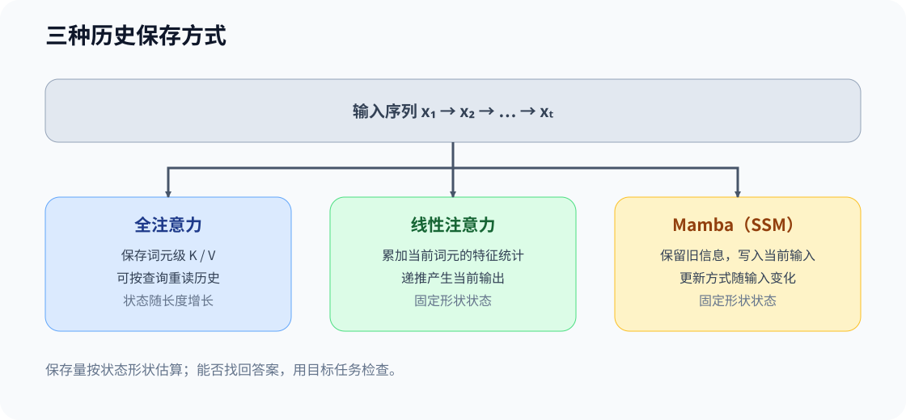
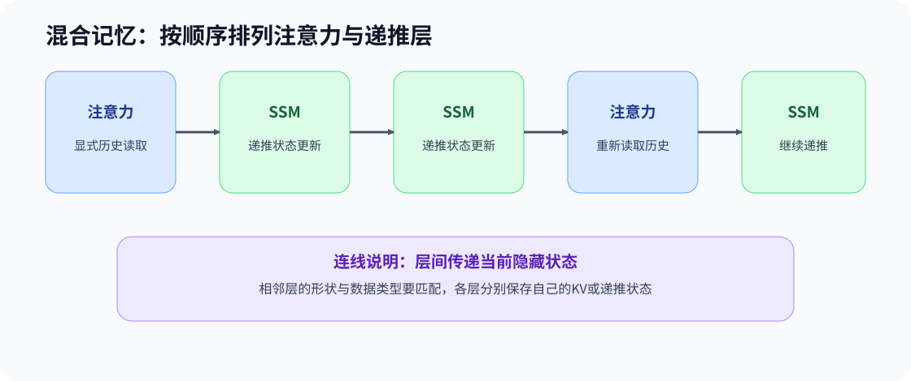

# ARCH-HYBRID-MEMORY. Attention SSM Hybrid | Attention、SSM 与混合记忆架构

**难度：** Hard | **环境：** [CPU 主线，GPU 可选](#runtime-environment) | **标签：** `模型架构`、`SSM`、`混合记忆` | **目标人群：** 理解注意力与递推、希望比较历史保存方式的读者

> 🚀 **云端运行环境**
>
> 本章节的实战代码可以点击以下链接在免费 GPU 算力平台上直接运行：
>
> [](https://colab.research.google.com/github/datawhalechina/llm-algo-leetcode/blob/main/02_PyTorch_Algorithms/ARCH-HYBRID-MEMORY_Attention_SSM_Hybrid.ipynb)
> [](https://modelscope.cn/my/mynotebook) *(国内推荐：魔搭社区免费实例)*


## 本节导读

处理长材料时，注意力层可以根据当前问题重新读取保存的历史K/V，递推层则把已经读过的内容写入一个不断更新的状态。前者需要随历史增长保存更多数据，后者的状态形状可以保持不变，但能否保留任务所需的信息还要看更新方式和训练。

混合模型同时使用这两类层。哪些层保存KV、哪些层更新递推状态，既影响要保存多少数据，也影响隐藏状态经过怎样的计算。本节从具体层排列出发，检查保存量和本题指定的历史读取路径。

<a id="runtime-environment"></a>
## 运行环境

CPU练习使用Python标准库。可选GPU实验使用 `ARCH-CUDA-MECHANISM`，环境准备见[架构实验 Quickstart](../topic_discussion/llm_architecture_evolution/quickstart.md)。

## 前置阅读

先理解固定形状的递推状态，再观察不同层如何传递当前词元的隐藏状态。

- [45. 线性Attention与递推状态](45_Linear_Attention_and_Recurrent_State.md)：区分逐词保存的KV与累计状态。
- [05. Decoder Block](05_LLaMA3_Block_Tutorial.md)：理解层间隐藏状态和残差连接。

## Step 1：区分三种历史保存方式

全注意力为历史词元保存K和V，当前查询可以再次读取这些位置。线性注意力累计经过特征映射的统计量，并用累计结果计算当前输出。状态空间模型（SSM）则通过状态转移逐步更新内部状态；Mamba使用随输入变化的控制量，选择怎样保留旧信息、写入新信息。

| 保存方式 | 保存什么 | 随历史长度怎样变化 | 当前输出怎样取得 |
| --- | --- | --- | --- |
| 全注意力 | 各历史词元的K/V | 线性增长 | 根据查询读取保存的位置 |
| 线性注意力 | 累计的特征统计 | 状态形状固定 | 从累计统计计算当前输出 |
| SSM／Mamba | 递推状态 | 状态形状固定 | 先更新状态，再计算输出 |



## Step 2：列出每层怎样处理隐藏状态

混合模型让部分层读取历史KV，其余层更新递推状态。仅知道注意力层占多少还不够：同样两层注意力，放在模型前部和分散放置，会让隐藏状态经过不同顺序的计算。因此把每层类型按顺序列出，称为层排列；同时检查相邻层的隐藏维度和数据类型是否相容。

| 层或连接 | 做什么 | 检查什么 |
| --- | --- | --- |
| 注意力层 | 根据查询读取已保存的历史 | KV形状、允许访问的位置和保存量 |
| 递推层 | 将当前输入写入状态，再计算输出 | 状态维度、更新方式与保存量 |
| 层间传递与残差 | 将隐藏状态交给下一层，与残差相加 | 形状、数据类型和尺度是否匹配 |



## Step 3：把读取路径要求与答题结果分开

层排列说明哪些层保存并读取逐词 KV。需要显式读取历史 KV 的计算路径，应保留至少一层注意力；采用纯递推路径时，则检查固定状态怎样随输入更新。两种路径的远距离读取能力，都要用任务输出检验。

保存量与实际能力分别检查：先计算各类层保存的字节，再用远距离检索或目标任务测试输出。比较不同公开模型时，还要列出数据、规模和训练预算差异。

| 要判断什么 | 先检查什么 | 怎样进一步验证 |
| --- | --- | --- |
| 状态如何增长 | KV与递推状态的形状、层数和字节数 | 读取实际分配的显存 |
| 哪些层读取历史KV | 每层类型的排列 | 检查实际模型配置与代码 |
| 是否满足指定路径要求 | 明确提出的路径要求、是否有注意力层 | 运行该模型，检查实际历史访问 |
| 是否适合目标任务 | 各模型的任务输出与耗时 | 在匹配条件下比较质量和资源 |


```python
from typing import Dict, List, Optional

```

## Step 4：生成层排列并计算保存量

题目生成注意力与递推层的排列，再分别计算KV和固定形状递推状态的字节数。输入检查和返回结构已提供，补全层排列、两类保存量，以及是否符合本题指定的路径要求。

| TODO / 函数 | 学习者完成的机制 | 必须满足的约束 | 测试证据 |
| --- | --- | --- | --- |
| TODO 1：生成层排列<br>`build_hybrid_schedule` | 按周期安排注意力与递推层 | 层数为正；`None`表示全递推；周期位置使用注意力 | 全注意力、全递推、混合排列与非法层数 |
| TODO 2：计算两类保存量<br>`memory_state_ledger` | 分别计算KV与固定递推状态字节数 | 注意力部分随长度增长，递推部分由固定维度决定 | 层数、两类字节数及总量 |
| TODO 3：检查指定读取路径<br>`exact_history_gate` | 根据本题配置检查是否保留KV读取路径 | 要求该路径时至少有一层注意力；未要求时允许纯递推 | 两种路径要求下的混合与纯递推排列 |


```python
def build_hybrid_schedule(num_layers: int, attention_every: Optional[int]) -> List[str]:
    """生成按顺序排列的注意力层与递推层列表。"""
    if not isinstance(num_layers, int):
        raise TypeError("num_layers must be an integer")
    if num_layers <= 0:
        raise ValueError("num_layers must be positive")
    if attention_every is not None and (not isinstance(attention_every, int) or attention_every <= 0):
        raise ValueError("attention_every must be a positive integer or None")
    # ==========================================
    # TODO 1：生成层排列
    # ==========================================
    # schedule = ???  # 按层索引生成 `attention` / `ssm` 计划。
    raise NotImplementedError("TODO 1：请生成混合层计划")
    return schedule


def memory_state_ledger(
    schedule: List[str],
    seq_len: int,
    num_kv_heads: int,
    head_dim: int,
    recurrent_state_dim: int,
    dtype_bytes: int = 2,
) -> Dict[str, int]:
    """计算单样本的显式 KV 与递推状态理论字节数。"""
    if not schedule or any(layer not in {"attention", "ssm"} for layer in schedule):
        raise ValueError("schedule must contain attention or ssm")
    values = (seq_len, num_kv_heads, head_dim, recurrent_state_dim, dtype_bytes)
    if any(not isinstance(value, int) or value <= 0 for value in values):
        raise ValueError("all dimensions must be positive integers")
    attention_layers = schedule.count("attention")
    ssm_layers = schedule.count("ssm")
    # ==========================================
    # TODO 2：计算两类保存量
    # ==========================================
    # kv_bytes = ???  # 显式 K/V 历史的理论字节数。
    # recurrent_bytes = ???  # 固定递推状态的理论字节数。
    raise NotImplementedError("TODO 2：请计算两类保存量")
    return {
        "attention_layers": attention_layers,
        "ssm_layers": ssm_layers,
        "kv_bytes": kv_bytes,
        "recurrent_bytes": recurrent_bytes,
        "total_bytes": kv_bytes + recurrent_bytes,
    }


def exact_history_gate(schedule: List[str], requires_exact_history: bool) -> Dict[str, object]:
    """检查层排列是否符合本题指定的KV读取路径要求。"""
    if not schedule or any(layer not in {"attention", "ssm"} for layer in schedule):
        raise ValueError("schedule must contain attention or ssm")
    has_attention = "attention" in schedule
    # ==========================================
    # TODO 3：检查指定读取路径
    # ==========================================
    # eligible = ???  # 为本题的路径检查结果，不表示真实模型答题质量。
    raise NotImplementedError("TODO 3：请检查指定读取路径")
    reason = "attention_path_available" if has_attention else (
        "exact_history_requires_attention" if requires_exact_history else "streaming_state_is_sufficient"
    )
    return {"eligible": eligible, "has_attention": has_attention, "reason": reason}

```

## 测试


```python
# 测试设计：分别验证层级计划、状态增长规律和本题指定的KV读取路径。
def test_hybrid_schedule_contract():
    """验证纯递推、周期 Attention 和非法层数。"""
    assert build_hybrid_schedule(6, 2) == ["attention", "ssm", "attention", "ssm", "attention", "ssm"]
    assert build_hybrid_schedule(3, 1) == ["attention", "attention", "attention"]
    assert build_hybrid_schedule(3, None) == ["ssm", "ssm", "ssm"]
    try:
        build_hybrid_schedule(0, 2)
    except ValueError:
        pass
    else:
        raise AssertionError("num_layers=0 必须拒绝")


def test_memory_state_ledger():
    """验证显式 KV 与固定递推状态的字节账本。"""
    schedule = build_hybrid_schedule(4, 2)
    report = memory_state_ledger(schedule, seq_len=8, num_kv_heads=2, head_dim=4, recurrent_state_dim=16)
    assert report["attention_layers"] == 2
    assert report["ssm_layers"] == 2
    assert report["kv_bytes"] == 512
    assert report["recurrent_bytes"] == 64
    assert report["total_bytes"] == 576


def test_exact_history_gate():
    """检查层排列是否符合本题指定的KV读取路径要求。"""
    mixed = ["attention", "ssm"]
    recurrent_only = ["ssm", "ssm"]
    assert exact_history_gate(mixed, True)["eligible"] is True
    assert exact_history_gate(recurrent_only, True)["eligible"] is False
    assert exact_history_gate(recurrent_only, False)["eligible"] is True


def run_arch_hybrid_tests():
    """运行本节全部机制测试。"""
    test_hybrid_schedule_contract()
    test_memory_state_ledger()
    test_exact_history_gate()
    print("✅ 混合记忆：层排列、保存量与指定路径检查通过")


run_arch_hybrid_tests()

```

---

🛑 **STOP HERE** 🛑
<br><br><br><br><br><br><br><br><br><br>
> 请先尝试自己完成代码并跑通测试。<br>
> 如果遇到困难，再向下查看参考代码与解析。
<br><br><br><br><br><br><br><br><br><br>

---
## 参考代码与解析

### 代码

```python
from typing import Dict, List, Optional


def build_hybrid_schedule(num_layers: int, attention_every: Optional[int]) -> List[str]:
    """生成按顺序排列的注意力层与递推层列表。"""
    if not isinstance(num_layers, int):
        raise TypeError("num_layers must be an integer")
    if num_layers <= 0:
        raise ValueError("num_layers must be positive")
    if attention_every is not None and (not isinstance(attention_every, int) or attention_every <= 0):
        raise ValueError("attention_every must be a positive integer or None")
    # TODO 1：生成层排列
    schedule = ["ssm"] * num_layers if attention_every is None else [
        "attention" if index % attention_every == 0 else "ssm" for index in range(num_layers)
    ]
    return schedule


def memory_state_ledger(
    schedule: List[str],
    seq_len: int,
    num_kv_heads: int,
    head_dim: int,
    recurrent_state_dim: int,
    dtype_bytes: int = 2,
) -> Dict[str, int]:
    """计算单样本的显式 KV 与递推状态理论字节数。"""
    if not schedule or any(layer not in {"attention", "ssm"} for layer in schedule):
        raise ValueError("schedule must contain attention or ssm")
    values = (seq_len, num_kv_heads, head_dim, recurrent_state_dim, dtype_bytes)
    if any(not isinstance(value, int) or value <= 0 for value in values):
        raise ValueError("all dimensions must be positive integers")
    attention_layers = schedule.count("attention")
    ssm_layers = schedule.count("ssm")
    # TODO 2：计算两类保存量
    kv_bytes = attention_layers * seq_len * num_kv_heads * head_dim * 2 * dtype_bytes
    recurrent_bytes = ssm_layers * recurrent_state_dim * dtype_bytes
    return {
        "attention_layers": attention_layers,
        "ssm_layers": ssm_layers,
        "kv_bytes": kv_bytes,
        "recurrent_bytes": recurrent_bytes,
        "total_bytes": kv_bytes + recurrent_bytes,
    }


def exact_history_gate(schedule: List[str], requires_exact_history: bool) -> Dict[str, object]:
    """检查层排列是否符合本题指定的KV读取路径要求。"""
    if not schedule or any(layer not in {"attention", "ssm"} for layer in schedule):
        raise ValueError("schedule must contain attention or ssm")
    has_attention = "attention" in schedule
    # TODO 3：检查指定读取路径
    eligible = has_attention or not requires_exact_history
    reason = "attention_path_available" if has_attention else (
        "exact_history_requires_attention" if requires_exact_history else "streaming_state_is_sufficient"
    )
    return {"eligible": eligible, "has_attention": has_attention, "reason": reason}

```

### 解析

#### TODO 1：生成层排列

- 按层索引选择类型：全递推排列全部使用递推层；指定周期时，第0层和后续周期位置使用注意力。
- 测试检查间隔2层、每层注意力与全递推三种情况，并拒绝零层输入。

#### TODO 2：计算两类保存量

- 注意力层保存每个历史词元的K/V，因此乘以序列长度；本题递推层只保存指定数量的状态元素。
- 分别计算两类字节数，再相加。测试使用两层注意力、两层递推和长度8，核对512、64及576字节。

#### TODO 3：检查指定读取路径

- `requires_exact_history`在本题中表示配置明确要求保留逐词KV读取路径。要求时检查是否有注意力层，未要求时允许纯递推排列继续。
- 测试比较混合与纯递推排列在两种要求下是否通过。这个布尔检查不评估模型能否记住或正确找回某条信息。

## Step 5：测量不同层安排的状态增长

GPU实验固定总层数、表示宽度和数据类型，比较全注意力、全递推与混合排列。它使用注意力调用和简化矩阵状态更新，测量保存对象与一次读写的耗时；真实Mamba的更新计算与模型答题质量另用对应实现检查。

| CPU中检查什么 | GPU补充什么 | 后续怎样使用 |
| --- | --- | --- |
| 层排列、状态字节数和本题指定的路径要求 | 各长度的状态占用、单步耗时与峰值显存 | 检查增长规律，再使用真实模型测试长输入任务 |

### 5.1 环境与固定输入

使用 `ARCH-CUDA-MECHANISM`，创建与预检见[架构实验 Quickstart](../topic_discussion/llm_architecture_evolution/quickstart.md)。三个排列共用总层数、宽度与测量方法，只改变两类层的数量。

| 配置项 | 当前设置 | 改变时注意什么 |
| --- | --- | --- |
| 实验版本与标签 | `arch-hybrid-memory-growth-v1`；默认标签 `default` | 新测量使用唯一标签，保留旧结果 |
| 环境 | `ARCH-CUDA-MECHANISM`；单张CUDA GPU | 预检通过后再启用GPU |
| 历史长度 | `512, 2048, 8192` | 分别读取每种保存方式的增长 |
| 层数与安排 | 总层数4；混合排列每4层有1层注意力 | 比例改变后单独记录 |
| 宽度 | 8个头，每头64维 | 三组保持相同宽度 |
| 测量 | BF16、预热10次、重复100次、CUDA事件计时 | 改变精度或轮数后单独比较 |
| 输出 | `benchmarks/results/arch_hybrid_memory_growth_<RUN_LABEL>.json` | 结果与[实验资产表](../topic_discussion/llm_architecture_evolution/experiment_assets.md)中记录对应 |


```python
# ======== 学习者配置：先改运行开关与结果标签 ========
RUN_MODE = 'dry_run'  # 默认值 dry_run；合法值为 dry_run / real_gpu，Profile 预检通过后才启用 GPU。
RUN_LABEL = 'default'  # 默认值 default；正式复测改为唯一标签，避免覆盖旧结果。

# ======== 工作负载：首次运行建议保留默认值 ========
SEQUENCE_LENGTHS = [512, 2048, 8192]  # 默认值：三个长度阶梯；显式历史随长度增长。
NUM_LAYERS = 4  # 默认值：4；三种候选保持相同总层数。
ATTENTION_EVERY = 4  # 默认值：4；混合候选每四层保留一层 Attention。
NUM_HEADS = 8  # 默认值：8；决定历史状态和递推状态的宽度。
HEAD_DIM = 64  # 默认值：64；增大会同时提高三种候选的状态与计算成本。
DTYPE = 'bfloat16'  # 默认值：bfloat16；三种候选必须使用相同 dtype。
WARMUP = 10  # 默认值：10；不计入结果的预热轮数。
REPEATS = 100  # 默认值：100；CUDA Event 计时的重复轮数。

# ======== 固定实验身份与相对结果路径：不要修改 ========
PROFILE_ID = 'ARCH-CUDA-MECHANISM'  # 固定环境身份；必须先通过同名 Profile 预检。
SEMANTIC_ID = 'ARCH-HYBRID-MEMORY-MECHANISM'  # 固定机制身份，不随复测改变。
WORKLOAD_ID = 'arch-hybrid-memory-growth-v1'  # 固定候选、状态宽度和测量口径。
RESULT_RELATIVE_PATH = f'benchmarks/results/arch_hybrid_memory_growth_{RUN_LABEL}.json'  # 仓库相对结果路径。
print({'run_mode': RUN_MODE, 'profile': PROFILE_ID, 'workload': WORKLOAD_ID, 'lengths': SEQUENCE_LENGTHS, 'layers': NUM_LAYERS, 'attention_every': ATTENTION_EVERY, 'result': RESULT_RELATIVE_PATH})

```

### 5.2 执行并保存结果


```python
from tools.project_runtime import resolve_project_root

REPO_ROOT = resolve_project_root()
RUNNER_PATH = REPO_ROOT / 'tools' / 'run_architecture_mechanism_benchmark.py'
RESULT_PATH = REPO_ROOT / RESULT_RELATIVE_PATH

if RUN_MODE == 'real_gpu':
    expected_identity = ('ARCH-HYBRID-MEMORY-MECHANISM', 'arch-hybrid-memory-growth-v1', 'ARCH-CUDA-MECHANISM')
    actual_identity = (SEMANTIC_ID, WORKLOAD_ID, PROFILE_ID)
    expected_result_name = f'arch_hybrid_memory_growth_{RUN_LABEL}.json'
    if actual_identity != expected_identity or RESULT_PATH.name != expected_result_name:
        raise RuntimeError('混合记忆实验身份不一致；请先重新运行本 Notebook 的 5.1 配置单元。')
    import subprocess, sys
    command = [
        sys.executable, str(RUNNER_PATH),
        '--mode', 'memory_growth', '--output', str(RESULT_PATH),
        '--semantic-id', SEMANTIC_ID, '--workload-id', WORKLOAD_ID,
        '--run-label', RUN_LABEL, '--profile-id', PROFILE_ID,
        '--sequence-lengths', ','.join(map(str, SEQUENCE_LENGTHS)),
        '--num-layers', str(NUM_LAYERS), '--attention-every', str(ATTENTION_EVERY),
        '--query-heads', str(NUM_HEADS), '--head-dim', str(HEAD_DIM), '--dtype', DTYPE,
        '--warmup', str(WARMUP), '--repeats', str(REPEATS),
    ]
    subprocess.run(command, check=True)
else:
    print('保持 dry_run；按 Quickstart 完成 Profile 预检后再设置 RUN_MODE=real_gpu。')

```

### 5.3 读取各长度结果

逐长度读取全注意力、全递推与混合排列的状态字节数、单步耗时和峰值显存，同时检查输出是否出现非有限值。


```python
import json
from tools.project_runtime import resolve_project_root

result_path = resolve_project_root() / RESULT_RELATIVE_PATH
if result_path.exists():
    result = json.loads(result_path.read_text(encoding='utf-8'))
    required = {'schema_version', 'identity', 'workload', 'hardware', 'baseline', 'candidates', 'metrics', 'evidence_level', 'failure', 'decision'}
    missing = required - set(result)
    if missing:
        raise ValueError(f'结果 JSON 缺少字段：{sorted(missing)}')
    print({'identity': result['identity'], 'baseline': result['baseline'], 'candidates': result['candidates'], 'evidence_level': result['evidence_level'], 'decision': result['decision']})
    for row in result['metrics'].get('rows', []):
        print(row)
else:
    print(f'尚无混合记忆结果：{result_path}；如需读取历史结果，请先在 5.1 设置对应 RUN_LABEL。')

```

### 5.4 解释已有测量

`rtx5070ti_hybrid_v1` 固定总层数与宽度，验证三种保存方式随长度的变化。这里的时间来自简化注意力与矩阵状态读写，解释时与真实模型的请求耗时分开。

| 检查项 | 读取字段 | 已有结果 | 怎样理解 |
| --- | --- | --- | --- |
| 运行记录 | `identity`、`failure` | 标识、有限值和增长检查通过 | 继续读取各长度结果 |
| 保存量 | `state_bytes` | 全注意力从4 MiB增至64 MiB；全递推保持0.25 MiB；混合从1.19 MiB增至16.19 MiB | 注意力保存量随长度增长，固定递推状态保持不变 |
| 耗时与峰值 | `mean_step_ms`、`peak_memory_mb` | 长度8192时，混合状态约少74.7%，简化单步耗时约为全注意力的32.8% | 记录当前张量与实现的表现，真实模型仍需任务复测 |
| 原始判断 | `decision`、`evidence_level` | `accept_hybrid_state_growth_mechanism` | 状态增长检查通过，未测真实模型的长序列质量 |

## 相关阅读

- [Mamba](https://arxiv.org/abs/2312.00752)：选择性状态空间模型。
- [Transformers are SSMs](https://arxiv.org/abs/2405.21060)：Attention 与状态空间模型的结构联系。
- [10 线性 Attention、SSM 与混合记忆](../topic_discussion/llm_architecture_evolution/10_linear_attention_ssm_and_hybrid.md)
- [77 长序列记忆架构基准](./77_Long_Sequence_Memory_Architecture_Benchmark.md)
