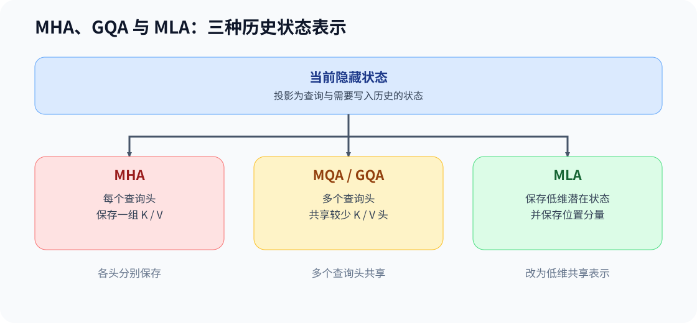
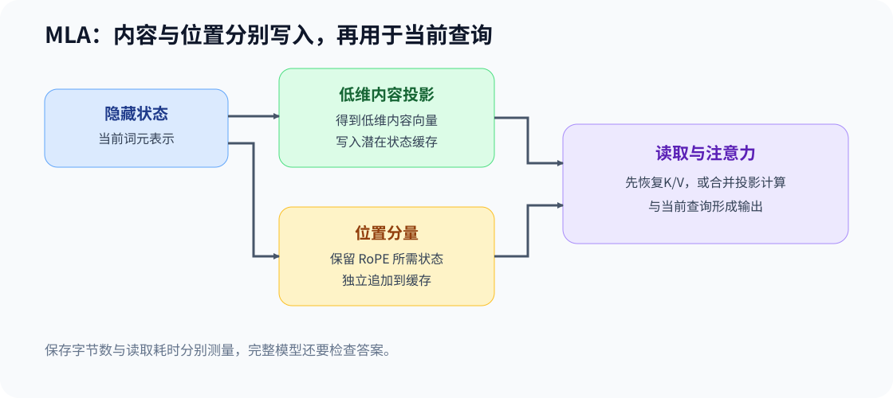

# ARCH-MLA. Multihead Latent Attention | MLA 与紧凑 KV 表示

**难度：** Hard | **环境：** [CPU 主线，GPU 可选](#runtime-environment) | **标签：** `模型架构`、`MLA`、`KV表示` | **目标人群：** 理解注意力头、希望比较缓存保存方式的读者

> 🚀 **云端运行环境**
>
> 本章节的实战代码可以点击以下链接在免费 GPU 算力平台上直接运行：
>
> [](https://colab.research.google.com/github/datawhalechina/llm-algo-leetcode/blob/main/02_PyTorch_Algorithms/ARCH-MLA_Multihead_Latent_Attention.ipynb)
> [](https://modelscope.cn/my/mynotebook) *(国内推荐：魔搭社区免费实例)*


## 本节导读

历史越来越长时，注意力缓存也随之增大。MHA为每个查询头保存一组K/V，GQA让多个查询头共享较少的K/V头；MLA则改为保存较低维的内容状态，并另外保存位置分量。它不仅少存几组，还改变了每个词元保存的内容。

本节先按状态形状计算字节数，再比较读取历史时是否需要恢复完整K/V。保存量和读取计算分别检查，才能解释一种表示为什么占用更小，却可能花更多时间。

<a id="runtime-environment"></a>
## 运行环境

CPU练习使用Python标准库。可选GPU实验使用 `ARCH-CUDA-MECHANISM` 环境，准备入口见[架构实验 Quickstart](../topic_discussion/llm_architecture_evolution/quickstart.md)。

## 前置阅读

先掌握 Q/K/V、MHA/MQA/GQA 和普通 KV Cache 的形状，再进入表示压缩。

- [04 Attention MHA / GQA](./04_Attention_MHA_GQA.md)
- [Part 01 · 11 KV Cache 与显存增长](../01_Hardware_Math_and_Systems/11_KV_Cache_and_Memory_Growth.md)

## Step 1：比较每个词元保存什么

在MHA中，各查询头使用各自的K/V头。GQA将查询头分组，同组共享一组K/V；MQA让所有查询头共享一组。MLA通过线性变换（投影）把历史内容编码为低维向量，称为潜在状态；推理时将它与位置相关的状态一起保存。

| 表示方式 | 历史中保存什么 | 怎样减小保存量 | 读取时做什么 |
| --- | --- | --- | --- |
| MHA | 各K/V头的键和值 | 各头独立保存 | 直接计算注意力 |
| MQA／GQA | 较少K/V头的键和值 | 多个查询头共享 | 将共享的K/V对应到查询头 |
| MLA | 低维内容状态与位置分量 | 缩小每词元保存的表示 | 使用投影恢复或改写后的计算 |



## Step 2：内容与位置分开保存，读取时再计算

MLA缓存中的内容状态是隐藏状态的低维投影；位置分量保留键中参与旋转位置编码（RoPE）的部分。位置旋转与任意压缩投影通常不能交换顺序，因此分别保存和计算这两部分。缓存字节数也要把两者相加。

读取内容状态时，可以先投影恢复K和V，再计算注意力；也可以把投影合并到查询计算和输出映射中，直接使用低维状态，这种改写称为矩阵吸收。它省去完整历史K/V的生成，但增加或改变了其他计算，需要分别测量耗时。

| 对象 | 怎样得到 | 是否随历史增长 | 读取时怎样使用 |
| --- | --- | --- | --- |
| 内容状态 | 隐藏状态的低维投影 | 是 | 恢复K/V，或在低维状态上计算 |
| 位置分量 | 位置相关的键投影与RoPE处理 | 是 | 与查询的位置部分计算分数 |
| 当前查询 | 当前词元的查询投影 | 不作为历史缓存保存 | 计算当前输出 |



## Step 3：把存储大小、输出与耗时分别检查

例如，某个简化配置每词元保存256个内容元素、32个位置元素，共288个元素；每个元素2字节时，单层单样本占576字节。这是按形状计算的保存量。实际运行还可能生成完整K/V、中间结果或额外工作区，需要读取实际分配的显存。

两条计算路径使用相同内容状态和投影时，可以先比较输出是否接近，再比较耗时与峰值。即使输出接近且缓存更小，完整模型的答题质量与请求性能仍要使用对应权重和任务测量。

| 检查什么 | 从哪里取得 | 回答什么问题 |
| --- | --- | --- |
| 保存字节数 | 状态形状与元素字节数 | 每词元、每层要保存多少数据 |
| 计算路径 | 投影、K/V恢复与注意力代码 | 是否生成完整历史K/V |
| 输出与局部耗时 | 相同内容状态下的两条路径 | 输出是否接近，哪条路径更快、更省显存 |
| 模型与服务结果 | 固定任务和真实模型 | 能否保持回答质量、缩短请求耗时 |


```python
from typing import Dict

```

## Step 4：计算三种表示的保存字节数

本题用同一组 Head、维度和数据类型配置比较 MHA、GQA 与简化 MLA。字段检查、模式分派和报告结构已经给出；你将补全维度条件、三类状态元素数与相对比例。测试分别覆盖非法维度、不可整除配置、保存字节数和最紧凑表示。

| TODO / 函数 | 学习者完成的机制 | 必须满足的约束 | 测试证据 |
| --- | --- | --- | --- |
| TODO 1：检查表示配置<br>`validate_attention_state_config` | 校验三类表示的共用配置 | 必需字段完整；维度为正整数；查询头可均匀映射到 K/V 头 | 缺失字段、非法维度与不可整除配置 |
| TODO 2：计算历史状态字节数<br>`cache_bytes_per_token` | 计算单词元历史状态字节数 | MHA / GQA 同时记录 K、V；MLA 记录潜在状态与位置分量 | 三类字节数、未知模式与数据类型口径 |
| TODO 3：比较相同配置下的保存量<br>`compare_attention_states` | 生成同口径表示对照 | 返回相对 MHA 的比例和最紧凑候选 | 比例、排序与同数据类型不变量 |

```python
def validate_attention_state_config(config: Dict[str, int]) -> None:
    """校验 MHA/GQA/MLA 共用的状态配置。"""
    required = ('num_heads', 'num_kv_heads', 'head_dim', 'latent_dim', 'rope_dim', 'dtype_bytes')
    missing = [key for key in required if key not in config]
    if missing:
        raise ValueError(f'missing fields: {missing}')
    # ==========================================
    # TODO 1：检查表示配置
    # ==========================================
    # values = ???  # required 对应的全部配置值。
    # heads_divisible = ???  # Query Head 数可被 KV Head 数整除时为真。
    raise NotImplementedError('TODO 1：请检查表示配置')
    if any(not isinstance(value, int) or value <= 0 for value in values):
        raise ValueError('所有维度和 dtype_bytes 必须是正整数')
    if not heads_divisible:
        raise ValueError('num_heads 必须能被 num_kv_heads 整除')


def cache_bytes_per_token(mode: str, config: Dict[str, int]) -> int:
    """返回单层、单样本、单 token 的历史状态字节数。"""
    validate_attention_state_config(config)
    # ==========================================
    # TODO 2：计算历史状态字节数
    # ==========================================
    # mha_elements = ???  # 完整 K/V Head 的元素数。
    # gqa_elements = ???  # 共享 KV Head 后的 K/V 元素数。
    # mla_elements = ???  # latent 与位置分量的元素数。
    raise NotImplementedError('TODO 2：请计算历史状态字节数')
    elements_by_mode = {'mha': mha_elements, 'gqa': gqa_elements, 'mla': mla_elements}
    if mode not in elements_by_mode:
        raise ValueError(f'unknown mode: {mode}')
    return elements_by_mode[mode] * config['dtype_bytes']


def compare_attention_states(config: Dict[str, int]) -> Dict[str, object]:
    """比较三种表示并返回相对 MHA 的状态比例。"""
    modes = ('mha', 'gqa', 'mla')
    # ==========================================
    # TODO 3：比较相同配置下的保存量
    # ==========================================
    # bytes_by_mode = ???  # 三种模式到单 token 状态字节数的映射。
    # ratio_vs_mha = ???  # 每种模式相对 MHA 的字节比例。
    # most_compact = ???  # 状态字节数最小的模式名。
    raise NotImplementedError('TODO 3：请比较相同配置下的保存量')
    return {
        'bytes_per_token': bytes_by_mode,
        'ratio_vs_mha': ratio_vs_mha,
        'most_compact': most_compact,
    }

```

## 测试


```python
# 测试设计：分别验证配置不变量、三类状态字节数和相对比例。
BASE_CONFIG = {
    "num_heads": 16,
    "num_kv_heads": 4,
    "head_dim": 64,
    "latent_dim": 256,
    "rope_dim": 32,
    "dtype_bytes": 2,
}


def test_attention_state_config_contract():
    """配置必须包含正整数维度并满足 Head 整除关系。"""
    validate_attention_state_config(BASE_CONFIG)
    invalid = dict(BASE_CONFIG, num_heads=15)
    try:
        validate_attention_state_config(invalid)
    except ValueError:
        pass
    else:
        raise AssertionError("num_heads 不能被 num_kv_heads 整除时必须拒绝")


def test_cache_bytes_per_token():
    """三类表示应按各自保存状态计算单 token 字节数。"""
    assert cache_bytes_per_token("mha", BASE_CONFIG) == 4096
    assert cache_bytes_per_token("gqa", BASE_CONFIG) == 1024
    assert cache_bytes_per_token("mla", BASE_CONFIG) == 576


def test_attention_state_comparison():
    """同 dtype 对照应返回稳定比例与最紧凑候选。"""
    report = compare_attention_states(BASE_CONFIG)
    assert report["most_compact"] == "mla"
    assert report["ratio_vs_mha"]["mha"] == 1.0
    assert report["ratio_vs_mha"]["gqa"] == 0.25
    assert report["ratio_vs_mha"]["mla"] == 0.140625


def run_arch_mla_tests():
    test_attention_state_config_contract()
    test_cache_bytes_per_token()
    test_attention_state_comparison()
    print("✅ MLA：配置、状态字节数与表示对照测试通过")


run_arch_mla_tests()

```

---

🛑 **STOP HERE** 🛑
<br><br><br><br><br><br><br><br><br><br>
> 请先尝试自己完成代码并跑通测试。<br>
> 如果遇到困难，再向下查看参考代码与解析。
<br><br><br><br><br><br><br><br><br><br>

---
## 参考代码与解析

### 代码

```python
from typing import Dict


def validate_attention_state_config(config: Dict[str, int]) -> None:
    """校验 MHA/GQA/MLA 共用的状态配置。"""
    required = ('num_heads', 'num_kv_heads', 'head_dim', 'latent_dim', 'rope_dim', 'dtype_bytes')
    missing = [key for key in required if key not in config]
    if missing:
        raise ValueError(f'missing fields: {missing}')
    # TODO 1：检查表示配置
    values = [config[key] for key in required]
    heads_divisible = config['num_heads'] % config['num_kv_heads'] == 0
    if any(not isinstance(value, int) or value <= 0 for value in values):
        raise ValueError('所有维度和 dtype_bytes 必须是正整数')
    if not heads_divisible:
        raise ValueError('num_heads 必须能被 num_kv_heads 整除')


def cache_bytes_per_token(mode: str, config: Dict[str, int]) -> int:
    """返回单层、单样本、单 token 的历史状态字节数。"""
    validate_attention_state_config(config)
    # TODO 2：计算历史状态字节数
    mha_elements = 2 * config['num_heads'] * config['head_dim']
    gqa_elements = 2 * config['num_kv_heads'] * config['head_dim']
    mla_elements = config['latent_dim'] + config['rope_dim']
    elements_by_mode = {'mha': mha_elements, 'gqa': gqa_elements, 'mla': mla_elements}
    if mode not in elements_by_mode:
        raise ValueError(f'unknown mode: {mode}')
    return elements_by_mode[mode] * config['dtype_bytes']


def compare_attention_states(config: Dict[str, int]) -> Dict[str, object]:
    """比较三种表示并返回相对 MHA 的状态比例。"""
    modes = ('mha', 'gqa', 'mla')
    # TODO 3：比较相同配置下的保存量
    bytes_by_mode = {mode: cache_bytes_per_token(mode, config) for mode in modes}
    mha_bytes = bytes_by_mode['mha']
    ratio_vs_mha = {mode: value / mha_bytes for mode, value in bytes_by_mode.items()}
    most_compact = min(bytes_by_mode, key=bytes_by_mode.get)
    return {
        'bytes_per_token': bytes_by_mode,
        'ratio_vs_mha': ratio_vs_mha,
        'most_compact': most_compact,
    }

```

### 解析

#### TODO 1：检查表示配置

- 维度和元素字节数须为正整数，查询头数还要能被KV头数整除，才能将查询头均匀分到各KV头。
- 测试保持KV头数不变，将查询头改为15，检查无法整除的配置是否被拒绝。

#### TODO 2：计算历史状态字节数

- MHA与GQA都保存K、V两份状态，因此元素数中有系数2；简化MLA则把内容状态与位置分量相加。
- 分别计算各模式的元素数，再乘元素字节数。测试核对4096、1024和576字节，防止漏掉V或位置分量。

#### TODO 3：比较相同配置下的保存量

- 三种模式使用同一组形状和元素字节数，先分别求保存量，再除以MHA的大小，得到相对比例。
- 测试检查各比例与最小值对应的模式。最小值表示本组配置下保存量最少，不代表运行最快。

## Step 5：测量缓存保存与内容计算

GPU实验固定查询头数、历史长度和数据类型，比较MHA、GQA、先恢复K/V的内容路径，以及合并投影后的内容路径。两条低维路径只计算内容分支；位置分量计入存储大小，未加入这两条计时计算。

| CPU中检查什么 | GPU补充什么 | 后续怎样使用 |
| --- | --- | --- |
| 维度、保存字节数和相对比例 | 实际缓存、生成完整K/V的额外占用、内容输出差异与耗时 | 选择需要进一步实现的路径，再使用真实模型复测 |

### 5.1 环境与固定输入

使用 `ARCH-CUDA-MECHANISM`，创建与预检见[架构实验 Quickstart](../topic_discussion/llm_architecture_evolution/quickstart.md)。固定查询头数、长度、数据类型与测量方法，再改变历史保存方式以及是否生成完整K/V。

| 配置项 | 当前设置 | 改变时注意什么 |
| --- | --- | --- |
| 实验版本与标签 | `arch-mla-representation-v2`；默认标签 `default` | 新测量使用唯一标签，保留旧结果 |
| 环境 | `ARCH-CUDA-MECHANISM`；单张CUDA GPU | 通过预检后再切换 `real_gpu` |
| 比较路径 | MHA、GQA、低维状态重建、合并投影后的内容计算 | 两条低维路径共用相同内容状态与投影 |
| 历史长度 | `512, 2048, 8192` | 分别记录各长度的保存量和耗时 |
| 表示宽度 | 查询头16、KV头4、头维度64、内容维度256、位置维度64 | 宽度改变后单独记录 |
| 测量 | BF16、预热10次、重复100次、CUDA事件计时 | 同时记录保存量、额外K/V、平均耗时、峰值和输出接近程度 |
| 输出 | `benchmarks/results/arch_mla_representation_<RUN_LABEL>.json` | 结果说明见5.4与[实验资产表](../topic_discussion/llm_architecture_evolution/experiment_assets.md) |


```python
# ======== 学习者配置：修改后先重新运行本单元 ========
RUN_MODE = 'dry_run'  # 默认值 dry_run；合法值为 dry_run / real_gpu，预检通过后才启用真实 GPU。
RUN_LABEL = 'default'  # 默认值 default；正式复测改为唯一标签，避免覆盖旧结果。

SEQUENCE_LENGTHS = [512, 2048, 8192]  # 默认单位为 token；增大会线性增加三种表示的历史状态。
QUERY_HEADS = 16  # 默认值 16；MHA 使用同数量 KV Head，且必须能被 KV_HEADS 整除。
KV_HEADS = 4  # 默认值 4；定义 GQA 和 latent 重建后的 KV Head 数。
HEAD_DIM = 64  # 默认值 64；单位为每个 Head 的特征维度。
LATENT_DIM = 256  # 默认值 256；每 token 保存的潜在内容维度，增大会提高状态量和重建计算。
ROPE_DIM = 64  # 默认值 64；每 token 单独保留的位置分量维度。
DTYPE = 'bfloat16'  # 默认值 bfloat16；合法值为 bfloat16 / float32，更换后结果不可直接合并。
WARMUP = 10  # 默认值 10 次；只用于预热，不计入平均时间。
REPEATS = 100  # 默认值 100 次；增大可降低计时波动，但会延长实验。
# ====================================================

# 固定身份与相对结果路径：协议不变时不要修改。
PROFILE_ID = 'ARCH-CUDA-MECHANISM'  # 固定环境身份；必须先通过同名 Profile 预检。
SEMANTIC_ID = 'ARCH-MLA-REPRESENTATION-MECHANISM'  # 固定机制身份，不随复测改变。
WORKLOAD_ID = 'arch-mla-representation-v2'  # v2 增加吸收式路径与语义一致性检查。
RESULT_RELATIVE_PATH = f'benchmarks/results/arch_mla_representation_{RUN_LABEL}.json'  # 仓库相对结果路径。
print({
    'run_mode': RUN_MODE, 'profile': PROFILE_ID, 'workload': WORKLOAD_ID,
    'lengths': SEQUENCE_LENGTHS, 'query_heads': QUERY_HEADS,
    'kv_heads': KV_HEADS, 'latent_dim': LATENT_DIM, 'result': RESULT_RELATIVE_PATH,
})

```

### 5.2 执行并保存结果


```python
from tools.project_runtime import resolve_project_root

REPO_ROOT = resolve_project_root()
RUNNER_PATH = REPO_ROOT / 'tools' / 'run_architecture_mechanism_benchmark.py'
RESULT_PATH = REPO_ROOT / RESULT_RELATIVE_PATH

if RUN_MODE == 'real_gpu':
    expected_identity = ('ARCH-MLA-REPRESENTATION-MECHANISM', 'arch-mla-representation-v2', 'ARCH-CUDA-MECHANISM')
    actual_identity = (SEMANTIC_ID, WORKLOAD_ID, PROFILE_ID)
    expected_result_name = f'arch_mla_representation_{RUN_LABEL}.json'
    if actual_identity != expected_identity or RESULT_PATH.name != expected_result_name:
        raise RuntimeError('MLA 实验身份不一致；请先重新运行本 Notebook 的 5.1 配置单元。')
    import subprocess, sys
    command = [
        sys.executable, str(RUNNER_PATH),
        '--mode', 'kv_representation', '--output', str(RESULT_PATH),
        '--semantic-id', SEMANTIC_ID, '--workload-id', WORKLOAD_ID,
        '--run-label', RUN_LABEL, '--profile-id', PROFILE_ID,
        '--sequence-lengths', ','.join(map(str, SEQUENCE_LENGTHS)),
        '--query-heads', str(QUERY_HEADS), '--kv-heads', str(KV_HEADS),
        '--head-dim', str(HEAD_DIM), '--latent-dim', str(LATENT_DIM),
        '--rope-dim', str(ROPE_DIM), '--dtype', DTYPE,
        '--warmup', str(WARMUP), '--repeats', str(REPEATS),
    ]
    subprocess.run(command, check=True)
else:
    print('保持 dry_run；按 Quickstart 完成 Profile 预检后再设置 RUN_MODE=real_gpu。')

```

### 5.3 读取结果

读取结果JSON，逐长度列出四条路径的保存量、额外生成的K/V、耗时与峰值，并检查两条内容计算的输出是否接近。


```python
import json
from tools.project_runtime import resolve_project_root

result_path = resolve_project_root() / RESULT_RELATIVE_PATH
if result_path.exists():
    result = json.loads(result_path.read_text(encoding='utf-8'))
    required = {'schema_version', 'identity', 'workload', 'hardware', 'baseline', 'candidates', 'metrics', 'evidence_level', 'failure', 'decision'}
    missing = required - set(result)
    if missing:
        raise ValueError(f'结果 JSON 缺少字段：{sorted(missing)}')
    print({'identity': result['identity'], 'baseline': result['baseline'], 'candidates': result['candidates'], 'evidence_level': result['evidence_level'], 'decision': result['decision']})
    for row in result['metrics'].get('rows', []):
        print(row)
else:
    print(f'尚无 MLA 表示结果：{result_path}；如需读取历史结果，请先在 5.1 设置对应 RUN_LABEL。')

```

### 5.4 解释已有测量

`rtx5070ti_mla_v3` 使用同一组低维内容状态与投影，比较先恢复K/V和合并投影两种算法。先查看运行版本与失败，再比较存储、输出差异、耗时和峰值。

| 检查项 | 读取字段 | 已有结果 | 怎样理解 |
| --- | --- | --- | --- |
| 运行记录 | `identity`、`failure` | 标识匹配，无失败 | 继续读取本次测量 |
| 保存量 | `cache_bytes`、`materialized_kv_bytes` | GQA比MHA少75%；低维状态比MHA少84.375%；合并投影路径未生成完整K/V | 当前形状下，保存对象与额外分配不同 |
| 内容输出 | `cosine_vs_reconstruction` | 0.999988–0.999993，均为有限值 | 两条内容计算的输出接近 |
| 耗时与峰值 | `mean_step_ms`、`peak_memory_mb` | 合并投影路径耗时约为重建路径的1.9–2.0倍；长度8192时峰值约低30.5% | 这组PyTorch实现节省了部分峰值，但耗时更长 |
| 原始判断 | `decision`、`evidence_level` | `accept_latent_representation_and_absorbed_path_mechanism` | 表示与内容计算检查通过；完整模型质量和服务性能另测 |

## 相关阅读

- [DeepSeek-V2](https://arxiv.org/abs/2405.04434)：MLA 的代表架构。
- [04 Attention 演进专题正文](../topic_discussion/llm_architecture_evolution/04_attention_evolution.md)
- [71 MLA / KV Cache 结构基准](./71_MLA_KV_Cache_Architecture_Benchmark.md)
