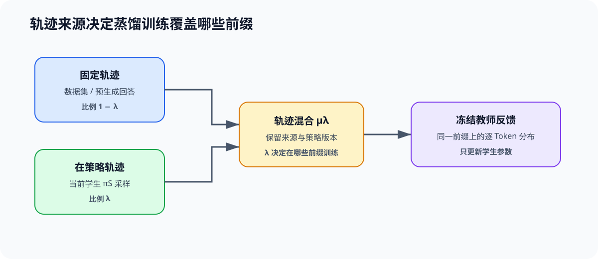
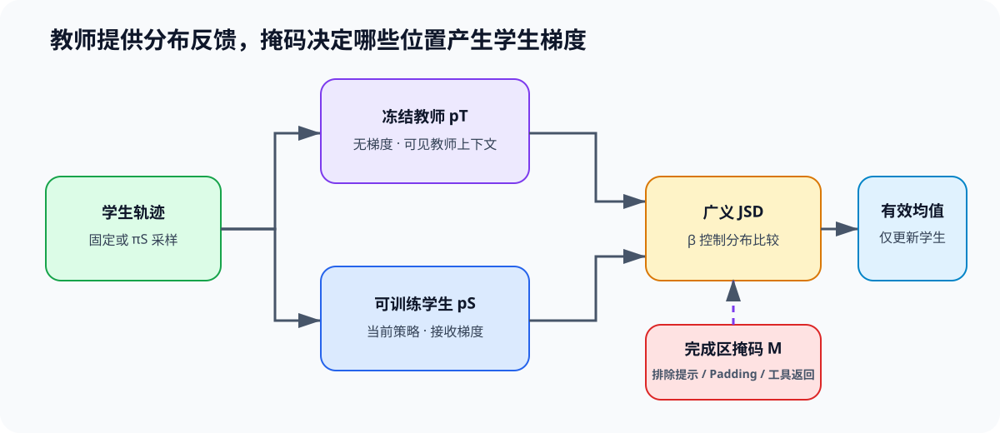

# DISTILL-OPD. On Policy Distillation and GKD | 在策略蒸馏与 GKD
**难度：** Hard | **环境：** [CPU 主线](#runtime-environment) | **标签：** `蒸馏`, `GKD`, `在策略采样`, `教师学生` | **目标人群：** 模型压缩与后训练学习者

> 🚀 **云端运行环境**
>
> 本章节的实战代码可以点击以下链接在免费 GPU 算力平台上直接运行：
>
> [](https://colab.research.google.com/github/datawhalechina/llm-algo-leetcode/blob/main/02_PyTorch_Algorithms/DISTILL-OPD_On_Policy_Distillation_and_GKD.ipynb)
> [](https://modelscope.cn/my/mynotebook) *(国内推荐：魔搭社区免费实例)*


---

## 本节导读

离线蒸馏通常在固定数据或教师生成数据上训练学生，学生部署时却要处理自己更容易产生的前缀和错误。GKD（Generalized Knowledge Distillation）让学生从自己的策略采样回答，再由冻结教师对这些学生轨迹给出逐 Token 分布反馈，从而把训练信号移到学生实际访问的状态附近。

本节先确定离线与在策略轨迹的混合比例，再计算教师—学生分布差异，最后用完成区掩码形成学生更新。完成后，你应该能解释“谁生成轨迹、谁提供监督、哪些 Token 参与损失”，并用独立的 PyTorch 分布 API 核对教学实现。

**关键词：** `on-policy distillation`, `GKD`, `generalized JSD`, `completion mask`, `teacher feedback`

---

<a id="runtime-environment"></a>

## 运行环境

- **基础练习：** 默认使用 [`BASE-CPU`](../guide.md#base-cpu)，运行 [Step 4 的题目与测试](#mechanism-practice)。
- **框架核对：** 如需用 PyTorch 分布 API 独立核对广义 JSD，使用 [`PT-CPU`](../topic_discussion/post_training_optimization/quickstart.md#pt-cpu-quickstart)，运行[框架一致性核对](#framework-check)。

---

## 前置阅读

**导语：** 压缩专题先区分量化、剪枝与蒸馏改变的对象；后训练专题的轨迹页解释策略版本和轨迹新鲜度。本节把二者汇合为教师—学生蒸馏目标。

- [剪枝、蒸馏与结构稀疏](../topic_discussion/quantization_compression/07_pruning_distillation_and_structured_sparsity.md)
- [PT-ROLLOUT-LIFECYCLE. Rollout and Policy Freshness | 轨迹与策略新鲜度](./PT-ROLLOUT-LIFECYCLE_Rollout_and_Policy_Freshness.md)

---

## Step 1：训练批次中的轨迹由谁生成

在策略蒸馏先决定每条训练轨迹来自固定数据还是当前学生。固定数据提供稳定覆盖，学生采样暴露当前策略真实访问的前缀与错误；两类来源必须保留身份，才能判断收益来自数据覆盖还是在策略反馈。

设输入为 $x$，完整回答为 $y$，固定轨迹分布为 $\mu_{\mathrm{off}}(y\mid x)$，当前学生策略为 $\pi_S(y\mid x)$，在策略比例为 $\lambda\in[0,1]$。蒸馏批次的轨迹分布写成

$$
\mu_{\lambda}(y\mid x)
=(1-\lambda)\mu_{\mathrm{off}}(y\mid x)
+\lambda\pi_S(y\mid x).
$$

$\lambda=0$ 表示全部使用固定轨迹，$\lambda=1$ 表示全部由当前学生生成。这里的“在策略”只描述轨迹来源；监督信号仍由冻结教师提供，不把教师输出当成学生动作。

| 轨迹来源 | 生成者 | 主要作用 | 必须记录 |
|:---|:---|:---|:---|
| 固定轨迹 | 数据集或预先生成的回答 | 保持任务覆盖与训练稳定性 | 数据版本、样本身份、生成来源 |
| 在策略轨迹 | 当前学生策略 $\pi_S$ | 暴露学生当前会访问的前缀与错误 | 学生版本、采样参数、轨迹身份 |



## Step 2：教师和学生的逐 Token 分布怎样比较

同一轨迹前缀送入冻结教师与可训练学生，得到下一 Token 分布 $p_T$ 和 $p_S$。GKD 可以用广义 Jensen–Shannon 散度在两种分布之间构造有限、可调的差异度量。

当 $\beta\in(0,1)$ 时，先定义混合分布

$$
m_{\beta}=\beta p_T+(1-\beta)p_S,
$$

再定义广义 JSD

$$
D_{\mathrm{GJS}}^{\beta}(p_T,p_S)
=\beta D_{\mathrm{KL}}(p_T\Vert m_{\beta})
+(1-\beta)D_{\mathrm{KL}}(p_S\Vert m_{\beta}).
$$

$p_T$ 与 $p_S$ 是同一位置上的教师和学生词表分布，$m_{\beta}$ 是二者的加权混合，$D_{\mathrm{KL}}$ 是 KL 散度。端点单独定义：$\beta=0$ 使用前向 $D_{\mathrm{KL}}(p_T\Vert p_S)$，$\beta=1$ 使用反向 $D_{\mathrm{KL}}(p_S\Vert p_T)$。因此 $\beta\in[0,1]$ 控制分布比较方式，但不能替代轨迹混合比例 $\lambda$：$\lambda$ 决定“在哪些前缀上训练”，$\beta$ 决定“怎样比较两个分布”。

| 参数 | 控制对象 | 不应混淆的对象 |
|:---|:---|:---|
| $\lambda$ | 固定轨迹与学生轨迹的批次占比 | 教师—学生分布差异的方向和权重 |
| $\beta$ | 广义 JSD 的混合分布与两项权重 | 轨迹由谁生成 |
| 教师温度 | 教师分布的平滑程度 | 完成区掩码和损失分母 |

## Step 3：哪些位置进入学生更新

蒸馏损失只在声明的完成区计算。提示、Padding 以及不希望学生模仿的工具返回可以通过掩码排除；否则大量无关位置会改变损失分母，并掩盖真正的回答学习信号。

设批次编号为 $b$，Token 位置为 $t$，$M_{b,t}\in\{0,1\}$ 是蒸馏掩码，逐位置教师和学生分布分别为 $p^T_{b,t}$ 与 $p^S_{b,t}$。学生目标为

$$
\mathcal L_{\mathrm{distill}}
=\frac{\sum_{b,t}M_{b,t}
D_{\mathrm{GJS}}^{\beta}(p^T_{b,t},p^S_{b,t})}
{\sum_{b,t}M_{b,t}}.
$$

分母是有效蒸馏 Token 数；若分母为零，本批次没有可学习位置，应立即报错。教师参数保持冻结，梯度只流向学生。OPSD 可视为这一结构的扩展：教师与学生可以共享基础模型，但教师额外看到已验证推理或其他特权上下文；它仍需在学生轨迹、可见上下文和损失掩码上分别留痕。

| 对象 | 在训练中的状态 | 核对重点 |
|:---|:---|:---|
| 学生轨迹 | 固定数据或当前学生采样 | 来源比例、学生版本与采样参数 |
| 教师分布 | 冻结模型在同一有效前缀上的反馈 | 教师版本、温度与可见上下文 |
| 蒸馏掩码 | 选择参与目标的完成区位置 | 提示、Padding、工具返回是否被正确排除 |
| 学生参数 | 唯一接收梯度的模型参数 | 有效 Token 分母与梯度路径 |



<a id="mechanism-practice"></a>
## Step 4：实现轨迹混合与掩码蒸馏目标

题目区使用小型 Logits 张量复现 GKD 的四个核心动作：按 $\lambda$ 选择在策略样本、按 $\beta$ 计算广义 JSD、从序列边界构造完成区掩码，再按有效 Token 归约损失。测试覆盖比例与随机种子、散度端点、提示与 Padding 排除、工具结果排除、空掩码和教师冻结。

| TODO / 函数 | 学习者完成的机制 | 必须满足的约束 | 测试证据 |
|:---|:---|:---|:---|
| TODO 1：选择轨迹来源<br>`build_on_policy_mask` | 按 $\lambda$ 和固定随机种子标记学生轨迹 | 比例位于零到一；数量正确；同一随机种子可复现 | 检查两个边界、中间比例、种子复现和非法输入 |
| TODO 2：计算逐 Token 广义 JSD<br>`generalized_jsd_from_logits` | 将教师和学生 Logits 转成分布并与混合分布比较 | $\beta\in[0,1]$；两个端点分别使用前向和反向 KL；教师分布停止梯度 | 相同分布接近零，两个端点与对应 KL 一致，非法 $\beta$ 报错 |
| TODO 3：构造完成区掩码<br>`build_completion_mask` | 从 Attention Mask、提示长度和排除区得到蒸馏位置 | 提示、Padding 和工具结果均不得进入掩码 | 精确核对两条变长序列的有效位置，非法形状与边界报错 |
| TODO 4：归约有效蒸馏位置<br>`masked_distillation_loss` | 只在掩码为一的位置求平均 | 掩码形状匹配；有效位置数大于零；梯度只进入学生 | 修改被屏蔽位置不改变损失，空掩码报错，学生有梯度而教师无梯度 |


```python
import torch

```


```python
def build_on_policy_mask(
    batch_size: int, on_policy_fraction: float, seed: int = 0
) -> torch.Tensor:
    """按给定比例标记批次中由当前学生生成的轨迹。"""
    # ==========================================
    # TODO 1：检查输入，用固定随机种子抽取准确数量的在策略样本。
    # on_policy_count = ...
    # ==========================================
    raise NotImplementedError("TODO 1：构造在策略轨迹掩码")


def generalized_jsd_from_logits(
    student_logits: torch.Tensor,
    teacher_logits: torch.Tensor,
    beta: float,
) -> torch.Tensor:
    """返回每个 Token 位置的广义 Jensen-Shannon 散度。"""
    # ==========================================
    # TODO 2：计算教师、学生和混合分布，再组合两项 KL。
    # teacher_probs = ...
    # student_probs = ...
    # mixture_probs = ...
    # ==========================================
    raise NotImplementedError("TODO 2：计算广义 JSD")


def build_completion_mask(
    attention_mask: torch.Tensor,
    prompt_lengths: torch.Tensor,
    excluded_mask: torch.Tensor | None = None,
) -> torch.Tensor:
    """构造只保留回答 Token 且排除工具结果的布尔掩码。"""
    # ==========================================
    # TODO 3：组合 Attention Mask、提示长度和可选排除区。
    # positions = ...
    # completion_mask = ...
    # ==========================================
    raise NotImplementedError("TODO 3：构造完成区掩码")


def masked_distillation_loss(
    student_logits: torch.Tensor,
    teacher_logits: torch.Tensor,
    loss_mask: torch.Tensor,
    beta: float,
) -> torch.Tensor:
    """只在掩码选中的 Token 位置归约蒸馏损失。"""
    # ==========================================
    # TODO 4：检查形状与有效位置数，并按有效 Token 数归约。
    # per_token_loss = ...
    # ==========================================
    raise NotImplementedError("TODO 4：归约掩码蒸馏损失")

```

## 测试

运行下方 CPU 机制测试，检查轨迹来源比例、广义 JSD 的数值边界、完成区掩码和教师—学生梯度隔离。


```python
def _assert_raises(error_type, fn) -> None:
    try:
        fn()
    except error_type:
        return
    raise AssertionError(f"预期抛出 {error_type.__name__}")


def test_on_policy_mask():
    assert build_on_policy_mask(4, 0.0, seed=7).tolist() == [False] * 4
    assert build_on_policy_mask(4, 1.0, seed=7).tolist() == [True] * 4
    first = build_on_policy_mask(8, 0.5, seed=7)
    repeated = build_on_policy_mask(8, 0.5, seed=7)
    changed = build_on_policy_mask(8, 0.5, seed=11)
    assert first.sum().item() == 4 and torch.equal(first, repeated)
    assert not torch.equal(first, changed)
    _assert_raises(ValueError, lambda: build_on_policy_mask(4, 1.1))
    _assert_raises(ValueError, lambda: build_on_policy_mask(0, 0.5))


def test_generalized_jsd_boundaries():
    logits = torch.tensor([[[1.0, 0.0, -1.0]]])
    same = generalized_jsd_from_logits(logits, logits, beta=0.4)
    assert same.shape == (1, 1)
    assert torch.allclose(same, torch.zeros_like(same), atol=1e-7)

    shifted = generalized_jsd_from_logits(
        torch.tensor([[[4.0, -2.0, -2.0]]]),
        torch.tensor([[[-2.0, 4.0, -2.0]]]),
        beta=0.4,
    )
    assert shifted.item() > 0.1

    student_logits = torch.tensor([[[2.0, 0.0, -1.0]]])
    teacher_logits = torch.tensor([[[0.0, 2.0, -1.0]]])
    student_probs = torch.softmax(student_logits, dim=-1)
    teacher_probs = torch.softmax(teacher_logits, dim=-1)
    forward_kl = torch.sum(teacher_probs * (torch.log(teacher_probs) - torch.log(student_probs)), dim=-1)
    reverse_kl = torch.sum(student_probs * (torch.log(student_probs) - torch.log(teacher_probs)), dim=-1)
    assert torch.allclose(generalized_jsd_from_logits(student_logits, teacher_logits, 0.0), forward_kl)
    assert torch.allclose(generalized_jsd_from_logits(student_logits, teacher_logits, 1.0), reverse_kl)
    _assert_raises(ValueError, lambda: generalized_jsd_from_logits(logits, logits, -0.1))


def test_completion_mask():
    attention_mask = torch.tensor([[1, 1, 1, 1, 0], [1, 1, 1, 1, 1]])
    prompt_lengths = torch.tensor([2, 1])
    excluded_mask = torch.tensor([[0, 0, 0, 1, 0], [0, 0, 1, 0, 0]])
    actual = build_completion_mask(attention_mask, prompt_lengths, excluded_mask)
    expected = torch.tensor(
        [[False, False, True, False, False], [False, True, False, True, True]]
    )
    assert torch.equal(actual, expected)
    _assert_raises(
        ValueError,
        lambda: build_completion_mask(attention_mask, torch.tensor([6, 1])),
    )
    _assert_raises(
        ValueError,
        lambda: build_completion_mask(attention_mask, prompt_lengths, torch.ones(2, 4)),
    )


def test_mask_and_gradient_isolation():
    student = torch.tensor(
        [[[2.0, 0.0], [0.0, 2.0], [1.0, -1.0]]], requires_grad=True
    )
    teacher = torch.tensor(
        [[[0.0, 2.0], [2.0, 0.0], [-1.0, 1.0]]], requires_grad=True
    )
    mask = torch.tensor([[0, 1, 1]], dtype=torch.bool)
    loss = masked_distillation_loss(student, teacher, mask, beta=0.5)

    changed_teacher = teacher.detach().clone()
    changed_teacher[:, 0, :] = torch.tensor([100.0, -100.0])
    changed = masked_distillation_loss(student, changed_teacher, mask, beta=0.5)
    assert torch.allclose(loss, changed, atol=1e-7)

    loss.backward()
    assert student.grad is not None and student.grad[:, 1:, :].abs().sum() > 0
    assert teacher.grad is None
    _assert_raises(
        ValueError,
        lambda: masked_distillation_loss(student.detach(), teacher.detach(), torch.zeros_like(mask), 0.5),
    )


test_on_policy_mask()
test_generalized_jsd_boundaries()
test_completion_mask()
test_mask_and_gradient_isolation()
print("✅ 在策略蒸馏轨迹、广义 JSD、掩码和梯度隔离测试通过。")

```

---

🛑 **STOP HERE** 🛑
<br><br><br><br><br><br><br><br><br><br>
> 请先尝试自己完成代码并跑通测试。<br>
> 如果遇到困难没有思路，可以向下滚动查看参考答案。
<br><br><br><br><br><br><br><br><br><br>

---

## 参考代码与解析

### 代码


```python
def build_on_policy_mask(
    batch_size: int, on_policy_fraction: float, seed: int = 0
) -> torch.Tensor:
    # TODO 1：按固定随机种子抽取指定数量，避免来源与批次位置绑定。
    if batch_size <= 0:
        raise ValueError("batch_size 必须为正整数")
    if not 0.0 <= on_policy_fraction <= 1.0:
        raise ValueError("on_policy_fraction 必须位于 [0, 1]")
    on_policy_count = int(batch_size * on_policy_fraction + 0.5)
    mask = torch.zeros(batch_size, dtype=torch.bool)
    if on_policy_count:
        generator = torch.Generator().manual_seed(seed)
        selected = torch.randperm(batch_size, generator=generator)[:on_policy_count]
        mask[selected] = True
    return mask


def generalized_jsd_from_logits(
    student_logits: torch.Tensor,
    teacher_logits: torch.Tensor,
    beta: float,
) -> torch.Tensor:
    # TODO 2：教师停止梯度后，与学生共同构造混合分布。
    if student_logits.shape != teacher_logits.shape:
        raise ValueError("教师和学生 Logits 形状必须一致")
    if not 0.0 <= beta <= 1.0:
        raise ValueError("beta 必须位于 [0, 1]")

    teacher_probs = torch.softmax(teacher_logits.detach(), dim=-1)
    student_probs = torch.softmax(student_logits, dim=-1)
    tiny = torch.finfo(student_probs.dtype).tiny
    safe_teacher = teacher_probs.clamp_min(tiny)
    safe_student = student_probs.clamp_min(tiny)
    if beta == 0.0:
        return torch.sum(teacher_probs * (torch.log(safe_teacher) - torch.log(safe_student)), dim=-1)
    if beta == 1.0:
        return torch.sum(student_probs * (torch.log(safe_student) - torch.log(safe_teacher)), dim=-1)

    mixture_probs = beta * teacher_probs + (1.0 - beta) * student_probs
    safe_mixture = mixture_probs.clamp_min(tiny)
    teacher_kl = torch.sum(
        teacher_probs * (torch.log(safe_teacher) - torch.log(safe_mixture)), dim=-1
    )
    student_kl = torch.sum(
        student_probs * (torch.log(safe_student) - torch.log(safe_mixture)), dim=-1
    )
    return beta * teacher_kl + (1.0 - beta) * student_kl


def build_completion_mask(
    attention_mask: torch.Tensor,
    prompt_lengths: torch.Tensor,
    excluded_mask: torch.Tensor | None = None,
) -> torch.Tensor:
    # TODO 3：只保留有效回答 Token，并排除工具结果等非监督区域。
    if attention_mask.ndim != 2:
        raise ValueError("attention_mask 必须为二维张量")
    batch_size, sequence_length = attention_mask.shape
    if prompt_lengths.shape != (batch_size,):
        raise ValueError("prompt_lengths 形状必须等于批大小")
    if torch.any(prompt_lengths < 0) or torch.any(prompt_lengths > sequence_length):
        raise ValueError("prompt_lengths 必须位于序列边界内")
    positions = torch.arange(sequence_length, device=attention_mask.device).unsqueeze(0)
    completion_mask = attention_mask.bool() & (positions >= prompt_lengths.unsqueeze(1))
    if excluded_mask is not None:
        if excluded_mask.shape != attention_mask.shape:
            raise ValueError("excluded_mask 形状必须与 attention_mask 一致")
        completion_mask &= ~excluded_mask.to(device=attention_mask.device, dtype=torch.bool)
    return completion_mask


def masked_distillation_loss(
    student_logits: torch.Tensor,
    teacher_logits: torch.Tensor,
    loss_mask: torch.Tensor,
    beta: float,
) -> torch.Tensor:
    # TODO 4：只按有效蒸馏 Token 数归约，空掩码立即报错。
    per_token_loss = generalized_jsd_from_logits(student_logits, teacher_logits, beta)
    if loss_mask.shape != per_token_loss.shape:
        raise ValueError("loss_mask 形状必须与逐 Token 损失一致")
    float_mask = loss_mask.to(device=per_token_loss.device, dtype=per_token_loss.dtype)
    valid_tokens = float_mask.sum()
    if valid_tokens.item() == 0:
        raise ValueError("蒸馏掩码没有有效 Token")
    return (per_token_loss * float_mask).sum() / valid_tokens

```

### 解析

#### TODO 1：选择轨迹来源

- 机制：$\lambda$ 先转换成批次中的在策略样本数，再用布尔掩码保留每条轨迹的来源。
- 不变量：掩码长度等于批大小、选中数量与比例一致，同一随机种子得到相同来源分配；测试覆盖比例边界、数量和种子复现。

#### TODO 2：计算逐 Token 广义 JSD

- 机制：教师 Logits 停止梯度后转成 $p_T$，学生 Logits 转成 $p_S$，二者按 $\beta$ 构造 $m_\beta$ 并计算两项 KL。
- 不变量：教师与学生形状一致，$\beta$ 位于闭区间，两个端点分别退化为前向和反向 KL；测试同时检查端点、相同分布和明显偏移分布。

#### TODO 3：构造完成区掩码

- 机制：序列位置先排除提示和 Padding，再用排除掩码移除工具返回等不应模仿的区域。
- 不变量：输出形状与输入序列一致，提示、Padding 和排除区始终为假；测试对两条变长序列逐位置核对，并覆盖越界与形状错误。

#### TODO 4：归约有效蒸馏位置

- 机制：逐 Token 散度与掩码相乘，再除以有效蒸馏 Token 数，而不是批大小或完整序列长度。
- 不变量：被屏蔽位置不能改变损失，空掩码不能产生伪零损失，梯度只进入学生；测试分别覆盖三项约束。

<a id="framework-check"></a>

## 框架一致性核对（可选）

下面先用相同的教师 Logits、学生 Logits、$\beta$ 和完成区掩码，将教学实现与 PyTorch `Categorical` 和 `kl_divergence` 的独立计算路径对齐；再检查 TRL 稳定版 `DistillationTrainer` 与 `DistillationConfig` 的接口。TRL 稳定路径始终使用学生生成的 completion，对应 $\lambda=1$；旧实验版 GKD 的混合比例不作为稳定接口要求。

| 核对对象 | Step 4 教学实现 | 成熟框架 CPU 路径 | 共同输入与通过条件 |
|:---|:---|:---|:---|
| 逐 Token 广义 JSD | `generalized_jsd_from_logits` 手工组合两项 KL | PyTorch · `Categorical` / `kl_divergence` | 使用同一教师、学生 Logits 和 $\beta$；逐位置结果在容差内一致 |
| 完成区损失 | `masked_distillation_loss` 按有效 Token 数归约 | PyTorch 分布结果乘同一布尔掩码后归约 | 使用同一掩码；标量损失在容差内一致 |
| 梯度边界 | 教师概率停止梯度，学生参与混合分布 | PyTorch Autograd | 反向后学生得到有限梯度，教师梯度保持为空 |
| 稳定 Trainer 接口 | $\lambda=1$ 的学生在策略 completion、$\beta\in[0,1]$ | TRL · `DistillationTrainer` / `DistillationConfig` | 稳定类可导入；`beta` 接受两个端点并拒绝区间外数值 |


```python
def check_gkd_distribution_conformance():
    """核对教学版目标、PyTorch 分布计算和 TRL 稳定接口。"""
    import inspect
    from importlib.metadata import version
    from torch.distributions import Categorical, kl_divergence
    try:
        from trl import DistillationConfig, DistillationTrainer
    except ImportError:
        return {"status": "skipped", "reason": "请使用 PT-CPU 环境运行本单元"}

    student_logits = torch.tensor(
        [[[1.2, 0.1, -0.7], [0.0, 1.0, -1.0], [0.4, -0.2, 0.7]]],
        requires_grad=True,
    )
    teacher_logits = torch.tensor(
        [[[0.2, 1.1, -0.4], [0.8, 0.1, -0.5], [-0.1, 0.9, 0.2]]],
        requires_grad=True,
    )
    beta = 0.35
    loss_mask = torch.tensor([[0, 1, 1]], dtype=torch.bool)

    local_per_token = generalized_jsd_from_logits(student_logits, teacher_logits, beta)
    teacher_probs = torch.softmax(teacher_logits.detach(), dim=-1)
    student_probs = torch.softmax(student_logits, dim=-1)
    mixture_probs = beta * teacher_probs + (1.0 - beta) * student_probs
    framework_per_token = (
        beta * kl_divergence(Categorical(probs=teacher_probs), Categorical(probs=mixture_probs))
        + (1.0 - beta)
        * kl_divergence(Categorical(probs=student_probs), Categorical(probs=mixture_probs))
    )

    local_loss = masked_distillation_loss(student_logits, teacher_logits, loss_mask, beta)
    framework_loss = framework_per_token[loss_mask].mean()
    per_token_match = torch.allclose(local_per_token, framework_per_token, atol=1e-6)
    loss_match = torch.allclose(local_loss, framework_loss, atol=1e-6)

    local_loss.backward()
    gradient_boundary = (
        student_logits.grad is not None
        and torch.isfinite(student_logits.grad).all().item()
        and teacher_logits.grad is None
    )

    trainer_parameters = inspect.signature(DistillationTrainer).parameters
    stable_on_policy_interface = "model" in trainer_parameters and "teacher_model" in trainer_parameters
    stable_config_has_no_lambda = "lmbda" not in DistillationConfig.__dataclass_fields__
    endpoint_configs = [
        DistillationConfig(output_dir="/tmp/trl-distillation-interface", beta=value, use_cpu=True)
        for value in (0.0, 1.0)
    ]
    endpoint_beta_supported = [config.beta for config in endpoint_configs] == [0.0, 1.0]
    try:
        DistillationConfig(output_dir="/tmp/trl-distillation-interface", beta=1.1, use_cpu=True)
    except ValueError:
        invalid_beta_rejected = True
    else:
        invalid_beta_rejected = False

    assert (
        per_token_match
        and loss_match
        and gradient_boundary
        and stable_on_policy_interface
        and stable_config_has_no_lambda
        and endpoint_beta_supported
        and invalid_beta_rejected
    )
    return {
        "status": "passed",
        "check_kind": "framework_conformance",
        "versions": {"torch": torch.__version__, "trl": version("trl")},
        "checks": {
            "per_token_gjsd_match": bool(per_token_match),
            "masked_loss_match": bool(loss_match),
            "student_only_gradient": bool(gradient_boundary),
            "stable_on_policy_interface": bool(stable_on_policy_interface),
            "stable_config_has_no_lambda": bool(stable_config_has_no_lambda),
            "beta_endpoints_supported": bool(endpoint_beta_supported),
            "invalid_beta_rejected": bool(invalid_beta_rejected),
        },
    }


framework_check = check_gkd_distribution_conformance()
framework_check

```

## 相关阅读

- [On-Policy Distillation of Language Models: Learning from Self-Generated Mistakes](https://openreview.net/forum?id=3zKtaqxLhW)
- [TRL DistillationTrainer](https://huggingface.co/docs/trl/main/en/distillation_trainer)
- [剪枝、蒸馏与结构稀疏](../topic_discussion/quantization_compression/07_pruning_distillation_and_structured_sparsity.md)
- [PT-ROLLOUT-LIFECYCLE. Rollout and Policy Freshness | 轨迹与策略新鲜度](./PT-ROLLOUT-LIFECYCLE_Rollout_and_Policy_Freshness.md)
