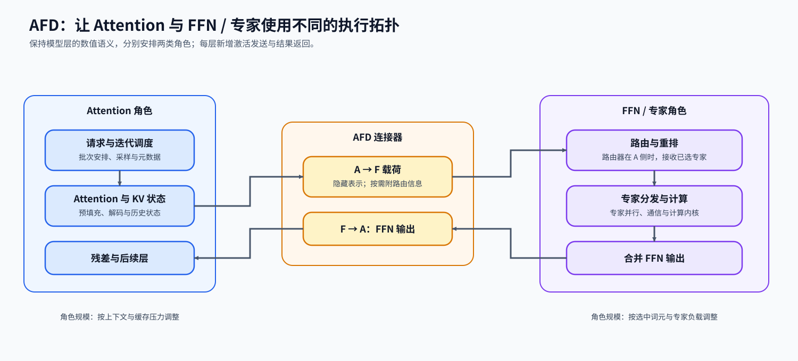
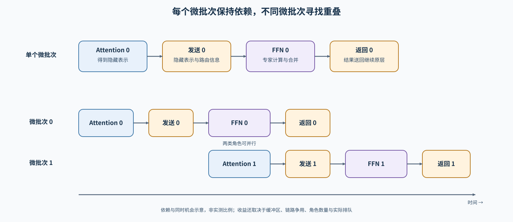

# INF-AFD. Attention FFN Disaggregation | Attention–FFN 解耦

**难度：** Hard | **环境：** [CPU 主线，GPU 可选](#runtime-environment) | **标签：** `推理优化`、`MoE`、`AFD`、`服务执行` | **目标人群：** 理解 MoE 路由、需要分析跨设备执行的读者

> 🚀 **云端运行环境**
>
> 本章节的实战代码可以点击以下链接在免费 GPU 算力平台上直接运行：
>
> [](https://colab.research.google.com/github/datawhalechina/llm-algo-leetcode/blob/main/02_PyTorch_Algorithms/INF-AFD_Attention_FFN_Disaggregation.ipynb)
> [](https://modelscope.cn/my/mynotebook) *(国内推荐：魔搭社区免费实例)*


## 本节导读

长上下文请求增加 Attention 侧的缓存压力，大量词元同时命中少数专家又会让前馈计算排队。如果两类计算始终绑定在同一组设备上，扩容时可能一起增加资源，却只缓解其中一侧。

Attention–FFN 解耦（AFD）把两类工作交给不同执行组，分别安排设备与并行规模。它也增加了每层的激活传输和结果返回：先跟踪一层如何跨组执行，再计算载荷与可隐藏的等待，判断独立扩容能否抵消新增成本。

<a id="runtime-environment"></a>

## 运行环境

- **基础练习：** 使用 [BASE-CPU](../guide.md#base-cpu)，运行载荷、拓扑与时间估算。
- **可选后端对照：** 参考 [推理服务环境入口](../topic_discussion/inference_optimization/quickstart.md#inf-vllm-quickstart)；AFD 还需独立固定兼容的插件、模型和多设备拓扑，当前页尚无完成的真实对照。

## 前置阅读

先理解专家路由的重排与通信，再判断拆分角色后增加了哪一段等待。

- [MoE 路由](./06_MoE_Router.md)：词元如何选择专家。
- [MoE 专家并行](./46_MoE_Expert_Parallel.md)：分发、专家计算与合并。
- [执行重叠与状态交接](./INF-SERVING-OVERLAP_Serving_Overlap_and_State_Handoff.md)：总传输时间与暴露时间。

## Step 1：Attention 与专家为何使用不同执行组

前馈网络（FFN）逐位置变换隐藏表示；在混合专家模型（MoE）中，路由器为词元选择少量专家。Attention 侧维护请求、历史键值缓存与生成顺序，专家侧处理路由后的词元及专家计算。两侧的压力可以不同：上下文变长主要增加历史状态，大量词元集中到少数专家则增加该侧排队。

执行进程在通信组中的编号称为 rank，若干进程组成一个角色组。AFD 将 Attention 与前馈工作分到不同组，由连接器传递激活、路由信息和返回结果；路由器放在哪一侧取决于具体实现。独立扩容使两类角色可以使用不同设备数量，也使层内计算增加跨组依赖。

| 角色 | 处理的对象 | 常见压力 | 需要比较的变化 |
| --- | --- | --- | --- |
| Attention 组 | 注意力、KV 与请求状态 | 上下文、并发及状态容量 | 增加该组资源后，排队和缓存压力如何变化 |
| FFN／专家组 | 选中词元、专家参数与计算 | 词元数量、专家负载不均 | 专家分布和计算等待如何变化 |
| 连接器 | 激活、路由元数据与 FFN 输出 | 字节量、链路与同步 | 新增传输是否抵消计算收益 |



## Step 2：每层的双向传输怎样进入时间线

在被拆分的一层中，Attention 后的隐藏表示送往 FFN 组，专家计算并合并结果后，再送回 Attention 组继续残差连接。隐藏表示是每个词元的一行向量；若共有词元数、隐藏宽度、元素字节数和拆分层数分别为 N、H、B、L，双向激活共需 2 × N × H × B × L 字节。路由器位于 Attention 侧时，另附每词元选中的专家编号与权重。实际序列化、跨组复制和分发格式仍由连接器决定。

微批次是拆成较小执行单元的一组词元。一个微批次的 FFN 必须等自己的输入到达，但这段时间可以让 Attention 组处理另一个独立微批次。流水线可能减少整个窗口的空闲与排队；同一个微批次仍依次经历 Attention、发送、FFN 和返回。估算剩余窗口耗时时，要区分可被其他工作覆盖的部分与该请求自身的依赖。

| 执行方式 | 同一微批次的依赖 | 可隐藏什么 | 额外条件 |
| --- | --- | --- | --- |
| 同步拆分 | Attention → 发送 → FFN → 返回 | 当前组等待较多 | 适合先核对数值和顺序 |
| 微批次流水 | 每个微批次仍遵循同一依赖 | 不同微批次的角色工作可并行 | 缓冲区独立、顺序匹配、连接器支持 |
| 同组执行 | 两类计算在原部署内衔接 | 减少新增的跨角色传输 | 两侧资源比例仍相互绑定 |



## Step 3：怎样判断拆分候选能否运行并值得保留

插件为模型提供切分位置、角色执行器与通信适配。先固定支持的模型、路由器位置、连接器和角色数量，再确认预填充、解码、图执行及量化组合是否兼容。图执行指复用已捕获的设备操作依赖，分布式通信与缓冲区变化可能限制它的适用范围；兼容组合以固定版本的实现和验证记录为准。

两组输出在相同输入下满足误差要求后，再用相同总设备预算比较延迟、吞吐和等待。按两侧压力比例分配进程只是初始方案：增加专家资源若仍不能分散热点，连接器等待和专家排队可能继续占据主要时间。

| 检查对象 | 核对什么 | 不满足时的动作 |
| --- | --- | --- |
| 模型切分 | 权重架构、切分点与路由器所在侧 | 使用已支持模型或回到同组执行 |
| 角色拓扑 | 两组均有进程，总数符合设备预算 | 调整比例并重新加载 |
| 通信实现 | 硬件、链路与连接器版本 | 更换兼容连接器并复测 |
| 执行组合 | 输入处理／解码、图执行、量化及微批次 | 选择已验证组合 |
| 数值结果 | 同输入的输出误差与完成情况 | 定位顺序、路由或计算问题 |
| 成本变化 | 跨组传输、专家排队与服务指标 | 调整角色比例或保留原部署 |

## Step 4：实现双向载荷、拓扑与剩余耗时估算

本题提供角色拓扑、隐藏表示形状和各阶段耗时，骨架负责输入检查与报告结构。请补全双向字节数、拓扑条件、可覆盖时间和角色数量分配。异步模式“预填充且关闭图执行”是本题给定的简化条件，用于练习组合检查；真实后端仍按固定插件版本的能力表验证。

| TODO / 函数 | 学习者完成的机制 | 必须满足的约束 | 测试证据 |
| --- | --- | --- | --- |
| TODO 1：统计双向载荷<br>`estimate_afd_payload_bytes` | 合计激活与可选路由元数据 | 统计拆分层数，双向激活计两次，字节单位一致 | 双向激活字节与有／无路由元数据 |
| TODO 2：核对角色与执行组合<br>`validate_afd_topology` | 判断两类角色和异步条件 | 两侧数量为正，总数等于通信组大小 | 可行组合、数量不符及异步阶段／图执行冲突 |
| TODO 3：估算覆盖后的窗口耗时<br>`estimate_afd_time_ms` | 从串行时间扣除可覆盖部分 | 覆盖量不超过给定预算和非 Attention 阶段之和 | 零覆盖、部分覆盖与过大预算 |
| TODO 4：分配角色数量<br>`allocate_afd_ranks` | 按压力比例构造初始拓扑 | 两侧各至少一个进程，总数不变 | 均衡与 Attention 压力增加时的分配 |


```python
from dataclasses import dataclass
from typing import Dict, List

```


```python
@dataclass(frozen=True)
class AFDTopology:
    """描述 Attention 与 FFN 两类 worker 的执行拓扑。"""

    world_size: int
    attention_ranks: int
    ffn_ranks: int
    mode: str = 'sync'
    stage: str = 'decode'
    graph_enabled: bool = False


def estimate_afd_payload_bytes(
    tokens: int,
    hidden_size: int,
    split_layers: int,
    dtype_bytes: int,
    *,
    top_k: int = 0,
    router_on_attention: bool = False,
) -> Dict[str, int]:
    """估算一次前向中跨 A/F 角色边界传输的载荷。"""
    if min(tokens, hidden_size, split_layers, dtype_bytes) <= 0 or top_k < 0:
        raise ValueError('shape and dtype values must be positive; top_k cannot be negative')
    one_way_activation = tokens * hidden_size * dtype_bytes * split_layers
    # ==========================================
    # TODO 1（跨角色载荷）：计算双向 activation 和可选 routing metadata。
    # 注意：双向 activation 包含 A→F hidden state 与 F→A FFN output；
    # Router 在 A 侧时，每个 top-k 项暂按 int32 expert id + dtype 权重估算。
    # ==========================================
    # activation_bytes = ???  # 所有拆分层的双向 activation 字节数。
    raise NotImplementedError("请完成 TODO 1 后再运行测试。")
    # routing_bytes = ???  # Router 位于 Attention 侧时附加的路由元数据字节数。
    return {
        'activation_bytes': activation_bytes,
        'routing_bytes': routing_bytes,
        'total_bytes': activation_bytes + routing_bytes,
    }


def validate_afd_topology(topology: AFDTopology) -> List[str]:
    """返回阻止候选进入真实实验的拓扑与执行模式问题。"""
    failures: List[str] = []
    # TODO 2（能力检查）：判断角色、rank、模式与异步执行条件。
    # roles_positive = ???  # Attention 与 FFN 两侧都至少有一个 rank。
    raise NotImplementedError("请完成 TODO 2 后再运行测试。")
    # ranks_match = ???  # 两侧 rank 总数等于 world_size。
    # mode_supported = ???  # mode 只能是 sync 或 async。
    # async_contract_supported = ???  # async 仅在约定 stage 且未启用 graph 时为真。
    if not roles_positive:
        failures.append('both roles need positive ranks')
    if not ranks_match:
        failures.append('role ranks must equal world_size')
    if not mode_supported:
        failures.append('unsupported mode')
    if topology.mode == 'async' and not async_contract_supported:
        failures.append('async execution contract is not satisfied')
    return failures


def estimate_afd_time_ms(
    attention_ms: float,
    transfer_to_ffn_ms: float,
    ffn_ms: float,
    transfer_to_attention_ms: float,
    overlap_budget_ms: float,
) -> Dict[str, float]:
    """比较完全串行时间与扣除有效 overlap 后的暴露时间。"""
    values = [attention_ms, transfer_to_ffn_ms, ffn_ms, transfer_to_attention_ms, overlap_budget_ms]
    if any(value < 0 for value in values):
        raise ValueError('time values cannot be negative')
    serial_ms = sum(values[:4])
    overlapable_ms = transfer_to_ffn_ms + ffn_ms + transfer_to_attention_ms
    # ==========================================
    # TODO 3（暴露时间）：有效 overlap 不能超过预算或可重叠区间。
    # 返回 exposed_ms 时不能小于 Attention 自身的依赖时间。
    # ==========================================
    # effective_overlap_ms = ???  # 不超过预算与可重叠区间的有效时间。
    raise NotImplementedError("请完成 TODO 3 后再运行测试。")
    # exposed_ms = ???  # 串行总时间扣除有效重叠后的关键路径时间。
    return {
        'serial_ms': round(serial_ms, 4),
        'effective_overlap_ms': round(effective_overlap_ms, 4),
        'exposed_ms': round(exposed_ms, 4),
    }


def allocate_afd_ranks(world_size: int, attention_pressure: float, ffn_pressure: float) -> AFDTopology:
    """按两类压力给 A/F 角色分配 rank，并保证两侧都可运行。"""
    if world_size < 2 or attention_pressure <= 0 or ffn_pressure <= 0:
        raise ValueError('AFD needs at least two ranks and positive pressure values')
    # ==========================================
    # TODO 4（独立扩缩容）：按压力比例分配 Attention ranks。
    # 注意：两侧至少各保留一个 rank，且二者之和必须等于 world_size。
    # ==========================================
    # attention_ranks = ???  # 按压力分配并裁剪到 [1, world_size - 1]。
    raise NotImplementedError("请完成 TODO 4 后再运行测试。")
    # ffn_ranks = ???  # 剩余 rank，确保总数守恒。
    return AFDTopology(world_size, attention_ranks, ffn_ranks)

```

## 测试

分别核对传输字节、拓扑组合、窗口耗时与进程数量守恒；这些样例验证给定的简化规则。


```python
def test_payload_accounting():
    """验证双向 activation 和路由元数据的字节账本。"""
    base = estimate_afd_payload_bytes(8, 16, 2, 2)
    routed = estimate_afd_payload_bytes(8, 16, 2, 2, top_k=2, router_on_attention=True)
    assert base['activation_bytes'] == 2 * 8 * 16 * 2 * 2
    assert base['routing_bytes'] == 0
    assert routed['total_bytes'] > base['total_bytes']


def test_topology_gate():
    """验证 rank 守恒以及 async stage / graph 限制。"""
    assert validate_afd_topology(AFDTopology(8, 4, 4)) == []
    assert validate_afd_topology(AFDTopology(8, 4, 3))
    assert validate_afd_topology(AFDTopology(8, 4, 4, mode='async', stage='decode'))
    assert validate_afd_topology(AFDTopology(8, 4, 4, mode='async', stage='prefill', graph_enabled=True))


def test_exposed_time_bounds():
    """验证 overlap 只减少可重叠区间，不能消除 Attention 依赖。"""
    no_overlap = estimate_afd_time_ms(4, 1, 6, 1, 0)
    overlapped = estimate_afd_time_ms(4, 1, 6, 1, 5)
    saturated = estimate_afd_time_ms(4, 1, 6, 1, 99)
    assert no_overlap['exposed_ms'] == 12
    assert overlapped['exposed_ms'] == 7
    assert saturated['exposed_ms'] == 4


def test_rank_allocation():
    """验证角色分配响应压力变化并保持 rank 守恒。"""
    balanced = allocate_afd_ranks(8, 1, 1)
    attention_heavy = allocate_afd_ranks(8, 3, 1)
    assert balanced.attention_ranks + balanced.ffn_ranks == 8
    assert attention_heavy.attention_ranks > balanced.attention_ranks
    assert min(attention_heavy.attention_ranks, attention_heavy.ffn_ranks) >= 1


def test_afd_mechanisms():
    """汇总四组 AFD 机制测试。"""
    try:
        test_payload_accounting()
        test_topology_gate()
        test_exposed_time_bounds()
        test_rank_allocation()
        print('✅ AFD 机制测试通过：载荷、拓扑、暴露时间与角色分配均符合预期。')
    except (NameError, UnboundLocalError) as exc:
        raise NotImplementedError('请根据变量级提示完成 TODO。') from exc


test_afd_mechanisms()

```

---

🛑 **STOP HERE** 🛑
<br><br><br><br><br><br><br><br><br><br>
> 请先尝试自己完成代码并跑通测试。<br>
> 如果遇到困难，再向下查看参考代码与解析。
<br><br><br><br><br><br><br><br><br><br>

---
## 参考代码与解析

### 代码

```python
@dataclass(frozen=True)
class AFDTopology:
    """描述 Attention 与 FFN 两类 worker 的执行拓扑。"""

    world_size: int
    attention_ranks: int
    ffn_ranks: int
    mode: str = 'sync'
    stage: str = 'decode'
    graph_enabled: bool = False


# TODO 1：计算跨角色载荷。
def estimate_afd_payload_bytes(tokens, hidden_size, split_layers, dtype_bytes, *, top_k=0, router_on_attention=False):
    if min(tokens, hidden_size, split_layers, dtype_bytes) <= 0 or top_k < 0:
        raise ValueError('shape and dtype values must be positive; top_k cannot be negative')
    one_way_activation = tokens * hidden_size * dtype_bytes * split_layers
    activation_bytes = 2 * one_way_activation
    routing_bytes = tokens * top_k * (4 + dtype_bytes) * split_layers if router_on_attention else 0
    return {'activation_bytes': activation_bytes, 'routing_bytes': routing_bytes, 'total_bytes': activation_bytes + routing_bytes}


# TODO 2：检查 Attention / FFN 拓扑能力。
def validate_afd_topology(topology):
    failures = []
    roles_positive = topology.attention_ranks > 0 and topology.ffn_ranks > 0
    ranks_match = topology.attention_ranks + topology.ffn_ranks == topology.world_size
    mode_supported = topology.mode in {'sync', 'async'}
    async_contract_supported = topology.stage == 'prefill' and not topology.graph_enabled
    if not roles_positive:
        failures.append('both roles need positive ranks')
    if not ranks_match:
        failures.append('role ranks must equal world_size')
    if not mode_supported:
        failures.append('unsupported mode')
    if topology.mode == 'async' and not async_contract_supported:
        failures.append('async execution contract is not satisfied')
    return failures


# TODO 3：计算暴露时间。
def estimate_afd_time_ms(attention_ms, transfer_to_ffn_ms, ffn_ms, transfer_to_attention_ms, overlap_budget_ms):
    values = [attention_ms, transfer_to_ffn_ms, ffn_ms, transfer_to_attention_ms, overlap_budget_ms]
    if any(value < 0 for value in values):
        raise ValueError('time values cannot be negative')
    serial_ms = sum(values[:4])
    overlapable_ms = transfer_to_ffn_ms + ffn_ms + transfer_to_attention_ms
    effective_overlap_ms = min(overlap_budget_ms, overlapable_ms)
    exposed_ms = serial_ms - effective_overlap_ms
    return {'serial_ms': round(serial_ms, 4), 'effective_overlap_ms': round(effective_overlap_ms, 4), 'exposed_ms': round(exposed_ms, 4)}


# TODO 4：按压力分配角色 rank。
def allocate_afd_ranks(world_size, attention_pressure, ffn_pressure):
    if world_size < 2 or attention_pressure <= 0 or ffn_pressure <= 0:
        raise ValueError('AFD needs at least two ranks and positive pressure values')
    raw_attention = round(world_size * attention_pressure / (attention_pressure + ffn_pressure))
    attention_ranks = min(world_size - 1, max(1, raw_attention))
    ffn_ranks = world_size - attention_ranks
    return AFDTopology(world_size, attention_ranks, ffn_ranks)

```

### 解析

#### TODO 1：统计双向载荷

- Attention 后的隐藏表示发出一次，FFN 输出返回一次；各拆分层分别计入。Attention 侧路由时再加入专家编号与权重，编号在本题按 4 字节计算。
- 答案先计算单向激活，再合计双向激活和可选元数据；测试对照是否在 Attention 侧附加路由信息，核对分项和总量。

#### TODO 2：核对角色与执行组合

- 两组数量均为正且总数等于通信组大小；模式还需属于允许集合，异步组合须满足题目给定的阶段与图执行条件。
- 答案分开计算条件并保留失败原因。测试改变数量、异步阶段和图执行条件，检查失败分类。

#### TODO 3：估算覆盖后的窗口耗时

- 串行时间包括 Attention、双向传输和 FFN；从中扣除的时间受预算与非 Attention 阶段总量共同限制。
- 答案取这两个覆盖上限的较小值再相减，测试核对零、部分及过量覆盖。返回的 `exposed_ms` 是该简化窗口的剩余耗时，仍包含 Attention；单个请求的完成时间需按自身依赖链计算。

#### TODO 4：分配角色数量

- 用两侧压力比例给出初始数量，并将 Attention 数量限制在 1 到总数减 1 之间；剩余进程分给 FFN。
- 答案在比例取整后限制范围。测试改变压力比并检查数量守恒；真实配置还需比较角色排队与设备利用率。

## Step 5：可选多设备后端对照

CPU 练习比较载荷、拓扑和给定覆盖预算；真实对照需要已部署的普通 MoE 服务与 AFD 服务，再补插件执行、数值和通信记录。

| 学习问题 | CPU 已核对 | 真实环境所需记录 |
| --- | --- | --- |
| 拆分能否改善相同设备预算下的服务成本 | 双向字节、角色数量与窗口估算 | 目标插件执行、同输入输出、实际传输与请求延迟／吞吐 |

### 5.1 环境与固定工作负载

以[推理服务 Quickstart](../topic_discussion/inference_optimization/quickstart.md)为环境入口，另按固定 AFD 插件版本准备模型、连接器和角色组。普通服务与 AFD 服务分别对外提供请求地址；AFD 请求发送到 Attention 侧，FFN 组处理连接器工作。插件与依赖版本需要一起核对，现有 vLLM Profile 只提供环境参考，实际兼容性以所选插件的支持表为准。

| 配置层 | 对照条件 | 核对动作 |
| --- | --- | --- |
| 设备预算 | 两种部署使用相同设备类型与总数 | 记录两组角色及进程拓扑 |
| 模型与输入 | 同一权重版本、精度和请求集 | 核对模型切分支持与生成规则 |
| 比较变量 | 同组执行与 AFD 同步／流水配置 | 分别记录启动配置和实际路径 |
| 测量 | 输出、传输、请求时间与吞吐 | 先数值核对，再比较性能 |
| 保存 | 两份请求报告及插件运行清单 | 新标签保留原始运行与失败 |


```python
RUN_MODE = 'dry_run'  # 默认值 dry_run：只登记计划；改为 real_gpu 后访问两个已就绪 endpoint。
RUN_LABEL = 'default'  # 默认值 default；正式复测改为唯一标签，避免覆盖旧结果。
PROFILE_ID = 'INF-VLLM-011-CU128'  # 默认 Serving Profile；还需另行安装并固定兼容的 AFD plugin。
AFD_MODEL_ID = ''  # 默认空值：禁止执行；填写 plugin 明确支持的 checkpoint@revision。
AFD_BASELINE_URL = 'http://127.0.0.1:8000'  # 默认普通 MoE vLLM endpoint。
AFD_CANDIDATE_URL = 'http://127.0.0.1:8100'  # 默认 AFD candidate endpoint。
AFD_WORKLOAD = 'benchmarks/workloads/fixed.jsonl'  # 默认固定请求集；更换后结果不可直接合并。
AFD_NUM_PROMPTS = 16  # 默认 16 条请求；增大会延长运行并提高排队压力。
AFD_MAX_TOKENS = 64  # 默认每请求最多生成 64 token。
AFD_CONCURRENCY = 4  # 默认并发 4；调整后需同时记录队列与尾延迟。
AFD_RESULT_DIR = 'benchmarks/results/inf_afd'  # 默认仓库相对结果目录。

```

### 5.2 执行并保存 JSON

当前单元调用两个已启动的服务，按相同请求集先后运行普通 MoE 与 AFD 请求测试，保存服务指标。插件部署、角色拓扑、传输测量和独立输出比较需要另备记录；通用请求报告提供其中的服务请求部分。


```python
if RUN_MODE == 'real_gpu':
    if not AFD_MODEL_ID:
        raise ValueError('必须填写 AFD plugin 当前支持的模型及 revision。')
    from pathlib import Path
    from tools.inference_project_runtime import locate_repo_root, run_backend_benchmark

    root = locate_repo_root()
    result_dir = root / AFD_RESULT_DIR
    result_dir.mkdir(parents=True, exist_ok=True)
    common = dict(
        project='INF-AFD', model=AFD_MODEL_ID, workload=AFD_WORKLOAD,
        num_prompts=AFD_NUM_PROMPTS, max_tokens=AFD_MAX_TOKENS,
        concurrency=AFD_CONCURRENCY, warmup=1, repeats=1, backend='vllm',
    )
    baseline = run_backend_benchmark(
        base_url=AFD_BASELINE_URL, label='moe_baseline',
        output=result_dir / f'{RUN_LABEL}_baseline.json', cache_policy='backend_default', **common,
    )
    candidate = run_backend_benchmark(
        base_url=AFD_CANDIDATE_URL, label='afd_candidate',
        output=result_dir / f'{RUN_LABEL}_afd_candidate.json', cache_policy='backend_default', **common,
    )
    print({'baseline': baseline['metrics'], 'candidate': candidate['metrics']})
else:
    print('AFD backend 实验未启动：先完成 plugin 能力矩阵、服务健康检查和正确性验证。')

```

### 5.3 读取结果

读取两份服务报告，展示文件是否存在、所需字段、失败和请求指标。当前读取器检查工作负载、指标与规范化结果字段；插件版本、模型切分、角色数量和通信时间还需与运行清单逐项核对后，才能归因于 AFD。


```python
import json
from pathlib import Path

from tools.inference_project_runtime import locate_repo_root
result_dir = locate_repo_root() / AFD_RESULT_DIR
summaries = []
for role, name in (
    ('baseline', f'{RUN_LABEL}_baseline.json'),
    ('candidate', f'{RUN_LABEL}_afd_candidate.json'),
):
    path = result_dir / name
    if not path.exists():
        summaries.append({'role': role, 'status': 'not_run', 'path': str(path)})
        continue
    report = json.loads(path.read_text(encoding='utf-8'))
    required = {'workload', 'metrics', 'normalized_result'}
    missing = sorted(required - set(report))
    summaries.append({
        'role': role,
        'status': 'invalid' if missing else 'completed',
        'failure': report.get('failure'),
        'workload': report.get('workload'),
        'metrics': report.get('metrics'),
        'evidence_level': report.get('evidence_level'),
        'decision': report.get('decision'),
        'missing_fields': missing,
        'path': str(path),
    })

summaries

```

### 5.4 解释结果与决定复测内容

当前尚无登记的真实 AFD 对照。先固定插件与模型组合，保存相同总设备预算的普通服务和 AFD 输出；完成数值比较，再采集跨组通信及角色排队时间。CPU 分配比例和请求报告可用于准备候选，采用判断需要这些记录共同支持。

| 观察项 | 所需字段或记录 | 当前状态 | 下一动作 |
| --- | --- | --- | --- |
| 可比条件 | 模型版本、请求集、精度、总设备数 | 待验证 | 固定两组条件与启动配置 |
| 执行路径 | 插件、切分点、角色组与连接器 | 待验证 | 保存实际加载和拓扑记录 |
| 输出比较 | 同请求输出与误差门槛 | 待验证 | 核对路由、顺序和数值 |
| 成本变化 | 传输、等待、TTFT、TPOT 与吞吐 | 待验证 | 比较同规模部署的收益及代价 |
| 决策 | 正式对照报告 | 未形成实测决策 | 完成上述记录后再判断保留或调整 |

## 相关阅读

从角色拆分继续查看实际插件如何连接两类工作，再比较其他跨阶段拆分方式。

- [AFD Plugin 官方仓库](https://github.com/vllm-project/afd-plugin)：查看支持模型、连接器和部署步骤；按固定版本核对兼容组合。
- [异构预填充／解码与服务分层](./39_Hetero_PD_and_Serving_Tiers.md)：比较按阶段拆分与按层内角色拆分。
- [通信热点与缓解](./48_Communication_Hotspots_and_Mitigation.md)：定位新增传输和专家负载不均。
