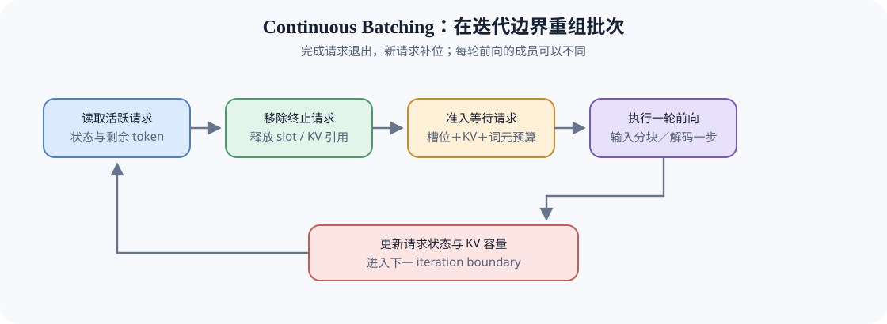

# INF-CONTINUOUS-BATCHING. Continuous Batching | 连续批处理

**难度：** Hard | **环境：** [CPU 主线，GPU 可选](#runtime-environment) | **标签：** `推理优化`, `连续批处理`, `迭代调度` | **目标人群：** 理解请求与单轮预算的读者

> 🚀 **云端运行环境**
>
> 本章节的实战代码可以点击以下链接在免费 GPU 算力平台上直接运行：
>
> [](https://colab.research.google.com/github/datawhalechina/llm-algo-leetcode/blob/main/02_PyTorch_Algorithms/INF-CONTINUOUS-BATCHING_Continuous_Batching.ipynb)
> [](https://modelscope.cn/my/mynotebook) *(国内推荐：魔搭社区免费实例)*


## 本节导读

四个请求一起开始生成，最短的先结束了。如果必须等整批完成后才提交下一组，空出的并发名额就会闲置；如果允许完成一个便补入一个，新请求可以更早开始，但也会与尚未完成的请求竞争计算和缓存。

连续批处理在迭代边界重新组织成员。沿一次边界观察终止、释放、准入和推进，就能解释“有空位为什么仍不能补人”，以及提高吞吐为何不保证所有请求都更快完成。

<a id="runtime-environment"></a>

## 运行环境

- **基础练习：** 使用 [`BASE-CPU`](../guide.md#base-cpu)，运行 Step 4 题目与测试。
- **GPU 实测：** 运行 Step 5 前，按其中 5.1 准备独立环境与固定输入。

## 前置阅读

先了解单轮工作量、请求排序与可回收容量，才能判断新请求是否能够加入下一轮。

- [Part 02 · INF-ITERATION-BUDGET：Serving 迭代成本与批次容量上界](./INF-ITERATION-BUDGET_Serving_Iteration_Cost_and_Batch_Bounds.md)：单轮成本与五类上界。
- [Part 02 · 36：Decode Scheduling](./36_Decode_Scheduling.md)：请求级优先顺序。
- [Part 02 · 37：KV Cache 生命周期与容量控制](./37_KV_Cache_Lifecycle_and_Capacity_Control.md)：准入所需的可用容量状态。
## Step 1：批次为什么要在迭代边界重组

普通自回归解码每轮通常只为每个活跃请求生成一个 token。请求完成时间不同，固定批次会逐渐出现空闲并发槽位（slot）；连续批处理在迭代边界释放终止成员，并从等待队列补入新请求。请求排序、批次重组和 KV 容量分别提供优先级、执行成员与资源约束，三者共同决定下一轮实际批次。

| 调度对象 | 提供的信息 | 对本轮批次的作用 |
|:---|:---|:---|
| 请求级调度 | 候选请求的优先顺序 | 决定等待队列的检查次序 |
| 连续批处理 | 活跃成员、空闲槽位、迭代边界 | 决定本轮实际执行成员 |
| KV 容量控制 | 可用缓存块与请求状态量 | 决定候选是否具备准入条件 |



## Step 2：空位、KV 与单轮工作量怎样共同限制准入

空闲序列槽位（slot）只说明可以再管理一个请求。新请求还需要 KV 容量，并且本轮工作量能放进剩余词元预算：普通解码至多推进一个词元，预填充则处理一块输入。这个账本为新请求一次预留所声明的 KV 块数，不再次扣除已准入成员的存储；随生成增长追加物理块，需要另行更新容量模型。

这里采用严格队列顺序：队首计划的输入块放不下时，保留队首和后续请求，不缩小该块，也不绕过它选择后面的短请求。这种队首阻塞是特定选择规则的代价，并非所有连续批处理都必须如此；按剩余预算缩小预填充块，继续由阶段配额讨论。

| 边界上的状态 | 准入或退出条件 | 对账本的影响 |
| --- | --- | --- |
| 仍活跃 | 未终止且本轮工作量可执行 | 保留槽位和原有 KV 预留，占用本轮词元预算 |
| 已终止 | 已完成、取消、超时或失败 | 移出活跃集合，归还本题预留的 KV 块 |
| 等待 | 槽位、KV 和本轮词元三项都足够 | 新增活跃成员并扣减相应预算 |
| 被阻塞 | 按槽位、KV、词元顺序遇到首个不足条件 | 不改变等待顺序，保留首个阻塞原因 |


## Step 3：补位怎样改变吞吐与等待

及时补位减少的是已空闲并发名额的等待，并不增加设备算力。新请求加入后也可能延长每轮执行时间，让原有请求的后续 token 更晚到达。比较时同时读取每秒输出量、首 token 延迟和尾部请求等待；P95／P99 表示相应比例请求落在其以内的延迟位置，不能只用平均值代替。

槽位利用率是请求占用并发名额的时间比例，不是 GPU 计算单元忙碌率。客户端滚动提交也只决定何时把请求送入服务，服务内部仍有自己的队列与组批规则；因此客户端等待、服务器排队和实际计算要分开解释。长期得不到执行机会称为饥饿，是否发生需要连续轮次的记录，而非一次成员快照。

| 选择规则 | 可能减少什么等待 | 仍要观察什么代价 |
| --- | --- | --- |
| 完成即补位 | 已有空位等待整批结束的时间 | 原有请求被新成员干扰后的延迟 |
| 优先短请求 | 短任务排在长任务之后的等待 | 长任务是否长期无法获选 |
| 随等待提高优先级 | 同类低等级请求的等待 | 规则是否仍把其他阶段长期排在后面 |
| 严格容量准入 | 运行中状态不足的风险 | 队首阻塞与空位闲置；其他工作区仍可能导致显存不足 |

<a id="mechanism-practice"></a>

## Step 4：实现一次迭代边界的批次重组

本题用活跃请求、等待队列和三类预算复现一次迭代边界。请求字典、队列遍历、账本更新和返回结构已经给出；你将补全阶段工作量、终止状态判断、准入阻塞原因和状态推进。测试分别覆盖 Prefill / Decode、终止回收、三重资源门槛与阶段迁移。

| TODO / 函数 | 学习者完成的机制 | 必须满足的约束 | 测试证据 |
| --- | --- | --- | --- |
| TODO 1 · `iteration_token_demand` | 计算本轮 Token 需求 | Prefill 不超过剩余量与 chunk；Decode 最多推进 1 Token | 长短 Prefill、Decode 与未知阶段 |
| TODO 2 · `release_terminal_requests` | 识别迭代边界需要释放的请求 | 终止请求移出 active 并释放其 KV block | 活跃与完成请求混合 |
| TODO 3 · `form_iteration_batch` | 按资源门槛组成本轮批次 | 按 slot → KV → Token 顺序返回首个阻塞原因；不跳过队首 | 三类阻塞、成功准入与队首保留 |
| TODO 4 · `advance_iteration` | 推进请求剩余工作量 | Prefill 归零后转 Decode；Decode 归零后转 completed | 两类阶段迁移、负工作量与解码单步上限 |

```python
from copy import deepcopy
```


```python
TERMINAL_STATES = {'completed', 'cancelled', 'timed_out', 'failed'}


def _validate_request_state(request):
    """核对最小请求身份、阶段与非负整数账本，不修改输入。"""
    if not isinstance(request.get('id'), str) or not request['id']:
        raise ValueError('请求 id 必须为非空字符串')
    if request.get('phase') not in {'prefill', 'decode'}:
        raise ValueError('未知请求阶段')
    if request.get('status') not in TERMINAL_STATES | {'active', 'waiting'}:
        raise ValueError('未知请求状态')
    for key in ('remaining_prefill_tokens', 'remaining_decode_tokens', 'kv_blocks'):
        if type(request.get(key)) is not int or request[key] < 0:
            raise ValueError(f'{key} 必须为非负整数')


def iteration_token_demand(request, prefill_chunk_size):
    """返回请求在当前迭代需要处理的 token 数。"""
    _validate_request_state(request)
    if type(prefill_chunk_size) is not int or prefill_chunk_size <= 0:
        raise ValueError('prefill_chunk_size 必须为正整数')
    # TODO 1（阶段工作量）：分别计算 Prefill 与 Decode 的本轮需求。
    raise NotImplementedError("请完成 TODO 1：prefill_demand 与 decode_demand")
    # prefill_demand = ???  # 不超过剩余 Prefill token 和 chunk 上限。
    # decode_demand = ???  # 仍有 Decode 工作时为 1，否则为 0。
    if request['phase'] == 'prefill':
        return prefill_demand
    if request['phase'] == 'decode':
        return decode_demand
    raise ValueError('未知请求阶段')


def release_terminal_requests(active_requests):
    """返回仍活跃请求、终止请求和释放的 KV blocks。"""
    active, terminal = [], []
    ids = [request['id'] for request in active_requests]
    if len(ids) != len(set(ids)):
        raise ValueError('活跃集合不能重复释放同一请求')
    for request in active_requests:
        _validate_request_state(request)
        # TODO 2（边界释放）：判断当前请求是否已经进入终止状态。
        raise NotImplementedError("请完成 TODO 2：is_terminal")
        # is_terminal = ???  # 仅 completed/cancelled/timed_out/failed 为真。
        target = terminal if is_terminal else active
        target.append(deepcopy(request))
    released_blocks = sum(item['kv_blocks'] for item in terminal)
    return active, terminal, released_blocks


def form_iteration_batch(active_requests, waiting_requests, max_batch_size, free_kv_blocks, max_num_batched_tokens, prefill_chunk_size):
    """在 slot、KV 与 token 预算下形成本轮批次。"""
    budgets = [max_batch_size, free_kv_blocks, max_num_batched_tokens]
    if any(type(value) is not int or value < 0 for value in budgets):
        raise ValueError('槽位、KV 与词元预算必须为非负整数')
    if type(prefill_chunk_size) is not int or prefill_chunk_size <= 0:
        raise ValueError('prefill_chunk_size 必须为正整数')
    for request in list(active_requests) + list(waiting_requests):
        _validate_request_state(request)
    ids = [request['id'] for request in list(active_requests) + list(waiting_requests)]
    if len(ids) != len(set(ids)):
        raise ValueError('活跃与等待集合中的请求 id 不能重复')
    if any(request['status'] in TERMINAL_STATES for request in waiting_requests):
        raise ValueError('等待队列不能包含终止请求')
    active, terminal, released = release_terminal_requests(active_requests)
    available_blocks = free_kv_blocks + released
    free_slots = max_batch_size - len(active)
    batch = []
    for request in active:
        item = deepcopy(request)
        item['scheduled_tokens'] = iteration_token_demand(item, prefill_chunk_size)
        batch.append(item)
    free_tokens = max_num_batched_tokens - sum(item['scheduled_tokens'] for item in batch)
    if free_slots < 0 or free_tokens < 0:
        raise ValueError('active 请求已经超过本轮预算')

    waiting, blocked = deepcopy(waiting_requests), []
    admitted_count = 0
    while admitted_count < len(waiting):
        request = waiting[admitted_count]
        demand = iteration_token_demand(request, prefill_chunk_size)
        # TODO 3（准入门槛）：按 slot、KV、token 的次序确定首个阻塞原因。
        raise NotImplementedError("请完成 TODO 3：block_reason")
        # block_reason = ???  # 可准入时为 None，否则为 slot/kv_blocks/token_budget。
        if block_reason is not None:
            blocked.append({'id': request['id'], 'reason': block_reason})
            break
        item = deepcopy(request)
        item['scheduled_tokens'] = demand
        item['status'] = 'active'
        batch.append(item)
        free_slots -= 1
        available_blocks -= item['kv_blocks']
        free_tokens -= demand
        admitted_count += 1
    return {
        'batch': batch, 'waiting': waiting[admitted_count:], 'terminal': terminal,
        'blocked': blocked, 'released_kv_blocks': released, 'free_slots': free_slots,
        'free_kv_blocks': available_blocks, 'free_token_budget': free_tokens,
    }


def advance_iteration(batch):
    """根据 scheduled tokens 推进 Prefill/Decode 状态。"""
    updated = []
    ids = [request['id'] for request in batch]
    if len(ids) != len(set(ids)):
        raise ValueError('一个请求不能在同一轮重复推进')
    for request in deepcopy(batch):
        _validate_request_state(request)
        if request['status'] in TERMINAL_STATES:
            raise ValueError('终止请求不能继续执行')
        amount = request['scheduled_tokens']
        if type(amount) is not int or amount < 0 or (request['phase'] == 'decode' and amount > 1):
            raise ValueError('执行量必须为非负整数，解码每轮最多推进一个 token')
        # TODO 4（状态推进）：从对应阶段的剩余工作量中扣除本轮 token。
        raise NotImplementedError("请完成 TODO 4：remaining_tokens")
        # remaining_tokens = ???  # 当前阶段执行后的剩余 token，不能为负。
        if remaining_tokens < 0:
            raise ValueError('scheduled_tokens 不能超过阶段剩余工作量')
        if request['phase'] == 'prefill':
            request['remaining_prefill_tokens'] = remaining_tokens
            if remaining_tokens == 0:
                request['phase'] = 'decode'
        elif request['phase'] == 'decode':
            request['remaining_decode_tokens'] = remaining_tokens
            if remaining_tokens == 0:
                request['status'] = 'completed'
        else:
            raise ValueError('未知请求阶段')
        updated.append(request)
    return updated

```

## 测试

测试分别验证阶段工作量、终止释放、三重资源 gate、队首阻塞原因和一轮状态推进。

```python
def _request(request_id, phase, prefill, decode, blocks, status='active'):
    """构造最小请求状态，供各机制测试复用。"""
    return {'id': request_id, 'phase': phase, 'remaining_prefill_tokens': prefill, 'remaining_decode_tokens': decode, 'kv_blocks': blocks, 'status': status}

def test_phase_token_demand():
    """Prefill 受 chunk 限制，Decode 每轮最多推进一个 token。"""
    assert iteration_token_demand(_request('p', 'prefill', 10, 4, 2), 4) == 4
    assert iteration_token_demand(_request('p', 'prefill', 2, 4, 2), 4) == 2
    assert iteration_token_demand(_request('d', 'decode', 0, 3, 2), 4) == 1

def test_terminal_release():
    """终止请求应离开 active 并释放其 KV block。"""
    active = [_request('a', 'decode', 0, 2, 3), _request('b', 'decode', 0, 0, 4, 'completed')]
    kept, terminal, released = release_terminal_requests(active)
    assert [x['id'] for x in kept] == ['a'] and [x['id'] for x in terminal] == ['b']
    assert released == 4

def test_batch_gates_and_block_reason():
    """队首请求未通过资源门槛时应保留队列并报告原因。"""
    active = [_request('a', 'decode', 0, 2, 2)]
    waiting = [_request('p', 'prefill', 6, 3, 2), _request('d', 'decode', 0, 3, 1)]
    report = form_iteration_batch(active, waiting, 3, 4, 4, 4)
    assert [x['id'] for x in report['batch']] == ['a']
    assert report['blocked'][0] == {'id': 'p', 'reason': 'token_budget'}
    assert [x['id'] for x in report['waiting']] == ['p', 'd']
    assert report['free_token_budget'] == 3

def test_iteration_state_advance():
    """执行后应正确推进 Prefill→Decode 与 Decode→completed。"""
    prefill = _request('p', 'prefill', 3, 2, 2); prefill['scheduled_tokens'] = 3
    decode = _request('d', 'decode', 0, 1, 2); decode['scheduled_tokens'] = 1
    updated = advance_iteration([prefill, decode])
    assert updated[0]['phase'] == 'decode' and updated[0]['remaining_prefill_tokens'] == 0
    assert updated[1]['status'] == 'completed' and updated[1]['remaining_decode_tokens'] == 0

def _expect_value_error(call):
    """核对非法账本或推进量明确失败。"""
    try:
        call()
    except ValueError:
        return
    raise AssertionError('应拒绝非法状态')


def test_all_gates_and_input_preservation():
    """逐项触发三重门槛，核对成功准入和输入不变。"""
    waiting = [_request('p', 'prefill', 3, 1, 2)]
    before = deepcopy(waiting)
    for slots, blocks, tokens, reason in [(0, 4, 4, 'slot'), (1, 1, 4, 'kv_blocks'), (1, 4, 1, 'token_budget')]:
        report = form_iteration_batch([], waiting, slots, blocks, tokens, 3)
        assert report['batch'] == [] and report['waiting'] == waiting
        assert report['blocked'] == [{'id': 'p', 'reason': reason}]
    admitted = form_iteration_batch([], waiting, 1, 2, 3, 3)
    assert admitted['free_kv_blocks'] == 0 and admitted['free_token_budget'] == 0
    assert admitted['batch'][0]['scheduled_tokens'] == 3
    assert waiting == before
    admitted['batch'][0]['remaining_prefill_tokens'] = 99
    assert waiting == before


def test_invalid_work_and_duplicate_ids():
    """负数不能产生额外预算，同一请求不能重复准入或推进。"""
    negative = _request('p', 'prefill', -1, 1, 1)
    _expect_value_error(lambda: iteration_token_demand(negative, 2))
    request = _request('d', 'decode', 0, 3, 1)
    _expect_value_error(lambda: form_iteration_batch([request], [request], 2, 2, 2, 2))
    _expect_value_error(lambda: form_iteration_batch([], [], 1, -1, 2, 2))
    _expect_value_error(lambda: advance_iteration([{**request, 'scheduled_tokens': -1}]))
    _expect_value_error(lambda: advance_iteration([{**request, 'scheduled_tokens': 2}]))
    _expect_value_error(lambda: advance_iteration([{**request, 'phase': 'unknown', 'scheduled_tokens': 1}]))
    _expect_value_error(lambda: release_terminal_requests([request, request]))


def test_multiple_boundaries_preserve_capacity():
    """跨轮释放、补位与阶段切换保持总预留容量，不重复回收。"""
    active = [_request('d', 'decode', 0, 1, 2)]
    waiting = [_request('p', 'prefill', 3, 1, 3)]
    free_blocks = 1
    for _ in range(5):
        report = form_iteration_batch(active, waiting, 1, free_blocks, 3, 2)
        assert report['free_kv_blocks'] + sum(row['kv_blocks'] for row in report['batch']) == 3
        active = advance_iteration(report['batch'])
        waiting = report['waiting']
        free_blocks = report['free_kv_blocks']
    assert not active and not waiting and free_blocks == 3


test_phase_token_demand()
test_terminal_release()
test_batch_gates_and_block_reason()
test_iteration_state_advance()
test_all_gates_and_input_preservation()
test_invalid_work_and_duplicate_ids()
test_multiple_boundaries_preserve_capacity()
print('✅ Continuous Batching 机制测试通过')
```

---

🛑 **STOP HERE** 🛑
<br><br><br><br><br><br><br><br><br><br>
> 请先尝试自己完成代码并跑通测试。<br>
> 如果遇到困难，再向下查看参考代码与解析。
<br><br><br><br><br><br><br><br><br><br>

---
## 参考代码与解析

### 代码

```python
TERMINAL_STATES = {'completed', 'cancelled', 'timed_out', 'failed'}


def _validate_request_state(request):
    """核对最小请求身份、阶段与非负整数账本，不修改输入。"""
    if not isinstance(request.get('id'), str) or not request['id']:
        raise ValueError('请求 id 必须为非空字符串')
    if request.get('phase') not in {'prefill', 'decode'}:
        raise ValueError('未知请求阶段')
    if request.get('status') not in TERMINAL_STATES | {'active', 'waiting'}:
        raise ValueError('未知请求状态')
    for key in ('remaining_prefill_tokens', 'remaining_decode_tokens', 'kv_blocks'):
        if type(request.get(key)) is not int or request[key] < 0:
            raise ValueError(f'{key} 必须为非负整数')


# TODO 1：计算本轮 Token 需求。
def iteration_token_demand(request, prefill_chunk_size):
    """返回请求在当前迭代需要处理的 token 数。"""
    _validate_request_state(request)
    if type(prefill_chunk_size) is not int or prefill_chunk_size <= 0:
        raise ValueError('prefill_chunk_size 必须为正整数')
    prefill_demand = min(max(request['remaining_prefill_tokens'], 0), prefill_chunk_size)
    decode_demand = 1 if request['remaining_decode_tokens'] > 0 else 0
    if request['phase'] == 'prefill':
        return prefill_demand
    if request['phase'] == 'decode':
        return decode_demand
    raise ValueError('未知请求阶段')


# TODO 2：识别迭代边界需要释放的请求。
def release_terminal_requests(active_requests):
    """返回仍活跃请求、终止请求和释放的 KV blocks。"""
    active, terminal = [], []
    ids = [request['id'] for request in active_requests]
    if len(ids) != len(set(ids)):
        raise ValueError('活跃集合不能重复释放同一请求')
    for request in active_requests:
        _validate_request_state(request)
        is_terminal = request['status'] in TERMINAL_STATES
        target = terminal if is_terminal else active
        target.append(deepcopy(request))
    released_blocks = sum(item['kv_blocks'] for item in terminal)
    return active, terminal, released_blocks


# TODO 3：按资源门槛组成本轮批次。
def form_iteration_batch(active_requests, waiting_requests, max_batch_size, free_kv_blocks, max_num_batched_tokens, prefill_chunk_size):
    """在 slot、KV 与 token 预算下形成本轮批次。"""
    budgets = [max_batch_size, free_kv_blocks, max_num_batched_tokens]
    if any(type(value) is not int or value < 0 for value in budgets):
        raise ValueError('槽位、KV 与词元预算必须为非负整数')
    if type(prefill_chunk_size) is not int or prefill_chunk_size <= 0:
        raise ValueError('prefill_chunk_size 必须为正整数')
    for request in list(active_requests) + list(waiting_requests):
        _validate_request_state(request)
    ids = [request['id'] for request in list(active_requests) + list(waiting_requests)]
    if len(ids) != len(set(ids)):
        raise ValueError('活跃与等待集合中的请求 id 不能重复')
    if any(request['status'] in TERMINAL_STATES for request in waiting_requests):
        raise ValueError('等待队列不能包含终止请求')
    active, terminal, released = release_terminal_requests(active_requests)
    available_blocks = free_kv_blocks + released
    free_slots = max_batch_size - len(active)
    batch = []
    for request in active:
        item = deepcopy(request)
        item['scheduled_tokens'] = iteration_token_demand(item, prefill_chunk_size)
        batch.append(item)
    free_tokens = max_num_batched_tokens - sum(item['scheduled_tokens'] for item in batch)
    if free_slots < 0 or free_tokens < 0:
        raise ValueError('active 请求已经超过本轮预算')
    waiting, blocked = deepcopy(waiting_requests), []
    admitted_count = 0
    while admitted_count < len(waiting):
        request = waiting[admitted_count]
        demand = iteration_token_demand(request, prefill_chunk_size)
        block_reason = (
            'slot' if free_slots <= 0 else
            'kv_blocks' if request['kv_blocks'] > available_blocks else
            'token_budget' if demand > free_tokens else None
        )
        if block_reason is not None:
            blocked.append({'id': request['id'], 'reason': block_reason})
            break
        item = deepcopy(request)
        item['scheduled_tokens'] = demand
        item['status'] = 'active'
        batch.append(item)
        free_slots -= 1
        available_blocks -= item['kv_blocks']
        free_tokens -= demand
        admitted_count += 1
    return {
        'batch': batch, 'waiting': waiting[admitted_count:], 'terminal': terminal,
        'blocked': blocked, 'released_kv_blocks': released, 'free_slots': free_slots,
        'free_kv_blocks': available_blocks, 'free_token_budget': free_tokens,
    }


# TODO 4：推进请求剩余工作量。
def advance_iteration(batch):
    """根据 scheduled tokens 推进 Prefill/Decode 状态。"""
    updated = []
    ids = [request['id'] for request in batch]
    if len(ids) != len(set(ids)):
        raise ValueError('一个请求不能在同一轮重复推进')
    for request in deepcopy(batch):
        _validate_request_state(request)
        if request['status'] in TERMINAL_STATES:
            raise ValueError('终止请求不能继续执行')
        amount = request['scheduled_tokens']
        if type(amount) is not int or amount < 0 or (request['phase'] == 'decode' and amount > 1):
            raise ValueError('执行量必须为非负整数，解码每轮最多推进一个 token')
        key = 'remaining_prefill_tokens' if request['phase'] == 'prefill' else 'remaining_decode_tokens'
        remaining_tokens = request[key] - amount
        if remaining_tokens < 0:
            raise ValueError('scheduled_tokens 不能超过阶段剩余工作量')
        if request['phase'] == 'prefill':
            request['remaining_prefill_tokens'] = remaining_tokens
            if remaining_tokens == 0:
                request['phase'] = 'decode'
        elif request['phase'] == 'decode':
            request['remaining_decode_tokens'] = remaining_tokens
            if remaining_tokens == 0:
                request['status'] = 'completed'
        else:
            raise ValueError('未知请求阶段')
        updated.append(request)
    return updated

```

### 解析

#### TODO 1：计算阶段工作量

- 预填充取剩余输入和块上限的较小值；解码剩余量大于零时只安排一个 token。先拒绝负账本，不能把错误输入截成零后继续执行。
- 长短输入和解码样例核对需求，非法工作量测试检查不会凭空增加剩余预算。

#### TODO 2：释放终止请求

- 只把完成、取消、超时与失败成员移入终止集合，其预留块数相加后归还；其他成员保留，返回独立副本。
- 混合成员和跨轮测试检查释放数与总容量。下一轮使用更新后的活跃集合，不能再次传入上轮已释放成员。

#### TODO 3：判断准入门槛

- 按槽位、KV、词元顺序报告队首的第一个阻塞原因；全部满足后扣减三份预算，保留未准入成员的原顺序。
- 分别触发三类不足、成功准入与重复编号；同时核对输入未被修改，以及后续成员没有绕过队首。

#### TODO 4：推进请求状态

- 从当前阶段扣除执行量；输入归零后转入解码，输出归零后标记完成。这里把输入处理和输出推进分成两步，不把阶段迁移当成完整模型调用的首 token 事件。
- 阶段测试、跨轮容量测试及负数／多 token 解码反例，核对进度、终止与预算不会被重复增加。

## Step 5：真实后端实验——批次屏障与滚动补位

CPU 题目验证迭代边界上的释放、准入和状态推进；真实后端固定同一服务、请求清单和并发槽位，只改变客户端准入方式，比较等待整批完成与空槽立即补位。该对照验证准入边界，不替换 vLLM 内部调度器。

| 学习问题 | CPU 已确认 | 真实后端要确认 |
|---|---|---|
| 请求何时退出与补位 | 终止请求释放槽位与 KV 容量 | 滚动补位是否减少空闲槽位时间 |
| 等待发生在哪里 | 准入状态与迭代状态分离 | 逻辑就绪到实际提交的等待是否下降 |
| 吞吐收益是否免费 | 状态机与预算守恒 | 吞吐改善是否伴随尾延迟恶化 |

### 5.1 环境与固定实验条件

本实验使用 `INF-VLLM-011-CU128`。首次运行先完成[推理服务环境 Quickstart](../topic_discussion/inference_optimization/quickstart.md#inf-vllm-quickstart)，启动固定 vLLM 服务并确认 `/v1/models` 可访问；Notebook 不安装依赖，也不启动或停止服务。本页不替换 vLLM 内部调度器，而是在同一服务上分别模拟静态批次屏障和完成即补位，观察请求提交边界带来的差异。

| 配置项 | 固定值 | 作用 |
|---|---|---|
| 模型与服务 | `Qwen/Qwen3-0.6B`，vLLM 0.11 | 保持执行后端一致 |
| 请求清单 | 12 条固定 128-token 输入，四档强制输出长度 | 制造可复现的批内完成时间差 |
| 并发度 | 4 | 两种提交方式使用同一槽位上限 |
| 对照变量 | 批次屏障 / 滚动补位 | 只改变完成后的补位时机 |


```python
# 5.1 只保留学习者需要修改的运行开关与结果标签。
RUN_MODE = "dry_run"  # 默认值 dry_run：只登记计划；服务就绪后改为 real_backend。
RUN_LABEL = "default"  # 默认值 default：正式复测改为唯一标签，避免覆盖历史结果。
RUN_ORDER = "barrier_then_rolling"  # 默认值 barrier_then_rolling：交换顺序复测时改为 rolling_then_barrier。

ENVIRONMENT_PROFILE = "INF-VLLM-011-CU128"  # Quickstart 中登记的独立服务环境。
BACKEND_BASE_URL = "http://127.0.0.1:8000"  # 已启动的 OpenAI-compatible 服务地址。
MODEL_ID = "Qwen/Qwen3-0.6B"  # 两组实验使用同一个服务模型。
MODEL_REVISION = "main"  # 5.2 优先从本地缓存解析实际 commit。
PROMPT_TOKENS = 128  # 默认值 128：两种准入方式固定相同输入长度。
CONCURRENCY = 4  # 两种提交方式共用的最大并发请求数。
WARMUP_STEPS = 1  # 每种提交方式开始前的预热请求数。
TIMEOUT_SECONDS = 180.0  # 单请求超时上限。
OUTPUT_RELATIVE_PATH = f"benchmarks/results/inf_continuous_batching/continuous_batching_{RUN_LABEL}.json"

```

### 5.2 执行固定请求清单的配对实验

两组请求使用相同输入 token 数、强制输出长度、顺序和并发度。批次屏障必须等待当前四条请求全部结束才提交下一组；滚动补位在任一请求结束后立即提交下一条。所有请求在实验开始时均视为逻辑就绪，从实验起点到实际提交的时间差定义为客户端准入等待；它不等于服务器内部排队时间。


```python
# 5.2 执行两种到达方式并保存请求级证据。
import json
from pathlib import Path

import torch
from transformers import AutoTokenizer
from tools.inference_project_runtime import locate_repo_root
from tools.notebook_runtime import package_version, resolve_model_commit
from tools.serving_mechanism_runtime import percentile, run_arrival_schedule

if RUN_MODE not in {"dry_run", "real_backend"}:
    raise ValueError("RUN_MODE 必须是 dry_run 或 real_backend；服务实验不能使用 real_gpu")
if RUN_ORDER not in {"barrier_then_rolling", "rolling_then_barrier"}:
    raise ValueError("RUN_ORDER 必须是 barrier_then_rolling 或 rolling_then_barrier")
root = locate_repo_root()
output_path = root / OUTPUT_RELATIVE_PATH
length_pattern = (16, 64, 32, 96)
expected_output_tokens = [length_pattern[index % len(length_pattern)] for index in range(12)]
record = {
    "schema_version": "inference-continuous-batching/v2",
    "semantic_id": "INF-CONTINUOUS-BATCHING",
    "environment_profile": ENVIRONMENT_PROFILE,
    "run_mode": RUN_MODE,
    "run_label": RUN_LABEL,
    "framework": {"torch": torch.__version__, "vllm": package_version("vllm")},
    "workload": {
        "id": "inf-continuous-batching-arrival-v2",
        "model_id": MODEL_ID,
        "requested_revision": MODEL_REVISION,
        "resolved_commit": None,
        "request_count": len(expected_output_tokens),
        "prompt_tokens": PROMPT_TOKENS,
        "expected_output_tokens": expected_output_tokens,
        "concurrency": CONCURRENCY,
        "run_order": RUN_ORDER,
    },
    "baseline": None, "candidate": None, "comparison": None,
    "failure": None, "evidence_level": "dry_run", "decision": "not_measured",
}

if RUN_MODE == "real_backend":
    try:
        commit, source = resolve_model_commit(MODEL_ID, MODEL_REVISION, local_files_only=True)
        record["workload"]["resolved_commit"] = commit
        record["workload"]["revision_source"] = source
        tokenizer = AutoTokenizer.from_pretrained(MODEL_ID, revision=commit, local_files_only=True)
        def fixed_token_prompt(index, target_tokens):
            suffix = f"\n请求编号 {index}：解释连续批处理的状态变化。"
            suffix_ids = tokenizer(suffix, add_special_tokens=False)["input_ids"]
            if len(suffix_ids) >= target_tokens:
                raise ValueError("PROMPT_TOKENS 必须大于请求后缀长度")
            seed = f"样本 {index} 的调度槽位、请求状态与完成边界。"
            body_ids = tokenizer(seed * (target_tokens // 4 + 16), add_special_tokens=False)["input_ids"]
            body_ids = body_ids[:target_tokens - len(suffix_ids)]
            return tokenizer.decode(body_ids + suffix_ids, skip_special_tokens=True)
        requests = [
            {
                "prompt": fixed_token_prompt(index, PROMPT_TOKENS),
                "max_tokens": output_tokens,
                "request_role": "scheduled_request",
                "ignore_eos": True,
            }
            for index, output_tokens in enumerate(expected_output_tokens)
        ]
        record["workload"]["client_content_token_counts"] = [
            len(tokenizer(item["prompt"], add_special_tokens=False)["input_ids"]) for item in requests
        ]
        cases = {"baseline": "barrier_waves", "candidate": "rolling_admission"}
        order = ["baseline", "candidate"]
        if RUN_ORDER == "rolling_then_barrier":
            order.reverse()
        for role in order:
            record[role] = run_arrival_schedule(
                base_url=BACKEND_BASE_URL, model=MODEL_ID, prompts=requests,
                schedule=cases[role], concurrency=CONCURRENCY, max_tokens=max(expected_output_tokens),
                warmup=WARMUP_STEPS, timeout_s=TIMEOUT_SECONDS,
            )
        for report in (record["baseline"], record["candidate"]):
            successful = [item for item in report["requests"] if item.get("ok")]
            ordered = sorted(successful, key=lambda item: item["request_id"])
            workload_ttft = [item["submitted_ms"] + item["ttft_ms"] for item in successful]
            workload_e2e = [item["completed_ms"] for item in successful]
            admission_wait = [item["submitted_ms"] for item in successful]
            makespan_ms = max(workload_e2e, default=0.0)
            occupied_slot_ms = sum(item["completed_ms"] - item["submitted_ms"] for item in successful)
            available_slot_ms = CONCURRENCY * makespan_ms
            events = []
            for item in successful:
                item["logical_ready_ms"] = 0.0
                item["admission_wait_ms"] = item["submitted_ms"]
                events.extend([
                    (item["submitted_ms"], 1, item["request_id"]),
                    (item["completed_ms"], -1, item["request_id"]),
                ])
            active, timeline = 0, []
            for timestamp_ms, delta, request_id in sorted(events, key=lambda event: (event[0], event[1])):
                active += delta
                timeline.append({"timestamp_ms": timestamp_ms, "active_requests": active, "request_id": request_id})
            report["slot_timeline"] = timeline
            report["metrics"]["workload_ttft_ms"] = {
                "p95": percentile(workload_ttft, 95), "p99": percentile(workload_ttft, 99),
            }
            report["metrics"]["workload_e2e_ms"] = {
                "p95": percentile(workload_e2e, 95), "p99": percentile(workload_e2e, 99),
            }
            report["metrics"]["admission_wait_ms"] = {
                "p95": percentile(admission_wait, 95), "p99": percentile(admission_wait, 99),
            }
            report["metrics"]["slot_accounting"] = {
                "occupied_slot_ms": occupied_slot_ms,
                "available_slot_ms": available_slot_ms,
                "idle_slot_ms": max(0.0, available_slot_ms - occupied_slot_ms),
                "slot_utilization": occupied_slot_ms / max(available_slot_ms, 1e-12),
            }
            observed = [item["output_tokens"] for item in ordered]
            report["metrics"]["observed_output_tokens"] = observed
            report["metrics"]["output_lengths_exact"] = observed == expected_output_tokens
        baseline_metrics = record["baseline"]["metrics"]
        candidate_metrics = record["candidate"]["metrics"]
        throughput_ratio = candidate_metrics["request_throughput_per_s"] / max(baseline_metrics["request_throughput_per_s"], 1e-12)
        workload_ttft_p99_ratio = candidate_metrics["workload_ttft_ms"]["p99"] / max(baseline_metrics["workload_ttft_ms"]["p99"], 1e-12)
        workload_e2e_p99_ratio = candidate_metrics["workload_e2e_ms"]["p99"] / max(baseline_metrics["workload_e2e_ms"]["p99"], 1e-12)
        admission_wait_p99_ratio = candidate_metrics["admission_wait_ms"]["p99"] / max(baseline_metrics["admission_wait_ms"]["p99"], 1e-12)
        slot_utilization_gain = candidate_metrics["slot_accounting"]["slot_utilization"] - baseline_metrics["slot_accounting"]["slot_utilization"]
        idle_slot_ratio = candidate_metrics["slot_accounting"]["idle_slot_ms"] / max(baseline_metrics["slot_accounting"]["idle_slot_ms"], 1e-12)
        output_lengths_exact = baseline_metrics["output_lengths_exact"] and candidate_metrics["output_lengths_exact"]
        all_succeeded = baseline_metrics["failed_requests"] == candidate_metrics["failed_requests"] == 0
        record["comparison"] = {
            "request_throughput_ratio": throughput_ratio,
            "workload_ttft_p99_ratio": workload_ttft_p99_ratio,
            "workload_e2e_p99_ratio": workload_e2e_p99_ratio,
            "admission_wait_p99_ratio": admission_wait_p99_ratio,
            "slot_utilization_gain": slot_utilization_gain,
            "idle_slot_ratio": idle_slot_ratio,
            "output_lengths_exact": output_lengths_exact,
            "all_requests_succeeded": all_succeeded,
        }
        record["evidence_level"] = "real_backend_mechanism_benchmark"
        record["decision"] = "accept_rolling_admission" if all_succeeded and output_lengths_exact and throughput_ratio > 1.03 and workload_e2e_p99_ratio <= 1.05 and admission_wait_p99_ratio < 0.95 and slot_utilization_gain >= 0.05 and idle_slot_ratio < 0.90 else "tune"
    except Exception as exc:
        record.update({
            "failure": {"type": type(exc).__name__, "message": str(exc)},
            "evidence_level": "failed_real_backend_attempt",
            "decision": "reject_until_fixed",
        })

output_path.parent.mkdir(parents=True, exist_ok=True)
output_path.write_text(json.dumps(record, ensure_ascii=False, indent=2), encoding="utf-8")
print(json.dumps(record, ensure_ascii=False, indent=2))

```

### 5.3 读取配对实验结果

结果必须同时包含两种提交方式的请求级记录和汇总指标；只完成服务预检不能形成连续批处理证据。


```python
# 5.3 只读取 5.2 保存的 JSON；重启 Kernel 后不依赖 5.2 的内存状态。
import json
from tools.inference_project_runtime import locate_repo_root

output_path = locate_repo_root() / OUTPUT_RELATIVE_PATH
saved = json.loads(output_path.read_text(encoding="utf-8"))
if saved["run_mode"] != "real_backend":
    summary = {"status": "dry_run", "next_action": "启动服务后将 RUN_MODE 改为 real_backend"}
elif saved["failure"] is not None:
    raise RuntimeError(saved["failure"])
else:
    summary = {
        "baseline": saved["baseline"]["metrics"],
        "candidate": saved["candidate"]["metrics"],
        "comparison": saved["comparison"],
        "decision": saved["decision"],
    }
summary

```

### 5.4 解释吞吐与尾延迟

v2 固定 128-token 输入并强制执行 16/32/64/96-token 输出矩阵。正向和反向两轮均完整生成 12 条请求；滚动补位把槽位利用率提高 18.1–23.9 个百分点，空闲槽位时间减少 59.2%–68.4%，准入等待 P99 减少 44.2%–52.8%，请求吞吐提高 34.6%–40.4%。两轮均接受滚动补位；TPOT 变化方向不一致，不能据此声称解码内核变快。

| 复测与运行顺序 | 槽位利用率：屏障 → 滚动 | 空闲槽位时间比 | 准入等待 P99 比 | 吞吐比 | 工作负载 E2E P99 比 | 决策 |
|---|---:|---:|---:|---:|---:|---|
| v2 正向：屏障 → 滚动 | 0.584 → 0.823 | 0.316 | 0.558 | 1.346 | 0.735 | 接受 |
| v2 反向：滚动 → 屏障 | 0.576 → 0.757 | 0.408 | 0.472 | 1.404 | 0.699 | 接受 |

## 相关阅读

成员补位确定后，继续查看阶段预算怎样分配，并把局部选择放回真实服务基准。

- [Orca: A Distributed Serving System for Transformer-Based Generative Models](https://www.usenix.org/conference/osdi22/presentation/yu)
- [vLLM Scheduling](https://docs.vllm.ai/en/latest/design/)
- [70：Serving Scheduler Benchmark](./70_Serving_Scheduler_Benchmark.md)
