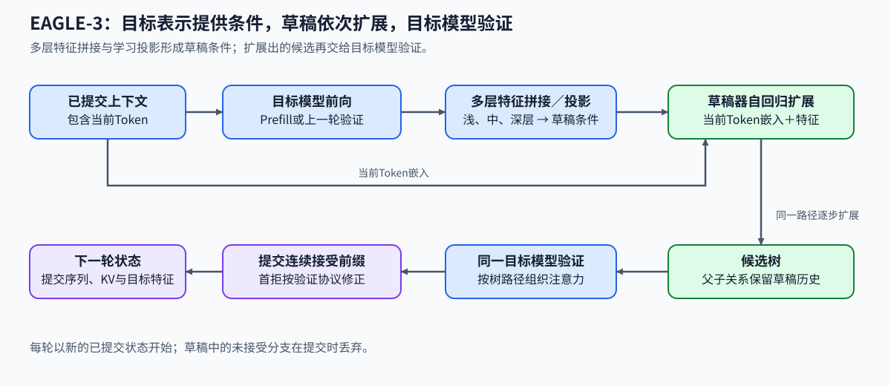
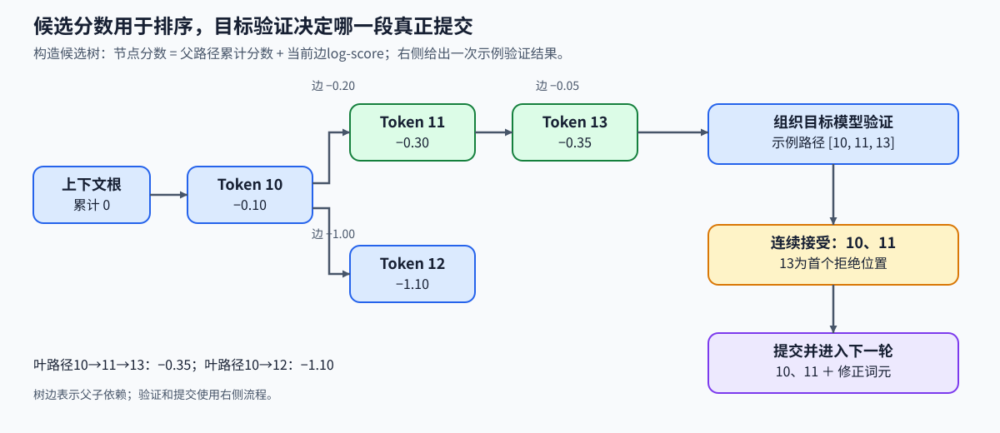

# INF-EAGLE. Feature Drafter and Candidate Tree | 特征草稿器与候选树

**难度：** Hard | **环境：** [CPU 主线](#runtime-environment) | **标签：** `推理优化`、`投机解码`、`EAGLE` | **目标人群：** 理解投机验证、准备分析特征草稿器的读者

> 🚀 **云端运行环境**
>
> 本章节的实战代码可以点击以下链接在免费 GPU 算力平台上直接运行：
>
> [](https://colab.research.google.com/github/datawhalechina/llm-algo-leetcode/blob/main/02_PyTorch_Algorithms/INF-EAGLE_Feature_Drafter_and_Candidate_Tree.ipynb)
> [](https://modelscope.cn/my/mynotebook) *(国内推荐：魔搭社区免费实例)*


## 本节导读

目标模型已经算出上下文的隐藏表示，草稿器能否复用这些结果，更快地提出后续词元？EAGLE 类方法沿这条思路生成候选，再交给目标模型验证。多提几条分支会增加可选择的路径，也要付出草稿、存储和验证成本。

本节先看目标表示怎样进入草稿器，再看候选树如何组织路径与分数。最后区分两种结果：草稿器认为哪条路径更有希望，以及目标模型实际接受了哪一段。

<a id="runtime-environment"></a>

## 运行环境

- **基础练习：** 使用 [BASE-CPU](../guide.md#base-cpu)，运行表示融合与候选树测试。
- **实验准备：** Step 5 记录配对模型字段与后端依赖的检查结果；真实服务采集入口仍待接入。

## 前置阅读

先理解草稿如何被验证、接受前缀如何提交，再比较不同候选来源。

- [23. 投机解码](./23_Speculative_Decoding.md)：接受、拒绝修正和追加词元。
- [35. 原生多词元预测](./35_Multi_Token_Decoding.md)：对照目标模型内部预测层与外置草稿器的区别。

## Step 1：目标模型与特征草稿器怎样分工

隐藏表示是模型中间层为各词元计算的向量。目标模型先处理上下文，草稿器复用其中的表示与当前词元，提出可能的后续序列；目标模型随后验证，并按接受规则提交输出。EAGLE-3 将多层表示融合后直接预测词元，后续草稿步骤使用前一步草稿状态继续推进。[原论文](https://arxiv.org/html/2503.01840v3#S3.SS1)给出了这一推理过程。

| 对象 | 从哪里得到 | 在本轮做什么 | 与下一阶段的关系 |
| --- | --- | --- | --- |
| 当前词元与上下文 | 已提交序列 | 确定草稿生成条件 | 与草稿状态共同作为输入 |
| 多层隐藏表示 | 目标模型选定层 | 提供不同深度的信息 | 经过融合送入草稿器 |
| 特征草稿器 | 与目标模型配对的轻量权重 | 继续扩展候选 | 将候选交给目标模型验证 |
| 候选树 | 多条草稿分支及其分数 | 组织可供验证的路径 | 验证结果决定提交前缀 |



## Step 2：多层表示怎样形成下一步草稿输入

EAGLE-3 读取目标模型浅、中、深层的表示，将三个同宽向量拼接，再通过学习得到的全连接投影压回草稿器需要的宽度。当前词元的嵌入——由词元编号查表取得的向量——也参与草稿计算。隐藏宽度决定向量有多少个分量，投影则学习怎样组合这些分量。

后续位置尚没有新的目标模型表示时，草稿器使用上一步草稿输出继续扩展。因此，扩展一条路径时仍有先后依赖；多层融合改变输入信息，候选树改变分支组织，两者分别影响草稿质量与工作量。结构细节见 [EAGLE-3 论文第 3.1 节](https://arxiv.org/html/2503.01840v3#S3.SS1)。

| 机制问题 | 需要固定的内容 | 检查动作 |
| --- | --- | --- |
| 从哪些层读取 | 层索引与隐藏宽度 | 对照目标配置与草稿器训练时的输入 |
| 怎样组合表示 | 拼接顺序与学习投影权重 | 核对输入、输出维度与投影参数 |
| 怎样继续扩展 | 当前草稿词元与上一步草稿状态 | 沿一条路径检查状态的先后传递 |
| 怎样比较收益 | 同一目标模型、输入与验证预算 | 比较输出、接受长度和完整生成时间 |

## Step 3：候选树分数怎样帮助选择验证路径

候选树把可能的后续词元画成分支：父节点是当前位置之前的候选，叶节点是当前分支的末端。边分数用对数分数（log-score）表示，沿路径相加得到累计分数；若边分数是条件概率的对数，相加对应路径概率的乘积。这个分数用于候选排序，目标模型的验证结果再决定实际提交内容。

例如一条路径的边分数为 −0.1、−0.2、−0.05，累计分数为 −0.35。即使它在候选中排名最高，验证在第三个词元拒绝时，也只能保留此前接受的部分，并执行修正；后续草稿状态随被丢弃的后缀一起撤销。

| 状态 | 怎样得到 | 用途 |
| --- | --- | --- |
| 节点累计分数 | 父路径分数加当前边分数 | 排序候选 |
| 候选路径 | 沿父节点回溯至根 | 组织验证输入 |
| 已接受前缀 | 从路径起点连续通过的位置 | 提交词元和对应缓存状态 |
| 首个拒绝位置 | 目标验证首次失败的位置 | 修正输出并进入下一轮 |



## Step 4：实现表示融合与候选路径评分

本题用归一化加权和练习多层特征的维度对齐与贡献计算；EAGLE-3 的真实草稿器使用前文介绍的拼接与学习投影。候选树用按父节点顺序排列的记录表示。输入校验和路径回溯已经给出；你将补全融合系数、逐维表示和父路径累计分数。测试分别覆盖非法权重、维度不一致、分支累计与最高分叶路径。

| TODO / 函数 | 学习者完成的机制 | 必须满足的约束 | 测试证据 |
| --- | --- | --- | --- |
| TODO 1 · `normalize_fusion_weights` | 归一化多层表示权重 | 权重为非负且总和为正；归一化后和为 1 | 正常、零和与负权重 |
| TODO 2 · `fuse_layer_features` | 融合多层隐藏表示 | 层数与权重数一致；每层 hidden size 一致 | 已知加权和与维度失配 |
| TODO 3 · `score_candidate_tree` | 累计候选树路径分数 | 根分支从 0 开始；非根节点继承父路径分数 | 分支排序、父节点索引与非法树 |

```python
from typing import Dict, List, Sequence, Tuple

```


```python
def normalize_fusion_weights(weights: Sequence[float]) -> List[float]:
    """将非负层权重归一化为和为 1 的融合系数。"""
    if not weights or any(weight < 0 for weight in weights):
        raise ValueError('weights 必须非空且非负')
    # TODO 1（层表示融合）：计算正的权重总和并逐项归一化。
    # total = ???  # 所有层权重之和，必须为正。
    raise NotImplementedError("请完成 TODO 1 后再运行测试。")
    if total <= 0:
        raise ValueError('权重总和必须为正')
    # normalized = ???  # 与输入等长、总和为 1 的融合系数。
    return normalized


def fuse_layer_features(
    layer_features: Sequence[Sequence[float]],
    weights: Sequence[float],
) -> List[float]:
    """按层权重逐维融合隐藏表示；所有层共享隐藏维度。"""
    if not layer_features or len(layer_features) != len(weights):
        raise ValueError('特征层数必须非零且与权重数相同')
    hidden_size = len(layer_features[0])
    if hidden_size == 0 or any(len(feature) != hidden_size for feature in layer_features):
        raise ValueError('所有层必须共享非零隐藏维度')
    normalized = normalize_fusion_weights(weights)
    # TODO 2（草稿输入）：对每个隐藏维度计算跨层加权和。
    # fused = ???  # 每个隐藏维度的跨层加权和。
    raise NotImplementedError("请完成 TODO 2 后再运行测试。")
    return fused


def score_candidate_tree(nodes: Sequence[Dict[str, float]]) -> Tuple[List[float], List[int]]:
    """累计候选树路径分数，并返回最高分叶节点的 token 路径。"""
    if not nodes:
        raise ValueError('候选树不能为空')
    scores: List[float] = []
    for index, node in enumerate(nodes):
        parent = int(node['parent'])
        if parent >= index or parent < -1:
            raise ValueError('parent 必须是 -1 或更早的节点')
        # TODO 3（候选树）：根分支从 0 开始，其余节点继承父路径分数。
        # parent_score = ???  # 根节点为 0，其余节点继承父路径累计分数。
        raise NotImplementedError("请完成 TODO 3 后再运行测试。")
        scores.append(parent_score + float(node['log_score']))

    parent_nodes = {int(node['parent']) for node in nodes if int(node['parent']) >= 0}
    leaves = [index for index in range(len(nodes)) if index not in parent_nodes]
    best = max(leaves, key=lambda index: scores[index])
    path: List[int] = []
    while best != -1:
        path.append(int(nodes[best]['token']))
        best = int(nodes[best]['parent'])
    return scores, list(reversed(path))

```

## 测试

分别检查权重归一化、逐维融合、父路径分数与叶节点回溯。


```python
def test_normalize_fusion_weights():
    """权重应归一化，并拒绝空、负数和零总和输入。"""
    assert normalize_fusion_weights([1.0, 3.0]) == [0.25, 0.75]
    for invalid in ([], [0.0, 0.0], [1.0, -1.0]):
        try:
            normalize_fusion_weights(invalid)
        except ValueError:
            pass
        else:
            raise AssertionError(f'非法权重未被拒绝：{invalid}')


def test_fuse_layer_features():
    """多层特征应逐维融合，并拒绝隐藏维度不一致。"""
    fused = fuse_layer_features([[2.0, 4.0], [6.0, 0.0]], [1.0, 3.0])
    assert all(abs(a - b) < 1e-9 for a, b in zip(fused, [5.0, 1.0]))
    try:
        fuse_layer_features([[1.0], [1.0, 2.0]], [0.5, 0.5])
    except ValueError:
        pass
    else:
        raise AssertionError('隐藏维度不一致时应失败')


def test_score_candidate_tree():
    """候选分数应包含父路径，最佳结果应从叶节点回溯。"""
    nodes = [
        {'parent': -1, 'token': 10, 'log_score': -0.1},
        {'parent': 0, 'token': 11, 'log_score': -0.2},
        {'parent': 0, 'token': 12, 'log_score': -1.0},
        {'parent': 1, 'token': 13, 'log_score': -0.05},
    ]
    scores, path = score_candidate_tree(nodes)
    assert scores == [-0.1, -0.30000000000000004, -1.1, -0.35000000000000003]
    assert path == [10, 11, 13]


def test_candidate_tree_contract():
    """空树、未来父节点和非法父编号都应被拒绝。"""
    invalid_cases = [
        [],
        [{'parent': 0, 'token': 1, 'log_score': -0.1}],
        [{'parent': -2, 'token': 1, 'log_score': -0.1}],
    ]
    for invalid in invalid_cases:
        try:
            score_candidate_tree(invalid)
        except ValueError:
            pass
        else:
            raise AssertionError('非法候选树拓扑应被拒绝')


test_normalize_fusion_weights()
test_fuse_layer_features()
test_score_candidate_tree()
test_candidate_tree_contract()
print('✅ EAGLE 表示融合与候选树测试通过')

```

---

🛑 **STOP HERE** 🛑
<br><br><br><br><br><br><br><br><br><br>
> 请先尝试自己完成代码并跑通测试。<br>
> 如果遇到困难，再向下查看参考代码与解析。
<br><br><br><br><br><br><br><br><br><br>

---
## 参考代码与解析

### 代码

```python
# TODO 1：归一化多层表示权重。
def normalize_fusion_weights(weights: Sequence[float]) -> List[float]:
    """将非负层权重归一化为和为 1 的融合系数。"""
    if not weights or any(weight < 0 for weight in weights):
        raise ValueError('weights 必须非空且非负')
    total = float(sum(weights))
    if total <= 0:
        raise ValueError('权重总和必须为正')
    return [float(weight) / total for weight in weights]


# TODO 2：融合多层隐藏表示。
def fuse_layer_features(
    layer_features: Sequence[Sequence[float]],
    weights: Sequence[float],
) -> List[float]:
    """按层权重逐维融合隐藏表示；所有层共享隐藏维度。"""
    if not layer_features or len(layer_features) != len(weights):
        raise ValueError('特征层数必须非零且与权重数相同')
    hidden_size = len(layer_features[0])
    if hidden_size == 0 or any(len(feature) != hidden_size for feature in layer_features):
        raise ValueError('所有层必须共享非零隐藏维度')
    normalized = normalize_fusion_weights(weights)
    return [
        sum(normalized[layer] * float(layer_features[layer][dimension]) for layer in range(len(layer_features)))
        for dimension in range(hidden_size)
    ]


# TODO 3：累计候选树路径分数。
def score_candidate_tree(nodes: Sequence[Dict[str, float]]) -> Tuple[List[float], List[int]]:
    """累计候选树路径分数，并返回最高分叶节点的 token 路径。"""
    if not nodes:
        raise ValueError('候选树不能为空')
    scores: List[float] = []
    for index, node in enumerate(nodes):
        parent = int(node['parent'])
        if parent >= index or parent < -1:
            raise ValueError('parent 必须是 -1 或更早的节点')
        parent_score = 0.0 if parent == -1 else scores[parent]
        scores.append(parent_score + float(node['log_score']))
    parent_nodes = {int(node['parent']) for node in nodes if int(node['parent']) >= 0}
    leaves = [index for index in range(len(nodes)) if index not in parent_nodes]
    best = max(leaves, key=lambda index: scores[index])
    path: List[int] = []
    while best != -1:
        path.append(int(nodes[best]['token']))
        best = int(nodes[best]['parent'])
    return scores, list(reversed(path))

```

### 解析

#### TODO 1：归一化融合权重

- 加权和示例先把非负层权重归一化，使其表示各层的相对贡献。真实 EAGLE-3 的拼接与学习投影按 Step 2 的结构计算。
- 测试用 [1,3] 得到 [0.25,0.75]，并检查空列表、零总和与负权重。

#### TODO 2：逐维合并表示

- 每个输出分量累加各层同一位置的加权值，因此层数与权重数相同，各层向量宽度也相同。
- 测试将两层向量融合为 [5,1]，再用宽度不同的输入检查维度错误。

#### TODO 3：累计路径分数并回溯

- 每个节点继承父路径分数，再加自己的边分数；从最高分叶节点沿父索引回溯，反转后得到根到叶的词元顺序。
- 分支测试检查累计值与路径 [10,11,13]；非法树测试检查空树、未来父节点及越界编号。目标模型的连续验证规则在 Step 3 解释。

## Step 5：实验前准备——配对模型与后端配置

当前执行单元记录模型字段是否填写，以及 `vllm`、`speculators` 是否可导入。准备真实比较时，再核对目标模型与草稿器的层索引、隐藏宽度、词表和固定权重版本，并接入仅目标模型与 EAGLE 的采集入口。

| 学习问题 | CPU 已确认 | 真实比较需要补充什么 |
| --- | --- | --- |
| 多层表示与候选树怎样参与草稿生成 | 加权和示例、路径累计与叶节点回溯 | 配对模型加载、真实草稿与验证活动、输出、接受长度、时间及显存 |

### 5.1 配对模型与容量准备

[Speculators 服务教程](https://docs.vllm.ai/projects/speculators/en/latest/user_guide/tutorials/serve_vllm/)提供 Qwen3-8B 与 `RedHatAI/Qwen3-8B-speculator.eagle3` 的示例。选择设备前，先累加目标权重、草稿权重、缓存和临时工作区的预算；采用量化目标模型时，还需核对其隐藏表示接口与配对草稿器。

| 准备项 | 固定内容 | 需要取得的记录 |
| --- | --- | --- |
| 模型与后端 | 目标与草稿模型的编号、固定版本和后端方法 | 配对声明、模型配置与加载日志 |
| 候选树 | 树宽、树深和验证预算 | 实际生效配置；当前配置单元默认宽4、深4 |
| 输入与输出 | 提示集、生成长度、精度和采样规则 | 仅目标模型与 EAGLE 的逐请求输出 |
| 容量 | 两套权重、KV 缓存和工作区 | 同一负载下的实际峰值与可用容量 |
| 时间 | 草稿、验证与完整生成 | 预热后的重复样本与接受长度 |


```python
RUN_MODE = 'asset_check'  # 默认值 asset_check；资产齐全后执行真实 EAGLE benchmark。
RUN_LABEL = 'rtx5070ti_eagle_asset_v1'  # 默认资产审计标签；不表示已完成 GPU benchmark。
PROFILE_ID = 'INF-CUDA-MECHANISM'  # 默认单卡推理机制环境。
SEMANTIC_ID = 'INF-EAGLE'  # 稳定机制身份。
WORKLOAD_ID = 'inf-eagle-feature-drafter'  # 稳定工作负载身份。
WORKLOAD_VERSION = 'v1'  # 配对模型或树预算变化时递增。
RECOMMENDED_TARGET_MODEL_ID = 'Qwen/Qwen3-8B'  # 官方 Speculators 示例 verifier。
RECOMMENDED_EAGLE_MODEL_ID = 'RedHatAI/Qwen3-8B-speculator.eagle3'  # 官方示例配对权重。
TARGET_MODEL_ID = ''  # 默认空；确认运行硬件后再填写配对目标模型。
TARGET_MODEL_REVISION = ''  # 默认空；填写目标模型不可变 revision。
EAGLE_MODEL_ID = ''  # 默认空；填写配对 EAGLE speculator。
EAGLE_MODEL_REVISION = ''  # 默认空；填写 speculator 不可变 revision。
EAGLE_BACKEND = ''  # 默认空；推荐使用 vLLM + Speculators 的真实 EAGLE-3 路径。
LOCAL_GPU_MEMORY_GB = 11.48  # 当前参考设备显存；不足以承载推荐 BF16 8B 配对。
TREE_WIDTH = 4  # 默认候选树宽 4；修改后递增 workload version。
TREE_DEPTH = 4  # 默认候选树深 4；修改后递增 workload version。
OUTPUT_RELATIVE_PATH = f'benchmarks/results/inf_eagle_{RUN_LABEL}.json'

```

### 5.2 检查配置并保存 JSON

执行单元检查模型、版本和后端字段是否非空，以及两个依赖包能否找到；结果写入当前标签路径。运行前核对路径，保留已有记录。模型加载、配对兼容与容量检查列在 5.1，后续需由真实采集入口执行。


```python
import importlib
from tools.project_runtime import resolve_project_root
import tools.speculative_mechanism_runtime as speculative_runtime
speculative_runtime = importlib.reload(speculative_runtime)
RESULT_PATH = resolve_project_root() / OUTPUT_RELATIVE_PATH
GPU_REPORT = speculative_runtime.build_asset_gate_result(
    semantic_id=SEMANTIC_ID, profile_id=PROFILE_ID, run_mode=RUN_MODE, run_label=RUN_LABEL,
    workload_id=WORKLOAD_ID, workload_version=WORKLOAD_VERSION, mechanism='eagle',
    required_assets=(
        {'name': 'target_model_id', 'value': TARGET_MODEL_ID},
        {'name': 'target_model_revision', 'value': TARGET_MODEL_REVISION},
        {'name': 'eagle_model_id', 'value': EAGLE_MODEL_ID},
        {'name': 'eagle_model_revision', 'value': EAGLE_MODEL_REVISION},
        {'name': 'eagle_backend', 'value': EAGLE_BACKEND},
    ), required_packages=('vllm', 'speculators'), output_path=RESULT_PATH,
    not_ready_decision='defer_to_multi_gpu',
    not_ready_message='推荐 EAGLE 配对与后端尚未满足；当前 12 GB 单卡不执行替代性探针。',
)
GPU_REPORT

```

### 5.3 读取准备记录

读取已有标签，查看缺失字段与依赖包。全部字段填写、依赖齐全时，记录会返回 `ready_to_measure`，表示可继续准备真实运行；随后按 5.1 核对模型加载与执行条件。


```python
from tools.speculative_mechanism_runtime import read_mechanism_result
report = read_mechanism_result(RESULT_PATH)
{key: report.get(key) for key in ('semantic_id', 'workload', 'asset_gate', 'failure', 'evidence_level', 'decision')}

```

### 5.4 当前准备状态与下一步

历史记录 [rtx5070ti_eagle_asset_v1](../../benchmarks/results/inf_eagle_rtx5070ti_eagle_asset_v1.json) 中，五个配对字段为空，两个依赖包不可用。下一步先准备配对模型与后端，再按完整工作负载评估设备容量并接入真实基准。

| 观察项 | 读取字段 | 当前结果 | 解释与动作 |
| --- | --- | --- | --- |
| 配对字段 | `workload.required_assets` | 目标、草稿及其版本、后端共五项缺失 | 填写后核对实际模型配置与权重版本 |
| 后端依赖 | `asset_gate.missing_packages` | 缺少 vLLM 与 Speculators | 按选定服务环境准备依赖 |
| 真实运行 | `baseline`、`candidates` | 基线为空，候选列表为空 | 接入真实采集后再比较性能与输出 |
| 历史决策 | `decision` | `defer_to_multi_gpu` | 沿用原状态名；当前已记录的原因是字段与依赖缺失，设备方案另按容量评估 |

## 相关阅读

对照真实草稿结构、实现接口与后端选型，继续查看：

- [EAGLE-3 论文](https://arxiv.org/abs/2503.01840)：多层表示融合、草稿状态反馈与训练方法。
- [EAGLE 官方实现](https://github.com/SafeAILab/EAGLE)：对照草稿树与目标验证的组织。
- [68. 投机解码机制选型基准](./68_Speculative_Decoding_Benchmark.md)：固定目标模型后比较输出、时间与资源。
