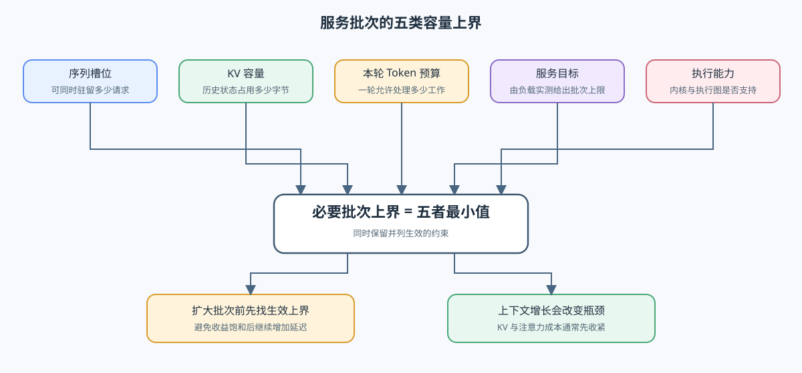

# INF-ITERATION-BUDGET. Serving Iteration Cost and Batch Bounds | Serving 迭代成本与批次容量上界

**难度：** Hard | **环境：** [CPU 主线，GPU 可选](#runtime-environment) | **标签：** `推理优化`, `Serving`, `Batch Budget`, `Cost Model` | **目标人群：** 理解请求与 KV 缓存的读者

> 🚀 **云端运行环境**
>
> 本章节的实战代码可以点击以下链接在免费 GPU 算力平台上直接运行：
>
> [](https://colab.research.google.com/github/datawhalechina/llm-algo-leetcode/blob/main/02_PyTorch_Algorithms/INF-ITERATION-BUDGET_Serving_Iteration_Cost_and_Batch_Bounds.ipynb)
> [](https://modelscope.cn/my/mynotebook) *(国内推荐：魔搭社区免费实例)*


## 本节导读

一轮多接纳几个请求，吞吐就一定更高吗？较大的批次可能摊薄权重读取和提交开销，也可能增加历史 KV 读取，让正在生成的请求更久才能获得下一步结果。判断能否扩大批次，需要同时检查单轮成本与剩余容量。

先把一轮中的输入处理、逐步生成和状态更新串起来，再分别估算计算与访存时间。由此可以区分“容量允许继续增加”和“增加后仍满足延迟要求”，并从批量扫描中找到值得继续复测的位置。

<a id="runtime-environment"></a>

## 运行环境

- **基础练习：** 使用 [`BASE-CPU`](../guide.md#base-cpu)，运行 Step 4 题目与测试。
- **GPU 实测：** 运行 Step 5 前，按其中 5.1 准备独立环境与固定输入。

## 前置阅读

先理解请求事件、历史 KV 如何增长，以及可用容量为何不等于整张卡的显存。

- [Part 02 · INF-REQUEST-LIFECYCLE：推理请求生命周期](./INF-REQUEST-LIFECYCLE_Inference_Request_Lifecycle.md)
- [Part 01 · 11：KV Cache 与显存增长](../01_Hardware_Math_and_Systems/11_KV_Cache_and_Memory_Growth.md)
- [Part 02 · 37：KV Cache 生命周期与容量控制](./37_KV_Cache_Lifecycle_and_Capacity_Control.md)
## Step 1：一轮怎样选择请求并更新状态

请求队列保存新到达和等待继续执行的请求；调度器结合优先级、KV 容量与本轮工作量预算，选出实际执行的请求；执行引擎完成一次前向、采样与状态更新。预填充处理尚未计算的输入词元，解码利用已有 KV 推进生成；完成请求退出，未完成请求携带新的状态进入下一轮。

| 层次 | 输入 | 本轮输出 | 主要约束 |
| --- | --- | --- | --- |
| 请求队列 | 新请求、未完成请求 | 候选集合 | 到达模式、等待时间、优先级 |
| 调度器 | 候选集合、KV 状态、预算 | 本轮执行批次 | 序列槽位、Token 数、KV 容量与服务目标 |
| 执行引擎 | 预填充分块、解码 Token 与 KV | 输出分布、新 KV 与完成状态 | 内核能力、带宽、算力与并行方式 |


## Step 2：计算、访存与未被隐藏的开销怎样相加

用工作量除以有效速率，可以分别估算计算与访存所需的时间。Roofline 的基本直觉是：若两者能够充分重叠，一轮至少要等较慢的一侧完成；调度、提交、同步与未被隐藏的通信，还会延长完成时间。这是成本估算，不是对任意执行轨迹都成立的精确计时公式。

下式中，$T_{memory}$ 是字节数除以有效带宽，$T_{compute}$ 是浮点运算量除以有效算力，单位均为毫秒。$T_{overhead}$ 合计所有尚未计入、且未被隐藏的开销，不能再把同一份提交或通信时间重复相加。带宽使用十进制 GB/s，算力使用 TFLOP/s；每词元计算量是当前形状的估计，注意力上下文改变后需要重新估算。

$$T_{iter} \approx \max(T_{memory}, T_{compute}) + T_{overhead}$$

| 成本项 | 本轮需要统计什么 | 批量或上下文增长时的变化 |
| --- | --- | --- |
| 权重读取 | 本轮实际或估计的权重读取总字节数 | 更多词元可能共同摊销，但不保证物理上只读一次 |
| 历史 KV 读取 | 本轮参与请求的上下文总长度与每词元 KV 字节数 | 上下文和请求数增加都会提高读取量 |
| 新 KV 写入 | 本轮输入处理与生成推进对应的新增状态 | 随本轮处理位置数增长 |
| 计算量 | 当前模型和形状下的浮点运算量 | 可能从访存主导转为计算主导 |
| 暴露开销 | 未被计算或搬运隐藏的准备、提交与同步等 | 需要独立测量或估算，不由带宽公式自动消除 |

## Step 3：五类上界怎样共同限制批次

序列槽位限制活跃请求数，KV 容量限制历史状态，本轮词元预算限制一次前向的工作量；延迟目标和执行后端还可能给出更小的上界。服务等级目标（SLO）规定可接受的延迟或成功率，满足它的批次上限需要由相应负载实测或外部估算提供，不能仅凭容量公式算出请求的首 token 或尾部延迟。

把各上界取最小值，是检查这些必要条件的方法，不保证任意请求混合都能实际执行。这里的 KV 估算假定请求具有相同上下文和预留生成长度、独立保存状态；共享前缀、块取整和工作区需要另计。沿批量递增扫描时，首次延迟越界或相邻吞吐增益低于阈值就停止，保留上一档；这是保守筛选，不是对非单调曲线寻找全局最优。

| 上界 | 需要的输入 | 如何理解零上界 |
| --- | --- | --- |
| 序列槽位 | 可同时管理的请求数量 | 没有空闲准入名额 |
| KV 容量 | 可用字节、每词元状态量、上下文与预留输出长度 | 无法为一个请求预留足够状态 |
| 单轮词元 | 本轮总预算、每请求本轮工作量 | 当前预算不足以执行一个请求 |
| 延迟目标 | 对当前负载已确认的批次上限 | 当前没有满足目标的批次 |
| 执行后端 | 内核、执行图与形状支持范围 | 当前路径不能执行该候选 |



<a id="mechanism-practice"></a>

## Step 4：实现迭代成本、批次上界与运行拐点

本题使用显式字节数、FLOPs、硬件有效带宽与算力构造教学成本账本，并把 slot、KV、token、SLO 和 backend 上界合并。题目区已提供字段约定；你将补全迭代下界、约束合并和吞吐—延迟拐点判断。测试覆盖主导成本、上下文导致的 KV 收缩、多个并列约束和 SLO 违规。

| TODO / 函数 | 学习者完成的机制 | 必须满足的约束 | 测试证据 |
| --- | --- | --- | --- |
| TODO 1：估算单轮成本<br>`estimate_iteration_cost` | 估算单轮计算与访存下界 | 单位换算一致；迭代时间由计算、访存和暴露开销决定 | 计算主导、访存主导与非法带宽 |
| TODO 2：合并批次上界<br>`compute_batch_bounds` | 合并批次的五类上界 | 保留最小硬上界及全部并列约束 | 单一、并列、零上界与非法输入 |
| TODO 3：选择运行拐点<br>`select_operating_knee` | 从批量扫描中选择运行拐点 | 首次延迟越界或相邻吞吐增益低于阈值时停止 | 饱和、越界、单点与非单调曲线 |

```python
from math import isclose, isfinite
from typing import Dict, List, Sequence

```


```python
def estimate_iteration_cost(
    weight_bytes: int,
    kv_bytes_per_token: int,
    active_context_tokens: Sequence[int],
    scheduled_prefill_tokens: int,
    scheduled_decode_tokens: int,
    flops_per_token: float,
    effective_bandwidth_gbps: float,
    effective_compute_tflops: float,
    exposed_overhead_ms: float = 0.0,
) -> Dict[str, float]:
    """估算一次迭代的访存、计算下界与暴露总时间。"""
    values = [weight_bytes, kv_bytes_per_token, scheduled_prefill_tokens, scheduled_decode_tokens, flops_per_token]
    if any(value < 0 for value in values) or effective_bandwidth_gbps <= 0 or effective_compute_tflops <= 0 or exposed_overhead_ms < 0:
        raise ValueError('成本输入不得为负，硬件有效速率必须为正')
    if any(type(tokens) is not int or tokens < 0 for tokens in active_context_tokens):
        raise ValueError('上下文长度必须为非负整数')
    if not all(isfinite(value) for value in values + [effective_bandwidth_gbps, effective_compute_tflops, exposed_overhead_ms]):
        raise ValueError('成本与有效速率必须是有限数值')
    scheduled_tokens = scheduled_prefill_tokens + scheduled_decode_tokens
    if scheduled_tokens <= 0:
        raise ValueError('成本估算需要一个非空执行迭代')
    kv_read_bytes = kv_bytes_per_token * sum(active_context_tokens)
    kv_write_bytes = kv_bytes_per_token * scheduled_tokens
    total_flops = flops_per_token * scheduled_tokens
    # TODO 1（迭代成本）：换算访存与计算下界，并识别主导项。
    raise NotImplementedError("请完成 TODO 1：memory_bytes、memory_ms、compute_ms 与 dominant")
    # memory_bytes = ???  # 权重读取、历史 KV 读取与新增 KV 写入的总字节数。
    # memory_ms = ???  # 按有效显存带宽换算的毫秒数。
    # compute_ms = ???  # 按有效计算吞吐换算的毫秒数。
    # dominant = ???  # memory_ms 与 compute_ms 中较大的资源侧。
    return {
        'scheduled_tokens': scheduled_tokens, 'memory_bytes': memory_bytes,
        'kv_read_bytes': kv_read_bytes, 'kv_write_bytes': kv_write_bytes,
        'total_flops': total_flops, 'memory_ms': memory_ms, 'compute_ms': compute_ms,
        'exposed_overhead_ms': exposed_overhead_ms,
        'iteration_ms': max(memory_ms, compute_ms) + exposed_overhead_ms,
        'dominant': dominant,
    }


def compute_batch_bounds(
    max_num_seqs: int,
    available_kv_bytes: int,
    kv_bytes_per_token: int,
    context_tokens_per_request: int,
    reserved_output_tokens: int,
    max_num_batched_tokens: int,
    scheduled_tokens_per_request: int,
    slo_batch_limit: int,
    backend_batch_limit: int,
) -> Dict[str, object]:
    """计算五类 batch 上界及最终生效约束。"""
    positive = [kv_bytes_per_token, scheduled_tokens_per_request]
    nonnegative = [max_num_seqs, available_kv_bytes, context_tokens_per_request, reserved_output_tokens,
                   max_num_batched_tokens, slo_batch_limit, backend_batch_limit]
    if any(type(value) is not int for value in positive + nonnegative):
        raise ValueError('容量、长度与批次上界必须为整数')
    if any(value <= 0 for value in positive) or any(value < 0 for value in nonnegative):
        raise ValueError('容量与上界不能为负，每词元字节数和单请求工作量必须为正')
    if context_tokens_per_request + reserved_output_tokens <= 0:
        raise ValueError('每请求的上下文与预留输出总长度必须为正')
    kv_per_request = kv_bytes_per_token * (context_tokens_per_request + reserved_output_tokens)
    # TODO 2（批次上界）：合并五类上界并保留全部并列约束。
    raise NotImplementedError("请完成 TODO 2：limits、final_limit 与 binding_constraints")
    # limits = ???  # 包含 slot、kv、token、slo、backend 五个非负整数上界。
    # final_limit = ???  # 所有上界的最小值。
    # binding_constraints = ???  # 等于 final_limit 的全部约束名。
    return {
        'limits': limits, 'final_limit': final_limit,
        'binding_constraints': binding_constraints,
        'kv_bytes_per_request': kv_per_request,
    }


def select_operating_knee(
    records: Sequence[Dict[str, float]],
    max_iteration_ms: float,
    min_relative_throughput_gain: float = 0.10,
) -> Dict[str, object]:
    """在满足延迟门槛的 sweep 中选择吞吐开始饱和前的 batch。"""
    if not records or not isfinite(max_iteration_ms) or max_iteration_ms <= 0 or not isfinite(min_relative_throughput_gain) or min_relative_throughput_gain < 0:
        raise ValueError('记录与阈值必须有效')
    batches = [row['batch'] for row in records]
    if any(type(batch) is not int or batch <= 0 for batch in batches) or len(set(batches)) != len(batches):
        raise ValueError('批量必须为不重复的正整数')
    if any(not isfinite(row['throughput']) or row['throughput'] <= 0 or not isfinite(row['iteration_ms']) or row['iteration_ms'] < 0 for row in records):
        raise ValueError('吞吐必须为有限正数，迭代时间必须为有限非负数')
    ordered = sorted(records, key=lambda item: item['batch'])
    selected = None
    reason = 'largest_valid_batch'
    previous = None
    for record in ordered:
        if record['iteration_ms'] > max_iteration_ms:
            reason = 'slo_violation'
            break
        if previous is not None:
            # TODO 3（运行拐点）：计算相邻吞吐增益并判断是否已饱和。
            raise NotImplementedError("请完成 TODO 3：relative_gain 与 throughput_saturated")
            # relative_gain = ???  # 相对 previous throughput 的增益比例。
            # throughput_saturated = ???  # 增益严格低于给定阈值时为真。
            if throughput_saturated:
                reason = 'throughput_saturation'
                break
        selected = record
        previous = record
    if selected is None:
        raise ValueError('没有 batch 满足延迟约束')
    return {'selected_batch': selected['batch'], 'selected_record': dict(selected), 'stop_reason': reason}

```

## 测试

测试分别定位成本主导项、容量上界和运行拐点；CPU 结果验证机制关系，不代表真实 backend 吞吐。

```python
def _expect_value_error(call):
    """核对非法输入明确抛出 ValueError，不吞掉断言错误。"""
    try:
        call()
    except ValueError:
        return
    raise AssertionError('应拒绝非法输入')


def test_iteration_cost():
    """核对字节、FLOPs、毫秒换算与两种主导项。"""
    result = estimate_iteration_cost(1_000_000_000, 1_000, [100, 200], 16, 4, 1e9, 100.0, 10.0, 0.2)
    assert result['scheduled_tokens'] == 20
    assert result['memory_bytes'] == 1_000_320_000
    assert isclose(result['memory_ms'], 10.0032)
    assert isclose(result['compute_ms'], 2.0)
    assert isclose(result['iteration_ms'], 10.2032) and result['dominant'] == 'memory'
    compute = estimate_iteration_cost(1_000, 1, [1], 0, 1, 1e12, 100.0, 1.0)
    assert compute['dominant'] == 'compute' and compute['iteration_ms'] == 1000.0
    _expect_value_error(lambda: estimate_iteration_cost(1, 1, [], 1, 0, 1, 0, 1))
    _expect_value_error(lambda: estimate_iteration_cost(1, 1, [-1], 1, 0, 1, 1, 1))
    _expect_value_error(lambda: estimate_iteration_cost(1, 1, [], 0, 0, 1, 1, 1))
    _expect_value_error(lambda: estimate_iteration_cost(1, 1, [], 1, 0, float('nan'), 1, 1))


def test_batch_bounds():
    """核对上下文增长、并列瓶颈、零容量与零预留输出。"""
    short = compute_batch_bounds(64, 64_000_000, 1_000, 1_000, 100, 128, 1, 48, 64)
    long = compute_batch_bounds(64, 64_000_000, 1_000, 8_000, 100, 128, 1, 48, 64)
    assert short['final_limit'] == 48 and short['binding_constraints'] == ['slo']
    assert long['limits']['kv'] < short['limits']['kv']
    tied = compute_batch_bounds(8, 80_000, 1_000, 9, 1, 8, 1, 8, 8)
    assert tied['final_limit'] == 8
    assert set(tied['binding_constraints']) == {'slot', 'kv', 'token', 'slo', 'backend'}
    zero = compute_batch_bounds(8, 0, 1_000, 9, 0, 8, 1, 8, 8)
    assert zero['final_limit'] == 0 and zero['binding_constraints'] == ['kv']
    assert zero['kv_bytes_per_request'] == 9_000
    _expect_value_error(lambda: compute_batch_bounds(8, -1, 1, 1, 0, 8, 1, 8, 8))
    _expect_value_error(lambda: compute_batch_bounds(8, 8, 1, 0, 0, 8, 1, 8, 8))


def test_operating_knee():
    """核对饱和、延迟越界、单点和保守停止规则。"""
    records = [{'batch': 4, 'throughput': 100.0, 'iteration_ms': 8.0},
               {'batch': 8, 'throughput': 180.0, 'iteration_ms': 11.0},
               {'batch': 16, 'throughput': 190.0, 'iteration_ms': 18.0}]
    assert select_operating_knee(records, 25.0)['selected_batch'] == 8
    assert select_operating_knee(records, 25.0)['stop_reason'] == 'throughput_saturation'
    assert select_operating_knee(records[:2], 25.0)['selected_batch'] == 8
    assert select_operating_knee(records[:1], 25.0)['selected_batch'] == 4
    assert select_operating_knee(records, 9.0)['stop_reason'] == 'slo_violation'
    nonmonotonic = [records[0], {'batch': 8, 'throughput': 200.0, 'iteration_ms': 30.0},
                   {'batch': 16, 'throughput': 300.0, 'iteration_ms': 9.0}]
    assert select_operating_knee(nonmonotonic, 10.0)['selected_batch'] == 4
    _expect_value_error(lambda: select_operating_knee(records, 1.0))
    _expect_value_error(lambda: select_operating_knee([records[0], records[0]], 25.0))
    _expect_value_error(lambda: select_operating_knee([{'batch': 1, 'throughput': 0.0, 'iteration_ms': 1.0}], 25.0))


test_iteration_cost()
test_batch_bounds()
test_operating_knee()
print('PASS: 迭代成本、五类上界与保守批量扫描测试通过。')

```

---

🛑 **STOP HERE** 🛑
<br><br><br><br><br><br><br><br><br><br>
> 请先尝试自己完成代码并跑通测试。<br>
> 如果遇到困难，再向下查看参考代码与解析。
<br><br><br><br><br><br><br><br><br><br>

---
## 参考代码与解析

### 代码

```python
# TODO 1：估算单轮计算与访存下界。
def estimate_iteration_cost(
    weight_bytes: int, kv_bytes_per_token: int, active_context_tokens: Sequence[int],
    scheduled_prefill_tokens: int, scheduled_decode_tokens: int, flops_per_token: float,
    effective_bandwidth_gbps: float, effective_compute_tflops: float, exposed_overhead_ms: float = 0.0,
) -> Dict[str, float]:
    """估算非空迭代的计算、访存下界和暴露开销，时间单位为毫秒。"""
    values = [weight_bytes, kv_bytes_per_token, scheduled_prefill_tokens, scheduled_decode_tokens, flops_per_token, effective_bandwidth_gbps, effective_compute_tflops]
    if any(value < 0 for value in values) or effective_bandwidth_gbps <= 0 or effective_compute_tflops <= 0 or exposed_overhead_ms < 0:
        raise ValueError('cost inputs must be non-negative and hardware rates must be positive')
    if any(type(tokens) is not int or tokens < 0 for tokens in active_context_tokens):
        raise ValueError('上下文长度必须为非负整数')
    if not all(isfinite(value) for value in values + [effective_bandwidth_gbps, effective_compute_tflops, exposed_overhead_ms]):
        raise ValueError('成本与有效速率必须是有限数值')
    scheduled_tokens = scheduled_prefill_tokens + scheduled_decode_tokens
    if scheduled_tokens <= 0:
        raise ValueError('成本估算需要一个非空执行迭代')
    kv_read_bytes = kv_bytes_per_token * sum(active_context_tokens)
    kv_write_bytes = kv_bytes_per_token * scheduled_tokens
    memory_bytes = weight_bytes + kv_read_bytes + kv_write_bytes
    total_flops = flops_per_token * scheduled_tokens
    memory_ms = memory_bytes / (effective_bandwidth_gbps * 1e9) * 1e3
    compute_ms = total_flops / (effective_compute_tflops * 1e12) * 1e3
    dominant = 'memory' if memory_ms >= compute_ms else 'compute'
    return {'scheduled_tokens': scheduled_tokens, 'memory_bytes': memory_bytes, 'kv_read_bytes': kv_read_bytes, 'kv_write_bytes': kv_write_bytes, 'total_flops': total_flops, 'memory_ms': memory_ms, 'compute_ms': compute_ms, 'exposed_overhead_ms': exposed_overhead_ms, 'iteration_ms': max(memory_ms, compute_ms) + exposed_overhead_ms, 'dominant': dominant}


# TODO 2：合并批次的五类上界。
def compute_batch_bounds(
    max_num_seqs: int, available_kv_bytes: int, kv_bytes_per_token: int, context_tokens_per_request: int,
    reserved_output_tokens: int, max_num_batched_tokens: int, scheduled_tokens_per_request: int,
    slo_batch_limit: int, backend_batch_limit: int,
) -> Dict[str, object]:
    """在独立状态与同形请求假设下计算五类必要上界，允许零容量。"""
    positive = [kv_bytes_per_token, scheduled_tokens_per_request]
    nonnegative = [max_num_seqs, available_kv_bytes, context_tokens_per_request, reserved_output_tokens,
                   max_num_batched_tokens, slo_batch_limit, backend_batch_limit]
    if any(type(value) is not int for value in positive + nonnegative):
        raise ValueError('容量、长度与批次上界必须为整数')
    if any(value <= 0 for value in positive) or any(value < 0 for value in nonnegative):
        raise ValueError('容量与上界不能为负，每词元字节数和单请求工作量必须为正')
    if context_tokens_per_request + reserved_output_tokens <= 0:
        raise ValueError('每请求的上下文与预留输出总长度必须为正')
    kv_per_request = kv_bytes_per_token * (context_tokens_per_request + reserved_output_tokens)
    limits = {'slot': max_num_seqs, 'kv': available_kv_bytes // kv_per_request, 'token': max_num_batched_tokens // scheduled_tokens_per_request, 'slo': slo_batch_limit, 'backend': backend_batch_limit}
    final_limit = min(limits.values())
    return {'limits': limits, 'final_limit': final_limit, 'binding_constraints': [name for name, limit in limits.items() if limit == final_limit], 'kv_bytes_per_request': kv_per_request}


# TODO 3：从 Batch Sweep 选择运行拐点。
def select_operating_knee(records: Sequence[Dict[str, float]], max_iteration_ms: float, min_relative_throughput_gain: float = 0.10) -> Dict[str, object]:
    """递增扫描，首次越界或收益饱和时保留上一档，不搜索全局最优。"""
    if not records or not isfinite(max_iteration_ms) or max_iteration_ms <= 0 or not isfinite(min_relative_throughput_gain) or min_relative_throughput_gain < 0:
        raise ValueError('记录与阈值必须有效')
    batches = [row['batch'] for row in records]
    if any(type(batch) is not int or batch <= 0 for batch in batches) or len(set(batches)) != len(batches):
        raise ValueError('批量必须为不重复的正整数')
    if any(not isfinite(row['throughput']) or row['throughput'] <= 0 or not isfinite(row['iteration_ms']) or row['iteration_ms'] < 0 for row in records):
        raise ValueError('吞吐必须为有限正数，迭代时间必须为有限非负数')
    ordered = sorted(records, key=lambda item: item['batch'])
    selected = None
    reason = 'largest_valid_batch'
    previous = None
    for record in ordered:
        if record['iteration_ms'] > max_iteration_ms:
            reason = 'slo_violation'
            break
        if previous is not None:
            gain = (record['throughput'] - previous['throughput']) / max(previous['throughput'], 1e-12)
            if gain < min_relative_throughput_gain:
                reason = 'throughput_saturation'
                break
        selected = record
        previous = record
    if selected is None:
        raise ValueError('no batch satisfies the latency constraint')
    return {'selected_batch': selected['batch'], 'selected_record': dict(selected), 'stop_reason': reason}

```

### 解析

#### TODO 1：建立迭代成本账本

- 模型权重由本轮 Token 共同摊销，历史 KV 读取量随活跃请求的上下文总长度增长；计算时间与访存时间必须使用同一轮工作量，迭代下界取两者较大值。
- 答案分别计算访存时间、计算时间和暴露开销；测试通过计算主导、访存主导与非法带宽输入验证单位和主导项判断。

#### TODO 2：计算并发上界

- 序列槽位、KV 容量、单轮 Token、延迟目标和执行能力分别给出上界；有效并发取其中最小值，并保留全部并列约束。
- 答案独立计算五类上界后再求最小值；测试构造单一瓶颈、并列瓶颈、零剩余容量与非法输入，验证上界数值和瓶颈标签。

#### TODO 3：选择运行拐点

- 按批量递增逐档检查，首次延迟越界或相邻吞吐增益低于阈值便停止，选择上一档；不跳过越界点继续寻找后面的可行配置。
- 答案按批量排序并计算相邻收益；测试覆盖延迟越界、收益饱和、持续增长、单点和非单调曲线。
## Step 5：GPU 机制实验——真实模型的 batch × context 成本曲线

| 学习问题 | CPU 机制实验 | GPU 真实实验 |
| --- | --- | --- |
| 批量和上下文如何改变单轮成本与可用容量 | 验证成本项、五类上界和拐点选择 | 用同一 Transformers 模型测量预填充、单步解码、峰值显存和 KV 字节，确认真实张量形状下的容量与延迟变化 |

### 5.1 环境与固定工作负载

使用 `INF-CUDA-MECHANISM` Profile；参考环境为单卡 12 GB 以上显存，首次运行需要下载模型，不需要外部数据集。创建或恢复环境见[推理优化实验 Quickstart](../topic_discussion/inference_optimization/quickstart.md#inf-cuda-mechanism-quickstart)，实验登记见[推理优化实验资产表](../topic_discussion/inference_optimization/experiment_assets.md)。运行前的 Profile 预检必须返回 `status=ok`。

| 配置层 | 本实验固定口径 | 修改规则 |
| --- | --- | --- |
| 模型 | `Qwen/Qwen3-0.6B`、同一 revision 与 dtype | 更换模型或精度后不得与旧结果直接合并 |
| 工作负载 | batch × context 矩阵；synthetic token IDs | 修改矩阵后递增 workload version |
| 配对变量 | 同一模型下只改变 batch 与 context | 预热、重复和随机种子保持一致 |
| 测量 | median / P95、KV 字节、峰值显存、OOM 恢复 | 不用平均值掩盖长尾或失败 shape |
| 结果 | 每个 shape 的状态与 JSON 路径 | 正式复测使用唯一 `RUN_LABEL` |


```python
RUN_MODE = 'dry_run'  # 默认值 dry_run：只登记计划；改为 real_gpu 执行真实矩阵。
RUN_LABEL = 'default'  # 默认值 default；正式复测改为唯一标签，避免覆盖旧结果。
PROFILE_ID = 'INF-CUDA-MECHANISM'  # 默认 Profile；预检必须返回 status=ok。
WORKLOAD_ID = 'inf-iteration-budget'  # 稳定实验身份；协议语义变化时才修改。
WORKLOAD_VERSION = 'v3'  # v3 兼容 Transformers DynamicCache，并记录 KV 张量数量。
GPU_MODEL_ID = 'Qwen/Qwen3-0.6B'  # 默认 0.6B 模型；更换模型后结果不可直接合并。
GPU_MODEL_REVISION = 'main'  # 默认 main；运行时先解析为本地 immutable commit。
GPU_DTYPE = 'bfloat16'  # 默认 bfloat16；硬件不支持 BF16 时改为 float16 并单独记录。
GPU_BATCH_SIZES = [1, 2, 4, 8]  # 默认四档 batch；增大会提高显存与迭代时间。
GPU_CONTEXT_LENGTHS = [128, 512, 1024]  # 默认 token 长度矩阵；增大会提高 KV 读取与容量压力。
GPU_WARMUP = 5  # 默认预热 5 次；用于稳定编译、缓存和时钟状态。
GPU_REPEATS = 20  # 默认重复 20 次；用于计算 median 与 P95。
GPU_SEED = 2026  # 默认随机种子 2026；保证 shape 输入可复测。
GPU_RESULT_DIR = 'benchmarks/results/inf_iteration_budget'  # 默认仓库相对结果目录。

```

### 5.2 执行并保存 JSON

执行单元对每个 shape 分别测 Prefill 与携带 `past_key_values` 的单步 Decode。OOM 作为该 shape 的失败证据写入结果，不据此推断生产并发上限。

```python
import json
import math
import torch
import statistics
from pathlib import Path

from tools.notebook_runtime import resolve_model_commit
from tools.project_runtime import resolve_project_root


def _cache_stats(cache):
    """兼容 legacy tuple 与 Transformers DynamicCache，统计 KV 张量字节。"""
    tensors = []
    visited = set()

    def visit(value):
        if value is None or id(value) in visited:
            return
        if isinstance(value, torch.Tensor):
            tensors.append(value)
            return
        visited.add(id(value))
        if isinstance(value, dict):
            for item in value.values():
                visit(item)
        elif isinstance(value, (list, tuple)):
            for item in value:
                visit(item)
        elif hasattr(value, 'to_legacy_cache'):
            try:
                before = len(tensors)
                visit(value.to_legacy_cache())
                if len(tensors) > before:
                    return
            except (AttributeError, NotImplementedError):
                pass
        for attr in ('key_cache', 'value_cache', 'layers', 'keys', 'values'):
            if hasattr(value, attr):
                visit(getattr(value, attr))

    visit(cache)
    return {
        'bytes': sum(t.numel() * t.element_size() for t in tensors),
        'tensor_count': len(tensors),
    }


def _cuda_latency_ms(fn, warmup, repeats):
    for _ in range(warmup):
        fn()
    samples = []
    for _ in range(repeats):
        start = torch.cuda.Event(enable_timing=True)
        end = torch.cuda.Event(enable_timing=True)
        start.record()
        fn()
        end.record()
        torch.cuda.synchronize()
        samples.append(start.elapsed_time(end))
    ordered = sorted(samples)
    p95_index = min(len(ordered) - 1, math.ceil(0.95 * len(ordered)) - 1)
    return {'median_ms': statistics.median(samples), 'p95_ms': ordered[p95_index]}


def _cuda_recovered_after_oom():
    try:
        probe = torch.empty(1, device='cuda')
        torch.cuda.synchronize()
        del probe
        return True
    except torch.cuda.OutOfMemoryError:
        torch.cuda.empty_cache()
        return False


def run_iteration_gpu_experiment():
    if RUN_MODE != 'real_gpu':
        return {'status': 'skipped', 'failure': "set RUN_MODE='real_gpu' after INF-CUDA-MECHANISM preflight"}
    if not torch.cuda.is_available():
        return {'status': 'failed', 'failure': 'CUDA is unavailable'}
    from transformers import AutoModelForCausalLM
    dtype = getattr(torch, GPU_DTYPE)
    torch.manual_seed(GPU_SEED)
    try:
        resolved_commit, resolution_source = resolve_model_commit(
            GPU_MODEL_ID, GPU_MODEL_REVISION, local_files_only=True
        )
        local_files_only = True
    except (FileNotFoundError, OSError):
        resolved_commit, resolution_source = resolve_model_commit(
            GPU_MODEL_ID, GPU_MODEL_REVISION, local_files_only=False
        )
        local_files_only = False
    model = AutoModelForCausalLM.from_pretrained(
        GPU_MODEL_ID, revision=resolved_commit, dtype=dtype, local_files_only=local_files_only
    ).cuda().eval()
    records = []
    for context in GPU_CONTEXT_LENGTHS:
        for batch in GPU_BATCH_SIZES:
            try:
                torch.cuda.empty_cache(); torch.cuda.reset_peak_memory_stats()
                input_ids = torch.randint(10, model.config.vocab_size, (batch, context), device='cuda')
                mask = torch.ones_like(input_ids)
                with torch.inference_mode():
                    prefill = _cuda_latency_ms(lambda: model(input_ids=input_ids, attention_mask=mask, use_cache=True), GPU_WARMUP, GPU_REPEATS)
                    output = model(input_ids=input_ids, attention_mask=mask, use_cache=True)
                    cache = output.past_key_values
                    decode_ids = torch.randint(10, model.config.vocab_size, (batch, 1), device='cuda')
                    decode_mask = torch.ones((batch, context + 1), dtype=mask.dtype, device='cuda')
                    decode = _cuda_latency_ms(lambda: model(input_ids=decode_ids, attention_mask=decode_mask, past_key_values=cache, use_cache=True), GPU_WARMUP, GPU_REPEATS)
                cache_stats = _cache_stats(cache)
                records.append({
                    'batch': batch, 'context_tokens': context,
                    'prefill_median_ms': prefill['median_ms'], 'prefill_p95_ms': prefill['p95_ms'],
                    'decode_median_ms': decode['median_ms'], 'decode_p95_ms': decode['p95_ms'],
                    'prefill_tokens_per_s': batch * context / (prefill['median_ms'] / 1000),
                    'decode_tokens_per_s': batch / (decode['median_ms'] / 1000),
                    'kv_cache_bytes': cache_stats['bytes'],
                    'kv_tensor_count': cache_stats['tensor_count'],
                    'peak_memory_bytes': torch.cuda.max_memory_allocated(),
                    'oom_recovered': None, 'status': 'ok',
                })
                del input_ids, mask, output, cache, decode_ids, decode_mask
            except torch.cuda.OutOfMemoryError as error:
                torch.cuda.empty_cache()
                records.append({'batch': batch, 'context_tokens': context, 'status': 'failed', 'failure': f'OOM: {error}', 'oom_recovered': _cuda_recovered_after_oom()})
    report = {'schema_version': 'inference-mechanism-gpu/v3', 'semantic_id': 'INF-ITERATION-BUDGET', 'profile_id': PROFILE_ID, 'run_label': RUN_LABEL, 'status': 'completed', 'model': {'id': GPU_MODEL_ID, 'requested_revision': GPU_MODEL_REVISION, 'resolved_commit': resolved_commit, 'resolution_source': resolution_source, 'local_files_only': local_files_only, 'dtype': GPU_DTYPE}, 'hardware': {'gpu': torch.cuda.get_device_name(0), 'cuda': torch.version.cuda, 'torch': torch.__version__}, 'workload': {'id': WORKLOAD_ID, 'version': WORKLOAD_VERSION, 'batch_sizes': GPU_BATCH_SIZES, 'context_lengths': GPU_CONTEXT_LENGTHS, 'warmup': GPU_WARMUP, 'repeats': GPU_REPEATS, 'seed': GPU_SEED}, 'records': records, 'failure': None, 'evidence_level': 'local_mechanism_benchmark', 'decision': 'tune'}
    output_dir = resolve_project_root(Path.cwd()) / GPU_RESULT_DIR; output_dir.mkdir(parents=True, exist_ok=True)
    result_path = output_dir / f"iteration_budget_{RUN_LABEL}.json"
    result_path.write_text(json.dumps(report, ensure_ascii=False, indent=2), encoding='utf-8')
    report['result_path'] = str(result_path)
    return report


GPU_REPORT = run_iteration_gpu_experiment()
GPU_REPORT

```

### 5.3 读取结果

只读取 5.2 保存的结果。先确认 schema、环境、工作负载、失败、证据等级和决策，再按 shape 展示 median/P95、KV 字节、峰值显存与 OOM 恢复状态；不重新加载模型或执行测量。


```python
report = globals().get('GPU_REPORT', {'status': 'not_run', 'records': []})
summary = {
    'schema_version': report.get('schema_version'),
    'status': report.get('status'),
    'failure': report.get('failure'),
    'model': report.get('model'),
    'hardware': report.get('hardware'),
    'workload': report.get('workload'),
    'evidence_level': report.get('evidence_level'),
    'decision': report.get('decision', 'rerun'),
}
matrix = [
    {
        'batch': item.get('batch'), 'context_tokens': item.get('context_tokens'),
        'status': item.get('status'),
        'prefill_median_ms': item.get('prefill_median_ms'),
        'prefill_p95_ms': item.get('prefill_p95_ms'),
        'decode_median_ms': item.get('decode_median_ms'),
        'decode_p95_ms': item.get('decode_p95_ms'),
        'kv_cache_bytes': item.get('kv_cache_bytes'),
        'peak_memory_bytes': item.get('peak_memory_bytes'),
        'oom_recovered': item.get('oom_recovered'),
        'failure': item.get('failure'),
    }
    for item in report.get('records', [])
]
summary, matrix

```

### 5.4 解释结果并作出决策

先检查失败 shape 是否在清理缓存后恢复，再确认模型、dtype、batch × context 矩阵和重复规则一致。随后比较 Prefill / Decode 的 median 与 P95、KV 字节和峰值显存，观察吞吐收益饱和时延迟与容量是否仍继续恶化。

`rtx5070ti_iteration_budget_v3` 已形成单卡真实模型快照。12 个 batch × context shape 均完成，没有 OOM；`kv_cache_bytes` 随 Batch 和 Context 线性增长。该结果用于识别容量与吞吐拐点，不能直接替代真实队列和连续批处理服务复测。

| 观察项 | 读取字段 | 当前结果 | 解释与动作 |
| --- | --- | --- | --- |
| 运行与口径 | `failure`、模型 commit、dtype、workload version | Qwen3-0.6B；commit `c1899de`；BF16；无失败 | 固定模型与矩阵后，结果可用于本机机制对照 |
| 机制与路径 | Batch、Context、KV 字节、OOM 恢复 | 12 个 shape 全部成功；KV 从 `17.5 MiB` 增至 `917.3 MiB`，按 Batch/Context 线性增长 | KV 容量可作为准入上界输入，不等同于服务可用容量 |
| 正确性 | 输出 shape、`kv_tensor_count`、缓存状态 | 56 个 KV 张量，Prefill 与单步 Decode 均完成 | 缓存字节为零或状态不完整时不得解释性能 |
| 资源与性能 | Prefill/Decode Median、P95、吞吐、峰值显存 | 峰值显存约 `1.26–6.06 GB`；Prefill 吞吐在中等 Batch 后趋于饱和；Decode 延迟随 Batch/Context 增长 | 选择满足延迟门槛且未触及容量上界的候选 |
| 证据与决策 | `evidence_level`、`decision` | `local_mechanism_benchmark`；`tune` | 当前证据支持容量与延迟机制判断；真实队列、连续批处理和服务吞吐仍需单独复测 |

## 相关阅读

单轮上界确定后，继续观察如何在轮次边界准入请求、重组批次，以及后端怎样执行这些选择。

- [Orca：迭代级调度](https://www.usenix.org/conference/osdi22/presentation/yu)
- [vLLM：PagedAttention 与高吞吐 Serving](https://arxiv.org/abs/2309.06180)
- [INF-CONTINUOUS-BATCHING：连续批处理](./INF-CONTINUOUS-BATCHING_Continuous_Batching.md)
- [38：Prefill/Decode 调度](./38_Prefill_Decode_Scheduling.md)
