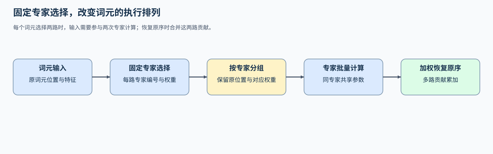
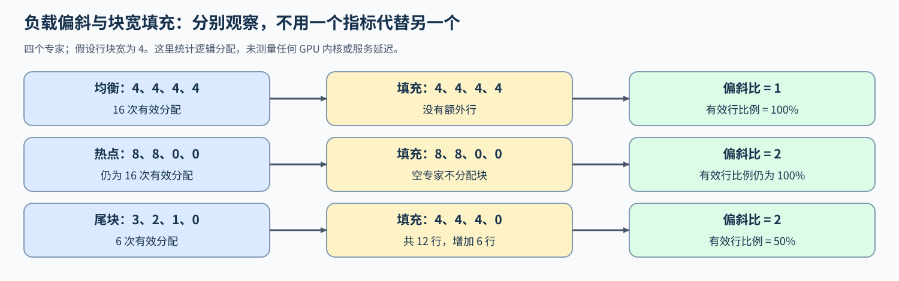

# INF-MOE-EXECUTION. MoE Inference Dispatch and Expert Execution | MoE 推理中的词元分组与专家执行

**难度：** Hard | **环境：** [CPU 主线，GPU 可选](#runtime-environment) | **标签：** `推理优化`, `MoE`, `专家执行` | **目标人群：** 理解 Top-K 路由、需要比较专家执行方式的学习者

> 🚀 **云端运行环境**
>
> 本章节的实战代码可以点击以下链接在免费 GPU 算力平台上直接运行：
>
> [](https://colab.research.google.com/github/datawhalechina/llm-algo-leetcode/blob/main/02_PyTorch_Algorithms/INF-MOE-EXECUTION_MoE_Inference_Dispatch_and_Expert_Execution.ipynb)
> [](https://modelscope.cn/my/mynotebook) *(国内推荐：魔搭社区免费实例)*


## 本节导读

相同词元被送给相同专家，逐词元调用与按专家批量调用可以产生相同输出，却形成不同大小的矩阵和不同数量的任务。解码时每轮词元少，某些专家只处理一两行；预填充时词元多，专家之间又可能出现明显负载偏斜。

把词元按专家重新排列后，必须保留每行来自哪里、使用哪一路权重，才能在计算结束后恢复原顺序。本节沿着分组、专家计算和加权合并，解释执行批量如何变化，以及为什么较少的激活参数不等于较小的全部权重驻留。

**关键词：** `Top-K 路由`, `词元分组`, `SwiGLU`, `负载偏斜`, `加权合并`

<a id="runtime-environment"></a>

## 运行环境

- **基础练习：** 使用 [BASE-CPU](../guide.md#base-cpu)，运行 [Step 4 题目与测试](#mechanism-practice)。
- **GPU 实测：** [Step 5](#gpu-experiment) 使用 [INF-CUDA-MECHANISM](../topic_discussion/inference_optimization/quickstart.md#inf-cuda-mechanism-quickstart)，比较固定路由下的真实 SwiGLU 专家层。

## 前置阅读

先确认专家选择与层内计算的含义，再比较相同路由结果的执行方式。

- [MoE 路由器](./06_MoE_Router.md)：Top-K 专家编号与归一化路由权重。
- [SwiGLU](./02_SwiGLU_Activation.md)：专家内部的门控前馈计算。
- [MoE 参数与计算](../01_Hardware_Math_and_Systems/22_MoE_Parameter_and_Compute.md)：总参数、激活参数和权重驻留的区别。

## Step 1：从固定路由到专家批次与原序输出

混合专家（MoE）的专家是可供选择的前馈网络；路由器为每个词元选出得分最高的 K 个专家，这称为 Top-K 路由。路由权重表示这些专家输出各占多少，而不是专家网络的参数。执行器可以逐词元调用这些专家，也可以把同专家的分配放到一起，让该专家处理一个行批次。两种方式都需要保存原词元位置和对应权重；排序改变执行顺序，不改变专家选择。

例如两个词元都选择两个专家，一共形成四次分配。同一词元的两份输入可能出现在两个不同专家批次中；输出恢复时，需要把这两份贡献加回同一位置，而不是用后一份覆盖前一份。空专家不参与计算，有分配的专家则必须覆盖全部有效行。



## Step 2：排序改变执行顺序，权重与词元身份保持对应

设有 $T$ 个词元，每个输入 $x_t$ 有 $D$ 个特征；每个词元选择 $K$ 个不同专家，共有 $E$ 个专家。编号为 $e_{t,j}$ 的专家接收第 $t$ 个词元的第 $j$ 路分配，权重 $g_{t,j}$ 非负且对每个词元求和为 1。专家函数记作 $F_e$，输出仍有 $D$ 个特征。原序输出为：

$$
y_t=\sum_{j=0}^{K-1} g_{t,j}F_{e_{t,j}}(x_t),\qquad 0\leq t<T.
$$

分组把 $TK$ 次分配按专家编号排序，专家边界由各专家的分配数累加得到。排序必须同时搬动输入、原词元位置和权重。计算结束后，再按原词元位置加权累加，就恢复上式；仅恢复位置而未恢复权重对应关系，输出形状仍可能正确，数值却已改变。

若两个专家对同一词元分别输出 2 和 6，对应权重为 0.75 和 0.25，则合并输出为 3。把权重错换会得到 5，覆盖写回则只留下某一路。每路计算都正确，也不能弥补合并关系被破坏。

| 执行变化 | 保持的关系 | 容易遗漏的边界 |
| --- | --- | --- |
| 按专家排序 | 分配数量、词元身份、专家编号、路由权重成组移动 | 空专家仍有零长度区间 |
| 专家批量计算 | 每行使用原先选中的专家参数 | 同一专家内部保留全部有效分配 |
| 恢复原序 | 同一词元的多路贡献相加 | 重复词元位置不能覆盖写入 |

## Step 3：词元规模与专家偏斜怎样改变执行成本

同一轮有 $TK$ 次分配，但每个专家实际接收的行数可能差别很大。令 $c_e$ 表示专家 $e$ 的分配数，则 $\sum_e c_e=TK$。可以用最忙专家与全体专家平均负载的比值观察偏斜：

$$
I=\frac{\max_e c_e}{TK/E}.
$$

该式用于非空输入；空输入约定统计量为零。$I$ 是负载描述，不是 GPU 延迟预测：单卡专家顺序执行、不同矩阵效率和跨卡等待，都会改变实际耗时。偏斜有时还减少活跃专家数，所以不能仅凭偏斜变大就断言单卡更慢。

若某种实现按 $b$ 行一块分配工作，非空专家需要的填充行数为 $p_e=b\lceil c_e/b\rceil$，空专家为零。有效行比例是 $\sum_e c_e/\sum_e p_e$，其中 $b$ 是假定的行块宽，不代表某个实际内核已经采用该配置。偏斜和填充是两项独立代价。

预填充常一次提供更多词元，解码每轮只提供活跃请求的新词元，因此即使专家数与 Top-K 相同，也会形成不同的专家矩阵形状。增加词元数可能改善批量计算效率，同时增加工作量和输入输出搬运；激活参数指本轮所选专家涉及的参数，不是前向产生的激活张量。全部专家权重若常驻设备，其容量也不会随本轮激活数量同比下降。



<a id="mechanism-practice"></a>

## Step 4：实现专家分组、加权恢复与负载统计

本题使用二维输入、固定 Top-K 编号和权重复现专家执行。骨架提供输入检查和分组结果结构；你将补全分组顺序与区间、输出加权累加，以及填充和偏斜统计。测试用独立的逐词元循环核对结果，并覆盖空专家、空输入、顺序打乱和非法路由。

| TODO / 函数 | 学习者完成的机制 | 必须满足的约束 | 测试证据 |
| --- | --- | --- | --- |
| TODO 1：按专家建立可逆分组<br>`pack_expert_assignments` | 同步排列词元、专家和权重，建立区间 | 总分配数守恒，空专家区间为零 | 正常路由保留全部分配；空专家与空输入边界正确 |
| TODO 2：恢复词元顺序并合并贡献<br>`combine_expert_outputs` | 按权重累加回原词元位置 | 多路贡献相加，不覆盖；输出保持原词元数 | 与逐词元参考一致；打乱分组行后输出仍一致 |
| TODO 3：量化填充与专家负载<br>`expert_load_metrics` | 计算块宽填充、有效行比例和偏斜 | 空专家不填充；空输入不除零 | 均衡与偏斜负载对照；尾块、负计数与非法块宽 |


```python
import torch

```


```python
def _validate_routes(x, expert_ids, route_weights, num_experts):
    """检查固定 Top-K 路由的形状、范围和权重，不改变路由选择。"""
    if x.ndim != 2 or expert_ids.ndim != 2 or route_weights.shape != expert_ids.shape:
        raise ValueError("需要 x=[T,D]、expert_ids/route_weights=[T,K]")
    if expert_ids.shape[0] != x.shape[0] or not 0 < expert_ids.shape[1] <= num_experts:
        raise ValueError("词元数量或 Top-K 不合法")
    if not isinstance(num_experts, int) or isinstance(num_experts, bool) or num_experts <= 0 or expert_ids.dtype != torch.long:
        raise ValueError("专家数量须为正整数，专家编号须为 int64")
    if expert_ids.device.type != "cpu" or route_weights.device.type != "cpu":
        raise ValueError("固定路由元数据使用 CPU 张量")
    if not torch.isfinite(route_weights).all() or (route_weights < 0).any():
        raise ValueError("路由权重须为有限非负数")
    if x.shape[0] and not torch.allclose(route_weights.sum(1), torch.ones(x.shape[0], dtype=route_weights.dtype)):
        raise ValueError("每个词元的路由权重之和须为 1")
    if expert_ids.numel() and ((expert_ids < 0).any() or (expert_ids >= num_experts).any()):
        raise ValueError("专家编号超出范围")
    sorted_ids = expert_ids.sort(dim=1).values
    if sorted_ids.shape[1] > 1 and (sorted_ids[:, 1:] == sorted_ids[:, :-1]).any():
        raise ValueError("同一词元不能重复选择同一专家")


def pack_expert_assignments(x, expert_ids, route_weights, num_experts):
    """按专家稳定分组，保留原词元身份与对应路由权重。"""
    _validate_routes(x, expert_ids, route_weights, num_experts)
    token_count, top_k = expert_ids.shape
    flat_experts = expert_ids.reshape(-1)
    flat_tokens = torch.arange(token_count).repeat_interleave(top_k)
    flat_weights = route_weights.reshape(-1)
    # ==========================================
    # TODO 1: 按专家建立可逆分组
    # ==========================================
    # order = ???  # [T*K]；同专家的分配连续排列，同组保持原先顺序
    # token_ids = ???  # [T*K]；排序后每行对应的原词元位置
    # counts = ???  # [E]；保留空专家，总数等于 T*K
    # offsets = ???  # [E+1]；每个专家的半开区间边界，首项为零
    raise NotImplementedError("TODO 1: 请按专家建立可逆分组")
    return {
        "inputs": x.index_select(0, token_ids.to(x.device)),
        "token_ids": token_ids,
        "expert_ids": flat_experts[order],
        "weights": flat_weights[order],
        "counts": counts,
        "offsets": offsets,
    }


def combine_expert_outputs(expert_outputs, token_ids, route_weights, token_count):
    """把专家输出按原词元位置加权累加，重复词元不能覆盖。"""
    if expert_outputs.ndim != 2 or token_count < 0:
        raise ValueError("专家输出须为二维，词元数量不得为负")
    if token_ids.ndim != 1 or route_weights.shape != token_ids.shape or len(token_ids) != len(expert_outputs):
        raise ValueError("分组输出、位置与权重数量须一致")
    if token_ids.dtype != torch.long or (token_ids < 0).any() or (token_ids >= token_count).any():
        raise ValueError("词元位置不合法")
    if not torch.isfinite(route_weights).all() or (route_weights < 0).any():
        raise ValueError("合并权重须为有限非负数")
    if not torch.isfinite(expert_outputs).all():
        raise ValueError("专家输出须为有限值")
    output = expert_outputs.new_zeros((token_count, expert_outputs.shape[1]))
    # ==========================================
    # TODO 2: 恢复词元顺序并合并贡献
    # ==========================================
    # weighted = ???  # [T*K,D]；每行使用它自身的路由权重
    # output = ???  # [T,D]；同一词元的多路贡献累加而不是覆盖
    raise NotImplementedError("TODO 2: 请恢复词元顺序并合并贡献")
    return output


def expert_load_metrics(counts, tile_rows):
    """计算分组填充与负载偏斜，空专家不分配计算块。"""
    if counts.ndim != 1 or len(counts) == 0 or counts.dtype != torch.long or (counts < 0).any():
        raise ValueError("counts 须为非空、非负的 int64 向量")
    if not isinstance(tile_rows, int) or isinstance(tile_rows, bool) or tile_rows <= 0:
        raise ValueError("tile_rows 须为正整数")
    total = int(counts.sum())
    mean_load = total / len(counts)
    # ==========================================
    # TODO 3: 量化填充与专家负载
    # ==========================================
    # padded = ???  # [E]；非空专家上取整到块宽，空专家保持零
    # utilization = ???  # 有效分配数占填充分配数的比例；无分配时为零
    # imbalance = ???  # 最忙专家负载与全体专家平均负载之比；空输入为零
    raise NotImplementedError("TODO 3: 请量化填充与专家负载")
    return {
        "assignments": total,
        "padded_assignments": int(padded.sum()),
        "padding": int(padded.sum()) - total,
        "utilization": utilization,
        "max_over_mean": imbalance,
        "active_experts": int((counts > 0).sum()),
    }

```

## 测试

测试分别核对分组身份、加权合并和负载账本；专家输出参考由独立逐词元循环计算。


```python
def _routing_fixture():
    """构造五个词元、四个专家，包含空专家与不同路由权重。"""
    x = torch.arange(15, dtype=torch.float64).reshape(5, 3) / 10
    ids = torch.tensor([[2, 0], [0, 2], [2, 1], [1, 0], [0, 1]])
    gates = torch.tensor([[0.2, 0.8], [0.7, 0.3], [0.4, 0.6], [0.1, 0.9], [0.5, 0.5]], dtype=torch.float64)
    return x, ids, gates


def _assert_value_error(call):
    """确认非法输入被显式拒绝而非产生可用外观的结果。"""
    try:
        call()
    except ValueError:
        return
    raise AssertionError("应抛出 ValueError")


def test_dispatch_identity_and_empty_experts():
    """分组保持词元、专家、权重对应，空专家区间长度为零。"""
    x, ids, gates = _routing_fixture()
    packed = pack_expert_assignments(x, ids, gates, 4)
    assert packed["counts"].tolist() == [4, 3, 3, 0]
    assert packed["offsets"].tolist() == [0, 4, 7, 10, 10]
    original = [(t, int(ids[t, k]), float(gates[t, k])) for t in range(5) for k in range(2)]
    observed = list(zip(packed["token_ids"].tolist(), packed["expert_ids"].tolist(), packed["weights"].tolist()))
    assert sorted(original) == sorted(observed)
    torch.testing.assert_close(packed["inputs"], x[packed["token_ids"]])
    assert packed["token_ids"][:4].tolist() == [0, 1, 3, 4]


def test_combine_matches_token_reference():
    """用独立的逐词元循环核对多专家加权结果及恢复顺序。"""
    x, ids, gates = _routing_fixture()
    packed = pack_expert_assignments(x, ids, gates, 4)
    expert_factors = torch.tensor([1., 2., 3., 4.], dtype=x.dtype)
    expert_outputs = packed["inputs"] * expert_factors[packed["expert_ids"]].unsqueeze(1)
    actual = combine_expert_outputs(expert_outputs, packed["token_ids"], packed["weights"], len(x))
    expected = torch.zeros_like(x)
    for t in range(len(x)):
        for k in range(ids.shape[1]):
            expected[t] += gates[t, k] * x[t] * expert_factors[ids[t, k]]
    torch.testing.assert_close(actual, expected)
    reverse = torch.arange(len(expert_outputs) - 1, -1, -1)
    reordered = combine_expert_outputs(expert_outputs[reverse], packed["token_ids"][reverse], packed["weights"][reverse], len(x))
    torch.testing.assert_close(reordered, expected)


def test_load_padding_and_skew():
    """区分空专家、块宽填充与热点；偏斜不必同时增加填充。"""
    balanced = expert_load_metrics(torch.tensor([4, 4, 4, 4]), 4)
    skewed = expert_load_metrics(torch.tensor([16, 0, 0, 0]), 4)
    tail = expert_load_metrics(torch.tensor([5, 3, 0, 0]), 4)
    assert balanced["max_over_mean"] == 1 and skewed["max_over_mean"] == 4
    assert balanced["padding"] == skewed["padding"] == 0
    assert tail["padding"] == 4 and tail["utilization"] == 8 / 12


def test_empty_input_and_invalid_routes():
    """空输入保持空输出；越界、重复专家与非归一化权重应失败。"""
    x = torch.empty((0, 3), dtype=torch.float64)
    ids = torch.empty((0, 2), dtype=torch.long)
    gates = torch.empty((0, 2), dtype=torch.float64)
    packed = pack_expert_assignments(x, ids, gates, 4)
    actual = combine_expert_outputs(x, packed["token_ids"], packed["weights"], 0)
    assert actual.shape == (0, 3) and packed["offsets"].tolist() == [0, 0, 0, 0, 0]
    assert expert_load_metrics(torch.zeros(4, dtype=torch.long), 4)["utilization"] == 0
    x, ids, gates = _routing_fixture()
    bad = ids.clone()
    bad[0, 0] = 4
    _assert_value_error(lambda: pack_expert_assignments(x, bad, gates, 4))
    _assert_value_error(lambda: pack_expert_assignments(x, torch.zeros_like(ids), gates, 4))
    _assert_value_error(lambda: pack_expert_assignments(x, ids, gates * 2, 4))
    _assert_value_error(lambda: combine_expert_outputs(x, torch.full((5,), 5), gates[:, 0], 5))
    _assert_value_error(lambda: combine_expert_outputs(x, torch.arange(5), -gates[:, 0], 5))
    _assert_value_error(lambda: combine_expert_outputs(torch.full_like(x, float("nan")), torch.arange(5), gates[:, 0], 5))
    _assert_value_error(lambda: expert_load_metrics(torch.tensor([1, -1]), 4))
    _assert_value_error(lambda: expert_load_metrics(torch.tensor([1, 0]), 0))


test_dispatch_identity_and_empty_experts()
test_combine_matches_token_reference()
test_load_padding_and_skew()
test_empty_input_and_invalid_routes()
print("PASSED: 专家分组、加权恢复、填充与偏斜、空输入和非法路由核对通过。")

```

---

🛑 **STOP HERE**

请先完成题目并运行测试，再展开参考代码。

<br><br><br><br><br><br><br><br><br><br>

## 参考代码与解析

### 代码


```python
def _validate_routes(x, expert_ids, route_weights, num_experts):
    """检查固定 Top-K 路由的形状、范围和权重，不改变路由选择。"""
    if x.ndim != 2 or expert_ids.ndim != 2 or route_weights.shape != expert_ids.shape:
        raise ValueError("需要 x=[T,D]、expert_ids/route_weights=[T,K]")
    if expert_ids.shape[0] != x.shape[0] or not 0 < expert_ids.shape[1] <= num_experts:
        raise ValueError("词元数量或 Top-K 不合法")
    if not isinstance(num_experts, int) or isinstance(num_experts, bool) or num_experts <= 0 or expert_ids.dtype != torch.long:
        raise ValueError("专家数量须为正整数，专家编号须为 int64")
    if expert_ids.device.type != "cpu" or route_weights.device.type != "cpu":
        raise ValueError("固定路由元数据使用 CPU 张量")
    if not torch.isfinite(route_weights).all() or (route_weights < 0).any():
        raise ValueError("路由权重须为有限非负数")
    if x.shape[0] and not torch.allclose(route_weights.sum(1), torch.ones(x.shape[0], dtype=route_weights.dtype)):
        raise ValueError("每个词元的路由权重之和须为 1")
    if expert_ids.numel() and ((expert_ids < 0).any() or (expert_ids >= num_experts).any()):
        raise ValueError("专家编号超出范围")
    sorted_ids = expert_ids.sort(dim=1).values
    if sorted_ids.shape[1] > 1 and (sorted_ids[:, 1:] == sorted_ids[:, :-1]).any():
        raise ValueError("同一词元不能重复选择同一专家")


def pack_expert_assignments(x, expert_ids, route_weights, num_experts):
    """按专家稳定分组，保留原词元身份与对应路由权重。"""
    _validate_routes(x, expert_ids, route_weights, num_experts)
    token_count, top_k = expert_ids.shape
    flat_experts = expert_ids.reshape(-1)
    flat_tokens = torch.arange(token_count).repeat_interleave(top_k)
    flat_weights = route_weights.reshape(-1)
    # TODO 1：按专家建立可逆分组
    order = torch.argsort(flat_experts, stable=True)
    token_ids = flat_tokens[order]
    counts = torch.bincount(flat_experts, minlength=num_experts)
    offsets = torch.cat([torch.zeros(1, dtype=torch.long), counts.cumsum(0)])
    return {
        "inputs": x.index_select(0, token_ids.to(x.device)),
        "token_ids": token_ids,
        "expert_ids": flat_experts[order],
        "weights": flat_weights[order],
        "counts": counts,
        "offsets": offsets,
    }


def combine_expert_outputs(expert_outputs, token_ids, route_weights, token_count):
    """把专家输出按原词元位置加权累加，重复词元不能覆盖。"""
    if expert_outputs.ndim != 2 or token_count < 0:
        raise ValueError("专家输出须为二维，词元数量不得为负")
    if token_ids.ndim != 1 or route_weights.shape != token_ids.shape or len(token_ids) != len(expert_outputs):
        raise ValueError("分组输出、位置与权重数量须一致")
    if token_ids.dtype != torch.long or (token_ids < 0).any() or (token_ids >= token_count).any():
        raise ValueError("词元位置不合法")
    if not torch.isfinite(route_weights).all() or (route_weights < 0).any():
        raise ValueError("合并权重须为有限非负数")
    if not torch.isfinite(expert_outputs).all():
        raise ValueError("专家输出须为有限值")
    output = expert_outputs.new_zeros((token_count, expert_outputs.shape[1]))
    # TODO 2：恢复词元顺序并合并贡献
    weighted = expert_outputs * route_weights.to(expert_outputs.device, expert_outputs.dtype).unsqueeze(1)
    output.index_add_(0, token_ids.to(expert_outputs.device), weighted)
    return output


def expert_load_metrics(counts, tile_rows):
    """计算分组填充与负载偏斜，空专家不分配计算块。"""
    if counts.ndim != 1 or len(counts) == 0 or counts.dtype != torch.long or (counts < 0).any():
        raise ValueError("counts 须为非空、非负的 int64 向量")
    if not isinstance(tile_rows, int) or isinstance(tile_rows, bool) or tile_rows <= 0:
        raise ValueError("tile_rows 须为正整数")
    total = int(counts.sum())
    mean_load = total / len(counts)
    # TODO 3：量化填充与专家负载
    padded = ((counts + tile_rows - 1) // tile_rows) * tile_rows
    utilization = total / int(padded.sum()) if total else 0.0
    imbalance = float(counts.max()) / mean_load if total else 0.0
    return {
        "assignments": total,
        "padded_assignments": int(padded.sum()),
        "padding": int(padded.sum()) - total,
        "utilization": utilization,
        "max_over_mean": imbalance,
        "active_experts": int((counts > 0).sum()),
    }

```

### 解析

#### TODO 1：按专家建立可逆分组

- 每次 Top-K 分配都带着词元身份和权重；稳定排序后用同一排列移动三者，计数和前缀和确定每个专家的半开区间。
- 分组测试逐项核对原分配与分组后的三元关系，并检查空专家的两个边界相等，避免只核对输出形状。

#### TODO 2：恢复词元顺序并合并贡献

- 一个词元可能有多行专家输出，按位置累加才能恢复加权和；普通覆盖会丢失其他专家贡献。
- 参考测试独立循环计算每个词元的专家加权和，并打乱待合并行；两次结果一致说明恢复不依赖分组顺序。

#### TODO 3：量化填充与专家负载

- 非空专家按假定块宽上取整，空专家保持零；有效行比例使用全部填充行作分母，偏斜使用全体专家平均负载作分母。
- 测试保留“偏斜增加但填充不增加”的反例，同时检查空输入和非法块宽。这里计算逻辑行账本，实际执行成本由设备实验测量。

<a id="gpu-experiment"></a>

## Step 5：可选 GPU 实验——固定路由下的专家批量执行

使用同一组 SwiGLU 专家参数，对照逐词元执行与按专家批量执行。固定路由计划预先构造并复用，GPU 完整调用包括重排、专家计算和合并；计划构造耗时单列，不把结果外推为动态路由下的完整模型收益。

| 学习问题 | CPU 已确认 | GPU 要确认与后续使用 |
| --- | --- | --- |
| 同一路由下，按专家执行是否能减少小矩阵调用并改善完整调用耗时？ | 分组身份、加权输出、空专家和逻辑负载账本 | 实际线性调用与 CUDA 路径、输出误差、延迟和额外峰值；后续结合专家并行或模型组件重新测量 |

### 5.1 环境与固定工作负载

使用 [INF-CUDA-MECHANISM](../topic_discussion/inference_optimization/quickstart.md#inf-cuda-mechanism-quickstart)，先完成该 Profile 预检。输入与专家权重由固定种子生成，无外部模型或数据下载；登记见[推理实验资产表](../topic_discussion/inference_optimization/experiment_assets.md#moe-execution)。

| 配置层 | 必须说明的内容 | 修改规则 |
| --- | --- | --- |
| 运行环境 | 单 GPU、原生 BF16、INF-CUDA-MECHANISM | 预检失败时保存失败记录，不计时 |
| 模型 / 数据来源 | 八个双投影门控、单输出投影的 SwiGLU 专家；固定随机权重与输入 | 不声明任务质量；模型层身份和种子随结果记录 |
| 工作负载 | 1/16/128 词元；均衡与集中到两专家的固定路由 | 修改规模或路由后不能合并旧矩阵 |
| 配对变量 | 逐词元逐专家 → 同专家批量执行 | 权重、路由、精度与合并语义相同；不是专用 grouped GEMM 内核 |
| 测量方法 | 交替顺序、多轮计时、误差、线性调用和 CUDA 事件 | CPU 计划构造另计；逻辑填充账本不是实际内核填充测量 |
| 结果资产 | 根目录 benchmarks/results/inf_moe_execution 下 JSON | real_gpu 使用唯一标签；已有结果不覆盖 |


```python
RUN_MODE = "dry_run"  # 默认值 dry_run：只打印计划；改为 real_gpu 执行设备矩阵。
RUN_LABEL = "default"  # 默认值 default；实测改为唯一标签，保留已有结果。
PROFILE = "INF-CUDA-MECHANISM"  # 默认机制 Profile；不与服务后端混装。
TOKEN_COUNTS = (1, 16, 128)  # 默认三档词元数；改变专家矩阵行数与总工作量。
ROUTING_CASES = ("balanced", "skewed")  # 默认均衡与热点路由；两条执行路径使用同一路由。
NUM_EXPERTS = 8  # 默认八个常驻专家；增加会提高权重容量。
TOP_K = 2  # 默认每词元两个不同专家；须满足 1 <= TOP_K <= NUM_EXPERTS。
HIDDEN_SIZE = 512  # 默认输入输出宽度；增大会增加投影计算与权重。
FFN_SIZE = 1536  # 默认专家中间宽度；增大会提高计算与工作区需求。
SEED = 42  # 默认固定种子；两条路径共用同一实例。
TILE_ROWS = 16  # 默认逻辑行块宽，只用于填充账本，不声明实际内核分块。
WARMUP = 3  # 默认每条路径预热三次，不计入稳态样本。
ITERATIONS = 5  # 默认每次测量执行五次，按调用平均。
REPEATS = 3  # 默认三轮交替顺序，结果保留每轮样本。
ATOL = 0.02  # 默认绝对误差容差，固定 BF16 专家层比较。
RTOL = 0.02  # 默认相对误差容差，不代替任务质量。
MINIMUM_SPEEDUP = 1.05  # 默认完整调用主机可见中位数至少加速 5% 才接受该档候选。
RESULTS_DIR = "benchmarks/results/inf_moe_execution"  # 默认仓库根相对路径，不随 Notebook 工作目录改变。

```

### 5.2 执行并保存 JSON

先运行题目或参考实现，随后执行本单元。dry_run 不初始化 CUDA、不保存性能结果；real_gpu 检查唯一标签，交替测量两条路径并保留失败档位。


```python
import json
import math
import statistics
import time
from pathlib import Path

from tools.notebook_runtime import failure_record
from tools.project_runtime import environment_preflight, resolve_project_root, runtime_snapshot, save_json_record_once


def _make_gpu_case(token_count, routing):
    """生成同权重 SwiGLU 专家层；路由固定，完整调用包含 GPU 重排与合并。"""
    generator = torch.Generator().manual_seed(SEED)
    x_cpu = torch.randn(token_count, HIDDEN_SIZE, generator=generator)
    slots = torch.arange(TOP_K).expand(token_count, -1)
    ids = (torch.arange(token_count).unsqueeze(1) + slots) % NUM_EXPERTS if routing == "balanced" else slots.clone()
    gates = torch.full((token_count, TOP_K), 1.0 / TOP_K)
    started = time.perf_counter()
    plan = pack_expert_assignments(x_cpu, ids, gates, NUM_EXPERTS)
    preparation_ms = (time.perf_counter() - started) * 1000
    device, dtype = "cuda", torch.bfloat16
    x = x_cpu.to(device=device, dtype=dtype)
    experts = []
    for _ in range(NUM_EXPERTS):
        gate = torch.randn(FFN_SIZE, HIDDEN_SIZE, generator=generator) / HIDDEN_SIZE ** 0.5
        up = torch.randn(FFN_SIZE, HIDDEN_SIZE, generator=generator) / HIDDEN_SIZE ** 0.5
        down = torch.randn(HIDDEN_SIZE, FFN_SIZE, generator=generator) / FFN_SIZE ** 0.5
        experts.append(tuple(w.to(device=device, dtype=dtype) for w in (gate, up, down)))
    token_ids = plan["token_ids"].to(device)
    route_weights = plan["weights"].to(device)
    offsets = plan["offsets"].tolist()

    def expert_forward(rows, expert):
        """执行三次线性映射与门控激活，基线和候选共用权重。"""
        gate, up, down = experts[expert]
        return torch.nn.functional.linear(
            torch.nn.functional.silu(torch.nn.functional.linear(rows, gate))
            * torch.nn.functional.linear(rows, up), down
        )

    def tokenwise():
        """逐词元逐专家执行，保持 Top-K 加权语义。"""
        result = torch.zeros((token_count, HIDDEN_SIZE), device=device, dtype=torch.float32)
        for token in range(token_count):
            for slot in range(TOP_K):
                expert = int(ids[token, slot])
                value = expert_forward(x[token:token + 1], expert)[0]
                result[token].add_(value.float() * float(gates[token, slot]))
        return result

    def grouped():
        """每个非空专家处理一个批次；包含输入重排和输出加权恢复。"""
        packed_input = x.index_select(0, token_ids)
        values = torch.empty_like(packed_input)
        for expert in range(NUM_EXPERTS):
            start, end = offsets[expert:expert + 2]
            if start != end:
                values[start:end] = expert_forward(packed_input[start:end], expert)
        result = torch.zeros((token_count, HIDDEN_SIZE), device=device, dtype=torch.float32)
        result.index_add_(0, token_ids, values.float() * route_weights.unsqueeze(1))
        return result

    return {"tokenwise": tokenwise, "grouped": grouped}, plan, preparation_ms


def _measure_call(call):
    """同步边界覆盖完整调用；分别记录主机可见与设备事件时间。"""
    torch.cuda.synchronize()
    torch.cuda.reset_peak_memory_stats()
    before = torch.cuda.memory_allocated()
    start, end = torch.cuda.Event(enable_timing=True), torch.cuda.Event(enable_timing=True)
    wall_start = time.perf_counter()
    start.record()
    for _ in range(ITERATIONS):
        output = call()
        del output
    end.record()
    torch.cuda.synchronize()
    return {
        "wall_ms": (time.perf_counter() - wall_start) * 1000 / ITERATIONS,
        "cuda_ms": start.elapsed_time(end) / ITERATIONS,
        "extra_peak_mb": (torch.cuda.max_memory_allocated() - before) / 1024 ** 2,
    }


def _execution_trace(call):
    """在计时之外记录实际线性调用数量与 CUDA 事件名称。"""
    with torch.profiler.profile(activities=[
        torch.profiler.ProfilerActivity.CPU, torch.profiler.ProfilerActivity.CUDA
    ]) as prof:
        output = call()
        torch.cuda.synchronize()
    del output
    linear_calls = sum(event.count for event in prof.key_averages() if event.key == "aten::linear")
    cuda_names = sorted({event.name for event in prof.events() if str(event.device_type).endswith("CUDA")})
    return {"linear_calls": linear_calls, "cuda_kernel_names": cuda_names, "cuda_event_observed": bool(cuda_names)}


def run_moe_matrix():
    """交替测量三个词元规模与两类固定路由，不输出模型质量或服务收益结论。"""
    preflight = environment_preflight(
        torch, environment_profile=PROFILE, require_gpu=True, require_native_bf16=True
    )
    result = {
        "schema_version": "moe-inference-execution/v1",
        "semantic_id": "INF-MOE-EXECUTION", "run_label": RUN_LABEL,
        "runtime": runtime_snapshot(torch), "preflight": preflight,
        "evidence_level": "local_mechanism_benchmark",
        "scope": "fixed-routing single-GPU SwiGLU expert layer; CPU dispatch plan prepared once",
        "workload": {"version": 1, "tokens": list(TOKEN_COUNTS), "routes": list(ROUTING_CASES),
                     "experts": NUM_EXPERTS, "top_k": TOP_K, "hidden": HIDDEN_SIZE,
                     "ffn": FFN_SIZE, "seed": SEED, "dtype": "bfloat16",
                     "warmup": WARMUP, "iterations": ITERATIONS, "repeats": REPEATS},
        "thresholds": {"minimum_speedup": MINIMUM_SPEEDUP, "atol": ATOL, "rtol": RTOL},
        "cases": [], "failure": None,
    }
    if not preflight["ready"]:
        raise RuntimeError("环境预检失败：" + str(preflight["reasons"]))
    with torch.inference_mode():
        for token_count in TOKEN_COUNTS:
            for routing in ROUTING_CASES:
                case = {"tokens": token_count, "routing": routing, "status": "failed",
                        "decision": "reject", "failure": None}
                calls = None
                try:
                    calls, plan, preparation_ms = _make_gpu_case(token_count, routing)
                    expected, actual = calls["tokenwise"](), calls["grouped"]()
                    case["max_abs_error"] = float((expected - actual).abs().max())
                    case["finite"] = bool(torch.isfinite(expected).all() and torch.isfinite(actual).all())
                    if not case["finite"]:
                        raise ValueError("候选或基线出现非有限输出")
                    torch.testing.assert_close(actual, expected, atol=ATOL, rtol=RTOL)
                    del expected, actual
                    for _ in range(WARMUP):
                        for call in calls.values():
                            call()
                    del call
                    samples = {name: [] for name in calls}
                    for repeat in range(REPEATS):
                        order = ("tokenwise", "grouped") if repeat % 2 == 0 else ("grouped", "tokenwise")
                        for name in order:
                            samples[name].append(_measure_call(calls[name]))
                    metrics = {
                        name: {"median_wall_ms": statistics.median(r["wall_ms"] for r in rows),
                               "median_cuda_ms": statistics.median(r["cuda_ms"] for r in rows),
                               "max_extra_peak_mb": max(r["extra_peak_mb"] for r in rows),
                               "samples": rows}
                        for name, rows in samples.items()
                    }
                    traces = {name: _execution_trace(call) for name, call in calls.items()}
                    active = int((plan["counts"] > 0).sum())
                    path_confirmed = (
                        traces["tokenwise"]["linear_calls"] == 3 * token_count * TOP_K
                        and traces["grouped"]["linear_calls"] == 3 * active
                        and all(trace["cuda_event_observed"] for trace in traces.values())
                    )
                    speedup = metrics["tokenwise"]["median_wall_ms"] / metrics["grouped"]["median_wall_ms"]
                    case.update({
                        "status": "measured", "metrics": metrics, "traces": traces,
                        "path_confirmed": path_confirmed, "speedup": speedup,
                        "cpu_plan_once_ms": preparation_ms,
                        "load": expert_load_metrics(plan["counts"], TILE_ROWS),
                        "decision": "accept" if path_confirmed and speedup >= MINIMUM_SPEEDUP else "tune",
                        "next_action": "复测动态路由计划与目标模型层；当前只覆盖固定路由计划复用"
                        if path_confirmed else "先检查 profiler 事件和实际线性调用数量",
                    })
                except Exception as error:
                    case["failure"] = failure_record("case", error)
                finally:
                    calls = None
                    try:
                        torch.cuda.empty_cache()
                    except Exception as cleanup_error:
                        case["cleanup_failure"] = failure_record("cleanup", cleanup_error)
                result["cases"].append(case)
    if any(case["failure"] for case in result["cases"]):
        result["failure"] = {"stage": "matrix", "message": "存在失败档位，读取各档 failure"}
    return result


if not TOKEN_COUNTS or any(not isinstance(t, int) or isinstance(t, bool) or t <= 0 for t in TOKEN_COUNTS):
    raise ValueError("TOKEN_COUNTS 须包含正整数")
if len(set(TOKEN_COUNTS)) != len(TOKEN_COUNTS) or len(set(ROUTING_CASES)) != len(ROUTING_CASES):
    raise ValueError("矩阵档位不得重复")
if not ROUTING_CASES or not set(ROUTING_CASES) <= {"balanced", "skewed"}:
    raise ValueError("路由只能选择 balanced / skewed")
if not all(isinstance(n, int) and not isinstance(n, bool) and n > 0 for n in (
    NUM_EXPERTS, TOP_K, HIDDEN_SIZE, FFN_SIZE, TILE_ROWS, WARMUP, ITERATIONS, REPEATS
)) or TOP_K > NUM_EXPERTS or REPEATS < 2:
    raise ValueError("层规模和计时次数须为正整数，Top-K 不超过专家数，至少两轮测量")
if not all(math.isfinite(v) and v > 0 for v in (ATOL, RTOL, MINIMUM_SPEEDUP)):
    raise ValueError("误差与速度门槛须为有限正数")
if RUN_MODE not in {"dry_run", "real_gpu"}:
    raise ValueError("RUN_MODE 仅支持 dry_run / real_gpu")
if RUN_MODE == "dry_run":
    print({"status": "planned", "profile": PROFILE,
           "tokens": TOKEN_COUNTS, "routing": ROUTING_CASES,
           "workload": [NUM_EXPERTS, TOP_K, HIDDEN_SIZE, FFN_SIZE],
           "note": "未初始化 CUDA、未执行 GPU；固定路由计划构造成本单列"})
else:
    import re
    if RUN_LABEL == "default" or re.fullmatch(r"[A-Za-z0-9_-]+", RUN_LABEL) is None:
        raise ValueError("真实实验须设置仅含字母、数字、下划线或连字符的唯一 RUN_LABEL")
    output_path = resolve_project_root() / RESULTS_DIR / f"moe_execution_{RUN_LABEL}.json"
    if output_path.exists():
        raise FileExistsError(f"结果已存在，请更换 RUN_LABEL：{output_path}")
    try:
        report = run_moe_matrix()
    except Exception as error:
        report = {"schema_version": "moe-inference-execution/v1",
                  "semantic_id": "INF-MOE-EXECUTION", "run_label": RUN_LABEL,
                  "evidence_level": "execution_failed", "cases": [],
                  "failure": failure_record("preflight_or_matrix", error)}
    save_json_record_once(output_path, report)
    print({"result_path": str(output_path), "failure": report["failure"], "cases": len(report["cases"])})

```

### 5.3 读取结果

读取已有标签的结果，逐档查看状态、路径、误差和调用成本；这里不重新运行实验。


```python
import json
from tools.project_runtime import resolve_project_root

read_path = resolve_project_root() / RESULTS_DIR / f"moe_execution_{RUN_LABEL}.json"
if not read_path.exists():
    print({"status": "not_measured", "result_path": str(read_path)})
else:
    saved = json.loads(read_path.read_text(encoding="utf-8"))
    if saved.get("schema_version") != "moe-inference-execution/v1" or saved.get("run_label") != RUN_LABEL:
        raise ValueError("结果版本或标签不匹配")
    print({key: saved.get(key) for key in ("schema_version", "run_label", "runtime", "workload", "thresholds", "evidence_level", "failure")})
    workload = saved.get("workload", {})
    expected_cases = {(t, r) for t in workload.get("tokens", []) for r in workload.get("routes", [])}
    actual_cases = [(r["tokens"], r["routing"]) for r in saved["cases"]]
    if len(actual_cases) != len(set(actual_cases)) or set(actual_cases) != expected_cases:
        raise ValueError("矩阵档位缺失、重复或与保存的工作负载不一致")
    for row in saved["cases"]:
        print({"tokens": row["tokens"], "routing": row["routing"], "status": row["status"],
               "path_confirmed": row.get("path_confirmed"), "error": row.get("max_abs_error"),
               "speedup": row.get("speedup"), "decision": row["decision"],
               "cpu_plan_once_ms": row.get("cpu_plan_once_ms"), "failure": row["failure"]})
        for name, metrics in row.get("metrics", {}).items():
            print({"candidate": name, **metrics, "trace": row["traces"][name]})

```

### 5.4 解释证据与决策

先检查全部档位是否成功、输出是否在容差内、实际线性调用和 CUDA 事件是否符合两条路径，再比较完整调用时间。每档分别决定采用或调整，低词元数没有收益也是有效结果。

| 观察项 | 读取字段 | 当前结果 | 解释与动作 |
| --- | --- | --- | --- |
| 运行与口径 | failure、workload、runtime | 待验证 | 同一路由、权重与精度；计划复用条件随结果保留 |
| 机制与路径 | traces、path_confirmed | 待验证 | 逐词元路径对应三倍分配数的线性调用，分组路径对应三倍活跃专家数；检查真实 CUDA 事件 |
| 正确性 | max_abs_error、finite | 待验证 | 超容差或非有限值时拒绝候选并定位分组、专家计算或合并 |
| 资源与性能 | metrics、speedup、cpu_plan_once_ms | 待验证 | 完整调用包含 GPU 重排与合并，计划构造另计；不合并冷启动与稳态 |
| 证据与决策 | decision、next_action | 待验证 | 该档正确、路径确认且达到加速门槛才接受局部候选；后续测动态计划和真实组件 |

## 相关阅读

继续从单卡执行进入跨卡放置与通信，或把本节的局部路径放回模型前向进行比较。

- [专家并行](./46_MoE_Expert_Parallel.md)：专家放置、跨卡分发与返回。
- [推理融合与执行分派](./INF-EXECUTION-DISPATCH_Inference_Fusion_and_Backend_Dispatch.md)：实际路径与回退。
- [MoE 专家并行项目](./80_MoE_Expert_Parallel_Benchmark.md)：本地、均衡跨卡与偏斜路由比较。
- [PyTorch index_add_](https://docs.pytorch.org/docs/stable/generated/torch.Tensor.index_add_.html)：按索引累加；设备上的浮点累加顺序可能影响末位误差。
