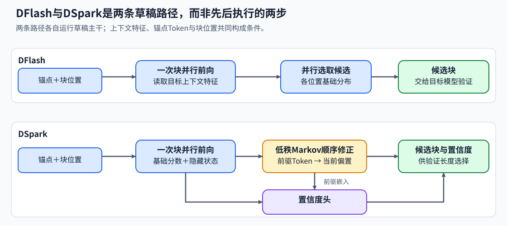
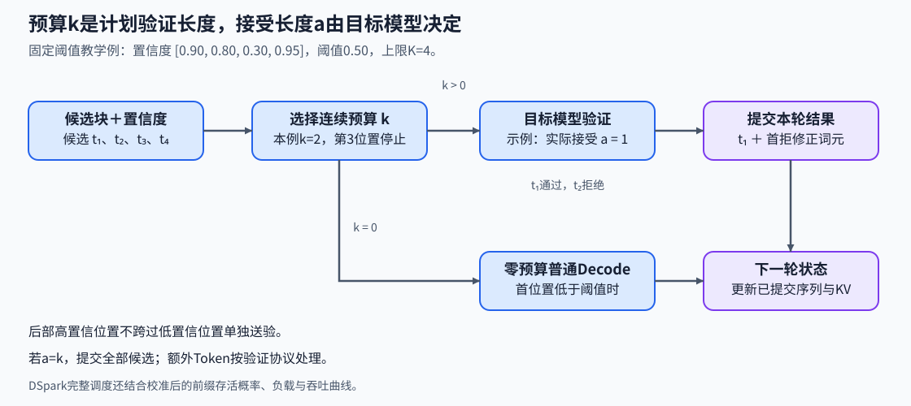

# INF-PARALLEL-DRAFTING. DFlash and DSpark | 并行草稿与置信度调度

**难度：** Hard | **环境：** [CPU 主线](#runtime-environment) | **标签：** `推理优化`、`投机解码`、`DFlash`、`DSpark` | **目标人群：** 理解投机验证、准备比较候选生成方式的读者

> 🚀 **云端运行环境**
>
> 本章节的实战代码可以点击以下链接在免费 GPU 算力平台上直接运行：
>
> [](https://colab.research.google.com/github/datawhalechina/llm-algo-leetcode/blob/main/02_PyTorch_Algorithms/INF-PARALLEL-DRAFTING_DFlash_and_DSpark.ipynb)
> [](https://modelscope.cn/my/mynotebook) *(国内推荐：魔搭社区免费实例)*


## 本节导读

逐个提出五个草稿词元，需要后一个位置等待前一个候选；一次提出一块候选，则能缩短这段串行路径。但后部位置如果频繁被拒绝，生成和验证它们的工作就会白费。怎样同时减少草稿等待，又保留有价值的后续候选？

DFlash 用块扩散模型并行提出候选，DSpark 在并行主干后加入轻量顺序模块，并按置信度选择验证长度。本节从位置分数、前驱修正和连续前缀三个环节，解释这些方法怎样分配草稿与验证工作。

<a id="runtime-environment"></a>

## 运行环境

基础练习使用 [BASE-CPU](../guide.md#base-cpu)，以给定分数、投影矩阵和置信度检查候选选择。真实草稿模型的加载、目标验证和性能采集需要配对权重与执行后端，后续在机制选型项目中比较。

## 前置阅读

先理解草稿、目标验证与连续接受，再比较候选块怎样生成。

- [23. 投机解码](./23_Speculative_Decoding.md)：接受、拒绝修正与输出提交。

## Step 1：一次提出多个位置，怎样缩短草稿等待

自回归草稿按已生成候选逐步推进，每一步都经过草稿模型。DFlash 则利用目标模型提供的上下文特征，通过块扩散草稿模型在一次前向中形成多个位置的候选分布。这里的并行指这些位置的分数一起产生；选取各位置的词元后，仍要交给目标模型连续验证。结构见 [DFlash 论文](https://arxiv.org/abs/2602.06036)。

后部位置形成分数时，尚不能像自回归模型那样逐步读取已采样的前驱候选，容易产生跨位置不协调。DSpark 在并行主干之后增加轻量顺序模块：先保留整块基础分数，再沿候选顺序修正，补入块内依赖。

| 草稿路径 | 位置如何推进 | 单轮形成什么 | 主要代价 |
| --- | --- | --- | --- |
| 自回归草稿 | 后一位置等待前一候选 | 顺序候选 | 草稿时延随长度增长 |
| DFlash | 一次形成多个位置的分布 | 候选块 | 后部候选可能频繁被拒绝 |
| DSpark | 并行主干后接轻量顺序修正 | 候选块与置信度 | 修正与置信度校准需要额外计算 |



## Step 2：前一个候选怎样修正当前位置的分数

DSpark 的 Markov 模块用前一个候选调整当前位置；这里的 Markov 指这一步修正直接依赖前一个词元。并行主干仍提供上下文相关的基础分数，轻量模块为它增加词表偏置。低秩表示用宽度为 $r$ 的向量保存前驱信息，再投影到大小为 $V$ 的词表；当 $r$ 远小于 $V$，这一步可使用较小的状态和矩阵。

例如并行主干对下一词元给出两个接近的分数，前一步选出的词元会改变偏置，使当前位置更偏向与它协调的候选。这个顺序循环随后把新选出的词元传给下一位置。[DSpark 论文第 3.1 节](https://arxiv.org/html/2607.05147v1#S3.SS1)说明了 Markov 与递推状态两种轻量模块，本页以 Markov 投影展开。

| 对象 | 表示 | 作用 |
| --- | --- | --- |
| 并行主干 | 各位置的基础词表分数 | 同时形成整个块的基础分布 |
| 前驱状态 | $e(x_{i-1})\in\mathbb{R}^{r}$ | 保存前一个候选的低维表示 |
| 低秩投影 | $b_i=e(x_{i-1})P$， $P\in\mathbb{R}^{r\times V}$ | 把前驱信息变成当前位置的词表偏置 |
| 修正分数 | 基础分数加 $b_i$ | 选择当前候选，再传给下一位置 |

## Step 3：哪些候选值得交给目标模型验证

置信度估计某位置在此前候选均被接受时，通过目标验证的可能性。先看固定阈值的例子：置信度为 [0.9,0.8,0.3,0.95]、阈值为 0.5 时，从左向右在第三个位置停止，验证前两个候选；若首位置已低于阈值，则候选预算为零，改由目标模型直接生成。筛选决定送去验证的长度，目标模型决定实际接受结果。

DSpark 的完整调度还使用校准后的前缀存活概率、当前负载与实测吞吐曲线：前缀存活表示从起点到该位置全部被接受的可能性；校准使预测概率与实际接受频率更接近。相关方法见[论文第 3.2 节](https://arxiv.org/html/2607.05147v1#S3.SS2)。

| 置信度筛选结果 | 验证预算 | 后续动作 |
| --- | --- | --- |
| 首位置低于阈值 | $k=0$ | 由目标模型直接生成 |
| 前 $k$ 个位置连续达到阈值 | $0<k<K$ | 验证这段连续前缀 |
| 所有位置达到阈值 | $k=K$ | 验证完整候选块 |



## Step 4：实现并行候选、低秩修正与连续预算

给定各位置分数、前驱状态和置信度，分别形成候选、投影词表偏置，再截取值得验证的连续前缀。辅助函数按顺序应用前驱偏置，并将候选与预算整理成统一记录；三处 TODO 对应下表的计算。

| TODO / 函数 | 学习者完成的机制 | 必须满足的约束 | 测试证据 |
| --- | --- | --- | --- |
| TODO 1 · `dflash_parallel_candidates` | 从各位置基础分数形成并行候选块 | 每个位置独立选择，不读取相邻位置候选 | 候选结果、位置独立性、空块与维度失配 |
| TODO 2 · `project_markov_bias` | 将前驱 Token 的低维状态投影为词表偏置 | 投影维度匹配；未知前驱返回零偏置 | 数值投影、未知前驱、秩与词表维度错误 |
| TODO 3 · `choose_confident_prefix` | 选择连续高置信候选前缀 | 首个低置信位置立即停止；允许零预算；不超过上限 | 中途停止、首位置失败、空序列、预算截断与非法输入 |


```python
from typing import Dict, List, Sequence

```


```python
def _validate_block_logits(block_logits: Sequence[Sequence[float]]) -> int:
    """校验位置数和词表维度，并返回词表大小。"""
    if not block_logits or not block_logits[0]:
        raise ValueError("候选块分数不能为空")
    vocab_size = len(block_logits[0])
    if any(len(row) != vocab_size for row in block_logits):
        raise ValueError("所有位置必须共享词表维度")
    return vocab_size


def dflash_parallel_candidates(block_logits: Sequence[Sequence[float]]) -> List[int]:
    """对候选块中的每个位置独立选择最高分 Token。"""
    vocab_size = _validate_block_logits(block_logits)
    # ==========================================
    # TODO 1：形成位置相互独立的并行候选块。
    # ==========================================
    # candidates = ???  # 每个位置独立选择的最高分 Token；列表长度等于位置数。
    raise NotImplementedError("请完成 TODO 1 后再运行测试。")
    return candidates


def project_markov_bias(
    previous_token: int,
    markov_embeddings: Dict[int, Sequence[float]],
    markov_projection: Sequence[Sequence[float]],
    vocab_size: int,
) -> List[float]:
    """把前驱 Token 的低维状态投影为词表偏置。"""
    if vocab_size <= 0 or not markov_projection:
        raise ValueError("词表大小和 Markov 投影不能为空")
    rank = len(markov_projection)
    if any(len(row) != vocab_size for row in markov_projection):
        raise ValueError("Markov 投影的每一行必须匹配词表维度")
    latent = markov_embeddings.get(previous_token)
    if latent is None:
        return [0.0] * vocab_size
    if len(latent) != rank:
        raise ValueError("前驱状态维度必须匹配 Markov 秩")
    # ==========================================
    # TODO 2：执行低秩状态到词表偏置的投影。
    # ==========================================
    # bias = ???  # 长度为 vocab_size；第 v 项为各秩分量与投影第 v 列的内积。
    raise NotImplementedError("请完成 TODO 2 后再运行测试。")
    return bias


def dspark_markov_candidates(
    block_logits: Sequence[Sequence[float]],
    anchor_token: int,
    markov_embeddings: Dict[int, Sequence[float]],
    markov_projection: Sequence[Sequence[float]],
) -> List[int]:
    """按候选顺序使用低秩 Markov 偏置修正并行主干分数。"""
    vocab_size = _validate_block_logits(block_logits)
    previous = anchor_token
    candidates: List[int] = []
    for row in block_logits:
        bias = project_markov_bias(previous, markov_embeddings, markov_projection, vocab_size)
        corrected = [float(score) + delta for score, delta in zip(row, bias)]
        previous = max(range(vocab_size), key=lambda token: corrected[token])
        candidates.append(previous)
    return candidates


def choose_confident_prefix(
    confidences: Sequence[float],
    threshold: float,
    max_tokens: int = 8,
) -> int:
    """返回值得交给目标模型验证的连续候选长度。"""
    if not 0.0 <= threshold <= 1.0:
        raise ValueError("置信度阈值必须位于 [0, 1]")
    if max_tokens < 1:
        raise ValueError("最大预算必须大于零")
    prefix_length = 0
    for confidence in confidences[:max_tokens]:
        if not 0.0 <= confidence <= 1.0:
            raise ValueError("每个置信度必须位于 [0, 1]")
        # ==========================================
        # TODO 3：在首个低置信位置停止连续前缀。
        # ==========================================
        # should_stop = ???  # 当前置信度不足以进入验证前缀时为 True。
        raise NotImplementedError("请完成 TODO 3 后再运行测试。")
        if should_stop:
            break
        prefix_length += 1
    return prefix_length


def build_draft_record(mode, candidates, confidences, threshold, max_tokens=8):
    """把候选块和验证预算整理为统一记录。"""
    if mode not in {"dflash", "dspark"}:
        raise ValueError("mode 必须是 dflash 或 dspark")
    if not candidates or len(candidates) != len(confidences):
        raise ValueError("候选与置信度必须非空且等长")
    budget = choose_confident_prefix(confidences, threshold, max_tokens=max_tokens)
    return {
        "mode": mode,
        "block_tokens": list(candidates),
        "verify_tokens": list(candidates[:budget]),
        "proposed": len(candidates),
        "verify_budget": budget,
        "fallback_to_decode": budget == 0,
    }

```

## 测试

分别改变某一位置的分数、前驱词元和置信度，核对位置选择、顺序修正与零预算回退。


```python
def test_dflash_parallel_candidates():
    """并行候选应逐位置选择，修改一行不能影响其他位置。"""
    logits = [[0.1, 0.8, 0.1], [0.6, 0.2, 0.2], [0.1, 0.2, 0.7]]
    assert dflash_parallel_candidates(logits) == [1, 0, 2]
    changed = [logits[0], [0.1, 0.2, 0.9], logits[2]]
    assert dflash_parallel_candidates(changed) == [1, 2, 2]
    for invalid in ([], [[0.1, 0.9], [0.3]]):
        try:
            dflash_parallel_candidates(invalid)
        except ValueError:
            pass
        else:
            raise AssertionError("空块或词表维度失配时应失败")


def test_project_markov_bias():
    """低秩状态应按投影列还原为词表偏置。"""
    embeddings = {7: [2.0, -1.0]}
    projection = [[0.5, 0.0, 1.0], [1.0, -1.0, 0.5]]
    assert project_markov_bias(7, embeddings, projection, 3) == [0.0, 1.0, 1.5]
    assert project_markov_bias(9, embeddings, projection, 3) == [0.0, 0.0, 0.0]
    try:
        project_markov_bias(7, {7: [1.0]}, projection, 3)
    except ValueError:
        pass
    else:
        raise AssertionError("前驱状态与 Markov 秩不匹配时应失败")


def test_dspark_markov_candidates():
    """前一候选应通过低秩状态改变下一位置的修正方向。"""
    logits = [[0.4, 0.6], [0.7, 0.3], [0.6, 0.4]]
    embeddings = {9: [1.0], 0: [-1.0], 1: [1.0]}
    projection = [[0.5, -0.5]]
    assert dspark_markov_candidates(logits, 9, embeddings, projection) == [0, 1, 0]


def test_choose_confident_prefix():
    """连续预算应支持中途停止、零预算、空序列与上限截断。"""
    assert choose_confident_prefix([0.9, 0.8, 0.3, 0.95], 0.5, 4) == 2
    assert choose_confident_prefix([0.1, 0.9], 0.5, 4) == 0
    assert choose_confident_prefix([], 0.5, 4) == 0
    assert choose_confident_prefix([0.9] * 10, 0.5, 4) == 4
    for args in (([1.1], 0.5, 4), ([0.9], -0.1, 4), ([0.9], 0.5, 0)):
        try:
            choose_confident_prefix(*args)
        except ValueError:
            pass
        else:
            raise AssertionError("非法置信度、阈值或预算上限应失败")


def test_unified_draft_record():
    """零预算记录不得向目标模型提交候选，并应显式触发回退。"""
    record = build_draft_record("dspark", [4, 5], [0.2, 0.9], 0.5, 2)
    assert record["verify_tokens"] == []
    assert record["verify_budget"] == 0
    assert record["fallback_to_decode"] is True
    try:
        build_draft_record("unknown", [1], [0.9], 0.5)
    except ValueError:
        pass
    else:
        raise AssertionError("未知草稿模式应失败")


test_dflash_parallel_candidates()
test_project_markov_bias()
test_dspark_markov_candidates()
test_choose_confident_prefix()
test_unified_draft_record()
print("✅ 并行草稿、低秩修正与连续预算测试通过")

```

---

🛑 **STOP HERE** 🛑
<br><br><br><br><br><br><br><br><br><br>
> 请先尝试自己完成代码并跑通测试。<br>
> 如果遇到困难，再向下查看参考代码与解析。
<br><br><br><br><br><br><br><br><br><br>

---
## 参考代码与解析

### 代码

```python
def _validate_block_logits(block_logits: Sequence[Sequence[float]]) -> int:
    """校验位置数和词表维度，并返回词表大小。"""
    if not block_logits or not block_logits[0]:
        raise ValueError("候选块分数不能为空")
    vocab_size = len(block_logits[0])
    if any(len(row) != vocab_size for row in block_logits):
        raise ValueError("所有位置必须共享词表维度")
    return vocab_size


# ==========================================
# TODO 1：形成位置相互独立的并行候选块。
# ==========================================
def dflash_parallel_candidates(block_logits: Sequence[Sequence[float]]) -> List[int]:
    """对候选块中的每个位置独立选择最高分 Token。"""
    vocab_size = _validate_block_logits(block_logits)
    candidates = [max(range(vocab_size), key=lambda token: row[token]) for row in block_logits]
    return candidates


# ==========================================
# TODO 2：执行低秩状态到词表偏置的投影。
# ==========================================
def project_markov_bias(
    previous_token: int,
    markov_embeddings: Dict[int, Sequence[float]],
    markov_projection: Sequence[Sequence[float]],
    vocab_size: int,
) -> List[float]:
    """把前驱 Token 的低维状态投影为词表偏置。"""
    if vocab_size <= 0 or not markov_projection:
        raise ValueError("词表大小和 Markov 投影不能为空")
    rank = len(markov_projection)
    if any(len(row) != vocab_size for row in markov_projection):
        raise ValueError("Markov 投影的每一行必须匹配词表维度")
    latent = markov_embeddings.get(previous_token)
    if latent is None:
        return [0.0] * vocab_size
    if len(latent) != rank:
        raise ValueError("前驱状态维度必须匹配 Markov 秩")
    bias = [
        sum(float(latent[index]) * float(markov_projection[index][token]) for index in range(rank))
        for token in range(vocab_size)
    ]
    return bias


def dspark_markov_candidates(
    block_logits: Sequence[Sequence[float]],
    anchor_token: int,
    markov_embeddings: Dict[int, Sequence[float]],
    markov_projection: Sequence[Sequence[float]],
) -> List[int]:
    """按候选顺序使用低秩 Markov 偏置修正并行主干分数。"""
    vocab_size = _validate_block_logits(block_logits)
    previous = anchor_token
    candidates: List[int] = []
    for row in block_logits:
        bias = project_markov_bias(previous, markov_embeddings, markov_projection, vocab_size)
        corrected = [float(score) + delta for score, delta in zip(row, bias)]
        previous = max(range(vocab_size), key=lambda token: corrected[token])
        candidates.append(previous)
    return candidates


# ==========================================
# TODO 3：在首个低置信位置停止连续前缀。
# ==========================================
def choose_confident_prefix(
    confidences: Sequence[float],
    threshold: float,
    max_tokens: int = 8,
) -> int:
    """返回值得交给目标模型验证的连续候选长度。"""
    if not 0.0 <= threshold <= 1.0:
        raise ValueError("置信度阈值必须位于 [0, 1]")
    if max_tokens < 1:
        raise ValueError("最大预算必须大于零")
    prefix_length = 0
    for confidence in confidences[:max_tokens]:
        if not 0.0 <= confidence <= 1.0:
            raise ValueError("每个置信度必须位于 [0, 1]")
        should_stop = confidence < threshold
        if should_stop:
            break
        prefix_length += 1
    return prefix_length


def build_draft_record(mode, candidates, confidences, threshold, max_tokens=8):
    """把候选块和验证预算整理为统一记录。"""
    if mode not in {"dflash", "dspark"}:
        raise ValueError("mode 必须是 dflash 或 dspark")
    if not candidates or len(candidates) != len(confidences):
        raise ValueError("候选与置信度必须非空且等长")
    budget = choose_confident_prefix(confidences, threshold, max_tokens=max_tokens)
    return {
        "mode": mode,
        "block_tokens": list(candidates),
        "verify_tokens": list(candidates[:budget]),
        "proposed": len(candidates),
        "verify_budget": budget,
        "fallback_to_decode": budget == 0,
    }

```

### 解析

#### TODO 1：形成并行候选块

- 在给定的块分数中，各行对应一个位置；逐行选择最高分词元，得到候选块。
- 测试更改中间一行后，其余位置选择保持不变；空块与词表宽度不一致时报告错误。这检查分数到候选的选择步骤，真实主干分数来自草稿模型。

#### TODO 2：投影前驱状态

- 查出前一个词元的低维状态，与投影矩阵相乘，得到逐词表分量的偏置；状态长度与矩阵行数相同。
- 数值测试检查偏置 [0,1,1.5]；未知前驱返回零偏置，维度错误被拒绝。辅助顺序循环的测试进一步检查前驱变化会怎样影响后续候选。

#### TODO 3：截取连续置信前缀

- 从首位置累计达到阈值的候选，在第一次低于阈值时停止；返回长度同时受候选数与预算上限约束。
- 测试覆盖中途停止、零预算、空序列及上限截断。统一记录测试确认零预算时提交空候选列表，并标记由目标模型直接生成。

## 相关阅读

继续比较完整预算策略和真实后端，再对照论文中的模型与调度设计。

- [动态候选与验证预算](./INF-PROPOSAL_Dynamic_Proposal_and_Verification_Budget.md)：草稿长度、接受结果与整轮时间。
- [投机解码机制选型基准](./68_Speculative_Decoding_Benchmark.md)：同目标模型的候选比较与实际执行检查。
- [DFlash 论文](https://arxiv.org/abs/2602.06036)：上下文特征条件下的块扩散草稿。
- [DSpark 论文](https://arxiv.org/abs/2607.05147)：轻量顺序模块与按负载选择验证长度。
