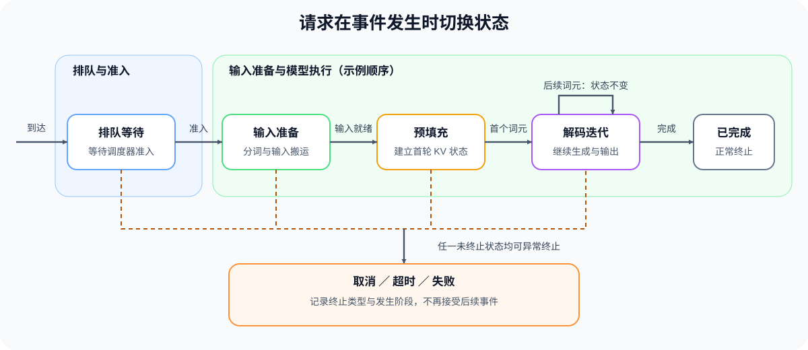
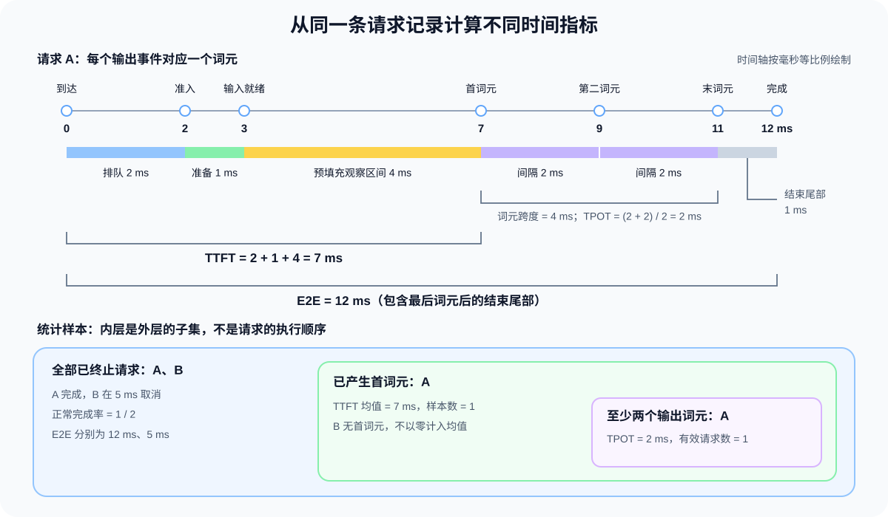

# INF-REQUEST-LIFECYCLE. Inference Request Lifecycle | 推理请求生命周期与核心指标

**难度：** Medium | **环境：** [CPU 主线](#runtime-environment) | **标签：** `推理优化`, `请求生命周期`, `服务指标` | **目标人群：** 具备 Python 基础、准备分析请求延迟的入门者

> 🚀 **云端运行环境**
>
> 本章节的实战代码可以点击以下链接在免费 GPU 算力平台上直接运行：
>
> [](https://colab.research.google.com/github/datawhalechina/llm-algo-leetcode/blob/main/02_PyTorch_Algorithms/INF-REQUEST-LIFECYCLE_Inference_Request_Lifecycle.ipynb)
> [](https://modelscope.cn/my/mynotebook) *(国内推荐：魔搭社区免费实例)*


## 本节导读

提交一条提示词后，请求可能先等待，再准备输入、产生首个词元，随后继续输出直到结束。它也可能在首次输出前被取消，或在已经返回部分内容后超时。只看最后花了多久，无法区分这些过程。

把到达、准入、输出和终止逐一记下，就得到一条请求事件记录。本节先沿正常请求和取消请求解释状态、指标与统计样本，再加入另一条请求，观察资源竞争怎样改变原请求的等待。

**关键词：** 请求状态、预填充、解码、首词元延迟、每输出词元时间、并发请求

<a id="runtime-environment"></a>

## 运行环境

- **基础练习：** 使用 [BASE-CPU](../guide.md#base-cpu)，运行 [Step 4 的题目与测试](#mechanism-practice)。
## 前置阅读

先通过性能证据与实验设计明确工作负载、时间边界和失败记录为何必须固定。

- [Part 00 · 20：性能证据与实验设计](../00_Prerequisites/20_Performance_Evidence_and_Experiment_Design.md)

## Step 1：跟踪请求从到达到终止

事件是某一时刻发生的变化，状态是两次事件之间请求所处的阶段。请求 A 在 0 ms 到达后进入队列，直到 2 ms 获得准入，即允许请求占用所需执行与缓存资源；等待期间没有输出，并不表示模型已经开始计算。准入后准备输入，3 ms 输入就绪，随后进入预填充观察区间。

词元是模型处理输入与生成输出的基本单位，不等同于一个汉字或单词。预填充处理输入词元，并建立后续生成要读取的键值缓存（KV Cache）；解码继续读取和追加这些历史状态。A 在 7 ms 首次输出，之后每次输出增加词元数，直到完成事件将它转为已完成。若请求在输入准备时被取消，则直接终止，并保留取消发生的阶段，解释为什么没有首词元。

下面的观察模型将输入准备安排在准入后，以首词元事件结束预填充观察区间，全部事件使用同一时钟；这个区间可能包含设备计算之外的等待与返回。真实引擎的分词、调度和模型执行边界需分别辨认。终止后不再追加词元，每次迁移都应符合当前状态允许的事件。

| 当前状态 | 合法事件 | 下一状态 | 状态约束 |
| --- | --- | --- | --- |
| 未到达 | 到达 | 排队 | 每条轨迹只出现一次 |
| 排队 | 准入 | 输入准备 | 准入前不能执行模型 |
| 输入准备 | 输入就绪 | 预填充 | 输入准备完成后才能进入模型 |
| 预填充 | 首个词元 | 解码 | 首个词元标记观察阶段切换 |
| 解码 | 输出词元 | 解码 | 输出继续增加，请求仍处于解码观察阶段 |
| 解码 | 完成 | 已完成 | 正常完成发生在解码观察阶段 |
| 已到达且未终止 | 取消、超时或失败 | 对应终止状态 | 记录发生阶段，终止后不再追加事件 |



## Step 2：用事件时间计算等待与生成指标

以下事件记录中，一次输出事件对应一个词元；真实流式内容块可能包含多个词元，需要区分两种记录。沿用请求 A：0 ms 到达，2 ms 准入，3 ms 输入就绪，7 ms 首次输出，9 ms 和 11 ms 各输出一个后续词元，12 ms 正常完成。排队耗时为 2 ms，输入准备为 1 ms，预填充观察区间为 4 ms，三段相加得到 7 ms 的首词元延迟（TTFT）。观察区间若还包含调度、传输或缓冲，需用后端事件进一步分开设备计算。

三个词元之间有两个间隔，均为 2 ms，平均每输出词元时间（TPOT）因此为 2 ms，首末词元跨度为 4 ms。请求在 12 ms 才完成，所以端到端延迟（E2E）是 12 ms，而不是最后词元所在的 11 ms。首词元至终止的 5 ms 观察区间还包含最后输出之后的 1 ms 尾部，不能全部解释为后续词元计算。

再看请求 B：它同样在 0 ms 到达、2 ms 准入，却在 5 ms 取消，尚未产生输入就绪或首词元事件。到达至终止仍可得到 5 ms 的 E2E，排队时间也可得到 2 ms；完整输入准备时长、TTFT 和 TPOT 则缺少所需边界。这种已异常终止的部分轨迹保留已有指标，缺失项为空；若将缺失 TTFT 填成 0 ms，未得到回答的请求反而会被统计成最快的请求。

| 指标 | 事件边界或关系 | 边界不完整时的处理 |
| --- | --- | --- |
| 排队时间 | 到达 → 准入 | 未准入时为空 |
| 输入准备时间 | 准入 → 输入就绪 | 输入未就绪时为空 |
| 预填充观察区间 | 输入就绪 → 首个词元 | 无首个词元时为空 |
| TTFT | 到达 → 首个词元 | 无首个词元时为空 |
| TPOT | 相邻输出词元时间戳的间隔均值 | 少于两个输出词元时为空 |
| 首词元后至终止 | 首个词元 → 完成或异常终止 | 包含结束尾部；无首词元时为空 |
| 词元跨度 | 首个词元 → 最后一个词元 | 无输出时为空，单词元时为零 |
| 端到端延迟 | 到达 → 完成或异常终止 | 终止后可计算，保留终止状态 |
## Step 3：比较单／多请求的等待与统计样本

单独运行 A 时，首个词元在 7 ms 返回，后续在 9、11 ms 返回，12 ms 完成。再构造另一轮运行：保持 A 的输入与输出词元数不变，请求 C 在 8 ms 到达并参与资源竞争，设 A 的后续输出推迟到 12、14 ms，15 ms 完成。A 的 TTFT 仍为 7 ms，TPOT 从 2 ms 增至 3.5 ms，E2E 从 12 ms 增至 15 ms。并发数是在同一时刻已到达、尚未结束的请求数；执行批次（batch）是本轮实际选中处理的请求集合。一次服务迭代执行选中工作并更新状态，未选中的请求仍可能等待。在同一模型实例中，请求共享权重与执行资源，同时保留各自的历史状态；要解释例中给定的延后，还需批次成员和执行区间记录。

回到 A 单独运行的记录，排队、输入准备、预填充观察区间、首词元至终止分别为 2、1、4、5 ms，合计 12 ms。最长区间占比约 41.7%，其中还包含结束尾部；阶段占比描述时间怎样分布，实际瓶颈仍需结合区间内部的计算与等待判断。

将 A 的原始正常轨迹与 B 的取消轨迹汇总，正常完成率是 1/2；TTFT 只有 A 的 7 ms 一个有效样本，均值仍为 7 ms。若将 B 的缺失 TTFT 补零，就会得到错误的 3.5 ms。已产生首词元、后来才超时的请求，也可以进入“已产生首词元”的 TTFT 统计，但要保留超时状态；这与只统计正常完成请求的口径不同。汇总时应分别报告状态计数、指标均值和样本数，将独立轨迹放在一起统计并不等于已经模拟了请求间竞争。

| 观察对象 | 使用哪些请求或边界 | A、B 的解释 |
| --- | --- | --- |
| 终止状态与正常完成率 | 全部已终止请求 | A 完成、B 取消；正常完成率为 1/2 |
| TTFT | 已产生首词元的请求，并保留终止状态 | A 为 7 ms；均值 7 ms，样本数 1 |
| TPOT | 至少产生两个词元的请求 | A 为 2 ms；B 没有可用间隔 |
| E2E | 到达与终止均已记录的请求 | 分别保留 A 的 12 ms 和 B 的 5 ms；取消更早不代表生成更快 |
| 阶段占比 | 阶段边界完整的正常完成请求 | A 最大占比约 41.7%，描述为耗时分散；B 保留取消发生阶段 |


<a id="mechanism-practice"></a>

## Step 4：实现事件回放、指标计算与工作负载汇总

本题用按时间排列的请求事件复现状态推进和指标计算。事件表、终止状态、输入校验与报告结构已经给出；你将补全合法迁移、TPOT 样本、阶段占比和统计分母。测试分别覆盖完整轨迹、部分轨迹、异常终止、非法迁移与工作负载汇总。阶段分类使用给定的 45% 教学阈值，未达到时返回 `mixed`；这只是练习中的描述规则，不是通用瓶颈门槛。报告字段 `decode_time` 保留兼容命名，表示首词元至终止的观察时长，包含结束尾部，不是 GPU 解码计算时间。

| TODO / 函数 | 学习者完成的机制 | 必须满足的约束 | 测试证据 |
| --- | --- | --- | --- |
| TODO 1：推进合法请求状态<br>`replay_request_events` | 按当前状态与事件选择合法下一状态 | 时间单调及终止约束由已有校验保证 | 合法生命周期、非法迁移与终止事件 |
| TODO 2：计算相邻词元间隔<br>`compute_request_metrics` | 对相邻输出间隔求均值 | 不足两个词元时保持缺失 | TTFT、TPOT、阶段时间与未产生首词元请求 |
| TODO 3：按阶段占比描述请求<br>`classify_request_outcome` | 比较最大阶段占比与教学阈值 | 未达阈值时返回耗时分散标签；异常请求保留终止阶段 | 主要耗时阶段、耗时分散和异常请求 |
| TODO 4：固定工作负载统计分母<br>`summarize_workload` | 分别选择完成率与 TTFT 样本 | 完成率使用全部终止请求；TTFT 使用已产生首词元的请求 | 完成率、TTFT 均值、样本数与空分母 |

```python
from statistics import mean

```


```python
TERMINAL_EVENTS = {'complete': 'completed', 'cancel': 'cancelled', 'timeout': 'timed_out', 'fail': 'failed'}
TRANSITIONS = {
    'not_arrived': {'arrive': 'queued'},
    'queued': {'admit': 'preprocessing'},
    'preprocessing': {'input_ready': 'prefill'},
    'prefill': {'first_token': 'decode'},
    'decode': {'token': 'decode', 'complete': 'completed'},
}
TERMINAL_STATES = {'completed', 'cancelled', 'timed_out', 'failed'}


def replay_request_events(events):
    """回放事件并返回请求状态、关键时间戳与输出词元时间。"""
    if not events:
        raise ValueError('events 不能为空')

    state = 'not_arrived'
    previous_time = None
    timestamps = {}
    token_times = []
    failure_stage = None

    for item in events:
        event = item['event']
        timestamp = float(item['timestamp'])
        if previous_time is not None and timestamp < previous_time:
            raise ValueError('事件时间必须单调')
        if state in TERMINAL_STATES:
            raise ValueError('终止状态后不能继续追加事件')

        if event in {'cancel', 'timeout', 'fail'}:
            if state == 'not_arrived':
                raise ValueError('请求到达前不能终止')
            failure_stage = state
            state = TERMINAL_EVENTS[event]
            timestamps['terminal'] = timestamp
        else:
            # ==========================================
            # TODO 1：推进合法请求状态
            # ==========================================
            # next_state = ???  # 当前状态接收当前事件后的唯一下一状态；非法组合保持为 None。
            raise NotImplementedError('TODO 1: 请推进合法请求状态')
            if next_state is None:
                raise ValueError(f'状态 {state} 不接受事件 {event}')
            state = next_state
            timestamp_key = {
                'arrive': 'arrival', 'admit': 'admitted',
                'input_ready': 'input_ready', 'first_token': 'first_token',
                'complete': 'terminal',
            }.get(event)
            if timestamp_key is not None:
                timestamps[timestamp_key] = timestamp
            if event in {'first_token', 'token'}:
                token_times.append(timestamp)
        previous_time = timestamp

    if state not in TERMINAL_STATES:
        raise ValueError('轨迹缺少终止事件')
    return {
        'status': state,
        'failure_stage': failure_stage,
        'timestamps': timestamps,
        'token_times': token_times,
    }


def compute_request_metrics(report):
    """从状态报告计算当前轨迹已经具备的延迟指标。"""
    timestamps = report['timestamps']
    token_times = report['token_times']

    def duration(start, end):
        return timestamps[end] - timestamps[start] if start in timestamps and end in timestamps else None

    # ==========================================
    # TODO 2：计算相邻词元间隔
    # ==========================================
    # token_gaps = ???  # 相邻输出词元的时间差列表；单位与输入时间戳一致。
    # tpot = ???  # 间隔均值；没有有效间隔时保持 None。
    raise NotImplementedError('TODO 2: 请计算相邻词元间隔')
    return {
        'queue_wait': duration('arrival', 'admitted'),
        'preprocessing': duration('admitted', 'input_ready'),
        'prefill': duration('input_ready', 'first_token'),
        'ttft': duration('arrival', 'first_token'),
        'tpot': tpot,
        'decode_time': duration('first_token', 'terminal'),
        'token_span': token_times[-1] - token_times[0] if token_times else None,
        'e2e': duration('arrival', 'terminal'),
        'streamed_tokens': len(token_times),
    }


def classify_request_outcome(report, metrics, dominance_threshold=0.45):
    """返回异常终止阶段，或完成请求的阶段占比与瓶颈标签。"""
    if report['status'] != 'completed':
        return {
            'outcome': report['status'],
            'stage': report['failure_stage'],
            'dominant_share': None,
        }
    if not (0.0 < dominance_threshold <= 1.0):
        raise ValueError('dominance_threshold 必须位于 (0, 1]')
    phase_durations = {
        'queue': metrics['queue_wait'],
        'preprocessing': metrics['preprocessing'],
        'prefill': metrics['prefill'],
        'decode': metrics['decode_time'],
    }
    available = {name: value for name, value in phase_durations.items() if value is not None}
    # ==========================================
    # TODO 3：按阶段占比归因请求
    # ==========================================
    # explained_ms = ???  # 可解释阶段的总时长；必须为正。
    # phase_shares = ???  # 阶段名到占比的映射；占比总和应为 1。
    # dominant_stage = ???  # 占比最大的阶段名。
    # dominant_share = ???  # 主导阶段对应的占比，用于和阈值比较。
    raise NotImplementedError('TODO 3: 请按阶段占比归因请求')
    return {
        'outcome': 'completed',
        'stage': dominant_stage if dominant_share >= dominance_threshold else 'mixed',
        'dominant_share': dominant_share,
    }


def summarize_workload(request_results):
    """汇总 ``(report, metrics)`` 列表并显式返回统计分母。"""
    total_requests = len(request_results)
    # ==========================================
    # TODO 4：固定工作负载统计分母
    # ==========================================
    # completed_count = ???  # 正常完成的请求数。
    # ttft_values = ???  # 所有非空 TTFT；不得用 0 代替缺失值。
    raise NotImplementedError('TODO 4: 请固定工作负载统计分母')
    return {
        'total_requests': total_requests,
        'completed_requests': completed_count,
        'success_rate': completed_count / total_requests if total_requests else None,
        'ttft_sample_count': len(ttft_values),
        'mean_ttft': mean(ttft_values) if ttft_values else None,
    }

```

## 测试

测试覆盖正常完成、异常终止、非法迁移、指标边界、阶段描述与统计分母。

```python
def _completed_events():
    """构造阶段耗时接近、没有明显主导瓶颈的完整请求轨迹。"""
    return [
        {'event': 'arrive', 'timestamp': 0.0},
        {'event': 'admit', 'timestamp': 2.0},
        {'event': 'input_ready', 'timestamp': 3.0},
        {'event': 'first_token', 'timestamp': 7.0},
        {'event': 'token', 'timestamp': 9.0},
        {'event': 'token', 'timestamp': 11.0},
        {'event': 'complete', 'timestamp': 12.0},
    ]


def test_completed_trace_and_metrics():
    """完整轨迹应恢复状态、指标和 TTFT 阶段可加关系。"""
    report = replay_request_events(_completed_events())
    metrics = compute_request_metrics(report)
    assert report['status'] == 'completed'
    assert report['token_times'] == [7.0, 9.0, 11.0]
    assert metrics == {
        'queue_wait': 2.0, 'preprocessing': 1.0, 'prefill': 4.0,
        'ttft': 7.0, 'tpot': 2.0, 'decode_time': 5.0,
        'token_span': 4.0, 'e2e': 12.0, 'streamed_tokens': 3,
    }
    assert metrics['ttft'] == metrics['queue_wait'] + metrics['preprocessing'] + metrics['prefill']
    assert metrics['e2e'] == metrics['ttft'] + metrics['decode_time']


def test_stage_share_attribution():
    """最大阶段占比不足阈值时应标记混合瓶颈。"""
    report = replay_request_events(_completed_events())
    outcome = classify_request_outcome(report, compute_request_metrics(report))
    assert outcome['outcome'] == 'completed'
    assert outcome['stage'] == 'mixed'
    assert abs(outcome['dominant_share'] - 5.0 / 12.0) < 1e-9

    prefill_heavy = _completed_events()
    prefill_heavy[3] = {'event': 'first_token', 'timestamp': 9.0}
    prefill_heavy[4] = {'event': 'token', 'timestamp': 10.0}
    prefill_heavy[5] = {'event': 'token', 'timestamp': 11.0}
    heavy_report = replay_request_events(prefill_heavy)
    heavy_outcome = classify_request_outcome(heavy_report, compute_request_metrics(heavy_report))
    assert heavy_outcome['stage'] == 'prefill'


def test_partial_trace_preserves_missing_metrics():
    """首词元前取消时，TTFT 保持为空但 E2E 仍可计算。"""
    events = _completed_events()[:2] + [{'event': 'cancel', 'timestamp': 5.0}]
    report = replay_request_events(events)
    metrics = compute_request_metrics(report)
    outcome = classify_request_outcome(report, metrics)
    assert metrics['queue_wait'] == 2.0
    assert metrics['ttft'] is None and metrics['e2e'] == 5.0
    assert outcome == {'outcome': 'cancelled', 'stage': 'preprocessing', 'dominant_share': None}


def test_failed_decode_keeps_streamed_tokens():
    """解码中超时仍应保留已经输出的词元与失败阶段。"""
    events = _completed_events()[:5] + [{'event': 'timeout', 'timestamp': 10.0}]
    report = replay_request_events(events)
    metrics = compute_request_metrics(report)
    outcome = classify_request_outcome(report, metrics)
    assert metrics['streamed_tokens'] == 2
    assert outcome['outcome'] == 'timed_out' and outcome['stage'] == 'decode'


def test_workload_denominators():
    """成功率与 TTFT 均值必须报告各自的统计分母。"""
    completed_report = replay_request_events(_completed_events())
    cancelled_report = replay_request_events(
        _completed_events()[:2] + [{'event': 'cancel', 'timestamp': 5.0}]
    )
    results = [
        (completed_report, compute_request_metrics(completed_report)),
        (cancelled_report, compute_request_metrics(cancelled_report)),
    ]
    summary = summarize_workload(results)
    assert summary['total_requests'] == 2
    assert summary['completed_requests'] == 1
    assert summary['success_rate'] == 0.5
    assert summary['ttft_sample_count'] == 1 and summary['mean_ttft'] == 7.0


def test_invalid_transitions():
    """非法起点、逆序时间和终止后事件都应被拒绝。"""
    cases = [
        [{'event': 'admit', 'timestamp': 0.0}],
        [{'event': 'cancel', 'timestamp': 0.0}],
        [{'event': 'arrive', 'timestamp': 1.0}, {'event': 'admit', 'timestamp': 0.5}],
        _completed_events() + [{'event': 'token', 'timestamp': 13.0}],
    ]
    for events in cases:
        try:
            replay_request_events(events)
            raise AssertionError('非法事件序列应被拒绝')
        except ValueError:
            pass


test_completed_trace_and_metrics()
test_stage_share_attribution()
test_partial_trace_preserves_missing_metrics()
test_failed_decode_keeps_streamed_tokens()
test_workload_denominators()
test_invalid_transitions()
print('✅ 请求生命周期机制测试通过')

```

---

🛑 **STOP HERE** 🛑
<br><br><br><br><br><br><br><br><br><br>
> 请先尝试自己完成代码并跑通测试。<br>
> 如果遇到困难，再向下查看参考代码与解析。
<br><br><br><br><br><br><br><br><br><br>

---
## 参考代码与解析

### 代码

```python
TERMINAL_EVENTS = {'complete': 'completed', 'cancel': 'cancelled', 'timeout': 'timed_out', 'fail': 'failed'}
TRANSITIONS = {
    'not_arrived': {'arrive': 'queued'},
    'queued': {'admit': 'preprocessing'},
    'preprocessing': {'input_ready': 'prefill'},
    'prefill': {'first_token': 'decode'},
    'decode': {'token': 'decode', 'complete': 'completed'},
}
TERMINAL_STATES = {'completed', 'cancelled', 'timed_out', 'failed'}


def replay_request_events(events):
    """回放事件并返回请求状态、关键时间戳与输出词元时间。"""
    if not events:
        raise ValueError('events 不能为空')
    state = 'not_arrived'
    previous_time = None
    timestamps = {}
    token_times = []
    failure_stage = None
    for item in events:
        event = item['event']
        timestamp = float(item['timestamp'])
        if previous_time is not None and timestamp < previous_time:
            raise ValueError('事件时间必须单调')
        if state in TERMINAL_STATES:
            raise ValueError('终止状态后不能继续追加事件')
        if event in {'cancel', 'timeout', 'fail'}:
            if state == 'not_arrived':
                raise ValueError('请求到达前不能终止')
            failure_stage = state
            state = TERMINAL_EVENTS[event]
            timestamps['terminal'] = timestamp
        else:
            # TODO 1：推进合法请求状态
            next_state = TRANSITIONS.get(state, {}).get(event)
            if next_state is None:
                raise ValueError(f'状态 {state} 不接受事件 {event}')
            state = next_state
            timestamp_key = {
                'arrive': 'arrival', 'admit': 'admitted',
                'input_ready': 'input_ready', 'first_token': 'first_token',
                'complete': 'terminal',
            }.get(event)
            if timestamp_key is not None:
                timestamps[timestamp_key] = timestamp
            if event in {'first_token', 'token'}:
                token_times.append(timestamp)
        previous_time = timestamp
    if state not in TERMINAL_STATES:
        raise ValueError('轨迹缺少终止事件')
    return {
        'status': state,
        'failure_stage': failure_stage,
        'timestamps': timestamps,
        'token_times': token_times,
    }


def compute_request_metrics(report):
    """从状态报告计算当前轨迹已经具备的延迟指标。"""
    timestamps = report['timestamps']
    token_times = report['token_times']

    def duration(start, end):
        return timestamps[end] - timestamps[start] if start in timestamps and end in timestamps else None

    # TODO 2：计算相邻词元间隔
    token_gaps = [current - previous for previous, current in zip(token_times, token_times[1:])]
    tpot = mean(token_gaps) if token_gaps else None
    return {
        'queue_wait': duration('arrival', 'admitted'),
        'preprocessing': duration('admitted', 'input_ready'),
        'prefill': duration('input_ready', 'first_token'),
        'ttft': duration('arrival', 'first_token'),
        'tpot': tpot,
        'decode_time': duration('first_token', 'terminal'),
        'token_span': token_times[-1] - token_times[0] if token_times else None,
        'e2e': duration('arrival', 'terminal'),
        'streamed_tokens': len(token_times),
    }


def classify_request_outcome(report, metrics, dominance_threshold=0.45):
    """返回异常终止阶段，或完成请求的阶段占比与瓶颈标签。"""
    if report['status'] != 'completed':
        return {
            'outcome': report['status'],
            'stage': report['failure_stage'],
            'dominant_share': None,
        }
    if not (0.0 < dominance_threshold <= 1.0):
        raise ValueError('dominance_threshold 必须位于 (0, 1]')
    phase_durations = {
        'queue': metrics['queue_wait'],
        'preprocessing': metrics['preprocessing'],
        'prefill': metrics['prefill'],
        'decode': metrics['decode_time'],
    }
    available = {name: value for name, value in phase_durations.items() if value is not None}
    # TODO 3：按阶段占比归因请求
    explained_ms = sum(available.values())
    if explained_ms <= 0:
        raise ValueError('可解释阶段时长必须为正')
    phase_shares = {name: value / explained_ms for name, value in available.items()}
    dominant_stage = max(phase_shares, key=phase_shares.get)
    dominant_share = phase_shares[dominant_stage]
    return {
        'outcome': 'completed',
        'stage': dominant_stage if dominant_share >= dominance_threshold else 'mixed',
        'dominant_share': dominant_share,
    }


def summarize_workload(request_results):
    """汇总 ``(report, metrics)`` 列表并显式返回统计分母。"""
    total_requests = len(request_results)
    # TODO 4：固定工作负载统计分母
    completed_count = sum(report['status'] == 'completed' for report, _ in request_results)
    ttft_values = [metrics['ttft'] for _, metrics in request_results if metrics['ttft'] is not None]
    return {
        'total_requests': total_requests,
        'completed_requests': completed_count,
        'success_rate': completed_count / total_requests if total_requests else None,
        'ttft_sample_count': len(ttft_values),
        'mean_ttft': mean(ttft_values) if ttft_values else None,
    }

```

### 解析

#### TODO 1：推进合法请求状态

- 下一状态由当前状态与事件共同决定；“输出词元”只允许解码状态继续推进，终止后不再接受事件。
- 按迁移表查找下一状态，未找到时拒绝该事件；时间单调和终止检查沿用骨架。正常轨迹测试核对完成状态，`test_invalid_transitions` 则用非法起点、逆序时间和终止后追加事件检查拒绝路径。

#### TODO 2：计算相邻词元间隔

- 三个输出词元只有两个相邻间隔；不足两个词元时，TPOT 保持缺失，不能以零替代。
- 将相邻时间戳相减后求均值。`test_completed_trace_and_metrics` 中 7、9、11 ms 得到 2 ms；`test_partial_trace_preserves_missing_metrics` 核对首词元前取消时 TTFT 为空，而 E2E 仍为 5 ms。

#### TODO 3：按阶段占比描述请求

- 正常完成请求按已有阶段时长计算占比；最大占比达到阈值才返回该阶段，否则返回 `mixed`。异常终止直接保留发生阶段。
- 将各段时长之和作为占比分母，再比较最大值与阈值。`test_stage_share_attribution` 中原轨迹的 5/12 未达 45%，推迟首次输出后的预填充占比为 6/12，验证两种标签；标签描述耗时分布，不直接证明实际瓶颈。

#### TODO 4：固定工作负载统计分母

- 完成率使用全部终止请求作分母，TTFT 均值仅使用已经产生首词元的记录；两者的样本集合不同。
- 分别统计正常完成数与非缺失 TTFT，并返回 TTFT 样本数。`test_workload_denominators` 将正常与取消请求放在一起，核对完成率为 1/2，TTFT 均值仍为 7 ms、样本数为 1。
## 相关阅读

理解单条事件记录后，可分别查看真实采集与多请求执行：

- [Part 02 · 66：单卡推理测量基线](./66_Inference_Performance_Comparison.md)：在真实客户端记录中核对时间边界与逐轮统计。
- [连续批处理](./INF-CONTINUOUS-BATCHING_Continuous_Batching.md)：观察多请求怎样在轮次之间进入和退出批次。
- [vLLM Metrics](https://docs.vllm.ai/en/latest/design/metrics.html)：服务指标定义与记录位置。
- [SGLang Benchmark and Profiling](https://docs.sglang.ai/developer_guide/benchmark_and_profiling.html)：后端基准测试与性能分析入口。
