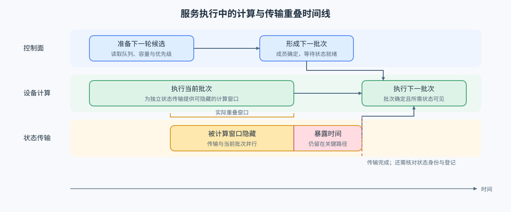
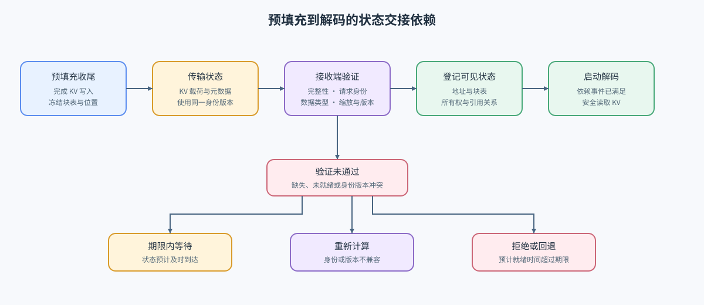

# INF-SERVING-OVERLAP. Serving Overlap and State Handoff | 服务重叠与状态交接

**难度：** Hard | **环境：** [CPU 主线，GPU 可选](#runtime-environment) | **标签：** `推理优化`、`执行重叠`、`状态交接` | **目标人群：** 理解请求与 KV 状态、需要分析执行等待的读者

> 🚀 **云端运行环境**
>
> 本章节的实战代码可以点击以下链接在免费 GPU 算力平台上直接运行：
>
> [](https://colab.research.google.com/github/datawhalechina/llm-algo-leetcode/blob/main/02_PyTorch_Algorithms/INF-SERVING-OVERLAP_Serving_Overlap_and_State_Handoff.ipynb)
> [](https://modelscope.cn/my/mynotebook) *(国内推荐：魔搭社区免费实例)*


## 本节导读

GPU 计算当前批次时，CPU 可以准备下一批请求，独立状态也可能同时传输。把工作放到不同队列后，完成时间是否缩短，取决于它们是否相互等待、是否争用同一资源，以及接收方何时真正能够使用数据。

沿时间线区分传输总时长、被其他工作覆盖的部分和剩余等待，再跟踪预填充状态如何交给解码。这样可以解释“复制已提交”和“解码可以安全开始”为什么是不同的事件。

<a id="runtime-environment"></a>

## 运行环境

- **基础练习：** 使用 [BASE-CPU](../guide.md#base-cpu)，计算时间区间并检查交接状态。
- **可选 GPU 测量：** 使用 [INF-CUDA-MECHANISM](../topic_discussion/inference_optimization/quickstart.md#inf-cuda-mechanism-quickstart)，比较主机到设备复制与独立矩阵乘的串行／重叠执行。

## 前置阅读

先了解两类推理阶段各自处理什么，再观察拆分后需要搬运哪些状态。

- [预填充／解码调度](./38_Prefill_Decode_Scheduling.md)：输入处理与逐步生成。
- [异构预填充／解码与服务分层](./39_Hetero_PD_and_Serving_Tiers.md)：两类阶段使用不同执行资源的方式。

## Step 1：哪些工作可以同时推进

控制面是安排请求、准备批次与管理状态的 CPU 工作；设备侧执行模型计算，复制引擎和链路负责搬运。没有数据依赖的工作才有同时推进的机会。例如，传输下一个独立请求的 KV 可以与当前批次计算并行，而当前请求的解码必须等它自己的 KV 到达。

完成全部必需工作的最早时间由关键路径决定，即从输入就绪到结果完成的依赖链中，耗时最长的一条。两项工作即使在不同队列提交，也可能争用显存带宽或计算资源；因此要核对实际开始、结束和等待事件，再判断并发是否缩短总时间。

| 工作 | 可以尝试同时执行的对象 | 需要满足什么 |
| --- | --- | --- |
| 下一轮批次准备 | 当前设备计算 | 准备过程读取的状态已确定 |
| 状态传输 | 不依赖该状态的设备计算 | 链路与复制资源可用，源数据写完 |
| 集合通信 | 不使用其结果的计算 | 带宽与设备资源争用仍可接受 |
| 预填充到解码交接 | 其他请求的计算 | 当前请求在状态可见后再开始解码 |



## Step 2：总传输时间中还有多少等待

传输总时长由载荷字节数、有效带宽与固定延迟决定；独立计算覆盖的区间可以隐藏其中一部分。在传输起点与计算窗口对齐且资源互不干扰的理想情况下，剩余等待为“传输时长减去可覆盖时长”，下限为零。窗口起点不同时，要按时间区间的交集计算；多个窗口重叠的部分只计一次。

例如传输从 0 到 10 ms，两个独立工作窗口分别为 1–4 和 3–7 ms。合并后覆盖 1–7 ms，共隐藏 6 ms，剩余 4 ms。带宽使用 Gbit/s 时，先将字节转换成比特：125 MB（十进制）经过 10 Gbit/s 链路约需 100 ms，再加 1 ms 固定延迟得到 101 ms。

| 量 | 如何取得 | 用于判断什么 |
| --- | --- | --- |
| 完整传输时间 | 载荷／有效速率，加固定延迟 | 搬运本身多长 |
| 有效覆盖区间 | 独立工作窗口与传输区间取交集、合并 | 有多少时间确实可被覆盖 |
| 暴露时间 | 总传输时间减去覆盖长度 | 仍需等待的部分 |
| 重叠比例 | 覆盖长度／总传输时间 | 当前窗口隐藏了多大比例 |

## Step 3：解码怎样确认接收到同一次状态

预填充产生键值缓存（KV），解码要知道这些值属于哪个请求、处理到哪个位置，以及怎样找到对应物理块。交接因此包含缓存数据和元数据；元数据描述块地址、序列位置、精度及必要的缩放信息。请求标识区分不同请求，状态版本区分同一请求的不同写入批次，所有权约定由谁持有引用并负责释放，防止仍在读取的块被回收。

提交复制操作后，数据可能仍在链路中。接收端要等写入完成、元数据可见和引用登记完成，再确认请求与版本匹配。依赖尚未齐全但预计能及时到达时可以等待；预计到达晚于启动期限时切回其他执行路径，身份或版本冲突则重新构造所需状态。

| 阶段 | 可继续的条件 | 尚未满足时观察什么 |
| --- | --- | --- |
| 预填充收尾 | KV 写完，待发送块和位置确定 | 写入完成事件 |
| 状态传输 | 数据与元数据到达目标 | 复制完成及传输错误 |
| 状态登记 | 地址可查，持有与释放责任明确 | 块映射和引用状态 |
| 解码启动 | 所需依赖齐全，请求及版本相符 | 等待、重算或回退动作 |



## Step 4：实现区间覆盖与解码启动判断

本题给出传输区间、可覆盖窗口和简化的交接状态，骨架提供区间合并循环与返回结构。请补全区间裁剪及覆盖长度、带宽换算、依赖与身份核对，以及依赖未齐时的等待期限判断。测试包含交叠窗口、固定延迟、元数据未就绪、版本冲突和等待超期。

| TODO / 函数 | 学习者完成的机制 | 必须满足的约束 | 测试证据 |
| --- | --- | --- | --- |
| TODO 1：计算覆盖长度<br>`compute_exposed_interval` | 裁剪窗口并合计合并后的覆盖 | 覆盖区间落在传输范围内，重叠部分只计一次 | 相交与区间外窗口，核对隐藏 6 ms、暴露 4 ms |
| TODO 2：换算完整交接时间<br>`estimate_handoff` | 将 Gbit/s 换成字节／毫秒并计入固定延迟 | 字节、比特与毫秒单位一致 | 125 MB、10 Gbit/s 加 1 ms 得到 101 ms |
| TODO 3：检查状态可用性<br>`validate_handoff_state` | 分开报告未就绪依赖和身份／版本冲突 | 三类依赖就绪且请求与版本符合预期 | 缺元数据、版本冲突与完整状态 |
| TODO 4：选择解码动作<br>`plan_decode_start` | 判断依赖未齐时是否还可等待 | 预计就绪不晚于期限才继续等待 | 就绪、期限内等待、超期回退及冲突重算 |


```python
from math import isclose
```


```python
def compute_exposed_interval(transfer_interval, cover_intervals):
    """计算传输区间未被独立工作覆盖的时间。"""
    start, end = transfer_interval
    if end < start:
        raise ValueError('transfer interval 非法')
    # TODO 1（关键路径）：先把覆盖窗口裁剪到传输区间，再合并重叠部分。
    # clipped = ???  # 排序后的有效交集区间；空交集不进入列表。
    raise NotImplementedError("请完成 TODO 1 后再运行测试。")
    merged = []
    for left, right in clipped:
        if not merged or left > merged[-1][1]:
            merged.append([left, right])
        else:
            merged[-1][1] = max(merged[-1][1], right)
    total_ms = end - start
    # hidden_ms = ???  # 合并后各覆盖区间长度之和，不得重复计数。
    return {'total_ms': total_ms, 'hidden_ms': hidden_ms, 'exposed_ms': total_ms - hidden_ms}


def estimate_handoff(payload_bytes, bandwidth_gbps, fixed_latency_ms, start_ms, cover_intervals):
    """估算状态传输区间、暴露时间和 overlap ratio。"""
    if payload_bytes < 0 or bandwidth_gbps <= 0 or fixed_latency_ms < 0:
        raise ValueError('payload、bandwidth 与 fixed latency 非法')
    # TODO 2（传输时间线）：完成 Gbit/s 到 bytes/ms 的换算并加入固定延迟。
    # bytes_per_ms = ???  # 当前链路每毫秒可传输的字节数。
    raise NotImplementedError("请完成 TODO 2 后再运行测试。")
    # transfer_ms = ???  # 固定延迟与 payload 传输时间之和。
    interval = (start_ms, start_ms + transfer_ms)
    exposure = compute_exposed_interval(interval, cover_intervals)
    return {
        'transfer_ms': transfer_ms, 'start_ms': interval[0], 'end_ms': interval[1],
        'exposed_ms': exposure['exposed_ms'],
        'overlap_ratio': exposure['hidden_ms'] / transfer_ms if transfer_ms else 1.0,
    }


def validate_handoff_state(handoff_state, expected_request_id, expected_version):
    """验证 Decode 消费状态所需的数据、所有权和版本契约。"""
    required = ['payload_ready', 'metadata_ready', 'ownership_ready']
    # TODO 3（状态协议）：分别收集未就绪依赖与身份/版本不兼容项。
    # missing = ???  # required 中值不为真的字段名。
    raise NotImplementedError("请完成 TODO 3 后再运行测试。")
    # incompatible = ???  # request_id 或 version 不符合预期时记录对应字段名。
    return {'ready': not missing and not incompatible, 'missing': missing, 'incompatible': incompatible}


def plan_decode_start(validation, ready_at_ms, deadline_ms):
    """根据交接验证和 deadline 选择 Decode 启动动作。"""
    if validation['incompatible']:
        return 'recompute'
    if validation['ready']:
        return 'ready'
    # TODO 4（启动决策）：依赖未齐时判断是否仍可在 deadline 内等待。
    # can_wait = ???  # ready_at_ms 恰好等于 deadline_ms 时仍可等待。
    raise NotImplementedError("请完成 TODO 4 后再运行测试。")
    return 'wait' if can_wait else 'fallback'

```

## 测试

分别核对区间合并、链路单位换算，以及未就绪和版本冲突对应的启动动作。


```python
def test_interval_union_and_exposed_time():
    """交叠覆盖窗口必须先合并，避免重复扣减暴露时间。"""
    report = compute_exposed_interval((0.0, 10.0), [(1.0, 4.0), (3.0, 7.0), (12.0, 14.0)])
    assert report == {'total_ms': 10.0, 'hidden_ms': 6.0, 'exposed_ms': 4.0}

def test_handoff_estimate():
    """链路吞吐换算应保留固定延迟并得到正确暴露时间。"""
    report = estimate_handoff(125_000_000, 10.0, 1.0, 0.0, [(0.0, 6.0)])
    assert isclose(report['transfer_ms'], 101.0, rel_tol=1e-6)
    assert isclose(report['exposed_ms'], 95.0, rel_tol=1e-6)

def test_handoff_protocol_and_decision():
    """缺失依赖、版本变化与 deadline 应产生不同启动动作。"""
    state = {'payload_ready':True, 'metadata_ready':False, 'ownership_ready':True, 'request_id':'r1', 'version':3}
    validation = validate_handoff_state(state, 'r1', 3)
    assert validation['missing'] == ['metadata_ready'] and validation['incompatible'] == []
    assert plan_decode_start(validation, 8.0, 10.0) == 'wait'
    assert plan_decode_start(validation, 12.0, 10.0) == 'fallback'
    incompatible = validate_handoff_state({**state, 'metadata_ready':True, 'version':2}, 'r1', 3)
    assert plan_decode_start(incompatible, 8.0, 10.0) == 'recompute'
    ready = validate_handoff_state({**state, 'metadata_ready':True}, 'r1', 3)
    assert plan_decode_start(ready, 8.0, 10.0) == 'ready'

test_interval_union_and_exposed_time(); test_handoff_estimate(); test_handoff_protocol_and_decision()
print('✅ Serving Overlap 机制测试通过')
```

---

🛑 **STOP HERE** 🛑
<br><br><br><br><br><br><br><br><br><br>
> 请先尝试自己完成代码并跑通测试。<br>
> 如果遇到困难，再向下查看参考代码与解析。
<br><br><br><br><br><br><br><br><br><br>

---
## 参考代码与解析

### 代码

```python
# TODO 1：计算未被隐藏的传输区间。
def compute_exposed_interval(transfer_interval, cover_intervals):
    start, end = transfer_interval
    if end < start:
        raise ValueError('transfer interval 非法')
    clipped = sorted((max(start, a), min(end, b)) for a, b in cover_intervals if min(end, b) > max(start, a))
    merged = []
    for a, b in clipped:
        if not merged or a > merged[-1][1]: merged.append([a, b])
        else: merged[-1][1] = max(merged[-1][1], b)
    total = end - start; hidden = sum(b - a for a, b in merged)
    return {'total_ms': total, 'hidden_ms': hidden, 'exposed_ms': total - hidden}

# TODO 2：换算完整状态交接时间。
def estimate_handoff(payload_bytes, bandwidth_gbps, fixed_latency_ms, start_ms, cover_intervals):
    if payload_bytes < 0 or bandwidth_gbps <= 0: raise ValueError('invalid payload or bandwidth')
    bytes_per_ms = bandwidth_gbps * 1_000_000 / 8.0
    transfer_ms = fixed_latency_ms + payload_bytes / bytes_per_ms
    interval = (start_ms, start_ms + transfer_ms)
    exposure = compute_exposed_interval(interval, cover_intervals)
    return {'transfer_ms': transfer_ms, 'start_ms': interval[0], 'end_ms': interval[1], 'exposed_ms': exposure['exposed_ms'], 'overlap_ratio': exposure['hidden_ms'] / transfer_ms if transfer_ms else 1.0}

# TODO 3：检查状态可消费条件。
def validate_handoff_state(handoff_state, expected_request_id, expected_version):
    required = ['payload_ready', 'metadata_ready', 'ownership_ready']
    missing = [name for name in required if not handoff_state.get(name, False)]
    incompatible = []
    if handoff_state.get('request_id') != expected_request_id: incompatible.append('request_id')
    if handoff_state.get('version') != expected_version: incompatible.append('version')
    return {'ready': not missing and not incompatible, 'missing': missing, 'incompatible': incompatible}

# TODO 4：选择 Decode 启动动作。
def plan_decode_start(validation, ready_at_ms, deadline_ms):
    if validation['incompatible']: return 'recompute'
    if validation['ready']: return 'ready'
    return 'wait' if ready_at_ms <= deadline_ms else 'fallback'
```

### 解析

#### TODO 1：计算覆盖长度

- 每个窗口先与传输区间取交集，再合并相交部分；隐藏与暴露时长相加等于总传输时长。
- 答案排序后累积覆盖长度。1–4 与 3–7 ms 的交叠样例核对合并，12–14 ms 的窗口核对范围外部分被排除。

#### TODO 2：换算完整交接时间

- Gbit/s 使用十进制单位，每字节 8 比特；换成每毫秒可传输的字节数后，再把固定延迟加到载荷传输时间。
- 答案据此构造完整区间并计算覆盖。测试核对总长 101 ms、覆盖 6 ms 后暴露 95 ms。

#### TODO 3：检查状态可用性

- 数据、元数据和所有权分别提供就绪状态；请求编号与状态版本还须符合预期。依赖未齐与身份冲突对应不同恢复动作。
- 答案分别收集两个列表。测试改变元数据标记与版本，再检查完整状态，核对失败原因和就绪判断。

#### TODO 4：选择解码动作

- 冲突时重算，依赖齐全时启动；其余情况比较预计就绪时刻和启动期限，不晚于期限才等待。
- 答案按此顺序分支。测试覆盖期限内等待、超期回退、冲突重算和就绪启动；等于期限的比较由实现中的包含等号条件给出。

## Step 5：GPU 机制实验——复制与独立计算的重叠

GPU 对照把锁页主机内存复制和独立矩阵乘放在串行或两个 CUDA 执行流中。执行流（Stream）维护设备操作的提交顺序，事件（Event）记录完成点并建立跨流依赖；在两个流内提交独立操作后，主流等待两者完成再结束计时。这个实验测物理执行窗口，服务交接还需另外核对请求身份、状态版本与解码依赖。

| 学习问题 | CPU 练习 | GPU 对照 |
| --- | --- | --- |
| 独立搬运能隐藏多少等待 | 按区间计算覆盖和剩余时间 | 比较串行／双流的设备事件耗时 |
| 状态能否被安全消费 | 检查依赖标记、身份与版本 | 核对复制张量和矩阵乘采样值，再用服务协议验证完整 KV 交接 |

### 5.1 环境与固定工作负载

使用 [INF-CUDA-MECHANISM](../topic_discussion/inference_optimization/quickstart.md#inf-cuda-mechanism-quickstart)，运行前完成环境预检。固定三档主机到设备复制量和同一个矩阵乘；锁页内存是不会被操作系统换出的主机内存，使异步主机到设备复制具备所需的内存条件。结果状态见[实验资产表](../topic_discussion/inference_optimization/experiment_assets.md)。

| 配置层 | 当前对照 | 比较时保持一致 |
| --- | --- | --- |
| 传输量 | 16／64／128 MiB | 两条路径使用同一源数据 |
| 独立计算 | 2048 × 2048 矩阵乘 | 形状、精度与输入相同 |
| 执行方式 | 同流串行／独立双流 | 只改变操作依赖与提交方式 |
| 重复测量 | 预热 5 次，正式 20 次 | 正式轮交替执行先后顺序 |
| 汇总与核对 | 中位数、P95、复制张量与采样计算值 | 原始标签保留，新一次测量换标签 |


```python
RUN_MODE = 'dry_run'  # 默认值 dry_run：只登记计划；改为 real_gpu 后执行真实 CUDA Stream 对照。
RUN_LABEL = 'default'  # 默认值 default：同一工作负载复测时改为新的唯一标签。
ENVIRONMENT_PROFILE = 'INF-CUDA-MECHANISM'  # 默认值：本专题单卡机制实验环境。
WORKLOAD_ID = 'inference-serving-overlap'  # 稳定工作负载身份。
WORKLOAD_VERSION = 'v2'  # v2 使用复用 Stream、交错配对和理论下界。
GPU_DTYPE = 'auto'  # 默认 auto：优先原生 BF16，否则使用 FP16。
PAYLOAD_MIB = [16, 64, 128]  # 默认值：三档固定 H2D payload，用于观察重叠收益随传输量变化。
MATRIX_SIZE = 2048  # 默认值：独立 BF16 方阵乘规模，提供可与传输重叠的计算窗口。
WARMUP_STEPS = 5  # 默认值：正式计时前的预热次数。
REPEAT_STEPS = 20  # 默认值：每种时间线的重复测量次数，用于 median/P95。
MIN_GAIN_RATIO = 0.02  # 默认值：Median 至少改善 2% 才通过收益门槛。
MAX_P95_RATIO = 1.05  # 默认值：重叠路径 P95 最多允许回退 5%。
SEED = 42  # 默认值：固定张量内容，保证串行与重叠路径可比较。

```

### 5.2 执行并保存 JSON

串行路径依次复制、矩阵乘；候选路径让复制流与计算流等待共同开始事件，再独立提交。主流等待两侧结束事件后记录总时间。每档保存两种执行方式的汇总耗时与路径条件，计算核对比较两次结果的首个元素，复制核对比较完整张量。


```python
import json
import statistics
from pathlib import Path

import torch

from tools.notebook_runtime import package_version
from tools.project_runtime import resolve_project_root


def percentile_95(values):
    ordered = sorted(values)
    return ordered[max(0, int(0.95 * len(ordered)) - 1)]


def select_gpu_dtype():
    if GPU_DTYPE == 'float16':
        return torch.float16
    if GPU_DTYPE == 'bfloat16':
        return torch.bfloat16
    if GPU_DTYPE != 'auto':
        raise ValueError('GPU_DTYPE 只能是 auto / float16 / bfloat16')
    try:
        supported = torch.cuda.is_bf16_supported(including_emulation=False)
    except TypeError:
        supported = torch.cuda.get_device_capability()[0] >= 8
    return torch.bfloat16 if supported else torch.float16


def time_case(host_source, device_target, left, right, copy_stream, compute_stream, overlap):
    start = torch.cuda.Event(enable_timing=True)
    copy_start = torch.cuda.Event(enable_timing=True)
    copy_done = torch.cuda.Event(enable_timing=True)
    compute_start = torch.cuda.Event(enable_timing=True)
    compute_done = torch.cuda.Event(enable_timing=True)
    end = torch.cuda.Event(enable_timing=True)
    torch.cuda.synchronize()
    start.record()
    if overlap:
        copy_stream.wait_event(start)
        compute_stream.wait_event(start)
        with torch.cuda.stream(copy_stream):
            copy_start.record()
            device_target.copy_(host_source, non_blocking=True)
            copy_done.record()
        with torch.cuda.stream(compute_stream):
            compute_start.record()
            product = left @ right
            compute_done.record()
        torch.cuda.current_stream().wait_event(copy_done)
        torch.cuda.current_stream().wait_event(compute_done)
    else:
        copy_start.record()
        device_target.copy_(host_source, non_blocking=True)
        copy_done.record()
        compute_start.record()
        product = left @ right
        compute_done.record()
    end.record()
    end.synchronize()
    return {
        'total_ms': start.elapsed_time(end),
        'copy_ms': copy_start.elapsed_time(copy_done),
        'compute_ms': compute_start.elapsed_time(compute_done),
        'checksum': float(product[0, 0]),
    }


result = {
    'schema_version': 'inference-mechanism-gpu/v2',
    'semantic_id': 'INF-SERVING-OVERLAP',
    'run_mode': RUN_MODE,
    'run_label': RUN_LABEL,
    'environment_profile': ENVIRONMENT_PROFILE,
    'framework': {'torch': package_version('torch')},
    'hardware': {'cuda_available': torch.cuda.is_available()},
    'workload': {
        'id': WORKLOAD_ID, 'version': WORKLOAD_VERSION, 'payload_mib': PAYLOAD_MIB,
        'matrix_size': MATRIX_SIZE, 'dtype': GPU_DTYPE,
        'warmup_steps': WARMUP_STEPS, 'repeat_steps': REPEAT_STEPS, 'seed': SEED,
        'minimum_gain_ratio': MIN_GAIN_RATIO, 'maximum_p95_ratio': MAX_P95_RATIO,
    },
    'cases': [], 'failure': None, 'evidence_level': 'dry_run', 'decision': 'not_measured',
}

if RUN_MODE == 'real_gpu':
    try:
        if not torch.cuda.is_available():
            raise RuntimeError('RUN_MODE=real_gpu，但 CUDA 不可用')
        properties = torch.cuda.get_device_properties(0)
        result['hardware'].update({'device': torch.cuda.get_device_name(0), 'cuda': torch.version.cuda, 'async_engine_count': getattr(properties, 'async_engine_count', None)})
        torch.manual_seed(SEED)
        dtype = select_gpu_dtype()
        result['workload']['resolved_dtype'] = str(dtype)
        left = torch.randn(MATRIX_SIZE, MATRIX_SIZE, device='cuda', dtype=dtype)
        right = torch.randn(MATRIX_SIZE, MATRIX_SIZE, device='cuda', dtype=dtype)
        copy_stream = torch.cuda.Stream()
        compute_stream = torch.cuda.Stream()
        distinct_streams = copy_stream.cuda_stream != compute_stream.cuda_stream
        for payload_mib in PAYLOAD_MIB:
            elements = payload_mib * 1024 * 1024 // torch.empty((), dtype=dtype).element_size()
            host_source = torch.randn(elements, dtype=dtype, pin_memory=True)
            device_target = torch.empty_like(host_source, device='cuda')
            for _ in range(WARMUP_STEPS):
                time_case(host_source, device_target, left, right, copy_stream, compute_stream, False)
                time_case(host_source, device_target, left, right, copy_stream, compute_stream, True)
            serial = []
            overlap = []
            for repeat_index in range(REPEAT_STEPS):
                order = (False, True) if repeat_index % 2 == 0 else (True, False)
                for overlap_enabled in order:
                    sample = time_case(
                        host_source, device_target, left, right, copy_stream, compute_stream, overlap_enabled
                    )
                    (overlap if overlap_enabled else serial).append(sample)
            serial_ms = statistics.median(item['total_ms'] for item in serial)
            overlap_ms = statistics.median(item['total_ms'] for item in overlap)
            serial_p95_ms = percentile_95([item['total_ms'] for item in serial])
            overlap_p95_ms = percentile_95([item['total_ms'] for item in overlap])
            copy_median_ms = statistics.median(item['copy_ms'] for item in serial)
            compute_median_ms = statistics.median(item['compute_ms'] for item in serial)
            theoretical_lower_bound_ms = max(copy_median_ms, compute_median_ms)
            hidden_ms = max(serial_ms - overlap_ms, 0.0)
            hideable_ms = max(serial_ms - theoretical_lower_bound_ms, 0.0)
            overlap_efficiency = min(hidden_ms / hideable_ms, 1.0) if hideable_ms > 0 else 0.0
            latency_ratio = overlap_ms / serial_ms
            p95_ratio = overlap_p95_ms / serial_p95_ms
            copy_correct = torch.equal(device_target.cpu(), host_source)
            compute_correct = abs(serial[0]['checksum'] - overlap[0]['checksum']) < 1e-2
            path_evidence = {
                'host_memory_pinned': bool(host_source.is_pinned()),
                'distinct_streams': bool(distinct_streams),
                'non_blocking_copy': True,
            }
            path_confirmed = all(path_evidence.values())
            result['cases'].append({
                'payload_mib': payload_mib,
                'serial_median_ms': serial_ms, 'serial_p95_ms': serial_p95_ms,
                'overlap_median_ms': overlap_ms, 'overlap_p95_ms': overlap_p95_ms,
                'copy_median_ms': copy_median_ms, 'compute_median_ms': compute_median_ms,
                'theoretical_lower_bound_ms': theoretical_lower_bound_ms,
                'latency_ratio': latency_ratio, 'p95_ratio': p95_ratio,
                'hidden_ms': hidden_ms, 'overlap_efficiency': overlap_efficiency,
                'copy_correct': copy_correct, 'compute_correct': compute_correct,
                'path_evidence': path_evidence, 'path_confirmed': path_confirmed,
                'benefit_gate_passed': latency_ratio <= 1.0 - MIN_GAIN_RATIO and p95_ratio <= MAX_P95_RATIO,
            })
        correct = all(item['copy_correct'] and item['compute_correct'] and item['path_confirmed'] for item in result['cases'])
        accepted_cases = sum(item['benefit_gate_passed'] for item in result['cases'])
        result['summary'] = {'correctness_passed': correct, 'accepted_cases': accepted_cases, 'total_cases': len(result['cases'])}
        result['evidence_level'] = 'local_mechanism_benchmark'
        result['decision'] = 'accept_physical_overlap' if correct and accepted_cases > 0 else ('tune_overlap_window' if correct else 'reject_incorrect_path')
    except Exception as exc:
        result['failure'] = {'type': type(exc).__name__, 'message': str(exc)}
        result['evidence_level'] = 'failed_real_gpu_attempt'
        result['decision'] = 'reject_until_environment_fixed'

root = resolve_project_root(Path.cwd())
result_path = root / 'benchmarks' / 'results' / f'inf_serving_overlap_{RUN_LABEL}.json'
result_path.parent.mkdir(parents=True, exist_ok=True)
result_path.write_text(json.dumps(result, ensure_ascii=False, indent=2), encoding='utf-8')
result_path

```

### 5.3 读取结果

下方单元读取 5.2 在当前内核中生成的 `result_path`，展示决策、失败和全部传输档位。重启内核后读取旧结果时，需要先根据已有标签恢复该路径；各档的样本耗时目前只汇总保存为中位数与 P95。


```python
report = json.loads(result_path.read_text(encoding='utf-8'))
summary = {key: report.get(key) for key in ['semantic_id', 'run_label', 'failure', 'evidence_level', 'decision']}
summary, report.get('cases', [])

```

### 5.4 解释重叠收益与计算核对范围

`rtx5070ti_overlap_v2` 的三档复制和计算采样均通过现有检查，串行到重叠的中位数比为 0.788／0.934／0.965。固定计算窗口约 0.32–0.34 ms，传输量增加后可减少的绝对时间仍约 0.32–0.33 ms，因此相对改善从约 21.2% 降到 3.5%。

报告的隐藏时间取两条路径总耗时中位数之差，重叠效率再与串行分项估计的可隐藏时间比较；这些是汇总估算。下一次复测补完整计算张量比较、逐次样本与事件时间线，再检查资源争用和真实服务状态的交接。

| 观察项 | 当前结果 | 如何理解与继续核对 |
| --- | --- | --- |
| 路径条件 | 锁页内存、不同流与非阻塞复制均记录为真 | 具备尝试重叠的条件；同时活动的时段用时间线核对 |
| 数值核对 | 完整复制张量相等；矩阵乘仅比较首元素 | 当前计算记录是采样核对，完整输出一致性另补 |
| 时间收益 | 中位数减少约 21.2%／6.6%／3.5%，三档均满足原收益门槛 | 固定窗口能覆盖的绝对时间有限 |
| 汇总估算 | 隐藏时间约 0.318–0.333 ms；效率约 95.7%–97.6% | 由中位数差值及分项下界估算，继续保存逐次事件 |
| 决策与范围 | `local_mechanism_benchmark`；历史 `accept_physical_overlap` | 保留原决策；服务级收益再核对请求等待、完整 KV 与交接协议 |

## 相关阅读

从本机复制窗口继续看跨流依赖，再把状态就绪事件放回服务请求的调度过程。

- [PyTorch CUDA 语义](https://docs.pytorch.org/docs/stable/notes/cuda.html#asynchronous-execution)：查看异步执行、跨流等待与锁页内存。
- [预填充／解码调度](./38_Prefill_Decode_Scheduling.md)：比较两类工作如何分享单轮预算。
- [服务调度基准](./70_Serving_Scheduler_Benchmark.md)：核对请求响应顺序与尾部等待。
